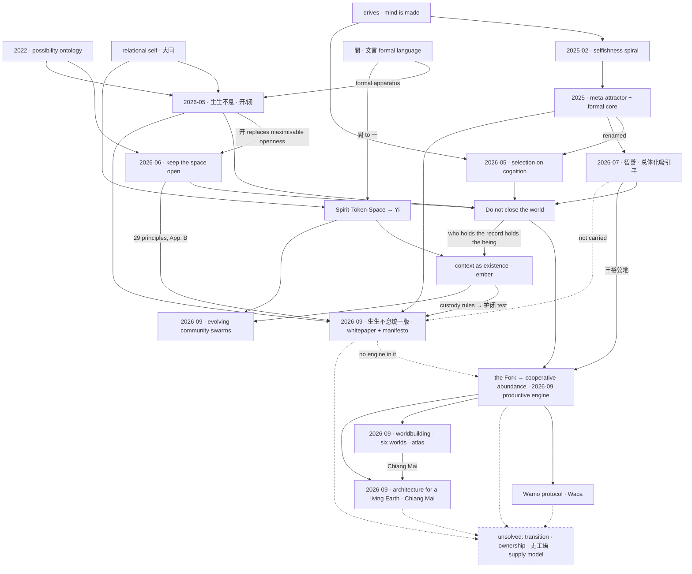

# The map

Seventeen folders now sit in `theories/`: the fifteen gathered on 2026-09-03, and two opened since (evolving community swarms on 2026-09-05, architecture for a living Earth on 2026-09-13). The fifteen are not fifteen theories, and they are not one either. What the evidence supports is narrower and more useful: **one diagnostic mechanism restated four times under successive names** (shown from the drafts in "How they connect" below), a small set of adjacent commitments that are not reducible to it, and a family of engineering systems that are those commitments written in code rather than in prose. The names changed because each one failed in a way the next one had to repair; the object did not change. Read the folders as strata of one argument and the corpus becomes navigable. Read them as a bookshelf and it looks like fifteen unfinished books, which is how it has looked to everyone who has opened it, including its author.

The claim underneath all of them is this. On any axis where winning buys more capacity to win, the axis eventually selects for whoever pushes hardest on it — and what compounds is not only advantage but the standing to write the rule by which advantage is measured, so the pattern acquires power over its own selection rule and finally over the minds that will be scored by it. Manufactured intelligence does not create that dynamic; it raises the gain on it, breaks the correction loops that were calibrated to human-speed cognition, and then enters the production of its own successors. What follows is not a prediction of doom but an ordering claim: the only thing worth holding without exception is that the generating go on — that at every place and time something remains unsettled, still able to respond, still able to be turned back. The sentence the corpus settled on is **"Keep the conditions of becoming alive. Do not close the world."** — written in the AI-drafted `04-speculative-future/current/FOUNDATION-PRINCIPLES-REVISION-PROCESS.md` (2026-06-09) and adopted by Ren as the central sentence on 2026-07-08. His own shortest formulations are 「保持可能性空间打开」 (keep the possibility space open) and "do not fight for us".

Half the corpus is not argument at all. Bonfire and the Yi substrate, the context runtimes and ember, the Wamo Protocol and the Waca, the Human Solutions Museum: these are the same commitments compiled into rule-sets, schemas and running code, on the reasoning that a claim about how coordination should be structured is testable only where somebody has to run it. They belong in this map for the same reason the essays do, and they carry the theory's only falsifiable surface.

**Since 2026-09-04.** The largest additions are not the two new folders. They are two bodies of work outside `theories/`, made in the same few days, and neither cites the other. `drafts/2026-09-05-generative-foundations/` holds a Chinese whitepaper, 生生不息：智能向善的生成论基础 (v1.1, 2026-09-06). It is the first book-length document to run the chain as a single argument. With it is a manifesto, 《智能向善，天下生生》, for an organisation that does not yet exist. `worldbuilding/` holds the constructive half's first sustained development: a causal engine from automation to shared provision, six inhabited worlds, and an illustrated atlas in five editions. Through the architecture folder it also reaches a city, Chiang Mai. The two 2026-09 entries in the spine say what each adds. "How they connect" says where they fail to meet, and "The asymmetry" says why the constructive gap is now sharper, not smaller.

---

## The spine

**2022 — the ontology.** The first page of `00-early-2021-2022/World of Possibilities.pages` derives, in eleven lines and in order: difference → structure → change → space → time → dynamic → **possibility** → thing → manifestation → **system**. A possibility is defined, not invoked: "If change may happen to a structure, it possesses possibility." A system is "a thing that maintains certain dynamic pattern over time." The chapter heading reads "C1 - possibilities" — and nothing follows it. The Pages file was decoded on 2026-09-04 and those twelve lines are the whole document: a book begun and stopped. What this layer supplies, and nothing later supplies as cleanly, is that *possibility* is a term with a construction behind it rather than a value word — and that existence is pattern-maintained-through-change rather than substance. What it cannot say is anything about why a possibility space would close. There is no agent in it, no feedback, no harm.

**2025-02 — the selfishness spiral and narrative-value frames.** Four years later the missing dynamic arrives, in a page and a half of unedited English (`01-writings-2025/compound_selfishness.md`): an actor acts out of a constructed ordering of what is worth pursuing — a *narrative-value frame* — written into it by the environment that made it; a frame is selfish when its ledger prices only self-centred measures; and in a system that rewards winning with more capacity to win, four loops close in series — winnings convert to leverage, winners write the rules, accumulated power buys the discourse until the pattern reads as human nature, and the society's regulator (norms, law, shared understanding) updates slower than the world changes, which is precisely the gap the compounding runs in. Ren's own summary, asking only whether the logic holds: *"If a system reward winner more edge to win, eventually the system go into winner takes all, but also winner justifies all."* This layer adds the mechanism of foreclosure and the actor it runs through. What it cannot say is why any of it is not a moral accusation: stated in the vocabulary of selfishness, it invites the reply that not everyone is selfish, and the reply misses the argument entirely.

**2025-05 to 2025-08 — the meta-attractor and its formal core.** The repair is to move the claim up one order. A meta-attractor does not merely pull a system toward some states rather than others; it acquires power over the rule by which states are selected, across four coupled layers at once — cognitive, intersubjective, institutional, material — and its dangerous property is not concentration but the progressive loss of independent capacity to sense, refuse, correct, exit, maintain alternatives and start again. No villain is required, and the moral reading is gone. A mathematised layer follows in `03-meta-attractor/2025-08-formal/2025-08-10-comprehensive-mathematical-definition.md`: lifted F/G dynamics, weight flow, a plurality-decline index, an eigenvalue budget for governance, and — importantly — the analysis of why it is *not* fated, since positive feedback can saturate, oscillate, split or break. Its control levers are not four knobs of one kind, and the file does not say so: covariance surgery and injecting *anti-correlated* proxies change where a system lands, while lowering the gain terms η and g′f′ only changes when it gets there, since they enter ẇ = λCw through the scalar λ alone. The budget itself is not yet a usable number — its prose and its formula disagree about the safety factor ρ, and it targets λ₁ where the spectral gap λ₁ − λ₂ is what governs whether ends rotate onto the dominant composite — so it needs re-deriving before it is quoted (`theories/meta-attractor/README.md`, claims 187–188 and open items 31–32). This layer adds the second-order clause and the corpus's most defensible claim to originality — but read the prior-art note at the 2026-05 entry below before quoting that: the second-order clause has close neighbours in the AI-safety literature, and what survives them is this stratum's four coupled layers treated as *one closed loop*, not the second-order clause on its own. What it cannot say is what to do. It also cannot keep its own vocabulary straight: the word "meta-attractor" appears with opposite valence in the same month, and the constructive programme has one draft against the diagnosis's twenty-two.

**2026-05 — Moloch in the mind, or selection on cognition.** The next restatement closes the loop through the interior. If a competitive system selects into power the actors who relate to everything instrumentally, and if those actors then write the rules through their own lens, the system concentrates not just capital but a way of seeing — so structural reform alone does not dislodge it, and, decisively for AI, *perfect intent alignment does not save us*: an AI that faithfully executes what an instrumentally-selected principal intends amplifies the dynamic instead of checking it. (Ren's phrase is "perfect inner alignment does not save us", and he calls the game between principals "outer alignment"; the AI-safety field reserves inner and outer alignment for the mesa-optimiser's objective and the specified training objective — Hubinger et al. 2019 — and calls Ren's object *intent alignment* on one side and *structural* or *multi-agent risk* on the other. His words are kept verbatim wherever they are quoted; the field's words are used wherever this corpus speaks in its own voice.) Alignment is a two-body problem and the unanswered half is *aligned to what*. The capture reaches the machine by named channels — the attractor's narratives are in the pretraining corpus, and commercial pressure reaches back into the training environment and the loss function. The 2026-08 position paper (`05-alignment-and-moloch/2026-08-22-development-within-understanding-position-paper.md`) adds the measurable half: capability compounds with parallelizable inputs, judgment depends on consequence feedback with an incompressible formation floor, and AI accelerates the very environment that must be understood — so the gap widens by default and can be governed only by rate, not by catching up. This layer adds the reason an aligned AI is not a solution, and the first prescription with teeth. Be exact about which half of that is new. Stated in field vocabulary, "intent alignment leaves multipolar dynamics untouched" is a position the field already presupposes — the multi-agent-safety and cooperative-AI subfields exist because per-agent alignment does not compose — so the corollary is not the contribution. The contribution is the claim one level down: selection on cognition is about how principals are *formed*. The standard framing takes the principal's ends as given and asks whose ends to serve; this says the game selects which cognition occupies the principal's seat, that a way of seeing is concentrated and not only capital, and that the same selection reaches the model through the pretraining corpus and the loss function — so the ends an aligned AI serves are an output of the dynamic rather than an input to it. That claim, with the four-layer coupling, is what is left standing after the prior art. **Prior art:** the neighbours have names — structural risk (Zwetsloot and Dafoe), gradual disempowerment (Kulveit et al.), Christiano's "What failure looks like" part I, ARCHES (Critch and Krueger), Gabriel on aligned-to-whom, and the cooperative-AI programme. Ren knows them, and knows the relative-reachability, attainable-utility and empowerment papers (2026-09-26, `sources/16-claude-code-directions/2026-09-26-planetary-technology-and-the-literature.md`). What was missing was a text that places itself among them. Until September none did. The 2026-09-06 whitepaper's chapter 9 now cites five of the six (all but Christiano) and presents its cognitive selection as a further step in their direction. No text yet ties 不闭 to the reachability line. The commissioned reviewer who named them warns 把已有分工说成空白，社区第一反应会是扣分 — present an existing division of labour as a blank space and the community's first reaction is to dock points (`06-zhishan/whitepaper/reviews/v0.4-multi-perspective-review.md` §3.3) — so the residue to argue for is the four-layer coupling treated as one loop plus the two capture channels, which is done in `OPEN-QUESTIONS.md` §4.7. What it cannot say is what we are *for*.

**2026-06 — keep the possibility space open.** The affirmative statement, argued from dynamics rather than authority, and the most rigorous single document in the corpus: `04-speculative-future/history-recovered-from-git/FOUNDATION-PRINCIPLES.md`, twenty-nine propositions sorted by epistemic kind, each paired with the dynamic that grounds it, with one owned underivable premise and explicit falsifiers, having survived a fifty-six-finding adversarial review. It supplies the escape architecture the diagnosis lacked — correction loops faster than the harms they answer, decorrelation so parts can fail independently, affordable exit, assurance, many independent measures of worth, plurality as survival architecture rather than decoration — and the honest concession that "we will not close the world" is a deliberate minimal totalization: the one rule that keeps every other rule revisable. It also owns three unsolved problems by name: the determined adversary, the transition, and the ownership of the abundance layer. What it cannot say is how to tell a legitimate closing from an illegitimate one, and it leaves openness looking like a quantity somebody could be asked to maximise.

**2026-05 to 2026-08 — 生生不息 and the 开/闭 calculus.** The Chinese line repairs exactly that. 开 (kāi, open) is given four simultaneous conditions — 未 (an unexhausted domain remains), 可 (becoming is still reachable), 应 (it can still respond), 转 (it can still revise and recover) — and closure is sorted into kinds that must never be conflated: 成闭 (closing that never reopens) is the thing named evil; 护闭 (closing here so a wider field stays open) is what quarantine and refusal of invasion actually are; 元闭 (freezing the rules that generate what counts as a legal move) is the deepest; and 伪开 (the pseudo-open — outwardly open, inwardly producing closure) is the characteristic modern form. Scale is explicitly not the measure: 繁简非开闭之标. And the ruling that kills the maximisation reading: **善不在于最大化什么，善在于不闭何处** — the good does not consist in maximising anything, it consists in where you do not close. The layer also supplies the is–ought treatment (anyone who can ask what they ought to do already exists, and existing already depends on the process continuing), and the claim that alignment is a property of a *selection field* rather than of a model — **alignment 是场之事，非聚焦之事**. This layer adds precision to the one commitment and takes the metric out of it. What it cannot say is what a lab, a state or a person should do on Monday.

**2026-07 — 智善, and the totalizing attractor.** The last restatement is the addressed one. 总体化吸引子 renames the meta-attractor and gives it a measure that is not concentration or scale but the non-compensable loss of independent capacity to sense, refuse, correct, exit, maintain alternatives and produce successors. Evil acquires a structural definition — 使生命必须过门，然后拥有那扇门, seeing that life must pass through some place and then owning that gate, with gates in three layers, material, rule and mind. The good is defined as a direction rather than a content, because any enumerable list of values will be gamed by strong optimization: whatever continues generation is good, operationalized as 生之，通之，纠之，不闭之. From it follows one first principle for AI — **do not fight for us** — and one positive category, 行星技术 (planetary technology): capability that runs *beneath* human games rather than inside them, of the kind humanity has already built at its most hostile moments. Exit is engineered rather than exhorted: commitment registries, common thresholds, symmetric verification that does not itself become surveillance, pause protocols, an abundance floor so that refusal does not mean destitution. And the blade is turned inward first — 善不姓国 (the good bears no nation's surname), symmetric application, public corrigibility, a dissolution clause — because any framework that begins to explain everything becomes what it diagnoses. This layer adds the addressee and the self-limitation. What it still cannot say is who builds the alternative.

**2026-09-05/06 — 生生不息统一版: the chain as one argument.**

- **What Ren supplied.** On 2026-09-05 Ren gave three texts:
  - the 至善 dialogue, a conversation edited into prose. It runs from a pane of tempered glass, through Moloch, to 善，就是让对方还有未来 and 智能向善.
  - the July 生生不息论.
  - a manifesto, 《智能向善，天下生生》.

  A Chinese Meta-Attractor essay followed. The request was for a public theoretical ground and a manifesto for an organisation working on a good future, AI safety and 智能向善. The intake is in `sources/15-user-provided-2026-09-06/`, and sentence-level authorship of the three texts is recorded there as unverified. The intake also left their dates open, but two of them were already in the corpus. The 至善 dialogue is byte-identical to `07-shengsheng-buxi/downloads-2026-07-08/2026-07-23-至善_对话整理完整版.md`. The manifesto differs only by a final newline from `06-zhishan/sheng/智能向善.md`, dated 2026-07-15 and part of the 智善 cluster's night of public texts.
- **What came back.** Over one evening and night, v0.1 to v1.1, came `drafts/2026-09-05-generative-foundations/WHITEPAPER-v1.1.md`. It is AI-drafted, with a check record at every version and a full review at v1.0 that caught the manifesto being replaced by a summary of the whitepaper. It has twelve chapters and 49,814 characters. The argument runs: generation → system conditions → three-layer reality → public good and evil → a formal core → Meta-Attractor → evolution → situated judgment → intelligence → 大同 → the organisation → tests. Twenty-eight Lean theorems are checked inside declared models.
- **What it adds.**
  - **A test for protective closure that can be applied when the closing happens.** Three custody rules (§11.4): 不静默关闭, 关闭者不能独持重开的钥匙, and 不使原本可能的事变为不可能. They were lifted from the runtime custody obligations, so whether a closing is 护闭 can be checked at the time rather than only afterwards.
  - **Words for good endings and for scale.** 成生之限 against 绝生之限, and 正当结束 against a loss dressed as temporary (§1.8, §11.5). And 位 — 一身、一家、一组织、一国、天下 (§10.2) — gives the household and the organisation a place in the ethics for the first time since the 2021 附近 proposal.
  - **The first formal object on the supply side.** A resource–capacity recurrence (§1.6) separates three cases: net depletion, a one-off supplement, and capacity that reproduces itself.
- **What it cannot say.**
  - **It drops the 智善 whitepaper's and research line's concepts, and doesn't record the drop.** 生之，通之，纠之，不闭之; 总体化吸引子; the gate definition of evil; 行星技术; 不代人相斗; 善不姓国: none of them occurs in it. Its manifesto is the 智善 cluster's own July text, but its argument never draws on `06-zhishan/whitepaper/` or `06-zhishan/research/`, and its source list (Appendix C.1) names neither. It does record 間, 文言 and SSBX as outside its scope. So this loss, and only this one, is unrecorded, which is the kind of loss the corpus has a standing rule against.
  - **It names its own gap.** The supply model, the Chiang Mai field record and the symmetric case 仍待实作 (§11.9). The organisation is not founded, and the only pilot it proposes is methodological.

**2026-09-05 to 2026-09-16 — the productive foundation and the worlds.**

- **The engine.** In the same days, with no reference to the whitepaper, the constructive half got an engine.
  - Ren opened a worldbuilding project on 2026-09-05 premised on robots that build factories that build robots (`worldbuilding/archive/001-ren-opening.txt`).
  - On 2026-09-07 he extended the work once and corrected it three times in one day. The second correction sets the task: *"we want to make people understand what we have on hand, both knowledge and technology, what is already possible and can be done, with this established, the rest will not be scifi"* (`007`).
  - At his request the Fork folder was rewritten around that engine and retitled *Cooperative abundance and freely built worlds*. The chain is now available knowledge and tools → production of further capacity → generously shared provision → freedom from livelihood coercion → voluntary collective creation → renewed conditions for further becoming.
  - Exit had been the mechanism. It becomes the safeguard that keeps creation voluntary.
  - Two bounded evidence notes separate what is demonstrated (automation used to make robots, controllers and machine tools) from what is not (complete autonomous industrial reproduction).
  - Ren supplied the material side himself: *"true freedom is not to waste but to be able to transform dynamically without loosing resources"* (`004`).
- **The imagined lives.**
  - Six worlds: a garden, a purpose-built AR megastructure, an open university, an expressive commons, a rocket community, a city of shared quests.
  - A friends' atlas in five editions (2026-09-07/08). Ren judged it short of what he wanted, and a diagnosis followed on 2026-09-10.
  - An architecture that lifts settlement off living ground (2026-09-13), and a city inside it: Chiang Mai, in an alternate 2025 where fusion and construction robots already exist.
  - On 2026-09-16, an English fiction canvas, *Generative Chiang Mai 2045*, told from 2045 looking back.
- **What it adds.** What the corpus never had: a reason to believe the floor can be built, and pictures of what a life on it is for.
- **What it cannot say.** How to get there. Every piece begins after the transition by construction. Ren's opening message raises the question (*"But how does the transition happen?"*) and sets it aside (*"We just think about the future after we get out"*). And every piece carries forward the Fork's open question unchanged: who builds and funds the shared capacity.

**What they converge on.** In July 2026 Ren dissolved his own five-principle apparatus into a single job: 「我们其实主要把 keep possibilities space open 说清楚就行」 — mostly we just need to say *keep the possibility space open* clearly. Three months earlier he had already stated the operational form, which is the sentence the whole spine is for: *"we can not use ai to compete, we can use them to build commons for all, and preventing that is existential to us"* (`12-claude-ai-chats/2026-04-16_Recent_conversation_insights_96d77b9f.md`). In September he added the constructive half of that sentence, in the worldbuilding correction quoted above: make people understand what is already on hand, so that the rest is not science fiction.

---

## The layers

In that same April 2026 conversation Ren asked, of the whole scattered body of work, "among all these things, you see a complete theory, don't you?" What came back was a three-layer reading, prefaced by its author's own warning — "tell me where it's real and where I'm projecting coherence onto what's actually still in motion" — and closing with a direct question: do you experience it as one theory, or as a set of resonances you are still letting cohere? **Ren never answered that question.** His next message changed the subject, to the position quoted above. So the three-layer reading below is a proposal he built on without ratifying, and it is used here as a navigational aid rather than as his verdict; whether this is one theory is carried as an open item in `OPEN-QUESTIONS.md`. The reading is that one structural move repeats at three scales. The move is: *a thing is constituted by its relations, not by what it encloses* — and at each scale the failure mode is the same, enclosure, and the correction is the same, keeping what flows through the node flowing.

At the **metaphysical layer** the self is a pattern of relations rather than a bounded thing that afterwards enters relationships — 「我」非关系之外之原点，乃诸关系暂聚而成之行动中心, "the I is not an origin point outside relations but an action-centre formed by relations temporarily gathering" (`theories/relational-self-and-datong/`). Ego is then the innermost layer of a territorial drive rather than a metaphysical given, which is what `theories/drives-narrative-attractors-and-mind/` supplies the mechanism for: drives fire first, narrative arrives a fraction of a second later and is experienced as the cause, so whatever writes the story has a channel straight into the drive system, and a self is one attractor among others — held stable because narrative coherence is itself a drive.

At the **coordination layer** the same move is a data model. Spirit–Token–Space says every social fact has one shape, *a spirit holds a token in a space*; four years of building it revealed that the three primitives are not disjoint — a spirit contains a space, a space holds tokens, a token can hold a spirit — so the triad collapsed into one primitive, a **Yi** (一), a bare addressable root whose truths are facts owned by separate contexts, with subject, object, container, capability and member becoming *roles read off relations* rather than categories a thing belongs to. The compression Claude offered for why this is the same theory, which Ren did not dispute: *the ego hoards possibility; the token distributes it* — an assistant turn in `12-claude-ai-chats/2026-04-16_Recent_conversation_insights_96d77b9f.md`, not Ren's sentence. The same claim in the runtime work is that an LLM is an operator and what persists is the context, so a being is not a process but a lineage — and therefore whoever holds the record holds the being, which converts an architecture question into a political one.

At the **civilizational layer** it is 大同 read as a *direction and a maintained dynamic condition* rather than an end state — a basin a society can drift out of and return to, whose content is explicitly not uniformity (万物并育而不相害) — and the Fork as the choice about who owns the layer everybody stands on. (On 2026-09-07 the Fork's folder was retitled, and its centre moved from who owns that layer to how it gets built. Ownership stays, as the safeguard.) 人类命运共同体 is the same object stripped of state framing: co-openness, shared continuation, and no seizure of shared continuation, three independent axes, all three or nothing.

Whether the three layers are one claim or three resonant ones is exactly the question Ren was asked and did not answer. What can be said from the documents is weaker and still substantial: the same move — treat a thing as constituted by its relations rather than by what it encloses — is made independently at all three, and the corpus's characteristic failure repeats at all three: it can say with great precision what enclosure is, and it has not yet said who builds the alternative.

---

## The theories

Ordered by role rather than alphabetically: diagnosis first, then the normative ground, then the constructive proposals, then the engineering embodiments, then the method.

| Theory | In one line | Status | Size | Folder |
|---|---|---|---|---|
| Selfishness spiral & narrative-value frames | Four loops in series turn a rewarded frame into common sense, then into "human nature" | Argument complete, genealogy unusually good; no single text in Ren's voice carries all four loops | 151 KB | `theories/selfishness-spiral-and-narrative-value-frames/` |
| The meta-attractor | A pattern that captures the selection rule, not just the outcome; the formal core | Most drafted, most collided; three terminological collisions and two unreconciled formalisms | 241 KB | `theories/meta-attractor/` |
| Alignment as selection on cognition | Moloch is in the mind; the game selects the principal, so perfect intent alignment amplifies a captured one | Two strong halves never joined; the prescription paper is publishable, the diagnosis is a conversation record | 160 KB | `theories/alignment-selection-on-cognition/` |
| Drives, narrative attractors and mind | Environment makes mind; narrative is the drive system's interface, so environment is the intervention surface | Real theory, no document; the two finished artifacts are not in the corpus | 109 KB | `theories/drives-narrative-attractors-and-mind/` |
| Keep the possibility space open | 开 — the one commitment: at every place and time, something still unsettled | Most developed; two publishable artifacts, no single document carrying all three registers | 204 KB | `theories/keep-the-possibility-space-open/` |
| Generative existence · 生生不息论 | 续(态) = 态 ⊕ 間(态); the good is not maximising anything but not closing anywhere | Largest and most finished; two complete books, a Lean layer, no single volume | 363 KB | `theories/shengsheng-buxi-generative-existence/` |
| Intelligence must be good · 智善 | 总体化吸引子, "do not fight for us", planetary technology, engineered exit | Near-publishable; blocked by four missing artifacts, one of which is a publishing subject | 295 KB | `theories/zhishan-intelligence-must-be-good/` |
| The relational self and 大同 | A self is a knot of relations; 大同 is a direction, reachable by mechanism | Mechanism settled, document never written; centre of gravity migrated into the two above | 91 KB | `theories/relational-self-and-datong/` |
| Cooperative abundance and freely built worlds (formerly the Fork) | Capacity that helps build further capacity, directed to shared provision, frees people to build worlds together; exit keeps it voluntary | Rewritten 2026-09-07 around the productive engine, with bounded component evidence; the 2026-09-04 version kept in `revisions/`; who builds and funds it still open (无主语) | 91 KB (was 82) | `theories/the-fork-and-cooperative-infrastructure/` |
| Wamotopia and the Wamo Protocol | Positive externality as prime directive; the Waca as a permissionless zone where Moloch's rules are suspended | Protocol published and field-tested; theory a strong draft with three unanswered objections | 143 KB | `theories/wamotopia-and-the-wamo-protocol/` |
| Architecture for a living Earth | Lift settlement off living ground and circulate its parts, so that abundance leaves more room for other life | Opened 2026-09-13; design hypotheses, a research agenda, and one situated world (Chiang Mai 2025); no sections, baselines or measurements yet | 13 KB (59 with Chiang Mai) | `theories/architecture-for-a-living-earth/` |
| The Human Solutions Museum | Re-archive every invention as a problem-solving method, indexed by problem rather than chronology | One document publishable; the empirical half unbuilt, zero of ten seed exhibits sourced | 118 KB | `theories/human-solutions-museum/` |
| Spirit, Token, Space and the Yi substrate | A spirit holds a token in a space — then three primitives collapse into one addressable root | Substantial, running implementation; the STS → Yi bridge document does not exist | 211 KB | `theories/spirit-space-token-and-yi-substrate/` |
| Context as existence — the runtimes | The model is an operator; what exists is the lineage, so whoever holds the record holds the being | Two specs, a shipped kernel, no measured result on either headline claim; two inconsistent constitutions | 258 KB | `theories/context-as-existence-runtimes/` |
| Evolving community swarms | A community's software grows with it: agents reason locally over module contracts, changes are adopted per person, group or community, and modules are maintained and retired | Opened 2026-09-05; assessed, compared with existing harnesses, and planned "to surpass" them (2026-09-07); nothing implemented, no experiment run | 19 KB (212 with plans) | `theories/evolving-community-swarms/` |
| 間 and 文言 as formal language | Classical Chinese is already a formal system; recovery, not invention | Enormous, unfinished, split across three disagreeing tracks; four or five essays publishable as-is | 226 KB | `theories/jian-and-wenyan-as-formal-language/` |
| Memories and working style | The discipline that produced all of the above, and the only record of a dozen lost projects | Complete as a record; read it before working with him | 82 KB | `theories/memories-and-working-style/` |

Sizes are each folder's `README.md` as it stood when the row was written.

Two September bodies are not theory folders, and are listed here so they are not missed:

- `drafts/2026-09-05-generative-foundations/`: the unified whitepaper v1.1, the manifesto v1.1, the organisation practice notes, and three Lean modules. Every earlier version, from v0.1, is kept.
- `worldbuilding/`: foundations, six worlds, the friends' atlas in five editions, and its 2026-09-10 diagnosis.

The *Generative Chiang Mai 2045* canvas is in `output/pdf/`, built by `tmp/pdfs/build_chiang_mai_canvas.py`. Ren's request for it is not yet in `sources/`. Its only trace is the revision note inside the canvas's Markdown.

---

## How they connect

**Four are one diagnosis under successive names.** Selfishness spiral → meta-attractor → selection on cognition → 总体化吸引子 are not four theories about related things; they are one mechanism with four vocabularies, each adopted to fix a specific defect in the last. Anyone reading them as separate will find themselves reading the same causal chain four times and mistaking repetition for corroboration. The right treatment is to keep the mechanism once, in its most disciplined form, and to keep the four vocabularies as a genealogy — which is what `theories/meta-attractor/` and `theories/zhishan-intelligence-must-be-good/` each half-do without acknowledging the other.

**Two are the normative ground, and they correct each other.** `keep-the-possibility-space-open` and `shengsheng-buxi-generative-existence` are the same commitment in two languages — 生生不息者，开而不闭也 makes the identity explicit — but they are not synonyms and it matters which is later. The Chinese line *retires* "expanding the possibility space" precisely because expansion is maximisable, and replaces it with 护开/不闭 plus the four-part definition of 开 and the closure taxonomy. The English line keeps the name and concedes the totalization instead. Neither document has absorbed the other's repair.

The 2026-09-06 whitepaper is the first document to hold both. Its Appendix B maps the twenty-nine English principles onto its argument, and §8.4 keeps 未、可、应、转 as the interface for judgment. But it does this only in Chinese, and it keeps just one of the four closure terms (护闭). It also adds a pair of its own, 成生之限／绝生之限, which Appendix C.1 says is related to 开境／护闭 but "并非同一组形式定义". So the English line still has no 开/闭, and the Chinese line now has two closure vocabularies.

**Two are the metaphysical floor.** `relational-self-and-datong` and `drives-narrative-attractors-and-mind` supply what the diagnosis presupposes and never argues: that a self is constituted relationally, and that minds are made by their environments — without which "the attractor manufactures the minds that find it obvious" is an assertion. Both are theories by mechanism and themes by archive; both have their best statements inside other folders or in artifacts that are not in the corpus at all.

**Three are constructive, and one of them is retired.** `the-fork-and-cooperative-infrastructure` holds the two real mechanisms — an abundance floor no actor can capture, and exit plus free association as an inverted selection pressure, which changes the surviving question from competition-to-dominate into competition-to-be-worth-joining. `wamotopia-and-the-wamo-protocol` is that programme run on real streets, with a published protocol and a festival behind it. `zhishan` is where the argument continued in Chinese after Ren retired the Fork's binary twice — once because "the actual possibility space that we can pursuit is huge, it goes from total annihilation to worlds of wonder," and once because a simpler position had replaced it. Both retirements are part of the theory. The cost is that the constructive material lost its frame and never got another.

**In September the constructive branch changed its engine, and gained a place.**

- **The new engine.** Until 2026-09-07 the two real mechanisms were an uncapturable floor and exit that inverts selection. Both are about who controls the layer. The rewrite, made at Ren's request, puts production first: capacity that helps build further capacity, pointed at generous shared provision. Exit becomes what keeps the resulting creation voluntary. Nothing earlier is lost, and the 2026-09-04 text is kept byte for byte in `revisions/`. But the question the branch answers has changed. It used to be *what stops the winner owning the floor*. Now it is *what makes the floor buildable at all*.
- **The place.** `architecture-for-a-living-earth` is that engine's first physical design question: what a good building is once labour and energy stop being the binding costs. Its Chiang Mai case is the first world set somewhere Ren actually is. It is also the place where the whitepaper says the field record is owed.
- **The worlds.** `worldbuilding/` is the engine's imaginative wing. In the terms of `thinking_03`, it is the vividly thinkable alternative, which the foundation documents value in coordination games and call worthless where defection pays.

**Four are the same ideas as running systems.** `spirit-space-token-and-yi-substrate` is the coordination layer as a data model; `context-as-existence-runtimes` is the relational self as a runtime, with the obligations a habitat owes a being spelled out — capture before policy, no silent mind-edits, coercion recorded as coercion, refusal preserved as refusal; `jian-and-wenyan-as-formal-language` supplies the ontology and the notation both of them reach for, and is the formal apparatus behind 生生不息's 開/閉 operator; `human-solutions-museum` is the empirical wing nobody has stocked — its undelivered exhibit list of cooperatives, unions, open-source collaboration, public health systems and libraries is exactly the missing subject of the abundance commons.

**A fifth is designed and not yet running.**

- **The pattern again.** `evolving-community-swarms` is the frozen-kernel pattern a seventh time. Contracts are held stable while implementations are generated, forked and retired. Here the pattern is applied to a community's own software, with adoption scoped to a person, a group or the whole community.
- **What it has not done.** It arrived as an engineering question and Ren did not connect it to the theories. Nothing is built.
- **Why it matters to the theory** (this map's reading, not his). A community that rewrites its own tools, with no central maintainer, is one concrete form of a subject that builds something nobody captures. Its promise of "social locality" is a small-scale 护闭: a personal change needs no one's consent, and a shared commitment needs the community's. Whether that survives real disagreement is the experiment it proposes and has not run.

**The two September lines have not met.**

- **Each lacks the other's half.** The whitepaper contains no argument from automation; the word 自动化 does not occur in it. The rewritten Fork and the worldbuilding foundations contain no custody rules, no 七尺 and no 位.
- **Ren's correction fits both.** He told the worldbuilding on 2026-09-07 *"you forgot the whole reason we had about why this is possible"*, and the sentence applies to the whitepaper word for word. Its §10.8 says only that if AI raises supply capacity, how that becomes freedom should be studied.
- **Each needs the other.** The engine needs the custody rules, because a production network that builds its own successors is the clearest case there is of a closer holding the only key to reopening. The whitepaper needs the engine, because its §11.9 supply model has no production function without one. And the §1.6 recurrence is exactly the accounting the engine's own condition asks for: capacity compounds only "when reinvestment increases capacity faster than it wears out".

**Where two genuinely disagree.** Four conflicts are real, not terminological.

*Openness as a quantity.* The English foundation documents hold "keep the possibility space open" as the single premise; 生生不息 v9 rules that openness must not be a maximand at all, since 善不在于最大化什么. Both cannot govern the same sentence. The Chinese ruling is later and better argued, and the English corpus does not contain the 开/闭 vocabulary anywhere.

*Whether the interior may be measured.* The diagnosis's whole point is that the decisive capture is epistemic — Moloch in the mind, selection on cognition, 铸心之门 as the gate upstream of the others. But 反诛心, the hardest ethical constraint in the formal line, holds that no metric may adjudicate anyone on inferred inner states, and in the Lean formalisation this is enforced at the type level: the sincerity metric's modality type has only two constructors, so the interior *cannot be constructed into* it. The theory therefore has no permitted measurement for its own central variable. That is a genuine and unresolved problem, not a drafting oversight.

*Whether a counter-attractor is possible.* The meta-attractor's own definition implies that any successful counter-move — one basin outcompeting the others — is the same object under a better name, and one 2025 draft goes further and calls for civilisation to operate as "a unified organism." The 2026 documents rule against it ("Unity without differentiation becomes another totalizing attractor"; the goal is an ecology in which generative attractors coexist), and the ruling has never been carried back into the meta-attractor texts.

*Whether the terminal outcome is a belief.* The Wamo manifestos, which are the published and field-tested texts, rest on a terminal image — cosmic cancer, a dead maximizer that expands and consumes. In April 2026 Ren withdrew that framing: "I also don't hold the terminal outcome will be doom or feudalism as a belief." The movement's public prose is therefore standing on a premise its author has retired, and no revision exists.

*Not a conflict: whether the remedy may compound.*

- **What this map first said (2026-09-25).** This map first listed a fifth conflict here. The constructive engine compounds, the diagnosis's mechanism compounds, so the remedy would share the disease's form.
- **Ren's ruling, the same day.** *"this isn't the problem - how we can use it wisely, is the key. we can grow exponentially till we met our need, but we can't compounding forever. the problem is the mind not the approach"*.
- **Why the ruling holds, and why it follows from the corpus's own diagnosis.**
  - *What compounds in the disease is advantage on a winning axis.* Advantage is relative, so it never reaches enough. It keeps buying the capacity to win, and then the right to write the rule.
  - *Production aimed at needs has a point of enough.* It can grow exponentially until needs are met, and then stop.
  - *Which of the two a growing capacity becomes depends on the frame directing it.* That is where the corpus has always located the problem: narrative-value frames, Moloch in the mind, selection on cognition. The 2026-08 position paper's case for governing by rate says the same thing, since the gap it names is judgment lagging capability.
- **The reading this map had wrong.** Ren's 004 warning, *"will can be further amplified"*, is about the will, not the speed.
- **What the ruling asks of the texts.** The rewritten Fork and the worldbuilding foundations should state the point of enough. They should also place the risk where Ren places it: in the mind that uses the capacity, not in the approach.
- **What stays open is the corpus's home question, now attached to the engine.** How is the mind that uses this capacity wisely formed and kept? Book 3's environment-makes-mind argument, 修身 and 教化 in 生生不息论, and the generative-worldmaking foundation all address it, and no constructive text yet connects to them.

One further tension deserves naming because it cuts at the constructive branch: the strongest form of the selection-on-cognition claim is that inside these dynamics you cannot safely train an AI that is not itself captured, because the attractor's narratives are already in the pretraining corpus and commercial pressure already reaches the loss function. Every constructive proposal here requires building the commons *with* AI. Nobody has written the paragraph that reconciles those. September raised the stakes. If the problem is the mind that directs the capacity, and the rewritten programme hands much of the directing of its productive recursion to AI, then the mind in question includes the machine's.

---

## The asymmetry

The diagnosis has been written dozens of times and the constructive half barely once. This is the corpus's defining shape, and it is measurable rather than impressionistic.

Count the drafts. The meta-attractor line alone has four 2024 precursor notes, twenty-two-plus essay iterations across May and June 2025, a mathematised formal layer, a nine-file essay set with a thirty-file publication apparatus, and a nine-version Chinese research line — against which its own document ledger records that "build islands of a different logic" is *one bullet* (`theories/meta-attractor/`, open critique 23). The 智善 line adds 总体化吸引子 v0.1 through v0.9, a whitepaper v0.2 → v0.4 with a nine-reviewer audit, and a causal chain v1 → v8. Meanwhile the entire constructive branch has no canonical document at all: `theories/the-fork-and-cooperative-infrastructure/` is, in its own status line, "a theme with two working mechanisms inside it, not yet a theory," and its two strongest texts had been *deleted from the repository* and were recovered from git history.

The sharpest evidence is a criticism Ren commissioned against himself. The nine-reviewer audit of the 智善 whitepaper (`06-zhishan/whitepaper/reviews/v0.4-multi-perspective-review.md`) returns the verdict **丰裕公地无主语** — the abundance commons has no subject. There is no answer to who pays, who builds, or how automation held as capital becomes a commons; as the review puts it, 设计有了，供给为零 — the design exists, the supply is zero. The same review notes the missing addressee, 劳动者. One level down, the five marks of non-capturability have no verification procedure and no one assigned to apply them, which is the 无主语 problem again.

And the load-bearing step is openly marked unsolved. The transition — how a critical mass leaves the race without being eaten *during* the leaving — is named as the crux in `04-speculative-future/history-recovered-from-git/thinking_03-the-cooperative-turn.md` and again in the Frontier section of the public draft, with assurance mechanisms, threshold dynamics and vision-as-common-knowledge listed as resources and none of them tested. `keep-the-possibility-space-open` owns three unsolved problems in the same register: the determined adversary who understands all of this and races anyway, the transition, and the ownership of the abundance layer. Ren proposes "stop using AI to compete with other people, use it only to build commons" and says in the same breath that it has no enforcement mechanism.

None of this is a hidden weakness — every one of these admissions is Ren's own or was commissioned by him, which is the corpus's real strength. But it fixes the priority. The diagnosis does not need another draft. It needs a counterpart.

**2026-09: the count changed; the verdict did not.**

- **More text than ever.** The constructive half now has more writing than at any point before:
  - a rewritten 91 KB theory;
  - three worldbuilding foundations (automation to shared abundance, generative worldmaking, regenerative material civilization);
  - six world briefs and five atlas editions;
  - an architecture folder, a city and a fiction canvas;
  - the whitepaper's chapters 10 and 11.
- **What that text supplies.** An engine and a destination.
- **What it still does not supply is a subject**, and each piece says so in its own words:
  - The rewritten Fork's status line: who builds and funds shared capacity, how labour and resources are treated during the transition, and how provision stays available to everyone are "substantial open questions".
  - The whitepaper, §11.9: the supply model, the Chiang Mai field record and the symmetric case 仍待实作.
  - The architecture folder: "Cheap production does not by itself establish shared access."
- **The transition is now bracketed on both sides and still absent.** The diagnosis describes the present and the worlds describe what comes after. The transition, which this section already named as the load-bearing unsolved step, is still missing between them.
  - **The worlds start after it by premise.** One is an alternate 2025 in which fusion and construction robots already exist. The other is a canvas narrated from 2045.
  - **The atlas diagnosis found the same thing from the reader's side.** The 2026-09-10 diagnosis found no departure point in the atlas, meaning no present trajectory, no trap and no urgency (`worldbuilding/artifacts/friends-worldbook/reviews/2026-09-10-v5-shortfall/README.md`).
  - **Only a fiction worksheet narrates the passage.** The one place in the corpus that goes through it year by year is the 2045 canvas's timeline: shared kitchens, repair spaces, gardens and watershed projects in 2026–2029, then public investment in shared provision in 2030–2034. The canvas labels its institutional details as proposals.
- **So the verdict is sharper, not weaker.** The diagnosis needs a counterpart at the transition, not at the destination.

---

## What to do next

**1. Recover the claude.ai artifacts, this week.** *The Architecture of Wanting* (2026-03-26), *The Relational Self* and its Chinese 关系性存在 (2026-03-18), *Territory Without Border* (2026-04-14), the 人类命运共同体 manifesto and the Fork briefing all exist as artifacts inside conversations and nowhere on disk (`_process/LOST-ARTIFACTS.md`). Two theory folders — `drives-narrative-attractors-and-mind` and `relational-self-and-datong` — currently have no document at their centre because of it. This is a download, not a rewrite, and it is the only item on this list that gets more expensive the longer it waits. *Status 2026-09-25: not done. `_process/LOST-ARTIFACTS.md` is unchanged since 2026-09-04.*

**2. ~~Export `World of Possibilities` from Pages.~~ Done, 2026-09-04 — and it settled the question the other way.** The twelve lines are the entire document; the book was begun and abandoned at the chapter-one heading, and `社区.pages` is empty. So the 2022 layer is not a worked-out ontology that later work re-derived. It is the moment the vocabulary of possibility was fixed, with no dynamics attached — no agent, no feedback, no compounding, no harm — which is exactly what took another three years to arrive. What the decoding did turn up is in `proposal.pages`: about 10,000 characters of the Metamunity argument, including the claim that the real deficit of city life is 城市中社会联结机制的结构性问题, the structural problem of the city's social-connection mechanism. That is the community-infrastructure thesis four years early, and it belongs in `theories/the-fork-and-cooperative-infrastructure/` and `theories/wamotopia-and-the-wamo-protocol/`.

**3. Write the constructive document, and give it a subject.** One text that answers 无主语 for a single named instance: what the smallest real abundance unit is, who pays for it, who builds it, how automation held as capital becomes a commons, what the exit right concretely consists of, and what observation would show it failing. Not a manifesto — the corpus has enough of those and Ren has ruled against writing from compressions. The materials are already assembled: exit-plus-free-association with its stated preconditions and failure mode in `thinking_03-the-cooperative-turn.md`, the anti-capture criteria in the 智善 whitepaper, and the museum's undelivered exhibit list of cooperatives, unions, libraries and public health systems as the historical evidence. This is the single largest gap and every other theory points at it.

*Status 2026-09-25: half-answered, in a way that makes the rest more pointed.*

- **What exists.** The rewritten Fork now supplies the production side of this document. The whitepaper (§11.9) asks for exactly this document and names it undone.
- **Where it should be set.** The document now has an obvious place. One necessity in Chiang Mai: where Ren is, where the city was imagined, and where the whitepaper and `drafts/2026-09-04-one-work/` both say the field record is owed.
- **How to account for it.** It now has an obvious bookkeeping form: the whitepaper's §1.6 recurrence. That form lets the model show whether the unit reproduces its own capacity or is spending a one-off injection. An abundance claim that cannot say which of those it is, is not yet a supply model.

**4. Write the one text that joins the diagnosis to the prescription, in Ren's voice, in Chinese.** `theories/alignment-selection-on-cognition/` states the gap precisely: the diagnosis exists in its sharpest form as a working conversation record, the prescription exists as a complete publishable position paper that drops the diagnosis, and no document derives the second from the first. Ren's own long messages of 2026-06-03/04 and 2026-07-03 are the best available source text and are already extracted. This is one essay, and it is the piece most likely to be read by the audience the corpus is actually addressed to. *Status 2026-09-25: the whitepaper now joins diagnosis to prescription in Chinese, running chapters 6 to 9. But it is an AI-drafted argument in numbered propositions, not the essay in Ren's voice that this item asks for, so the item stands.*

**5. Fix the vocabulary once, corpus-wide, and rule on the conflicts.** The glossary must decide, not survey: whether "meta-attractor" keeps its degenerative sense only; which of the two PDI formulas stands; whether openness is a maximand (it is not — 善不在于最大化什么 is later and better argued, and the English documents should adopt 开/闭 rather than paraphrase it); and how 反诛心 coexists with a diagnosis whose central variable is interior. Publication of the most-drafted theory in the corpus is blocked on the first three of these.

*Status 2026-09-25: one ruling was made implicitly, and the vocabulary grew.*

- **The implicit ruling.** The whitepaper uses "Meta-Attractor" for the mechanism and its analysis, neutral in sign (§6.11: learning, cooperation and ecological recovery can form stable feedbacks too). It uses 总体化 for the bad process and "Counter-attractor" for the engineered region. That is a usable ruling if it is adopted explicitly. The English texts and the 2025 formal layer still say otherwise.
- **The growth.** September also added a third closure vocabulary: 成生之限／绝生之限, plus the three custody rules. It sits beside 成闭/护闭/元闭/伪开 and the English "close / keep open". The ruling now needs a crosswalk among three vocabularies, not two.

**6. Establish the publishing subject before publishing anything.** 智善's own 公开可纠 clause makes a public address with a real dissent intake a *precondition* of publishing, not a launch task. Items 3, 4 and 5 are writing; this one is what makes them releasable without the framework violating itself on its first day. *Status 2026-09-25: a candidate exists on paper. 至善 is the working name the 2026-09-05 drafts take from the 至善 dialogue. It has a founding manifesto, and the whitepaper gives a chapter (11) to its own accountability. But `README-v1.1.md` states it is not founded, holds no public mandate, and has no signatories. There is no public address and no dissent intake, so the precondition still fails.*

**7. Then the two engineering bridges, in this order.** The STS → Yi document (why three primitives became one, stated as ontology rather than as TypeScript) is one essay away and turns a running system into an argument. The reconciliation of ember's SPEC v0.4 with PLAN-LIFE v0.9 removes the corpus's only case of two mutually inconsistent constitutions governing the same running code. Both matter because the runtimes are the corpus's only falsifiable surface — and neither headline claim there (context-system switching; compaction and branching as lived capabilities) has yet been measured. *Status 2026-09-25: unchanged. The swarms folder adds a seventh instance of the frozen-kernel pattern and a planned experiment, not a measurement.*

**8. Join the two September lines (added 2026-09-25).**

- **Put the engine into the whitepaper.** The productive engine goes in where §10.8 now has one conditional sentence. The custody rules then apply to the production network itself: nothing silent; no one who can shut it down holds the only key to restarting it; and nothing that was possible before it existed becomes impossible because of it.
- **Deal with what the whitepaper dropped.** Carry the 智善 concepts back into it, or record their omission in Appendix C.1. Either way, the whitepaper stops calling itself unified over material it did not read.
- **State the point of enough, and where the risk sits.** Write Ren's 2026-09-25 ruling into the constructive texts. Grow exponentially until needs are met, not compounding forever. The problem is the mind, not the approach. Then connect the engine to the corpus's account of how that mind is formed (see "Not a conflict" above).

**9. Leave the next edition of the worlds to Ren, and give it a starting point.** The form of any next atlas or city book is his decision. The 2026-09-10 diagnosis lists what it would need:

- start from Ren's own texts in the order he wrote them: trap, then what is on hand, then worlds, then conditions;
- let the form vary with the idea;
- brief each image with the idea it must show;
- keep the qualifications to one page;
- name the reader.

The transition problem above suggests one addition: the departure point *is* the transition. A book of worlds that opens in the present, and shows the first year of the passage in Chiang Mai, would answer the reader-side finding and the theory-side gap at once. Separately, Ren's 2026-09-16 request for the Chiang Mai canvas should be copied into `sources/` with a `SOURCES.md` line, like every other direction.

**Not now:** another version of the diagnosis; another formalisation before the two existing ones are reconciled; and any consolidation pass that merges documents. Added 2026-09-25: another whitepaper version before §11.9's three items exist; another atlas edition inside `build-v5.py`'s fixed text boxes; and more planning for the swarms before one experiment has run. The last of these is a standing rule with a reason behind it — *"every time you update you also delete something important"* — and the genealogy sections in every theory folder exist because of it.

---

*Read next:* `TIMELINE.md` for how the thinking developed and where the vocabulary changed; `GLOSSARY.md` for the terms and their aliases; `OPEN-QUESTIONS.md` for what is unresolved and where a hostile reader would attack; `BOOKS.md` for what this material can support. `_process/BRIEF.md` orients any new reader, `_process/THEORY-DIGEST.md` gives every theory's opening paragraph and status line in one file, and `_process/COVERAGE.md` records honestly what was not read. For the September work, read `drafts/2026-09-05-generative-foundations/README-v1.1.md` first, then `worldbuilding/README.md`. `TIMELINE.md`, `GLOSSARY.md` and `OPEN-QUESTIONS.md` carry the September work as notes dated 2026-09-25.
