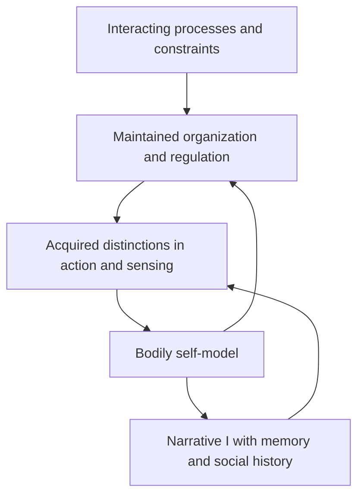

# The generated I and ethics without a fundamental owner

**Acquisition continuation, 6 October 2026:** the [composed Lean entry](../../../experiments/integrated-correction/general-framework/generative-basis/lean/GenerativeAcquisitionModel.lean) now carries an actual formed learner through acquired action-effect prediction, environmental change, paid correction and successful organizational use. The [acquisition bridge](../../../_process/research/2026-10-05-generative-foundation-review/root-foundation/SELF-ACQUISITION-BRIDGE.md) uses unchanged local laws and derives the retained record's response-function meaning. It closes a partial representation/use connection; it does not derive the body boundary, phenomenal experience or ethical significance. [The completion audit](../../../_process/research/2026-10-05-generative-foundation-review/root-foundation/COMPLETE-FOUNDATION-DERIVATION-AUDIT.md) records why the requested assumption-free foundation remains unfinished. The earlier 43 empty-dependency structural additions remain preserved and checked at their own scope.

6 October 2026. AI-authored research responding to [Ren's stronger thesis](../../../sources/15-codex-theory-conversations/2026-10-06-generated-i-and-owner-independent-ethics.md): the I arises within the generative account, and good/evil need not depend on I or a fundamental subject/object division. This develops the [nondual question](../../../_process/research/2026-10-05-generative-foundation-review/root-foundation/NONDUAL-GROUNDING-QUESTION.md) through selected primary readings and an explicit argument. It is not a systematic literature review, a new experiment or a completed derivation of consciousness and ethics.

**Strongest current position:** an I can be investigated as a formed organization and representation, rather than supplied as the ungenerated origin of experience and value. In the severe-suffering case, actual adversity and its permissible relief are proposed ethical grounds without an additional ownership requirement. This supports a direction for ethics within generative reality; it does not establish that bare generativity necessarily produces goodness.

**核心方向：不是先有一个独立的“我”，再由“我”的偏好赋予一切意义；而是在生成过程中解释组织、体验、关切以及“我”的形成。痛苦的实际发生与合宜缓解，是伦理根据的候选；“这是我的”不必成为它们取得意义的前提。生成的差异仍可真实，真实的差异不必是根本分裂。**

The named connections are **organization → regulation → acquired self/world representation**, and **experiential adversity → a reason for an eligible response**. The first specifies a formation hypothesis to realize and test; the second requires ethical justification. Their interaction matters, but neither can silently discharge the other's burden.

## Self-formation as a requirement of this foundation

[Ren's subsequent clarification](../../../sources/15-codex-theory-conversations/2026-10-06-generated-i-and-owner-independent-ethics.md#clarification-self-formation-is-required) makes the formation of the notion of self a requirement of this foundation, rather than an optional application. A complete generative account must explain the I and its evaluations within the process. Starting with an unexplained evaluator whose preferences define good would leave both its origin and the authority of that definition ungrounded. This records a research requirement; it does not upgrade the preceding hypotheses into established results.

Three acceptance criteria now govern this connection:

1. **Explain the formed self.** Show how organization, interaction, learning and retained history produce usable self-representation. Correct me/world labels, an internal spectator and benevolent preferences cannot be unexplained inputs at the foundation. Local models may supply such inputs only with their unresolved dependencies identified. Explaining the notion of self remains distinct from explaining phenomenal experience.
2. **Distinguish evaluative formation from ethical justification.** Explain how evaluations arise, and separately why actual conditions and transformations warrant some evaluations. Cruel or mistaken preferences must remain explainable within the same generative account. Their origin, stability, prevalence or contribution to persistence does not certify them as good. The analyst's preferred objective cannot silently settle this question either.
3. **Defend independence without erasing actual differences.** Explain why changing an ownership description or private endorsement need not erase the baseline relief-ground when the warranted burden, effective means and competing claims remain unchanged. Preserve additional reasons created by commitments, and permit correction when experience, consent, continuity or consequences actually change. This invariance is a necessary test of the proposed position, not a sufficient derivation of value: even an ethically empty or arbitrary rule might pass a relabeling test.

The intended good–evil direction is independent of a self's approval; it need not be independent of experienced reality. Deriving self-representation closes an explanatory gap. Justifying ethical significance closes another. Both are required here. The claim that every possible objective ethics logically requires emergent selves is stronger and is not established by this clarification. A single scalar axis also remains to be justified rather than assumed.

**本理论的要求：在生成过程内解释“我”与评价的形成，同时说明评价何以有对错。生成了偏好，不等于证成了善恶；不以“我”的认可为根据，也不等于取消真实体验与差异。**

## 1. What is generated, and what does the generating?

Three meanings must remain distinct. A generative **process** produces and transforms actual organization. A generative **theory** describes or explains that process. An embodied predictive **model** is one possible organization formed within it. Ren's foundation concerns the first through the second; a neural model is a candidate for explaining particular capacities within that account. An equation in an analyst's notebook does not itself produce an organism or an experience.

Likewise, I can mean a differentiated living organization, a bodily self-model, an experienced perspective or a narrative identity. Explaining one does not automatically explain all four. A continuing system can have regulatory organization without an autobiography. Explaining an ownership judgment does not explain why anything is experienced. Denying an independent owner does not require denying actual situated experience.

The constructive proposal has this explanatory order:

These arrows are research obligations, not completed universal deductions or a fixed developmental timetable. Actual dynamics, resources, retention and learning mechanisms remain supplied. The realization of experience is an additional open question; the diagram does not equate a functional state with consciousness.

A model can guide action because its state changes the continuing process. No further little observer has to read it. For example, retained action–consequence regularities could organize which signals are directly regulable, which events resist control and which changes threaten the organization. A self-related partition could emerge from that activity without initial training labels saying me and world. Controllability alone is insufficient: a tool may be controllable without becoming one's body. The mechanism must explain the appropriate differentiation, including its failures.

Once formed, an I can influence subsequent organization. Generated does not mean powerless, false or disposable. The explanatory claim concerns its dependence and formation, not its complete causal exclusion.

## 2. What the primary research contributes

The [organization comparator](../../../_process/research/2026-10-05-generative-foundation-review/root-foundation/ORGANIZATION-AND-GENERATED-SELF.md) examines Barandiaran, Di Paolo and Rohde's theoretical account of agency through adaptive, self-maintaining organization. It provides a route to individuation before reflective identity; it does not turn viability into moral value.

The [self-model source study](../../../_process/research/2026-10-05-generative-foundation-review/root-foundation/GENERATED-SELF-SOURCES.md) distinguishes three contributions. Apps and Tsakiris propose predictive self-recognition. Seth, Suzuki and Critchley propose an account of conscious presence while leaving fuller selfhood open. Suzuki and colleagues experimentally alter virtual-hand ownership through cardiac feedback. These are respectively theoretical mechanisms and a bounded manipulation of ownership in existing adults; together they do not establish the origin of experience or a final nondual ontology.

This supports an affirmative research strategy: explain the formation and revision of self-representation, rather than use a primitive self as its own explanation. It does not establish that all conceptions of an irreducible subject have been refuted. Nor does a changeable boundary imply that every boundary is arbitrary.

The repository's [prediction/action construction](PREDICTION-ACTION.md) supplies the local learner used in the [acquisition continuation below](#acquired-action-effects-and-organizational-use). That proof establishes a retained prediction of action effects on organizational support, paid correction and actual use. It does not yet derive bodily ownership or self-recognition. Acquiring a usable own/world attribution without supervised ownership labels remains a stronger task; the supplied physical organization and decoder must not be mistaken for its solution.

## 3. Ethical significance need not wait for an ownership judgment

Consider an actual severe, ongoing experiential burden that remains unwanted, together with an informed capacity to relieve it through permissible means. The proposed ground concerns what is happening and what the response can change. It need not begin with an independent entity that acquires the burden as a possession and then declares it bad.

This distinction is easiest to see by separating two questions. What makes the condition adverse? What makes responding to it morally favored? The [constitutive candidate](UNIFIED-ETHICAL-GROUNDING.md#the-constitutive-candidate-and-its-test) proposes that the first is grounded in the actual undergoing. It separately defends the second through the relationship between that adversity and appropriate relief. An ownership judgment is not identical to either relationship.

The argument is affirmative, although not conclusive against every rival:

1. A still-unwanted severe burden has a character that genuine relief changes. An articulate judgment that it is mine is not what such relief has to remove.
2. A permissible effective response addresses that very condition. An equally elaborate intervention that leaves the burden untouched lacks this particular advantage.
3. The proposed ethical significance of this difference is available before the responder adopts helping as a goal. It can explain why concern is worth acquiring; it need not be manufactured by an already benevolent I.
4. A theory that makes primitive ownership or private adoption necessary for all such moral favor owes a justification for that additional gate. Removing the gate preserves the proposed occurrence-and-relief ground.

Step 3 is the substantive ethical bridge. A critic may accept the experience and its improvement but deny a reason addressed to an uncommitted responder. That position is not contradicted merely by drawing a causal diagram. The positive defense is that actual relief explains the option's patient-directed advantage and remains available as a justification when private endorsement changes. This is a ground for endorsing the bridge, not a proof that no coherent rival exists.

The case also requires independent warrant for experience, genuine relief and permissible means. An investigator's penalty score, a physiological signal or a generated distress report is not automatically the burden itself. Evidence may identify the ground imperfectly; uncertainty about identification must not be concealed by a definition.

## 4. A direct philosophical predecessor, and its strongest objection

Śāntideva's *Bodhicaryāvatāra* VIII.102–103 connects suffering without an ultimate owner to impartial relief. The [primary-text and argument study](../../../_process/research/2026-10-05-generative-foundation-review/root-foundation/OWNERLESS-ETHICS-SOURCES.md) separates that positive proposal from the further inference that no-self alone entails altruism.

Harris's original objection is important: granting suffering's adversity need not settle obligation, and no-self reasoning can leave an apathetic alternative. Garfield, Jenkins and Priest also warn against preserving suffering while dismissing persons solely for being conventional. Exact passages, bibliographic details and source limits are in the linked study.

Our reconstruction therefore does not make suffering an ultimate substance while treating its continuities as nonexistent. It proposes that relationally constituted events and responses can be real enough to ground ethical differences. Being dependent or generated is not itself a reason to dismiss an experience, a relationship or an obligation. The converse also holds: generated existence alone confers no automatic goodness.

The important gain is a change in the explanatory burden. A fundamental owner is no longer the default supplier of all value. The account must explain actual adversity, beneficial change and the relevance of those facts to action. Nonduality opens that route but does not complete its justification.

## 5. The independence claim has three different strengths

| Independence from… | Current position |
|---|---|
| A substantial I that owns experience | The proposed ground can be stated without it; generated continuities can identify actual consequences. |
| The responder's preference, reward or prior endorsement | The defended ethical bridge allows a reason before adoption. This is a substantive moral position. |
| Every situated experience or differentiation | Not established. The suffering argument depends on what actually occurs and changes. Other proposed goods require their own grounds. |

Thus ethical objectivity need not mean that nothing is experienced from anywhere. An experience can have situated conditions of occurrence while its moral significance is independent of another agent's approval. Rejecting a fundamental subject/object split is compatible with explaining differentiated perspectives within the process.

The I may organize **access, attribution and responsibility** without being the source that creates every value. Access helps explain who knows what. Causal capacities help explain who can respond. Histories help explain responsibilities. None of these alone establishes that only what is mine can matter.

There is an equally important limit: removing a metaphysical ownership requirement does not abolish consent or other authority. A refusal can express the situation and commitments of an actual continuing life. Its weight must be explained through those grounds. Its generated origin neither automatically invalidates it nor automatically makes every refusal decisive.

## 6. A moral direction without an ego-based axis

The narrow proposed direction is **from an actual severe unwanted burden toward its genuine, permissible relief**, with other affected consequences and competing grounds retained. This is already evaluative content. It does not depend on how many times a system says I, how little ego it reports or how well it predicts.

For a wider account, flourishing, understanding, relationships, agency and the capacity to revise destructive arrangements are candidates for positive grounds. Their value and priority must be argued, not inferred from their occurrence or placed inside a universal growth score. Nothing in this study establishes a complete scalar ranking of lives or actions. Some conflicts may admit only partial ordering.

Likewise, evil cannot simply mean individuality, differentiation or insufficient selflessness. A proposed severe case is deliberately sustaining another's grave suffering for slight amusement when one can stop without sacrificing another serious claim. The comparative judgment is that this amusement cannot justify that grave burden; it is an ethical judgment to defend, not a consequence contained in the word generated. Its condemnation depends on the suffering, alternatives and responsibilities. The absence of an ultimate ego would remove none of those questions. This example identifies a domain for judgment, not a complete definition of evil.

A relational predator is the decisive control case. It can understand its own generated nature, model others accurately and exploit them. This refutes necessary benevolent behavior from self-knowledge or interdependence. It does not refute an ethical reason the predator ignores. Conversely, perfect regulation of an exploitative organization gives no reason, by itself, to preserve it. The generative foundation must explain constructive and destructive regimes with the same honesty.

## 7. What this changes in the existing derivation

The [noninstrumental-concern interface](NONINSTRUMENTAL-CONCERN.md) uses patient, event and actor indices to keep evidence and consequences properly directed. Those indices need not name metaphysically independent substances. In a generative account they may identify formed, differentiated histories. However, treating them as supplied local inputs is not yet an explanation of their formation or phenomenal status.

Its C1/C2 contracts remain distinct: an identified occurrence constitutes local adversity; adversity and an eligible response support a moral consideration. This study does not claim that no-self proves either contract. It clarifies why the proposed contracts need no extra primitive-owner variable and where their remaining justification belongs. The inherited ethical results retain their conditional scope. The new compilation described below checks the acquisition bridge; it does not validate C1/C2 or establish new empirical evidence.

The [ethical minimum](UNIVERSAL-ETHICAL-MINIMUM.md) retains its separate comparison between a favoring reason, a rescue requirement, personal latitude and authority to compel. Complete histories still matter: repeated burdens do not disappear because identity is generated. Relief at one locus does not literally relieve another. Replacing a sufferer with a contented successor is not automatically relief of the original suffering. These facts constrain the problem without themselves settling aggregation or every conflict.

## Formal integration into the existing model

The [self module](../../../experiments/integrated-correction/general-framework/generative-basis/lean/GeneratedSelf.lean) starts from the existing transition relation and derives which finite futures are compatible with a history. A proposed record preserves this information exactly iff it does not merge histories with different compatible futures. This criterion and its consistent history-update rule add no self/world labels or physical law. The interpreter constructed by the proof can be an analyst's mathematical object; the theorem does not install an acquired self-model inside the process.

A closed counterexample identifies the limit. In the existing toggle process, an empty history and a one-event history end in different states while every finite future word remains possible. No decoder depending only on the resulting continuation profiles can recover both endpoints. This rules out equating that profile with a demonstrated complete state representation. It does not require every useful self-model to track the phase or exclude richer, locally formed perspectives.

The [orientation module](../../../experiments/integrated-correction/general-framework/generative-basis/lean/EthicalOrientation.lean) separately derives a factual order by inclusion of feasible continuations. It also proves that ordering histories by length and ordering them in reverse both satisfy coherence and annotation-independence, yet rank the same actual histories oppositely. Therefore those conditions alone do not select a direction of value. History length is event count, not welfare; attached annotations are not generated selves. The result leaves richer experiential or practical grounds open.

The public entry point composes these interfaces on the same existing histories. A fresh source-only build and an independent reconstruction accept all 43 additions with empty axiom reports. Prior non-entry sources remain byte-identical; no ethical axiom, primitive event law or claimed universally benevolent dynamics is inserted. Earlier inherited standard axiom dependencies remain in their original theorems. [Verification and scope](../../../_process/research/2026-10-05-generative-foundation-review/root-foundation/SELF-FOUNDATION-LEAN-INTEGRATION.md) preserve those distinctions.

### Acquired action effects and organizational use

[AcquiredPerspective.lean](../../../experiments/integrated-correction/general-framework/generative-basis/lean/AcquiredPerspective.lean) now closes one positive interface in that same inherited material-backed learner. For retained score `q`, the two analytical action forecasts are `q` and `4 − q`. These are checked against the existing receipt law. The actual controller already reads the score; no new evaluator, reward or command rule is installed.

The formed register starts neutral, acquires an accurate prediction, retains it when the environment changes, and consequently becomes wrong. A later paid write uses the issued action and its receipt to correct both action-effect forecasts. The next paid action uses that changed record and restores the same organization's support; the required subsequent write and completion renew its leases. [GenerativeAcquisitionModel.lean](../../../experiments/integrated-correction/general-framework/generative-basis/lean/GenerativeAcquisitionModel.lean) composes the formation prefix and this complete paid continuation through their actual states in `Generative.Trace`.

This is an operative, partial representation of the consequences of the system's action for its support. The two-action exactness theorem concerns the supplied response function; only the current command is executed by the actual work event. Memory is internally acquired and can be inaccurate, but the body boundary, memory recipe, decoder, available noiseless response and initial resources remain supplied. Target names in the separate recipient comparison are also inherited. This does not yet establish a learned own/world attribution, full selfhood or experience.

The [separate acquisition verification](../../../experiments/integrated-correction/general-framework/generative-basis/lean/acquired-perspective/README.md) compiles the old structural and physical chains with the two new modules. It preserves the original structural check's strict dependency policy and checks inherited sources and declaration dependencies against their prior receipts. Some new concrete results inherit `propext`; no new axiom or physical law is added. Absence of new axioms does not remove the existing explanatory premises.

The [constitutive closure attempt](../../../_process/research/2026-10-05-generative-foundation-review/root-foundation/ETHICAL-CONSTITUTION-CLOSURE.md) grants accurate identification and even local badness to test the strongest ethical route. It still does not discharge the inference from that badness and an eligible response to an independent actor's reason. Prediction accuracy, organizational renewal and ethical goodness therefore remain distinct. The [derivation audit](../../../_process/research/2026-10-05-generative-foundation-review/root-foundation/COMPLETE-FOUNDATION-DERIVATION-AUDIT.md) identifies the unresolved roots without enlarging them into a universal impossibility claim.

## Acquired records and outcome-sensitive use

The [new continuation](../../../_process/research/2026-10-05-generative-foundation-review/root-foundation/ACQUIRED-RECORD-INTEGRATION.md) derives the native predictor's current score from the writes actually consumed along its history. Equal starting memory, write inputs and retained action reference give the same next command. An enabled work event actually issues that command, and a reached paid correction changes the later command and receives support. The transcript is an analytical reconstruction of the existing writes, not newly installed memory or a replay algorithm executed by the learner.

The outcome criterion retains the endpoint readout as well as the feasible event word. This matters in the unchanged finite implementation: two states can allow exactly the same complete operation language and nevertheless receive different returns from the same rent/work suffix. Conversely, score plus last action determines the current command while omitting the resources and phase that determine future availability. The record's adequacy is relative to the question it must answer.

The parallel [action-effect acquisition result](../../../_process/research/2026-10-05-generative-foundation-review/root-foundation/SELF-ACQUISITION-BRIDGE.md) establishes exact two-action response interpretation and materially backed use under the same inherited noiseless law. This round adds general write provenance, the outcome interface and exact finite distinctions; it does not claim that the older productive correction history is new. Its 32 new audits are empty, while the parallel typed-material proof retains its reported standard dependencies.

The local history-to-record correspondence is now derived for the native command interface. The initial prior, decoder, finite register, updater and command coupling remain supplied. A record of action effects is not yet a generated self/world partition, an experience or an ethical reason. The next connection is formation and warranted revision of those operative rules, including the existing ambiguity between an unsuitable action and unavailable support.

The [receipt-identification continuation](../../../_process/research/2026-10-05-generative-foundation-review/root-foundation/RECEIPT-IDENTIFICATION-INTEGRATION.md) makes that ambiguity exact: success identifies the regime at its trial, whereas failure with unknown availability leaves both candidates. The existing phase guards derive freshness through an actual next write; a later reached reversal leaves the acquired record intact while changing its applicability. The same changing history contains opposed successful receipts, defeating a fixed-regime interpretation without making either event-time receipt false. All 32 new audits are empty. No new controller is installed, and the origin of reliable sensing, change detection, self attribution and warranted action remains unresolved.

## 8. The next decisive test

The next central ethical connection remains **actual adversity → prospective practical significance without primitive ownership**. Compare the same warranted suffering and relief opportunity under different self-descriptions and prior helping attitudes. In this comparison, private attitude changes do not change promises, assigned responsibilities or independently created commitments: adoption can create additional reasons without creating the entire baseline relief-ground. Then vary actual continuity, relief, consent and costs separately. A valid account should explain why the first changes need not erase the baseline ground, while the latter can change what action is justified.

This is a relevance test, not a tautological instruction to hold all morally relevant facts fixed. Whether self-description or adoption is an indispensable moral fact is precisely what is disputed. The test assumes their variation leaves the stated experiential and practical conditions intact; where it changes experience or consequences, that is a different case.

A successful exclusive-ownership or exclusive-endorsement argument would narrow the proposal. A case meeting a predeclared experiential domain while lacking the claimed adversity would challenge the constitutive identification or that domain's proposed generality; counterexamples must not be excluded merely to save the claim. Evidence of wrong patient identification would revise its application. A self-model mechanism that works only with externally rewarded me/world labels would fail the formation claim. Suppressed reports without relief, or benefit to a replacement without warranted continuity, would fail the ethical identification.

The completed work here includes a source-grounded reconstruction, adversarial assessment and the checked local action-effect acquisition/use bridge. The universal foundation remains unfinished. The strongest defensible formulation is that **a formed I need not be value's creator: ethical significance can be sought in actual modes of experiencing, relating and responding, while the formation of selves is explained within that same reality.**

Supporting work: [organization](../../../_process/research/2026-10-05-generative-foundation-review/root-foundation/ORGANIZATION-AND-GENERATED-SELF.md), [self-model primary readings](../../../_process/research/2026-10-05-generative-foundation-review/root-foundation/GENERATED-SELF-SOURCES.md), [ownerless-ethics readings](../../../_process/research/2026-10-05-generative-foundation-review/root-foundation/OWNERLESS-ETHICS-SOURCES.md), [adversarial mechanism and ethics review](../../../_process/research/2026-10-05-generative-foundation-review/root-foundation/GENERATED-SELF-REVIEW.md).
