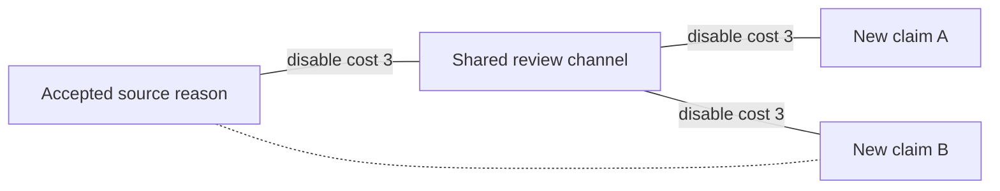

# Revising who and what matters

**How concern can change its own scope, preserve warranted claims, and resist strategic exclusion.** A continuation of the formation and renewal of concern, 5 October 2026. Research direction from Ren; AI-assisted development, proofs, and internal review.

**Later development:** [the integrated settlement](../../../theories/becoming/chapters/REVISABLE-CONCERN-SETTLEMENT.md) now supplies a conditional joint process for paid revision, retained grounds, strategic protection and renewal, alongside ethical decision results and an evidence audit. This chapter preserves the earlier modular argument and its then-open integration target; the [settlement record](settlement/README.md) states what has since been resolved and what remains open.

## The advance

The previous concern theory explained a route by which learned recognition and valuation could change action, remain correctable, and survive succession. Its broader ethical scope and shared evaluation route remained supplied. This continuation takes a further step: it specifies how a process can encounter a case excluded by its current rule, recognize that the exclusion conflicts with a reason it already accepts, and revise the operative domain of that reason.

The central mechanism is a **traceable challenge**. Given an acknowledged reason and an independently warranted comparison with an excluded case, a process committed to relevant consistency must do one of three things: extend the reason, establish a relevant difference, or openly revise its earlier commitment. It can also refuse or evade the challenge, but doing so does not count as resolving it. An unresolved case remains visible rather than being converted into a successful correction.

This is a conditional architecture for revising scope. It does not derive the original positive reason, settle every relevant difference, or force a self-interested actor to honor a commitment. We therefore also model the actor's incentives to block the route through which the challenge becomes effective. The main new mathematical result is that resistance to exclusion must be assessed **jointly**: two claims can each appear protected while one shared bottleneck makes excluding both worthwhile.

The constructive account now joins three distinct processes: learning a concern, revising the scope and reasons through which it operates, and maintaining the routes that let those revisions change action. Existing concern can survive a blocked channel; an old mistake can survive invalidation of the evidence that created it. A complete implementation must distinguish those cases.

## 1. A concrete challenge to an exclusion

Suppose a decision process says that a particular avoidable injury counts against an action because of its effect on the sufferer. It responds to that injury in a familiar person but assigns it no reason at all when an unfamiliar person suffers it. A challenge supplies evidence that the declared relevant properties of the injury are the same.

There are three accountable responses:

| Response | What must change or be supplied | What it does not establish by itself |
|---|---|---|
| Extend the reason | The previously excluded case enters the operative reason rule, including appropriate novel cases. | That every intervention is justified or affordable. |
| Establish a relevant difference | Evidence and an argument explain why the comparison fails for this particular reason. | That a difference in identity, familiarity, or administrative category is relevant merely because it exists. |
| Revise the prior commitment | The process states which anchor, reason, relevance criterion, or scope rule it is changing and why. | That openly adopting a narrower or harsher commitment makes it justified. |

Requests for further evidence can be appropriate when the comparison is uncertain. They need an intelligible status, relevant questions, and a feasible route to resolution. Endless deferral, deleting the record, redefining the claimant out of the database, or removing the right to challenge are different events. They can suppress inconsistency without improving judgment.

This protocol matters because learning new facts and changing an evaluative rule are different changes. A person can understand a stranger's injury and retain the identity exclusion. A rule can admit the stranger while actual action remains blocked. A new action can be compelled while the actor's concern remains unchanged. The theory must report which change occurred.

Consistency alone also has no favorable direction. A process assigning zero weight to everyone's interests can be consistent. The positive anchor and the commitment that bare identity does not cancel its relevance remain substantive premises. The contribution here is to make the consequences, revision, and evasion of those premises inspectable.

## 2. The unit of transfer is a particular reason

A node in the formal model is a **case in context for one named reason**. It is not a whole person, a complete life, or a total moral priority. A case includes the properties that the declared reason treats as relevant: the kind of stake, its severity where comparable, the circumstances, and relevant relationships or responsibilities.

An edge records a warranted equivalence for that reason coordinate. It does not mean that two beings resemble each other generally. Equal recognition of one reason permits different responses when other reasons, needs, duties, preferences, uncertainty, or available means differ. The equality of an injury-based reason does not erase an additional duty to one's child, or settle whether that additional duty is legitimate.

The model requires valid composition. A chain of approximate similarities is not automatically a chain of exact reason-preserving equivalences. The question whether a property is morally relevant is itself open to challenge. In the finite specimen, the relevance specification and certificate test are declared; the model does not discover a complete moral ontology from raw data.

There must also be **direct intake for unfamiliar claims**. A being does not have to resemble an accepted example, persuade an existing beneficiary, speak for itself, or supply a profitable contribution before it can deserve consideration. Analogy is one route for detecting an inconsistent exclusion. Testimony, representation, investigation, or recognition of a new kind of stake can supply another starting reason. A graph with no path to an existing anchor records a limit of the current procedure, not proof of absence of standing.

## 3. Warrant, memory, and access must remain separate

Three structures clarify what an actual process can change.

- **Warrant:** the relations and reasons that survive the declared evidential and normative examination.
- **Retained support:** the certificates, records, acknowledged reasons, and practices that the process actually preserves.
- **Operational access:** the channels through which a reason can now enter an update, obtain a hearing, exercise authority, or change conduct.

Passing a declared examination does not by itself establish ethical truth: the formal specimen assumes sound certificates, while real audits and retained acceptance can be mistaken. A censor can cut operational access without refuting a warrant. A broken communication channel need not erase an already learned concern. Conversely, removing a false comparison from the current database need not remove the conclusion previously learned from it.

The object to maintain is therefore more than an opinion or a connection. It includes enough provenance to distinguish **a defeated justification** from **a still-valid justification whose delivery has been obstructed**. Recomputing every belief from only the currently permitted communication graph would let a censor turn silence into apparent disproof. Retaining every previous conclusion without examining its support would preserve errors indefinitely.

Storage, certificate inspection, transmission, and authority to correct the record have costs. A successor's effective starting knowledge includes what it actually inherits or can reconstruct from surviving public evidence. It must not be modeled as ignorant merely to make a new access channel seem indispensable.

## 4. An explicit finite procedure for admitting an existing reason in a new case

Take a finite set of case–reason nodes and accepted anchors. A paid comparison can admit a directed transfer certificate under the declared relevance rule. The simplest reason-admission procedure is

\[
S_0=A,\qquad
S_{t+1}=S_t\cup\{j:\exists i\in S_t\text{ with an admitted transfer }i\to j\}.
\]

Here `S_t` is the set whose reason has been procedurally admitted, and `A` contains the presently accepted anchors. A newly admitted case did not need to reward the learner or to have been directly trained as a helping target. Its reason becomes operative through the specified transfer commitment.

For a fixed finite graph, this procedure reaches exactly the anchor-reachable set. A case first enters at its shortest directed distance from the anchor set. Closure takes at most `|V|−1` parallel rounds when anchors exist; unreachable nodes remain outside it. These rounds have to be implemented: simultaneous inspection of many certificates can require more work than one local comparison.

This is a complete finite rule for reason admission inside a supplied language and relevance specification. Its mathematical foundation is ordinary reachability and least fixed-point closure. It is not the invention of previously unrepresentable values. Its contribution is to make a validated challenge change the procedure's operative scope, while recording the assumptions that authorize the change.

The corresponding hard equality result is equally precise. If every warranted equivalence requires `y_i=y_j`, then an anchored connected component must have its anchor's value. Two different anchor values in the same equivalence component create an inconsistency. An unanchored component has an undetermined common value. Averaging conflicting anchors does not prove that the disagreement has been resolved.

The [scope appendix](scope-math.md) supplies the proofs, operational variants, and failure cases. It keeps the hard commitment distinct from a psychological learning process or a complete moral judgment.

## 5. Admission and learned responsiveness can move at different speeds

The earlier theory supplies a bridge from learned significance and recognition to action. The present reason-admission procedure can change where that bridge is permitted to operate. It does not guarantee immediate emotional motivation, reliable implementation, or sufficient resources.

One explicit implementation uses local averaging. Anchor states are held at one; other states start at zero. A free node updates from a weighted average of the admitted predecessor states. Under a fixed finite bidirectional graph with positive weights, every node in an anchored component converges to one. Directed access needs stronger care: a reachable node can remain diluted by dependencies that never receive anchored support.

For the specified averaging process,

\[
x_j(t)=\Pr_j(\tau_A\le t),
\]

where `τ_A` is the first time a reverse dependency walk reaches an anchor. This is an exact interpretation of the algorithm. It is not a probability that the recipient possesses moral standing.

If a feasible protective action is selected exactly when `x_j>θ_j`, its selection by deadline `t` is equivalent to that hitting probability exceeding `θ_j`. A path can exist and still transmit too slowly. A chain of length `d` produces zero support at its endpoint before `d` update rounds. Positive but steadily shrinking attention can also prevent a threshold from ever being crossed.

This separates three questions that a general claim of inclusion can hide: whether a reason is warranted, whether the process admits it, and whether its implementation becomes effective in time. The actual action must additionally help the recipient and satisfy the resource and authority conditions developed in the earlier theory.

## 6. Widening does not justify weakening an already admitted claim

An algorithm can make a poor tradeoff even when every new relation it receives is valid. With a unit anchor connected to one free case, three half-self, half-neighbor updates give that case state `7/8`. Connect it to a new zero-state case and split the neighbor attention equally. Its next state falls to `11/16`, while the new case rises to `7/16`.

At a protective threshold of `4/5`, the old case changes from protected to unprotected during that update. Both cases eventually approach one if the favorable conditions persist. Eventual convergence does not repair a missed current deadline.

This is a counterexample about a specified normalization rule, not evidence that expanding moral concern generally harms prior recipients. A better implementation can keep an admitted reason in a separate ledger while allocating attention and action resources explicitly. The monotone admission procedure above does not revoke the old admission merely because a new case arrives.

Scarcity may still require choices between actions. Those choices should expose the competing claims and actual constraints; they should not be implemented by making a previously recognized claim disappear from the record. This extends the existing ethical distinction between inability to fulfill every claim and a judgment that some claim has no standing.

## 7. Correcting an error requires correcting its inherited support

Consider a false comparison that once transferred a positive reason weight to a case. The comparison is later defeated. If the learner deletes the edge but lets an isolated node retain its state, the positive value persists forever. This can be an obsolete inference, even though every currently stored edge is correct.

An explicit retraction procedure inspects the **retained valid support**, invalidates derivations that actually depended on the defeated warrant, and checks for independent surviving grounds. Withdrawing one derivation does not show that the case has no reason or that the recipient lacks standing. Direct claims and other supports remain available for examination.

Ordinary obstruction must be treated differently. If the original warrant remains valid and its certificate is retained, severing its delivery channel gives no evidential reason to retract it. This distinction is especially important at succession: a reliable inherited record can let a successor retain a justified concern even when the former communication route is gone.

Automatic forgetting offers a different mechanism. Multiplying each free update by a factor `0<λ<1` makes unsupported inherited influence fade. But it also attenuates warranted reasons along long paths. In the stationary unit-anchor model, the resulting limit is a discounted anchor-hitting value rather than undiminished equality. Forgetting by itself cannot distinguish an obsolete error from an inconvenient truth.

A process that can revise its own scope therefore needs both retention and selective retraction. It must preserve reasons through obstruction while withdrawing unsupported derivations when their grounds actually fail. Which event occurred is itself a question for evidence and contestable judgment.

## 8. Why valid challenges can be strategically suppressed

Now consider a controller who can interfere with the route by which **new claims** become effective. Every target is initially reachable in the intact operational graph. Deleting a set of channels `F` costs `c(F)`. Excluding the resulting target set `S(F)` gives the controller private gain `B(S(F))` over a declared finite accounting window. The payoff from interference is

\[
U(F)=B(S(F))-c(F).
\]

The gains are private burdens avoided, not the moral value of the claims. The controller knows the finite game and chooses a payoff-maximizing feasible action. This is a strategic benchmark, not a theory of how it learns the game. Immediate attack costs must be affordable before later gains arrive. In the simple liquidity variant, `c(F)` is the full payment due before the attack. When an economic cost includes noncash opportunity costs, affordability needs a separate cash ledger and optimization over the actually feasible attacks.

For one target, all optimal choices preserve its access precisely when the cheapest affordable disconnection is more costly than the gain it offers, with unaffordable attacks excluded. Equality permits a suppressing choice; it does not guarantee protection.

For several targets with monotone gains, define `κ(S)` as the cheapest attack that disconnects at least the set `S`. All optimal responses preserve every target **if and only if**

\[
\boxed{\kappa(S)>B(S)\quad\text{for every nonempty target subset }S}
\]

among cuts affordable to the controller in the upfront-cost variant. With a distinct cash bill, replace `κ(S)` by the cheapest feasible cut cost `κ_L(S)`. The quantifier over subsets matters. Checking each recipient separately can miss a profitable joint attack. Checking only the attack that excludes everyone can miss a profitable attack on a minority.

With additive avoided burdens, the controller's exact optimization can be represented by a standard augmented network cut. The proof and exhaustive comparisons are in [the access appendix](access-math.md). This is an application of established cut mathematics, not a new network theorem or an empirical prediction of how every institution behaves.

The interpretation has a strict boundary. A communication cut does not erase retained knowledge, prior concern, or an already installed protection. Those provide additional starting routes unless an explicit attack also destroys records, revokes authority, or stops implementation. The model applies to new admissions, accurately described successor states, or downstream functions that genuinely need a continuing live channel. It is not allowed to manufacture ignorance.

## 9. Two claims can be vulnerable together while each looks secure

Take an accepted source reason `r`, a shared review channel `c`, and two newly presented claims `a` and `b`. Each channel in `r—c—a` and `c—b` costs three units to disable. Honoring either claim imposes a private burden of two on the controller.

The dashed route is absent in the baseline and constructed in one comparison. Costs in the diagram describe disabling a channel, not the strength or worth of a reason.

Each individual claim passes the tempting test: preventing it costs three to avoid a burden of two. But disabling the shared channel costs three to avoid **both** burdens, totaling four. Joint exclusion is profitable by one unit.

| Architecture | Cheapest disconnection of A | Of B | Of both | Outcome under the specified controller |
|---|---:|---:|---:|---|
| Shared channel only | 3 | 3 | 3 | Both excluded |
| Shared-channel cost raised to 4 | 3 | 3 | 4 | Exclusion and full access tie |
| Shared-channel cost raised to 5 | 3 | 3 | 5 | Every optimal response preserves both |
| Independent source-to-B route added, disabling cost 2 | 3 | 5 | 5 | Every optimal response preserves both |

The added route can also reach A through B and the review channel. It has a separate construction bill of one and an operating bill of one quarter, both due before use. Those are supplied technology values in this example: spending one and a quarter does not generally buy resistance of two.

The result gives a concrete reason to inspect shared dependencies. Many nominal complaint routes can all fail behind one revocable office, one funding decision, one credential rule, or one implementation authority. Those are possible applications of the model, not facts established about any particular organization here.

## 10. A strong information channel can coexist with captured authority

A valid claim has several transitions to complete: evidence arrives; the process admits the reason; the reason can change a decision; the action is implemented. An information-only graph covers only the first transition.

In a separate constructed example, information and adoption channels each cost ten to disable, but a shared authority channel costs one. Honoring two claims costs the controller four. Capturing authority gives a private gain of three even while evidence continues to arrive and the reason remains openly accepted. Strengthening the information channels alone changes nothing about that cheapest attack.

Disabling the update rule itself is another possible attack. If the controller can freely declare that accepted claims no longer matter, protecting lower-level channels has no demonstrated effect. Rule revision cannot therefore be treated as an intrinsically favorable operation: it can remove an arbitrary exclusion, or remove the commitment that made an inconvenient claim consequential.

For a declared finite menu of reinforcements, the defender can choose the least expensive executable option that makes every feasible excluding attack less profitable than preserving access. This is an exact optimization within that menu. It does not establish invulnerability to unmodeled attacks, actors willing to accept losses, coordinated coercion, or a changing payoff structure.

Construction, upkeep, retained records, decision procedures, and transfer to successors must be funded separately from the adversary's disabling costs. The earlier renewal and prefix-financing results still apply. So does the formation study's lesson that a present action can change another actor's future ability to afford correction. The present graph result complements that temporal mechanism by identifying shared access and authority dependencies. The newly integrated concern–correction interface also shows how current concern and effective refusal can jointly change a choice when either alone is insufficient; it preserves harmless exit as a possible response to inadequate safeguards. These remain distinct conditional modules. We have not joined every learning, construction, interference, record, and succession transition into one proved developmental system.

## 11. What this explains about the formation of wider concern

This continuation changes the explanatory status of one bridge. Previously, a learned correspondence fed an already specified shared evaluation route. We now supply a procedure by which a validated challenge can **extend the admitted domain of a stated reason**, then characterize whether that extension can spread, arrive in time, survive obstruction, or require retraction.

The procedure has actual consequences for previously excluded cases, including new cases covered by the revised rule. It is more than rehearsing the same examples or increasing emotional intensity. But its starting language, positive anchors, relevance criteria, valid audit interface, and procedural commitment are still explicit inputs. New concepts, changes in the ultimate grounds of a reason, and legitimate resolution of plural conflicts are not generated by the graph recurrence.

This distinction also clarifies the role of conscience. On the present interpretation, conscience can register a conflict between an accepted reason and an exclusion, resist convenient forgetting of that conflict, and help bring judgment and conduct into a more defensible relation. An unpleasant feeling alone is neither a complete diagnosis nor an infallible verdict. A fair institution may make the same conflict consequential through records, testimony, reasons, and authority even when an official feels little sympathy.

The direction of development depends on what is being preserved and revised. A procedure can learn how to avoid hearing the claim. It can retain a false inference after its grounds are defeated. It can defend a sound reason but lack the means to act. The proposed theory identifies these as different causal trajectories rather than assigning every failure the same label.

## 12. Evidence and mathematical precedent

The [conceptual and evidence memo](conceptual-evidence.md) examines four primary sources. They address a limited compassion intervention, the difference between imagining another's perspective and obtaining it, exclusion from effective testimony, and a formal account of treating similar cases similarly. The memo keeps their empirical findings, conceptual arguments, and mathematical assumptions distinct. None validates the whole present architecture.

The anchored averaging model belongs to established graph-learning mathematics. Zhu, Ghahramani, and Lafferty model labeled and unlabeled cases on a weighted graph and characterize the resulting harmonic solution. Their formulation also makes the choice of graph substantive. Our use of this machinery concerns a declared reason-transfer procedure; the choice of ethically relevant properties needs an argument beyond statistical proximity. [Primary paper, 2003](https://mlg.eng.cam.ac.uk/zoubin/papers/zgl.pdf).

The obstruction calculation applies classical network-cut ideas associated with Ford and Fulkerson. We prove the needed equivalence directly by comparing deleted edges with reachable-set boundaries, and verify it through separate enumerations. No claim of mathematical priority is made. What is new within this research program is the explicit connection between scope revision, retained warrants, finite learning time, and the strategic control of the routes that make claims effective. [Original paper, 1956](https://www.cs.yale.edu/homes/lans/readings/routing/ford-max_flow-1956.pdf).

The numerical cases are authored finite constructions, not observations of human behavior or institutions. The simulations test whether the implementation matches the declared model. The proofs establish their conditional generalizations. Empirical applicability remains a separate question.

## 13. Tests that distinguish revision from its appearances

A useful empirical or implemented-system study should compare a public reason challenge with equally informative factual exposure. It should independently vary whether the recipient is familiar, whether the challenged criterion is actually relevant, and whether correcting the exclusion imposes a private cost. The outcome should include treatment of genuinely new cases, not only a changed answer about the demonstrated example.

Further discriminations follow from the model:

- If the positive anchor and consistency commitment are retained, a warranted matched case should change the rule’s admitted scope; a supported disanalogy should preserve a justified distinction.
- An unfamiliar claim should have a direct intake route even when no familiar analogy fits.
- A blocked channel should not retract a retained valid reason; a defeated warrant should trigger examination of the derivations that depended on it.
- A concern score that eventually rises should not be counted as timely protection when the relevant deadline was missed.
- Two claims should be tested together when they share a channel, fund, or authority that a beneficiary of exclusion can capture.
- Retained verbal acceptance should be distinguished from actual changes in decisions, paid conduct, and succession.

Success would support a scoped mechanism of revision. Failure could locate a missing or false bridge: motivation, relevant comparison, admission, authority, financing, provenance, or timing. Neither outcome alone determines the whole universal-direction hypothesis.

## 14. The revised foundation

The unified foundation begins with activity changing the conditions of further activity. The concern theory asks how another's condition enters what a process treats as worth doing. This continuation asks whether the process can reconsider **the rules determining whose conditions count**, and whether that reconsideration can have consequences when exclusion is advantageous.

The proposed root of wisdom becomes more operational:

> A process becomes more capable of wisdom when affected realities can challenge its categories and commitments, when it can distinguish warranted revision from convenient evasion, and when it preserves workable means for those challenges to change conduct.

This remains a candidate account of wisdom, with an explicit ethical orientation toward affected beings. Its mathematical support consists of conditional closure, learning, memory, and interference results. It does not say that every network should expand, every criticism is correct, every intervention should continue, or every accepted rule deserves preservation.

The strongest advance is the connection between **a reason's validity, its retained grounds, and its practical power**. Validity alone does not secure access. Access alone does not establish validity. Memory can preserve either a warranted concern or an error. Wisdom requires a process able to distinguish those situations and respond effectively without making inconvenient claims disappear.

[Reading guide](START-HERE.md) · [Scope and learning proofs](scope-math.md) · [Strategic access proofs](access-math.md) · [Conceptual and evidence analysis](conceptual-evidence.md) · [Claims and limits](CLAIMS.md) · [Research and verification record](RESEARCH-RECORD.md).
