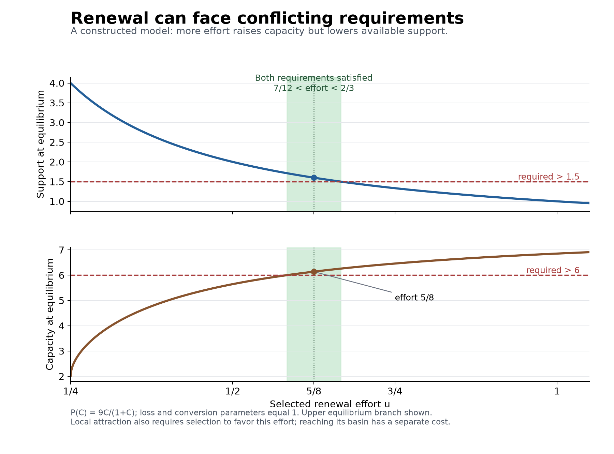

# Alignment as the Reproduction of Its Conditions

## An integrated theory with explicit optimality criteria

Specialist review synthesis, 5 October 2026. Research direction: Yongxu Ren. AI-assisted mathematical development and review. This document addresses the four outstanding tasks: deriving persistence from mechanisms, identifying the causal loop, demonstrating added predictive or intervention value, and making learning and revision operational.

The resulting proposal is a general architecture with conditional theorems, exact finite solution methods, and a specified validation program. Its empirical causal loop has not yet been demonstrated by the proposed experiment. Calling this a final validated theory, or a universally optimal scientific model, would exceed the results. The earlier [canonical representation formulation](../OPTIMAL-FOUNDATION.md), [mechanistic dossier](../FOUNDATION.md), and [unchanged original](../FOUNDATION-ALTERNATIVE-ORIGINAL.md) remain available.

The central claim is:

> Continuing an acceptable function under sustained loss requires continuing its enabling functions. Activity can change both those functions and the mechanisms that select, interpret, authorize, and reproduce subsequent activity. Durable alignment therefore depends on the joint continuation and justified revision of these mechanisms, subject to actual information, resources, participation, and time.

The first sentence supports necessity results where its physical and functional premises hold. The second identifies a causal architecture to be specified and tested. The third introduces an explicitly normative evaluation: continuation alone does not make a system acceptable. These statements have different warrants and must remain distinguishable.

## 1 The foundation is a process under situated questions

A process can be represented as a spatial field, a network, a population, or an interaction history. No fixed inventory of variable names is declared universally fundamental. The questions being asked identify affected parties or biological reference functions, interventions that are genuinely available, observations, protected consequences, deadlines, and amendment rules. These questions can be plural, incomplete, and disputed.

For a declared family of intervention questions \(\mathfrak C\), write \(R_{\mathfrak C}(h)\) for all required responses from history \(h\), including retained current information and permissions. Then

\[
h\sim_{\mathfrak C}h'
\quad\Longleftrightarrow\quad
R_{\mathfrak C}(h)=R_{\mathfrak C}(h').
\tag{I1}
\]

The quotient is the least informative exact deterministic representation: every other exact representation must distinguish different response profiles and therefore maps onto this quotient. Under the continuation conditions in the canonical formulation, it also admits a recursive observation-based update. This is a proved representation optimum, grounded in established predictive-state and controlled-equivalence theory. It is not a proof that the supplied causal response model is true.

The mechanism layer must therefore restrict those responses independently. It names how activity generates losses and provision, how practices are transmitted, how interventions are gated, and how consequences change later rules. A flexible transition kernel can encode these phenomena without explaining them. Explanation begins when measured mechanisms exclude alternative responses and survive withheld interventions.

Changing timescale can reveal previously hidden maintenance or selection. Changing the system boundary can reveal external suppliers. Neither operation justifies treating every transformation as differential selection. The proposed universal necessity concerns persistence under specified loss; whether every relevant actual organization satisfies that premise is an application question.

## 2 Persistence from mechanisms

### Necessary renewal across time

For an independently specified capacity \(C\), let

\[
\dot C=R-L,\qquad C(t)\ge C_{\min}.
\]

For every prefix \(t\le T\), acceptable continuation requires

\[
\int_0^tR(s)\,ds
\ge
\int_0^tL(s)\,ds-[C(0)-C_{\min}].
\tag{I2}
\]

This follows by integration. If cumulative indispensable loss diverges, finite inherited reserves cannot sustain the function indefinitely without provision, substitution, or a change in dependence. The requirement applies to every prefix, so favorable long-run averages do not excuse an earlier outage. A replacement that becomes useful after exhaustion is too late.

This necessity does not assign fictitious conservation laws to knowledge, trust, or authority. A stock interpretation must be justified. Some functions require logical permissions or joint competence instead; those enter through transition and feasibility conditions rather than being added as interchangeable quantities.

### A class in which practice selection creates or destroys persistence

Consider two transmitted renewal practices, with efforts \(u_H>u_L>0\), functional capacities \(C_H,C_L\), total \(C=C_H+C_L\), support \(E\), and high-effort share \(x=C_H/C\). Replacement inherits the practice producing it. A second channel copies the current expenditure-saving practice with response coefficient \(\kappa\). With conversion efficiency \(\eta\), decay rates \(\delta,\mu>0\), and production \(P(C)\), the resulting aggregate equations are

\[
\begin{aligned}
\dot E&=P(C)-\delta E-\bar u EC,\\
\dot C&=(\eta\bar u E-\mu)C,\\
\dot x&=(\eta-\kappa)E(u_H-u_L)x(1-x),\\
\bar u&=u_L+(u_H-u_L)x.
\end{aligned}
\tag{I3}
\]

This is derived from separate same-practice production and conservative switching events, not from an assumed social preference for renewal. The copying law is a substantive, testable premise: observers respond to immediate expenditure savings without fully crediting replacement production. It is not a claim about all learning or competition.

Assume \(P(0)=0\), and \(P\) is differentiable, increasing, strictly concave, and bounded, with the regularity conditions stated in [Mechanism mathematics](MECHANISM-MATH.md). Put

\[
m=\mu/\eta,\qquad
H=\max_{C\ge0}\{P(C)-mC\}.
\tag{I4}
\]

If \(P'(0)>m\), then \(H>0\). The critical effort is

\[
u_{\rm crit}=\frac{\delta m}{H}.
\tag{I5}
\]

For a pure practice of effort \(u\), positive equilibria obey

\[
E^*=m/u,\qquad P(C^*)-mC^*=\delta m/u.
\tag{I6}
\]

Strict concavity gives two positive roots exactly when \(u>u_{\rm crit}\). The lower root is a saddle and the upper root is locally attracting in the support-capacity subsystem. Equality is the nonhyperbolic threshold and must be treated separately.

For \(\kappa\ne\eta\), the locally selected boundary practice is high effort when \(\kappa<\eta\) and low effort when \(\kappa>\eta\). Its upper equilibrium is locally asymptotically stable in the full system precisely when that effort exceeds the critical value. The complementary practice-direction eigenvalue has the opposite sign. Protected floors add the separate requirements \(E^*>E_{\min}\) and \(C^*>C_{\min}\) if a neighborhood preserving strict margins is claimed.

The result concerns existence of a locally attracting positive equilibrium, not recovery from every initial condition. Depleted initial conditions can converge to collapse even when a positive attracting regime exists. Conversely, when cost-based copying favors a subcritical low-effort practice, the companion proof establishes global collapse for mixed initial populations under its strict assumptions. These are mechanisms producing different regimes, not an equilibrium defined to be sustainable.

For \(P(C)=9C/(1+C)\) and \(\delta=\eta=\mu=1\), \(H=4\) and \(u_{\rm crit}=1/4\). At \(u_H=1/2\), the positive equilibria have \(E^*=2\) and \(C^*=3\pm\sqrt7\). With \(u_L=1/10\), changing the copying response across \(\kappa=\eta\) can change resistance to invasion into collapse under the specified dynamics. This example and much of its rational-production analysis were already present in the earlier practice-transmission work; the concave-production class is an extension, not a rediscovery presented as a new foundation.

Increasing effort is not an unconditional optimum: equation (I6) lowers equilibrium support as effort rises, while the upper capacity root rises. Separate support and capacity requirements can therefore conflict. In the numerical production family above, the strict floors \(E>3/2\) and \(C>6\) give the exact selected-effort interval \(7/12<u<2/3\). The interior choice \(u=5/8\) gives \(E^*=8/5\) and \(C^*=(16+6\sqrt6)/5>6\). Effort \(u=1\) yields more capacity but violates the support floor. This is an operational design interval, not an instruction to maximize maintenance.

Changing \(\kappa\) is not a free governance intervention. An application must model the information, authority, participation, and resources that would implement and retain that change.

The figure shows the upper equilibrium branch of the constructed model, conditional on favorable practice selection. The shaded interval satisfies both strict floors. It does not establish safe access to that regime from a depleted initial state.

### How additional mechanisms join the result

Competence, observation, authority, willing participation, succession, and controller replacement can be included as interacting subsystems. The [composition result](COMPOSITION-AND-SCOPE.md) supplies a sufficient joint certificate: each actual local policy preserves its own operating region under the other regions; joint actions respect shared resources and permissions; the combined region satisfies the protected requirements; and the system starts in that region. Induction then establishes continued operation under the stated joint disturbances.

When rules change, the establishment transition must reach a certified region for the new rule before the previous support fails. Certifying each rule separately does not certify their succession. This explicitly addresses the meta level without postulating an ideal supervisor above it. External feedstock, available technologies, and the modeled repertoire of rule changes remain declared boundaries.

Deterministic attraction also does not establish indefinite stochastic survival. In a finite system with an absorbing failure state and a uniformly positive probability of reaching it in a bounded number of steps, survival probability tends to zero. The companion gives the elementary geometric bound. Applications must distinguish sure invariance, finite-horizon reliability, and long expected residence near an attractor.

## 3 The best feasible response under actual information

The operational optimum is conditional on a causal model family and explicit requirements. It should return a policy, a feasible region, or a certificate that the requirements cannot jointly be guaranteed. It should not return an imaginary action using information or authority that no participant possesses.

For a finite family of controlled models, retain the unresolved persistent model label and compatible hidden states in an information state \(I\), computed from the actual observation history. Include monitors for obligations, deadlines, resources, participation, and amendment versions. An intervention can be executed only if its enabling conditions hold; an attempted intervention that can be refused must include that consequence in its transition law.

Let \(S_t\) denote information states in which every still-possible state satisfies the hard requirements at stage \(t\), and let \(T_H\) encode the terminal obligations. Let \(\operatorname{Post}_t(I,a,o)\) be the compatible successor information state after the common action \(a\) and observed outcome \(o\). The finite-horizon robust viability recursion runs backward:

\[
\begin{aligned}
W_H&=S_H\cap T_H,\\
W_t&=\left\{I\in S_t:\exists a\in A(I),\quad
\operatorname{Post}_t(I,a,o)\in W_{t+1}\text{ for every possible }o\right\}.
\end{aligned}
\tag{I7}
\]

An empty successor is ignored as an impossible observation in this hard-guarantee recursion. Time, resources, and obligations are included in the information state and monitors. The quantifier order is essential: one action must work across the unresolved possibilities. Choosing a different action for each hidden true model would answer a different, easier question.

Induction proves that \(I\in W_t\) if and only if there is an admissible observation policy preserving the requirements from stage \(t\) through \(H\), including terminal obligations. Minimizing a stated resource cost over the retained actions yields an attained finite optimum. The [adaptive method](ADAPTIVE-OPTIMUM.md) gives the precise recursion, proof, implementation conditions, and exact witness. Its objective is resource expenditure subject to separately protected concerns, not an aggregate moral utility.

For finite information-state safety games, iteration to a fixed point gives the maximal region from which sure indefinite safety is possible. Bounded recurring service can be encoded by deadline counters, so freezing an institution need not count as success. This does not guarantee arbitrary unbounded liveness. Finite-horizon guarantees do not automatically extend to an unmodeled future, nor do they prove that a feasible policy will be selected and installed. Actual use of the certified actions is an additional condition, itself subject to the mechanism analysis in Section 2.

A central impossibility follows directly: if indistinguishable possibilities require incompatible immediate safe actions and no safe informative experiment is available before the deadline, no observation-based controller can guarantee the requirements. More intelligence or a better compression cannot remove missing information. Extra reserve, an earlier diagnostic, a reversible intervention, or a changed requirement can alter feasibility—but each changes the actual problem and must be charged accordingly.

The strongest common optimum is consequently a feasible policy set with explicit criteria for choosing within it. The [scope note](COMPOSITION-AND-SCOPE.md) separates this from minimal representation, experimental design, and selection of the scientific model itself. Their optima need not coincide.

## 4 Learning and legitimate revision

Unknown models cannot be made known by declaring their response profiles. The operational extension uses a finite, declared family, observation-based updates, and paid experiments. The persistent model label is retained so a calculation does not silently allow the world to switch arbitrarily between unrelated models at every step.

Exact support elimination is conservative: a model is removed only after an observation it deems impossible. A separate likelihood-based confidence procedure can remove plausible models with a controlled exclusion risk. The companion establishes an anytime bound under its fixed-model and likelihood assumptions. On the event that the true model remains, actions certified for the retained family preserve the stated requirements. The exclusion probability contributes explicitly to the failure budget; it cannot be relabeled sure safety.

This closes a finite operational learning problem. It does not supply a guarantee against unrestricted misspecification or arbitrary new environments. If the true process can change, the admissible changes, detection delay, fallback resources, and accumulated risk must be modeled. A stationary confidence theorem does not become a change-detection theorem by repeated use. Existing work on safe exploration and learnable viability already demonstrates the importance of these model and learning assumptions; these principles are inherited, not novel claims of this project. See [Moldovan and Abbeel](https://arxiv.org/abs/1205.4810) and [Heim and colleagues](https://proceedings.mlr.press/v100/heim20a.html).

Revision has three distinct objects:

1. **Model revision:** change beliefs about what interventions do, preserving the data and assumptions behind the old claim.
2. **Representation revision:** add distinctions required by new questions. If an old summary merged histories that the new question separates, no universal decoder can recover the erased distinction. Re-observation, retained raw evidence, or renewed inquiry may be necessary and can be costly or impossible.
3. **Commitment revision:** alter whose consequences count or what is acceptable through an explicit procedure. New commitments do not retroactively change recorded outcomes under previous commitments.

A finite amendment procedure can make participation, notice, refusal, and authorization conditions operational. Correct execution proves conformity with that procedure. It does not prove that the procedure is morally legitimate. Coercive outside options, suppressed interests, unrepresented people, and unequal ability to contest remain substantive normative issues. The theory must expose these choices rather than derive legitimacy from persistence, consent labels, or computational convenience.

When plural requirements conflict, the method should return infeasibility or a Pareto frontier. Any further choice requires an explicit priority, negotiated amendment, or justified tradeoff. A universal direction toward increasing every concern need not exist. Where a change improves all declared concerns while preserving the capacities for further correction, direction can be established without a universal scalar gradient.

## 5 Identifying the causal loop

The current empirical question is narrower than whether feedback exists somewhere. It concerns the route

\[
\text{verified consequences}
\longrightarrow\text{delivered maintenance}
\longrightarrow\text{operative successor capacity}
\longrightarrow\text{response under changed cases}.
\tag{I8}
\]

The existing design randomizes timely outcome disclosure before a maintenance choice, then randomizes access after the handoff package is sealed. It scores successors on independent cases and records burdens, non-maintenance, missing delivery, harmful inheritance, and nonresponse. That identifies effects of the specified assignments under consistency, randomization, measurement, and communication assumptions. It does not automatically identify mediation by the maintenance variable.

An exact counterexample sharpens the remaining test. Let \(A\) indicate disclosure, \(B\) access, \(M\) delivered content, and \(Y\) a successor outcome. Compare

\[
\begin{array}{lll}
\text{route model:}&M=A,&Y=BM,\\
\text{direct-channel rival:}&M=A,&Y=AB.
\end{array}
\tag{I9}
\]

Every ordinary \((A,B)\) arm has the same observed values in both models, including a positive factorial interaction. An independently enforced intervention on delivered content, holding \(A=B=1\) and setting \(M=0\), separates them: the route model predicts zero and the rival predicts one. Alternatively, an independently justified interface exclusion can rule out the direct path. Merely naming the observed maintenance variable does not do so.

The [identification specification](IDENTIFICATION-AND-VALUE.md) develops this strengthened design, its rival classes, and exact distinguishability limits. A real content intervention must be feasible, have its own cost and permissions, and retain any experiential side effects in the causal interpretation. Randomizing a label while changing several unmeasured features would not implement equation (I9)'s intervention.

Repeated succession extends the study over an explicit horizon. A successful first handoff does not demonstrate perpetual reproduction. The validation target is a measured mechanism with bounded transport claims, not universal affirmation from one positive experiment.

## 6 Added value and an optimal discriminating test

The general framework earns complexity only when restrictions chosen before observation improve a prediction, an intervention, or a useful impossibility diagnosis relative to credible simpler alternatives. Useful rivals include fixed maintenance, one-way inheritance, stock-only dynamics, fixed competence, and direct attention effects. A rival should not be weakened merely to ensure the integrated model wins.

For a finite family of models and feasible experiments, the companion poses a finite-budget design problem that maximizes the minimum pairwise total-variation separation of the labeled experimental outcomes. Its optimality is exact for that one-test randomization criterion and candidate family. It is not a theorem that this design minimizes every multi-sample error rate or every practical experimental cost. The experiment label is observed and retained; otherwise mixing can destroy the very separation being optimized.

If two models induce the same entire observation law under every permitted adaptive experiment, no statistic or experimental schedule using that interface can distinguish them. This impossibility is proved by induction on the history law. It identifies whether the remedy is more data, a different intervention, a changed observation interface, or a narrower claim. More repetitions of an observationally equivalent test cannot identify a missing causal route.

For this prospective comparison, model fitting and model testing use separate evidence. Fit shared quantities in a calibration regime, freeze the models and criteria, and score predictions under withheld interventions. Compare proper predictive scores and separately defined consequence errors at the experimental-unit level. Refit on held-out interventions only as a transparently new model version. Retain failed predictions rather than changing the contract after the outcome.

The feedback and rival models share the specified calibration history law. Enabling execution from the same original complete initial state changes 25-round retention by approximately 9.99 percentage points in the feedback model and zero in its rival. This is a constructed intervention contrast, not an observed institutional effect. The new exact design examples likewise validate logic and computation, not a real-world causal hypothesis.

## 7 What the four tasks now contain

| Task | Completed result in this synthesis | What remains an empirical or scope limit |
|---|---|---|
| Derive persistence from mechanisms | A concave-production class threshold, selected-practice stability, collapse and depletion cases; joint composition and establishment conditions | Identification of the actual production, transmission, observation, authority, and participation mechanisms in each application |
| Identify the causal loop in an actual system | Exact identification and nonidentification results; strengthened feasible-intervention specification | The prospective human handoff study has not been run; no new real-system causal demonstration is claimed |
| Establish added value | A criterion with a solved finite design example, credible rival comparisons, and explicit discrimination limits | Superior out-of-sample prediction and intervention outcomes in actual systems remain to be shown |
| Operationalize learning and revision | Exact finite information-based optimization, bounded-risk learning extension, and explicit amendment/information-loss rules | Unrestricted novelty, arbitrary drift, and independent ethical justification are not solved by these algorithms |

The distinction is not between theory that is complete in every respect and theory that has no value. The formal problems now have specified answers, witnesses, boundaries, and proof obligations. Two original requests are empirical achievements and remain incomplete until the observations exist.

The previous evidence record is preserved. The institutional reanalysis supports a bounded persistence result, with identification limitations; the authority-investment estimate was inconclusive; the microbial primary joint predictive criterion failed; the AI selector pilot failed its first intended prediction. See [the evidence dossier](../../../../experiments/integrated-correction/general-framework/reproduction-test/README.md) and the prior mechanistic dossier's evidence section. Neither the new mathematics nor successful constructed checks reverses those findings.

## 8 Scientific position and the proposed contribution

Predictive minimality, viability theory, evolutionary transmission, environmental feedback, organizational closure, causal identification, and compositional invariance are established research traditions. Existing work also explicitly models endogenous institutions: [Itao and Kaneko's 2025 study](https://doi.org/10.1073/pnas.2500960122) couples evolving decision functions with environmental dynamics and emergent norms. Therefore the broad claim that institutions and their selection conditions coevolve is not an original discovery of this program. [Weitz and colleagues](https://pmc.ncbi.nlm.nih.gov/articles/PMC5127343/) already analyzed game-environment feedback producing oscillating commons dynamics.

The defensible candidate contribution is the particular integration: distinguishing current acceptable performance from executable correction, from the selection and replacement of corrective mechanisms, and from the continued applicability and legitimate revision of their own evaluations. The framework connects these distinctions to measurable loss and provision, practice transmission, actual information, dated feasibility, and discriminating interventions.

The mathematical contribution here is a scoped extension and assembly of results, with explicit inherited foundations. Originality and scientific importance require external specialist assessment. Internal AI review and exact examples are preparation for that assessment, not substitutes for it.

The preferred final formulation is consequently an architecture that returns different regimes and interventions under different circumstances. It does not privilege finance, competition, centralized control, or a single goal. It can explain why locally selected behavior sometimes reproduces shared capacities and sometimes erodes them, while treating beneficial competition, failed cooperation, harmful institutional persistence, and justified endings as possible outcomes.

## 9 Specialist materials

- [Mechanism mathematics](MECHANISM-MATH.md): assumptions, concave-production proofs, protected floors, basins, and stochastic limits.
- [Adaptive optimum](ADAPTIVE-OPTIMUM.md): finite exact optimization, actual information, confidence updating, and amendment boundaries.
- [Identification and added value](IDENTIFICATION-AND-VALUE.md): causal estimands, competing routes, optimal finite experiment design, and evidence status.
- [Composition and scope](COMPOSITION-AND-SCOPE.md): joint continuation, switching, deadlines, and the distinct meanings of optimality.

These documents form one reviewable development. The package's check record reports which computational examples and document-integrity properties were actually verified. The theory's empirical universality and its practical superiority are not among those checks.

The [package index](README.md) links the exact checks, numerical illustration, internal reviews, and provenance records.
