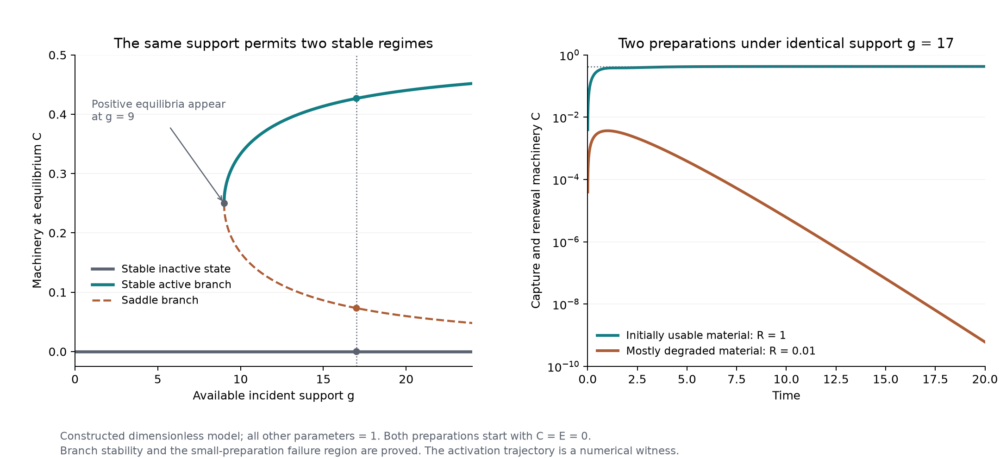

# Renewing access to supporting conditions

Research continuation for Ren, 5 October 2026. This develops the [supporting conditions theory](conditions-of-generativity.md) while preserving the earlier results. The advance is to make actual access to support depend on machinery that the activity itself builds and renews. A second construction shows how that renewal can continue through replacement by a structure with an additional function.

**The conditions for continued activity include the means of participating in its source of support.** An external resource can remain available while this means disappears. Conversely, supported activity can rebuild the means through which support becomes usable.

Our stronger working formulation is:

> Organization can produce and renew the relations through which supporting conditions become usable. Those enabling relations can continue, and sometimes acquire new functions, through a change of their material carriers.

Here a “relation” must have a physical meaning: a particular capture, conversion, retention, transport, or repair process. The claim becomes testable by specifying a transformation, measuring how an enabling structure changes its rate under fixed external conditions, and determining whether the resulting activity replenishes that structure. This avoids defining everything that continues as generative.

The formulation concerns maintained generativity. A transformation can produce something once without maintaining its own enabling conditions; a stable object can persist without doing either. A theory should explain these differences before trying to combine them in one measure.

The previous model supplied usable power directly. We now distinguish incident support from the capacity to capture it. Let \(R\) be usable material, \(C\) machinery, \(D\) degraded material, and \(E\) a usable-energy reserve. The total material is \(M=R+C+D\). Machinery both captures external power and uses the reserve to recycle degraded material:

\[
P_{\mathrm{captured}}=\eta I\frac CM=gC,
\qquad J=kECD,
\]

\[
\begin{aligned}
\dot R&=J-aR,&\dot C&=aR-bC,\\
\dot D&=bC-J,&\dot E&=gC-\ell E-\varepsilon J.
\end{aligned}
\]

Here \(I\) is incident power, \(0<\eta\le1\), and \(g=\eta I/M\). Captured power cannot exceed incident power. Machinery forms from usable material, wears into degraded material, and must be rebuilt. The material cycles while the usable-energy account has ongoing input and loss. This is a reduced model; the capture chemistry and assembly pathway are supplied assumptions, and the source remains a boundary condition. A fuller account would include the source and receiving surroundings as dynamical processes too.

This small change gives a consequential result: **the same constant external conditions can coexist with stable activity and stable inactivity.** In this model, loss of access remains locally stable at every finite intensity of incident support. A stable active regime also exists above a calculable threshold. Activity then helps maintain the machinery through which that activity receives its energy.

With all other dimensionless parameters equal to one, the positive equilibria appear at \(g=9\). At \(g=17\), the stable active regime has approximately \(C=0.427\). Inactivity is also stable. These are proven local stability statements; the threshold locates positive equilibria, and does not establish every possible long-term behavior.

We can go beyond comparing prepared equilibria. Starting with usable material but no machinery or reserve, the equations make machinery form first and captured energy accumulate afterward. Under \(g=17\), a numerical trajectory beginning with all material usable approaches the active regime. Under the same incident support and with the same total material, starting with only one percent usable material and the rest degraded provably loses activity. The small-preparation failure follows from an invariant-region bound, not only from a simulation.

The left panel gives equilibrium branches. The right panel illustrates formation and failure; both preparations start with no machinery or energy reserve. The stable active branch has a basin of attraction, but its full boundary has not been derived. The saddle branch is not a single machinery threshold that decides every starting state's outcome.

**Maintaining an organization and bringing it into existence are different problems.** The external conditions can support an already functioning renewal relation without reliably assembling that relation from every preparation. That distinction belongs to the current situation: usable material, degraded material, machinery, and reserves record the consequential effects of earlier events. No separate dependence on inaccessible history is needed for these equations.

Complete loss can also differ from temporary shortage. In this model, if both usable material and machinery are absent, more incident power alone cannot restore them. Every available route to either requires the other. The related chemical-network concept is a *siphon*: a set of species whose complete absence stays invariant because producing a member requires a member. [Shiu and Sturmfels, Proposition 2.1](https://people.tamu.edu/~annejls/SiphonsInCRNs.pdf).

This is conditional on the supplied reaction repertoire. A seed, an independent assembly route, or another coupling changes what can restart. Even a weak omitted pathway can turn strict impossibility into a question of rate and waiting time. This gives a concrete way to investigate a missing possibility: inspect which claimed impossibilities depend on having omitted every route across a boundary.

There is an experimental example of activity modifying a material interface. Adamala and Szostak studied model protocells in which an encapsulated catalyst produced a membrane-associated peptide; this affected fatty-acid retention and promoted vesicle growth. The catalyst was supplied and not reproduced; the experiment establishes a coupling between internal chemistry and membrane growth. Some growth occurred at other vesicles' expense, and permeability to the tested small molecule and oligonucleotides did not increase. [Primary study](https://doi.org/10.1038/nchem.1650).

**Continuation can pass through a change of form.** Split the machinery into an old structure \(X\) and a successor \(Y\). Let both perform capture and recycling, while new assembly produces \(Y\). Their sum \(C=X+Y\) then follows exactly the same renewal equations. At an active equilibrium there is an exact solution:

\[
X(t)=C_*e^{-bt},\qquad
Y(t)=C_*(1-e^{-bt}).
\]

The amount of the old structure tends to zero, yet total machinery, captured power, reserves, and renewal activity stay constant. To make the two forms functionally different, give only \(Y\) an additional catalytic ability to convert a supplied substrate \(S\) into \(T\). This transformation is initially inactive and becomes active as the successor forms. Its substrate is finite and its conversion is assumed downhill; no perpetual extra work is being claimed.

The construction establishes that renewal can persist while a further capacity becomes available. It assumes the successor's assembly route, equal renewal costs, and additional function. It therefore does not explain the invention of that function or open-ended novelty. Those remain tasks for a stronger theory.

This also connects to our earlier work on missing distinctions. A description that tracks only total machinery predicts the common renewal activity throughout the succession, yet misses the changing ability to transform \(S\). Whether two situations are equivalent depends on which consequential transformations the description must explain. A constant aggregate can conceal a newly available possibility.

The emerging foundation has a precise conditional form: **available differences can support activity; activity can rebuild access to those differences; and this renewal can pass through changing structures.** The whole supporting relation determines whether this happens. Dependence on wider conditions is present throughout the account.

There is still no proof here that reality universally increases generativity or moves toward 善. Greater local capture can consume conditions needed elsewhere. The next substantive question is when renewal also preserves or expands the wider conditions under which other renewal relations can form. Answering it requires explicit effects on shared sources, sinks, substrates, and assembly routes. Local survival alone cannot answer it.

The [mathematical companion](renewing-access-to-support-mathematics.md) gives the equilibrium and stability proofs, the preparation bound, and the exact succession construction. The [evidence record](renewing-access-to-support-evidence.json) separates proven results, numerical illustrations, supplied assumptions, and source scopes.
