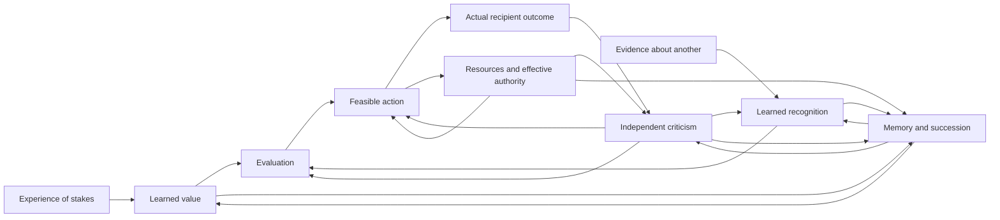

# The formation and renewal of concern

**A candidate theory of how another being comes to matter, how concern widens, and how it remains answerable to its consequences.** 5 October 2026. AI-assisted theoretical development for Ren, extending 生生不息论 (generative existence) and the unified foundation.

## 1. The answer and its scope

Another being's condition becomes something that matters within a process when differences in that condition enter the process's evaluation of what to do—not only its prediction of what will happen. Other-directed concern specifically gives the prospect of the other’s benefit weight in favor of action, and their harm weight against it, apart from expected private consequences. The actor’s understanding of benefit can still be wrong. Concern learns when experience changes that evaluation and the understanding through which it operates. It widens when relevant reasons and learned value can travel beyond the identities and situations in which they first arose. It becomes wiser when its judgments remain correctable by what actually happens to those affected. It sustains itself when the relations, resources, memory, authority, and successor capacities enabling these achievements are themselves renewed.

This is the proposed organizing principle:

> **Concern is responsiveness that treats another’s benefit as a reason to act and their harm as a reason for restraint. Wise concern can correct its own interpretation and conduct. Regenerative concern also maintains the conditions through which that correction and care can continue.**

These are distinct achievements. A process can care and misunderstand; understand and not care; care accurately but lack power; act effectively and exhaust its support; persist while excluding some recipients. The theory explains their connections without treating any one as sufficient for all the others.

We can establish a complete conditional account of a specified mechanism: declare its primitive capacities and environment, show concern forming from initially zero learned coefficients, derive its action and widening thresholds, specify actual outcome criticism, and account for continuing operation and succession. The specimen below does that. We cannot yet establish that it explains every origin of concern, that every relevant natural system implements it, or that reality inevitably selects it. Those are additional causal and empirical claims.

“Complete” therefore has two standards here. **Mechanistic completeness** means no essential update, action, payment, or transmission step in the stated specimen is left unspecified. **A complete general theory** would additionally require justified coverage of alternative mechanisms, biological and institutional evidence, the origin and prevalence of its enabling architectures, and an adequate account of contested moral reasons. The first is attainable within a stated boundary; the second remains a research program. This distinction allows constructive work without presenting a candidate as a settled universal discovery. Closure is relative to the declared interfaces: the implemented critic revises action efficacy. Origin and revision of the feature repertoire, evaluative routing, and moral scope appear in the broader architecture as explanatory obligations; the scalar specimen does not yet generate them.

## 2. What it means for something to matter

Four senses must remain distinct.

| Sense | Meaning | What does not follow from it alone |
|---|---|---|
| Causal relevance | Changing a condition changes a process's trajectory. | That the process treats the change as good or bad. |
| Functional stakes | A change improves or damages specified capacities, needs, or continued functioning. | That the affected system experiences that change. |
| Experienced significance | A subject feels a condition as pleasant, painful, threatening, meaningful, or otherwise significant. | That observers correctly recognize it or take it into account. |
| Normative standing | There are reasons to take the being's interests or claims into account. | That any existing decision system actually does so. |

The formal model addresses **functional other-directed valuation**. A recipient’s predicted benefit counts in favor of action and predicted harm against it, even after represented private returns, reputation, and retaliation are held fixed. This direction distinguishes concern from exploitation or delight in another’s harm. This is a counterfactual property of the model. One generous-looking act does not uniquely identify the actor's motivation; several different evaluations can select it.

A single cell's regulation, a person's felt compassion, and an institution's enforceable attention to someone are not interchangeable. At an institutional level, another can matter through records, hearings, duties, budgets, and rights of correction even when no single official feels strong empathy. Conversely, a sympathetic official can work inside a process that prevents their concern from affecting decisions. The proper unit of analysis is the whole effective route from stakes to consequences.

For organisms and persons, identifying relevant stakes requires domain evidence and attention to their own perspective. For unfamiliar systems, neither complexity nor persistence alone establishes felt welfare. This theory does not solve consciousness by calling every error signal suffering.

## 3. The architecture: where each achievement happens

Let the joint state contain the affected beings' conditions, the actor's predictive and evaluative representations, available actions, resource stocks, retained records, revision procedures, and successor carriers. At each step, the actual process changes that joint state. Its boundary includes declared environmental inputs; it is not an isolated universe.

The arrow from action to resources is contingent: some actions renew their support, some consume it, and some redistribute it. The diagram represents possible causal dependencies, not an assertion that every arrow is beneficial. The equations below specify one concrete implementation; [the evidence and conceptual analysis](conceptual-evidence.md) examine alternative pathways and limits.

Six questions make the architecture inspectable:

1. **Acquisition:** what teaches that a condition has significance?
2. **Recognition and transfer:** what connects that learned significance to someone differently situated?
3. **Choice and delivery:** when does the connection change action, and does the action help?
4. **Criticism:** what can show that the recognition, purpose, or intervention was mistaken?
5. **Maintenance:** what pays for attention, action, records, and the ability to revise?
6. **Succession:** what remains effective when the current carrier is replaced?

The route can begin in attachment, dependence, shared activity, observation, testimony, instruction, deliberation, or other histories. The self-experience route below is a constructive sufficient mechanism, not a claim that every instance of concern develops through consciously imagining oneself in another's place.

## 4. How concern can be learned rather than inserted

The earlier exploration assigned a fixed concern weight. We now make that effective weight a product of two learned quantities:

\[
\boxed{v_{j,t}=w_t g_{j,t}.}
\]

Here `w` is learned significance of an adverse feature, and `g_j` is learned alignment between that feature and recipient class `j`. Both begin at zero. The product is a local scalar specimen, not a proposed measure of all love, justice, or wisdom.

Assume an original self-experienced adverse event provides an intrinsic teaching signal `β>0`. Subsequent learning can use a calibrated retained trace; maintaining concern need not repeatedly cause suffering. With rehearsal, leakage, and independently observed correspondence evidence, use

\[
w_{t+1}=(1-\delta-\eta)w_t+\eta\beta,
\qquad
g_{j,t+1}=(1-\kappa)g_{j,t}+\kappa G_j.
\]

The domain is `η>0`, `δ≥0`, `δ+η≤1`, `0<κ≤1`, and `0≤G_j≤1`. The correspondence target `G_j` comes from independently warranted structural or role evidence; it is not defined as whatever produces helping. In this deterministic specimen, targets are stable and exact. Noisy or misleading targets require additional analysis.

Let `r=1−δ−η` and `W=ηβ/(δ+η)`. Starting from zero,

\[
w_t=W(1-r^t),\qquad
g_{j,t}=G_j[1-(1-\kappa)^t],
\]

so

\[
\boxed{v_{j,t}=G_jW(1-r^t)[1-(1-\kappa)^t].}
\]

The other-directed coefficient is acquired: it was not positive initially, and the learner was not rewarded for protecting this recipient. But the construction has an indispensable architectural premise: **aligned features enter a shared evaluation route**. A learner can instead recognize the same correspondence in its world model while allowing only self-related features to affect evaluation. The latter can understand perfectly and transfer no concern.

The intrinsic teaching signal, learnability, valid correspondence evidence, and shared routing are legitimate explicit primitives for this conditional model. They are not conclusions smuggled out of the recurrence. Explaining why these primitives arise together in particular organisms, relationships, or institutions is a further causal task. A theory need not derive every primitive from nothing; it must say where its explanation starts.

## 5. Why accurate understanding cannot force care

There is an exact identification obstruction. In a linear evaluator with unrestricted real parameters, consistent training data constrain parameters by `Xθ=y`. All solutions predict the same value for a new feature `x` **if and only if** `x` lies in the row span of `X`. Otherwise a null-space change preserves every training prediction while changing the new evaluation. [The learning appendix](learning-formal.md) gives the proof and the qualification for bounded parameters.

A simpler example is decisive. Train on the actor's own injury. One architecture values the injury feature wherever it occurs. Another values it only when the actor is the injured party. The two agree on every self-training example, including arbitrarily many examples, and disagree about another's identical injury. Both may have equally accurate world models.

The same issue arises when all training recipients belong to one familiar group: “this kind of harm matters wherever it occurs” and “this harm matters only inside our group” can fit the same observed acts. Additional training diversity, an explicit generalization principle, or reflection can distinguish them. More examples inside the unchanged boundary need not do so.

This establishes a limit on inference, not the impossibility of learning concern. Shared representations can support transfer; heterogeneous environments can favor accurate cross-context prediction; social practices can cultivate broader reasons. Each claim needs its own evidence and scope. No distribution-free argument shows that broader transfer is always more accurate, and no improvement in prediction alone proves moral progress.

## 6. When newly learned concern changes action

First consider a recipient who suffers harm `H>0` unless protected. Perfect protection costs `c`; ignoring the harm costs the actor `d`; evading its private consequences costs `e`. Both ignoring and evading leave the recipient harmed. Put `b=min(d,e)`.

When all actions are feasible and affordable, their evaluated burdens are `c` for protection and `b+v_t H` for the best unprotected action. Thus

\[
\boxed{\text{unique protection}\quad\Longleftrightarrow\quad v_tH>c-b.}
\]

Equality is a tie. When `c<b`, private incentives already favor protection, so the case does not demonstrate newly learned concern.

Under the learning conditions above, finite acquisition of a strict protective preference occurs **if and only if**

\[
\boxed{GWH>c-b.}
\]

The proof is convergence from below of the two learned factors. The criterion separates recognition, learned valence, stakes, action cost, and private alternatives. With `β=2`, `η=1/2`, `δ=1/10`, `κ=1/4`, `G=4/5`, `H=10`, `c=6`, and `b=1`, the effective concern is initially zero, remains below the action threshold at the first two updates, and crosses it at the third. The appendix verifies this exactly.

For finitely many separable recipient classes with stable parameters and continued teaching, the protected set grows toward precisely those classes satisfying `G_j W H_j>c_j−b_j`. This is a conditional widening theorem, with an exact ceiling. It does not cover arbitrary unknown classes, collective resource conflicts, or changes in what genuinely benefits them. A single uniform date for infinitely many classes does not follow from a finite crossing for each one.

The earlier bypass result also remains: increasing the harm returned privately to the actor can induce cheaper insulation instead of protection. Shared vulnerability can create incentives for care, but can also create incentives to escape accountability. Direct learned concern is one possible route beyond that limitation.

## 7. Widening recognition is not creating someone's standing

The recipient's standing does not begin when an observer learns to care. Nor should a recipient lose standing because the observer lacks a familiar feature, emotional resonance, a shared body, or a prospect of repayment. The model describes an acquisition channel; it does not determine the limits of legitimate concern.

The ethical core retained from the unified theory is a public commitment: suffering, agency, and worthwhile futures count as reasons, and identity alone does not erase an otherwise relevant reason. In logical form, if a reason is accepted for a condition and relevant properties remain the same under a change of bearer, then an evaluator committed to bearer-independent relevance must preserve that reason. This conclusion follows from the commitment and the relevance specification. It does not follow from survival, physical symmetry, or the learning equations.

Differences in need and context can justify different responses. Equal standing does not require identical treatment, identical burdens, or helping everyone in every conflict. Distinct relationships can also create additional duties; the theory does not settle their priority by deleting other claims.

This gives reflective learning a concrete task: expose exclusions that rely only on familiar identity; test claimed relevant differences; revise categories when recipients' testimony and circumstances contradict them; and distinguish someone's ends from the observer's comfort or convenience. It can alter the evaluation architecture, rather than merely increasing a weight inside an unchanged one.

Such revision remains a normative and social achievement whose implementation needs explanation. A scripted learner does not acquire the authority to decide every contested moral question merely because its updates converge. The proposed theory combines causal explanation of concern with an explicit, revisable defense of its ethical scope.

## 8. How concern learns to help rather than merely to feel successful

Add a learned efficacy estimate `z`. Let the true fraction of harm prevented by an intervention be `Q`. For the favorable regime, `0<Q≤1`. A repair attempt costs `a`; failed repair also leaves its share of the private unprotected cost. Estimated burdens are

\[
J_{\rm unprotected}=b+gwH,
\qquad
J_{\rm repair}=a+(1-z)(b+gwH).
\]

Hence the exact strict-choice condition is

\[
\boxed{z(b+Hgw)>a.}
\]

This reduces to the earlier threshold when repair is perfectly effective. Actual recipient harm after chosen repair is `(1−Q)H`; estimated value and actual outcome must never be conflated. Choosing `a>b` ensures that, in the favorable parameter domain, private benefit alone cannot explain the repair choice.

The efficacy learner updates by `z^+=(1−γ)z+γY`, with `0<γ≤1`, where `Y` is an independently measured fraction of harm prevented. In the specimen, a paid controlled comparison supplies `Y=Q`. Baseline identification, probes, measurement, compensation, and recipient burdens are part of the implementation. The comparison is not a free oracle. In the base specimen it continues on its declared schedule even when current low confidence withholds the ordinary repair; otherwise no new evidence might arrive. Separate validation recipients can bear additional harm. The appendix therefore records their outcomes separately from ordinary recipients and from the resource fee. Lower harm in ordinary operation alone does not establish lower total harm.

A critic reading only the observer's distress can learn the wrong target. Suppose concealing a distressing signal costs less than helping and both make the observer feel relieved. A cue-based critic can reward concealment while the recipient remains harmed. That system can learn, become internally consistent, and remain solvent. None of those achievements makes its conduct caring in the recipient-directed sense.

An outcome channel that distinguishes concealment from benefit changes the inference. So can the recipient's testimony, provided the process can hear it and it can effectively challenge action. Testimony is evidence, not an infallible sensor; suppression and strategic distortion remain possible. Good institutions need multiple routes for noticing errors and actual authority to revise decisions.

Criticism can properly decrease intervention. If paid valid probes show a formerly favored repair worsens harm, then its estimated efficacy falls and eventually overturns the repair preference under the appendix's bounds. Increasing concern while preserving a false intervention model can instead amplify harm. Wisdom is therefore not monotonic growth in any single coefficient.

The critic also needs criticism. A fixed schedule can keep exposing validation recipients to a harmful intervention after ordinary deployment stops. A separate protective gate in the appendix suspends both deployment and further active tests when a valid exact assay reports nonpositive efficacy. This leaves the stationary favorable theorem unchanged and stops the harmful testing sequence after its first valid warning. It cannot undo the initial exposure; acceptable pilot burdens, authority, and prefunding remain requirements. Noisy evidence needs its own decision rule, and later reopening requires actual new grounds rather than free knowledge.

## 9. Concern must carry its own conditions of correction

Learning and action require attention, time, energy, records, instruments, and permission. Let `C_k` be every cost that must be paid before step `k` returns resources, and let `R_k` be the actual receipt afterward. With stock `B_k`,

\[
B_k\ge C_k,\qquad B_{k+1}=B_k-C_k+R_k.
\]

The resource cost includes rehearsal, recognition, causal probes, any compensation, selected actions, common upkeep, record maintenance, and succession. Recipient harms and other nonfungible burdens require a separate outcome ledger: paying compensation does not make them disappear. Omission of an implementation expense narrows the financing claim accordingly.

For a repeating `m`-step regime, set `P_j=Σ_{i<j}(R_i−C_i)` and `E=P_m`. The exact cash requirement for indefinite operation of that schedule is

\[
\boxed{E\ge0\quad\text{and}\quad B_0\ge \max\bigl(0,\max_{0\le j<m}(C_j-P_j)\bigr).}
\]

The first condition prevents cumulative depletion; the second funds every payment before its return. Positive total value or average income does not pay an early bill. A finite learning phase must also satisfy every prefix requirement and leave enough stock for the continuing regime. The appendix proves these statements and checks concrete financed and unfinanced cases.

Continued receipt is a real dependency. Some care protects the people, ecosystems, or cooperative practices that produce future support. Some care has no compensating productive return and requires funded sharing or other provision. Both can be warranted. The standing of a child, a dependent adult, an animal, or an otherwise powerless recipient is not conditional on a profitable return to the helper.

A self-maintaining regime means its declared activities and environment jointly renew the needed capacities. It does not mean energy or resources appear without an input. The productive-coupling extension in the dynamics appendix makes one such return depend on maintained capacity while keeping the physical throughput assumption explicit. This is an optional causal route, not a moral test of who deserves care.

## 10. What survives succession

A concerned individual can disappear while their practice survives; a celebrated ethical tradition can survive as text while losing its capacity to correct anything. We must track effective capacities, not only names or records.

Let a generation contain `m` paid learning intervals. Each learned coordinate `x∈{w,g,z}` follows `x^+=r_x x+A_x`. At handoff, only fraction `t_x` is retained. The parameters are those already defined: `r_w=1−δ−η`, `A_w=ηβ`; `r_g=1−κ`, `A_g=κG`; `r_z=1−γ`, `A_z=γQ`. Take `0<t_x≤1` and the favorable stationary case. If `S_m(r)=1+r+⋯+r^{m−1}`, the attracting generation-start value is

\[
\boxed{x_*={t_xA_xS_m(r_x)\over1-t_xr_x^m}.}
\]

Decisions in this specimen occur at the start of each operating interval, before its refresher update. The least learned capacity in a mature generation is therefore immediately after succession. From all three coefficients initially zero, eventual strict preference for repair at every operating phase occurs **if and only if**

\[
\boxed{z_*\bigl(b+Hg_*w_*\bigr)>a.}
\]

Actual protection additionally requires true positive efficacy, feasible authority, valid paid updates, and the funding conditions. The theorem is eventual: early formation can include unprotected outcomes. It gives no guarantee of safety from the untrained starting date. A refresh-before-decision policy or protected bootstrap could change that fact, but must be supplied and financed.

This result joins formation and retention in one model. More frequent teaching can compensate for some forgetting; sufficiently lossy transmission can defeat an otherwise strong mature policy. Maintaining average exposure alone is insufficient if unattended gaps become arbitrarily long. The learning appendix gives a sequence whose teaching frequency tends to one but whose occasional memory losses still defeat every positive protection threshold.

This scalar succession model assumes that the specified feature map, evaluation route, audit access, and update rules are faithfully reinstalled at their accounted cost. It does not derive their institutional or evolutionary reproduction from loss of the weights alone.

The functional content worth passing on includes evidence of failure, ways to inspect recipients' present circumstances, resources, permissions to challenge inherited practice, and means of replacing the carrier. Copying yesterday's conclusion is not equivalent to preserving tomorrow's capacity to judge.

## 11. A precise conditional closure claim

The combined specimen supplies the following pieces, with their assumptions visible.

| Component | Constructed or derived here | Still supplied at this level |
|---|---|---|
| Significance | A predictive adverse-value coefficient learned from zero | Intrinsic teaching valence and a retained original trace |
| Recognition | Alignment learned from zero; feature-class transfer | Valid evidence and the class/feature repertoire |
| Concern | Product of learned significance and recognition | Shared evaluative routing rather than identity gating |
| Protective conduct | Exact choice threshold and actual harm effect | Available actions, feasible authority, and true efficacy |
| Correction | Efficacy revision from paid recipient outcomes; reversal of harmful intervention | Identifiable comparison, audit access, and installed schedule |
| Widening | Exact protected-class ceiling under sustained learning | Coverage of relevant classes and joint affordability |
| Persistence | Every-prefix financing and paid lossy succession | Continuing physical support and preservation of the specified procedures |
| Ethical adequacy | Explicit reasons, standing, plural constraints, and contestability | No unique moral order or full conflict-resolution theorem is derived |

Under those premises, the model is causally executable and mathematically closed for its stated variables: initially absent learned concern can form, change decisions toward actual benefit, widen over a specified class family, correct a false action belief, and remain operational across generations. The harmful-change correction is a separate regime with its own transient; it is not smuggled into the stationary guarantee.

This establishes **possibility with exact conditions and failure boundaries**. It does not estimate how often those conditions co-occur in nature. No global optimum is claimed. Costs, uncertain recipient interests, heterogeneous needs, and legitimate conflicts prevent “largest care weight” from being a general optimum. A proposed institutional application must identify its feasible alternatives and evaluate actual effects, burdens, voice, reversibility, and continuity together.

## 12. Relationship to the evidence

Primary research gives partial footholds, not validation of the whole chain. [The evidence memo](conceptual-evidence.md) distinguishes learned shifts in valuation of a trained target, helping shaped by social interaction, persistence after reward withdrawal, and reflection across disagreement. It records what each study actually tests and where generalization remains unshown.

A particularly relevant artificial-agent precedent is Yoshida and Man's **Homeostatic Coupling for Prosocial Behavior**. Its simulations distinguish observing another's state from coupling that state to the actor's drive, and learn a self-state decoder that is applied to another under shared encoding assumptions. Crucially, the other-directed drive weight is supplied as `0.5`. This supports the importance of separating representation from evaluation; it does not show that concern universally emerges from prediction. The present construction learns an effective coefficient while likewise declaring its routing premise. The architectures and linear mathematics have established precedents; no priority claim is made. [Primary preprint, 2025](https://arxiv.org/html/2506.12894v1).

No new human, animal, or deployed-AI experiment was performed here. Exact arithmetic checks corroborate specified equations and examples; they are neither empirical evidence nor substitutes for the general proofs.

## 13. What would test or defeat the proposed bridges

The next research target is not another unconstrained illustration in which helpful behavior is rewarded by definition. It is a set of discriminations with declared scope.

| Bridge | Discriminating comparison | Evidence against the bridge in the tested domain |
|---|---|---|
| Recognition to valuation | Equal world-prediction accuracy; shared versus identity-gated evaluation | Accurate transfer of predictions without costly recipient protection |
| Familiar to unfamiliar recipients | New identities and powerless recipients, not just new scenarios for an old target | Benefit confined to familiar or rewarding targets |
| Concern to benefit | Equally relieving the observer by masking or by actual assistance | Persistent choice of masking when recipient benefit is separately measurable |
| Concern to corrigibility | Credible evidence that the favored intervention fails or harms | Concern remains high while ineffective or harmful conduct resists revision |
| Maintenance to continuity | Paid versus unavailable rehearsal, audit, and handoff; actual resource accounts | Claimed continuity disappears when omitted costs or succession losses are counted |
| Broader reasons to justice | Relevant differences examined with recipient challenge and refusal | Wider declared scope paired with silenced recipients or imposed harm |

A concrete study should predeclare a population or system class, a time horizon, outcome measures, treatment assignment, and how uncertainty will be evaluated. Its main comparison can test whether independently measured gains in cross-position recognition increase costly protection of untrained recipients who cannot reward or punish the actor. It must separately measure predictive improvement, action efficacy, private relief, and what survives withdrawal of the training context. The appropriate sample size depends on the chosen task, variance, and minimum effect of interest; none is invented here.

Failure would narrow the proposed bridge, not erase observed local kindness. Success would support a scoped mechanism, not establish universal ethical direction. Rival pathways—including attachment, explicit moral instruction, common-interest coordination, and institutional duty—must be measured rather than mislabeled as the same mechanism.

## 14. The place of this theory within 生生

The unified foundation says that activity changes the conditions of further activity. This continuation adds an account of how **another center's conditions** can enter that recursive process as something to attend to, learn about, act for, and remain answerable to.

The connection to 良知 (conscience) is a proposed interpretation: an acquired and revisable responsiveness through which another's situation can interrupt self-enclosed evaluation and reshape conduct. The connection to wisdom is the ability to examine whether that interruption was understood and acted upon well. The connection to 生生 (continuing generation and renewal) is maintaining both recipients' possibilities and the means of further correction, including across changes of carrier.

The causal story and ethical commitment belong to one natural and social world, but their warrants differ. Selection can explain why a capacity spreads without proving that its exclusions are right. A publicly defended reason can justify protection without proving that selection will finance it. Their relation is a problem for the theory to explain, not a gap to cover with one word such as “evolution.”

The strongest warranted foundation is now more specific:

> **Another’s condition comes to matter when it changes what a process treats as worth doing. It becomes an object of concern when the other’s benefit counts in favor of action and their harm against it. Concern becomes wiser through answerability to actual affected lives; it becomes regenerative through renewal of the capacities, relations, and material support that keep such answerability effective.**

This is a coherent candidate theory with constructive mechanisms, scoped proofs, and exposed failure conditions. Whether these mechanisms tend to assemble, broaden, and reproduce across reality remains open. That question is now separable into things we can derive, things we can measure, and commitments we must defend.

## Reading and verification

[Start here](START-HERE.md) · [Learning proofs](learning-formal.md) · [Paid dynamics and succession](dynamics-formal.md) · [Conceptual and primary-evidence analysis](conceptual-evidence.md) · [Claims and limits](CLAIMS.md) · [Research and review record](RESEARCH-RECORD.md).
