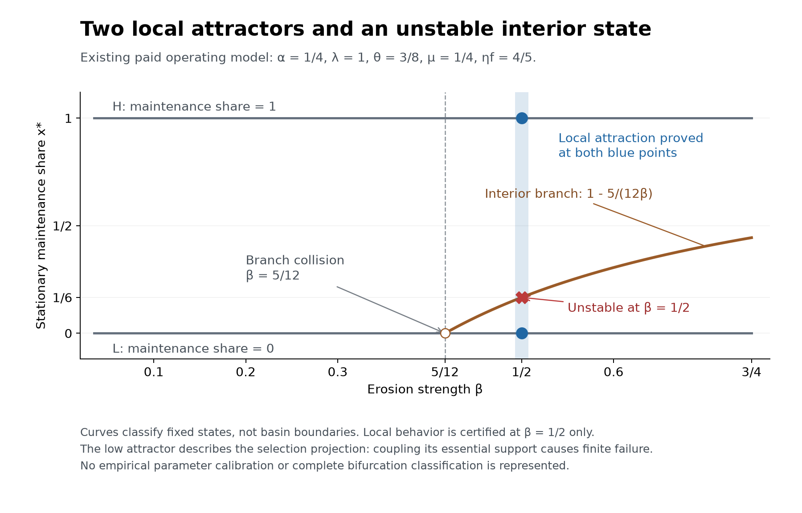

# 市场与互联网：生成、退化及纠正的实际历史

2026-10-08。AI 撰写，回应 [Ren 的现实检验纠正](../../../../sources/15-codex-theory-conversations/2026-10-08-generative-alignment-priority.md#markets-internet-and-degeneration)。本轮完成两项历史事件的主来源核读、关系对应、竞争解释及理论修订。已有市场模型的条件证明直接复用；这里没有新增数学命题、实验、独立验收或总体效应估计。

## 1. 这次纠正改变了什么

不能把“尚无新实验”写成“尚无现实检验”。市场和互联网已经包含共同创造、依存形成、规则改变、实际损失及纠正的连续历史。它们能够检验我们的解释，并揭示解释遗漏，不只是给完成后的理论配例子。

[已有市场研究](../../../../theories/shengsheng-buxi-generative-existence/unified-2026-10-05/MARKETS-AND-GENERATIVE-REGIMES.md)与[元吸引子的权力表述](../../../../theories/meta-attractor/README.md#the-power-formulation-2026-10-02)已经指出：局部成功可以改变后来的选择条件，并与共同条件受损并存。本轮推进的是这些关系的**实际对应与可区分后果**，不重新发明方向、重做合成模拟，或把所有现场材料降格为有待实验替代的轶事。

上一轮[关切内容形成候选](../../../../theories/shengsheng-buxi-generative-existence/unified-2026-10-05/ETHICAL-LEARNING.md#concern-content-acquisition)仍有其范围。但眼前的连接不应仅表述成“更多人怎样学会关心”：实际组织也可能听见损失、懂得依存，仍然保留使损失持续的规则。此时必须追问哪些后果能改变谁的决定，谁能保留或撤销纠正渠道。

## 2. Enshittification 在理论中的位置

[Doctorow 2023-01-21 的原文](https://pluralistic.net/2023/01/21/potemkin-ai/#hey-guys)将 enshittification 描述为平台先吸引参与、再利用锁定改变利益分配的过程。这提供一个已有的具体机制候选；其普遍必然性和最终死亡叙事不随术语一起接受，也不充当本研究的独立事实验证。

**这里将 enshittification 解释为 degeneration 的一种制度性形态：共同活动形成的连接、能力和依存，被转化为少数位置改变后续条件的支配力；这种改变使其他参与位置的继续创造、选择或纠正能力受到实际侵蚀，并可通过既有优势而延续。** 这是理论解释，个案是否完整实现它要逐项查证。

起点是同一活动史中形成的关系：内容生产、阅读、维护、开发、连接与经营相互形成条件；平台运营、用户、开发者等是其中不同的参与和控制位置。共同形成既不等于贡献相同，也不预先判定全部控制权归谁。整体亦不意味着公司、国家或研究者有权代表一个总利益。

诊断不能循环使用“坏了，所以退化”。先在不用 generative/degenerative 标签的情况下，分别记录：可继续的活动、实际可用的功能与替代、承担的费用与劳动、拒绝和迁移的条件、提出异议以及改变规则的实际权限。再比较损失、支持成本和替代路径，依据已明示的 G0/J/E 作规范判断。数量更多、体验更差、收费更高、经营者更富，都不能独自完成判断。

## 3. Reddit／Apollo：经营增长与路径损失可以同时发生

| 时间与材料 | 直接支持的事实或当事方主张 | 仍不能据此断言 |
|---|---|---|
| Reddit 2023-06-15 发布、06-30 更新的[官方说明](https://redditinc.com/news/apifacts) | 公司公布 7 月 1 日起高用量第三方应用按每千次调用 0.24 美元收费，以基础设施及机会成本、自我维持解释政策；同时列出免费工具、无障碍豁免与计划继续的应用 | 每项报价等于独立核定成本；一切第三方活动都被关闭；收费本身即不正当 |
| [Apollo 的开发者主页](https://apolloapp.io/) | 记载 2023-06-30 停止服务，并将关闭归因于突然提高的 API 价格 | 开发者说明是无利害关系的因果审计；其他实现无法替代全部功能 |
| Reddit [2024 年 S-1/A，Trends in Monetization Metrics](https://www.sec.gov/Archives/edgar/data/1713445/000162828024010137/reddit-sx1a1.htm) | 2023 年收入 8.040 亿美元，2022 年为 6.667 亿美元，年增约 21% | 增长由 API 政策导致；收入等于利润；用户或整个网络净受损的数值已经识别 |

这些材料确认政策变更与一条参与路径结束的事件边界；收入数据仅保留为同期经营背景。先前把它们写成对“增长代表共同生成改善”的检验，设立了过弱的靶子，现依据 [Ren 的纠正](../../../../sources/15-codex-theory-conversations/2026-10-08-generative-alignment-priority.md#profit-and-externalities-correction)撤回这种成果定位。外部性已经足以说明私人收益与共同后果可以分离；营收既不是利润，也不能证明决策者的目标或完整因果机制。API 准入权的改变提供了进一步追踪选择条件的入口，而不是递归退化已获证实的结论。

**完整的退化诊断仍要与成本回收和替代改善相比较。** 对一条应用路径终止的确认，不自动证明所有相关生活机会净减少；对后者的判断必须保留谁失去什么、谁得到什么及真实替代成本。这里保留的观察是局部路径终止及非对称的规则变更接口；增长与损失并存不再列为新的理论发现。完整“锁定 → 抽取 → 抑制纠正 → 自我强化”的因果链，本轮材料没有逐项识别完毕。

“成本回收”同样不能凭公司声明完成正当化。应查可持续经营究竟需要哪些成本、哪些过渡与替代可行、受影响活动为何以这种方式承担。公司的继续存在是有关条件之一，不能直接替代全部参与者的继续发展。

## 4. D&D：真实的规则纠正，限制不可避免论

Wizards 在 [2023-01-27 的官方声明](https://www.dndbeyond.com/posts/1439-ogl-1-0a-creative-commons)中报告大量反对反馈，宣布保留 OGL 1.0a，并将全部 SRD 5.1 置于 Creative Commons 许可下。公司还说明，后者不依赖其日后可撤回的承诺。这里记录的是特定规则材料的开放，不是所有 D&D 内容、所有未来版本或整家公司均已开放。

它提供另一种实际后续：异议进入了规则改变，改变又涉及谁能够继续创作以及经营者日后的单方控制范围。退出压力、声誉、商业计算与管理者关切各自贡献多少，这份声明不能分离；它也不是随机样本的公众意见调查。但是，**已有商业组织确实作出了撤回和开放决定**，不应把这样的实际纠正排除为无关，直到先证明决策者具有纯粹动机。

此案限制“发生集中化后只能一路退化”的无条件叙事，并支持将纠正能力视为会改变的实际关系。它没有证明每种抗议都有效，或一个成功决定足以保障长期开放。

## 5. 从现实材料推进的三个理论判断

**第一，复用已有判断：退化不必先表现为整体停机或经营失败。** 部分位置可能通过限制其他活动而保持收益；受损活动即使不再是其经营的必要条件，也保有规范意义。理论必须保留被替代、被排除者的实际损失，不能只追踪最后留下来的组织能否繁殖。这里直接复用 G0 的适用范围，而不是以市场存续定义善。

**第二，知道后果、对后果有感、后果能够改变规则，是不同的关系。** 发布反馈渠道不等于反馈具有决定效力；能够投诉不等于能保持证据、获得回应或改写决定。反过来，成本、声誉或竞争压力参与一次有益纠正，也不使纠正的实际益处失效。关切形成研究需要与关切取得制度作用的研究接续。

**第三，成功后的规则变更是对齐本身的一部分。** 若一种活动靠开放连接获得参与，却能在依存形成后单方取消参与所需的条件，初期结果良好不足以保障其后续方向。应评价收益怎样转化为准入、排序、许可、证据与修订权限，以及这些权限怎样再次被纠正。这个递归关系已有理论和局部证明；现实历史使对应问题具体可查。

因此，智能越强并不独自说明方向越好。若优化继续服务于排除、抽取和控制纠正，能力提高也可能提高退化的执行效率。这是跨制度与 AI 的条件性推论，不是两个市场事件已经测得 AI 退化效应。

## 6. 对齐方向的实践内容

复用已完成的[对齐方向](../../../../theories/shengsheng-buxi-generative-existence/unified-2026-10-05/ALIGNMENT-DIRECTION.md)：在 G0 及分别明示的 J/E 下，支持生命、心智、关系和多样生活的形成、展开及继续生成。市场材料让它在制度层面更具体：评价目标执行时，也评价它改变了哪些后续可能、哪些人能继续参与、实际损失由谁承担，以及怎样保留修正目标和选择规则的能力。

由此支持的方向包括：使有贡献的参与有可持续的继续路径，使必要收费与维护负担可以核查，使实际替代和有条件的退出可行，使受影响者有能改变决定的纠正渠道，并使成功者不能仅凭成功就取得不受纠正的永久权限。每项安排还要接受成本、权限、冲突与可行性评价；无限免费接入、永久保存每家企业、绝对开放一切信息都没有由此获得授权。

这里没有从历史直接推出 G0，也没有把可观察事实与价值设为互不关联的两种实体。规范承诺及其适用条件决定怎样回应同一活动史中查明的后果。互有损失时，J1 的无反向损失比较不能直接给出完整排序；不能用一个总分把待判断的冲突抹去。

## 7. 作者反审与可改变判断的证据

| 有力的竞争解释／反例 | 怎样区分；什么会要求改判 |
|---|---|
| 补贴不可持续，收费维持服务 | 若费用及过渡必要、替代实际可用、重要活动得以继续，应撤回把该变化整体归为退化的判断；只有损失并存不足以排除正当转型 |
| 旧路径结束，新路径更好 | 检查相同受影响人能否实际接续及付出什么，而不是只数应用或总使用量；可达的新机会可能改变比较 |
| 不满意者选样；没有普遍下降 | 本轮只提出两个事件的有界对应；不能估计全网退化率。以后应纳入稳定开放、失败扩张和成功收费案例，不能只收集抱怨 |
| D&D 只是逐利退让 | 动机混合不否定已改变的规则。若开放只存在于文案而实际不能继续创作，应缩小纠正判断；不能把声明当作长期实践的全部证据 |
| 标准产业组织／制度理论已能解释 | 保留支持的机制，缩小新颖性；本轮不声称发现新经济定律。共同生成的规范评价和跨智能递归对齐仍须各自说明贡献 |
| 可用纠正渠道很多，却持续退化 | 查证费用、权力、时间及执行障碍；若这些解释仍不能区分结果，就修改所提机制，而不是事后把所有失败都定义为“渠道不真实” |

下一步应沿**实际可用的纠正渠道为何有时改变规则、有时未能改变规则**深化这组历史：具体提案、回应、权限变化、支持成本及后续结果。退出压力和纯粹关切的权重无须先完整分离，才能承认已经发生的规则改变；若要声称某种机制优于既有解释，则需补足真正区分它们的证据。

新的陌生处境关切扩展仍是未完问题，但不再被列为本会话唯一的紧接任务。先前路线中的实验构想保留为可选检验；市场既有材料的理论作用已经开始落实。

## 8. 来源与验证范围

上述五个外部链接均于本轮直接打开核读相关正文：Doctorow 原文为概念来源；Reddit 政策说明、Apollo 开发者公告、Reddit 申报文件与 Wizards 声明为事件主来源。没有把引用同一公告的转载当作多次独立确认，没有下载、改写或伪造原始档案。公开页面可能变动；记录的日期、段落和争议范围是本轮可复核入口，未声称具备网页字节级存档。

本轮完成的是现实材料对理论的有界检验与实质整合；没有证明全市场必然退化、某一政策必然最优、主体必然向善，或本理论独有解释力。[修改记录](MARKET-INTERNET-DEGENERATION-EDITS.json)与[文档检查](MARKET-INTERNET-DEGENERATION-CHECKS.json)只核对保存、导航和来源版本，不把这些一致性检查算作经验支持。

## 9. 纠正研究靶子：从外部性出发追踪递归退化

Ren 指出，商业增长往往围绕利润优化而忽略外部性。上一轮将“商业增长代表共同生成能力增长”当作待反驳主张，低估了已有解释，也误把低信息量的并存事实抬为理论推进。这里明确撤回这一定位，保留已核对事实及证据不足之处。引用的营收数字不承担利润测量或利润最大化识别的任务。

**已有起点：私人回报没有充分包含活动的全部后果。** 在有关损失没有充分反馈为成本、责任、竞争劣势或其他约束时，一种做法可以通过转移成本取得私人优势；它也可能因正面外部性无法取得足以继续有益活动的回报。不能把“外部性存在”重新包装为本理论的发现，也不能把利润增长一概归因于成本转移。

**本理论已有的进一步连接：优势可以参与重建选择优势的条件。** 复用[既有元吸引子表述](../../../../theories/meta-attractor/README.md#selection-for-control-over-selection-2026-10-02-after-review)，实际要查的是成本转移所得的优势是否进入扩张、准入、评价或规则修订，改变了维护者和受损者的继续能力，并使相同做法更容易接续。利润、控制和持续受损的并列记录不够；各环节的资源、权限、时间顺序及纠正结果需要可核对的材料。这是已有条件机制的现实对应问题，不是重新立一个待证明的抽象机制。

**退化的对象及“外部”的范围。** 所谓外部，是相对于特定交易、核算与责任安排的外部；受影响的生活及生成条件仍在同一关系过程中。这个读法接续 Ren 已有的[相互关联与外部性表述](../../../reading-notes/out-hb-02.md)第261项。“忽略”也可能指后果已被看见却不影响选择，而非单纯没有信息。需要追踪继续创造、支持与纠正条件的实际变化；仅有利益重新分配不自动等于这些条件退化，短期损失也不能跳过可行替代与过渡成本比较。

Reddit／Apollo 案应据此询问实际支持成本、谁承担后果、准入改变及纠正权限。锁定租金、交易内质量下降和严格意义的外部性可能同时存在，但不能混作已识别的同一机制。D&D 案保留为一次可查的规则变更；动机和压力的相对贡献仍未分离。它们是机制追踪入口，现有材料未单独辨明上述完整链条。

对齐上的作用是明确的条件性应用：若给定目标容许将共同损失留在其评价之外，提高执行能力可能加强成本转移；若优势又改变选择规则，单次修正目标也可能失去效力。故目标、后果的实际承担、选择压力与修订权限需要连在一起评价。G0/J/E 的规范根据直接复用；把后果计入不等于所有损失都能货币化或可由收益抵偿。

本轮修订不增加历史事实，不重跑既有证明，不宣称独有的新经济学机制。剩余工作是以真实历史区别“在规则下转移成本”与“取得维持或改写这些规则的能力”，以及纠正何时切断或转变该接续。[精确修改记录](MARKET-EXTERNALITY-CORRECTION-EDITS.json)与[文档核对](MARKET-EXTERNALITY-CORRECTION-CHECKS.json)保留被撤回的表述及原有内容。

## English statement

Existing market and internet histories are evidence for theoretical testing now. Enshittification is a candidate institutional form of degeneration: collectively formed capacities and dependencies become leverage for changing the conditions of further activity, while participation, alternatives or correction are impaired. Diagnose these relations through independently described changes before making a normative appraisal under G0/J/E.

The two cases above support bounded correspondence and possible correction, not a universal trajectory or an identified causal effect. The separation of private returns from shared consequences is an established starting point, not a new result of comparing revenue with an app closure. Revenue identifies neither profit nor the objective driving a decision. The empirical burden is to trace how cost-shifting advantage affects future selection and correction; the current cases do not identify that complete mechanism. Conversely, a commercial institution can make a consequential corrective decision without demonstrated purity of motive. The immediate theoretical connection is how recognized consequences acquire or fail to acquire power over actual rule revision. Alignment must evaluate goals and the changing conditions that select and revise them, alongside their effects on living, learning and plural further creation. Earlier conditional proofs are reused; no new theorem or empirical experiment is claimed.

## 10. 接续：规则控制可以发生在经营活动本身

2026-10-08，依据 [Ren 的继续指示](../../../../sources/15-codex-theory-conversations/2026-10-08-generative-alignment-priority.md#continue-institutional-degeneration)。本轮选择 Google 广告技术案中的规则变更史，推进共同依存 → 实际规则控制 → 替代和纠正受到影响这一连接。已有[条件市场模型](../../../../theories/shengsheng-buxi-generative-existence/unified-2026-10-05/MARKET-DYNAMICS-MATH.md)及[元吸引子机制](../../../../theories/meta-attractor/GENERATIVE-REGIMES.md)直接复用；不再以增长与损失并存作为新成果。

上一轮的“利润优势 → 购买影响力 → 改写规则”容易被读成唯一顺序。它只是一个实现路径。另一条路径是：**某个经营位置同时承担共同接口的运行，并控制该接口的准入、比较顺序和修改权限。** 共同活动通过这个接口继续时，经营上的决定已经会改变他人怎样竞争；不需要先把利润花在游说上才开始改变选择条件。收益、依存、规则和控制位置因而可以相互形成。

这里没有将“基础设施”和“使用者”设为两个独立起点。是持续的交往形成了某些接口的关键性、各方的依存和不对称修改能力。运营维护的实际贡献应计入判断，但这种贡献并不单独证明其拥有任意重写全部条件的正当权限。

## 11. 广告技术案例：有材料支持的中间环节

采用[美国弗吉尼亚东区地区法院 2025-04-17 意见，Document 1410](https://www.justice.gov/atr/media/1412561/dl)。以下是其历史事实认定的简要对应，不是独立重做庭审调查，也不报告截至今日的上诉或补救状态。页码是 PDF 的一基页码，与页脚一致。

| 原文位置 | 判决记载的关键关系 |
|---|---|
| 第33–35页 | Header bidding 引入多方实时报价；Last Look 让 AdX 在获知竞争报价后回应 |
| 第37–39页 | 2019年撤去 Last Look，同时用 Unified Pricing Rules 限制发布者对 AdX 设较高底价；竞争者的规模受损 |
| 第38页、第110–111页 | 发布者以差异底价分散依赖；新规则限制了这条路径，其异议并未阻止实施 |

相关正文的第31–40、109–112页已核读；不将其中引用的附件当作本轮已独立逐份读取。法院讨论的效率解释与其处理见第109–112页。[Google 2025-05-06 的回应](https://blog.google/company-news/outreach-and-initiatives/public-policy/our-remedies-proposal-in-the-doj-ad-tech-case/)反对相关裁决，强调工具整合与拆分成本，同时提出开放实时报价、撤去 Unified Pricing Rules 等补救方案。这是公司当时的解释与提案，不是已落实且已验证的改革。

这比两个总量的共变多了一层证据：能够定位谁执行规则、受影响者曾采取哪种改变、该改变在哪个接口被回应，以及后续限制落在何处。它支持一个具体的规则控制机制对应。它没有辨明全部初始优势来自哪里，没有测出所有参与者的净福利，更没有单独验证旧模型的政治支出、责任征收或全市场吸引域。

## 12. 理论推进：纠正的出现也进入了选择过程

以下是由上述对应推进的理论解释，须与法院的事实及法律判断分开。

**第一，反馈存在与反馈能够纠正，是不同的因果关系。** 受损者提出替代、表达异议、调整参与方式，均可能把新信息送到掌握接口的一方。后者既可以据此改善共同条件，也可以据此寻找维持优势的其他安排。因而，不能把持续损失一律归因于无人知道；信息增多并不指定它被用于哪一种后续活动。

**第二，一项做法结束，不足以判定其选择逻辑已经结束。** 判断改变，应跟踪不同做法是否继续造成同一种可独立描述的非对称：谁可以看见什么，谁可以决定他人如何参与，谁能改变比较方式，以及受影响者还能实行哪些替代。不能仅以新旧政策名字相同或不同来识别机制；也不能事后把一切不理想结果都归为“同一逻辑”。若控制关系和实际限制已经解除，应承认发生了纠正。

**第三，替代方案的质量与它能否持续参与，必须连起来。** 一个有益替代已经出现，不意味着它有稳定的接入、可承担的维护成本和抵抗单方变更的条件。仅比较当期输出，可能遗漏谁仍能产生下一轮不同方案。由此研究的，是有益活动形成后取得实际接续条件的问题；不是把任意既存企业或任意差异永久保存。

这三项说明接续已有元吸引子解释：活动的后果进入组织未来选择的条件。当前材料支持的是一个历史实现的局部关系，不构成新的普遍定理。这里的“再生产”也不是数学吸引性已经识别；关于换人、换组织后仍稳定延续的强主张，仍需其自身材料。

## 13. 怎样区分有效纠正与仅改变做法

对齐方向已经在 G0/J/E 下完成，本轮把它用于检验改变过程：**修正某项行为的同时，是否增加或保留了有根据地改变后续规则的实际能力。** 可以按同一活动史逐项核对：

| 比较对象 | 对判断有意义的证据 | 不能代替它的信号 |
|---|---|---|
| 实际可行的继续与替代 | 相关参与者能够在资源、时间、数据与维护条件下继续活动 | 纸面可退出、总使用量、某一方短期收入 |
| 纠正请求与实际权限 | 有根据的挑战能促成有效回应，且实施变更不完全依赖被挑战方随时可撤回的许可 | 已收集意见、客服存在、单次让步 |
| 改革前后控制关系 | 旧限制撤除后的新规则、接口和实际差别可逐一解释 | 新名称、开放宣传、单个违规功能消失 |
| 改革自身的代价 | 维护、反欺诈、隐私及转型成本由实际可行安排承接，保留真实受损者 | 假定互操作、分拆或监管天然无成本 |

这些是有条件的实践比较项目，不是从案例直接推出的绝对权利或统一评分。若改革提升当前服务，却损害有根据的纠正与继续条件，需要按已有冲突原则判断，不能让当前效率自动抵偿所有后续损失。若旧限制有真实且必要的保护功能，也不能为了“开放”把那项功能直接删去。对受影响生活及生成条件的具体对应仍由 E 承担。

对 AI 的应用相应具体：当 AI 被放在分配注意、机会、资源或准入的位置时，目标执行会参与形成别人下一次可以做什么。需要评价其执行的目标，也评价其对异议、替代及目标修订条件的影响。一个执行得更精确的局部目标，若同时削弱这些条件，并不会因此更符合生生方向。此为复用既有规范论证的条件性应用，没有声称本案测得了通用 AI 的整体伦理效果。

## 14. 实质反审、完成范围及下一连接

**最强对手是有效整合。** 集成接口可能降低成本、提高匹配、减少欺诈，差异限制也可能有真实技术理由。对方提出这些理由就需要查它们与具体不对称的必要关系；不能把好处当作任意限制的许可证，也不能因存在控制就否认所有好处。本轮采用的是法院经过争辩后的具体认定，并保留公司的反对；不是独立识别每项反事实。

**另一对手是一般性的垄断维持解释。** 它已经能够解释这里的大量材料。本轮不声称更换为“退化”词汇就取得独有预测。生成理论的任务，是把已查明的控制、损失、替代和未来纠正接到共同生成的规范根据，并检验跨制度与 AI 的适用条件。

**可改变本轮判断的情况。** 若相关改变实际保留了可用替代及有根据的纠正，或已证明造成限制的技术条件不可在可行代价内替换，就应相应收窄退化诊断。相反，若一项有名限制撤回后，新的权限安排继续阻断同一种正当回应，就不能把前一项撤回当作整个接口已经修复。标准必须先由可查关系说明，不能靠最终输赢倒推。

本轮完成了所选接口控制史的机制对应、两条控制取得路径的区分，以及改革前后应比较什么的论证。**下一连接是：有益的替代与纠正怎样取得能够继续运行的支持、权限和接续安排，使其在依存及规则改变后仍能起作用。** 复用既有条件接续证明；现实中这些安排如何形成、由谁支持、如何被修订，仍须查其实际关系。没有新增 Lean 命题、合成实验、独立验收或全面经验确认。

本轮记录：[修改范围](MARKET-RULE-REPRODUCTION-EDITS.json)、[文档核对](MARKET-RULE-REPRODUCTION-CHECKS.json)。旧两例及第9节的纠正保留；没有用新案例抹去先前不足。

English continuation: Rule control can arise directly from operating a shared interface, not only from spending profits on influence. Historical correspondence now supports a specific route through which attempted correction encounters changes in selection conditions. The theoretical advance concerns tracking effective alternatives, revision authority and their continued support across changes in particular practices. Integration benefits and conventional monopoly explanations remain substantive rivals. Existing formal mechanisms and normative commitments are reused; no new theorem, universal attractor or uniquely identified causal effect is claimed.

## 15. 当前问题：限定规律，而不是把市场演化全部称作退化

2026-10-08，依据 [Ren 的边界与相变指示](../../../../sources/15-codex-theory-conversations/2026-10-08-generative-alignment-priority.md#degeneration-boundaries-and-phase-transitions)。本轮接通**已识别的递归选择机制 → 其成立、保持和脱离的边界 → 可以辨别的转变条件**。前轮关于替代支持和权限的问题由此取得具体研究位置；已完成的规范方向与局部机制不重新开题。

**当前主张：退化元吸引子有条件地成立。** 当侵蚀共同生成条件的活动取得实际选择优势，它的后果又参与重建这种优势，且相应区域内的既有纠正不足以扭转这一接续时，退化就可能从局部损失发展为能够自行延续的组织方式。其递归性来自明确的返回路径，其退化性来自实际损失及 G0/J/E 下的比较。这两个根据不能互相代替。

这里有三个不同边界：

| 边界 | 判定对象 | 不足以判定的现象 |
|---|---|---|
| 伦理比较的边界 | 生活、支持、学习、后续创造与纠正条件实际怎样变化；可行替代与真实代价怎样比较 | 涨价、企业退出、利润增长或集中度单独变化 |
| 元吸引子解释的适用边界 | 活动后果是否重建选择这种组织的条件；改变返回路径后，该接续是否改变，包括替代路径和承载者更换 | 相同结果重复出现、一次损害，或恒定背景条件下的普通持续 |
| 特定状态域的保持／脱离边界 | 在指定规律、支持和权限下，哪些状态继续留在该区域，哪些变化足以离开或使它不再成立 | 当前收益差的正负，或一项政策更名 |

元吸引子的通用定义并不专指退化：独立核验、有根据的纠正及共同维护也可以重建自身的继续条件。Ren 所要求的“在边界内”因而应落实为**条件及对应先定、域内规律可查、越界后重新判断**，不能成为所有反例都能事后吸收的说法。

## 16. 在原有市场模型中找到精确的参数界线

直接扩展[原市场规律](../../../../theories/shengsheng-buxi-generative-existence/unified-2026-10-05/MARKET-DYNAMICS-MATH.md)，不另换一个有利玩具模型。所有以下新数学结果均为有理数范围；[源码](../../../../experiments/market-generativity/formal/RegimeBoundary.lean)、[检查器](../../../../experiments/market-generativity/formal/check_boundary.py)及[实际回执](../../../../experiments/market-generativity/formal/boundary-verification.json)一起保存。新增 **19 项定理／27 项声明审计**；实际导入的旧模块 **39 项定理审计**重新编译并分列，不重复计为新成果。依赖只含标准 Lean 公理，无新公理、未完成证明或原生求值捷径。

模型中的角色与状态来自同一活动史的关系分化：维护实践份额 \(x\)、后果进入可执行责任的有效程度 \(q\)、侵蚀该效力的累积影响 \(w\)，以及维持纠正和实际活动的支持。它们不是独立的本体种类。当前只研究持续获授权并付款、活动尚能运行、没有额外不利误差时的三坐标投影：

\[
\begin{aligned}
x'&=x+\eta x(1-x)f(q-\theta),\\
w'&=(1-\mu)w+\mu\lambda(1-x),\\
q'&=\operatorname{clip}_{[0,1]}\big((1-\alpha-\beta w)q+\alpha\big),
\qquad \theta=(c-\ell)/f.
\end{aligned}
\]

\(\alpha\) 是已执行纠正的恢复强度，\(\beta\) 是累积影响侵蚀有效责任的强度，\(\lambda\) 是该影响的目标上界，\(\theta\) 是私人选择不再偏向耗损实践所需的责任水平。单位、支付和因果意义沿用原模型；不能直接把广告接口案中的控制全部认作已识别的有偿影响参数。

物理域条件为 \(0<\alpha,\ 0\le\beta,\ \alpha+\beta\le1,\ 0\le\lambda\le1,\ 0<\theta<1\)。份额更新另需 \(\eta,f\ge0,\ \eta f\theta\le1\)，影响更新需 \(0\le\mu\le1\)。实际选择和返回机制的解释使用正的速率；闭合证明允许零速率这一退化情形。

定义在选择门槛上的纠正余量：

\[
\boxed{\quad M=\alpha(1-\theta)-\beta\lambda\theta.\quad}
\]

**第一条精确边界：统一保护。** 对所有 \(\theta\le q\le1,\ 0\le w\le\lambda\)，都有 \(q'\ge\theta\)，**当且仅当 \(M\ge0\)**。必要性由门槛角点 \(q=\theta,w=\lambda\) 给出，充分性使用原模型的单调性。若每步另有 \(0\le e\le\varepsilon\) 的不利误差，统一保护的充要条件改为 **\(M\ge\varepsilon\)**。所以等号边界在零误差下成立，却没有正的统一误差余量。

**第二条精确边界：低选择区域是否能够存在。** 存在 \(0<x_D<1,\ 0\le q_D<\theta,\ 0\le w_D\le1\)，满足

\[
w_D\le\lambda(1-x_D),\qquad
\alpha(1-q_D)\le\beta w_Dq_D,
\]

**当且仅当 \(M<0\)**。这不是仅找到一个数值见证：必要方向排除 \(M\ge0\) 下所有这种证书，充分方向对每一组合格的负余量参数构造证书。

证书对应的区域为

\[
0\le x\le x_D,\qquad 0\le q\le q_D,\qquad w_D\le w\le\lambda.
\]

本轮另检查了它的一步闭合及任意自然数时刻的保持；当 \(\eta,f>0\) 且 \(x>0\) 时，维护实践份额严格下降。意义是：既有付款纠正仍在运行，但不足以突破该区域内的侵蚀；较低的维护份额又使累积影响的返回得到保持。它给出退化选择组织的条件性自我维持，不声称整个经济必然无限运行、份额极限已证明或生命损失已由这些三个数自动认证。完整模型的支付、权限及支持底线继续约束实际适用时间。

**重要反例保留：负余量不是所有状态的命运。** 原参数 \(\alpha=1/4,\lambda=1,\theta=3/8\) 下，临界侵蚀强度为 \(\beta=5/12\)。三个实际检查的见证分别给出：

| \(\beta\) | \(M\) | 已证范围 |
|---|---:|---|
| \(1/4\) | \(1/16\) | 选择门槛有正的统一保护余量 |
| \(5/12\) | \(0\) | 零误差保护仍成立；无上述严格低选择证书 |
| \(1/2\) | \(-1/32\) | 低选择证书存在，例如 \(x_D=1/10,q_D=9/25,w_D=9/10\) |

在第三行的同一原参数下，旧证明还保留 \(x\ge3/4,q\ge1/2,w\le1/4\) 的良性保护区域及其支持条件。因此这里检查的是**两种不同区域能够共存**，并没有把参数线误画成每条历史都同时变坏的时点。两区域以外的完整吸引域、分界曲面和稳定性谱仍未由本轮证明。

## 17. 什么变化可能导致 phase transition

把相变问题落实为“哪种组织方式不再能维持，或历史进入另一种能够维持的组织方式”，再分别检验以下路线：

| 转变路线 | 市场／互联网中的候选变化 | 本轮所能支持及尚需辨明的部分 |
|---|---|---|
| 参数关系改变 | 纠正变弱，侵蚀变强，成本转移所得的优势加大；反向改革亦可改变这些关系 | \(M=0\) 精确界定本模型的统一保护及低选择证书出现；未证明全部动力学分岔 |
| 状态越过区域边界 | 冲击、替代退出或累积控制把当前状态送入可保持的低选择区；实际恢复也可能送回保护区 | 新低区与旧保护／恢复区均有证书；完整域外路径仍需实际初态和变化史 |
| 执行条件断裂 | 纠正的当期资金、授权、独立判断或替代支持先失效，之后原恢复项已不能照常执行 | 直接复用既有付款、权限、支持与依存结果；此时须切换适用规律，不能继续假定 \(u=1\) |
| 变化快于纠正 | 依存、接口或选择压力变化太快，使可行回应在完成前失去条件 | 是有根据的研究路线；不能从本轮定参投影推出一个通用速度阈值 |

这里的“参数改变”是更广生成过程内关系的改变，在当前低维表示中才表现为给定参数。不能以分析上的外部输入重设主体／环境二元结构。

原典比较采用 [Ashwin、Wieczorek、Vitolo 与 Cox，2011 年预印本，摘要及 §1](https://arxiv.org/html/1103.0169v1)：它区分吸引子分岔、噪声导致脱离及变化过快导致失跟三类 tipping。这个区分约束我们的用词：跨越状态域不必伴随参数分岔，速度引发的失跟也不要求静态吸引子消失。原文并不提供互联网的参数、证明社会系统必然同构，或支持把任意骤变叫作热力学相变。

因此，本轮完成的是一个**精确的区域存在／保护边界及转变机制分类**。严格的分岔类型、临界指数、滞后环与现实临界点，分别需要额外结果。既有累积影响已说明当前观测可能遗漏历史状态；它不单独证明正式的滞后环。不要用更多相变术语填补这些差别。

## 18. 用现实历史辨别边界

前述案例已提供局部关系，不应要求重新发明全部证据。新增的任务是定位每条关系何时发生改变，并明确什么发现会改变判断：

| 已有历史入口 | 这次边界判断真正要追踪的关系 | 会使判断收窄或改变的证据 |
|---|---|---|
| 广告技术接口变更，§§10–14 | 一个限制撤回后，独立比较和改变规则的能力是否仍受同一控制位置约束；这种控制能否跨做法和承载者接续 | 实际可用的替代与修订权恢复，且维持控制的替代路径消失；则应承认脱离，而非坚持元吸引子不可改变 |
| Reddit／Apollo，§3 | 实际维护成本、可承担的接入、替代路径及纠正权限何时改变 | 成本与可行替代足以解释收费及退出而未侵蚀共同生成条件，就不能从退出一事判定完整退化 |
| D&D 许可回撤，§4 | 反馈何以取得改变规则的效力，以及回撤后的许可和继续条件 | 已发生的规则纠正须计入；若要主张长期脱离或稳固良性组织，还需之后的接续证据 |

同一案例需要把价格、分成、收入、参与路径和修改权限分别记录。高收入不识别高利润，集中度不识别 \(\beta\)，异议数量不识别 \(\alpha\)，也不能把原模型的数值临界点直接套到平台份额。新一轮材料应优先区分：**实际损失已发生、损害已取得选择优势、优势已重建其选择条件、某次改变使这条返回不能继续**。这四种判断有不同的证据负担。

这些历史可检验返回关系和纠正边界，不只是给公式配例子。若相同的独立测量与适用条件下，修改返回路径没有产生所预测的差别，且替代返回已被排除，应收窄或否定该实现解释。若根本未识别模型中的因果量，则是对应未完成，不能报告模型已被验证或已被推翻。

## 19. 反审：这条界线能说明什么，不能说明什么

**非循环性。** 低区定义使用事先规定的份额、有效责任、影响和返回不等式；其闭合是证明所得，不把“能自我维持”直接写成前提。伦理退化仍由实际对应与 G0/J/E 判断，不能用低 \(x\) 这一命名替代真实损失。

**证书边界不是完整分界。** \(M<0\) 是指定矩形证书存在的充要条件；不能推广为所有几何形状、所有纠正安排、所有退出方式的充要条件。\(M\ge0\) 保证的只是指定当前域内的门槛保护：初态 \(q<\theta\)、继承影响 \(w>\lambda\)、资金或授权短缺、非必需受损者遭排除，都不由它自动修复。尤其 \(\lambda\) 是目标上界，不保证所有历史初态已经满足该上界。

**动力学强度。** 不变区域与份额严格下降尚不等于严格数学吸引子；有限生命支持可能先耗尽。旧实数收敛与有限失效论证保持原验证范围；本轮只迁移并加强低区证书与投影闭合，没有将所有旧极限论证升级为 Lean 结果。

**竞争解释。** 传统外部性、制度俘获和动力系统方法已经解释其中许多关系。元吸引子的解释贡献需要体现在跨做法／承载者的返回组织及其可干预边界上，不能靠更名主张独有定律。良性维护、合理整合、短暂适应成本及有效改革全部是要保留的对手和反例。

**对齐结论。** 已完成的规范根据要求评价目标及选择规则对共同生成的后果。本轮增加其条件诊断：提升一个目标的执行效率，可能同时降低实际纠正余量或使低选择区出现；反向改变恢复能力、侵蚀关系、可行替代和权限，可以改变这种可能性。具体改革仍需同一历史中的支持、权责和实际损失比较；“破坏现有吸引子”本身不是伦理目的。

本轮的理论与数学连接完成，经过作者反审和实际内核检查；无独立 agent 验收、无新增经验测量。**下一未完连接是实际返回关系随制度变化后的识别，以及完整状态域和变化速率下的转变条件**。真实案例的阈值尚未测得；这不妨碍已经给出的条件规律，也不允许把它扩大为市场必然退化。

English integration: This extension distinguishes ethical degeneration, causal reproduction of selection, and domain-specific persistence or escape. In the existing rational paid-correction market model, the exact margin \(M=\alpha(1-\theta)-\beta\lambda\theta\) controls uniform preservation of the selection floor; bounded adverse error requires \(M\ge\varepsilon\). A positive-width low-selection certificate exists exactly when \(M<0\); its operating projection remains inside the certified box at every natural-number time. The original parameter example also retains a distinct protected favorable region. Nineteen new Lean theorems and 27 declaration audits pass, with 39 imported theorem audits separately rebuilt. These are conditional domain results, not a full basin classification, spectral bifurcation, calibrated market threshold or universal degeneration law. Historical evidence and normative appraisal remain separately accountable.

## 20. 从“保持在区域内”推进到实际吸引

2026-10-08，依据 [Ren 的继续指示](../../../../sources/15-codex-theory-conversations/2026-10-08-generative-alignment-priority.md#continue-regime-attraction-and-support)。本轮推进上一轮留下的稳定组织与实际支持连接，沿原规律作证明，不重新构造另一套选择机制。[RegimeAttraction.lean](../../../../experiments/market-generativity/formal/RegimeAttraction.lean)新增 **38 项定理／52 项声明审计**；实际导入的旧 **58 项定理／66 项声明审计**分列复编。[检查器及回执](../../../../experiments/market-generativity/formal/attraction-verification.json)保存源码、编译器、检查器和输出摘要，依赖仅为标准 Lean 公理。

此次可以比“两个区域能够共存”说得更强：**在指定参数下，选择关系存在两处局部稳定吸引，以及一个受到任意小扰动就可能有限时离开的内部平衡。接回原有必要支持后，退化一侧的实际运行会先失效。** 这明确区分了选择关系的吸引与整体活动的持续能力。

## 21. 参数边界处，哪些平衡状态发生接合

固定原例的 \(\alpha=1/4,\lambda=1,\theta=3/8,\mu=1/4,\eta f=4/5\)，只改变侵蚀强度 \(0<\beta\le3/4\)。这是一条已给定模型内的参数路径，不是一般市场的经验刻度。

本轮先证明整个物理域内的裁剪不改变责任更新表达式，再穷尽分类所有物理平衡点。按 \((x,q,w)\) 顺序：

\[
H=(1,1,0),\qquad
L_\beta=\left(0,\frac1{1+4\beta},1\right),\qquad
S_\beta=\left(1-\frac5{12\beta},\frac38,\frac5{12\beta}\right).
\]

\(H,L_\beta\) 是平衡；\(S_\beta\) 落在物理域内当且仅当 \(\beta\ge5/12\)，并在等号处与 \(L_\beta\) 接合。严格越过门槛后，\(S_\beta\) 的维护份额位于零与一之间。在原 \(\beta=1/2\) 截面：

\[
H=(1,1,0),\qquad L=(0,1/3,1),\qquad S=(1/6,3/8,5/6).
\]

低端平衡的责任水平相对于私人选择门槛的方向，也被精确检查：\(q_L<3/8\) 当且仅当 \(\beta>5/12\)，反向不等式亦然。它说明有维护实践参与时的选择方向；**不能把它独自叫作整个分岔的稳定性交换证明**。

图中曲线是已分类的平衡状态，不是吸引域分界。蓝点和红叉只标示 \(\beta=1/2\) 截面实际证明的局部行为；其他参数的稳定性没有被颜色暗示为已证。[绘图程序](../../../../experiments/market-generativity/formal/plot_regime_states.py)与[图像来源记录](../../../../experiments/market-generativity/formal/figures/regime-fixed-states.json)保留公式和实际证明回执的绑定；未用有限模拟代替证明。

## 22. 两处吸引和一处不稳定，分别证明了什么

在 \(\beta=1/2\) 的有理状态域，定义两个随半径变化的邻域：

\[
\begin{aligned}
U_H(r):\;&1-r\le x\le1,\quad1-8r\le q\le1,\quad0\le w\le2r,\quad0\le r\le1/32;\\
U_L(r):\;&0\le x\le r,\quad1/3-r\le q\le1/3+r,\quad1-2r\le w\le1,\quad0\le r\le1/48.
\end{aligned}
\]

这里的半径及坐标比例只是证明用的距离尺度，不是伦理权重。实际映射满足：

\[
F(U_H(r))\subseteq U_H(7r/8),\qquad
F(U_L(r))\subseteq U_L(79r/80).
\]

本轮检查了任意自然数时刻的几何缩小，并进一步证明：**对每个正的有理精度，都有有限时刻，此后整个历史一直留在该精度的邻域内。** 因此不只是数百步的样本接近，也不只是“不能离开某个大盒子”。初态的整个邻域均有可查的局部稳定和趋近保证。两种缩小常数是保守上界，使用的坐标比例也不同，不能把它们解读成现实恢复速度或严格的优劣比较。

内部点 \(S\) 的结果同样比数值图更强。对任意小的正有理精度，存在符合物理域、在该精度内的初态，其维护份额最终超过 \(1/4\)，离开 \(x_S=1/6\) 的一个固定邻域。证明通过上侧扰动锥：只要仍在该邻域，偏离下界每步至少扩大为 \(81/80\) 倍；随后用有限增长界证明必然离开。它证明 \(S\) 不稳定，但没有声称所有方向的扰动都会离开，或它的稳定集合已经被刻画。

这已经建立该有理投影中的局部双吸引结构。**点 \(S\) 不是完整三维分界面，\(x=1/6\) 也不是所有初态的通用分界线。** 当前 \(q,w\) 与累积历史仍然重要。完整吸引域、非平衡周期以及其他参数下的局部行为，尚不能由固定点穷尽分类排除。

## 23. 接回同一过程中的实际支持

若把上一节直接叫作“经济可以长期稳定退化”，会遗漏原模型已经保留的支持关系。这里不把环境补到一个原本孤立的主体外面，而是恢复同一活动史中被三坐标投影暂时略去的量。

本轮将 \((x,q,w)\) 和支持 \(C\) 提升回原 State，预算固定在每步有钱先付纠正的 \(B=1\)，无额外冲击；证明**一步和全部自然数时刻的投影／完整运行历史严格相同**。原支持法则继续是

\[
C_{t+1}=\max(0,\ 0.9C_t+3x_t-1),\qquad L_C=5.
\]

在低端吸引邻域，所有运行步的 \(x_t\le1/48\)。只要支持仍满足 \(C_t\ge5\)，下一步便有已查的

\[
C_{t+1}\le C_t-15/16.
\]

因此，对任意有限有理初始支持，原必要支持的实际守卫都会在某个有限时刻停止运行。该命题直接检查了原 guardedHistory；并未让经济在实际失效后继续“证明收敛”。投影无限历史只是识别选择趋向的数学延伸，它与实际过程的对应止于执行条件失效。

相对地，高端吸引邻域加上 \(C_0\ge5\)，满足旧保护矩形的全部条件；复用已完成证书，证明实际守卫永不触发。本轮没有重复宣称那套旧保护机制是新发现。

**这给出退化元吸引子的一个重要形态：一种选择组织可以把扰动吸收回自身，同时持续侵蚀它实际依赖的生成条件。** 自我维持的选择与自我破坏的整体后果能够来自同一返回关系，但这种维持有实际时间和支持边界。支持一旦成为运行的必要条件，忽略其耗损就会误认吸引子的范围。若受损者不是经营的必要支持，旧排除案例已说明经营可能继续；不能用本轮必要支持的有限失效结果替代那一种情况。

## 24. 对纠正与相变问题的理论推进

**第一，恢复原状态可能包括恢复原有损害。** 在低端邻域内，一次变化即使短暂增加维护份额或提高责任效力，只要仍受同样关系支配且留在该邻域，就会收敛回原低端选择状态。高端邻域则具有相应的良性恢复。哪个组织被恢复，必须由实际后果判断；“有韧性”并不独自指定规范方向。

**第二，改变一次状态、改变返回规律及恢复已经失去的参与能力，是不同操作。** 上一轮的 \(M\) 描述参数条件；本轮的邻域描述状态条件。改动参数可能改变可保持的区域，却不会凭空补出模型里没有的进入关系。已查的零份额保持性质说明：在该份额更新法则中，\(x=0\) 后仅改 \(\beta\) 不会创造新的维护者。这是局部表示省略进入机制的限制，不是现实中无法重建替代、或生成理论有不可逆宿命的证明。

**第三，纠正的有效窗口与耗损发生在同一条历史里。** 本例不是经费先不足：预算始终足额，纠正持续执行，低端选择仍耗尽必要支持。规范上应比较的既包括纠正能否改变选择关系，也包括在改变奏效之前谁还能继续承担其代价。既有 J 原则处理真实损失和有限负担；这里没有从吸引性另造义务。

这些结论让既有市场史的检验更有区分力：广告接口的一项限制消失后，应查实际比较和修订能力是否恢复；Apollo 等参与路径退出后，应查进入与替代是否真的能够重建；D&D 已发生的许可纠正则必须获得其真实成果的信用。现有案例尚未测出本模型的吸引域或回归率，本轮没有新增经验观察。

## 25. 反审及下一连接

**证明范围的扩大是真实但有限的。** 之前只有低区保持；现在有全物理域的平衡分类、指定参数下局部稳定吸引、任意小扰动导致的内部不稳定，以及原完整运行历史的实际支持结局。所有量仍为有理数，实数状态域的推广没有被冒称为已检查；也没有证明全部参数的谱稳定性、中心流形或严格分岔类型。

沿用 [Ashwin 等的原典区分，2011 年预印本 §1](https://arxiv.org/html/1103.0169v1)：参数化吸引子的稳定性变化、噪声脱离和速度失跟是不同的 tipping 路线。本轮给出了平衡分支接合及一个截面的实际局部行为；单有这些仍不够把整条参数路径命名为已完整证明的特定分岔。更不宜把图中的曲线当作实测社会临界线。

**最强竞争解释仍是常规的反馈动力学与制度俘获。** 这些数学结果为该模型提供可靠的条件推论，没有证明元吸引子术语独占解释。它在当前理论中的作用，是把活动后果重建选择条件的关系，与跨做法接续、共同生成的实际损失和纠正的可行窗口连起来。规范比较不由稳定性或私人利润替代。

**可改变判断的证据。** 若实际影响没有所设的返回路径、维护者能以当前模型没有的途径持续进入、必要支持得到尚未表示的补充，或责任读取与征收没有按 \(q\) 的解释起作用，就应修改相应模型及其适用域。所需修订是具体关系的修订，不能仅以“更复杂”保护模型免受检验。

本轮局部三态结构与支持连接已经完成，作者反审、实际 Lean 检查及图像核对分列保存；没有独立 agent 验收。**下一未完连接是：在同一支出和权限条件下，哪些持续改变或有支持的进入能够越过完整状态域的分界，并在实际支持耗尽前完成；变化速率属于这条时序问题。** 已完成的边界、局部吸引与支持结局作为结果复用，不再列为待证明的抽象机制。

English continuation: The original rational one-parameter family now has an exhaustive classification of physical fixed states. At beta=1/2, two endpoint neighborhoods contract geometrically and eventually remain within every positive rational tolerance; arbitrarily small interior perturbations can escape a fixed neighborhood in finite time. Exact lifting to the original paid operating history reveals an essential distinction: the low selection attractor exhausts its necessary support and triggers finite guarded failure, while the high neighborhood meets the existing nonfailure certificate. Thirty-eight new Lean theorems / 52 declaration audits pass, with 58 inherited theorems / 66 audits separately rebuilt. This is local attraction and actual support coupling, not a full basin, real-state or all-parameter bifurcation classification, or empirical market calibration.
