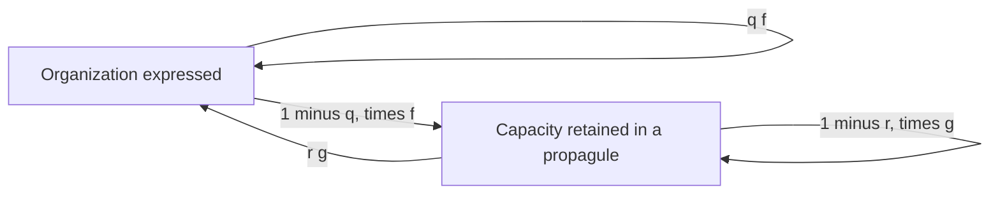

# Selection on the capacity to reconstruct organization

8 October 2026. AI-authored theoretical continuation of Ren's request to “continue to push theoretical frontier.” The contribution is a checked connection within this programme: **an inherited developmental capacity can gain through recurrent reconstruction even when visible parent–offspring resemblance decreases and reproduction pays a cost**. The result states when this is possible, when it fails, and why an immediate offspring census can miss the decisive relationship. It does not establish priority over existing life-cycle theory or broad comparative superiority.

**中文核心：可传递的发育能力，可以通过后继对组织的重新形成获得选择优势，即使直接外形延续减少，而且重建付出繁殖代价。关键是完整接续路径，而不是每一步都保持同一形态。路径本身仍有形成、供给、传递和失效的条件。**

## The explanatory transition

The existing [reconstruction study](EVOLUTIONARY-ORGANIZATION-INTEGRATION.md) follows an actually sampled cell into development; the [generated recurrence](GENERATED-SELECTION-RECURRENCE-INTEGRATION.md) computes successors from produced carriers. Those completed results establish reconstruction under specified laws. They do not alone determine whether a variant changing that reconstruction process gains across repeated generations.

This study supplies that next conditional connection. A developmental rule is carried through two census states: **O**, where the focal organization is expressed, and **P**, where it is absent but its reconstructive capacity remains transmitted. These are differentiated stages of one reproductive history, not independent substances. A P descendant is not counted as having lost the developmental rule merely because it lacks the organized phenotype. Actual genetic loss, broken provision or changed partners can instead invalidate that correspondence.

The model is a mesoscopic descendant recurrence, **not a new microscopic extension of DevelopmentalReconstruction**. Its expected transition coefficients remain supplied; they have not been derived from that module's cell events. The advancement is the conditional selection and identification bridge, not elimination of those inputs. The [separate connectionist learning recovery](EVOLUTION-THEORETICAL-INTEGRATION.md#5-what-theoretical-completion-still-requires) remains open and is not replaced by this result.

## A cycle with explicit production and return

At one fixed census interval let the descendants carrying a focal rule satisfy

\[
\begin{pmatrix}O_{n+1}\\P_{n+1}\end{pmatrix}
=
\begin{pmatrix}qf&rg\\(1-q)f&(1-r)g\end{pmatrix}
\begin{pmatrix}O_n\\P_n\end{pmatrix}.
\]

Here f and g are expected numbers of descendant units produced by O and P, respectively. q is the fraction of O-produced descendants already in O at the next census; r is the fraction of P-produced descendants that reconstruct O. The same transmitted rule determines these developmental consequences across the compared history. All four parameters are rational in the formalization. Biological use requires nonnegative production and fractions between zero and one, consistent census timing, no unrepresented mixing of rule identities, and adequate accounting of the developmental routes.

Counts refer to census units, not conserved cell mass or ethical value. f and g include survival to that census and are expressed relative to a supplied resident growth factor of one in a fixed resident context. Dividing a raw descendant matrix by a positive resident factor changes this reference, not the underlying physical history. A prediction of rare-lineage growth is conditional on the context staying appropriate; it is not fixation, finite-population survival probability or global competitive exclusion.

For the general matrix K = [[a,b],[c,d]], the checked finite return sum is

\[
R_n=a+bc\sum_{j=0}^{n-1}d^j,
\qquad (1-d)R_n=a(1-d)+bc(1-d^n).
\]

Each path is stopped at its first return to O. This prevents counting a lineage again merely because its already returned descendant produces further O descendants. The theorem is a finite identity; no infinite-series convergence theorem is claimed. It makes the missing route explicit: O can send descendants into P, those descendants can persist there, and some subsequently reconstruct O.

## The checked selection condition

For b,c > 0 and d < 1, Lean proves the exact equivalence

\[
bc>(1-a)(1-d)
\quad\Longleftrightarrow\quad
\exists t>0:\ a+ct>1\ \text{and}\ b+dt>t.
\]

The right side supplies a positive weighting V = O + tP under which every nonzero nonnegative composition increases. A second theorem constructs an epsilon > 0, and a history theorem establishes V_n ≥ (1+epsilon)^n V_0 for every finite n. For changing matrices, the history theorem remains sufficient when one common t and epsilon meet its inequalities at every step. Pointwise favorable thresholds alone are not asserted to supply such a common certificate.

At or below the threshold, the weighting t=b/(1-d) instead gives V_next ≤ V. A separate history theorem preserves that bound through nonnegative transitions sharing the same certificate. Thus a transient rise in raw O counts must not be confused with sustained growth of the capacity-carrying lineage. No spectral theorem is assumed inside the proof; this is an elementary two-state result consistent with conventional matrix population methods.

In the developmental domain f>0, 0<g<1, 0≤q<1 and 0<r≤1, the criterion becomes

\[
f>f_*:=\frac{1-g+rg}{q(1-g)+rg}.
\]

The checked expansion certificate gives the finite-history bound directly under these hypotheses. For a fixed gross production F and an actual production cost k, set f=F-k. The cost ceiling is **k < F-f_***. Physical applicability still requires f≥0; a negative modeled offspring count is not an admissible way to satisfy a biological claim.

Holding g and q fixed within that domain, increasing r strictly decreases f_*. The proof compares the cross-products exactly:

\[
D(r_1)N(r_2)-D(r_2)N(r_1)
=g(1-g)(1-q)(r_2-r_1),
\]

where D(r)=1-g+rg and N(r)=q(1-g)+rg. The cost may nevertheless increase faster than the permitted ceiling. The theorem does not imply that maximizing reconstruction is the favored strategy, nor does it supply an unmeasured cost–reconstruction relation.

Two adverse results prevent an automatic favorable reading. First, f_*>1 in this domain: reconstruction needs actual reproductive return in the organized phase. Second, the total-count identity O_next+P_next=fO+gP shows that routing alone cannot increase total descendants when f≤1 and g≤1. The model does not produce descendants or provision by attaching a favorable score to a route.

## What the examples establish

These rational examples are kernel-checked witnesses, not parameter estimates.

| Case | Parameters and result |
|---|---|
| Reconstruction without immediate resemblance | f=3, g=1/2, q=0, r=1 admits t=2/5 with strict weighted expansion. O never directly produces O in one census interval; the return passes through P. |
| Return route removed | With the same f,g,q but r=0, no positive strict expansion weighting exists. The descendants lose the return path while remaining in the supplied recurrence. |
| Costly developmental change | A baseline f=8/5, g=1/2, q=1/2, r=0 has negative margin. A changed rule f=3/2, g=1/2, q=2/5, r=1 has positive margin and t=17/36. Production and immediate resemblance both decrease, while reconstruction opens a sufficient return. |
| Excessive cost | Keeping the changed routing but reducing f to 1 gives a negative margin. Reconstruction itself remains available; its output no longer compensates for the loss. |

The baseline and changed rules are compared against the same resident factor, not claimed to form a solved frequency-dependent two-allele ecology. Mutation supply, within-collective cheating, linkage breakdown and demographic extinction are outside this recurrence. In particular, q is **not** a variance-based heritability coefficient H². The q=0 example concerns an alternating phenotype with a retained developmental capacity, not evolution without inheritance.

## What observations can identify

Starting with O_0>0 and P_0=0, both first-census counts are independent of r:

\[
O_1=qfO_0,\qquad P_1=(1-q)fO_0.
\]

Lean checks a stronger consequence: the same f=3/2, g=1/2 and q=2/5 give identical O_1 and P_1 for r=0 and r=1, yet their selection margins have opposite signs. Neither immediate resemblance nor complete first-census counts settle the return-capacity question.

Under the fixed recurrence, the difference at the second census is

\[
O_2(r_2)-O_2(r_1)=g(1-q)fO_0(r_2-r_1).
\]

When f,g,O_0>0 and q<1, equal second-census O counts therefore imply equal r **with those other quantities held fixed**. This is a conditional structural-identification result. Unknown production, time-varying provision, new mutations, untracked immigration or detection error can confound the inference. Directly following or manipulating P descendants provides a route to checking the proposed developmental correspondence. The [91-frame observation study](DEVELOPMENTAL-HISTORY-INTEGRATION.md) has no linked descendants and does not already estimate these coefficients.

## Strong comparative assessment

The [primary-source record](../../../../sources/evolutionary-selection/reconstructive-selection/README.md) preserves inspected sources and their limits.

| Strong existing account | Credit and comparison |
|---|---|
| Herron, Zamani-Dahaj and Ratcliff 2018 | Derives collective trait heritability from particle variation and the trait mapping under explicit clonal assumptions, with broader simulation cases. This already explains an important source of collective heredity. Our q and r have different meanings and do not supersede H². |
| Pichugin, Peña, Rainey and Traulsen 2017 | Models developmental group formation and fragmentation, comparing life cycles through population growth. This directly addresses selection on reproductive organization. Our two-state threshold is a small related derivation, not a discovery that reproductive modes evolve. |
| Pichugin and Traulsen 2020 | Includes fragmentation delay, risk and cell loss, and studies how these costs change favored life cycles. Our additive output cost is narrower; it cannot stand in for all three mechanisms without correspondence. |
| Doulcier and colleagues 2024 | Already studies stability after scaffold change in a richer ecological model. Our constant-context expansion condition does not replace that analysis. |
| Evolutionary connectionism | Already treats evolution of relationships and individuality. No correlation-learning or generalization result has been recovered here. The named recovery obligation stays active. |

An equally informed conventional matrix model gets the same threshold and identification result. There is no predictive win or fewer independently supplied coefficients in this comparison. The theoretical improvement **within this programme** is the explicit connection of inherited reconstruction to a selection condition, its cost and its observation requirements. The result replaces neither population genetics nor the origin of the relevant developmental law.

## Proof and dependency audit

[ReconstructiveSelection.lean](../../../../experiments/integrated-correction/general-framework/generative-basis/lean/universal-ethics/ReconstructiveSelection.lean) and its [fresh-build receipt](../../../../experiments/integrated-correction/general-framework/generative-basis/lean/universal-ethics/reconstructive-selection-verification/verification.json) contain **28 new theorems and 40 audited declarations**. The checker copies the actual source and toolchain into an isolated temporary build, compiles with Lean 4.29.1, checks every declared theorem/definition/structure, rejects proof placeholders and custom axioms, and records source, checker and log hashes. The standard logical dependencies are reported; this is not an assumption-free biological theory.

The theorem groups cover the general cycle criterion and counter-certificate; arbitrary finite positive-history bounds; the production/routing factorization and finite returns; the threshold, cost ceiling and monotonic comparison; and four observation results plus adverse witnesses. The module imports Std alone. It does not silently acquire a physical derivation by importing an earlier generative result.

## Author counterreview and remaining frontier

**Is the benefit stipulated?** f and g are supplied reproductive consequences, so their physical origin remains unexplained here. What is derived is whether those consequences, when routed through the stated developmental process, actually retain the capacity. The exact failure cases prevent substituting collective benefit for lineage success.

**Has the conclusion been hidden in a weighting?** No favorable weighting is an input to the threshold theorem. It is constructed precisely when the explicit return margin is positive; a positive nonincrease weighting is constructed on the other side. V is a proof certificate for this recurrence, not a proposed universal measure of fitness, generativity or goodness.

**Could apparent reconstruction actually come from a different lineage?** Yes. That would violate the faithful capacity correspondence and could reverse the interpretation while preserving visible morphology. This is a substantive biological failure, not a harmless relabeling. The model must then include rule identities, mixing and genetic loss explicitly.

**Does alternating morphology explain the origin of a new individual?** It explains one necessary reproductive connection once an inherited capacity and its expression states are available. It does not prove functional integration, conflict mediation or exclusive evolutionary individuality. Those require additional relations, not a redefinition of O.

**What changes the account?** A measured return route that is not capacity-linked, or one whose support dependence violates the assumed recurrence, defeats this application. The broader account should then represent that loss, dependency or changing context. More variation in r cannot be treated as an advantage until its production and transmission consequences are included.

**Next theoretical connection:** derive the developmental coefficients and their tradeoffs from an explicit mutable local organization, then show that the induced descendant recurrence satisfies the present correspondence. This would remove an independent input instead of renaming it. Connectionist learning recovery remains the parallel comparative obligation; it must recover the named learning result with its actual premises. No further microscopy is made a prerequisite for either theoretical task.

**Continuation completed on a restricted slice, 8 October 2026.** The [assembly-derived selection study](ASSEMBLY-DERIVED-SELECTION.md) now computes the P column, its cost and output-weighted reconstruction from executable finite histories, with 37 new theorems / 57 audits. It also supplies a resident-relative adjacent-rule invasion condition. The local success law, copying law and O-stage output remain supplied; the entire molecular coefficient-formation problem is not closed. This supersedes the generic next-step wording above for the completed finite assembly connection while preserving its broader scope and the connectionist recovery obligation.

For generative alignment, the result supplies a conditional mechanism for how a capacity can survive temporary nonexpression and how supporting its reconstruction can be selected or eroded. Applying it to evaluators requires its own correspondence. Evolutionary gain supplies no ethical warrant; G0 and the completed practical commitments keep their stated role.
