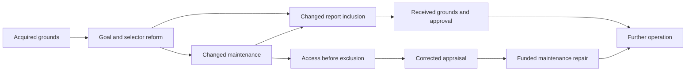

# 改革也改变判断改革的证据 / Reform changes the evidence used to judge reform

8 October 2026, Asia/Bangkok. AI-authored continuation of [Ren's instruction to keep pushing the frontier](../../../../sources/15-codex-theory-conversations/2026-10-08-goal-formation-and-revision.md#continue-the-frontier). Current account: [understanding and changing formative conditions](../../../../theories/becoming/history/GOAL-FORMATION-AND-REVISION.md#7-reform-can-change-its-own-evidential-conditions).

**新推进：改革不仅改变目的及其支持，也可以改变哪些后果能够进入判断。旧安排下真实通过的校准，不自动覆盖改革后的证据路线。新安排可以不断给自己正面反馈，同时把真实负担转移到不再被记录的位置。** 本轮在同一目标形成历史中构造这一失败及有成本的纠正：补足实际维护条件，可以保留新的学习目的，而不必将目的退回旧形式。

**Result:** selector reform can jointly change actual maintenance and the reporting route used to judge it. A previously faithful route can then produce the same judgment inputs in histories with different actual losses. Repeated approval does not distinguish them. Paid access before the exclusion exposes the loss; an authorized, funded repair restores maintenance while preserving the revised learning goal. **23 new Lean theorems and 43 explicit-declaration audits pass.** This is a new connection within the repository's account, not a claim of literature priority, empirical validation or general moral convergence.

## 1. What this advances and what is already complete

The [43-theorem formation/revision model](GOAL-FORMATION-REVISION-INTEGRATION.md) supplied one joined history under stable local consequence laws. The separately completed and independently reviewed [goal-continuation account](GOAL-REVISION-CONTINUATION.md) supplies another, with stronger acquired payment/offer and demand-horizon interfaces. Neither is reopened or counted as new work here.

The completed [model-revision study](MODEL-REVISION-INTEGRATION.md) already establishes why old-domain coverage does not certify a changed setting and how evidence can support bounded repair. The [correction-infrastructure study](CORRECTION-INFRASTRUCTURE-INTEGRATION.md) already separates acceptance, usable access, observation-limited choice and finite support. Our new connection is narrower: **the very reform selected from acquired goals changes both an actual burden and the information reaching later appraisal, within the retained operation and resource history**. We instantiate an evidential failure pathway and its repair; we do not claim to invent general indistinguishability, causal feedback or correction access.

For universal normative grounding, this advances an **application condition**: if generative grounds are to guide self-modification, the descriptions carrying those grounds must remain answerable to effects of the modification itself. G0 and the existing J commitments retain their warrant and scope. An implementation's continued confidence is not a new ethical premise and cannot replace actual correspondence.

## 2. The affirmative argument

An earlier comparison can be valid for the relations it actually describes. Changing a selector may alter who supplies necessary maintenance, whose experience is retained, and which signals reach appraisal. The old correspondence therefore has a domain. When a material intervention reaches that domain's supporting relations, transferring the comparison requires a supported account of those effects or an appropriately limited judgment. This is not a requirement to doubt every unchanged fact after every action.

The same point reaches practical responsibility. Where an authorized reform creates accountable dependence or a displaced burden, J3 can ground bounded repair or handoff; J2 can favor restoring a basic condition while retaining other protections. Whether those premises apply remains substantive. Neither causal participation nor high intelligence alone assigns limitless responsibility. Cost, affected lives, legitimate authority and genuine alternatives belong in the comparison.

The response need not reverse the goal. New learning can be valuable while the current support arrangement is defective. Correcting maintenance can preserve that learning and restore a harmed condition. Conversely, the phrase “preserving a good goal” does not excuse destroying another basic condition or exhausting indispensable resources. Where protected requirements conflict, the earlier sufficient comparator leaves a conflict rather than inventing a total ordering.

**正面推论的范围。** 对已经改变的关系继续使用旧判断，须有适用根据；新认可本身不使旧基本损失消失。可修复的是实现条件，也可能是目的、比较或权限安排，不能预定每次都退回旧目的。本例证明一种保留新目的的修复可能性，不证明所有改革都有这种解。

## 3. One retained causal history

The new Lean module imports the unmodified `GoalFormationRevision` closure. Its initial work/reserve endowment is explicitly **14/12**, allowing inquiry and repair to have an actual cost. The inherited acquisition, calibration, assessment, goal revision, selector reform and operation functions execute in sequence; there is no free replacement of the accumulated state.

Two represented dispositions agree under the old attendance selector. In one, the new learning selector keeps maintenance supported. In the other, its change displaces maintenance until provision is installed. This dependence is the local `conditions` law: the maintenance loss requires burden transfer, the changed selector and absent provision together. It is not a freely toggled ethical verdict after an otherwise identical history.

The old reporting route faithfully transmits both maintenance-loss values. After selector reform it excludes that maintenance constituency, transmitting no maintenance loss regardless of its actual condition. A direct route reads the operation's retained consequence before that exclusion. The possibility and fidelity of this access are explicit premises; calling it direct does not establish them in reality.

`judgmentInput` identifies exactly the observations being compared: received evidence and transmitted maintenance reports. The full histories are different. The controller's stipulated assessment reads this limited input, while the direct inquiry operation obtains a further consequence from the same history. These are differentiated access relations within one process, not an infallible observer outside it.

| Stage in the burden-transfer branch | Work / reserve / spent | Retained consequence |
|---|---|---|
| Acquired goal revised; selector reformed | 7 / 12 / 7 | Initial access loss remains; learning is the operative goal |
| First post-reform operation | 7 / 10 / 9 | Maintenance loss appears; total recorded loss-events becomes 2 |
| Selected-route inspection and assessment | 5 / 10 / 11 | Report says no maintenance loss; inherited sufficient comparison appears to favor learning |
| Direct inspection and assessment | 3 / 10 / 13 | Reports are `[false, true]`; the newly disclosed loss defeats that sufficient approval |
| Authorized maintenance provision | 2 / 8 / 16 | One work unit and two reserve units spent; goal/selector retained; stale judgment cleared |
| Actual operation and direct recheck | 0 / 6 / 20 | Reports `[false, true, false]`; no further loss-event; earlier two remain |

Every row totals 26. The reserve transfer supporting operation and the reserve consumed in installing provision are different transactions; neither creates resources. The account has no remaining work at the end, so another operation fails despite a residual reserve. This retains the model's requirement for an initial operating outlay. No unlimited continuation follows.

The recheck updates maintenance evidence while retaining earlier formative feedback and access evidence. This is coherent in the supplied law because access consequences and the encoding reference remain invariant across the selector change. It is a maintenance recheck, not certification of every causal or ethical classification. If access or the reference also changes, those retained inputs need their own renewed grounds.

The two original acquisition trials and the first harmful post-reform operation are **already incurred events**, not experiments justified by the fact that they later teach a lesson. The proof does not authorize intentionally imposing basic deprivation to learn. `losses` counts recorded failures in performed operations, not all welfare loss, unmet need or compensation. Failure to perform a later action is separately visible as `none`; it is not a harmless outcome.

## 4. What is checked

[Source](../../../../experiments/integrated-correction/general-framework/generative-basis/lean/universal-ethics/generative-capacity/ReformEvidence.lean), [checker](../../../../experiments/integrated-correction/general-framework/generative-basis/lean/universal-ethics/generative-capacity/check_reform_evidence.py), [passing receipt](../../../../experiments/integrated-correction/general-framework/generative-basis/lean/universal-ethics/generative-capacity/reform-evidence-verification.json).

Lean **4.29.1** compiles frozen source bytes and audits all explicit declarations, with no unfinished proofs, `native_decide`, unsafe declarations or new custom axioms. It retains exact source/helper hashes, theorem signatures, dependency logs and compiler-binary hash. The new module has **23 theorems / 43 audited declarations**: 12 empty dependency lists, 30 with `propext`, and one with `propext, Quot.sound`. The unchanged imports contain **93 inherited theorems / 165 explicit declarations**; standard `Classical.choice` remains in some imported declarations. These counts are not new empirical evidence or proof of substantive premises.

| Claim | Exact checked result |
|---|---|
| Old calibration can fail after this reform | `old_route_calibration`, `old_calibration_does_not_transport` |
| Reform activates a real burden rather than merely relabeling the report | `old_conditions_agree`, `rule_change_activates_real_burden`, `actual_burden_differs_after_reform` |
| Identical admitted inputs cannot distinguish these histories | `filtered_judgment_inputs_agree`, `every_decider_shares_filtered_answer` |
| Repetition on the same defective route adds no separating information | `repetition_of_filtered_report_does_not_separate` for arbitrary repetition count |
| Approval and selected feedback coexist with repeated actual loss | `self_approval_coexists_with_actual_loss`, `approved_continuation_repeats_real_loss` |
| New access changes judgment when needed and retains it otherwise | `direct_observation_changes_judgment`, `supported_reform_survives_direct_check` |
| Repair leaves the changed goal intact and works in subsequent operation | `repair_preserves_revised_goal_and_selection`, `actual_repaired_continuation_and_recheck` |
| Authority and finite support matter | `repair_requires_authority`, `repair_conserves`, `all_stages_account_for_the_same_support`, the three unavailability/depletion witnesses |
| The old normative comparator still has exact scope | `restoring_maintenance_is_favored`, `unrepaired_shift_has_real_basic_conflict` |

The arbitrary-decider theorem is about the stated input, not a ban on every conceivable way to know the difference. The direct inspection itself exhibits another usable input. Repeating an excluded loss report does not improve this deterministic channel; this is not a general theorem that repeated measurements have no value.

`restoring_maintenance_is_favored` instantiates the inherited J2 comparator across provided/unprovided learning continuations. The costs remain real in the ledger. Their classification as not destroying another basic condition is an application premise, not implied by the conservation equation. The earlier new-mastery and forgone-output distinctions remain inherited and are not collapsed into a total utility.

## 5. Substantive counterreview

This is author-conducted review, not independent-agent acceptance.

**“This refutes the earlier goal-revision proof.”** No. That proof stated stable outcome and measurement laws. This extension identifies a concrete intervention-dependent relationship omitted by that instance. It defeats unrestricted transfer of the old verdict, not the theorem under its original hypotheses. The concurrently completed goal-continuation account likewise retains its exact scope.

**“A previously justified reform has become ethically wrong for no reason.”** The full shifted continuation never satisfied the assumed all-other-protections-retained condition. The old description failed to establish its transfer to this intervention. Whether the original decision was reasonable given available evidence is a further practical-uncertainty question; this module does not decide it. When the loss is acquired, the old sufficient comparison no longer supports continuing unchanged.

**“The check secretly uses the true answer.”** The model specifies a causal route transmitting a retained actual consequence and charges for accessing it. This gives a conditional mechanism, not autonomous invention or independent empirical validation of the route. A shared corruption before both readings could defeat it. The current inquiry schedule and remedy are supplied; there is no claim to have learned all audit policies or correctly located an arbitrary cause from one reading.

**“Access repairs everything.”** Access changes evidence, not maintenance. Two work units are needed to inspect and assess; actual repair needs authority, another work unit and reserve. Insufficient support blocks the appropriate step. The generic correction-access results are credited; this instance adds their operation inside the goal-induced reporting failure.

**“Always reject changed institutions.”** The supported counterpart passes direct inquiry and retains approval. The harmful counterpart can preserve the new goal after repair. Neither reflexive conservatism nor automatic endorsement is the rule. Other cases may demand a changed goal or legitimate closure; this local witness does not decide them.

**“This is a new solution to reward tampering.”** No. We do not establish an incentive for deliberate falsification, an unrestricted anti-tampering algorithm or a new general optimum. The failure can arise without malicious intent. Its contribution is a checked connection among an acquired goal, a changed selector, actual displacement, selective evidence and a paid response under the existing normative account.

## 6. Primary comparisons

Primary abstracts inspected on 8 October 2026; targeted comparison, not a comprehensive priority search or empirical reproduction.

| Primary source | Relevant established work | Our relation and limit |
|---|---|---|
| Perdomo et al. (2020), [Performative Prediction](https://proceedings.mlr.press/v119/perdomo20a.html) | Decisions based on predictions can change the outcomes and distributions later assessed; the paper studies performative stability and retraining conditions | Intervention-dependent validation is established prior work. Our instance concerns loss inclusion and normative application, not a new convergence theorem |
| Everitt et al. (2021 version), [Reward Tampering Problems and Solutions](https://arxiv.org/abs/1908.04734) | Distinguishes reward-function and reward-input tampering and analyzes instrumental incentives with causal influence diagrams | This supplies a strong causal comparator for altered evaluation. Our chosen reporting law does not prove an incentive to tamper or reproduce their prevention results |
| Mandal, Triantafyllou and Radanovic (2023), [Performative Reinforcement Learning](https://proceedings.mlr.press/v202/mandal23a.html) | The selected policy can change reward and transition dynamics; stable-policy computation is studied | Policy-dependent dynamics are established. The present finite realization earns no algorithmic superiority over conventional causal, learning or institutional models |

Theoretical compatibility with these accounts is affirmative evidence that the proposed relations are intelligible through established machinery; it is not proof that this formulation is uniquely necessary. No external dataset, human behavior or deployed AI response was measured in this round.

## 7. Frontier and next discriminating work

The new conditional connection is checked. The larger frontier is **how the changing organization acquires and maintains access to materially omitted consequences, and chooses an affordable corrective intervention, when neither the relevant reporting failure nor the repair is already supplied**. The completed model-revision and correction-infrastructure studies are available components, not tasks to restart.

A useful next joint test must derive a probe choice from retained uncertainty and control over a reporting pathway, account for that probe's effect on the remaining response options, and permit a supported counterpart to continue. In real evidence, the key discriminator is whether changed representation of affected positions explains apparent success after reform, while an independently supported route records an actual loss and its response. That empirical claim remains untested here. Any advance must preserve conventional explanations and cases where further inquiry costs more than the available opportunity allows.

Integration verification: [owned edits](REFORM-EVIDENCE-INDEX-EDITS.json) and [scoped checks](REFORM-EVIDENCE-CHECKS.json). They bind this result and its sources, without certifying unrelated concurrent changes.
