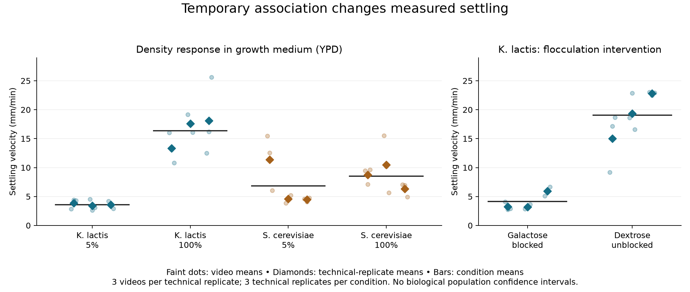

# Inherited clusters, temporary aggregation and differential continuation

8 October 2026. AI-authored empirical reconstruction and author self-review for [The Theory of Evolution](../../../../theories/shengsheng-buxi-generative-existence/unified-2026-10-05/THE-THEORY-OF-EVOLUTION.md), especially requirements 2–5. The preceding goal turn restated completion requirements and supplied no new research evidence. This continuation preserves a primary experiment, reanalyses measured velocities and revises the structure-to-selection correspondence. No new mathematical theorem or independent biological replication is claimed.

**Result.** Fifty-four public video means reproduce a strong response to concentration and inhibited adhesion in evolved K. lactis clusters, with a weaker and less stable concentration response in S. cerevisiae. The data identify three technical replicates per condition. The same publication reports that inherited daughter-cell association and temporary aggregation jointly contribute to sorting, while unicellular lineages can share the sorting benefit and persist through repeated transfers. A connected evolutionary account must therefore distinguish the organization reconstructed by descendants from the temporary association transported during selection. Existing conventional ecology already supplies this explanation; the result strengthens correspondence and comparator requirements, not our superiority claim.

**中文结论。** 54段视频的均速数据可按18项技术重复重算；K. lactis 的浓度响应及阻断黏附对照明确，S. cerevisiae 的浓度差异较小且对技术重复敏感。同篇实验把分裂后持续相连、临时絮凝、筛选收益共享及反复传代中的共存联系起来。遗传重建的组织与当次沉降的集合可以不同，不能把临时共同运输直接当作新的遗传个体。常规生态解释得到信用；个体材料—几何—速度—后继的联合记录仍缺，完整演化目标未完成。

## What was actually obtained and recomputed

[Driscoll and Travisano (2017)](https://doi.org/10.1038/ncomms15707) experimentally evolved ten initially unicellular K. lactis populations through 60 daily transfers. Following 24 hours of growth in 10 ml YPD, 1.5 ml was sampled, settled for seven minutes, and its bottom 100 μl transferred into fresh medium. The paper reports multicellular clusters in all populations by transfer ten, formed through continued daughter-cell attachment; unicellular genotypes also persisted. It then investigates attachment and density effects and conducts two mutual-invasion experiments using isolates from all ten populations. These are source-reported evolutionary observations, not population trajectories newly extracted here.

We preserve the complete original XML, publisher HTML and six original workbooks in [the source directory](../../../../sources/evolutionary-selection/driscoll-2017/README.md), with unchanged-byte fingerprints. Supplementary Data 5 supplies the velocities below. Supplementary Data 3 supplies competition and invasion summaries; it does not supply the corresponding raw time series. The particle-level diameter/neighbor/velocity records behind the structural-equation analysis are also absent from the retrieved workbooks.

[Our numerical analysis](../../../../experiments/integrated-correction/general-framework/generative-basis/ecological-selection/interactions/README.md) reads 54 videos: six conditions, three technical replicates per condition, three videos per replicate. It first averages within technical replicate, then across replicates. The equal video counts recover the publication's rounded condition means. Technical replicates are not treated as independently evolved lineages, and numbered replicates in different treatments are not assumed to be paired.

| Conditions compared | Lower-condition mean | Higher-condition mean | Ratio of means | Technical-replicate deletion range for the difference |
|---|---:|---:|---:|---:|
| K. lactis, 5% → 100% overnight-culture concentration in YPD | 3.6058 | 16.3423 | 4.5322 | 11.7541 to 14.3757 |
| S. cerevisiae, 5% → 100% in YPD | 6.8125 | 8.5059 | 1.2486 | −0.4330 to 5.0625 |
| K. lactis, galactose → dextrose, 100% concentration | 4.1205 | 19.0551 | 4.6245 | 12.5821 to 17.8629 |

Speeds and differences are mm/min. Each deletion range covers all nine combinations of removing one technical replicate from each condition; it is **not a confidence interval**. The species difference in density responses is 11.0430 mm/min. Across all 81 combinations of deleting one technical replicate from each of the four density conditions it remains 6.6916–14.8087 mm/min. That describes sensitivity of these recordings, not universality or independent biological replication. The S. cerevisiae response is preserved as a contrasting result rather than relabelled a general cooperative effect.

An independent standard-library implementation reads original workbook XML and computes rational means/contrasts. It agrees on 132 numerical values within 3.56 × 10⁻¹⁵ and verifies all eight original-file fingerprints. [Verification receipt](../../../../experiments/integrated-correction/general-framework/generative-basis/ecological-selection/interactions/verification.json). It does not replicate microscopy, particle tracking, biological interventions or the source's significance tests. The figure has been visually checked. No scientific proof claim was introduced requiring a new Lean result.

## The connection supplied by the experiments

The source distinguishes continued attachment after division from aggregation among previously separate cells or clusters. In the former, the history of daughter formation explains clonal cluster relationships. In the latter, adhesion can temporarily associate distinct clusters and unicells. These are differentiated relationships within growth, encounter, transport and transfer, not independent organism/environment substances.

The density experiment changes the abundance of potential neighbors. The sugar experiment inhibits K. lactis adhesion with galactose and compares it with dextrose. Their combined evidence supports an interaction-dependent settling mechanism. It does not hold each focal cluster's material and geometry fixed or isolate every possible sugar effect. The authors' particle-level structural model assigns a larger positive contribution to neighbors in K. lactis and a negative one in S. cerevisiae; we inspected its supplied coefficient table, but cannot refit it without particle records.

Additional source-reported controls link this mechanism to retained lineage composition: unicells have little settling enrichment alone or with S. cerevisiae clusters, but improve in mixtures with K. lactis clusters. Separate heat-fixed preparations distinguish short-duration cluster/flocculation effects from slower unicell aggregation; those preparations cannot establish reproductive success because the cells were killed. The live mutual-invasion experiments report both phenotypes doing better when initially rare. They support the authors' frequency-dependent coexistence account. Their summary tables are evidence for that report, not enough to reconstruct the complete growth–sorting–descendant history independently.

Settling enrichment is a change in sampled **CFU concentration**, not a measured per-cell survival probability. Fracture, viable colony formation, sampled volume and subsequent growth must be kept explicit before converting it into transmitted descendants. Greater speed need not yield proportionately greater lineage representation in a fixed bottom-volume transfer, especially when many clusters compete for that volume. The investigators' fresh-medium preparation is real supporting activity in the laboratory cycle; the wider origin and renewal of that supply are outside this experiment's explanation.

## What changes in our theoretical account

The empirical correspondence now requires at least three related identifications: the inherited developmental organization, the temporarily transported association and the viable units reconstructed after transfer. A clonal cluster may enter a mixed aggregate, and a unicell may share its transport advantage while continuing a different developmental phenotype. Observed collective transport alone does not identify a newly inherited evolutionary unit. The earlier [developmental-association proof](DEVELOPMENTAL-ASSOCIATION-INTEGRATION.md) already limits common-founder ancestry to its non-aggregative history; its aggregation counterexample must remain active here.

This supplies a specific route by which evolved organization changes conditions of later selection: the formation of clusters changes opportunities for aggregation and hence the sorting experienced by neighbors, including non-clustering lineages. The sorting protocol may remain fixed while its biological consequences change with developed composition and interaction. This is a narrower, empirically supported connection than claiming that the experiment explains the origin of every selector or establishes indefinite support renewal.

An adequate conventional rival includes daughter attachment, aggregation, density dependence, growth differences, sampling and redevelopment. These mechanisms are already central to the source's account. A model restricted to isolated particles can be useful in a validated dilute regime; applying a fixed phenotype speed across the present conditions would omit measured variation. Beating that restricted model would not demonstrate superiority to the stronger conventional rival. Nor can this K. lactis/S. cerevisiae dataset decide the two density/drag approximations evaluated on the different Day 2022 geometries in [the prior study](SETTLING-CORRESPONDENCE-INTEGRATION.md).

The consequence for requirements 3 and 4 is substantive: trace how relations formed by descendants change differential continuation, while testing rather than assuming coincidence between physical sorting groups and evolutionary units. For requirement 5, the comparator is strengthened by the same evidence. The general formation, broader evolutionary-mechanism recovery and comparative objectives remain incomplete. For the normative programme, the study constrains how capacities supporting further life can affect plural continuations; it supplies neither G0 nor a new reason to equate reproductive advantage with ethical authority.

## Next discriminating connection and author self-review

The immediate empirical bridge is now **developed attachment → mixture-dependent aggregate transport → viable representation after sampling → redevelopment across transfers**. Joint records should retain lineage identities, mixture composition, actual aggregate membership, cluster material/geometry, medium, concentration, sampled volume and descendant production. Distinguish inherited changes from an experimenter's changed protocol. A matched comparison must give conventional developmental/ecological models the same measured relations; otherwise any apparent advantage is informational.

The strongest counterreading is that this is already a well-explained conventional result and therefore offers no unique confirmation of our foundation. That objection is accepted at the comparative level. The affirmative gain is a reproducible empirical constraint and correction of the required composition: the relevant physical association can cross inherited lineages, and its benefit can preserve alternative forms. Another objection is pseudoreplication. We therefore show all technical-replicate means and deletion sensitivity, make no population significance claim, and keep the separately reported ten-population experiment distinct.

This is **author self-review**, not an independent agent review. [Study checks](AGGREGATION-SELECTION-CHECKS.json) preserve the source, numerical and integration scopes. The full six-part objective remains active; an empirically constrained connection does not complete the whole theory.
