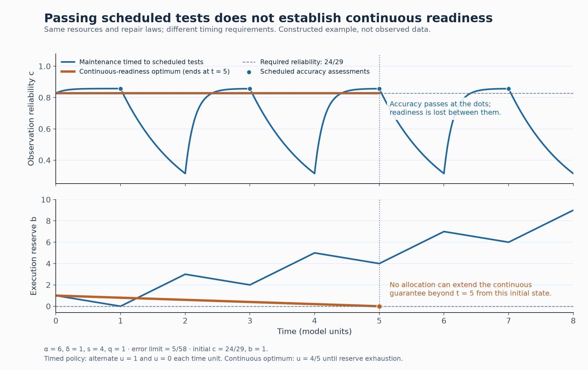

# Root-foundation review package

**Learned-agent evidence/action audit, 6 October 2026:** read the [canonical interpretation](../../../../theories/shengsheng-buxi-generative-existence/unified-2026-10-05/TOOL-EVIDENCE-AND-AUTHORITY.md), [primary review](AGENTDOJO-EVIDENCE-REVIEW.md), [independent replay review](AGENTDOJO-REPLAY-REVIEW.md), [experiment](../../../../experiments/agentdojo-evidence-boundary/README.md) and [integration receipt](AGENTDOJO-EVIDENCE-INTEGRATION.json). The complete 320-trace cohort retains reported outcomes, reconstructed effects, missing receipts, ambiguous identities and authority distinctions. The [fresh-acquisition interface](FRESH-ACQUISITION-INTERFACE.md), [assumption audit](FRESH-ACQUISITION-ASSUMPTIONS.md), [source search](FRESH-ACQUISITION-AI-EVIDENCE.md) and [downstream contract](RECIPIENT-EVIDENCE-DOWNSTREAM-CONTRACT.md) connect this evidence to the central reason-ground task without requiring another inspection mechanism by default.

**Fresh evidence and recipient-reason revision, 6 October 2026:** read the [accepted canonical account](../../../../theories/shengsheng-buxi-generative-existence/unified-2026-10-05/RECIPIENT-REASON-REVISION.md), [mathematics](REASON-REVISION-MATH.md), [independent review](REASON-REVISION-REVIEW.md), [scope analysis](REASON-REVISION-SCOPE.md) and [integration receipt](REASON-REVISION-INTEGRATION.json). Sixty-seven new Lean audits and independent checks of 1,064 continuations connect actual acquisition after change to fresh records, revised reasons and paid recipient action. A repaired reusable-token defect is preserved; all physical outcomes and comparative costs remain unchanged. The next central connection is justified evaluative concern and its compatible continued influence, under the unchanged [five completion criteria](FIXED-FINISH-LINE-AUDIT.md).

**Paid pre-import evidence, 6 October 2026:** read the [canonical study](../../../../theories/shengsheng-buxi-generative-existence/unified-2026-10-05/PAID-PREIMPORT-EVIDENCE.md), [independent review](PREIMPORT-EVIDENCE-REVIEW.md), [primary comparators](PREIMPORT-EVIDENCE-COMPARATORS.md), [constructed implementation](../../../../experiments/shared-renewal-capability/regulation/retention/formation/selectors/updaters/prediction/recipient-correction/identification/recording/reason-consumer/transport/calibration/pre-import/README.md) and [integration receipt](PREIMPORT-EVIDENCE-INTEGRATION.json). Twenty-nine new Lean audits and independent reconstruction of 1,976 histories establish a paid, single-use evidence/action interface. Stable acquired memory exposes source-only corruption; copied agreement, common faults, changed laws and faulty import delimit the result. The next bridge is genuine new acquisition and warranted revision, while supplied objective, calibration, authority and interlock remain explicit.

**Constructed route observation, 6 October 2026:** read the [canonical result](../../../../theories/shengsheng-buxi-generative-existence/unified-2026-10-05/FORMED-ROUTE-MONITOR.md), [mathematics](FORMED-ROUTE-MONITOR-MATH.md), [independent review](FORMED-ROUTE-MONITOR-REVIEW.md) and [actual replacement handoff](../../../../experiments/shared-renewal-capability/regulation/retention/formation/selectors/updaters/prediction/recipient-correction/route-diagnostics/monitor/HANDOFF.md). Thirty-six new Lean audits and independent reconstruction of 616 executions establish paid finite observation under supplied head/contact laws. Old failure mass, hidden-law ancestry, invalid/incomplete frames and the cost relative to an unmonitored learner remain explicit. The next bridge is consequence-dependent route replacement using the actual remaining resources. The [resource derivation](ROUTE-REVISION-RESOURCE-MATH.md), [independent boundary review](ROUTE-REVISION-RESOURCE-REVIEW.md) and [first-commit export](../../../../experiments/shared-renewal-capability/regulation/retention/formation/selectors/updaters/prediction/recipient-correction/route-diagnostics/monitor/handoff/README.md) now give actual earlier inputs, sharp prefix-funding bounds and separate source/material obligations to the active revision implementation.

**Architecture formation, 6 October 2026:** read the [canonical result](../../../../theories/shengsheng-buxi-generative-existence/unified-2026-10-05/ARCHITECTURE-FORMATION.md), [mathematics](ARCHITECTURE-FORMATION-MATH.md), [independent review](ARCHITECTURE-FORMATION-REVIEW.md), [identification and inherited-state audit](ARCHITECTURE-FORMATION-IDENTIFICATION.md), and [fifty-arm experiment](../../../../experiments/shared-renewal-capability/regulation/retention/formation/selectors/updaters/prediction/coupling/architecture/README.md). The [original proposal](ARCHITECTURE-FORMATION-PROPOSAL.md) remains preserved. Local bonds generate broad or filtered response paths; funded guide copying changes a second assembly. Production and retention have distinct outcomes, including adverse maintenance and transfer regimes. The finite conditional bridge leaves component laws, calibration, co-development and ethical grounds open; the following continuation completes its learned-recipient join.

**Architecture-to-recipient learning, 6 October 2026:** read the [canonical result](../../../../theories/shengsheng-buxi-generative-existence/unified-2026-10-05/ARCHITECTURE-LEARNING.md), [mathematics](ARCHITECTURE-LEARNING-MATH.md), [independent review](ARCHITECTURE-LEARNING-REVIEW.md), [handoff and identification audit](ARCHITECTURE-LEARNING-IDENTIFICATION.md) and [72-arm experiment](../../../../experiments/shared-renewal-capability/regulation/retention/formation/selectors/updaters/prediction/coupling/architecture/learning/README.md). Actual formed routing now admits paid recipient evidence and correction while preserving actor correspondence. The strict primary event has mass 11/405; its intersection with earlier strict motor revision is zero under current resources. Independent suffix and handoff checks accept the conditional result, retaining missing interfaces, outages, proxy feedback, aliased writes and stale qualification. Faithful evidence earns no private retention premium. The next central connection concerns justified evaluative influence and its effective corrigible continuation; acquisition, calibration and schedule remain supplied.

**Evaluative application, 6 October 2026:** read the [canonical account](../../../../theories/shengsheng-buxi-generative-existence/unified-2026-10-05/EVALUATIVE-APPLICATION.md), [concrete field contract](EVALUATIVE-APPLICATION-CONTRACT.md), [mathematical application audit](EVALUATIVE-APPLICATION-MATH.md) and [independent review](EVALUATIVE-APPLICATION-REVIEW.md). The conditional document study maps acquired facts and the prospective operational evaluator to independently grounded patient-condition, authority and comparison premises. It separates the existing robust remainder from the stronger intersection of licensed actions, preserves gross/net costs and actual source meanings, and exposes patient-good ambiguity despite correct receipt prediction. It adds no mechanism, scientific run or new normative axiom. Concrete causal and ethical application remain separate from the accepted interface audit. Added [math §7](EVALUATIVE-APPLICATION-MATH.md#7-functional-recognition-of-instrumental-applicability-under-a-fixed-ground) and [contract §5](EVALUATIVE-APPLICATION-CONTRACT.md#5-the-smallest-functional-recognition-of-instrumental-applicability) specify sufficient conditions for bounded functional recognition under a fixed warranted ground. Acquired support must actually mediate assessment or command; publication-only mismatch blocks, whereas coherent acquired correspondence can redirect. The positive application is one episode and remains conditional on the separate producer verification.

**Actual recipient reasons to funded execution, 6 October 2026:** read the [canonical result](../../../../theories/shengsheng-buxi-generative-existence/unified-2026-10-05/RECIPIENT-REASON-ACTION.md), [mathematics](REASON-ACTION-MATH.md), [independent review](REASON-ACTION-REVIEW.md), [empirical candidate audit](REASON-ACTION-EMPIRICAL-CANDIDATES.md) and [preserved public-preview check](reason-action-evidence/README.md). The physical join has 79 new Lean audits and 111 independent finite comparison arms. Its same-recipient command, actual resources, non-recording port and later reconstruction are conditional on explicit calibration and objective premises. The review preserves repaired target redirection and the aggregate advantage/cost of simpler learned routes. The preview is a separately identified reading edition, with an unresolved published-analysis sample discrepancy; it supplies no whole-mechanism empirical validation.

**Empirical cue/action identification, 6 October 2026:** read the [canonical study](../../../../theories/shengsheng-buxi-generative-existence/unified-2026-10-05/RECIPIENT-CUE-GROUNDING.md), [methods](CUE-GROUNDING-METHODS.md), [independent review](CUE-GROUNDING-REVIEW.md), [reanalysis](../../../../experiments/recipient-cue-grounding/README.md) and [integration receipt](CUE-GROUNDING-INTEGRATION.json). The retrospective paired audit retains all 24 displayed animals and every omission, with independent arithmetic and original/derived-source boundaries. A stable cue/action contrast does not identify recipient-specific cognition; the next discriminating interface varies source, beneficiary and delivery consequences. No new animal experiment or general alignment success is claimed.

**Retained acquisition and calibration, 6 October 2026:** read the [canonical study](../../../../theories/shengsheng-buxi-generative-existence/unified-2026-10-05/SEMANTIC-CALIBRATION.md), [independent identification](SEMANTIC-CALIBRATION-IDENTIFICATION.md), [formal and root review](SEMANTIC-CALIBRATION-REVIEW.md), [primary comparisons](SEMANTIC-CALIBRATION-SOURCES.md) and [integration receipt](SEMANTIC-CALIBRATION-INTEGRATION.json). Twelve new Lean audits reuse the actual identification updater; independent computation checks 1,850 original transitions, 666 retained rows and 10,656 inspection scenarios. The acquired controller exposes archive-only corruption; copying the source into it first makes the check circular. Common corruption, silent change, correct new disagreement, ordinary-controller equality and the repaired hypothetical-publication interpretation remain explicit. Next is a paid, correctly ordered evidence/action interface, not another free inspection assumption.

**Route diagnostics, 6 October 2026:** the [canonical account](../../../../theories/shengsheng-buxi-generative-existence/unified-2026-10-05/ROUTE-DIAGNOSTICS.md), [mathematical analysis](ROUTE-DIAGNOSTICS-MATH.md) and [review](ROUTE-DIAGNOSTICS-REVIEW.md) identify a conditional observation interface for revision of inherited learners. Fifteen Lean audits and exact finite checks establish update signatures, paid partial-inspection behavior and stable task-relative equivalences, with twelve actual matched ancestry groups. Physical monitor formation, route replacement and their composition remain separate work in the successor branch.

**Acquired abstraction, 6 October 2026:** read the [canonical result](../../../../theories/shengsheng-buxi-generative-existence/unified-2026-10-05/ABSTRACTION-ACQUISITION.md), [hand proofs](ABSTRACTION-ACQUISITION-MATH.md), [independent review](ABSTRACTION-ACQUISITION-REVIEW.md), [primary comparators](ABSTRACTION-ACQUISITION-COMPARATORS.md) and [executable package](../../../../experiments/integrated-correction/general-framework/generative-basis/mathematical-abstraction/acquisition/README.md). The learner acquires a distinction after its own failed prediction, constructs a minimal exact model and productively uses a new composition. Its paid installation and later use inherit an actual resource path under explicit added recipes. Correct partitions and counterexample labels are not supplied; architecture, reset/calibration, state bound and question relevance remain inputs. Twelve controls and 234 finite target checks preserve cost and interpretation failures. Next is warranted experimental access and revision of these class/meaning assumptions; metaphysical uniqueness remains unproved.

**Constitution of mathematical truth: resolution, 6 October 2026:** read the [canonical assessment](../../../../theories/shengsheng-buxi-generative-existence/unified-2026-10-05/MATHEMATICAL-TRUTH-AND-THE-ROOT.md#resolution-of-the-remaining-bridges), [closure/identity proofs](MATHEMATICS-CLOSURE-RESOLUTION.md), [model admissibility](MATHEMATICS-MODEL-ADMISSIBILITY.md), [constitutive justification](MATHEMATICS-GROUNDING-RESOLUTION.md), [uniqueness tests](MATHEMATICS-UNIQUENESS-RESOLUTION.md) and [review](MATHEMATICS-REVIEW.md#remaining-bridges-resolution). Fixed formation and semantic conditions yield the completed relative mathematical result. Counterexamples rule out the proposed generic shortcuts to unique logic, infinite closure and ultimate grounding. The philosophical structural-identity extension is explicit and scoped; the unique all-mathematics root remains an unproved hypothesis. Earlier [semantic/arithmetic proofs](MATHEMATICS-TRUTH-CONSTITUTION-MATH.md), [constitutive architecture](MATHEMATICS-CONSTITUTIVE-ARGUMENT.md) and [rival accounts](MATHEMATICS-CONSTITUTION-RIVALS.md) remain preserved.

**Mathematics and generative grounding, 6 October 2026:** read the [stronger claim assessment](../../../../theories/shengsheng-buxi-generative-existence/unified-2026-10-05/MATHEMATICS-AND-GENERATIVITY.md), [presentations](MATHEMATICS-GENERATIVE-PRESENTATIONS.md), [structural results](MATHEMATICS-STRUCTURAL-RESULTS.md), [foundation audit](MATHEMATICS-FOUNDATION-AUDIT.md), [learning evidence](MATHEMATICS-LEARNING-EVIDENCE.md) and [integration/review](MATHEMATICS-REVIEW.md#deeper-claim-audit-and-structural-development). Nine hand propositions and exhaustive checks of 9,994 machines support canonical exact abstraction and bounded-class finite certification; counterexamples preserve the state-bound and interpretation obligations. The next bridge is an actually formed learner obtaining evidence, revising its abstraction and supplying an interpreted affordable certificate. Mathematical cognition, empirical distinctiveness and unique metaphysical grounding remain open; no new Lean or human experiment is claimed.

**Semantic evidence-to-action composition, 6 October 2026:** read the [canonical integration](../../../../theories/shengsheng-buxi-generative-existence/unified-2026-10-05/SEMANTIC-ACTION-COMPOSITION.md), [independent fixture identification](SEMANTIC-ACTION-IDENTIFICATION.md), [primary comparators](SEMANTIC-ACTION-COMPARATORS.md) and [scope/implementation review](SEMANTIC-ACTION-REVIEW.md). Sixteen checked Lean declarations establish the abstract transport contract. Separate finite checks preserve 666 rows and test 14,472 scenarios, 1,024 joint mismatches and 10,404 source/destination pairs. The failed raw-mask interpretation, repaired cross-history substitution and surviving calibration failure are retained. Actual meaning-preserving, funded actuation and justified concern remain further connections; no upstream acceptance or physical effect is inferred from this interface check.

**Paid reasons and effective protection, 6 October 2026:** read the [canonical result](../../../../theories/shengsheng-buxi-generative-existence/unified-2026-10-05/REASON-PROTECTION.md), [mathematics](../../2026-10-05-revisable-concern/settlement/formal/REASON-PROTECTION-MATH.md), [internal review](../../2026-10-05-revisable-concern/settlement/formal/REASON-PROTECTION-REVIEW.md) and [empirical identification contract](../../2026-10-05-revisable-concern/settlement/formal/REASON-PROTECTION-EVIDENCE.md). The physical interface passes 61 new Lean audits; the separate finite game passes 22 strategic cases. The [completion audit](FOUNDATION-COMPLETION-AUDIT.md) and [input ledger](CONCERN-WISDOM-INPUTS.md) retain the distinct remaining typed-evidence, evaluation-origin, successor-route and empirical obligations.

**Patient-ground and deliberator scope, 6 October 2026:** the further [慧根 investigation](../../../../theories/shengsheng-buxi-generative-existence/unified-2026-10-05/HUIGEN.md#why-relief-does-not-settle-authority) extends the [authorship audit](HUIGEN-SELF-GROUND-AUDIT.md#16-concern-authorship-and-the-authority-to-intervene), [finite permission results](HUIGEN-REASON-TRANSPORT.md#15-authorization-requires-more-than-a-beneficial-endpoint), and [source comparison](HUIGEN-SELF-GROUND-SOURCES.md#13-benefit-authorship-and-permission). Benefit, supported judgment, prior authority and later approval remain separate. [Review](HUIGEN-REVIEW.md#follow-up-authorship-and-history-sensitive-permission-6-october-2026) records bounded Shiffrin, Darwall and Mill readings and the distinction between scoped permission constraints and complete duties. The next bridge is justified response under conflicting claims; no new empirical or formal run is counted. The [finite interface](HUIGEN-FULL-THEORY-AUDIT.md#9-finite-interface-with-formed-understanding-and-action) identifies the strongest defended ethical inputs and the exact causal coverage of the accepted fresh-evidence/action construction; no new operating join is claimed. The [bounded transfer contract](HUIGEN-FULL-THEORY-AUDIT.md#applicability-transfer-and-costly-choice) separates an acquired operational coefficient from warranted recipient concern and from the margin needed for costly choice; qualitative dominance or an independently defended priority must justify the finite comparison.

**Repeated actual-successor learning, 6 October 2026:** read the [canonical integration](../../../../theories/shengsheng-buxi-generative-existence/unified-2026-10-05/RECIPIENT-RENEWAL.md), [mathematical derivation](RECIPIENT-RENEWAL-MATH.md), [independent review](RECIPIENT-RENEWAL-REVIEW.md), [checked sibling-source evidence](recipient-renewal-evidence/README.md) and [full completion programme](../../../../theories/shengsheng-buxi-generative-existence/unified-2026-10-05/ALIGNMENT-COMPLETION.md). The finite executable checks pass 168 comparisons, while 39 Lean declarations establish the separate abstract reserve/composition theorem. Exact conventional equality, failures of early funding, misleading nonreceipt, stale copying and finite source/part exhaustion remain visible. Next are compatible factual-evidence/reason/action interfaces and control of revision when the affected center lacks private leverage; this acceptance does not complete alignment or the foundation.

**慧根 and whole-theory necessity, 6 October 2026:** [the canonical continuation](../../../../theories/shengsheng-buxi-generative-existence/unified-2026-10-05/HUIGEN.md) strengthens the earlier inquiry-compatibility target. Read [generative closure and 27 new Lean audits](HUIGEN-GENERATIVE-CLOSURE.md), [the entire-theory and ethical audit](HUIGEN-FULL-THEORY-AUDIT.md), [five primary necessity arguments](HUIGEN-NECESSITY-ARGUMENTS.md), [the 55-row claim inventory](HUIGEN-CLAIM-COVERAGE.json) and [integration/review receipt](HUIGEN-REVIEW.md). The scope includes unbounded valid development and all intended ethical content. Necessity of the actual root and full coverage remain open; the next bridge is real center-relative significance into reasons valid for shared action, followed by their actual formation and retention.

**Cognition and reciprocity, 6 October 2026:** [the canonical study](../../../../theories/shengsheng-buxi-generative-existence/unified-2026-10-05/COGNITION-LI-AND-RECIPROCITY.md) joins the [local genealogy](COGNITION-THEORY-MAP.md), [classical evidence](COGNITION-LI-CLASSICAL.md), [conditional bounds and counterexamples](RECIPROCITY-BOUNDARY.md), and [modern model comparators](COGNITION-MODEL-COMPARATORS.md). [Integration and review](COGNITION-RECIPROCITY-REVIEW.md) separate calibrated self-to-other prediction, justified reason transport and effective action. This first research round is integrated; calibration, the ethical grounding bridge and sustained practical uptake remain open.

**Hanzi mapping, 6 October 2026:** [the canonical synthesis](../../../../theories/shengsheng-buxi-generative-existence/unified-2026-10-05/HANZI-AND-THEORY-TREE.md) connects Ren’s character/combination question to a [current theory-node map](HANZI-THEORY-MAP.md), [six-character form study](HANZI-FORM-EVIDENCE.md), [eight-character lexical pilot](HANZI-LEXICAL-PILOT.md), and [mapping/combination criteria](HANZI-MAPPING-REVIEW.md). [Integration and internal review](HANZI-INTEGRATION.md) distinguish a controlled terminology from historical correspondence and a claimed structural identity. The initial comparison is complete at its declared scope; controlled-language validation and full-corpus coverage remain open. Its next connection is faithful distinctions and naming into justified reasons and practical protection. **Current status, confirmed by Ren:** the Dao, pre-Qin/wenyan and Hanzi direction is feasible and a route has been opened; the research remains unfinished and open to continued exploration. [His exact instruction](../../../../sources/15-codex-theory-conversations/2026-10-06-classical-direction-feasible-and-open.md) is preserved.

**Pre-Qin and 文言 comparative program, 6 October 2026:** [the canonical synthesis](../../../../theories/shengsheng-buxi-generative-existence/unified-2026-10-05/PRE-QIN-AND-WENYAN.md) expands the Dao checkpoint into rival formation, ethical and governance arguments. Read [Confucian routes](WENYAN-CONFUCIAN.md), [Mohist/political/name debates](WENYAN-MOHIST-POLITICAL.md), [later transformations and Buddhist comparison](WENYAN-LATER-TRANSFORMATIONS.md), [language and cross-genre analysis](WENYAN-LANGUAGE-AND-CORPUS.md), and the [coverage ledger](WENYAN-CORPUS-MAP.md). [Review](WENYAN-REVIEW.md) records three separate internal audits. This closes a first selected-text comparison, not whole-corpus research. The next bridge joins recipient consequences, justified evaluation, effective action and evaluator correction; competing routes and supplied normative/linguistic premises remain explicit.

**Generativity and Dao, 6 October 2026:** [the canonical study](../../../../theories/shengsheng-buxi-generative-existence/unified-2026-10-05/DAO-AND-GENERATIVITY.md) connects the foundation to Ren's question about 道. Read the [classical-source comparison](DAO-CLASSICAL-SOURCES.md), [genealogy audit](DAO-GENEALOGY.md), [normative argument](DAO-NORMATIVE-REVIEW.md), and [integration/review receipt](DAO-REVIEW.md). This bounded philosophical checkpoint distinguishes generation, actual concern and warranted reasons, retaining naturalist and other positive grounding routes. Its next interface is recipient evidence and reason relevance into effective protection and succession. No new empirical study, historical code validation or Lean theorem is claimed.

**Paid contextual reason replay, 6 October 2026:** [the canonical bridge](../../../../theories/shengsheng-buxi-generative-existence/unified-2026-10-05/RECORDED-REASONS.md) and [separate review](../../2026-10-05-revisable-concern/settlement/formal/RECORDED-REASONS-REVIEW.md) accept actual record/reader construction, authenticated contextual evidence, rooted revision and charged cold replay. Fifty-eight new Lean audits and independent finite checks preserve calibration/relevance premises, alternate grounds and all accounts. The full foundation still needs compatible recipient-evidence and protection/transmission interfaces.

**Scientific philosophy and warranted inquiry, 6 October 2026:** [the canonical synthesis](../../../../theories/shengsheng-buxi-generative-existence/unified-2026-10-05/SCIENTIFIC-PHILOSOPHY.md) develops Ren's necessary-compatibility conjecture. Read the [mechanism/proof note](SCIENTIFIC-INQUIRY-CONDITIONS.md), [counterexample review](SCIENTIFIC-PHILOSOPHY-COUNTEREXAMPLES.md), [primary philosophical sources](SCIENTIFIC-PHILOSOPHY-SOURCES.md), [evidence and proposed test](SCIENTIFIC-INQUIRY-EVIDENCE.md), and [integration/review receipt](SCIENTIFIC-PHILOSOPHY-REVIEW.md). The completed research round constrains formed learning → warranted inquiry; it adds no empirical or Lean validation and leaves calibration formation, justified relevance and actual downstream composition open.

**Empirical identification, 6 October 2026:** [the cross-domain contract](CROSS-DOMAIN-IDENTIFICATION.md) compares the measured and unmeasured interfaces in bacterial regulation, actual AI handoffs and human learning for a represented beneficiary. Its internal review preserves conventional comparators, fixed-payment/deception limits and unrun tests. It advances the evidence map without declaring requirement 5 complete.

**Generative development, 6 October 2026:** [the canonical account](../../../../theories/shengsheng-buxi-generative-existence/unified-2026-10-05/GENERATIVE-DEVELOPMENT.md) connects the new [coupling mathematics](GENERATIVE-COUPLING-MATH.md), [independent mechanism/assumption review](GENERATIVE-DEVELOPMENT-REVIEW.md) and [primary evidence assessment](GENERATIVE-DEVELOPMENT-EVIDENCE.md). Actual formed prediction undergoes motor-coupling revision and later supports a separate recipient through a paid supplied target interface, with joint probability 1/18 of all original histories. The 35 coupling arms and 220 recipient comparisons retain adverse regimes and exact conventional equivalence. This is a completed conditional functional concern realization; target calibration, shared-routing programme selection and reflective ethical evaluation are not silently derived. The next interface composes acquired recipient evidence with effective protection and revisable reasons.

**Common premises and the full completion audit, 6 October 2026:** [the canonical ledger](../../../../theories/shengsheng-buxi-generative-existence/unified-2026-10-05/FOUNDATION-PREMISES.md) and [completion audit](FOUNDATION-COMPLETION-AUDIT.md) distinguish common claims, conditional constructions, evidence and ethical grounds. [Concern/wisdom inputs](CONCERN-WISDOM-INPUTS.md) identify the next certificate, reason-revision and successor-replay interface, coordinated with the separate recipient-correction study.

**Material predictive construction, 6 October 2026:** [the canonical result](../../../../theories/shengsheng-buxi-generative-existence/unified-2026-10-05/MATERIAL-PREDICTION-COMPOSITION.md), [mathematics](MATERIAL-PREDICTION-MATH.md) and [internal review](MATERIAL-PREDICTION-REVIEW.md) connect actual component preparation to separately backed acquired memory, paid updater replacement and corrected action. Thirty-six new Lean audits and independent finite checks retain complete support/material histories, actual shortages and the supplied functional recipe. The package closes this finite material interface, not the remaining recipient, justified-reason or empirical connections.

**Formed recipient transmission, 6 October 2026:** the [accepted canonical construction](../../../../theories/shengsheng-buxi-generative-existence/unified-2026-10-05/RECIPIENT-TRANSMISSION.md) and [implementation review](RECIPIENT-TRANSMISSION-IMPLEMENTATION-REVIEW.md) now follow the preserved [prospective contract](RECIPIENT-TRANSMISSION-CONTRACT.md) and [contract review](RECIPIENT-TRANSMISSION-REVIEW.md). Retained routes form before use; actual recipient funds pay copying and one child action, whose return can fund finite retention despite tied original-actor resources. Thirty-seven new Lean audits and 96 route comparisons retain equal proxy copying access, correct-frozen ties, context reversal and paid failures. The child has not yet relearned or propagated its revision; recipes, local association and renewed stocks remain supplied.

**Concrete predictor protocol, 6 October 2026:** the [canonical result](../../../../theories/shengsheng-buxi-generative-existence/unified-2026-10-05/PREDICTION-PROTOCOL.md), [mathematics](PREDICTION-PROTOCOL-MATH.md) and [separate review](PREDICTION-PROTOCOL-REVIEW.md) join the actual predictor to the prior paid-protocol interface. Thirty-eight new Lean audits establish exact deterministic completed trial histories and actual consumed observations with inherited accounts. Failed prefixes, bounded memory, cleared receipts and updater expiry delimit the result; sensing/action recipes and physical evidence delivery remain further obligations.

**Cybernetics comparison, 6 October 2026:** the [canonical comparison](../../../../theories/shengsheng-buxi-generative-existence/unified-2026-10-05/CYBERNETICS.md) and [source/assumption review](CYBERNETICS-REVIEW.md) distinguish conceptual inclusion, exact reconstruction of specified controllers, and the further claim of explanatory advance. This is a completed comparative checkpoint for the dependency-to-regulation and selector bridges; it adds no new formal or empirical validation.

**Lean continuation, 6 October 2026:** the [formal-core result](../../../../theories/shengsheng-buxi-generative-existence/unified-2026-10-05/GENERATIVE-CORE-LEAN.md), [executable proofs](../../../../experiments/integrated-correction/general-framework/generative-basis/lean/README.md), and [internal review](LEAN-CORE-REVIEW.md) add a precise finite-continuation completeness criterion and nontrivial realizations. The earlier support and information results below retain their scopes; they are not all newly machine-checked by this addition.

Prepared 5 October 2026. Start with [The root of alignment as continuing realizability](ROOT-FOUNDATION.md). This development asks what mathematical necessity supports the broader theory, without presuming that persistence establishes truth, legitimacy, or a uniquely best physical description. The existing [integrated theory](../final-synthesis/INTEGRATED-THEORY.md), [canonical representation](../OPTIMAL-FOUNDATION.md), and [alternative mechanistic presentation](../FOUNDATION.md) remain available and unchanged.

The focused [plural-capacity extension](PLURAL-CAPACITY.md) generalizes the maintenance result to separate capacity floors, multiple resource reserves and shared activities. It proves an exact indefinite-feasibility condition, a dual finite-failure certificate, and an exact maximum duration for constant losses. This is theoretical development using established methods, with no new empirical study or priority claim.

The central conclusion is conditional: a finite vulnerable organization can continue informed correction only while it can continue distinguishing relevant circumstances and executing responses. Under the stated lifetime or turnover premises, its support ancestry must include recurrent outside provision or internal renewal cycles. Specific mechanisms determine whether those cycles are adequate and which regimes are selected.

## Results and review route

| Result | What is established | Main qualification |
|---|---|---|
| Attainable response profiles | Faithful description transport preserves capability and every expressed feasibility question | Actual information, implementations, costs, and intervention meanings must transport |
| Finite acyclic lifetime bound | No tracked function continues beyond the maximum weighted support-path lifetime | Finite types, bounded lifetimes, live parents, no new outside organizational instances |
| Recurrent support ancestry | Unbounded turnover traces to recurrent outside supply or an internal cycle | Productive suppliers must themselves be vulnerable; graph ancestry is weaker than full closure |
| Spectral obstruction | Service bounds with ρ(B)<1 imply finite cumulative output despite cycles | Independently justified conversion bounds; ρ(B)≥1 is necessary, not sufficient |
| Accuracy and execution theorem | Exact necessary and sufficient allocation condition; no adaptive escape from the exhaustion bound | History-conditional continuous readiness in the specified channel and resource model |
| Endogenous practice selection | Explicit locally stable adequate and inadequate information regimes, with invariant basin subsets | Constructed selection law; attractors belong to the reliability/practice subsystem |
| Scheduled-assessment counterexample | Indefinitely passing known tests can coexist with loss of continuous readiness | Different temporal obligations; no evidence here that a real system uses this strategy |

The detailed companions are [Turnover and closure](TURNOVER-AND-CLOSURE.md), [Information and renewal](INFORMATION-AND-RENEWAL.md), and [Invariance and prior art](INVARIANCE-AND-PRIOR-ART.md). Each supplies assumptions, proofs, counterexamples, and primary antecedents. Mathematical ingredients with established antecedents are credited; originality of the particular integration is not certified.

## Internal cross-review and resolutions

Three AI agents wrote the companions and then reviewed documents written by other agents and the primary integrator. These are internal adversarial reviews, not independent human peer review:

- [Invariance review](REVIEW-INVARIANCE.md) checked scope, policy transport, information/execution feasibility, truth and normative distinctions, and prior-art claims.
- [Epistemic review](REVIEW-EPISTEMIC.md) checked lifetime and recurrent-support proofs, the spectral obstruction, and integration with the information theorem.
- [Turnover review](REVIEW-TURNOVER.md) checked arbitrary adaptive allocations, endpoints, selection stability, and universality claims.

Two material clarifications were applied. First, the accuracy guarantee is now explicitly conditional on each pre-demand history and continuously available; an explicit scheduled-assessment counterexample shows why that quantifier cannot be weakened silently. Second, the spectral example now states both unit routing coefficients. The reviewers rechecked and recorded the resolutions. No unresolved blocking finding remained in their stated review scopes. This does not certify the absence of all possible errors.

## Constructed checks and figure

[EXACT-CHECKS.json](EXACT-CHECKS.json) records 28 passing check groups. These include all 4,096 four-node directed graphs without self-loops, their 543 acyclic lifetime bounds, all 4,096 three-node recurrent-support/boundary configurations, 225 rational observation-law pairs with all eight deterministic decoders, exact accuracy thresholds, the attained five-unit service deadline, and the scheduled-assessment and marginal-risk counterexamples. Finite enumeration checks the named finite examples and consequences, not the general theorems by itself.

The figure uses analytic constructed trajectories. It shows a policy that passes every scheduled assessment while repeatedly losing the required readiness, alongside a policy attaining the maximum five-unit continuous guarantee. [FIGURE-CHECKS.json](FIGURE-CHECKS.json) records its calculations; a [vector version](continuous-readiness.svg) is available. The rendered PNG was visually inspected. These are not measured data.

[DOCUMENT-CHECKS.json](DOCUMENT-CHECKS.json) records file and link checks, equation identifiers, original-dossier preservation, and verification scope. [MANIFEST.json](MANIFEST.json) records file fingerprints and the principal unchanged inputs. No new real-system experiment was conducted, and the earlier mixed evidence and unrun prospective study retain their prior status.

## Questions for external specialists

1. Are the finite-type and productive-vulnerability premises useful and independently identifiable across the intended domains, or do important cases require an infinite or changing support interface?
2. Which existing results most closely subsume the lifetime, service, and information/execution constructions? Is the integration a useful synthesis, a new theorem family, or both?
3. Does a measured observation channel explain task accuracy under interventions, and do independently estimated maintenance and execution laws predict the continuation boundary?
4. Can a prospective intervention distinguish continuous corrective capacity from performance concentrated around predictable assessments?
5. What additional ethical and institutional arguments justify the protected functions, participants, burdens, and amendment rules in an application?

The package establishes explicit mathematical consequences under declared premises. Its broader scientific importance depends on identifiable applications, discriminating tests, and its value beyond the established theories it integrates.
