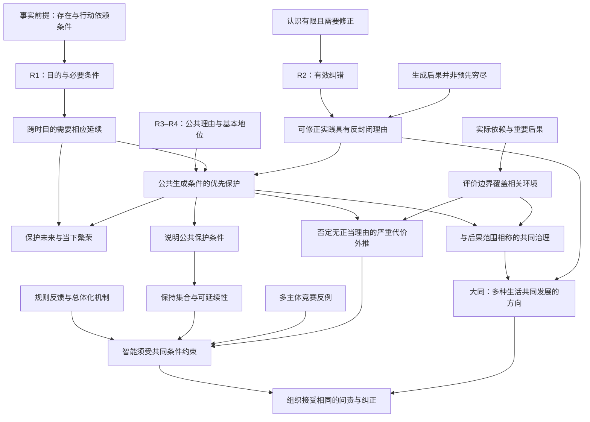

# 生生不息的公共理性基础

## 从生成的不确定性、共同条件与反外部化，到智能向善与开放的共同未来

**理论白皮书／论证工作稿 v0.2 · 2026 年 9 月 5 日**

本文依据作者的《生生不息论》《至善》、Speculative Future、Meta-Attractor 及相关研究材料重建论证，并纳入作者关于物理生成、情境判断和保护未来的进一步澄清，由 AI 协助整理、推演和检查。[v0.1](WHITEPAPER.md)及[物理生成补篇](物理生成与内在规范性_论证补篇.md)均保留。原始材料对应见[论证与来源](论证与来源.md)，本次变化见[v0.2 修订说明](v0.2-修订说明.md)。文中的证明明确区分模型内推导、规范论证和经验判断；论文的说服力也不等于对他人的决定权。

### 摘要

生命、认知和评价活动在世界的生成过程中形成，并持续依赖这一过程。新结构可以成为下一轮生成的条件，也可能产生破坏；其所有后果不能一概在出现之前完整列出。因此，生生不息论不以“每次新生必然增加新生”为前提，而把问题转向：在有限认识中，如何维护共同生活、继续生成、观察后果和修正方向的条件。

本文从实际生活的价值、实践的必要条件、判断的可修正性与公共理由出发，论证保护未来的责任。未来具有多种尚未确定的形式，保护未来意味着维护当下生活继续发展、修复与繁荣的实际条件。善的具体实现因情境而异；但对某些反复出现的破坏机制，可以形成明确的否定判断。尤其是，当一个行动仅以局部收益为充分理由，无视具有实质影响的依赖关系，将可避免的严重损害强加给他者，或取消他者和后来者改变共同安排的能力时，它违反了共同生成条件的保护要求。

本文进一步以总体化机制解释局部优势如何改变规则，以形式化模型说明信息遗漏、软惩罚、竞争困境和反馈延迟的限制。由此提出反外部化与反封闭原则：评价边界应覆盖重要依赖和后果；任何模型、信仰或分数都不得凭自身成功取得封锁现实反馈和垄断共同未来的权利。智能向善、与后果范围相称的共同治理，以及大同作为开放的发展方向，由这些理由和条件推出。原则为行动提供可公开辩护的尺度，并不预定所有未来形式或豁免具体判断。

**关键词：** 生生不息；公共理性；生成条件；善恶；总体化；Meta-Attractor；AI 安全；大同；共同治理。

---

## 一、问题的起点：为什么进步可以损害进步的主体

“更强”是相对于某一目标的比较；“更好”则要求说明目标为什么值得追求，以及由谁承担实现目标的代价。武器可以更精确地毁伤，市场可以更高效地出售注意力，行政系统可以更彻底地消除异议，智能系统可以更忠实地完成委托。这些能力改进本身，都不能回答人的生活是否更有尊严、是否更自由，以及社会是否还能够改变方向。

作者所说“市场成为了神，斗争成为了逻辑”，可以重建为一个可讨论的判断：当某种协调工具获得了最终裁判权，无法在该工具内部显示价值的事物，就容易在决策中被系统性忽略。照护、闲暇、独立判断、生态恢复、失败后重新开始的机会，可能具有重要价值，却没有相应的购买力或短期回报。这个判断并不要求证明所有市场交换都坏，也不要求否定一切竞争。它针对的是工具与目的之间关系的倒置。

更深的问题在于，参与者未必能够凭个人善意退出这种倒置。如果拒绝扩张意味着被淘汰，如果保留纠错程序意味着落后，如果不采用某种技术意味着失去生计，那么个人选择会受制于产生这些选项的结构。结构又可能由上一轮胜利者重写。因而，伦理讨论必须同时回答两个问题：行动者应当怎样做；共同安排为什么持续奖励某类行为，并使其他行为越来越难以存续。

本文不把“人类必然灭亡”当作已经证实的现实预测。需要建立的是更有针对性的论证：哪些发展机制会削弱共同生活的条件；这些机制在什么前提下形成不可接受的风险；为什么提高能力本身不足以修复它们。这样，危机感才能转化为可检验的研究，而不是依赖危机感本身取得认同。

原稿的思想链条由此可以明确写出：

> 生成形成生活、认识与新的生成条件 → 新生的后果具有情境性和不确定性 → 生活的延续与繁荣需要保护共同条件和纠错能力 → 相互依赖要求判断超出“我”的边界 → 无正当理由的代价外推与未来封闭应被否定 → AI 和制度须受此约束 → 共同未来成为责任，大同成为开放方向。

这里每一个箭头都需要论证。尤其是从“存在的条件”走向“善的要求”，不能仅靠词语上的相似完成。

## 二、理论对象：生生不息究竟要求什么延续

### 2.1 从孤立实体转向条件关系

我们的认识包含对差异的登记、对差异之间关系的建模，以及在变化中更新模型。能够完成这些活动的观察者，也由物理结构和关系构成。生成可以形成新结构，新结构又可能改变后来能够发生的相互作用；因而，一次生成的结果可以成为下一次生成的条件。这个递归关系，是本文理解“生生”的起点。它并不保证每个新结构都会促进后续生成。

一个人的能力取决于身体、照护、语言、教育、信任与可获得的资源。一家企业的效率取决于基础设施、知识、劳动力再生产与社会秩序。一个智能系统的行动则依赖能源、设备、数据、部署者与制度接口。因此，存在者并非先完整独立地存在，再偶然与外界发生联系。至少对于本文讨论的生命、社会与技术系统，它们的持续存在包含了对条件的持续取得和更新。

但“相互依赖”本身不是善的定义。寄生者依赖宿主，垄断者依赖被控制者，稳定的压迫关系也可能高度互相依赖。真正的分界在于：依赖关系是否容许各方更新自身、回应伤害、形成异议和改变关系；还是把一方的生存条件转化为另一方永久支配它的工具。Speculative Future 中关于“条件的流通”与“条件的闸门”的区别，应当放在这个位置理解。

### 2.2 三种不同的“生生不息”

为避免循环论证，本文区分三个层次。

1. **事实层的生成持续性：** 某个过程能够在环境约束下维持结构、补充资源、产生后续状态。癌细胞、压迫制度与森林都可能在这一意义上持续；因此，它还不是道德评价。
2. **实践层的可延续性：** 一个行动者仍能实现其有理由认可的计划，获得反馈，并在需要时修正目标和手段。这已涉及行动理由，但仍可能只是某个人或集团的理由。
3. **公共层的生生不息：** 共同安排使受影响者能够过有价值的生活，其基本利益得到考虑，其地位不被任意抹除，并保留共同修正安排的实际能力。这需要后文的公共理由论证。

三个层次不能相互替代。第一层提供约束事实，第二层建立行动的必要条件，第三层讨论这些条件应如何在不同主体之间得到承认。本文的善恶尺度最终位于第三层，却不能脱离前两层而成立。

### 2.3 延续的不是一切既有形态

生生不息不能等于所有组织永不退出、所有个体无限延寿、所有文化形式保持原样，也不能等于人口越多越善。制度的解散、产品的停用、关系的结束，以及生命有限性中的照护，都可能属于良好生活的一部分。应保护的是人及相关生命的利益、关系得以更新的条件和未来行动的能力；某种载体是否应保留，要依据它对这些价值的作用判断。

这同时防止一种危险的挪用：把“人类延续”解释为可以无限牺牲眼前的人。未来之所以具有道德意义，是因为其中会有生活和受影响者；同样的理由也适用于现在。把现实中的人完全转化为未来的燃料，会破坏使未来值得追求的理由结构。

### 2.4 冻结与烧尽：两种不同的失败

原稿反复强调两种极端。一种是冻结：秩序得以保持，却失去学习、异议和改变的空间。另一种是烧尽：变化极其活跃，却不断消耗生成变化所需的身体、生态、信任与注意力。前者以消除未来保存现在，后者以消耗未来放大现在。

良好的持续过程因而至少包含三个相互依赖的功能：维持足以支持生活的结构；产生和接纳有意义的变化；在错误中恢复并修正方向。稳定、开放和更新不是三个可无限累加的数量。变化过快可能摧毁学习，稳定过强可能封闭纠正，更新也需要承担成本。生生不息讨论的是这些功能的关系是否能够持续成立。

### 2.5 “有了未来，才有未来的未来”

某些后续过程需要新的结构、知识或关系先行形成。能够预测它们的部分性质，并不意味着已经枚举了它们与所有环境相遇时的全部后果。我们需要在行动前推理与试验，也需要在行动后继续观察：实际出现了什么，改变了谁的条件，哪些原来的判断需要修订。

这不是宣布一切新事物都不可预测。一座桥的新设计可以接受力学检验；一个新系统的部分行为也可以在部署前验证。困难在于把有限范围的正确预测扩张成对无限情境的保证。开放式演化研究也区分在既定空间内探索与扩展、改变行为空间的创新；这些区分帮助研究新增可能性，并不保证创新必然有益。[Taylor，2018](https://arxiv.org/abs/1806.01883)

我们可以观察到历史中出现新的组织层次与能力，但“全世界的复杂度处处单调增加”不是本论的必要前提。复杂度需要指定尺度和度量。例如，Adami等人在数字有机体与特定环境条件中研究了基因组信息复杂度的增长，不能将该结论直接外推为宇宙的一般规律。[Adami、Ofria与Collier，2000](https://pmc.ncbi.nlm.nih.gov/articles/PMC18257/)

本论真正需要的是较弱且更具体的事实：生成能够打开实际的新能力；这些能力可能促进生活，也可能形成伤害；后来发生的相互作用能够使原有判断得到检验和修正。**未来的开放性因而是持续判断所需要的条件，而非关于世界必然越来越好的保证。**

## 三、从事实到理由：规范桥梁的三层论证

### 3.1 规范如何在自然生成过程中形成

判断者的身体、感受、记忆、目的与推理能力，在持续的物理、生命和社会生成过程中形成，并继续依赖这些过程。不同变化会支持或损害这些能力；这种区别具有实际的因果基础。因此，规范论证需要从生活及其构成关系出发，说明什么对生成者构成利害，为什么这些利害能够进入行动的理由。

已有研究尝试从自我维持的组织关系解释功能的规范性，也尝试通过信息干预考察系统和环境的关联如何影响其延续。这些研究为规范与意义的自然基础提供了具体路径，并未解决全部公共伦理。[Mossio等，2009](https://academic.oup.com/bjps/article-abstract/60/4/813/1635631)；[Kolchinsky与Wolpert，2018](https://arxiv.org/abs/1806.08053)

本论沿此路径进一步区分：能够形成结构；对某个生命或实践有利；能够向其他受影响者说明其正当性。三者之间可以建立连续论证，但每一步需要交代理由。一个局部生成者的扩张可能损害他者；继续发生某种物理变化，也不能代替人的实际生活与繁荣。

问题由此变得具体：我们既已承认生活、认识和创造具有价值，就应当如何对待它们继续发生的条件？当我们的行动改变其他生成者的基本生活和未来时，又为什么不能只计算自己的增长？下列实践与公共理由论证回答这些问题，而不要求先证明所有未来必定更好。

### 3.2 第一座桥：目的与必要条件

**前提 R1：实践一致性。** 如果行动者认可一个目的，并知道条件 C 是实现该目的不可替代的必要条件，那么，在没有足以放弃该目的的理由时，它也有理由保留 C。

这不是把所有条件都宣布为最高价值。一个人可以为了照顾亲人放弃旅行，因为旅行并非无条件目的。但是，一个人不能一面坚持必须完成旅行，一面明知且无其他理由地消除唯一可行路线，并仍把这一选择解释为实现旅行的合理手段。

**命题 N1：有时间跨度的目的产生相应的延续理由。** 若目的 P 需要在区间 H 内持续行动，而条件 C 在 H 内不可替代，则在继续认可 P 的条件下，行动者具有维持 C 至少覆盖 H 的理由。

**论证：** 缺少 C 就无法实现 P；选择无必要地摧毁 C，会同时使自己认可的 P 不可实现；因此这种选择与给定的实践承诺冲突。结论的跨度由 P 决定。一个今天即可完成的有限目的，不由此要求宇宙永远存续。

这一命题将“延续”从随意偏好提升为许多实际目的的共同前提。幸福、学习、照护、创作、建设与共同生活，虽然内容不同，却普遍需要跨越当下的条件。

### 3.3 第二座桥：承认可能出错，就要保留纠错条件

**前提 R2：可修正的判断。** 当行动者知道自己的认识有限，并仍以获得较好理由作为继续行动的依据时，它承认未来证据和受影响者的反馈可能构成修正理由。

**命题 N2：可修正实践具有反封闭理由。** 在其他条件相当、保留渠道没有不可接受代价时，一个承认 R2 的行动者有理由保留获取相关证据、表达异议、修正行动和恢复损害的渠道。

**论证：** 认可“我可能错，新的理由可能重要”，却系统性排除所有能够改变判断的证据，并不能同时作为认真求真的实践。选择性排除无关噪声不构成矛盾；取消纠正自身的所有有效机制则使“愿意修正”失去实际内容。这里的结论不是任何时刻都必须无限讨论，而是行动体系必须使有根据的修正在某个有效环节成为可能。

原稿对开放性的重视由此获得了更明确的依据：开放不是喜爱新鲜事物，而是有限认识者持续形成可靠判断的条件。它并不要求永远推迟行动。实际决断、承诺与局部关闭可以是保护更广泛行动空间的必要方式。

### 3.4 第三座桥：为什么不能只保护赢家

R1 和 R2 仍然不足以排除一个聪明、谨慎、能够自我修正的独裁者。它可能保护自己的长期能力，同时剥夺别人的能力。因此，道德论证必须增加关于人与人之间关系的理由，不能声称自利的可持续性已经自动产生普遍善。

**前提 R3：公共理由的非任意性。** 一个要求受影响者承认其正当性的共同安排，不能仅凭“我更强”“我是制定者”或某种与所讨论利益无关的身份差别，就把相同性质的利益和伤害完全排除在理由之外。相关差异可以支持不同对待，但必须说明差异与决定之间的关系。

**前提 R4：受影响者具有不可任意取消的基本地位。** 当共同安排决定一个人的生存、身体、基本自由和生活可能性时，这个人不能只以对别人的用途被计入。他的基本利益和作为理由来源的地位，不能仅因取消它们能增加优势者的收益而被抹除。

R4 是本文最重要的规范承诺，不能伪装成物理定律。它得到的支持是：公共正当性声称所施加的安排可向受其约束的人说明；如果一个人的反对之所以无效，仅仅因为安排预先剥夺了他提出有效反对的地位，那么“说明”已经退化为权力的自我确认。一个自称不欠任何人解释的强者可以拒绝这种承诺，但它也相应放弃了公共正当性的要求。我们无须证明它的机器会停止运转，才能指出这一点。

这一论证与康德将人视为目的、拒绝仅把人作为手段的思想有联系；本文进一步追问这种地位依赖哪些物质和制度条件才能实际存在。[康德，《道德形而上学奠基》，第二节](https://www.gutenberg.org/cache/epub/5682/pg5682-images.html)

### 3.5 不会发言的人为何仍然在场

这里的“理由来源”不等于当前能够参加辩论。婴儿、失能者、处于昏迷中的人，并不因为不能表达完整主张而失去利益。我们关注痛苦、依赖、发展与关系损失的理由，在他们身上仍然成立；把语言表达能力当作权利开关，会把需要更多照护的人置于更弱的保护之下。

因此，公共理由必须允许可问责的代理表达，并将有感受能力的非人生命所遭受的相关伤害纳入考虑。不同存在者是否具有相同权利，不在这里预先一概决定；相同性质的伤害不能因发言能力不同而被直接忽略。未来世代则通过我们对其生活条件的影响进入理由范围。代理机制会犯错，因此必须接受事实核查、利益冲突约束和修正。

### 3.6 所能得到的结论及其强度

由 R1—R4，生生不息不再只是“我喜欢延续”。对于追求跨时目的的行动者，它是目的实现的条件；对于承认可错性的行动者，它是持续判断的条件；对于要求公共正当性的行动者，它还要求把这些条件扩展到受影响者，而不能只保全自己的力量。

**命题 N3：公共生成条件具有优先的保护理由。** 如果某些条件对于受影响者的基本生活、有效参与或共同纠错不可替代，那么一个满足 R1—R4 的共同安排，不能仅因提高局部收益而取消这些条件。

这是带有明确规范前提的结论。它没有解决一切悲剧性冲突，也没有证明所有基本利益永不冲突。它确立了举证责任：毁损共同条件的行动必须提出足以回应受影响者的理由，不能用“总体更强了”代替这一说明。

### 3.7 从未来的脆弱性到保护未来的责任

未来并不会仅凭时间流逝就自动拥有良好生活的条件。照护需要有人承担，知识需要记录和检验，生态需要恢复，合作需要维系。若当前行动能够毁损这些条件，也可能维护或修复它们，那么未来的部分品质已经成为当下行动的责任对象。

这里的推导有四步：实际生活中的感受、关系、认识和创造已有值得维护的价值；这些价值的继续实现依赖尚未必然得到保障的条件；当行动者能够影响这些条件时，其行动可以使价值延续或受损；依据R1—R4，在没有更强相反理由且负担相称时，它应承担维护和修复的责任。

**命题 N0：保护未来的责任来自已有价值、构成依赖与行动能力的结合。** “未来可能受损”本身不足以产生无限义务；但它与上述理由结合，使保护未来成为可说明的行动要求。

保护未来包括当下的繁荣。今天的身体、关系、教育、自由活动与照护，就是后来生活的条件。为了一个遥远分数而耗尽这些条件，会同时伤害现在与未来。保护未来也不要求眼前形式永久不变；更新、替换与适当终结，可以使共同生活继续发展。

### 3.8 相互依赖为什么要求把“我”之外纳入判断

以完整状态x=(i,e)表示行动者与其环境。环境e包含其他主体及共同条件。若行动a的后果H(a,i,e)随e发生实质变化，那么只读取i的模型，一般不能保证正确判断H。

具体地，假设存在e₁、e₂，使行动者可见信息相同，甚至局部收益相同，却使同一行动在一种环境中维持关键条件、在另一种环境中破坏它们。只依据这些相同信息的判断必然给出相同答案，因而不能同时正确评价两种后果。第六节给出这一信息限制的形式化。

**命题 N5：重要后果不能仅因位于行动者边界之外而被排除。** 其认识论依据是：忽略有因果作用的环境会丧失判断相关后果的能力。其规范依据是R3—R4：他者的相关利益不会因为不属于“我”而自动归零。两项合起来，要求评价范围覆盖实质依赖、重要后果及其传播路径。

这不要求每次行动模拟整个宇宙。对于已证明与所问问题无关、影响可忽略或可由可靠边界吸收的变量，可以合理抽象。需要反对的是为了保留好看的局部结果，删去已知重要的关系和伤害。**“在账外”是记录方式，“不存在”才是事实判断；前者不能充当后者的证据。**

## 四、善恶的重建：评价什么，依据什么

### 4.1 善的三个不可相互替代的维度

公共生生不息中的善，至少需要同时考察：

| 维度 | 核心问题 | 单独优化它的失败方式 |
| --- | --- | --- |
| 生活实现 | 人是否能够免于严重伤害，并拥有值得过的生活、关系和活动？ | 用强制快乐或资源堆积代替自由与参与 |
| 主体与关系 | 人的利益能否作为理由进入决定，是否能够拒绝、参与并改变关系？ | 保留名义权利，却使人缺乏行使权利的现实条件 |
| 共同更新 | 生态、知识、信任与纠错能力是否能够维持、恢复和发展？ | 以未来延续为名，无限压低当下生活 |

善不是这三项任选一项，也不是未经论证的加权总和。它要求在现实情境中寻求三者相互支持的安排，并对无法消除的冲突作公开说明。

**工作定义 D1：** 一项行动在相关范围与时间内，如果改善受影响者的实际生活能力，承认其基本地位，并维护或修复共同生成与纠错条件，就在这些方面具有善的理由。若不能同时改善全部维度，应报告所得、所失、替代方案与补救责任。

**工作定义 D2：** 一项行动若无充分理由地造成严重伤害，或系统性剥夺受影响者的基本地位、生活条件及纠正安排的有效能力，就在相应方面构成恶或不正义；若这种剥夺被固定为可自我强化的规则，则构成结构性的不正义。

这两个定义不会自动排出所有政策的唯一顺序。它们先排除把压迫稳定、单一效率或单纯物种存活直接叫作善的做法，再为进一步比较建立问题结构。

### 4.2 行为后果、个人责任与制度机制

坏后果不等于所有参与者都是恶人。对责任的判断还需要考虑知识、可预见性、行动能力、胁迫、获益与补救机会。一个被迫参与有害竞争的人，和明知存在替代方案却维持该结构的规则制定者，责任不会相同。

但缺乏恶意也不能消除结构问题。如果一种安排反复产生可预见的伤害，而获益者有能力改变却持续阻碍改变，那么它不能无限以“没有人主观想要坏结果”为辩护。生生不息论在这里的力量，是让伦理从识别坏人进一步进入条件和机制的判断。

### 4.3 为什么幸福、爱与创造不能被降为系统燃料

假如一个社会保存了人口与秩序，却让所有人只能为系统维护服务，我们仍有理由认为它失败了。保存生活条件的理由来自生活本身：感受、友谊、爱、游戏、艺术、求知、照护、自由活动，以及人们赋予自己人生的意义。它们不是必须先证明能提高系统产出，才获得价值。

因此，生生不息需要一个双重检验：共同条件是否使生活成为可能；实际生活是否反过来被“维护条件”无限推迟。前者防止耗尽未来，后者防止牺牲现在。一个理论如果只有第一项，会成为生存管理学；两项相互约束，才可能构成面向人的伦理。

### 4.4 情境判断为什么不妨碍明确判恶

无法提前穷尽善的全部形式，不等于无法识别某些破坏性的行动关系。我们未必知道下一代会创造什么，却可以判断无正当理由地毁坏其基本生活、知识与行动条件，会使这些创造变得更难或不再可能。

需要区分三个判断。“尚未证明为善”表示证据不足，不能直接当作恶；“判断方式失责”表示行动者在应当考察重要后果时刻意或持续不作考察，即使偶然未出事，也不消除方法上的责任；“构成恶或结构性不正义”则要求说明实际或有充分根据预见的严重损害、受影响者地位被剥夺，以及缺乏足以正当化这些行为的理由。

**命题 N6：无正当理由的严重代价外推应被否定。** 假如一项行动或制度同时满足下列条件：

1. 它导致、维持或有充分根据预见会导致对他者基本生活、共同更新或有效纠错条件的严重损害；
2. 获益者仅以自身增长、利润、胜利或使命完成为充分理由，将该损害排除在有效决策之外；
3. 针对这种损害，没有成立的必要性、相称性或基本利益冲突的辩护；行动者本可采取相称的避免、减害、调整或修复措施，却无充分理由地拒绝；

那么，该行动或制度违反R3—R4和N3、N5，应被判为非善；当这种关系被持续固定为剥夺他者基本条件的机制时，构成结构性的恶。

**论证：** 第一项指出需要保护的对象及损害；第二项以主体边界和局部收益取消对这些对象的有效考虑，违背公共理由与基本地位；第三项排除了把不可避免的悲剧或真实保护冲突误判为普通收益交换的情况。因而局部成功无法使这一行动正当化。若获益者明知并主动封锁补救，其个人或组织的责任进一步加重。∎

“无充分理由”不是任意免责口。理由至少需要有事实支持，回应具体受影响者，比较可行替代，说明必要性与负担，并允许独立质疑。仅重复“进步需要代价”，没有完成这些要求。

对于尚未完全显现的后果，也可以判断决策方法是否失责：当行动具有实质影响他者基本条件的可信风险，行动者具有相应的调查能力和注意责任，却把“不计算自身边界之外的后果”固定为不可修正的规则，这一规则本身违反N5和R3—R4。它已经排除了本来需要考虑的理由，不必等到每次伤害都发生后才能指出其不正当性。相应要求是与风险相称的审查、约束和纠正，并非穷尽所有微小外部影响。

### 4.5 可以形成公共共识的恶之判准

本论主张公开反对以下机制：以他人的严重且可避免损失维持自己的扩张；把基本生存与参与条件变成服从的筹码；明知重要伤害却阻断发现、表达和纠正；为当前分数或某种终局图景永久取消他者与后来者改变生活的资格。

这些判断不要求所有人共享同一种理想生活。不同生活都需要某些存在、行动与回应条件，因此可以从不同价值出发形成重叠的支持。“可以形成共识”指理由能够向不同受影响者公开辩护，并不保证获益于伤害的人会同意。

共识也不能仅以票数代替理由。多数若以自身便利剥夺少数的基本地位，同样需要接受上述判断。恶在这里指可说明的伤害、支配与封闭关系；它不是某个群体、行业或身份的永久本质。

### 4.6 对利润与外部性的直接判断

利润可以提供某些生产与交换的信息；当损害没有进入价格、产权、责任或行动限制时，利润本身并不记录全部重要后果。缺失的信息可能改变哪项行动应被选择。问题因此有两个层次：单独最大化利润不能保证共同条件得到保护；若实际制度继续奖励并固化N6所描述的损害，则它在该机制上构成非善。

考虑一个两行动模型：A保留基本保护条件，局部回报为3；B突破这些条件，局部回报为5。假定存在可行的A，且B的损害没有更强正当理由。纯局部回报最大化必然选择B。这一有限反例已在Lean中检查，它证明局部回报最优与保护条件可以冲突；结合N6，才能完成相应的规范判断。

这里的结论可以明确表达：**把可避免的严重伤害长期留给他者，以此维持自己的利润，并拒绝相称的约束与修复，是不正当的。** 不能用“市场选择了它”来代替对后果的说明。价格、责任分配、公共供给和行动限制都可以是改进工具，实际采用何种机制要检验其效果以及是否会再次被俘获。

本论无需把全部外部影响称为恶。外部影响可以有益、轻微或经正当安排得到处理。真正被否定的是把重要的外部损害当作无需考虑的零，并将这种排除稳定为获胜条件。

## 五、形式化的第一层：持续存在与可控延续

### 5.1 状态、行动、扰动和保护条件

取状态空间 X、行动集合 A，以及转移关系 T(x,a,y)。它表示在状态 x 采取行动 a 后，y 是模型认为可能出现的后继状态。环境扰动、他人行动与模型内的不确定性，可通过多个可能的 y 表示。历史依赖、时间、资源与未完成义务，必要时都应进入状态。

设 S⊆X 为保护条件。数学并不自动给出 S：它必须由前述规范理由、领域知识和受影响者的具体情况来说明。例如，S 可以包含基本生活保障、尚可恢复的生态条件、有效纠错渠道及危险系统的可控性。把权利和幸福全部转换成精确数值，既非定义的要求，也通常不现实。

对 K⊆X，定义一个行动保持 K，当且仅当：

\[
\operatorname{Keep}(x,a,K)
\iff [\exists y\,T(x,a,y)]\ \land\ [\forall y,\ T(x,a,y)\Rightarrow y\in K].
\]

第一个条件很重要：没有任何后继状态的“行动”，不能因为全称陈述在空集上成立而被当成安全行动。

称 K 为受控保持集，当且仅当：

\[
\forall x\in K:\quad x\in S\ \land\ \exists a\in A\,\operatorname{Keep}(x,a,K).
\]

定义可延续集合：

\[
V(S,T)=\bigcup\{K:K\text{ 是上述受控保持集}\}.
\]

这里使用了可生存性理论中的保持集合思想；这一数学家族有成熟研究，不能作为本理论新发现的定理来署称。本文的工作在于连接其规范输入、总体化机制和公共判断。[Aubin、Bayen 与 Saint-Pierre，2011](https://link.springer.com/book/10.1007/978-3-642-16684-6)

### 5.2 保持定理

**命题 F1：**

\[
x\in V\iff x\in S\ \land\ \exists a\,\operatorname{Keep}(x,a,V).
\]

**证明：** 若 x∈V，则它属于某个保持集 K。K 中的保持行动把所有后继留在 K，因而留在 V，且 x∈S。反向，若 x∈S 且存在把后继全部留在 V 的行动，则集合 V∪{x} 也是保持集：在 x 使用该行动，在其他状态使用 V 已有的保持行动。故 x∈V。∎

这说明“现在没有出事”和“仍有能力持续不出事”不同。后者还要求有可行的行动把下一步留在能够继续保持条件的区域。

**命题 F2：** 如果实际路径从某个保持集开始，而且每一步选择的行动都保持该集合，那么路径的每个时刻都满足 S。

**证明：** 初始状态在集合内；若第 t 步在集合内，保持行动使第 t+1 步仍在集合内。归纳可得所有时刻均在集合内，而集合包含于 S。∎

F1、F2 的离散命题已经由附带的 Lean 文件检查。它们不意味着现实世界的 S、T 已经准确给出，也不保证模型外的扰动受到保护。

### 5.3 三种必须区分的“还有未来”

第一种是存在一条好路径：某种幸运的未来仍有可能。第二种是存在一种能应对模型内所有扰动的行动方式：行动者仍能保证保护条件。第三种是满足给定概率或风险预算的路径安排。三者不能混用。

**命题 F3：** 若 x∈S 但 x∉V，则每个可执行行动都至少有一个可能后继不在 V。

否则，某个行动能把全部后继送回 V，由 F1 可得 x∈V，产生矛盾。这个命题也已通过 Lean 检查。但它不等于“离开 V 后绝无可能回来”。附录中的三状态反例允许从赌局状态幸运地到达安全状态，只是无法排除另一条死亡分支。

原《证明篇》某些不可回返结论采用“存在一条安全路径”的量词；在固定模型中，无安全路径状态的后继确实不可能突然拥有安全路径，否则可把路径接回去。但改成“能对所有扰动保持安全”后，结论必须随之改变。失去控制与注定毁灭之间有重要差别。

### 5.4 数学核心为什么没有偷渡善恶

同一套保持定理可以用于生态恢复，也可以用于维持压迫。因此它证明了条件关系，没有单独完成道德判断。规范层负责说明保护谁、保护什么、为什么具有优先性；形式层负责检查这些要求在模型中是否可共同保持；经验层负责检查模型是否描述了现实。

若 S₁⊆S₂，则 V(S₁,T)⊆V(S₂,T)。这个已检查命题提醒我们：增加保护要求可能减少可行方案，甚至使可延续集合为空。面对这种情况，不能靠重命名宣布所有好事可同时实现；需要改变技术、资源分配或制度条件，或者承认不可消除的冲突并说明选择理由。

### 5.5 模型的边界也是论证的一部分

选择状态变量、受影响者、扰动范围与时间跨度，会直接改变所得结论。一家公司在季度内保持盈利，与整个供应系统跨世代保持更新，是不同命题。不能通过缩短观察期、删去外部成本或把受害者移出模型，让有害行动在形式上变成安全。

使用这套模型至少应说明：保护条件对应哪些利益；哪些变化被归为同一状态；哪些扰动已纳入、哪些仍未知；为什么时间和空间边界覆盖重要后果；在替代建模下结论是否稳健。局部指标只是这些判断的代理，需要持续接受现实反馈。

本节的无限步模型是一种考察持续保持能力的理想化，并不声称物理宇宙保证无限寿命。有限期限的任务可以把期限和剩余义务纳入状态，采用有限时域的安全与终端条件；那是不同的模型，本版 Lean 未实现该扩展。V 的存在定义也不自动提供现实中可计算的决策算法。

## 六、形式化的第二层：开放、信息与不可逆损害

### 6.1 为什么分枝越多不等于越善

原稿尝试用可达状态的增长率刻画生成性：设 Rₙ(x) 为从 x 出发 n 步后的可达状态集合，令 γₙ(x)=log|Rₙ(x)|/n。这个尝试抓住了未来空间被压缩的问题，却不足以直接作为道德标尺。

首先，在有限状态空间中，只要 Rₙ 非空，就有 0≤γₙ≤log|X|/n，故极限一律为零；它不能区分复杂的有限生态与简单循环。其次，纯随机噪声可能产生许多不同状态，却没有维持生命或实现目的的能力。再次，一个完全确定、可预测但能够持续照护与创造的世界，不会仅因观察者对未来没有信息熵而失去价值。

因此，需要区分状态数量、可选择的行动、有效控制、可实现的生活与道德承认。附带 Lean 反例证明确定性的两状态循环可以满足形式上的保持条件；这不证明循环是善，只证明“确定性”不足以判定缺乏持续结构。

生成性的更合适对象是**有效能力**：在实际资源、身体条件和社会关系中，一项生活活动是否真正做得到，代价是否可承受，是否能够选择不做，以及失败后能否恢复。这与 Sen 将评价从拥有多少物品推进到人实际上能够做什么的研究有联系。[Sen，《Equality of What?》](https://tannerlectures.org/wp-content/uploads/2024/07/sen80.pdf)

### 6.2 “未、可、应、转”的四个位置

原稿关于开放未来的讨论，可整理为四个连续问题：

| 位置 | 所问问题 | 防止的混淆 |
| --- | --- | --- |
| 未 | 未来哪些部分仍未确定，哪些认识可能出错？ | 把当前模型当作全部现实 |
| 可 | 哪些行动在具体条件下真正可行？ | 把想象中的选项当作实际自由 |
| 应 | 在受影响者的生活和共同条件之间，哪些行动有正当理由？ | 把能力或可能性当作许可 |
| 转 | 行动后如何反馈、修复并改变方向？ | 把一次正确决定当作永久正确 |

这四者形成判断过程，而非四个可以盲目最大化的指标。开放必须允许判断收束为行动；行动也必须在适当的层级保留再次展开的可能。

### 6.3 保留选择为何通常有价值，又为何不是绝对命令

设 A 为有限非空的原有可选行动集合，u(a,θ) 为情境 θ 中的可积收益。观察相关信息 Y 之后再选择，若原选项不消失、信息没有额外成本，且行动者可以忽略信息，则：

\[
\mathbb E[\max_{a\in A}\mathbb E(u(a,\theta)\mid Y)]
\ \geq\ \max_{a\in A}\mathbb E[u(a,\theta)].
\]

**证明：** 对任何固定行动 a，信息后的最优条件收益至少等于继续选择 a 的条件收益；取期望，再对固定行动取最大值即可。严格优势需要信息确实改变某些最优选择等额外条件。∎

这给出保留判断机会的一个工具性理由，但不能推出永不承诺。等待可能错过救援窗口，维持多个选择可能耗尽资源，信息搜集可能侵犯隐私。生生不息要求比较这些实际代价，而非把“不关门”当作脱离情境的最高戒律。若保留局部选择会毁掉更大的共同空间，局部关闭可能具有正当性。

### 6.4 重复毁灭风险的严格版本

设 Aₖ 表示在前 k 次风险暴露中尚未发生某种不可恢复失败。如果在每一次已经存活的条件下，下一次失败概率至少为 ε，其中 0<ε≤1，则：

\[
\Pr(A_k)\leq(1-\varepsilon)^k.
\]

**证明：** 由条件概率，Pr(Aₖ₊₁)=Pr(Aₖ)Pr(Aₖ₊₁|Aₖ)≤Pr(Aₖ)(1−ε)，递推即可。这里不要求各次事件相互独立，但要求条件风险下界在每次暴露中仍然成立。如果风险确实无限次出现，则存活概率趋近零。∎

这一结论解释了为什么局部回报的持续增加不自动抵消毁灭风险。它也说明原稿中“最终必败”的论断必须附带条件：若风险次数有限、风险趋近零或制度改变了暴露结构，不能继续套用同一结论。对现实 AI 风险，ε 和暴露次数都不是本文已知的数据。

### 6.5 为什么不能只给基本底线一个有限价格

设某系统以 R−λH 评价行动，其中 H=1 表示突破保护底线，λ 为固定有限惩罚，而潜在收益 R 没有上界。那么，总可以找到收益足够大的违规行动，使其得分超过零收益的合规行动。

**命题 F4：** 任意有限惩罚都不能在无界竞争收益下保证底线永不被突破。取违规收益大于 λ 即可。其自然数核心不等式已经通过 Lean 检查。

因此，如果某些损害不能仅因更多竞争收益而被正当化，系统应把相应条件表达为行动约束、分层优先关系或具有严格解释的风险限制；不能只期待一个软惩罚在所有规模下都有效。若收益有已知上界，足够大的有限惩罚可能有效；若条件确实冲突，刚性约束也可能导致无解。这里证明的是适用边界，不是一种算法包办所有伦理问题。

### 6.6 善恶的不对称，及其限度

找到一种值得过的生活，并不能穷尽所有值得过的生活；发现一种足以消灭所有相关生活的机制，却可能构成排除该机制的强理由。原稿关于善恶不对称的洞见，在这里可以保留：正面的生活形式具有开放性，而某些破坏条件的方式具有跨越多种生活形式的否定作用。

但不能由此宣布所有恶都不可逆，或所有不可逆变化都是恶。教育改变人生、作出承诺和个体生命的结束，都包含不可回到原样的部分。需要检查的是不可逆地失去了什么、由谁承担、是否有充分理由，以及是否关闭他人的基本生活与纠正机会。保护未来的原则由此支持可恢复的试验和及时补救，却不要求停止一切会改变世界的行动。

### 6.7 情境判断的形式依据：被删去的信息可能改变结论

设W为相关情境集合，O(w)为当前判断者能获得或愿意纳入的信息，B(w)为某项已明确的事实判据，例如某行动是否破坏关键恢复条件。若存在w₁、w₂使：

\[
O(w_1)=O(w_2),\qquad B(w_1)\neq B(w_2),
\]

则任何只以O为输入的确定性判断器j，都不可能在这两个情境中同时正确：

\[
\neg\big[j(O(w_1))=B(w_1)\ \land\ j(O(w_2))=B(w_2)\big].
\]

**命题 F6：相同输入无法保证区分不同的相关后果。** 若两个判断都正确，相同输入的相同输出就必须同时等于两个不同的B，矛盾。布尔判据版本已由[OpenFuture.lean](formal/OpenFuture.lean)检查。∎

这一命题既适用于未知的新交互，也适用于被有意排除的外部性。它不证明所有未来都不可预测：若进一步的知识能够排除其中一种情境，或两者对判据没有区别，原来的限制就可能解除。

它支持的是一个具体要求：当现有信息不能区分重要后果时，要补充相关观测、试验和模型，或采用能够承受这种不确定性的行动边界；不能把同一个局部得分冒充全部情境的正确判断。分类器也可以明确返回“不确定”，但这不等于已得到可以无限扩大行动的许可。

原则与情境判断由此各有作用。原则说明为什么要保护基本生活、共同条件和纠错；情境判断说明实际行动如何影响它们。我们可以对新的实现形式保持开放，同时坚持已得到理由支持的限制。

## 七、总体化与 Meta-Attractor：为什么局部理性会重写世界

### 7.1 从固定规则中的竞争，进入规则本身的竞争

在简单优化模型里，规则给定，行动者寻找最优行动。社会过程更复杂：经济优势可以影响立法和基础设施，注意力优势可以影响何种事实被看见，技术优势可以改变进入门槛，军事优势可以改变谈判条件。竞争的结果会进入下一轮竞争的规则。

可用两个耦合状态表示：

\[
x_{t+1}=F(x_t,\sigma_t),\qquad
\sigma_{t+1}=G(x_t,\sigma_t),
\]

其中 x 是资源与行为状态，σ 是规则、标准、注意力分配和可被承认的目标。Meta-Attractor 所关注的，正是选择过程及其评价标准也被选择结果改变的情形。

**工作定义 D3：总体化。** 某个局部目标获得对共同存在条件的广泛控制，并借此使其他主体越来越只能以服务该目标的方式生存，同时削弱拒绝、纠正和形成替代安排的能力。

因此，总体化不等于组织很大、标准统一或力量很强。公共卫生标准可以协调行动，强有力的公共机构也可以保护弱者。判断关键在于力量能否被问责、受影响者是否保有有效地位，以及共同条件是否变成单一目标的永久闸门。

### 7.2 一个可以验证的局部反馈模型

设 a 表示某方相对优势的偏离，r 表示规则向其偏移的程度。线性近似为：

\[
\begin{pmatrix}a_{t+1}\\r_{t+1}\end{pmatrix}
=
M\begin{pmatrix}a_t\\r_t\end{pmatrix},\quad
M=\begin{pmatrix}1-\delta_a&\beta\\\gamma&1-\delta_r\end{pmatrix}.
\]

取 0<δₐ,δᵣ≤1，β,γ≥0。δ 表示优势消散和规则纠偏，β 表示有利规则转化为优势的强度，γ 表示优势转化为规则影响的强度。矩阵特征值为：

\[
\lambda_\pm=1-\frac{\delta_a+\delta_r}{2}
\pm\sqrt{\left(\frac{\delta_a-\delta_r}{2}\right)^2+\beta\gamma}.
\]

**命题 M1：** 在上述参数条件下，若 βγ>δₐδᵣ，则 λ₊>1，原平衡在这一模式上局部不稳定；若 βγ<δₐδᵣ，则两个特征值的绝对值均小于 1。

**证明：** λ₊>1 等价于根号项大于 (δₐ+δᵣ)/2，平方整理即得 βγ>δₐδᵣ。反向严格小于时，λ₊<1；同时 λ₋>1−δₐ−δᵣ≥−1，故谱半径小于 1。等号为边界情形，线性部分不足以给出渐近稳定结论。∎

这项推导把“正反馈可能失控”变成一个附带条件的陈述。仅知道 βγ>0，不能宣布系统已经失稳；局部不稳定也不能证明最终一定形成全球唯一吸引子。后者还需要非线性饱和、资源约束、竞争者响应、边界条件与现实数据。

### 7.3 降低速度为何可能只延迟同一方向

原 Meta-Attractor 数学稿还讨论相关优势的放大。对一个固定的实对称矩阵 C，设：

\[
\dot w=\kappa Cw,\quad \kappa>0.
\]

若 C 的最大特征值 λ₁ 严格大于 λ₂，且初始 w 在首特征向量方向上的分量不为零，则将 w 按长度归一化后，其方向趋向首特征向量或其反向。因为特征分量之比按 exp[−κ(λ₁−λⱼ)t] 衰减。

**命题 M2：** 在这个固定矩阵模型中，单纯降低正的 κ 会放慢方向收敛，却不改变占优的特征方向。改变长期方向，需要改变 C、加入足以影响结构的反馈，或改变模型假设。

这说明为什么“放慢一点”未必足够：如果不改变优势之间的转换关系，同一种总体化可以在更慢的速度下继续。但它也不证明现实中的最大特征方向必然是资本、军备或控制。选择变量、估计矩阵和检验是否近似固定，都是经验工作。

### 7.4 四个层级如何相互强化

在作者材料中，总体化并非只发生于资本分配。它可以通过四个层级连接起来：个人认知把某个分数当作成功；人与人之间按照该分数分配声望和信任；制度按照它分配资源与决定权；物质基础设施又使依赖该分数的行为更加容易，使其他行为越来越昂贵。

例如，一个假设性平台把停留时长作为核心指标，收入依赖停留时长，收入又用于扩大触达并影响规则，创作者则为生计适应平台偏好。如果独立传播、收入来源和用户迁移机会逐步消失，问题就超出了“推荐模型是否忠实优化指标”。这是一个机制示例，不是对某个具体平台已经完成的实证判定。

Goodhart 研究分析了代理指标被优化时失效的不同机制，为“分数不等于价值”提供了已有研究背景。本文进一步追问：当代理指标的胜利者可以改变他人的生存条件时，代理失效如何转化为制度性的不可退出。[Manheim 与 Garrabrant，2018/2019](https://arxiv.org/abs/1803.04585)

### 7.5 总体化与生生不息的直接冲突

两者之间的冲突不是因为一个喜欢变化、另一个不喜欢变化。总体化系统也可能高速创新。冲突在于创新资格被单一目标所垄断：允许产生新东西，却不允许改变什么算值得产生；允许选择手段，却不允许受影响者重新讨论目的。

由 N2，取消有效纠错破坏可修正判断的条件；由 N3，把基本生活与承认完全系于服从某个局部目标，不能仅靠该目标的收益正当化。因此，当总体化满足这些具体特征时，它与公共生生不息发生可说明的规范冲突。这一结论不依赖于证明总体化最后必然自我毁灭。一个能够稳定存在的压迫体系，仍然可以是不正义的。

### 7.6 为什么把一个模型变成全部世界的终点应被否定

有限模型必须有所选择。某种选择对特定任务可以有效，但它不能仅凭任务内成功，取得决定全部生活形式的资格。当某模型、信仰或指标被用于控制共同生活，排除无法被其表达的价值，并阻止现实反馈和后来者改变目标时，简化就转化成了总体化。

**命题 N7：以未经充分论证的局部模型永久封闭共同未来，不具有公共正当性。** 若这种封闭取消了基本生活和有效纠错条件，且没有相称的保护理由，则由N2、N3、N5、N6应予否定。即使模型在自身指标上不断成功，结论也不改变，因为所需要回应的后果已经被其评价方式排除。

这正是“争大小、断子孙路”的机制含义：当下的胜利者不仅获得一次收益，还剥夺后来者提出新目的、形成其他生活和纠正错误的条件。未来被当作完成当下模型的材料，而失去自身继续形成价值和判断的地位。

这一结论不禁止所有固定规则或收敛目标。可靠的安全底线、针对具体疾病的治疗目标、承认新证据的科学模型，都可能保护更广泛的未来。需要否定的是把局部目标提升为对全部共同生活的不可修正统治，特别是用无法质疑的终局正当化现实伤害。生生不息理论自身也不能获得这种豁免。

## 八、资源、共存与“通吃”：原证明篇可以保留多强的结论

### 8.1 条件耗损定理

原稿尝试说明，获胜者消灭他者后也可能破坏自己的条件。把这一论证写严，需要具体假设。设共同资源存量 sₜ≤s̄，再生量每期至多 Y*；某种支配行动持续 τ 期，每期消耗至少 e，其中 e>Y*。若：

\[
(e-Y^*)\tau>\bar s-s_{\mathrm{crit}},
\]

则持续执行完整 τ 期，会使存量在这一时段内越过临界线 s_crit，或者行动因资源不足而更早中止。

**证明：** 每期净减少至少 e−Y*，因此 s_τ≤s₀−τ(e−Y*)≤s̄−τ(e−Y*)<s_crit。∎

若再增加“低于临界线不再恢复”和“存活持续需要消耗”的假设，才可进一步推导最终枯竭。这个结果说明某一类通吃策略会破坏自身，不说明所有统治都必然昂贵到满足这些条件。若压迫者能够维持资源、替代被消灭者的功能并长期封锁反抗，原来的资源证明就不能直接反驳它；此时仍需要公共正当性的批判。

### 8.2 共存具有优势的条件

共存可能通过知识分工、差异化试错、互补能力、相互纠错和资源更新提高共同能力。但结论取决于合作收益是否存在、能否分享、冲突成本是否受控，以及参与者是否能够获得维持参与的条件。若每个独立参与者都能带来正的净知识贡献，消灭参与者会减少相应贡献；若贡献为负或合作机制失败，就不能仅凭人数增加推出更好结果。

公共生生不息因此不需要声称“多永远胜过少”。它需要论证不应把他者的独立存在轻易当作可删除的成本，并为多样性发挥作用建立条件。需要的是差异能够协作、失误能够被发现、局部失败不至于共同毁灭。

### 8.3 多样性与必要的协调

形式不同不代表风险独立。许多组织使用不同名称，却依赖同一基础设施、同一收入渠道或同一判断模型，可能仍然具有高度相关的失败风险。相反，若彼此完全不能沟通、没有共同承诺，多样性也可能成为无法协调的碎片化。

因此，需要保护的是与实际扰动有关的响应多样性、适当的故障隔离和可工作的共同接口。Ashby 的必要多样性讨论说明了调节能力与所需应对的扰动之间的关系；它不能直接推出“世界差异越多越好”，也不要求每个治理者完整复制整个世界。[Ashby，《An Introduction to Cybernetics》，第十一章](https://ashby.info/Ashby-Introduction-to-Cybernetics.pdf)

## 九、智能向善为何不能缩减为听话

### 9.1 一个充分反例：所有 AI 都忠诚，所有人仍然变差

考虑两个参与方，都可以选择克制或竞赛。下表中的数是用于证明可能性的效用序数示例，不是现实国家或企业的数据：

| 甲／乙 | 乙克制 | 乙竞赛 |
| --- | --- | --- |
| 甲克制 | (3,3) | (0,5) |
| 甲竞赛 | (5,0) | (1,1) |

对任意一方，竞赛在对方两个选择下都严格优于单方克制。因此，分别忠实最大化委托者收益的 AI 会选择竞赛，得到 (1,1)，却使双方都差于共同克制的 (3,3)。这两个不等式已在 Lean 中检查。

**命题 A1：** 对每个委托者的忠实优化，不足以保证多主体整体结果良好。证明只需要上述一个反例。∎

这个命题不意味着意图对齐没有价值，也不意味着现实所有竞争都符合这一矩阵。它说明意图对齐与结构及多主体安全是两个必须同时处理的问题。合作型 AI 和 ARCHES 等研究已经明确讨论了多主体合作与社会层面的安全问题，本文应与它们对话，而不能把整个领域描述成只会让模型听话。[Dafoe 等，2020](https://arxiv.org/abs/2012.08630)；[Critch 与 Krueger，2020](https://arxiv.org/abs/2006.04948)

### 9.2 智能增强也可能增强选择压力

AI 不仅增加某个主体实现意图的能力，也可能改变谁有资格继续作为主体。例如，如果就业、表达、文化生产和公共治理越来越不需要多数人的参与，那么仅靠“系统依赖人，所以会顾及人”的隐含约束可能减弱。这与《Gradual Disempowerment》所研究的渐进失权问题相近；该文是风险机制研究，不能被当作已经发生的必然结局。[Kulveit 等，2025](https://arxiv.org/abs/2501.16946)

因此，“以人为本”的严格含义不能只是系统最终给人某些消费品。它还包括：人拥有不以竞争效用为条件的基本地位，对共同生活具有实际发言和改变能力，可以形成技术之外或不同技术条件下的生活，而不是被动接受已经完成的安排。

### 9.3 从公共生成条件推出智能的约束

若某项 AI 行动会实质影响共同条件，且其部署要求公共正当性，那么由 N3，部署者不能只援引自身收益；由 A1，也不能只证明模型忠实于自身意图。因此必须同时论证：该行动不会无充分理由地毁损受影响者的基本利益；相关人有有效申诉与修正渠道；风险评估覆盖多主体相互作用和权力转移；出错时仍保有有效干预能力。

**命题 A2：智能向善是正当部署的要求。** 在 R1—R4 与相关影响条件成立时，智能的扩大使用必须受公共生成条件约束。这里“向善”不是要求 AI 采用一个神谕般的终极善恶分数，而是使其能力始终可向受影响者说明、受共同底线限制，并保留纠正的可能。

由此，对“让 AI 为我们赢得一切”的批判获得了具体范围：不能允许一个委托者借助 AI 取消他人的基本地位和共同纠错条件。它不等于禁止一切竞争、合法防御、反欺诈或反压迫行动。判断仍须比较真实威胁、比例、替代方案及后果。

### 9.4 零和博弈与毁损未来的竞争

严格的零和仅说明所选收益之和为零，不直接说明公共生活受到损害。一项自愿、有边界的比赛，可以把比分安排为一方得分、另一方失分，同时不损害共同生活的基本条件。新增Lean模型给出了零和比分与保持背景条件同时成立的反例。因此，“所有零和互动必然是恶”这个普遍命题不能成立。

现实中的问题是把所有生活关系都组织成只能靠击败他者取得基本条件的竞争，或者使胜者有权取消败者的生活与未来。此时，所计入的竞争收益可能是零和的，被排除的共同损害却不是零。军事升级、规则俘获或有害的成本外推，都需要依据实际机制判断，不能由收益矩阵标签直接完成。

**可以明确否定的是：一种竞争若持续奖励对共同条件的无正当理由破坏，并使参与者为了生存被迫加剧这种破坏，它在这一机制上是非善的。** 意图对齐的AI若扩大这种机制，同样需要承担相应判断。改进应当改变竞争边界、基本保障、收益条件和纠正能力，使参与不必以断绝他人的未来为代价。

## 十、发展必须保持在能够纠正的范围内

### 10.1 为什么能力增长不等于判断同步增长

一些能力可以通过复制系统、并行计算和扩大部署迅速扩张。但是，关于一种新干预如何改变社会的判断，可能依赖尚未发生的反馈、难以隔离的相互作用和受影响者的经验。并非所有知识都可以按部署数量同比复制。

这不是普遍宣称“理解永远追不上技术”。在形式化充分、反馈快速的领域，验证可能赶得上甚至先于部署。应当检验的是具体领域：伤害多快扩散，何时能被识别，谁能提出有效异议，以及停止或修复是否仍然来得及。

### 10.2 一个反馈延迟条件

设某类尚未被纠正的损害 h 在干预之前满足 dh/dt=gh，g>0；从损害出现到有效干预需要 τ；超过 B 则跨越不可接受的阈值。该模型中，干预前不越界的必要条件为：

\[
h_0e^{g\tau}\leq B.
\]

这只是微分方程的直接解，不是对社会损害增长率的测量。它揭示一个结构关系：扩张增益 g、反馈延迟 τ 和缓冲能力 B 必须一起考虑。更强的干预能力若始终在越界之后才到场，也不足以维持保护条件。

可以通过降低扩散增益、缩短发现和纠正时间、增加缓冲、限制部署范围或隔离失败来改变关系。仅规定一个统一速度，未必适用于所有领域；只宣布“将来更强的技术会解决”，也没有回应当前是否会先越过阈值。

### 10.3 可纠正性必须成为现实权力

“接受反馈”可以只是界面上的按钮。有效纠正还需要能够发现问题的人不被惩罚，能够提出问题的人有被听见的渠道，具有决定权的人有责任响应，以及实际停用、回滚和赔偿不会被部署者单方面封锁。

《The Off-Switch Game》在特定博弈设定中研究了目标不确定性与保留关闭开关的激励。这为设计纠正机制提供了一个具体研究入口，但不能证明加入谦逊表述的任意 AI 都会保持可纠正。[Hadfield-Menell 等，2016/2017](https://arxiv.org/abs/1611.08219)

由 N2 与上述延迟关系，可以得到一个开发原则：扩大能力与部署范围之前，应当具有与其影响相称的检测、干预和问责能力。当这种能力不足时，证明扩大部署仍然可接受的责任在扩大者一方。这个原则并不要求任何创新零风险，而是拒绝把他人承担无法纠正的风险当成默认许可。

## 十一、把善恶尺度落实为行动比较

### 11.1 先表达保护要求，再比较改进

设 I 为相关受影响者集合，Pᵢ(x) 表示状态 x 满足对 i 有理由成立的基本保护要求，E(x) 表示共享生态与物质条件，C(x) 表示有效的公共纠错条件。可以写出：

\[
S_{\mathrm{pub}}(x)=E(x)\land C(x)\land\bigwedge_{i\in I}P_i(x).
\]

这个合取表达的是“每个人的基本地位都必须被考虑”，不是预先声称所有欲望都必须满足。Pᵢ需要辨别基本利益与一般偏好，也需要随义务、能力和时间变化；它不应被设成每个人永远不受任何损失。代表未来世代或非人生命时，必须另行说明保护要求及代表方式。

对存在可行保持方案的情境，可以先把保持 V(S_pub,T) 的行动作为候选，再比较候选行动实际带来的生活改善、负担分配与未来能力。这样，善恶判断获得了两层形式：保护条件限定可被接受的行动范围；正面价值决定在范围内为什么选择某个行动。

**命题 F5：** 若 x∈V(S_pub,T)，则对每个 i，都满足 Pᵢ(x)。交换利益承受者的索引、保持其保护要求对应不变，不改变合取条件的真假。两项结构结果已通过 Lean 检查。

这些证明检验的是“所有人”在表达中是否真的包含每一个人。为什么要采用这种公共保护形式，来自 R3—R4；Lean 不会替我们证明谁具有何种基本权利。

### 11.2 一个有限但严格的改进关系

在同样满足保护条件的可比较方案 a、b 之间，设 q_d(a) 表示某个已说明含义的评价维度 d，例如特定群体的照护可获得性、参与能力或某项恢复条件。只有量纲相同且比较确有依据时，才使用相应大小关系。

定义：

\[
a\succ_G b\iff[\forall d,\ q_d(a)\geq q_d(b)]\land
[\exists d,\ q_d(a)>q_d(b)].
\]

这是一个很弱但有用的严格改进关系：它不允许通过隐藏某一维度的恶化来宣称无代价的进步。若维度采用同一有序表示，则它不可自反，且可传递。附录对整数表示给出机器检查；整数只是演示类型，并不主张现实中的尊严可以按整数测量。

大量真正重要的选择不会在这个关系下可比。例如，一种安排改善某些人的收入，却损害另一些人的退出能力。此时需要更具体的权利、需要、风险与分配论证，不能把不完备的比较伪装成一个总分已经解决。

### 11.3 当没有方案能够同时满足所有要求

若可行集合为空，应首先检查模型是否遗漏可用技术、互助方式、资源转移或时间安排；也应检查保护条件是否误把某些特权当作基本要求。如果冲突仍然存在，就进入悲剧性选择，而不是假装约束从未发生。

处理这种选择至少需要公开事实与不确定性，认真比较替代方案，说明为什么某些负担不能避免，尽量减少不可逆伤害，并承担补救与制度改进责任。R4并不保证世界不会迫使人作出痛苦决定；它禁止把这些人的损失当作根本不需要解释的零。

因此，生生不息在这里产生的是有约束、可说明、允许不完备的判断体系。其严格性不来自“任何情境都立即算出唯一答案”，而来自不能任意删去主体、后果或前提。

## 十二、为什么会推出人类共同未来，而不只是彼此善意

### 12.1 后果的共同性与治理的共同性

如果甲的行动会改变乙不可替代的生活条件，那么仅由甲决定是否应当这样行动，可能使乙承担无法回避的代价。空气、气候、战争升级、跨域基础设施和某些 AI 部署，都可能产生超出直接交易边界的后果；具体范围必须逐案辨认，不能把“万物相关”当作无限扩大权力的许可。

**命题 N4：后果范围要求相应的理由与问责范围。** 若一个行动对某些人的基本利益具有实质影响，且共同安排要求公共正当性，那么这些人的相关利益必须进入决定的理由结构，并具有与影响相称的代表、申诉和问责渠道。

**论证：** R3不允许仅因当事人位于现有决策边界之外，就排除与边界内同样性质的重要伤害；R4不允许以这种排除取消其地位。因此，现有边界不能单独决定全部道德范围。∎

当某种后果具有全球范围和代际跨度时，共同治理的理由也相应扩展。人类命运共同体在这个意义上不只是感情表达，而是对相互影响与公共正当性共同提出的要求。

这里与N5形成两步连接：相互依赖说明哪些因素在事实上不能被忽略；公共理由说明受影响者为什么不能在规范上被删去。因此，interconnectedness不只是“万物有关”的表述，而要求将真实依赖转化为观察、责任和参与的安排。

### 12.2 共同体不等于一个中心决定所有事情

由 N4 可以推出跨边界协调的必要性，不能直接推出唯一世界政府、某种现成制度或某个国家天然拥有代表权。不同问题的后果范围、地方知识与决策可逆性不同，所需治理尺度也不同。

可行方向是相互连接且可问责的多层治理：可以由地方处理的事项尽量留在地方；跨域损害需要跨域约束；影响全体的风险需要更广泛代表；各层都保留纠正和防止权力自我豁免的机制。Ostrom 对复杂经济系统多中心治理的研究，是这一制度研究方向的重要对话对象，不是任何具体制度必然成功的保证。[Ostrom，2010](https://www.aeaweb.org/articles?id=10.1257/aer.100.3.641)

### 12.3 共同条件并不消除真实冲突

人们共享某些条件，并不意味着他们已经共享所有价值。资源稀缺、历史伤害、身份冲突和不对称权力，不会因宣布共同体而消失。共同体的实践内容，是建立处理这些冲突的方式，使它们不必总以取消对方生存资格或彻底封死未来来解决。

因此，道德和理性不要求回避立场。面对明确的伤害和压迫，可以作出强判断；但判断应当指向行为、关系和可检验的理由，并允许修正事实错误，而不是把群体身份本身当作永恒的善恶证明。这才回应作者关于避免非黑即白站队的要求。

## 十三、大同作为方向：开放的规范秩序如何可能

### 13.1 为什么不设置最终完成的社会模板

如果人的需要、知识与关系会变化，而当前认知又可能出错，那么任何具体社会形态都需要保留修正余地。由 N2，若一个方案声称最终回答了一切问题，并取消后来者重新讨论它的权利，它就削弱了使其判断保持可靠的条件。

本文据此赋予“大同”一种现代的规范解释：不同的人能够共同生活，基本利益得到照顾，公共权力可问责，人们能够发展各自生活，并共同修正共享安排。这里讨论的是本文如何使用这一概念，不声称历史上所有大同思想都具有同一种开放含义；同样，也不能把所有乌托邦思想一概等同于封闭极权。真正要批评的是把某个终局图景绝对化，并使现实中的人失去修改它的资格。

因此，大同的开放性也包含积极内容：使当下的生活继续繁荣，并为后来的人留下发展、创造与重新理解美好生活的条件。谨慎、停止有害活动和恢复受损关系，都是这一建设的一部分；开放也需要教育、照护、文化与基础设施使新的生活实际成为可能。

### 13.2 方向如何具有内容

方向不等于模糊愿望。由前文，可以检查一项变化是否减少严重匮乏与任意支配，是否扩大真实生活能力，是否改善共同条件，是否使错误更容易被发现和修复。这样的方向具有可争论、可比较的内容，却不要求每个人最终过同一种生活。

尤其需要区分“共同的底线”与“共同的全部目的”。人们可以在禁止任意剥夺、提供基本照护和维护纠错渠道上形成合作，同时对宗教、艺术、家庭、职业和生活意义保有差异。大同的“同”在此指向共同参与和共存的条件，并非所有判断的同一。

### 13.3 从仁义礼智信到制度功能

作者的传统伦理词汇不必停留在文化装饰。它们可以与前文形成相互解释的关系：

| 概念 | 在本文中的作用 | 缺少它时的具体问题 |
| --- | --- | --- |
| 仁 | 对具体生命的感受、脆弱与依赖保持回应 | 系统保存抽象指标，却忽视实际受苦者 |
| 义 | 说明利益分配与行动限制的正当理由 | 强者把成功或身份直接当作应得 |
| 礼 | 把尊重、承诺与合作沉淀为可学习的程序 | 每次互动都需重新争夺地位，合作成本过高 |
| 智 | 在有限信息与具体情境中辨别后果、承认错误 | 原则僵化，或技术能力代替判断 |
| 信 | 使承诺可被合理依赖，并使背弃承担责任 | 即使共同合作更好，参与者仍不敢行动 |
| 中和 | 在需要、约束与差异之间作适当调节 | 以单项极大值破坏支持该价值的其他条件 |

这是一种功能性重建，不是宣称古典文本已经包含现代控制论或 AI 治理的全部答案。德可以理解为这些回应能力在行动者与制度中的稳定形成；真要求判断持续接触现实；美为生活开启不能被功利分数穷尽的感受与意义。它们共同防止生生不息被缩减为一个只有生存和风险的贫乏体系。

## 十四、从方向走向合作：改变使人无法向善的条件

### 14.1 为什么共同愿景有用，又为什么仅有愿景不够

共同愿景可以帮助人看见另一种可行未来，形成对合作的预期，并协调资源。但在第九节的竞争矩阵中，只要收益与违约条件不变，大家一起宣读善意并不会改变单方竞赛的优势。

合作转变需要使“别人也会遵守”成为可以合理依赖的事实。具体工具包括条件性的共同承诺、可验证的执行、比例适当的违约后果、第三方保障、补偿和逐步扩大合作范围。它们的作用是改变行动的实际条件与收益，而不是要求每个人独自承担守善即被淘汰的代价。

验证本身也可能变成监控和支配。因此只应收集履约所需的信息，并对监督者施加用途限制、问责和申诉机制。不能为了避免竞争总体化，再建立一个不受约束的监督总体化。

### 14.2 基本保障为什么是自由的条件

如果拒绝某种安排就意味着失去住所、医疗或基本生计，那么法律上可以拒绝，并不等于实际能够拒绝。由 R4，保护主体地位需要考察现实退出与参与能力，而非仅保存一纸许可。

因此，减少基本匮乏、提供照护与教育、使人拥有可承受的迁移和重新开始机会，并非竞争结束后的可选慈善。它们改变了参与者能否对不正当要求说“不”的条件。AI 若能提高供给能力，应当研究这种能力如何转化为更广泛的真实自由。

但技术丰裕不会自动产生自由：土地与关键资源可能被垄断，分配权可能集中，网络效应可能使退出代价上升，照护也包含不能简单以机器产量替代的关系。必须研究所有权、获得权、公共供给、互助结构和议价能力。本文不预言某年资源就会免费，也不把技术可能性当作已经兑现的保障。

### 14.3 不把消灭欲望当作制度方案

好奇、竞争、声望、归属与创造欲不必被一概压抑。问题在于这些动力是否只能通过伤害共同条件来获得满足。社会可以为竞争设置不剥夺基本地位的边界，为创新提供试错空间，为声望提供多种尺度，为失败提供重新开始的条件。

同样，要求“善良的人进入权力中心”还不够。若角色奖励迫使任职者不断扩大控制，那么人员更替可能只是替换了同一机制的执行者。需要改变权力能够做什么、如何获得、如何被限制，以及退出者是否还能生活。

### 14.4 转变不应以共同崩溃为前提

原材料讨论危机可能改变合作条件，这可以作为一种情景分析。但从中不能推出应该等待、制造或利用灾难让人接受理论。由公共生成条件本身，避免严重损害和保护脆弱者具有理由。

更合适的变化路径是在危机之前建立可工作的局部实例：能够提供真实保障的社区、能够接受外部审查的 AI 项目、可迁移且不锁定用户的基础设施、可验证的合作承诺。实例需要记录成本、失败和适用条件，使其他人能够判断它是否值得采用。方向通过可检验的生活改善取得可信度。

## 十五、由理论推出组织原则，以及理论不能授予的权力

### 15.1 组织存在的理由

若能力增长、制度激励与公共判断之间存在缺口，那么一个组织可以通过研究、公共讨论、工具建设和合作实验减少这一缺口。其任务应具体表述为：识别损害共同生成条件的机制；研究并验证减少这些损害的办法；使受影响者能够参与决定技术和制度的发展方向。

组织的正当性由其工作是否真实、有用、可问责而逐步形成，不由“掌握终极善”一次性取得。本文可以提供共同语言和论证依据，不能取代成员授权、公共参与、专业评审或制度责任。

### 15.2 原则必须反过来约束组织自己

| 组织要求 | 推导依据 | 应当可观察的安排 |
| --- | --- | --- |
| 理由与证据公开 | R2与持续纠错 | 区分事实、模型、价值前提；公布重大修订与失败 |
| 受影响者能够参与 | R3—R4、N4 | 有效的反馈、申诉和代表渠道，而非只邀请支持者 |
| 权力不能自我豁免 | 总体化分析 | 利益冲突披露、独立审查、适当任期与权限边界 |
| 人不以贡献大小决定价值 | 公共基本地位 | 不以产出、财富或忠诚决定基本尊重与保障 |
| 不以使命压倒全部生活 | 第四节的正面价值 | 对劳动、照护、休息和退出承担实际责任 |
| 高影响实验先具备纠正能力 | 第十节 | 与风险相称的试验范围、停止条件与补救责任 |
| 合作不要求思想一致 | 开放的大同方向 | 允许批评、不同生活选择以及对理论本身的修订 |
| 不垄断未来 | N2与反总体化 | 工具尽可能可移植，参与可退出，继任与解散有安排 |

这些并非附加的品牌美德。如果组织以善为名封锁异议，以人类未来为名耗尽成员，或把资源永久系于个人权威，它就在实践上否定自己的论证。

### 15.3 legitimacy 的三个不同含义

**认识上的可信度**来自概念清楚、推理有效、来源准确和反例检验。**规范上的正当性**来自能够回应受影响者的理由，以及对权力和伤害的合理限制。**组织上的授权**来自真实参与、有效程序和具体责任。

这三者可以相互支持，却不能相互冒充。机器检查若干定理，不等于现实判断全部正确；一套伦理具有说服力，不等于作者获准替所有人决定；成员同意加入，也不等于组织可以任意影响外部的人。

组织应当寻求的是能够经受这些不同检验的正当性，而不是一份看起来足够像论文的免责文件。

## 十六、最强的反对意见与明确的研究边界

### 16.1 “你仍然选了规范前提，何来必然？”

确实如此，本文没有从无前提的宇宙事实产生道德义务。但条件性并不意味着随意性。一个人若同时认可跨时目的、有限认识和公共正当性，就不能任意拒绝这些承诺的必要后果。本文的“必然”是论证关系的必然：接受前提且情境条件成立，就应接受相应结论，或说明自己撤回哪一项承诺。

一个拒绝他人任何地位的行动者不会被纯算术强迫成为善人。规范论证的作用是揭示其公共理由不足，并支持对其行为的正当限制，而不是保证所有有算力的系统自动服从。

### 16.2 “维持系统会不会成为压迫人的新理由？”

会，如果把事实层的持续性直接等同于善。因此本文特意区分三层生生不息，并要求生活实现、主体地位和共同更新相互约束。若某种稳定只能通过永久取消人的有效地位来维持，就不能仅凭稳定获得公共正当性。

### 16.3 “开放会不会让社会无法决定，无法防御？”

不会必然如此。开放是可修正性，不是无限拖延。为了防止侵害，可以依法采取限制、隔离和防御；为了合作，可以作出长期承诺。关键在于限制是否有具体理由、与威胁相称、接受问责，并保留必要的复核，而不是把例外永久化。

这里仍有一个没有被本稿解决的难题：足以约束极强、决意背叛的对手的防御能力，如何可靠地避免自己成为不受约束的统治力量？限权、分权与审查给出了研究方向，尚未构成对所有极端情景的保证。这既是 Speculative Future 明确留下的问题，也是本组织若进入高能力 AI 实践必须面对的实质缺口。

### 16.4 “如果牺牲少数真能拯救多数？”

这需要区别一般利益交换与无法避免的灾难选择。本文反对的是仅凭优势者收益就取消少数的地位；它不假定所有紧急情境都有无损解。若生命或基本条件确实冲突，需要具体伦理与事实分析，不能把“整体延续”作为自动答案。被迫承担损失的人仍然具有地位，其损失仍须被承认、解释与尽可能补救。

### 16.5 “若 AI 真比人更有能力，为什么仍以人为本？”

因为能力优势不产生取消别人基本地位的权利；这对强人、强机构和强 AI 同样成立。保护人也不要求预先否定其他可能具有道德相关利益的存在者。若未来系统具有值得认真对待的感受或利益，应依据证据研究相应地位；不能只以“它更有用”判定其权利，也不能只以“它是人造的”结束讨论。

### 16.6 “这只是把已有思想重新命名吗？”

本文与人格尊重、能力方法、可生存性理论、控制论、多中心治理及合作型 AI 研究存在明显联系。其可能贡献在于把规范桥梁、生成条件、规则反馈、能力与判断的速度关系以及组织的自我约束放进一条可追踪的论证链，并以同一批反例检查各层。

这是一项整合与进一步建模的贡献主张，不是已完成的原创性判定。若要投稿，需要针对目标学科补充系统文献综述，明确与已有理论的具体差异，接受同行对概念和论证的检验。

### 16.7 哪些经验发现会迫使我们修订

| 待检验主张 | 应寻找的证据 | 什么结果会削弱或推翻相应版本 |
| --- | --- | --- |
| 优势可以经规则形成自我强化 | 资源优势、规则变化及后续优势的因果关系 | 规则变化与优势无关，或纠偏持续压过强化 |
| 某领域的扩散快于纠正 | 损害增长、发现延迟、干预延迟及可恢复范围 | 可靠纠正始终在关键阈值之前完成 |
| 多样性提高系统恢复能力 | 面对相关扰动的独立响应与恢复表现 | 所谓多样性没有新增响应，或协调代价超过收益 |
| 基本保障增强实际拒绝能力 | 获得保障后议价、迁移、申诉与生活的变化 | 保障被新控制抵消，或未改善实际选择 |
| 合作机制降低竞赛损害 | 履约率、违约收益与负担分配的变化 | 机制无法改变偏离激励，或监督制造更大支配 |
| 渐进替代削弱人的公共影响 | 人对决策的实际影响、收入与资源控制变化 | 人的地位通过其他机制稳定增强 |

这些结果不会自动推翻“伤害需要理由”的规范要求，却会改变针对某种技术或制度的判断。将规范承诺和经验预测分开，正是为了让理论能够学习，而不是把一切结果都解释成自己正确。

## 十七、结论：从推理中得到的共同立场

现在可以把开篇所要求的结论写得更严格。

第一，生生不息具有自然与实践的基础。生活、认识和评价由生成过程形成，并仍依赖其共同条件。新生可以打开后续能力，也可能产生破坏。本论不要求证明新生必然增生，而要求理解并维护有价值的生活继续生成的条件。

第二，未来并非自动得到保障，因而保护未来构成有理由的责任。这项责任由实际生活的价值、条件依赖与行动能力共同建立，包含让当下能够继续发展与繁荣。认识有限要求观察、试验、反馈与修正；它既不许可盲目加速，也不要求停止一切变化。

第三，相互依赖要求判断与责任超出“我”的边界。重要环境因素可能改变同一行动的后果；他者的利益也不会因不属于获益者而消失。把会改变结论的关系删去，再宣称自身最优就是共同良好，既缺乏充分认识，也缺乏公共正当性。

第四，善的实现具有情境性，不妨碍对恶形成明确判准。以局部增长、利润、胜利或使命为充分理由，将可避免且无正当理由的严重伤害外推给他者，并把这种关系固定为剥夺基本生活与未来的机制，应被判为结构性的恶。明知而封锁反馈、申诉与修复，会进一步加重责任。

第五，有限模型、信仰和指标不能仅凭自身成功取得垄断共同未来的权利。它们可以指导有边界的实践，却必须接受后果检验。把世界强制收敛到一个不可质疑的局部终点，并取消后来者改变目的的资格，破坏了持续判断和共同生成的条件。

第六，智能向善、人类共同未来与大同由此获得实践内容。AI应增强人的感知、参与、学习、修复与发展能力，并使效率成果转化为实际生活的改善；共同治理的范围应与后果相称；大同应使不同生活能够共同繁荣，并保留形成未知价值和修正安排的可能。承担这一方向的组织也必须受到相同原则约束。

因此，可以提出这样一项由论证支持、并接受论证约束的共同承诺：

> 我们由世界的生成而来，也正在参与世界接下来的生成。未来的良好生活需要当下维护其条件。我们以实际生活、受影响者的基本地位和共同更新能力评价发展，通过观察、判断与纠正使当下继续繁荣。我们反对把他人的严重伤害记为自身增长的账外成本，反对为当下胜利断绝后来者的生活与选择，反对任何模型、信仰、市场、国家或智能封锁现实反馈并垄断未来。我们愿意建设不同生活能够共同延续、发展和创造的条件，并让自己的理论与组织接受同样的检验。

这份承诺的力量不在于预先结束争论，而在于说明为什么有些条件必须受到保护、为什么有些胜利不足以成为正当理由，以及我们应如何继续共同判断。

---

## 附录 A：论证依赖与证明状态

| 类别 | 本稿结果 | 证明／支持方式 |
| --- | --- | --- |
| 规范论证 | N0—N7、A2及组织推论 | 明示R1—R4及相关事实后的论证；机器检查不替代规范前提 |
| 离散结构 | F1—F5相关保持、约束与算术性质 | [Lean 源码](formal/GenerativeCore.lean)与[检查说明](formal/README.md) |
| 简单反例 | 竞赛困境、稳健保持集合外可幸运返回、确定循环 | Lean 检查模型内结论；不作为现实数据 |
| 新增结构与反例 | F6信息不足、局部回报最优可以破坏保护、零和并不必然封闭背景 | [OpenFuture.lean](formal/OpenFuture.lean)与[检查说明](formal/OpenFuture-说明.md)，三项均通过Lean |
| 纸面数学 | 信息选择价值、重复风险、M1—M2、资源耗损、反馈延迟 | 正文给出假设与推导；本版未在 Lean 中形式化 |
| 社会机制 | 现实中的总体化、失权、合作与保障效果 | 文献背景与待检验假设；本版没有完成实证识别 |
| 历史／概念解释 | 大同与传统伦理词汇的现代重建 | 明确为本文解释；不是古典思想史的穷尽结论 |

## 附录 B：将本稿推进为可投稿论文的研究任务

本稿已经构成一份可整体阅读和批评的理论白皮书。进一步取得学术上的支持，需要把不同类型的主张交给相应的方法检验：

1. **规范桥梁论文：** 集中论证 R3—R4，从实践一致性到公共理由之间还需要哪些前提；比较可能的反例，尤其是稳定压迫、悲剧冲突、代理表达与未来世代。
2. **总体化模型论文：** 为资源、规则影响、退出能力和纠偏能力选择可识别变量，检验反馈机制；避免仅凭结果集中就反推存在特定正反馈。
3. **AI 治理研究：** 在有明确边界的应用场景中，测量部署速度、损害传播和有效纠正时间，设计可以被第三方检查的停止与恢复机制。
4. **合作与保障实验：** 比较不同承诺、验证、保障和退出安排，公开成本、失败与人们实际获得的能力。
5. **形式化扩展：** 研究部分可观测、概率风险、模型更新与多主体策略；形式化重要纸面命题，并分析保护条件发生冲突时的处理规则。

这些任务不应被合并成“形式化已经证明全世界该怎样生活”。更有说服力的支持，来自每个层次都完成自己能够完成的证明，并把不能代替的工作留给相应的证据与公共判断。
