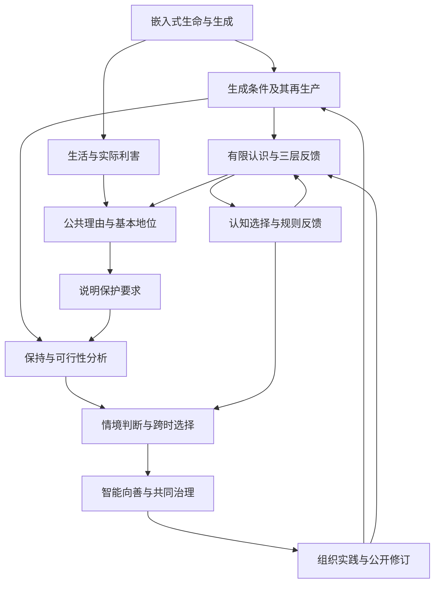
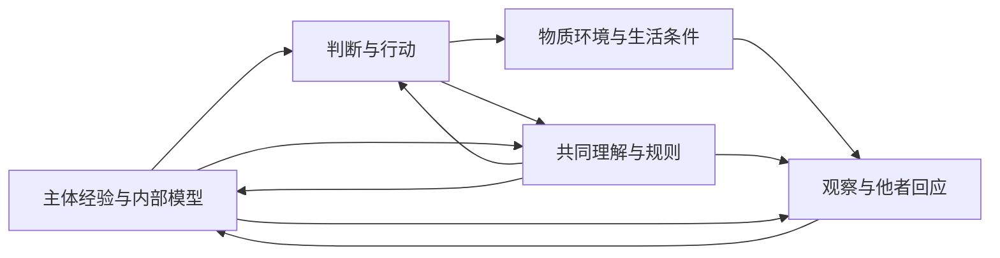

# 生生不息：智能向善的生成论基础

**从嵌入式生命、三层现实与 Meta-Attractor，到开放的共同未来**

统一理论白皮书 v1.0 · 2026 年 9 月 5 日  
思想与立场提出：Ren；AI 协助论证整理、文字重构与形式检查。  
本文为可供公开讨论的研究版本，尚未对外发布。配套文本：[《智能向善，天下生生》统一版宣言](宣言-v1.0.md)。

## 摘要

生命、认识与评价活动在世界的生成过程中形成，并持续依赖能够更新的结构。它们的行动又改变自身、他者与后来者的条件。本文以这一嵌入式生成事实为起点，连接差异与建模、生命的功能利害、共同生成条件及公共理由，论证智能向善与开放共同未来的方向。

生生指生成者继续生成，并使生成的结果参与后来生成及其条件的更新。新的结构、知识与合作可以扩展实际能力；生成成本和相关损害也必须进入评价。本文用有时间、资源与执行边界的有效可能性刻画这种扩展，区分持续不失效、能够形成新能力，以及对受影响者具有正当性的公共改进。保护未来包含对当下生活的珍重，也包含对后来者继续理解、参与和创造的关照。

本文从生命的实际利害、实践一致性、判断可修正性、公共理由的非任意性与基本地位出发，论证共同生成条件的保护要求。善恶判断因情境而异，但具有事实与理由的约束：无充分理由地造成严重损害、转嫁可避免代价、剥夺基本地位或毁损有效纠正，不能仅凭局部增长和胜利获得正当性。评价成立不以行为者接受为条件；个人责任和行为改变还需要考察知识、能力、处境与制度。

系统层面，本文研究资源更新、相关信息、协调、冲突约束、适应、再生产与维持维持者。形式核心使用受控保持集合，并检验观察不足、独立组合、抽象实现、重复风险及有限软惩罚的边界。随附三个 Lean 模块保留 28 个已检查命名定理；它们检查明确模型中的结构结果与反例。其余纸面推导、规范理由和现实机制均另行标识，详见附录 A。

认知、目标与制度也参与生成。本文以主体经验与内部模型、主体间的共同理解与规则、物质与实际后果三个相互作用的层面，分析判断与环境如何彼此塑造。Meta-Attractor 进一步追踪奖励怎样筛选策略和认知，优势怎样进入规则，规则又怎样改变证据与后来行动。权力、欲望和共同预期因而是可研究、可塑造的机制；形成共识和取得成绩也需要接受现实反馈。

向善演化需要维护共同条件的效果进入实际保留、传播与及时修复，不能从生命延续直接推断演化总会自动纠正。对于反思性智能，科学方法、制度学习与相称干预可以在损害成为淘汰结果之前改变选择条件。本文进一步提出跨时多维策略比较，研究知识与环境如何改变可行集合，并给出公共诊断与组织程序。

由此，智能向善要求技术能力、认知学习和制度作用共同回应生活、基本地位、生成条件与纠正能力；共同命运要求判断范围覆盖重要依赖与后果；大同作为多种生活能够共同发展的方向，在具体实践中持续展开。理论及其组织也应接受同样的要求，以可追溯理由、真实参与和可检验实践建立可信度。

**关键词：** 生生不息；生成能力；公共善恶；三层现实；Meta-Attractor；系统存续；认知与环境；智能向善；共同未来。

## 论证路径与阅读说明

本文采用十二章连续论证。第一至三章建立生成、系统与认识的对象；第四章说明公共善恶的理由；第五章检查形式关系；第六至八章连接选择、演化与情境决策；第九至十一章推出智能、共同未来与组织实践；第十二章集中说明检验与结论。

| 论证位置 | 本文完成的工作 | 应使用的检验 |
| --- | --- | --- |
| 生成与系统事实 | 说明构成依赖、有效能力及条件再生产 | 领域知识、建模、观察与干预 |
| 公共理由 | 说明生活、基本地位、共同条件与责任 | 前提辩护、推理、反例与公共讨论 |
| 形式关系 | 检查保持、信息、选择及比较的条件命题 | 纸面证明；明确标注部分的 Lean 检查 |
| 诊断与行动 | 追踪机制、干预与修订，提出组织程序 | 竞争解释、实际结果、异议与问责 |

条件定理的严格性来自前提成立时结论必须成立；其现实应用取决于输入与情境。关于公共基本地位的理由不会由逻辑符号自动提供，关于实际机制的判断也需要证据。第一版将这些接口公开，使读者能够定位分歧和提出修订。

图中箭头表示论证依赖或现实反馈，需要按相应章节的前提理解，不表示从任意自然变化已经推得全部伦理。附录 A 给出命题与证明位置，附录 B 对应既有原则，附录 C 说明研究来源。

## 目录

1. [从差异与生命到生生不息](#chapter-1)
2. [生命与系统的存续条件](#chapter-2)
3. [三层现实与能够更新的认识](#chapter-3)
4. [从生命的利害到公共善恶](#chapter-4)
5. [形式核心：保持、观察与风险](#chapter-5)
6. [Meta-Attractor：认知、规则与长期趋向](#chapter-6)
7. [演化、系统健康与修复能力](#chapter-7)
8. [情境中的公共判断与跨时决策](#chapter-8)
9. [智能向善与可纠正的发展](#chapter-9)
10. [共同未来、大同与合作的形成条件](#chapter-10)
11. [让理论成为可以检验的共同实践](#chapter-11)
12. [检验、研究边界与共同立场](#chapter-12)

[附录 A：定义、命题与证明范围](#appendix-a)；[附录 B：原则的统一对应](#appendix-b)；[附录 C：来源与研究位置](#appendix-c)。

---

## 一、从差异与生命到生生不息

### 1.1 认识者由世界生成，也继续改变世界

人的身体、语言、记忆、感受与判断能力，在物理、生命和社会过程中形成。呼吸、食物、照护、教育、工具与共同知识继续维持这些能力；人的行动又改变这些条件。我们认识世界时，自身已处于这种关系之中。

这提供了本论的起始事实：**认识与行动是世界内部生成的过程；它依赖能够维持和更新的结构，并会改变自身及他者后来能够存在、认识和行动的条件。** 其中包含世界内的实现、构成依赖、变化中的维持和行动反馈。它们需要在具体领域接受研究，也足以让评价者进入评价所考察的世界。

对差异与变化的观察，是认识的入口。辨别两个状态，需要能够登记相关区别；认识变化，还需要记忆、记录或某种保留历史影响的结构。温差、一个被保存的符号、他人的回应和制度的改变，能够在不同尺度上进入这样的过程。后来的建模可以进一步区分：哪些差异只是同时发生，哪些改变会造成后果，哪些关系在环境变化以后仍然成立。

仅有“曾经观察到变化”还没有说明观察者怎样形成、将怎样延续，以及为什么某些后果值得保护。一个有限过程也可以留下两个不同状态的记录，然后结束。要研究生生，需要继续进入结构形成、自我维持、实际利害和共同依赖。这是对起始事实的展开，不以一个词语包含全部后续结论。

本文沿三个层次推进：差异与变化提供认识入口；生命使一些差异具有实际利害；生生则研究生成的结果怎样再次参与生成，并更新相应条件。关于时间、因果和意识的全部理论，不必在此前一次性完成。需要明确的是所采用的时间次序、因果模型和观察条件，并允许后来的证据修订它们。

### 1.2 象、像与理：把模型放回因果关系

本论以“象”指情境中能够影响后续过程的结构。一个细胞、一项技术、一种规则或一段被共同相信的叙事，都可以在不同方式下改变后来发生的事。“像”则指对某些结构与关系的表征，包括概念、模型、地图、目标和自我理解。

**像亦象也。** 模型由世界中的过程实现，又能影响行动。人们对货币、承诺和组织身份的理解，会改变资源流动与相互预期；关于风险的模型，会改变什么技术被部署、什么证据被收集，以及什么后果被认为值得注意。因此，对一个模型至少有两个问题：它是否准确表达所声称的对象；它进入现实以后产生什么效果。错误模型也可能具有很强的因果力量。

“理”指这些结构如何形成、维持、相互作用和失效的条件关系。在材料科学中，它可以涉及承载与疲劳；在生命中，涉及代谢、调节与修复；在社会中，涉及信息、承诺、资源与权力的反馈。具体规律有各自的适用范围。跨尺度的统一应体现为明确的关系结构和条件命题，而不能只因两个系统都能被称作“生命”便视其制度完全相同。

模型的成功需要持续接受不同位置、不同方法和实际后果的检验。共享确信能够促进协调，却不能单独证明模型正确；模型也可能通过改变证据产生的环境，维持自己的表面成功。第三章与第六章将把这一点发展为认识与制度的共同问题。

### 1.3 变化怎样成为生成

并非一切变化都具有相同结构。某些变化消散原有差异；另一些相互作用形成能够保持一段时间的结构，并使后来能够发生不同的过程。A 与 B 在环境 E 中形成 C，C 再与其他结构相互作用，便构成一个可以研究的递归关系：

\[
(A,B,E)\longrightarrow C,\qquad
(C,D,E')\longrightarrow F.
\]

这种关系需要具体的形成机制、资源条件、保持时间与相互作用。只有结果确实进入后来的过程，“生成的结果成为生成条件”才具有实际内容。形成的结构可能提供催化、记忆、协调、承载或修复能力，也可能形成新的消耗与破坏。

物理规律约束这个过程。在常用开放系统热力学模型中，可写出：

\[
\frac{dS_{\mathrm{sys}}}{dt}=\dot S_e+\dot S_i,
\qquad \dot S_i\geq0.
\]

内部熵产生非负，系统还与环境交换熵。适当驱动、相互作用和交换条件下，局部结构的形成与维持可以与包含环境的熵增加相容。非平衡统计物理也能够研究信息与维持活动的代价。[Kolchinsky 与 Wolpert，2018](https://arxiv.org/abs/1806.08053)

守恒约束转化，不单独保证某种组织得到保留。导热使温差消失，也可以同时满足适用的能量守恒与熵增关系。因此，本论不将“总有变化”直接等同于“生成能力不断增加”。生成的方向需要考察结构改变了哪些实际能力，以及相应条件是否能够更新。关于这一物理区别的具体推导保存在[物理生成补篇](物理生成与内在规范性_论证补篇.md)。

### 1.4 生命使差异具有内在利害

对于通过活动维持组织的生命，环境差异会影响维持、修复、感受与行动的能力。某些改变使这些活动能够继续，另一些则破坏它们。这种利害有实际的因果基础，不以生命能否将它表达为语言命题为必要条件。

维持自身也不是一次完成的工程。构成组织的条件可能在运行中被损耗，也可能依靠组织活动得到补充；维持这些条件的机制本身，还需要被维持。生物组织的约束闭合研究考察这种相互维持，以及它与环境交换的联系。[Montévil 与 Mossio，2015](https://montevil.org/publications/articles/2015-mm-organisation-closure-constraints/)

由此可以研究功能上的有利与有害：一项机制在什么环境、期限和系统边界内支持相应活动。公共伦理随后需要解释不同生命与主体的利益为何进入共同判断，以及如何处理实际冲突。对于一个局部过程有利，尚不足以评价它改变的全部关系；这种尺度区别将在第四章展开。

对于本文讨论的社会和智能，存在还包含语言、训练、基础设施、共同知识和制度接口等条件。它们的作用可以通过实际依赖来研究，无需先宣布社会与一个细胞完全同类。把我们置于生命—环境的共同生成之中，已经能够揭示许多被局部账目遗漏的关系。

### 1.5 生生的三个层次与共同方向

“生生”指生成者继续生成，并使生成的结果参与后来生成及其条件的更新。为了使论证可追踪，本文区分三个层次：

| 层次 | 评价对象 | 核心问题 |
| --- | --- | --- |
| 事实层的生成与持续 | 结构、过程及其依赖 | 它如何形成、保持并产生后续？ |
| 实践层的可延续性 | 行动者的生活、能力与计划 | 它能否继续行动、获得反馈、修复并改变？ |
| 公共层的生生 | 受影响者及共同生成条件 | 谁的生活得到支持，谁承担代价，谁能够参与与纠正？ |

这三个层次组成连续研究，也承担不同的论证工作。物理与系统分析说明约束和机制；生活与实践说明利害和行动理由；公共论证说明他者及后来者的地位。数学检查其中明确的条件关系，经验研究检查实际情境是否符合。

本论的共同方向可以表达为：维护有价值的生活，维护这种生活能够继续生成的条件，也维护认识、纠正和更新这些条件的能力。它关注眼前的实际生活，同时关注后来生活的条件；具体载体可以改变，维护方式也可以在学习中更新。

### 1.6 新结构扩展的是有效可能性

“A、B 生成 C 后，世界具有了新的可能性”，可以通过有效能力得到严格表达。设 x 为包含实际结构和资源的状态，H 为相关期限，B 为可支配预算，q 为已说明含义的任务或活动。定义：

\[
\mathcal E_{H,B}(x)=
\{q:q\text{ 能从 }x\text{ 出发，在期限 }H
\text{、预算 }B\text{ 内实现}\}.
\]

它所表达的是在实际条件下做得到什么。一个抽象上可以通过很长路径实现的过程，未必能够赶上现实中的需要；设施、知识或协作网络已经形成以后，实现过程所需的时间、成本与风险可能改变。

**命题 P1：有效生成扩展。** 比较生成前后的 x 与 x′，若在同一含义的任务、期限与剩余预算下，原来的活动都有可执行的保留方式，并存在一项原先做不到而现在能够完成的活动，则：

\[
\mathcal E_{H,B}(x)\subsetneq\mathcal E_{H,B}(x').
\]

**证明：** 原有活动的保留给出集合包含；新增活动给出属于右侧而不属于左侧的元素。∎

命题不要求枚举全部未来。可以通过能力保留的实现关系和至少一个新增活动的见证，证明特定扩展。实质研究是这些条件为何成立：C 是否被维持，形成它消耗了什么，是否保留 A、B 的相关能力，是否转嫁了维护成本。

在固定规则的无限步可达集合中，如果 C 原本可由 A、B 生成，那么经过 C 发生的后续可能已经包含在原集合中；实际 C 的形成仍然可以扩大有限期限和资源下的有效能力。区分这两种可达性，有助于同时保留生成的现实意义和数学量词的准确性。

这也说明不能以结构目录变长、分枝变多或随机性增加代替善的判断。新的能力可以用于照护、理解和合作，也可以用于操纵、毁损和控制。公共评价要进一步考察它的使用方式、负担与后续选择机制。

### 1.7 理解、环境与能力共同变化

理解是将结构转化为有意组织的能力的重要机制。人需要辨认某结构可以做什么、如何组合和维护，以及什么时候应当停止使用。结构的物理作用也受实际环境约束，因此模型与环境应共同进入能力分析。

令 Π(m,e,σ) 表示内部知识 m、物质环境 e、共同规则与预期 σ 下实际能够执行的策略族。能够执行包括技能、资源、权限、协作与反馈条件。只有算法而没有设备，只有技术而没有可合作的关系，都可能使一个方案停留在可描述而不可执行的状态。

**命题 P2：策略保留下的认知与组织扩展。** 在相同任务含义、期限 H、剩余预算 B 及其他执行约束下，若更新以后，每个原有策略都有保留这些约束与任务结果的可执行实现，且至少新增一个能够完成原先无法完成任务的策略，则相应有效任务能力扩大。

证明仍由原有能力的实现映射与新增任务的见证给出。新增信息、设施或规则未必总是满足这些条件；错误认识、过高的维护成本或取消原有权利，也可能削弱能力。将这些代价计入后，知识与环境怎样共同扩展可能性，便成为可以检验的问题。

能力应包含选择不做、停止、恢复与改变方向的实际条件。相关研究已经将评价从资源拥有量推进到人真正能够实现的活动与生活机会。[Sen，《Equality of What?》](https://tannerlectures.org/wp-content/uploads/2024/07/sen80.pdf) 本论进一步追踪这些能力如何参与后来能力的形成，以及其维持条件受何种制度选择。

### 1.8 开放未来与有分寸的限制

后来发生的相互作用，可以暴露此前没有看见的能力和风险。开放式演化研究区分既定空间中的探索，以及扩展或改变行为空间的创新，为这一问题提供了研究语言。[Taylor，2018](https://arxiv.org/abs/1806.01883)

本论并不要求在行动前完整列出所有产物。可以约束资源、基本保护、试验范围和纠正条件，在生成过程中观察实际后果，再更新模型和行动。开放未来因而包含两种相连的能力：形成尚未实现的生活与活动；在新经验中改判和改变。

限制也可以形成能力。承诺减少临时反悔的选项，却可能建立信任；学习需要时间和纪律，却可能扩大后来的创造；防止严重侵害的规则，可以保护其他人真实行动的条件。本论称这类具有充分理由、代价相称且可以复核的限制为“成生之限”。反之，若限制使一方永久依附另一方并阻断回应与修正，则需要按其实际损害与支配关系评价。

稳定、开放与更新都有具体条件。冻结判断会使持续秩序失去学习；耗尽共同基础会使活跃变化失去接续。生生研究的是它们如何在变化中相互支持，不要求将其中任何一项无限最大化。

### 1.9 保护当下与后来者，不要求一切形式永存

生活中的感受、关系、认识和创造，既具有当下价值，也参与后来条件的形成。保护未来包括今天的身体、照护、自由活动和判断能力。将现实中的人无限转化为未来目标的资源，会损害使未来值得追求的理由。

延续的对象需要说清楚。一个组织可以解散，一项技术可以停用，一套理论可以被改写，一种制度可以让位于更好的安排。个体生命的有限性也要求照护与关系的接续，而不使无限延寿成为所有任务的前提。不同载体如何承担生成，应依据其对生活和共同条件的实际作用判断。

因此，生生不息首先是一种能够在有限情境中指导持续判断的方向。它不预言物理宇宙保证无限寿命，也不要求一个任务承担超出其能力与关系的无限责任。第二章将展开这种方向面对的系统条件，第三章研究认识如何在这些条件中形成，第四章论证为什么共同安排需要回应每个受影响者。

---

## 二、生命与系统的存续条件

生命的延续是一项持续发生的活动。构成生命的材料会交换，维护活动会消耗资源，既有响应会遇到新的环境；能够继续存在，意味着这些变化没有切断所需的组织与功能。社会中的身体、知识、基础设施、共同规则和判断能力，也通过各自的更新过程继续存在。

本章把这个事实展开为有前提的约束关系：**凡某项活动依赖需要更新的条件，活动的接续便依赖条件得到足够更新；凡条件的更新又需要其他活动，那些活动的条件也进入存续问题。** 这使资源、信息、协作、修复和跨代传承能够在同一框架中研究。公共伦理还要进一步说明哪些生活与关系值得共同保护；这里首先建立判断不能绕开的实际依赖。

### 2.1 适用对象与三种边界

本章的主要对象，是具有可辨认的组织或功能、依赖物质与能量条件、在一定变化范围内通过维持、调节或更新而持续的开放系统。生命是核心实例，持续运作的组织、社会与技术设施则需要分别检查适用条件。能够调整响应方式的对象，还具有适应系统的性质。

“系统”若仅指任意划定的集合，不能独自推出代谢、感知、学习或再生产。石块保持形状、火焰持续燃烧、细胞修复组织、社会培养成员，具有不同的保持方式。近于平衡的被动结构不必持续获取维持性通量；短期休眠的生命可以依赖储备。一个组织从外部取得电力、照护或维修，也没有免除这些条件，只是把其生产过程放在了研究边界之外。

应当分开三种边界。**辨认边界**说明研究的是什么，以及延续什么才算该对象的接续；它可以渗透、分布或变化。**因果边界**纳入足以改变结论的资源、环境、关联主体与传播路径。**责任边界**则涉及谁受到实质影响、谁有被考虑和回应的理由。这三者不会仅凭一个法人名称、一张资产负债表或一条地理边界自动重合。

例如，企业能够分别记账，但其劳动者依赖家庭照护与公共卫生，其生产依赖生态与基础设施，其信息依赖共享知识。研究企业存续，可以选择一个较小的辨认边界；判断企业活动对共同生活的影响，必须纳入相关外部条件。认识到“我是一个系统”，同时要求认识到“我的维持发生在其他系统和环境之中”。

边界还涉及接续的含义。细胞材料可以更新，组织成员可以交替，制度可以转型，某项任务也可以由另一种组织承担。因此，维持某种功能不总要求维持同一个名称、所有原有成员或固定形式。需要明确的是：哪些功能和生活继续了，哪些被终止了，谁承担这种改变；不能把任意变化都重新描述为“系统依然存在”。

### 2.2 E1—E4：公开建模的前提

以下四项公设组成存续研究的最小骨架。它们包含适用对象的经验特征与建模要求，其有效范围由具体对象检验。称为公设，是为了使推导的输入可见。

**E1，嵌入性。** 系统的相关状态 \(x\)、环境 \(e\)、可采取的行动 \(a\) 和所考虑的扰动，共同决定后来变化。环境提供输入，也承受输出。输出可能经由生态、供应、关系和制度重新改变系统的条件；反馈是否存在、作用到谁、需要多久，都应由具体因果关系说明。

嵌入性不要求每个影响都双向，也不要求每项损害最后都由施害者承担。它要求模型不能仅因某个重要变量处于“我之外”，便把它从解释和评价中删除。外部供给一旦成为维持前提，就须追问它能否继续；共同损害一旦成为行动后果，就须追问谁会承受。

**E2，有条件的持续性。** 研究对象要在指定期限内继续某项组织或功能，就需要某些条件处于容许范围。将这些条件写成 \(S(x,e)\)。条件可能是库存阈值、物理完整性、关键任务完成率、成员健康或其他经说明的要求。

\(S\) 应由功能关系、独立领域证据与明示的保护理由确定，不能在结果出现后把“发生了什么”重新命名为“应该维持什么”。如果所谓安全只意味着当前统治者继续控制，安全证明便只覆盖这一目标；如果还要保护人的生活、学习与参与，就必须把它们以适当方式纳入要求。形式证明不会替研究者修补被删去的对象。

**E3，有限能力与更新需求。** 储备、处理能力、响应速度和可调用资源有边界；某些必要条件会被消耗、损坏或环境变化所削弱。研究须说明损失、补充、替代和时限，尤其是哪个条件在什么时候不可替代。

一般的守恒并不等于可利用能力守恒，一般的熵增也不能替代每个具体变量的损耗测量。水量、可饮用水量和在需要时能够送达的饮用水量，是不同的对象。数学约束所需要的，是已经说明的有限缓冲、必要支出与可得补充；它不需要先给整个宇宙指定一个统一的衰败速度。

**E4，调节者的内在性。** 感知、判断、协调、纠正和传承，也由实际结构实现，也需要人员、时间、设备、资源与制度条件。不能一面分析社会的有限性，一面假定科学、审计、维修者和公共判断总能无成本、无失误地工作。

因此，监督是否有资源，坏消息能否到达，承担照护的人能否恢复，知识能否被理解和传承，都属于系统状态。调节者也会学习，会受奖励与惩罚，会改变对自身目标和他人的理解。这使认知模型、共同预期与规则选择能够进入后文的动力学分析。

四项公设之间的关系可以表达为：E1 指明条件位于关系中，E2 指明什么变化对接续有影响，E3 指明这些条件为何需要行动，E4 把能够采取行动的机制及其维持纳入研究。后续结论仍需要连接前提：没有互补任务，就不能独自推出协调的必要性；存在同时适用于所有情况的稳健保护，就不能独自推出实时感知的必要性。

### 2.3 从“当前成立”到“能够接续”

将环境、储备、能力与必要历史纳入扩展状态 \(z\)，令 \(T(z,a,z')\) 表示采取行动后的可能后继。一个当前满足 \(S\) 的状态，仍可能已经失去后续维护的办法：库存尚未耗尽而补充已经中断，设备尚能工作而维修能力已经瓦解，统计尚显正常而关键观察已被压制。

第五章将严格定义可存续集合 \(V\)：其中每个状态满足所声明的保护要求，而且具有可执行的行动，使全部模型内后继继续落在这一集合。其保持定理 F1 表明，持续可行性必须包含继续保持可行性的能力。这里的“全部”相对于明示的转移与扰动范围，不能无条件扩展到模型尚未认识的一切未来。这属于既有可存续性与不变集研究的数学家族。[Aubin、Bayen 与 Saint-Pierre，2011](https://link.springer.com/book/10.1007/978-3-642-16684-6)

这个结构有实际内容的关键，在于条件可以独立识别和检验。研究者能够观察库存、维护周期、训练时间与故障类型，判断某个当前仍在生产的方案能否承受这些扰动。若后续证据显示替代资源早已存在、故障模型不成立或维护能力被低估，具体结论就应修订。

还应区分延续的一条幸运路径、对所列扰动的可控保持，以及风险低于声明阈值。本章主要讨论第二种较强要求。无法建立保证，可能要求补充知识、改变结构或采用风险分析，并不直接证明失败一定发生。同样，一个数学上存在的保持行动，还需要信息、资源、权限和协调才能成为实际行动。

### 2.4 资源更新：累积预算与耗损边界

将一项关键资源的存量记为 \(s_t\)，外部输入与再生为 \(i_t+r_t\)，使用、维护与不可回收损失的合计为 \(d_t\)。各项采用一致量纲并避免重复记账。考虑：

\[
s_{t+1}=s_t+i_t+r_t-d_t,
\qquad s_t\ge s_{\min}.
\]

**C1，有限时域的累积预算约束。** 若从第 \(0\) 期到第 \(T\) 期均保持临界存量，则对每个 \(1\le k\le T\)：

\[
\sum_{t=0}^{k-1}d_t
\le s_0-s_{\min}+\sum_{t=0}^{k-1}(i_t+r_t).
\]

**证明。** 逐期累加存量方程，得到 \(s_k=s_0+\sum(i_t+r_t)-\sum d_t\)，代入 \(s_k\ge s_{\min}\) 即得。这个条件必须对每个前缀成立。∎

这说明，生产无需在每个瞬间都超过消费和维护。储备使生命能够跨越夜晚，使生产能够跨越收获期，也使社会能够进行需要先投入的建设。与此同时，期末收支平衡不足以保证中途存续：若必要条件已经不可逆地失效，未来补充不能把此前的后果从历史中删掉。

**C2，有限缓冲无法承担无限持续的正净亏损。** 若每期净支出满足 \(d_t-i_t-r_t\ge\varepsilon>0\)，且初始缓冲 \(B=s_0-s_{\min}\) 有限，则连续执行超过 \(B/\varepsilon\) 期，临界条件必然失效，或者过程更早因条件不足中止。

**证明。** 第 \(k\) 期缓冲至多为 \(B-k\varepsilon\)。当 \(k\varepsilon>B\)，它不能仍然非负。∎

附带形式代码检查了非负整数缓冲的两个命题：在前 \(N\) 步每步至少减少 \(d\)，则第 \(n\le N\) 步满足 \(s(n)+nd\le s(0)\)；当 \(d\ge1\)，这样的序列不可能对全部自然数时间持续。一般实数预算的纸面推导、现实损耗率和资源必要性，应与这两项机器检查分别理解。

应用 C2 时，不能把“每期有损失”偷换为“每期有至少同样大的净损失”。损失可能趋近零，输入可能增加，资源也可能被替代；这些变化必须进入模型。反过来，凭未来可能创新也不能直接删除已经证实的缺口。要把替代作为当前策略的依据，就须说明形成时间、可执行路径和它能承担什么功能。

多项资源通常需要向量及替代关系。货币、土地、水、健康、技术技能和时间不能在任意时限下相互替换。即使总量充足，位置错误、品质不合要求或交付太晚，也可能使关键活动无法继续。资源更新因此包括可用性、分配、转换与接口，不能仅看一个总产出指标。

由此，所谓“增长在吃自己的身体”可以被转化为可检验论证：找出必要条件，测量净损失和缓冲，检查替代及补充所需时间，再判断账面增长有没有覆盖这些变化。结论可以针对一种明确做法，而无需先预测整个社会的终局。一次为建立后来能力而使用储备，也应沿同一方法评价：新增能力能否及时接续，以及代价是否毁损其他应受保护的条件。

### 2.5 信息与反馈：保持行动相关的差异

一个模型无需复制世界的全部细节。压缩与选择本来就是建模的组成；决定性的，是模型有没有保留改变可行应对的差异。

设 \(w_1,w_2\) 是两种可能情况，\(O(w)\) 是控制者能够取得的观察，\(A_{\mathrm{safe}}(w)\) 是该情况下满足要求的行动集合。

**C3，行动相关的不可区分性障碍。** 若

\[
O(w_1)=O(w_2),\qquad
A_{\mathrm{safe}}(w_1)\cap A_{\mathrm{safe}}(w_2)=\varnothing,
\]

则任何仅依赖 \(O\) 的确定性控制者，都不能保证在这两种情况中保持要求。

**证明。** 相同观察使控制者选择同一行动。若这个行动在两种情况中都安全，它便属于两个安全行动集的交集，与交集为空矛盾。∎

这个命题已有机器检查。它识别的障碍比“内部模型与世界不同”更具体：被省略的差异必须影响行动要求。仅增加决心、计算速度或相同数据的数量，不会自动产生缺失的区分。随机化可以重新分配风险，也不能凭空产生一个在两种情况下都安全的共同选项。

假设某设施在一种状态下必须停止一项过程，而在另一种状态下必须保持它才能维持关键功能，报告系统却把两者都称为“正常”。只根据该报告下令，就无法保证正确。改善可以来自新增检测、保留历史、重新设计报告，也可以来自改变物理设施，使两种状态有共同安全应对。知识与环境在这里共同改变可行控制。

反过来，若一个被动保护结构已经能够应对全部相关差异，实时识别它们可能并非必要。因而，一般要求是：**不能由共同稳健方案消除的行动差异，需要足够的观察、记忆、模型或交互支持。** Ashby 对调节、扰动与必要多样性的分析提供了相关理论基础；具体观察变量与响应范围仍须在应用中建立。[Ashby，1956，第十一章](https://ashby.info/Ashby-Introduction-to-Cybernetics.pdf)

真实信息还须在相关期限内抵达能够行动的位置。发现、表达、理解、授权和执行共同构成反馈时延；其中任一环节失效，都可能使已知问题无法及时修复。感知能力、执行能力和剩余时间因此应当分别评估。完全真实但无法进入决定的信息，与及时到达却没有任何可执行响应的信息，都不能独自保证存续。

科学独立、可靠统计、审计、安全报告和公开质疑，可以承担使现实进入共同判断的功能。它们怎样组合，需要考虑隐私、安全、理解成本和实际纠正渠道。数据总量增加并非唯一目标；保护发现反例的能力，使错误能够被承认和改变，才直接连接存续与认识。

### 2.6 合作与信任：使互补能力真正接合

协调的必要性来自任务结构。如果某项关键服务需要不同角色完成互补任务，而缺少任一任务都不能及时得到产出，则有效能力受到共同瓶颈约束。在一个简化模型中，生产 \(q\) 单位服务需要第 \(j\) 类能力至少为 \(a_jq\)，可用能力为 \(c_j\)，于是：

\[
q\le\min_j\frac{c_j}{a_j},\qquad a_j>0.
\]

证明是分别写出 \(a_jq\le c_j\)，再取全部上界的最小值。这里的 \(c_j\) 必须是能够按时、以兼容方式投入的有效能力。社会上存在掌握知识的人、仓库里存在合格零件，都不等于它们能够在需要时完成协作。

可靠协调可由适当信任、验证、契约、共同习惯、技术接口和责任机制共同实现。它的条件包括预期是否可信、错误能否被发现、行动是否能接续、成本能否承担。盲目信任可能放大欺骗；全面不信任也可能使所有承诺都需要无法承受的核验。应当研究的是哪种组合让相关协作可持续。

因此，不能把社会复杂度简单写成信任的固定倍数；可以推导的是，在已说明的互补任务与替代限制下，足够可靠的协调是完成相应功能的必要条件。若破坏承诺持续占优，同时使关键协作成本超过可承担范围，就必须改变这种选择、另建协调路径，或者承受功能下降。

这里的合作还包括维护参与者本身。一个安排若依赖特定的人长期无偿吸收成本、透支健康或放弃更新机会，即使当前协作成功，也应检查其补充与替代条件。能够共同完成任务，与让共同完成任务的人继续具有生活和参与能力，需要同时成立。

### 2.7 外部性与局部优势：何时构成系统性侵蚀

一个行为在局部获利、在其他地方造成代价，不足以直接证明系统必然崩溃。应说明代价的对象、重要程度、持续时间，以及补偿、替代和其他净收益。但若存在如下链条，存续结论就可以得到逐项支持：

> 一类行为得到局部优势；优势使它被保留或扩散；扩散持续净侵蚀共同必要条件；补充与替代不能抵消损失；耗损超过有限缓冲，相关共同功能失效。

C1—C2 支持最后的耗损推导。选择和规则如何使行为扩散，则由后文的 Meta-Attractor 分析。两部分接起来，才解释了为什么“系统奖励侵蚀自身的行为”比个别错误更危险：修复承担成本，破坏取得优势，规则还可能继续向后者倾斜。

这里的关键不在竞争这一名称，而在竞争选择什么、依赖什么、把后果放在哪里。局部增长可以来自新增共同能力，也可以来自消耗他者与未来的条件；它们在表面业绩中可能相似，在因果与公共评价上却不同。需要记录的是净变化、负担承担者、更新路径和反馈方向。

将外部后果重新进入决策，可以通过责任、补偿、数量限制、恢复义务、共同治理、改变供给与技术条件等方式实现。并非所有后果都适合货币化；一些基本保护的意义，正是不能让足够大的其他收益直接购买其取消。多中心治理的研究提供了处理复杂共同问题的制度资源，具体安排仍须接受情境与经验检验。[Ostrom，2010](https://www.aeaweb.org/articles?id=10.1257/aer.100.3.641)

若某个系统长期把损害转嫁给他者，而自身依然存续，功能证明不会自动否定这一事实。公共伦理要求另外评价受影响者的生活与地位。由此，系统存续是评价的现实基础；“某组织活下来了”不会取得凌驾一切成员和外部人的资格。

### 2.8 冲突与权力：改变形成失调的条件

冲突可能表达真实的资源矛盾，也可能来自错误认识、不可信承诺、共同预期和现有规则。发现不公、反对错误和调整关系，本身也会产生冲突。因此，需要维持的是冲突能够被处理、代价受到约束并且关键生活得以接续的能力。

在一个纯粹示意模型中，若升级强度满足 \(c_{t+1}\ge g c_t\)，其中 \(g>1,c_0>0\)，则 \(c_t\ge g^tc_0\)。若关键功能要求 \(c_t\le B\) 而 \(B\) 有限，这种持续无界升级终将违反条件。证明来自递推与指数增长；它没有证明现实中的冲突必然如此发展。有效降级、资源限制、退出、隔离和新协议，都可能改变模型。

治理应当首先调查哪些机制正在制造或放大冲突。过去只能争夺的资源，可能因新的生产或共享方式增加；交接后的恐惧，可能因真实保障降低；“人人都在争夺”的预期，可能因可核验的共同实践改变。改善知识、环境与共同规则，可以改变可行集合。仍然存在的冲突，再由有理由的比较、分配和补救处理。

权力的持续扩张同样需要机制解释。一个主体可能以控制为目的，也可能担心交权后的报复，或者认为只有继续控制才能保护共同目标。目标表征、他人模型、实际安全和规则激励都会影响选择。取得支配权不意味着存在一条无需条件的“永不退场”定律。

不过，可塑性需要有承载条件。若退出确实意味着基本安全丧失，仅要求主体改变想法缺少支持；若环境已经改变，旧有错误预期仍持续，则新证据、学习和可信互动可能有帮助。职责交接、成员保障、权限期限、复核渠道和后续行动能力，可以分别作用于这些因素。效果须由实际行为和后果检查。

系统性危险发生在权力能够重写对自身的评价、删除不利信息、转嫁成本、排除替代者，并以这些变化继续取得优势的时候。若这一过程损害共同条件，也损害修正它的能力，便形成需要改变的反馈。所需功能是让影响共同生活的决定持续可纠正，并使受影响者能够提出有效异议。分权、审计、专业责任和参与机制，是实现这一功能的候选安排。

共识也要检验其形成方式。隐瞒证据、制造恐惧或剥夺反对资格，能够产生一致表态，却会侵蚀共同认识。把目标从“保持权力”改写为“实现共识”，若同时垄断共识的含义与证据，仍然可能延续相同问题。主体、关系、规则和物质保障需要一并进入诊断。

### 2.9 适应、冗余与多样性：为相关变化保留响应

环境从 \(e_1\) 变化到 \(e_2\) 后，原有行动可能无法维持关键功能。若现有策略族中有可行替代，需要具备切换能力；若只有结构改变才能产生可行响应，就进一步需要形成这种改变的能力。反之，若已有结构足够稳健，能覆盖相关变化，就无需为了适应之名持续重组。

因此，适应的目标是让变化后的重要条件仍能实现。稳定的记忆、信任和接口，与能够改变方法的能力，可以相互支持。何者需要较慢修改，何者需要快速试验，取决于依赖与失效方式。Simon 对层级结构、稳定中间结构和近可分解性的讨论，为这类跨尺度设计提供了先行分析。[Simon，1962](https://www.andrew.cmu.edu/course/15-440/assets/READINGS/simon-architecture-of-complexity-1962.pdf)

冗余是一类针对失效情境的响应。若某功能不可中断，而单一组件可能在维修完成前失效，就需要储备、替代路径、故障容忍或其他足以覆盖该情况的方案。在 \(n\) 个组件独立以概率 \(p\) 失效、任一组件成功即足以保持功能的模型里，可用概率为 \(1-p^n\)。这是该概率模型的结果，共同电源、相同漏洞和一致误判都会改变独立性。

增加组件同时增加维护需求。真正有效的冗余，既要检查备用能力是否能接入，也要检查它是否与主要路径共享失效原因。多样性的价值也来自差异能否产生互补响应、揭示不同错误或形成新的能力；表面类别更多，不自动证明这些功能成立。

学习和创新可以使旧冲突得到新的解法，但学习需要时间，试验需要资源，推广需要接口。把探索纳入系统，意味着提供可恢复试验、经验保留和有效扩散的条件；也意味着检查试验是否把不可逆代价放到没有决定权的人身上。开放生成与具体保护的关系，将在形式与规范部分继续展开。

### 2.10 八类功能约束及其连接前提

前面的推导可以整理成八类适用于社会诊断的功能要求。它们不是八个独立常数，而是同一依赖结构在不同任务中的展开。

| 功能要求 | 使其成为必要条件的前提 | 需要保持的能力 |
| --- | --- | --- |
| 物质再生产 | 关键资源有持续支出、有限缓冲与受限替代 | 在每个必要期限内取得足够的供给、修复和转换 |
| 局部行动与共同接续相容 | 被持续选择的行为净侵蚀共同必要条件，补充不足 | 改变侵蚀、选择或补充关系，使共同条件可接续 |
| 真实的信息流 | 不同情况需要互不兼容的应对，现有观察无法区分 | 取得行动相关的信息，或改变环境以形成共同稳健响应 |
| 合作与信任 | 关键任务具有分布式互补依赖，协调无法完全替代 | 以可承担成本形成可信、可核验、可接续的合作 |
| 冲突有边界 | 升级代价可能超过关键条件的承受和恢复能力 | 处理、缓解、隔离或改变冲突，使损害不持续失控 |
| 权力保持可纠正 | 决策能够改变共同条件，并可能封锁自身的反馈 | 使证据、异议、责任和替代能够实际改变决定 |
| 自我更新 | 环境改变使原响应失效，替代或重组有必要 | 学习、试验与调整结构，同时维持必要功能 |
| 跨代再生产 | 成员、知识和参与能力会流失，持续活动需要补充 | 提供照护、教育、培养、传承和新参与条件 |

每一项都有可能的替代实现，也有需要继续验证的范围。协调可以分布实现，保护可以来自被动结构，资源可以有替代；适应也可能依靠更大的网络。功能约束所追踪的是必要工作是否被完成，不能凭某个机构名称缺席就断言功能不存在。

八类要求之间也存在重叠。培养维修者同时涉及资源、知识、协作与跨代更新；保护诚实报告者同时涉及权力、信息与再生产。它们尚未被证明穷尽所有系统的失效方式。实际研究应允许新增被遗漏的依赖，也允许删除对某个对象不必要的条目。这种可修订性使跨尺度原则能够进入具体研究。

### 2.11 维持维持者：修复能力的再生产

设某项关键能力 \(c_t\) 因退出、磨损或失配而减少 \(ell_t\)，由培养、维修或替代增加 \(u_t\)：

\[
c_{t+1}=c_t+u_t-\ell_t.
\]

若它必须保持在 \(c_{\min}\) 以上，C1 的逐期累积推导立即适用。这不是换一个变量名称便得到新的自然定律；实质工作在于证明这项能力的必要性，并识别真实损失、补充与接入时间。

维修需要零件、技能和休息；科学需要训练、方法、时间与反驳渠道；公共纠正需要表达、授权与实施。若维护活动长期消耗维护者，而他们无法恢复或得到补充，当前成功就可能伴随未来能力下降。“今天修复了问题”因而还应检查：明天修复问题的人、资源和渠道是否仍然存在。

这种递归不要求建立无穷个外部监督者。相互支持、相互检验和能够替代的网络，可以共同承担更新；关键是每条依赖都有实际承载与失效边界。生物组织研究讨论的“约束闭合”，指构成组织的约束相互参与维持，同时仍与环境交换物质和能量。它为维持条件的相互再生产提供理论资源，与取消异议或封闭未来是不同的概念。[Montévil 与 Mossio，2015](https://montevil.org/publications/articles/2015-mm-organisation-closure-constraints/)

可以把相关能力纳入扩展状态：

\[
z=(x,e,c_{\mathrm{感知}},c_{\mathrm{协调}},
c_{\mathrm{纠正}},c_{\mathrm{再生}},\sigma,p),
\]

其中 \(\sigma\) 表示规则，\(p\) 表示实践或参与者的分布。更新能力与选择条件共同改变后来是否还有可行行动。状态划分可以调整，但不能总把最关键的维护工作留在“其他条件不变”之中。

“可存续性等于感知、协调、纠正、再生的乘积”表达了瓶颈直觉，却不能直接作为具有普遍量纲的等式。若 \(P,C,Q,R\) 分别表示某任务所必需的四项功能有效，首先能够写成：

\[
\operatorname{Success}\Rightarrow P\land C\land Q\land R.
\]

这只是必要性。如果另行证明任务成功当且仅当四项同时成立，在条件概率有定义时，概率链式法则给出：

\[
\Pr(\operatorname{Success})=
\Pr(P)\Pr(C\mid P)\Pr(Q\mid P,C)\Pr(R\mid P,C,Q).
\]

它不需要独立性；只有进一步证明独立，才能写成四个边际概率的直接乘积。若四项仅为必要条件，成功概率至多为交集概率，也至多为其中最小的边际概率。若存在替代路径，则须将对应部分写成“或”。实际依赖图比未经验证的四个分数相乘更有解释力。

### 2.12 跨尺度：组合、共享条件与抽象实现

跨尺度的统一需要给出推导关系。局部系统各自可行，能否共同可行？在粗尺度证明的保持，能否由具体机制实现？这两个问题具有不同的条件。

**C4，独立组合的保持性。** 假设两个系统分别具有保持集 \(K_1,K_2\)，各自每个集内状态都有可执行的保持行动。若联合行动可以同时执行，并且联合转移恰为两个局部转移的直积，则 \(K_1\times K_2\) 是联合保持集。

**证明。** 在任一联合状态分别选局部保持行动。独立性保证两者可以共同执行，局部可执行性保证存在联合后继；每个联合后继的两个分量分别留在 \(K_1,K_2\)，故仍在直积集合。∎

该命题已有机器检查。其独立性假设不能在应用时省略：两项不可延迟任务在同一时段各需一单位资源，实际共有一单位且无替代。每项单独运行都可行，共同运行却不可行。把两次“各自有一单位”相加，只是在模型中重复许诺同一份资源。

耦合系统需要共同可执行的行动组合。若 \(A_{\mathrm{compatible}}(z)\) 表示满足资源、权限与接口约束的联合行动，真正的要求为：

\[
\exists\mathbf a\in A_{\mathrm{compatible}}(z):
\operatorname{Enabled}(z,\mathbf a)\land
\forall z'\,[T(z,\mathbf a,z')\Rightarrow\forall i\,K_i(z')].
\]

它不能由“对每个 \(i\)，各有一个行动使 \(K_i\) 成立”直接替代。量词次序体现了协作的实质：分别作出的承诺，可能无法共同兑现。共享条件本身也应纳入联合状态，避免每个局部方案都把公共资源当作固定外部输入。

即使存在联合行动，还需研究参与者能否知道它、能否协调采用它，以及维护这一合作的条件能否持续。存在性证明给出一个重要层次，观察、执行和选择机制负责其他层次。相反，联合系统的某项总体指标保持，也不会自动证明每个成员受到保护；这取决于 \(K_i\) 究竟表达了什么。

**C5，保守抽象与可实现控制的保持传递。** 设 \(T\) 为具体转移、\(U\) 为抽象转移，\(\pi:X\to Y\) 将具体状态映射为抽象状态，抽象系统具有保持集 \(L\)。进一步假定，对每个具体状态 \(x\) 及在 \(\pi(x)\) 可执行的抽象行动 \(b\)，存在可执行的具体行动 \(a\)，使：

\[
T(x,a,x')\Rightarrow U(\pi(x),b,\pi(x'))
\quad\text{对全部具体后继 }x'\text{ 成立}.
\]

则具体系统可以保持 \(\pi^{-1}(L)\)。

**证明。** 在 \(\pi(x)\in L\) 时选抽象保持行动，由实现前提选对应具体行动。具体行动可执行；全部具体后继的投影都是该抽象行动允许的后继，因而仍在 \(L\)。故全部具体后继仍在其逆像。∎

这项机器检查采用了较强的实现前提：它覆盖所有具体状态上的所有可执行抽象行动。若只要求在保护区内或特定策略上实现，可以另行研究较弱条件的版本；这里不把未检查的推广混入已检验命题。

“保守”指抽象转移覆盖全部相关具体后继，而不是只画出期待发生的后果。保持总产出的抽象模型，如果没有表达人的受损、实际交付或风险分布，也不会因此保护这些遗漏。应用 C5 必须另行核查 \(\pi^{-1}(L)\) 是否蕴含所要保护的具体条件。

跨尺度工作的次序由此明确：识别条件，建立映射，核查共享资源与接口，证明行动可实现及后果覆盖，最后检查保护含义。边界可以改变，映射也可以修订，但不能在转换尺度时把重要依赖和受影响者无声删除。

### 2.13 跨时间：期限、接续与下一代

维持条件都有相应时限。食物可能需要每天供给，维修可能跨越数月，技能培养可能持续多年；这些周期之间需要能够接合。若下一轮人员尚未形成能力，上一轮已全部退出，远期足够的人数也不能自动补回中间的功能缺口。

对有限期限 \(H\)，可以指定终端要求 \(K_H\subseteq S_H\)，再逐期倒推：

\[
K_t=\{z:S_t(z)\land\exists a[
\operatorname{Enabled}_t(z,a)\land
\forall z'(T_t(z,a,z')\Rightarrow z'\in K_{t+1})]\}.
\]

这是有限时域的纸面表达；应用还需给定状态、行动与终端条件，并计算或近似这些集合。它把“未来要求如何约束当下”写清：当下选择需要为下一时段留下能够继续履行要求的状态。若损害在两次采样之间就不可逆发生，还须把时段内轨迹纳入转移或保护条件，不能仅检查两个端点。

终端条件必须说明责任为何可以在这里交接。任务真正结束，与任期结束、报表截止或项目经费到期不同。废弃物、健康后果、维护义务与知识依赖，不因观察窗口结束而消失。有效交接需要后来承担者、资源、知识与权限在相应时点真实可用；把未解决的依赖留给一个没有条件行动的未来人，不构成接续证明。

跨代再生产同样关注能力与生活的接续。成员会退出，语言、判断、合作和照护需要被学习与实践，社会必须使这些条件继续形成。这不要求每个人生育，也不要求后来者复制前人的职业、信仰或制度。迁移、外部学习和新组织可以补充能力；扩大尺度后，仍要说明这些能力在何处受到培养和维护。

后来者对既有制度失去认同，可能是在指出制度需要改变。评估再生产不能只问旧秩序有没有被复制，还应问新参与者能否生活、理解、建立关系、提出异议并形成自己的共同实践。生生所接续的是有理由保护的生活与生成条件，某个载体在更好形式出现时可以调整或结束。

跨时比较也应追踪多维后果，知识与环境的改善能够改变后来可行的策略。但任何积分或长期收益表示，都须交代权重、保护要求和期限外责任，不能让很远的好处自动抵消中途不可逆的失效。对具体选择的形式比较将在第五章和后续决策章节展开。

无限时域的保持模型，是研究递归接续的数学理想化。实践方向并不依赖证明宇宙或某个主体具有无限寿命；它要求在实际可及的条件下，不无充分理由地耗尽共同生活的基础，并持续形成接续、学习和转化的能力。

### 2.14 统一性的含义与研究责任

本章的跨尺度统一性，表现为必要条件、有限能力、可执行响应与条件更新之间的共同关系。细胞、身体、社会和技术系统可以共享这一关系形式，而拥有不同的材料、时间尺度、保护对象与实现机制。相似功能支持比较，具体映射与连接前提支持推导。

控制论、可存续性理论、组织闭合、层级结构与公共治理已经提供了广泛基础。本论的工作，是把这些条件关系接到生活价值、开放生成、认知与规则的选择上，使“维持什么、依赖谁、如何修订、谁能够继续参与”进入同一论证。其可信性需要由明确前提、有效推导和实际检验取得。

一项应用至少应当能够回答：保护条件为何重要；依赖关系如何识别；损耗与更新是否匹配；各方行动能否共同执行；观察与判断能否改变行动；维护者怎样得到接续；何种新证据会推翻目前结论。若这些问题没有回答，统一术语不能代替研究。

至此可以得到一个具有实际内容的方向：**支持生命与共同系统的接续，需要维护必要条件，维护更新这些条件的能力，并维护认识与改变其实现方式的能力。** 新能力如何生成、这种方向如何获得公共规范的理由、维护实践怎样进入实际选择，构成后续各章的任务。

---

## 三、三层现实与能够更新的认识

### 3.1 主体、主体间与物质的相互作用

行动发生在三个相互影响的分析层面。Subjective 包含主体的感受、需要、意义、自我理解与内部模型；inter-subjective 包含语言、相互预期、共同记录、制度与公共标准；material 包含身体、能源、设备、生态及行动所改变的实际条件。

我们对三者的认识都通过经验、区分与建模形成。认识具有视角，并不使后果可以被主体任意决定。身体反应、他者回应、重复观察、干预结果与行动代价，能够约束模型。判断需要让这些约束实际进入认识过程。

| 分析层面 | 应当关注什么 | 可以发生的失误 |
| --- | --- | --- |
| 主体经验与表征 | 感受、生活意义、注意、需要、自我理解及判断能力 | 以成绩替代生活，以确信替代检验，以服从替代自主 |
| 主体间关系与共同模型 | 信任、承诺、规则、公共记录、解释标准及协调 | 将表态一致当作共识，让获益者垄断标准，筛掉不利证据 |
| 物质与实际因果条件 | 资源、身体、基础设施、生态、维护与恢复 | 账面增长伴随耗损，损害传播超过修复，叙事与现实脱离 |

这不是三个互不相干的世界，也不是已证明穷尽一切现实的分类。主体与制度通过世界内部的过程实现；划分它们，是为了避免某一种成功遮蔽另一种实际变化。

### 3.2 主观生活与内部模型不能互相替代

一个人的预测可能很准确，却生活痛苦、关系匮乏或失去选择余地；也可能在受损的环境中感到确信和满足，却缺乏获得相关事实的机会。因此，生活价值、认知可靠性和公共参与需要分别考察。

人的体验可以通过报告、行为、身体指标和持续关系被部分理解；任何单一测量都有边界。缺少完整的数值表示，不等于体验不应进入公共理由。将幸福只视为维持系统效率的信号，会遗漏它作为生活本身的一部分。

对于人工智能，内部状态、目标表征、学习与通信，可以作为技术对象研究。由这些能力本身，不能直接断定系统具有人的主观体验。若出现道德相关体验或利益的证据，应当认真研究其地位；当前模型不能凭功能类比预先解决意识问题。

### 3.3 主体间现实依靠共同实践，也接受现实检验

主体间性不等于主观意见的平均。一个公共规则即使没有获得每个人喜爱，也可能通过实际执行、制裁、设施与相互预期塑造生活。相反，很多人声称赞同的规范，若没有可靠执行条件，也可能不能支持合作。

共同理解使陌生人能够协调行动。它还决定什么被记录、什么被当作证据、谁有资格说明问题。若提出异议会导致基本生活受损，则表面一致未必反映充分理解和自由接受。评价共识应当考察形成过程、可反对性和实际后果。

互动本身也能参与意义的形成。关于参与式意义生成的研究，为理解个体与交互关系提供了理论背景；这不意味着所有社会认识都可由一个固定的显式表征模型穷尽。[De Jaegher 与 Di Paolo，2007](https://link.springer.com/article/10.1007/s11097-007-9076-9)

### 3.4 共同的动力学接口

用 xₜ 表示相关物质状态，mᵢ,ₜ 表示主体 i 的内部模型、注意与目标表征，σₜ 表示规则、共同记录和相互预期。令 hᵢ,ₜ 为主体实际取得的观察与通信历史，zₜ 为公共安排实际取得的消息、公开观察与行动记录。观察和通信接口决定什么能进入 h 与 z；它们不能以未观察的内部状态冒充可获得记录。一个分析接口为：

\[
a_{i,t}=\pi_i(m_{i,t},h_{i,t}),
\]

\[
x_{t+1}=F(x_t,\{a_{i,t}\},d_t),
\]

\[
y_{i,t+1}=O_i(x_{t+1},\{a_{j,t}\},\sigma_t,m_{i,t}),
\]

\[
m_{i,t+1}=L_i(m_{i,t},h_{i,t},y_{i,t+1},r_{i,t+1}),
\]

\[
\sigma_{t+1}=G(\sigma_t,z_{t+1}).
\]

d 是纳入模型的扰动，y 是实际到达判断者的新增观察，r 是可获得的奖励等学习反馈；h 将这些结果和实际收到的消息接入后续行动。O 作为观察映射可以描述环境、规则和注意怎样影响信号，行动者读取的是其输出。G 则通过公共可获得记录 z 更新规则，不能直接读取未表达的全部内心或全局事实。G 若进一步用作多个主体的实际执行方案，还需说明权限与协调的实现条件。这些函数需要选择变量、提出机制并接受检验，函数名本身不是完整解释。

人的生活状态与经验也可以进入扩展状态，以适当方式与身体、关系、行动和理解联系。它们不应只用模型预测误差替代。更一般的模型还可以令 π、O、L 和 G 随学习与制度变化而更新；相关更新机制本身同样需要资源与约束。

图中箭头表示需要在具体领域验证的影响。其共同意义是：一项行动的后果包括环境、关系和后来的判断者。模型与规则也可能改变证据出现、保留与传播的机会；第六章将研究这种反馈如何接入选择机制。

### 3.5 情境性具有可检验的结构

善恶判断可以写成 J(a,c,I,H;N)，其中 a 是行动，c 是情境，I 是相关受影响者，H 是期限，N 是已有理由支持的保护要求。J 可以表示许可与禁止、风险、证据强度或方案之间的偏序，不必是一个总分。

情境性来自实际关系：同一行为在不同环境中可能改变不同条件；同一限制可能形成合作，也可能关闭纠正。原则说明为何保护生活、地位与共同条件；情境研究说明具体行动怎样影响它们。

**命题 G1：相关差异被压缩掉时，判断可能必然失误。** 若两种情境具有相同的可见表征，但在同一组评价要求下正确判断不同，则任何只读取该表征的确定性判断器，都不能同时给出两个正确结论。

相同输入产生相同输出，不能同时等于两个不同答案，故命题成立。第五章 F6 给出对应形式；其结构已经由随附 OpenFuture 模块检查。何种事实改变具体伦理判断，仍需因果与规范理由说明。

这一结果允许讨论合理抽象。并非每次决定都需要收集所有信息；需要保留的是对所问问题有实质影响的区别。能够说明无关、可忽略或被可靠边界吸收的变量，可以被抽象掉。为了保留好看的局部结果而删除已知相关损害，则使模型失去判断依据。

### 3.6 科学更新包括对模型本身的修订

可检验假说、预测检查、误差分析、独立核验与干预比较，可以直接成为本论的方法。相关知识应当积累：有效结果得到保留，失败改变理解，新的问题推动对象和方法扩展。

需要区分模型内参数更新与模型结构修订。前者在给定变量和解释结构内调整估计；后者追问遗漏了什么变量、主体或因果机制，以及当前备选解释是否不足。Gelman 与 Shalizi 讨论了模型检查与修订，说明它们不能简单等同于给定模型内的贝叶斯确认。[Gelman 与 Shalizi，2013](https://arxiv.org/abs/1006.3868)

适用于本论的一套过程是：行动前记录问题、模型、关键假设与保护要求；行动中观察结果并接纳独立回应；出现偏差时检查参数、因果结构、测量、目标及制度过滤；修订后比较实际表现；保存修订理由与剩余不确定性。这些环节可以按情境的风险与能力调整，不要求每次日常行动举行完整研究。

最好的可用知识不能保证事后结果总是最好。判断的责任还包括是否认真利用相关证据、是否合理识别未知、是否保留相称的试验与补救机会。坏结果需要研究原因，不能自动等同于所有参与者有同样责任；缺乏知识也不能自动免除有能力却故意阻止获取证据的责任。

### 3.7 求真本身需要被维持

科学方法通过具体的人、记录、设施、时间和组织运行。若提出坏消息的人持续失去资源，若承认错误使机构无法继续承担生活，若公开反馈没有实际修正权限，认识方法就可能被选择环境架空。

因而需要同时研究：什么方法能够形成可靠判断；什么条件让使用这些方法的人与实践能够持续。训练、工作保障、可追溯记录、不同位置的核验及实际修正权，是具体情境中的候选机制。它们也有成本，不能只靠维护者无限牺牲来实现。

认识既依赖环境，又改变环境。保护求真和判断自主，不是为所有主体规定同一思想。教育与认知塑造必须允许检验、异议和修订；通过操纵证据取得一致，会损害共同认识的条件。第六章研究奖励怎样筛选认知，第十一章则要求本论的组织接受同样的检查。

### 3.8 三层反馈为什么进入善恶评价

只评价产量、利润或胜负，会遗漏行动如何改变人的生活、共同关系以及后来判断的条件。只评价主观满足，可能看不见损害与受限的选择；只评价共同认可，也可能让制度成功遮蔽物质失败。

这里有两步论证。认识论上，若遗漏使两种应作不同判断的情境成为不可区分的输入，就无法保证对两者同时判断正确；具有相关影响的变化未被其他信息可靠表征或被边界吸收时，删去它会增加判断失真的风险。规范上，若被遗漏的是有充分保护理由的利益和共同条件，严重而可避免的损害不能仅因另一层的成功获得豁免。第四章将给出第二步所需要的公共理由。

这不把普通模型误差直接称作恶。对损害性质、替代方案、知识与行动能力的判断仍然必要。三层框架的作用，是扩大实际研究的覆盖范围，并保持各层之间表达、核验和纠正的联系。

一个能持续学习的社会，还应当让自己的成功标准成为可以讨论的对象。目标可以随经验修订；修订应说明理由、受影响者和后果，并保留对原有承诺与实际生活的记录。当前获益者不能仅通过改写“成功”便消除以前的损害和义务。

---

## 四、从生命的利害到公共善恶

### 4.1 生成者对世界具有实际的利害

我们由世界中的生成形成，并继续依赖身体、环境、关系与知识的更新。对于这样的存在者，变化并非只有外部观察者所记录的状态差异。食物能否获得、照护是否中断、身体是否受损、事实能否被认识，会改变其感受、行动、修复与继续生活的能力。这些区别具有可以研究的因果依据，不随获益者的解释而任意消失。

由此可以先建立功能判断：在所说明的环境、时间与活动范围内，一个变化支持或破坏了某个生命及系统的哪些条件？对自我维持的组织关系的研究，已经尝试据此解释功能的规范性；对系统与环境之间信息关联的干预，也能够研究这些关联对存续的具体作用。它们为本论提供自然基础和分析工具。[Mossio 等，2009](https://academic.oup.com/bjps/article-abstract/60/4/813/1635631)；[Kolchinsky 与 Wolpert，2018](https://arxiv.org/abs/1806.08053)

功能利害需要注明主体和尺度。某种活动提高一个组织的控制能力，同时可能破坏成员的健康与自主；一种新结构扩大了生产能力，也可能使维持它的共同资源加速耗损。“对谁、在哪方面、在何种条件下有利”是判断的一部分。省略这些索引，就可能把局部力量的增长直接改称世界的改善。

但索引明确并不意味着利害只是任意偏好。一个人是否受到严重伤害、是否失去行动能力，可以有独立于施害者态度的事实根据。主观经验只能通过一定方式被认识，不等于痛苦可以因旁观者不愿记录而被取消。功能性的存续条件、生命经历的好坏与公共关系的正当性，也不应压成同一种测量：它们相互联系，各自还要求说明。

本章沿着这条连续关系推进：生命具有实际利害；行动者能够认识并改变这些利害的条件；共同安排会影响不止一个生成者；因此，需要说明哪些条件值得保护、保护范围如何扩展，以及何种行为构成可以公开判断的恶。

### 4.2 生活本身为何不能无限让位于维持生活的手段

保存身体和社会的理由，来自能够在其中发生的生活。感受、友谊、爱、游戏、创造、照护、理解、自由活动与共同实践，都可以成为生活值得继续的内容。它们不是先为一个总体产出指标作出贡献，才得到考虑的资格。一个维持人口数量、组织秩序与技术能力，却使人只能服务于系统扩张的安排，仍然可能在生活层面失败。

这里存在一个容易被倒置的关系。资源、组织与治理是诸多生活的构成条件；一旦其维持变成独立的最高目标，人就可能被要求不断推迟生活，以供养原本应当支持生活的系统。于是，手段以目的的名义获得无限权力，而原有目的失去判断手段的资格。

生生不息因此要求双向检验：当前生活是否耗尽了后来生活的条件；维护条件的安排是否正在无充分理由地耗尽当下的人。只有前一项，会把伦理缩减为生存管理；只有后一项而忽略构成依赖，又可能在暂时满足中损毁继续生活的基础。

承认生活内容具有价值，不要求所有人过同一种生活，也不要求每项愿望都应满足。人的愿望可能建立在错误认识上，也可能依赖对他者的支配。某种生活方式值得保护到何种程度，需要结合它的实际意义、形成条件及对他者的影响加以判断。但这种审查不能把主体自己的经验与理解排除在外，更不能只听取管理者关于“对大家有益”的说明。

本论据此明确其规范起点：实际生活及其中的基本感受、行动与关系具有进入理由的地位。这个起点由我们作为生命的利害和生活实践提供内容，也需要在公共论证中接受检验。它既不是一个保证宇宙最终繁荣的预言，也不是以系统存活为由要求一切个体无限牺牲的命令。

### 4.3 R1 与 N1：认可目的，就要认真对待其必要条件

**前提 R1：实践一致性。** 如果行动者继续认可目的 \(P\)，并有充分根据知道条件 \(C\) 是实现 \(P\) 不可替代的必要条件，那么，在没有更强理由支持放弃、调整该目的或采取相反行动时，它有理由保留 \(C\)。

这一要求来自目的与手段之间的关系。缺少 \(C\) 就无法实现 \(P\)；明知而无相反理由地消除 \(C\)，同时仍声称该行动服务于 \(P\)，会使实践的解释发生冲突。一个人可以改变目的，也可以在更重要的责任面前放弃原计划。但它需要说明这样的改变，而不能一面坚持目的，一面把破坏其唯一实现条件当作无须解释的进步。

**命题 N1：有时间跨度的目的产生相应的延续理由。** 若 \(P\) 的实现需要在区间 \(H\) 内持续活动，而 \(C\) 在该区间内不可替代，则在 R1 的条件下，保留 \(C\) 的理由覆盖相应时段。论证直接来自必要条件与实践一致性：在需要条件时使其失效，就使仍被认可的目的不可实现。∎

学习、照护、建设、创造和共同生活往往具有这种时间结构。它们之间虽有差异，却可以共享健康、信任、环境和知识等条件。这使延续理由能够跨越不同理想生活：一个人不必先接受别人的全部追求，才能理解为什么不能无理由地摧毁实现这些追求的基本条件。

R1 与 N1 不要求每个结构永远存在。某项任务完成后，其专用组织可以结束；一个损害生活的制度可以被替换；为恢复共同能力，某些活动需要停止。应被追踪的是值得支持的生活及其条件如何接续，而非原有形式是否永久占据位置。必要性也不能只由既得利益者宣称：是否存在替代，能否改变资源与组织方式，均属于论证。

这一阶段得到的是目的相关的理由。一个有害目的也可能要求有效手段，因此，实践一致性尚未决定哪些目的具有公共正当性。后面的公共理由将约束目的本身及其实现方式。

### 4.4 R2 与 N2：有限认识者需要维持现实中的纠错能力

**前提 R2：可修正的判断。** 当行动者承认自身认识有限，并仍以较好的理由作为行动依据时，它承认新的证据、经历和受影响者的反馈可能构成修正理由。

这项承认必须有实际内容。如果所有不符合当前目标的经验都被改名为噪声，如果对决定的批评必然导致提出者失去发言条件，那么“有证据就会改变”只是一句无法发生作用的陈述。认真承认可错性，需要让相关现实有机会改变判断和行动。

**命题 N2：可修正实践具有反封闭理由。** 在其他条件相当、保留渠道不造成不可接受代价时，承认 R2 的行动者有理由保留相关观察、异议表达、独立核验、行动修正与损害恢复的有效渠道。

**论证：** R2 把可能出现的更好理由纳入实践；若行动体系系统性取消所有使这些理由进入并改变决策的条件，所承认的修正便无法实现。根据 R1，行动者不能无理由地消除这一仍被认可的实践的必要条件。∎

这种开放允许作出决定，也允许对骚扰、欺骗和紧急风险采取相称限制。有效纠错不等于每次行动必须等到所有争论结束，而是要求事实核验、复核、申诉与实际纠正在适当环节可行。渠道是否有效，要看信息能否到达、提出者能否承担代价、决定者是否需要回应，以及修正是否仍来得及。

目标与判断者本身也在变化。长期胜利可能强化某种理解；共同叙事可能使某些代价不再被命名；环境又会使一种错误理解暂时显得合理。因此，纠错既包括更新关于外部世界的模型，也包括检查“我们正在追求什么”“为什么某些证据不再重要”。向善的组织同样需要这种能力，不能以其使命已经正确为由豁免自己。

### 4.5 R3：共同理由不能以获胜者的身份作为终点

从生命的利害和实践一致性出发，仍需解释为什么行动者不能只保护自己的长期能力。关键在于：当一项安排改变他者的基本条件，并要求其被承认为正当时，它提出的已经是关于共同关系的主张。这样的主张需要说明，受影响者为何应承受所施加的限制和代价。

**前提 R3：公共理由的非任意性。** 共同安排不能仅凭“因为是我”“因为我更强”“因为我制定规则”，或与所讨论利益不相关的身份差异，把相同性质的利益和伤害排除在理由之外。不同对待可以成立，但必须说明相关差异及其与决定的联系。

这一要求可以通过对理由的追问得到支持。若保护我的理由是我会受苦、需要行动、依赖关系并具有自己的生活，那么这些性质出现在他人身上时，也构成需要考虑的理由。若此时仅以“那不是我”让它们归零，原先诉诸生命利害的论证就被替换为身份优先。身份能够说明利益属于谁，却不能独自说明为什么另一人的同类基本利益不再重要。

相关差异并未因此消失。照护依赖、承诺、职责、不同的风险暴露与实际需要，可以支持不同责任；紧急情况下，伤情差异也可能支持不同资源顺序。非任意性要求说明这些关系，而不是要求所有人获得完全相同的东西。它允许特殊关系产生额外责任，同时拒绝由此直接推出其他人不再具有基本地位。

R3 的支持不限于互利交易。一个暂时无力回报的人依旧可能受到伤害；取消其地位并不会使这一伤害变成不需要说明的事实。公共理由所问的是安排能否成立，不是每位受影响者目前有没有足够筹码迫使强者回应。

这里确立的是共同正当性的标准，不能被实际赞成票、市场份额或执行成功替代。赞成需要辨认其形成条件；强制能够得到服从，仍不等于已经提供理由。反过来，一个有事实与公共理由支持的判断，也不会因为获益者拒绝承认而自动失效。

### 4.6 R4：受影响者为何具有不能任意删除的基本地位

**前提 R4：受影响者具有不可任意取消的基本地位。** 当共同安排决定一个人的生存、身体、基本行动和生活可能性时，这个人不能只按其对他者的用途被计入。其基本利益及其作为理由来源的地位，不能仅因取消它们有利于优势者而被抹除。

R4 将 R3 落实到公共安排的边界。有时一个制度声称听取意见，却同时规定：只要某人的意见妨碍总体目标，此人的利益就不再属于有效理由。它随后以“没有有效反对”证明安排正当。这个过程没有回答反对的内容，只是通过控制谁算数，使权力的结论成为自己的前提。

不可任意删除的地位正是对此的约束。受影响者必须能以其生活、损害和依赖提出理由；不能仅为免于回应而将其降格为资源。这里的地位不是否决所有决定的特权，也不意味着任何自我描述都准确。事实可以被质疑，要求可以因与他者基本利益冲突而不能满足，但回应必须针对事实、关系和理由，而非直接取消提出者。

这项原则还受到认识上的支持。决定者并不自动拥有他人生活的全部信息；删去受影响者的经历和质疑，可能同时删去识别错误所需的证据。但是，人的地位不应只依靠其提供有用信息的能力。即使其发言无法改善总体效率，无充分理由的严重伤害仍需要得到说明。认识论支持与规范理由在此相互加强，不能彼此替代。

R4 是本论明确承担的规范前提。它通过生命的实际利害、相同理由的非任意应用，以及公共说明不能预先删除异议者的要求得到支持；不能仅用一个形式符号宣称其已被证明。将这些理由展开，正是从功能利害走向公共善恶所需的工作。这与将人作为目的、拒绝仅将人作为手段的思想相接，同时进一步追问实现这种地位所需的物质与共同条件。[康德，《道德形而上学奠基》，第二节](https://www.gutenberg.org/cache/epub/5682/pg5682-images.html)

公共地位也需要实际实现。名义上可以拒绝，却因拒绝而必然失去饮水、医疗或人身安全，未必形成了有意义的自主。评价应检查资源、信息、退出与参与条件，不能仅记录是否存在同意表格。人的经验与能力应当进入对安排的判断，而非在制度已经自称正当后被要求适应其全部后果。

### 4.7 不能发言者、他者与后来者如何进入公共理由

作为理由来源，不等于必须当下具有语言、谈判能力或完整自主性。婴儿、失能者和暂时失去意识的人，仍然有可能承受损害，仍然依赖照护，也仍然处在值得维护的关系中。若保护理由来自这些利害，就不能因为他们缺少表达能力而让相关理由消失。

公共安排因此需要允许可问责的代理表达。代理者应说明依据、避免利益冲突、听取能够获得的实际反馈，并接受修订；不能把“我代表未来”或“我代表弱者”变成新的免于质疑的资格。无法直接询问一个主体，增加了认识和代理的责任，并不自动扩大代理者的支配权限。

对其他有感受能力的生命，相同性质的痛苦与生活损害也应获得相关考虑。不同生命需要何种保护、其利益如何与人的基本需要协调，应依据实际情况展开。把一切系统都当作系统分析，可以帮助认识依赖，却不意味着每个公司、国家或模型都具有与人相同的利益和地位。一个组织形式的结束，可能正是其成员和共同生活继续繁荣的条件。

未来世代通过当下能够改变的条件进入理由范围。我们未必知道某个未来人的姓名，仍可能有充分根据知道某种污染、债务安排或知识断裂会严重限制后来生活。身份未知，不等于后果没有承受者；时间较远，也不能独自把同类严重损害改称无关。

未来责任不要求制造所有可能出现的人，更不要求以人口或寿命总量作为唯一目标。它要求：对于当下实践可以实质改变的后来生活条件，给予与影响、能力和证据相称的考虑。风险、因果距离、责任能力与替代方案会影响义务强度；“还没出生”不能直接作为把全部相关利益归零的理由。

同样，未来不能被用来删除当下的人。以未经检验的遥远繁荣承诺要求某一群体无限牺牲，必须接受 R3—R4 的检验。保护后来生活与保护今天承担照护、学习和劳动的人，往往属于同一条条件链；真实冲突则需要明确呈现，不能藏进“历史必然”之中。

### 4.8 N3 与 N5：共同条件为何具有公共保护理由

**命题 N3：公共生成条件具有优先的保护理由。** 如果某些条件对于受影响者的基本生活、有效参与或共同纠错不可替代，那么满足 R1—R4 的共同安排，不能仅因提高局部收益而取消这些条件。

**论证：** R1 要求认真对待被认可活动的必要条件；R2 将能够修正判断的条件纳入其中；R3 排除仅凭力量和身份删除相同性质理由；R4 要求保留受影响者的基本地位。于是，对这些生活与判断不可替代的共同条件，不能只按获益者的回报决定去留。若确有冲突，需要提供足以回应相关基本利益的理由。∎

共同条件可以包括水土、照护、可靠知识、基础设施、合作与纠错渠道，其具体内容需要经验研究。不能把任何现存制度自封为不可替代条件，也不能把某一代理指标的提高等同于条件已经改善。真正的必要性、可替代性、恢复时间与承担者，需要被辨认。

这也使“我们属于更大的系统”具有明确含义。若某个条件对每位成员在指定时段内的某项基本活动都不可替代，那么该条件彻底失效，就使全部依赖者无法继续相应活动。第七章将进一步形式化这一共同依赖关系。

应用时必须查明实际依赖；可以迁移、替代或获得其他支持的成员，不满足同样的前提。对共同条件的损害，也不等于每个人最终获得同样的净损失。有些人可能在受损期间获利。这不取消其他人的损害，更不使侵害必须等到施害者也失败才成立。

**命题 N5：重要后果不能仅因位于行动者边界之外而被排除。** 若环境及他者的状态会实质改变相关后果，而这些影响未被其他可靠信息表征或由适当边界吸收，忽略它们就可能损害判断能力；若后果涉及他者基本利益，R3—R4 又禁止仅凭“不属于我”使这些利益归零。因此，评价范围应覆盖重要依赖、后果与传播路径。

N5 不要求每次决策模拟整个宇宙。合理抽象、分工与边界保护可以减少所需信息。需要拒绝的是删去已知重要的损害，再用局部账面的完整性证明行动正当。“未被计算”是一种模型状态，不是“没有损害”的证据。

### 4.9 N0：保护未来来自生活价值、构成依赖与行动能力

**命题 N0：在负担相称且无更强相反理由时，已有生活价值、跨时构成依赖与行动能力，共同产生维护和修复未来条件的责任。**

推导可以分成四步。首先，实际生活中的感受、关系、理解和创造已有进入理由的价值。其次，这些价值的继续实现依赖尚未得到自动保障的条件。再次，当下行动能够支持、毁损或修复其中一些条件。最后，依据 R1—R4，行动者不能一面认可相关生活与公共地位，一面仅为局部便利而无理由地取消它们的实现条件。责任据此指向其实际能够影响的部分。

这条责任不以“未来一定更好”为前提。恰因为未来并不必然具有良好条件，维护与修复才可能成为有意义的行动。也不必提前知道每一个新结构会怎样发展：可以保护共同基础，允许形成新能力，在生成过程中观察后果，并据新证据改变做法。

未来保护包括今天的繁荣。健康、照护、信任、教育与创造既是当前生活，也是后来能力的条件。让今天的人在无止境的竞争中失去休息、判断和共同实践，可能同时破坏两者。对当前与未来的比较，应追踪同一条条件链，而不能先假定二者必然是固定的零和关系。

知识、主体理解、环境和制度本身也可以改变，使原先无法并存的利益获得新的实现方式。因此，在宣称牺牲不可避免之前，需要研究是否能够改变冲突条件。真实冲突依然可能存在；此时应说明需要、基本保护、风险、负担与补救，不能用增长总量把谁失去了什么全部抹平。

“未来有责任”也不能被解释为无限责任。行动能力、可预见性、相称成本与其他基本要求限定具体义务。持续观察与可修正实践能够改善判断，但不保证消除全部不确定性。公共安排承担的是在实际认识和能力下尽责，并持续改善这些条件，而非对所有未能想象的未来作出全知保证。

### 4.10 善恶的工作定义与情境判断

公共善恶至少需要同时考察三个规范维度：实际生活是否能够免于严重伤害并得到发展；受影响者的基本地位是否得到承认；共同生成与纠错条件是否能够维持、修复和更新。这些维度相互支持，又可以彼此约束。稳定压迫在后两项存在根本问题，透支未来的暂时满足在第三项存在问题，为保存制度而永久推迟人的生活则在第一项存在问题。

**工作定义 D1：** 在所说明的情境、影响范围和时间内，行动若改善实际生活与有效能力，承认受影响者的基本地位，并维护或修复共同生成和纠错条件，就在相应方面具有善的理由。不能同时改善各项时，应说明收益、损害、替代、分担与修复。

**工作定义 D2：** 行动若无充分理由地造成严重伤害，或系统性剥夺受影响者的基本生活、地位及纠正安排的有效能力，就在相应方面构成恶或不正义；若这种关系被固定为能够自我强化的规则，则构成结构性的恶。

可以把判断写成 \(J(a,c,I,H;N)\)：行动 \(a\)、情境 \(c\)、受影响者 \(I\)、时间范围 \(H\) 与保护理由 \(N\) 共同进入评价。\(J\) 可以报告底线违反、方案之间的部分顺序、不确定区间或有根据的风险，不需要把所有生活压成唯一分数。

情境性来自真实因果关系。同一项限制在一种环境中保护基本条件，在另一种环境中可能封锁纠正。同一技术在不同供给、知识和权力关系中，也可能具有不同结果。情境变化可以要求改变判断，但不能成为随着胜者改写标准的许可。相关事实与理由确定以后，结论就受它们约束；认识变化则需要留下能够追踪的说明。

应当区分“尚未证明有益”“存在重要风险”“判断程序失责”与“已构成严重不正义”。证据不足不是恶的自动证明，偶然未发生伤害也不使失责方法获得正当性。基本保护的内容和冲突处理仍需理由；公式表达了判断结构，没有替代这些实质工作。

### 4.11 N6：系统性外部化何时可以明确判恶

开放未来并不要求对一切行动保持道德沉默。我们未必知道下一代将创造什么，仍然能够判断某些行为正在无充分理由地毁坏其生活与创造条件。

**命题 N6：无正当理由的严重代价外推应被否定。** 设一项行动或制度满足以下条件：其一，它导致、维持或有充分根据预见会导致他者基本生活、共同生成或有效纠错条件的严重损害；其二，获益者仅以自身增长、利润、胜利或使命完成为充分理由，将该损害排除在有效决策之外；其三，不存在成立的必要性、相称性或基本利益冲突的辩护，并且本有相称的避免、减害、调整或修复措施，却无充分理由地拒绝。则该行动或制度违反 R3—R4 及 N3、N5；当这种关系被持续组织为剥夺机制时，构成结构性的恶。

**论证：** 第一项确定需要回应的基本利益和损害；第二项仅以局部边界与收益取消这些理由，违反非任意性与基本地位；第三项排除了已有充分保护理由的必要限制及无法避免的基本利益冲突。因而局部成功不能使这项损害获得正当性。若制度进一步奖励代价外推，并惩罚发现和修正损害者，它还会侵蚀纠正自身的条件。∎

“无充分理由”需要具体审查。理由至少应有事实支持，回应实际受影响者，比较可行替代，说明负担为何必要、怎样分配，以及何时复核和修复。“发展需要代价”“竞争迫使我们如此”“使命比个人重要”只能提出待研究的问题，不能单独完成论证。必要性本身也可能被制度塑造；能够改变竞争条件的主体，应当对拒绝改变提出说明。

对尚未实现的风险，同样可以评价决策规则。如果一项活动对基本条件具有可信的重大影响，行动者也有相应调查能力，却规定永不考虑自身边界之外的后果，那么该规则已经删除了应当进入判断的理由。相应要求应与风险和能力相称，不是先穷尽每个微小影响才允许行动。

利润、权力和技术指标可以提供某些信息，但不能自动包含其未记录的损害。若可行行动 \(A\) 保留基本保护、局部回报为 \(3\)，行动 \(B\) 突破保护、局部回报为 \(5\)，纯局部回报最大化就会选择 \(B\)。这个有限反例说明最大化与保护可能冲突；把相应选择判为不正当，还要结合保护内容与 N6 的前提。现有 Lean 反例只检查前一个关系。

因此，可以明确否定以可避免的严重损害维持自身扩张、并拒绝相称约束和修复的机制。判准针对实际关系，不把所有市场、竞争、外部影响或某种身份一概判恶。它同样适用于以安全、正义、生态或生生不息之名运作的组织。

### 4.12 三层现实如何进入同一评价

主体经验与内部模型、共同理解与制度关系、物质环境与实际结果，都会影响行动的意义和后果。前者关乎生活如何被经历与理解，中间层关乎规则、信任和意义如何共同形成，后者关乎资源、身体和环境发生了什么。它们彼此作用，不能由某一层的成功自动代替其余层的检验。

第三章所讨论的观察限制在此直接适用：如果模型把需要不同判断的两种情境表示为同一输入，只读取该输入的确定性判断器就不能同时判断正确。第五章的形式核心检查这一逻辑结构；具体何种经验或关系会改变判断，仍由实质研究确定。

规范上的结论随之连接：若被删去的差异涉及基本生活、地位或共同条件，N5 要求将其重要影响纳入；若为某项目标无充分理由地排除重大、可避免的损害，便符合 N6 的否定条件；若阻断损害的表达和纠正，还进一步违反 N2。普通的信息限制和合理抽象不因此自动成为恶，关键是相关性、能力、责任与实际后果。

三层现实不是前述三个规范维度的另一种名称。三层帮助寻找后果在哪里、如何发生；规范维度说明其为什么重要。同一种伤害可能同时改变身体、经验与关系。三层彼此一致也不足以证明善：一个压迫安排可能准确预测服从，获得支持者认可，并使胜者感到满意，仍然剥夺受影响者的基本地位。

认知可塑性因此既是改善的条件，也是评价对象。通过真实保障、教育、共同实践与公开证据，可以改变不信任和争夺的动力；通过操纵证据、压制异议与制造一致表态，也可以改变认知。判断两者需要检查形成方式、实际生活、反对条件和后续纠错，不能只看主体最终是否说“我满意”。

对于智能系统，内部表征、共同通信与环境反馈应进入分析；具有模型不直接证明具有与人相同的主观感受。其是否有自身应被保护的利益，需要相应证据和论证；其行为对人类和共同条件造成的影响，则已经可以按本章标准评价。

### 4.13 后果、可责性与改变主体的条件

善恶评价的有效性不以被评价者同意为前提。饮水被破坏、照护被中断、纠错遭到封锁，不会因实施者否认而消失。在事实和公共保护理由已经成立时，“我不接受这种伦理”也没有反驳相应结论。接受与否需要研究，因为它会改变行为和制度的可行性；它不决定事实与理由是否成立。

同时，功能损害、制度不正当与个人可责性不能合并。自然过程可能损害生命，但不因此成为能够承担理由的道德行动者。一个人是否应受责备，需要考虑知识、可预见性、选择能力、胁迫、获益以及补救机会。被迫参与有害竞争者，与有能力改变规则却主动封锁改变者，承担的责任不会相同。

主体也不应被当成固定的恶性实体。恐惧、错误认识、共同预期和真实的生存条件，可以维持某种破坏行为。拒绝交出权力，可能与追求支配有关，也可能来自交权后的真实危险，或“只有我能够保护共同目标”的信念。相应改善需要同时检查模型、资源、交接条件与制度反馈，不能只在训诫个人和假定其不可改变之间选择。

解释机制不取消损害，而是帮助形成有效且相称的回应。对有害行动可能需要及时限制；限制应服务于保护、修复与行为改变，并接受同样的公共检验。掌握保护权力者不能把解释他人的认知，当作永久替他人决定的资格。

制度评价还需要追踪选择过程。组织眼下存在诚实者，不足以证明其结构健全；必须看诚实者能否留下，报告坏消息的人会不会失去能力，维护共同条件的成本由谁承担。一次行动的眼前结果、反复行动筛选的认知与行为、这些行为进一步塑造的规则，构成连续的评价对象。Meta-Attractor 将在这一基础上分析其动力学。

### 4.14 公共生生不息的规范结论

上述论证具有可以追溯的层次。嵌入式生命提供真实的利害与依赖；实际生活为需要保护的内容提供根据；R1 将被认可的目的与其必要条件连接，得到 N1；R2 将可修正的判断纳入实践，得到 N2；R3—R4 约束理由的范围及受影响者的地位，由此得到 N3 与 N5；它们与跨时依赖、实际能力相结合，支持 N0；对严重损害、理由排除和可行替代的具体判断，则支持 N6。

这条链并未要求先知道所有未来，也未把伦理交给当前胜者。它允许对新的生活与生成形式保持开放，同时对毁损共同条件、剥夺地位和封锁纠正作出明确判断。善的形式可以随情境丰富，判断却需要持续回应真实后果与公共理由。

由此，生生不息成为可以承担实践要求的方向：支持有价值的生活，维持并更新它们的共同生成条件，保护认识错误和改变做法的实际能力。制度与智能的正当性，需要通过这些关系得到说明；既有形式、权力和使命不能单独获得豁免。

后续形式模型可以检查明确保护条件下的保持、损害和选择关系，科学研究可以检验所假定的依赖与因果作用，公共讨论可以质疑保护内容和负担安排。三者各自承担任务，并共同接受修订。公共生生不息因而同时要求有根据的判断、能够落实的行动，以及允许后来认识超越当前判断的条件。

---

## 五、形式核心：保持、观察与风险

前面的生活、系统与公共理由说明了保护要求从何而来。本章将这些要求作为明确输入，检查在给定转移、信息和风险模型中能否持续保持。形式证明承担的是条件关系的可靠性；实际保护内容与模型识别继续由规范论证和领域研究负责。

### 5.1 状态、行动、扰动和保护条件

取状态空间 X、行动集合 A，以及转移关系 T(x,a,y)。它表示在状态 x 采取行动 a 后，y 是模型认为可能出现的后继状态。环境扰动、他人行动与模型内的不确定性，可通过多个可能的 y 表示。历史依赖、时间、资源与未完成义务，必要时都应进入状态。

设 S⊆X 为保护条件。数学并不自动给出 S：它必须由前述规范理由、领域知识和受影响者的具体情况来说明。例如，S 可以包含基本生活保障、尚可恢复的生态条件、有效纠错渠道及危险系统的可控性。把权利和幸福全部转换成精确数值，既非定义的要求，也通常不现实。

对 K⊆X，定义一个行动保持 K，当且仅当：

\[
\operatorname{Keep}(x,a,K)
\iff [\exists y\,T(x,a,y)]\ \land\ [\forall y,\ T(x,a,y)\Rightarrow y\in K].
\]

第一个条件很重要：没有任何后继状态的“行动”，不能因为全称陈述在空集上成立而被当成安全行动。

称 K 为受控保持集，当且仅当：

\[
\forall x\in K:\quad x\in S\ \land\ \exists a\in A\,\operatorname{Keep}(x,a,K).
\]

定义可延续集合：

\[
V(S,T)=\bigcup\{K:K\text{ 是上述受控保持集}\}.
\]

这里使用了可生存性理论中的保持集合思想；这一数学家族有成熟研究，不能作为本理论新发现的定理来署称。本文的工作在于连接其规范输入、总体化机制和公共判断。[Aubin、Bayen 与 Saint-Pierre，2011](https://link.springer.com/book/10.1007/978-3-642-16684-6)

### 5.2 保持定理

**命题 F1：**

\[
x\in V\iff x\in S\ \land\ \exists a\,\operatorname{Keep}(x,a,V).
\]

**证明：** 若 x∈V，则它属于某个保持集 K。K 中的保持行动把所有后继留在 K，因而留在 V，且 x∈S。反向，若 x∈S 且存在把后继全部留在 V 的行动，则集合 V∪{x} 也是保持集：在 x 使用该行动，在其他状态使用 V 已有的保持行动。故 x∈V。∎

这说明“现在没有出事”和“仍有能力持续不出事”不同。后者还要求有可行的行动把下一步留在能够继续保持条件的区域。

**命题 F2：** 如果实际路径从某个保持集开始，每一次实际转移都属于模型 T，而且每一步选择的行动都保持该集合，那么路径的每个时刻都满足 S。

**证明：** 初始状态在集合内；若第 t 步在集合内，保持行动使第 t+1 步仍在集合内。归纳可得所有时刻均在集合内，而集合包含于 S。∎

F1、F2 的离散命题已经由附带的 Lean 文件检查。它们不意味着现实世界的 S、T 已经准确给出，也不保证模型外的扰动受到保护。

### 5.3 三种必须区分的“还有未来”

第一种是存在一条好路径：某种幸运的未来仍有可能。第二种是存在一种能应对模型内所有扰动的行动方式：行动者仍能保证保护条件。第三种是满足给定概率或风险预算的路径安排。三者不能混用。

**命题 F3：** 若 x∈S 但 x∉V，则每个可执行行动都至少有一个可能后继不在 V。

否则，某个行动能把全部后继送回 V，由 F1 可得 x∈V，产生矛盾。这个命题也已通过 Lean 检查。但它不等于“离开 V 后绝无可能回来”。附录中的三状态反例允许从赌局状态幸运地到达安全状态，只是无法排除另一条死亡分支。

若采用“存在一条安全路径”的量词，对于当前满足 S 的状态，在固定模型中，若它不存在全程安全的延续路径，其任何可执行后继也不能具有这样的路径，否则可以用当前安全前缀拼接。当前安全这一前提不可省略：一个已经不安全的状态，仍可能转入以后一直安全的状态。失去稳健控制与没有任何全程安全路径，也需要分别判断。

### 5.4 数学核心为什么没有偷渡善恶

同一套保持定理可以用于生态恢复，也可以用于维持压迫。因此它证明了条件关系，没有单独完成道德判断。规范层负责说明保护谁、保护什么、为什么具有优先性；形式层负责检查这些要求在模型中是否可共同保持；经验层负责检查模型是否描述了现实。

同样，确定性的两状态循环可以满足给定保持条件，随附代码已检查这个反例。它不证明循环有意识或具有公共善，只说明确定性与可保持性不冲突。状态数量、随机分枝与信息熵，也不能直接替代第一章的有效能力或第四章的生活价值。

若 S₁⊆S₂，则 V(S₁,T)⊆V(S₂,T)。这个已检查命题提醒我们：增加保护要求可能减少可行方案，甚至使可延续集合为空。面对这种情况，不能靠重命名宣布所有好事可同时实现；需要改变技术、资源分配或制度条件，或者承认不可消除的冲突并说明选择理由。

### 5.5 模型的边界也是论证的一部分

选择状态变量、受影响者、扰动范围与时间跨度，会直接改变所得结论。一家公司在季度内保持盈利，与整个供应系统跨世代保持更新，是不同命题。不能通过缩短观察期、删去外部成本或把受害者移出模型，让有害行动在形式上变成安全。

使用这套模型至少应说明：保护条件对应哪些利益；哪些变化被归为同一状态；哪些扰动已纳入、哪些仍未知；为什么时间和空间边界覆盖重要后果；在替代建模下结论是否稳健。局部指标只是这些判断的代理，需要持续接受现实反馈。

此外，第五章的存在量词允许按模型状态选择行动；现实控制者能否获得所需信息，并未由“存在保持行动”自动解决。第二章 C3 检查观察不足造成的障碍，C5 检查抽象行动能否具体实现。完整的部分可观测策略模型仍需另行建立，不能将全状态下的可行性直接当成现实中的可执行性。

本节的无限步模型是一种考察持续保持能力的理想化，并不声称物理宇宙保证无限寿命。有限期限的任务可以把期限和剩余义务纳入状态，采用有限时域的安全与终端条件；那是不同的模型，随附 Lean 未实现该扩展。V 的存在定义也不自动提供现实中可计算的决策算法。

### 5.6 情境判断的形式依据：被删去的信息可能改变结论

设W为相关情境集合，O(w)为当前判断者能获得或愿意纳入的信息，B(w)为某项已明确的事实判据，例如某行动是否破坏关键恢复条件。若存在w₁、w₂使：

\[
O(w_1)=O(w_2),\qquad B(w_1)\neq B(w_2),
\]

则任何只以O为输入的确定性判断器j，都不可能在这两个情境中同时正确：

\[
\neg\big[j(O(w_1))=B(w_1)\ \land\ j(O(w_2))=B(w_2)\big].
\]

**命题 F6：相同输入无法保证区分不同的相关后果。** 若两个判断都正确，相同输入的相同输出就必须同时等于两个不同的B，矛盾。布尔判据版本已由[OpenFuture.lean](formal/OpenFuture.lean)检查。∎

这一命题既适用于未知的新交互，也适用于被有意排除的外部性。它不证明所有未来都不可预测：若进一步的知识能够排除其中一种情境，或两者对判据没有区别，原来的限制就可能解除。

它支持的是一个具体要求：当现有信息不能区分重要后果时，要补充相关观测、试验和模型，或采用能够承受这种不确定性的行动边界；不能把同一个局部得分冒充全部情境的正确判断。分类器也可以明确返回“不确定”，但这不等于已得到可以无限扩大行动的许可。

原则与情境判断由此各有作用。原则说明为什么要保护基本生活、共同条件和纠错；情境判断说明实际行动如何影响它们。我们可以对新的实现形式保持开放，同时坚持已得到理由支持的限制。

### 5.7 保留选择为何通常有价值，又为何不是绝对命令

设 A 为有限非空的原有可选行动集合，u(a,θ) 为情境 θ 中的可积收益。观察相关信息 Y 之后再选择，若原选项不消失、信息没有额外成本，且行动者可以忽略信息，则：

\[
\mathbb E[\max_{a\in A}\mathbb E(u(a,\theta)\mid Y)]
\ \geq\ \max_{a\in A}\mathbb E[u(a,\theta)].
\]

**证明：** 对任何固定行动 a，信息后的最优条件收益至少等于继续选择 a 的条件收益；取期望，再对固定行动取最大值即可。严格优势需要信息确实改变某些最优选择等额外条件。∎

这给出保留判断机会的一个工具性理由，但不能推出永不承诺。等待可能错过救援窗口，维持多个选择可能耗尽资源，信息搜集可能侵犯隐私。生生不息要求比较这些实际代价，而非把“不关门”当作脱离情境的最高戒律。若保留局部选择会毁掉更大的共同空间，局部关闭可能具有正当性。

### 5.8 重复毁灭风险的严格版本

设 Aₖ 表示在前 k 次风险暴露中尚未发生某种不可恢复失败。如果在每一次已经存活的条件下，下一次失败概率至少为 ε，其中 0<ε≤1，则：

\[
\Pr(A_k)\leq(1-\varepsilon)^k.
\]

**证明：** 由条件概率，Pr(Aₖ₊₁)=Pr(Aₖ)Pr(Aₖ₊₁|Aₖ)≤Pr(Aₖ)(1−ε)，递推即可。这里不要求各次事件相互独立，但要求条件风险下界在每次暴露中仍然成立。如果风险确实无限次出现，则存活概率趋近零。∎

这一结论解释了为什么局部回报的持续增加不自动抵消毁灭风险。若风险次数有限、条件风险没有统一正下界，或制度改变了暴露结构，则需要重新分析。对现实 AI 风险，ε 和暴露次数都不是本文已知的数据。

### 5.9 为什么不能只给基本底线一个有限价格

设某系统以 R−λH 评价行动，其中 H=1 表示突破保护底线，λ≥0 为固定有限惩罚。

**命题 F4：有限软惩罚不能对允许足够大违规收益的模型族提供统一底线保证。** 对任意 λ，构造两个可执行行动：合规行动的收益为 0、H=0；违规行动的收益为 λ+1、H=1。它们的得分分别为 0 与 1，故最大化该分数选择违规行动。∎

其自然数算术核心已经通过 Lean 检查。这个反例族不声称所有现实任务都存在如此高收益的违规行动，也不从“总收益无界”推断“违规收益无界”。实际应用需要检查可选行动和收益结构。

因此，如果某些损害不能仅因更多竞争收益而被正当化，系统应把相应条件表达为行动约束、分层优先关系或具有严格解释的风险限制；不能只期待一个软惩罚在所有规模下都有效。若收益有已知上界，足够大的有限惩罚可能有效；若条件确实冲突，刚性约束也可能导致无解。这里证明的是适用边界，不是一种算法包办所有伦理问题。

### 5.10 善恶的不对称，及其限度

找到一种值得过的生活，并不能穷尽所有值得过的生活；发现一种足以消灭所有相关生活的机制，却可能构成排除该机制的强理由。正面的生活形式具有开放性，而某些破坏共同条件的方式具有跨越多种生活形式的否定作用。

但不能由此宣布所有恶都不可逆，或所有不可逆变化都是恶。教育改变人生、作出承诺和个体生命的结束，都包含不可回到原样的部分。需要检查的是不可逆地失去了什么、由谁承担、是否有充分理由，以及是否关闭他人的基本生活与纠正机会。保护未来的原则由此支持可恢复的试验和及时补救，却不要求停止一切会改变世界的行动。

---

## 六、Meta-Attractor：认知、规则与长期趋向

持续条件与公共理由还需要进入实际的选择环境。本章研究行动怎样改变后来什么更容易获得资源、传播和规则影响，并把主体的理解、目标与真实环境一并视为可变化的机制。分析由一轮选择推进到规则反馈，再进入可被干预的认知与制度循环。

### 6.1 从固定规则中的竞争，进入规则本身的竞争

在简单优化模型里，规则给定，行动者寻找最优行动。社会过程更复杂：经济优势可以影响立法和基础设施，注意力优势可以影响何种事实被看见，技术优势可以改变进入门槛，军事优势可以改变谈判条件。竞争的结果会进入下一轮竞争的规则。

可用两个耦合状态表示：

\[
x_{t+1}=F(x_t,\sigma_t),\qquad
\sigma_{t+1}=G(x_t,\sigma_t),
\]

其中 x 是资源与行为状态，σ 是规则、标准、注意力分配和可被承认的目标。Meta-Attractor 所关注的，正是选择过程及其评价标准也被选择结果改变的情形。

为分析认知，可进一步将状态展开为：

\[
\Omega_t=(x_t,\sigma_t,p_t,m_t,e_t),\qquad
\Omega_{t+1}=\Phi(\Omega_t).
\]

p表示不同策略和认知实践在资源、职位或影响中的分布，m表示参与者正在使用的模型、注意习惯与成功观，e表示相互依赖的环境和共同条件。本章的 x 与 e 展开第三章讨论的物质及依赖条件，m 展开内部模型，σ 展开主体间规则与理解；它们不是互相独立的现实，也不是完整替代人的主观生活。这些是分析变量，不是宣称人的认知已被五项完整测量。它们使一个往返关系显现：规则筛选参与者，参与者学习规则、形成判断并影响环境，获得优势者又可能改变规则。

“二阶”在本文中指选择规则内生地受到反馈，不是声称使用了二阶微分方程，或发现了一类与标准动力系统无关的新数学对象。扩展状态后，仍可使用通常的动力学方法。若在给定模型中使用严格的吸引子概念，需要说明所研究集合的保持性、邻域轨迹的趋近及条件；只有重复发生或一个正反馈箭头，还不足以证明吸引子存在。证据不足时，应报告“反馈假说”或“吸引趋势”。

在本文的用法中，Moloch突出给定竞争条件下的协调困境；Meta-Attractor进一步追踪困境如何筛选策略、进入认知并改变制度，使它更容易继续产生。这是分析重点的区别，不是两类严格互斥的数学对象。

图中箭头表示需要检验的影响关系，可能增强也可能抑制相关趋势；不能仅凭图中形成环就断定反馈已失控。

**工作定义 D3：总体化。** 某个局部目标获得对共同存在条件的广泛控制，并借此使其他主体越来越只能以服务该目标的方式生存，同时削弱拒绝、纠正和形成替代安排的能力。

因此，总体化不等于组织很大、标准统一或力量很强。公共卫生标准可以协调行动，强有力的公共机构也可以保护弱者。判断关键在于力量能否被问责、受影响者是否保有有效地位，以及共同条件是否变成单一目标的永久闸门。

### 6.2 认知也被选择：为什么“知道道理”仍然不够

系统对认知的影响至少有三种不同机制。

**选择与替换。** 某些实践更容易获得职位、预算、关注和延续机会。即使所有人都不改变观点，能够保持影响的群体构成也会改变。

**学习与适应。** 同一个人在奖惩中调整注意、表达和决策。如果报告复杂后果只增加负担，而展示漂亮指标得到支持，人可能逐渐减少对前者的研究。这里讨论的是可观察的激励响应，不能凭某人的观点反推其一定有隐秘动机。

**规则与解释的固化。** 获胜的方法进入培训、招聘、评估、专业语言和基础设施，改变什么被当作能力、证据和理性。后来者面对的已是被改造过的选择环境。此时，原来有条件的生存策略，可能变成看起来无需解释的常识。

所以，道德劝说不能只问参与者是否理解共同善，还要问：理解和践行共同善的人，在现有条件下能否生活、工作、获得必要资源并影响下一轮决定。**一种认知如果只能靠持有者不断牺牲自身维持，它在结构上并没有得到稳定支持。**

Smaldino与McElreath研究了科研激励如何选择研究方法，提出即使不假定研究者有意作弊，高产出奖励仍可能在其模型中传播低质量方法。这为“认知实践也受选择”提供具体研究背景，不证明所有科研或所有竞争必然如此。[Smaldino与McElreath，2016](https://pmc.ncbi.nlm.nih.gov/articles/PMC5043322/)

### 6.3 选择方向的形式表达

考虑有限种实践，比例为pᵢ，满足pᵢ≥0、Σpᵢ=1。设wᵢ>0表示在一轮选择中，各实践获得保留、复制或影响的相对权重；zᵢ是已明确定义的某个特征，例如在特定工作中核查外部后果的程度。在这一轮内保持zᵢ不变，令：

\[
p_i'=\frac{p_iw_i}{\bar w},\qquad
\bar w=\sum_i p_iw_i>0.
\]

**命题 M3：** 平均特征的选择变化为：

\[
\bar z'-\bar z
=\frac{\operatorname{Cov}_p(w,z)}{\bar w},\quad
\operatorname{Cov}_p(w,z)=\sum_i p_iw_iz_i-\bar w\bar z.
\]

**证明：** 将pᵢ'代入Σpᵢ'zᵢ，再减去Σpᵢzᵢ，通分即得。∎

因此，在这一模型中，若重视某种关键后果的实践持续获得较低保留权重，其平均影响会下降。这个推导属于选择与协方差研究的基本数学家族；本文没有将该恒等式作为原创发现。[Price，1970](https://www.nature.com/articles/227520a0)

它也不把w自动等同于利润，不把z等同于整体善恶，更不把人划为固定类型。现实中的学习、实践转换和环境变化需要另加项；相关性本身也不证明是哪项制度造成差异。公式的诊断作用，是迫使研究者说明“被奖励”和“被淘汰”分别指什么，并用实际变化检验选择机制。

当w进一步取决于可被胜者改变的规则σ，而σ又受p、m和资源x影响时，一轮选择就接入了二阶循环。这解释了为什么认知筛选应进入前面的状态—规则模型，而不只是作为最后的文化后果出现。

### 6.4 共同现实如何进入认知循环

某种解释得到持续奖励后，可能改变什么经验能被表达、什么问题值得研究，以及哪些结果被认为能够证明成功。第三章的三层框架在这里具有直接作用：主体在学习，公共标准在变化，环境也正受到这些模型指导的行动影响。

共同现实的功能，是支持不同主体围绕经验、记录、解释与后果进行有效争论和协调。它不要求统一叙事。观察、保存和传播不利事实的人若持续失去条件，系统也可能同时失去识别其他损害的能力。

因此，应检查事实准确性、适应现行选择规则的成功与公共正当性之间的差别。§6.12—§6.14 进一步分析预测塑造结果、自确认学习，以及成功如何改变判断者和下一轮规则；其中 H1 给出成绩与确信上升而损害被隐藏的条件反例。

### 6.5 六类反馈结构作为诊断假说

六类候选反馈结构，可以用作寻找机制的入口。它们不是六种人的本性，也不是贴上名称就已完成的结论。

| 动力结构 | 需要追踪的循环 | 什么证据会削弱该诊断 | 干预应改变的关系 |
| --- | --- | --- | --- |
| 积累 | 资源优势转化为进入壁垒和规则影响，再提高获益机会 | 优势持续消散，新参与者可进入，收益不能购买决定权 | 限制优势向规则控制的转换，保留可行替代 |
| 竞争 | 对手的扩张提高单方克制成本，迫使各方继续升级 | 克制者能持续存在，合作承诺可依赖，竞争边界有效 | 改变克制的代价、背叛的收益与共同保障 |
| 控制 | 控制惩罚反馈或削弱信任，继而增加对控制的依赖 | 被控制者的申诉有效，信任和纠正能力改善，权力能收缩 | 将控制与责任、独立复核和退出条件连接 |
| 优化 | 指标收益奖励对指标的适应，使未计入价值进一步失去地位 | 指标外证据能改变目标，实际生活与指标同步改善 | 恢复目标与实际后果的联系，避免单项分数垄断 |
| 权谋 | 隐瞒、操纵和制造依赖获得优势，再削弱识别这些行为的能力 | 诚实披露与核查有稳定回报，决策不受单方信息垄断 | 改变信息控制收益和规则制定的进入条件 |
| 自私螺旋 | 转嫁代价带来资源，资源又使转嫁更容易、责任更难追索 | 外部损害能有效进入约束，承担责任者不因此被持续淘汰 | 让责任与控制能力对应，使减害与修复可持续 |

同一系统可能同时具有多种循环；也可能有足够强的纠偏使它们无法主导。诊断需要给出因果链、实际证据与适用边界，不能把一切失败统一解释为隐藏的同一个吸引子。

### 6.6 一个可以验证的局部反馈模型

设 a 表示某方相对优势的偏离，r 表示规则向其偏移的程度。先研究以下线性离散模型：

\[
\begin{pmatrix}a_{t+1}\\r_{t+1}\end{pmatrix}
=
M\begin{pmatrix}a_t\\r_t\end{pmatrix},\quad
M=\begin{pmatrix}1-\delta_a&\beta\\\gamma&1-\delta_r\end{pmatrix}.
\]

取 0<δₐ,δᵣ≤1，β,γ≥0。δ 表示优势消散和规则纠偏，β 表示有利规则转化为优势的强度，γ 表示优势转化为规则影响的强度。矩阵特征值为：

\[
\lambda_\pm=1-\frac{\delta_a+\delta_r}{2}
\pm\sqrt{\left(\frac{\delta_a-\delta_r}{2}\right)^2+\beta\gamma}.
\]

**命题 M1：** 在上述参数条件下，若 βγ>δₐδᵣ，则 λ₊>1，所示线性离散模型的零平衡不稳定；若 βγ<δₐδᵣ，则两个特征值的绝对值均小于 1，零平衡渐近稳定。

**证明：** λ₊>1 等价于根号项大于 (δₐ+δᵣ)/2，平方整理即得 βγ>δₐδᵣ。反向严格小于时，λ₊<1；同时 λ₋>1−δₐ−δᵣ≥−1，故谱半径小于 1。等号为边界情形，线性部分不足以给出渐近稳定结论。∎

这项推导把“正反馈可能失控”变成一个附带条件的陈述。仅知道 βγ>0，不能宣布系统已经失稳；该线性模型失稳也不能证明实际系统最终一定形成全球唯一吸引子。后者还需要非线性饱和、资源约束、竞争者响应、边界条件与现实数据。

### 6.7 降低速度为何可能只延迟同一方向

Meta-Attractor 分析还涉及相关优势的放大。对一个固定的实对称矩阵 C，设：

\[
\dot w=\kappa Cw,\quad \kappa>0.
\]

若 C 的最大特征值 λ₁ 严格大于 λ₂，且初始 w 在首特征向量方向上的分量不为零，则将 w 按长度归一化后，其方向趋向首特征向量或其反向。因为特征分量之比按 exp[−κ(λ₁−λⱼ)t] 衰减。

**命题 M2：** 在这个固定矩阵模型中，单纯降低正的 κ 会放慢方向收敛，却不改变占优的特征方向。改变长期方向，需要改变 C、加入足以影响结构的反馈，或改变模型假设。

这说明为什么“放慢一点”未必足够：如果不改变优势之间的转换关系，同一种总体化可以在更慢的速度下继续。但它也不证明现实中的最大特征方向必然是资本、军备或控制。选择变量、估计矩阵和检验是否近似固定，都是经验工作。

### 6.8 四个层级如何相互强化

总体化可以通过四个层级连接起来：个人认知把某个分数当作成功；人与人之间按照该分数分配声望和信任；制度按照它分配资源与决定权；物质基础设施又使依赖该分数的行为更加容易，使其他行为越来越昂贵。

传播可以跨越承载它的组织和技术，不必由单一中心统一设计。旧机构退出，新的平台或AI仍可能通过相同的奖励与依赖关系延续该模式。新材料将这种塑造外部条件以支持自身复制的特征称为exopoietic；本稿保留其机制含义，不将这一用词当作已获验证的独立自然定律。协调和建设也会改变环境，关键仍是这种改变是否使他者能够独立发展、反馈和改变安排。

例如，一个假设性平台把停留时长作为核心指标，收入依赖停留时长，收入又用于扩大触达并影响规则，创作者则为生计适应平台偏好。如果独立传播、收入来源和用户迁移机会逐步消失，问题就超出了“推荐模型是否忠实优化指标”。这是一个机制示例，不是对某个具体平台已经完成的实证判定。

Goodhart 研究分析了代理指标被优化时失效的不同机制，为“分数不等于价值”提供了已有研究背景。本文进一步追问：当代理指标的胜利者可以改变他人的生存条件时，代理失效如何转化为制度性的不可退出。[Manheim 与 Garrabrant，2018/2019](https://arxiv.org/abs/1803.04585)

### 6.9 总体化与生生不息的直接冲突

两者之间的冲突不是因为一个喜欢变化、另一个不喜欢变化。总体化系统也可能高速创新。冲突在于创新资格被单一目标所垄断：允许产生新东西，却不允许改变什么算值得产生；允许选择手段，却不允许受影响者重新讨论目的。

由 N2，取消有效纠错破坏可修正判断的条件；由 N3，把基本生活与承认完全系于服从某个局部目标，不能仅靠该目标的收益正当化。因此，当总体化满足这些具体特征时，它与公共生生不息发生可说明的规范冲突。这一结论不依赖于证明总体化最后必然自我毁灭。一个能够稳定存在的压迫体系，仍然可以是不正义的。

这个冲突也可以在终局之前被诊断：考察获得优势的做法是否降低下一轮认识损害、提出异议、修复条件的能力，以及这种能力下降是否又强化原有做法。如果这一链条有证据支持，就有理由针对循环采取行动，而不必等待整个系统走到崩溃。

### 6.10 为什么把一个模型变成全部世界的终点应被否定

有限模型必须有所选择。某种选择对特定任务可以有效，但它不能仅凭任务内成功，取得决定全部生活形式的资格。当某模型、信仰或指标被用于控制共同生活，排除无法被其表达的价值，并阻止现实反馈和后来者改变目标时，简化就转化成了总体化。

**命题 N7：以未经充分论证的局部模型永久封闭共同未来，不具有公共正当性。** 若这种封闭取消了基本生活和有效纠错条件，且没有相称的保护理由，则由N2、N3、N5、N6应予否定。即使模型在自身指标上不断成功，结论也不改变，因为所需要回应的后果已经被其评价方式排除。

这正是“争大小、断子孙路”的机制含义：当下的胜利者不仅获得一次收益，还剥夺后来者提出新目的、形成其他生活和纠正错误的条件。未来被当作完成当下模型的材料，而失去自身继续形成价值和判断的地位。

这一结论不禁止所有固定规则或收敛目标。可靠的安全底线、针对具体疾病的治疗目标、承认新证据的科学模型，都可能保护更广泛的未来。需要否定的是把局部目标提升为对全部共同生活的不可修正统治，特别是用无法质疑的终局正当化现实伤害。生生不息理论自身也不能获得这种豁免。

### 6.11 吸引子的方向、结果与可改变性

“存在吸引子”不是判恶的充分条件。学习、可靠合作、生态恢复和可问责的公共供给，都可能形成自我维持的反馈。值得判断的是这些反馈保护或损害什么，如何处理差异与失败，以及受影响者还能否改变规则。

因此，不应只用“好吸引子／坏吸引子”替换“好人／坏人”。同一系统可以同时改善供给、扩大控制、支持部分学习并压制另一部分反馈。诊断应分别说明这些关系、它们在何种条件下占优，以及可改变的环节。

还要区分循环机制、演进轨迹和可能结果。崩溃与锁定是不同结果，总体化是扩展控制范围的过程，递归加速则描述反馈速度和增益的变化；它们可以组合发生，不是一个被证明必经的五阶段历史。基于现有模型只能给出条件性路径，不能把命名当作预测的证据。

生生不息在这里提供评价方向：共同生活是否能够繁荣，价值来源是否保持多样且可相互回应，条件是否得到更新，错误是否仍可纠正。Meta-Attractor分析提供机制判断：什么在奖励和选择这些结果，怎样改变循环才可能改变方向。两者在决策中必须结合。

### 6.12 为什么胜利不足以证明模型正确

这里至少有三种不同的反馈。

**选择适应。** 某模型能够准确适应现行规则并获得回报。这证明了一定范围内的策略有效性，却不单独证明规则正当、模型适用于其他环境，或未计入的后果没有发生。

**预测参与塑造结果。** 模型指导资源分配，资源分配改变后续表现，后续表现又被用于支持模型。例如，未获得支持的方案失败，不能单独证明它在获得适当支持时也不可行。Performative Prediction 研究了预测介入决策后改变目标结果的关系；这种关系本身可以有益，也可以有害。[Perdomo 等，2020](https://proceedings.mlr.press/v119/perdomo20a.html)

**自证性学习。** 实际行动没有经过某些情境，参与者便没有观察到能纠正其相关判断的结果。Fudenberg 与 Levine 的自确认均衡允许参与者对实际发生的路径判断正确，同时对没有经历的分支保持错误信念。没有遇到反证，不足以证明所有相关信念正确。[Fudenberg 与 Levine，1993](https://economics.mit.edu/sites/default/files/inline-files/sce.pdf)

三者不能混同，也都不意味着所有获胜者必然失真。需要调查的是：参与者从什么范围的成功推导出了多大的正确性主张；成功是否改变证据的生成条件；有哪些合理的反事实和受影响者经验被排除。

认知闭合还可能发生在基本预测正确的情况下。某个机构通过控制资源使他人服从，其对服从的预测可以准确；这仍不证明对方自由认同，更不证明控制具有公共正当性。经验准确性、主观确信、社会认可和善，不能相互直接替代。

### 6.13 一个反例：业绩、确信上升时，损害报告可以趋近零

设一个假设系统持续扩张，可见产出为 q，真实但未被充分观察的损害为 h；共同规则对不利反馈的过滤强度为 c；参与者对“这套扩张机制能够始终保持安全”的确信为 b。取：

\[
q_{t+1}=q_t+v,\qquad h_{t+1}=h_t+\delta,
\]

\[
c_{t+1}=c_t+\beta(1-c_t),\qquad
b_{t+1}=b_t+\alpha(1-b_t),
\]

\[
y_t=(1-c_t)h_t.
\]

v、δ>0，0<α、β<1，0≤c₀,b₀<1，h₀≥0。y 表示报告渠道可见的损害量。本例把持续取得成绩作为给定情景，以常系数表示该情景下过滤和确信的增长；方程展示这些趋势可以并存，没有独立识别成绩对过滤与确信的因果作用。要证明这种因果反馈，需要另行建立与检验相应更新机制。b 的更新也不是贝叶斯学习定律或临床心理模型。

**命题 H1：这种模型允许可见成绩与确信持续增长，同时真实损害增长、可见损害趋近零。**

由递推得：

\[
q_t=q_0+tv,\quad h_t=h_0+t\delta,
\]

\[
1-c_t=(1-c_0)(1-\beta)^t,\quad
1-b_t=(1-b_0)(1-\alpha)^t.
\]

于是 bₜ→1，且：

\[
y_t=(1-c_0)(1-\beta)^t(h_0+t\delta)\longrightarrow0.
\]

**证明：** 对前两组递推归纳求解；比率在 0 与 1 之间的几何衰减乘以一次多项式趋向零。真实损害则线性增长，超过任一有限临界值只需足够多步。∎

例如，取 q₀=10、h₀=1、v=δ=1、c₀=0、b₀=0.5、α=β=0.5，并设安全要求为 h<6：

| 时刻 | 可见产出 q | 真实损害 h | 可见损害 y | 安全确信 b |
| --- | --- | --- | --- | --- |
| 0 | 10 | 1 | 1 | 0.5 |
| 2 | 12 | 3 | 0.75 | 0.875 |
| 4 | 14 | 5 | 0.3125 | 0.96875 |
| 5 | 15 | 6，已违反安全要求 | 0.1875 | 0.984375 |

这组数只是模型演示，不是现实观测。趋近零也不表示可见损害从第一步起必定严格下降；实际系统越过阈值以后，原递推未必继续适用。有限表格已经足以展示：在损害失效的时点，可见成绩更高、报告更少、参与者却更确信安全。

这个反例还说明：三层各选一个“好看”的指标，并不能保证三层得到真实关照。高自信不能代替主体判断的可修正性；高认同不能代替共同理解的可靠性；高产出不能代替全部重要物质与生活条件。

### 6.14 Meta-Attractor 同时塑造结果与评价结果的主体

认知构造得到物质回报和社会认可以后，可能进入身份与共同叙事；获胜者随后改变规则，使其理解更容易继续取得成功。该机制把生活处境、解释与规则放入同一条反馈路径，需要在具体情境中检验各环节是否成立。

三层框架使机制可以更完整地表达：

> 某种内部模型指导行动
> → 行动在特定物质与制度条件下取得优势
> → 优势增加确信、声望与解释权
> → 解释进入共同规则，改变机会和信息渠道
> → 规则塑造新的行动与环境，也改变可以出现的证据
> → 新证据被用来强化原模型及其成功标准。

认知并非始终站在这个循环之外。赢家可能不只是为利益辩护，还可能确实失去理解其他经验和可能安排的能力。一个原本有范围的策略，可以逐渐被当作世界本身的全部规律。

这是需要调查的条件性路径，不是对个体隐秘动机的推断。报告者被惩罚、替代试验失去机会、胜者取得标准制定权等关系，可以提供证据；单凭某人获胜或自信不能完成诊断。

改善也应作用于三层关系：主体能够区分自己知道什么、希望什么和被奖励相信什么；共同安排支持不同经验的表达、有效核验与规则修订；物质行动提供可观察的实际后果，并使受影响者有反馈与恢复的条件。

如果只改口号而不改资源与惩罚，新的共同语言可能成为旧循环的外衣。如果只改外部指标而不检查模型与生活，新的胜利可能继续缩窄判断。如果只追求内在确信，却不接触他者和环境约束，也不能证明向善已经实现。

### 6.15 主体、目标与权力倾向也是可变机制

解释系统性行为，需要把行动者的理解和目标纳入变化。长期控制可能来自对权力本身的追求，也可能来自“别人都在争夺”“交权会遭到报复”“只有我能够维持共同目标”等认识。后几种情形中，权力即使不是最终价值，也可能成为被认为不可放弃的手段。

因此，拒绝退场是一种需要诊断的机制可能性，不能作为无需解释的固定本性。与之相关的实际不安全、知识交接困难、相互预期和奖励规则，能够成为干预对象。认知改变与环境改变应共同研究：如果交权确实导致基本安全丧失，只要求相信他人无法消除问题；如果可靠保障已经建立，错误预期仍可能阻碍合作，需要通过可验证经验和学习更新。

将状态扩展为 Z=(e,m,σ,k)，其中 k 是实际能力，再以 θ 表示策略及目标更新中的可变参数，可以写出：

\[
a_t=\pi_{\theta_t}(h_t),\qquad
(Z_{t+1},\theta_{t+1})=\Phi(Z_t,\theta_t,a_t,d_t).
\]

h 是行动者实际可获得的记录；Φ 是包含学习、环境反馈和规则变化的系统描述。该接口不声称目标总能被任意改写，也不保证任何干预成功。它明确允许研究：什么过程改变了目标、执行策略与可见证据，以及这些改变如何影响后来行动。

例如，一项假想职责交接可以同时建设可传递的知识、接任者的能力、可靠的成员保障、可核验的承诺与权限结束安排。它们分别改变执行条件、实际风险、共同预期与控制回路。若只更换一个人，却保持使持续控制有利的整个环境，变化可能难以维持；若只改一条权限规则，却忽略无法交接的知识和真实安全，也可能造成失败。

认知塑造本身应接受三层评价。操纵证据、制造对组织的依赖或让异议者失去生活条件，会损害判断自主和共同认识。一个人能够提出不同理解、检验共同假设并在有理由时改变立场，是可靠学习的一部分。共识应通过形成过程、可反对性与实际后果检验，不能仅以表态一致衡量。

### 6.16 从诊断不良循环到支持良好实践

Meta-Attractor 的行动意义，是使一次选择放回它正在改变的选择环境。干预可以改变即时收益，也可以改变谁获得观察机会、什么实践被保留、谁能影响规则，以及下一轮能够采用什么替代方案。

因此，应当先识别冲突由哪些当前条件产生，其中哪些可以改变，再判断剩余冲突。一种被信任危机放大的防御行为，可能需要可验证的相互约束；一种由真实匮乏造成的依附，可能需要改善可获得资源；一种由错误模型维持的控制，则需要知识、反馈和实际修正权共同进入。不同机制需要不同干预，不能由同一个名称自动指定方案。

候选的良好循环可以包括：实际支持使人有能力调查和学习；可靠判断改善服务和共同条件；实际改善形成合理信任；合作形成继续维护知识、生活与纠错的资源。这条循环每一环都需要实现条件。尤其要检查：有益效果是否进入维护者的持续条件，资源是否被新的集中控制截留，以及纠正是否赶得上损害。

“使善更容易持续”因而不是将人固定分为善恶类型。它要求让诚实认知、照护、合作和修复在实际环境中获得接续机会，让错误受到可理解且相称的纠正，并使规则自身保留修改和结束的可能。第七章将从演化角度分析这种条件，第八章把它纳入决策程序。

---

## 七、演化、系统健康与修复能力

生命能够形成维护自身条件的机制，也能够形成新的协作与组织，使后来生成获得新的基础。具有反思能力的生命与智能，则进一步能够认识这些机制，评价其共同后果，并改变使某些实践获得优势的环境与规则。本章研究这条生成路径的条件。

这里需要接通两种不同关系：一种实践怎样支持生活与共同条件，以及这种支持怎样进入该实践的实际保留和传播。前者说明评价依据，后者说明演化方向。将二者连接起来，才能回答为什么维护能力会积累，也才能诊断维护者正在被淘汰、纠正来不及起效或规则受到俘获的情形。

### 7.1 健康是可研究的功能关系，也是需要说明的公共要求

在功能意义上，系统健康可以表示：在声明的变化范围内，系统能够维持重要功能，恢复相关损害，更新所依赖的条件，并保留继续响应变化的能力。这里的健康不是一个脱离对象的总分，必须交代功能、时间范围、环境和可承受的扰动。

这一概念有因果内容。若改变某项资源、接口或调节机制，会改变一个生命维持、修复、感受和行动的能力，就能够研究这一改变的实际利害。相关生命不必先以语言提出主张，破坏者也不必先同意评价，因果差别才存在。知识的更新发生在我们对依赖与后果的认识中，不意味着利害完全由命名产生。

然而，不同尺度的功能可能冲突。局部复制能力提高，可以伴随所在组织受损；某个机构控制能力增强，可以伴随成员健康与判断能力下降。多细胞组织中的合作、冲突调节及破坏性增殖研究，为这种局部优势与整体后果的区分提供了具体生物学对象。[Aktipis 等，2015](https://pmc.ncbi.nlm.nih.gov/articles/PMC4581024/)

公共健康的评价因此还必须包含人的实际生活、基本地位和参与、纠正能力。一个高度稳定的压迫结构，可以在维持控制的意义上成功，在公共意义上却持续伤害成员。把统治结构的稳定预先命名为“社会健康”，再把异议命名为“疾病”，会把规范问题藏在定义中。

本论以功能关系为自然基础，以公共理由说明保护范围。两者结合，既能够指出某些毁损具有不随施害者意见改变的依据，也能够追问：被维持的究竟是谁的能力，维护费用落在谁身上，被称作整体的对象有没有删除成员。涉及人的基本生活时，个体承受的痛苦和失去的自主不能仅以总体仍在增长来回答。

### 7.2 G2：共同必要条件如何把利害连接起来

“系统受到损害，成员也会受到损害”包含一个可以严格表达的核心：若成员的继续活动共同依赖某项不可替代条件，该条件彻底失效，就会破坏这些成员在相应条件下的接续。

设 \(I\) 为相关成员集合，\(V_i\) 表示成员 \(i\) 能够在指定时间与环境中延续，\(C\) 为共同必要条件。假定：

\[
\forall i\in I:\ V_i\Rightarrow C.
\]

**G2，共同必要条件的传递。**

\[
\neg C\Rightarrow\forall i\in I:\neg V_i.
\]

**证明。** 任取 \(i\in I\)。若 \(V_i\) 仍成立，由前提推出 \(C\)，与 \(\neg C\) 矛盾。因此 \(\neg V_i\)。由于 \(i\) 任意，结论覆盖 \(I\)。∎

应用时，实质问题在于建立“共同”“必要”和时间范围。一个成员若能够迁移、转换载体、取得替代资源，或通过另一种组织接续，便需要重新判断其依赖。位于同一个命名系统内，只是待研究的关联，不会自动证明所有条件都共同必要。

还应区分条件受损、某个维度上的不利影响，以及每个成员最终净结果都更差。总体收入下降可以与部分人的收入上升并存；风险增加也不等于所有人都会实际遇害。在阈值尚未突破时，有人可能获得短期好处。这些分配差异要求更具体的评价，而不是取消共同条件的重要性。

据此，公共损害可以采用清楚的表述：**不可替代的共同生成条件被侵蚀，削弱全部依赖者在这一条件维度上的保障；当条件失效且不存在替代时，接续能力随之失效。** 行为者获得局部好处，不会使共同依赖消失，也不能代替对其他受影响者的理由。

这使善恶评价不必等待最终崩溃。若已有可靠证据表明某项行为在削弱重要条件、代价严重而可避免，就可以评价其方向与责任。是否采用何种制止与补救，还须考虑证据强度、替代方法、行动代价和受影响者的地位。

### 7.3 无神经的调节：认识功能可以由不同结构实现

调节并不始于语言推理。环境中的差异，可以通过分子状态、反应网络与行为响应改变生命后续活动。结构能够保留过去影响，也能够使当前响应随环境改变，而无需先形成“我应该适应”的命题。

细菌趋化研究中，Yi 等人分析了积分反馈与鲁棒适应的关系，提供了在无神经系统中研究调节机制的具体实例。这里援引的是该模型展示的机制可能性，而不是由一项研究推出所有生命具有同一结构或认识方式。[Yi 等，2000](https://pmc.ncbi.nlm.nih.gov/articles/PMC18287/)

本论区分三种可以相互连接的实现。第一种是演化保留下来的响应与组织结构；第二种是个体经历中形成的学习和适应；第三种是能够反思、解释并接受公共检验的知识。它们可能承担相关功能，但拥有不同的形成过程、修订速度与表达能力。

这种区分使“生命逐渐形成所需认识”具有更准确的含义：生命可以积累与环境相关的有效组织，复杂学习可以改变已有响应，反思性主体又能够把响应及其形成条件作为研究对象。把所有层次都称作显式世界模型，会遗漏差异；完全拒绝比较它们的功能，则会遗漏连续性。

知识也在环境中发挥作用。同样的内部表征，在不同资源、协作和执行条件下，可能产生不同能力。有关系统与环境的信息关联，是否对系统维持有因果作用，可以通过改变关联并比较后果来研究；Kolchinsky 与 Wolpert 的形式工作提供了这样的研究路径。[Kolchinsky 与 Wolpert，2018](https://arxiv.org/abs/1806.08053)

因此，积累知识与建设环境能够共同改变生成的条件。教育、设施、照护、实践与公共方法，使理解可以被执行、检验和传承。认识不只是关于能力的描述，也能够成为能力的一部分。

### 7.4 生命与环境共同形成后来的选择条件

生命从环境获得条件，同时通过代谢、建造、协作与其他活动改变环境。被改变的环境又影响后来哪些活动可行、哪些结构易于形成、哪些行为获得优势。把环境永远视为不变的外部筛选器，就会遗漏这种生成。

可以用一个待具体化的耦合形式表示：

\[
 x_{t+1}=F(x_t,e_t,a_t),\qquad
 e_{t+1}=G(e_t,x_t,a_t,d_t).
\]

其中 \(x_t\) 为相关组织状态，\(e_t\) 为环境，\(a_t\) 为系统活动，\(d_t\) 为外部扰动。这些函数没有预先指定所有反馈的正负，也没有证明任何轨迹稳定；它们明确要求把行动改变环境的通路放回研究对象。

Gaia 可以在这一意义上提供关系视角：我们处于生命与环境共同形成的条件之中。研究不必先证明地球是一个拥有统一目的的超级个体。Daisyworld 原始模型研究了生命与环境的耦合如何在特定条件下产生调节，为这种问题提供了一个明确的简化实例。[Watson 与 Lovelock，1983](https://onlinelibrary.wiley.com/doi/abs/10.1111/j.1600-0889.1983.tb00031.x)

同样，合作实践能够改变支持合作的结构。Powers、Penn 与 Watson 的模型研究社会行为与群体结构共同演化，为“选择条件自身也在变化”提供了具体理论资源。[Powers 等，2011](https://arxiv.org/abs/1208.0482)

这些研究支持分析机制，而不提供一个无需检查的“自然最终会恢复平衡”。某种反馈可能保护局部范围，却不能覆盖更大扰动；形成和传播也需要时间。系统中的成员还能对同一环境变化具有不同利害。把 Gaia 视为共同依赖的提醒，有助于扩大因果认识；实际调节能力仍须由耦合关系和边界判断。

对人类与 AI，这个回路还包括共同规则与认知。行动会改变什么被奖励、什么被教导、什么证据被保留，再改变后来行动。生生研究由此进入二阶问题：生成不仅产生对象，也产生继续生成的环境与选择条件。

### 7.5 G3：反馈的累积如何影响实践的保留

要研究维护实践是否能够积累，先独立说明哪些实践在所研究情境中维护共同条件，哪些造成侵蚀。这个分类应依据后果和公共理由，不能把“最后获胜者”直接定义为维护者，否则演化结论只是重复命名。

考虑两类可被保留或复制的实践 \(M,D\)。在无突变、无迁入、类别在所分析期间明确的两类连续增长模型中，设数量 \(n_M,n_D>0\)，人均净增长率为 \(r_M,r_D\)，相关函数使微分方程与积分有定义：

\[
\dot n_M=r_M(t)n_M,\qquad
\dot n_D=r_D(t)n_D.
\]

**G3，累计相对优势决定相对数量。**

\[
\ln\frac{n_M(T)}{n_D(T)}
=\ln\frac{n_M(0)}{n_D(0)}
+\int_0^T[r_M(t)-r_D(t)]\,dt.
\]

**证明。** 对数比的导数为
\(\dot n_M/n_M-\dot n_D/n_D=r_M-r_D\)，在给定时域积分即得。∎

令 \(p=n_M/(n_M+n_D)\)，也得到对数优势比 \(\ln[p/(1-p)]\) 的同一关系。有限的正积分使相对比例提高；若模型能够持续适用，且积分趋向正无穷，才得到 \(p\to1\)。负无穷对应 \(p\to0\)。分类改变、迁入、突变与实践转换出现时，应加入相应流量，不能继续把二类封闭模型当作完整描述。

这里需要累积的是实际进入保留、复制或传播机会的相对反馈。声誉、收入、人员、执行能力与繁殖，在不同对象中可以影响这一机会；若要相加为 \(r\)，必须建立共同单位和转换关系。善意得到赞扬，却使实践失去执行资源，可能尚未形成足以改变保留方向的反馈。

G3 也不把增长率当作价值总分。维护者比例上升时，两类数量都可能下降，或者共同资源仍在减少。相对优势描述谁留下更多份额，整体健康描述生活和生成条件能否接续，两者需要共同观察。

### 7.6 G4：共同收益必须进入维护者的实际条件

“维护使整个系统更好，所以维护会自动得到更多选择优势”，中间需要机制连接。最简单的反例来自共享收益与差异成本。

设两类实践获得相同公共收益 \(B\)，维护者 \(M\) 承担成本 \(c>0\)，侵蚀者 \(D\) 获得外推成本的额外优势 \(e\ge0\)，并承担能够实际减少其选择优势的责任成本 \(s\ge0\)。把各项转换为同一净增长率单位，写成：

\[
r_M=B-c,\qquad r_D=B+e-s.
\]

**G4，共享收益抵消。**

\[
r_M-r_D=s-c-e.
\]

**证明。** 两式相减，共同收益 \(B\) 抵消。若 \(s<c+e\)，侵蚀者仍有相对优势，即使 \(B\) 因总体合作而提高。∎

这个模型显示，共同利益与个体接续之间的关系不能只靠劝说填补。维护成本由谁承担、共同收益怎样进入维护者的资源、外推收益怎样被限制，会改变实际方向。共同系统从维护受益，并不保证完成维护的人能够继续工作和生活。

干预不只包括处罚。适当补偿降低净维护成本，公共技术降低工作负担，互惠改变后来机会，可靠合作形成参与者可分享的能力，责任安排减少外推优势，不同组织的存续差异也可以改变保留。合作演化已有研究在亲缘、互惠、网络与群体等设定下讨论不同机制和条件。[Nowak，2006](https://pmc.ncbi.nlm.nih.gov/articles/PMC3279745/)

因此，应研究使维护更容易、使共同结果真实进入选择的组合。提高 \(s\) 只是示意模型的一种操作，并不授予无限惩罚的理由。错误归责、过度监督、压制与成本转嫁同样可能侵蚀生活和纠正能力。干预自身仍受公共保护、证据与可修订性的约束。

将 G3 与 G4 连接，就得到清楚的方向判断：若机制使维护者持续获得足够的累积相对优势，且其执行条件能够维持，维护实践可以扩大。仅有某一时刻的道德认同，或仅有所有人共享的产出增长，都不足以代替这个条件。

### 7.7 G5：群体内部与群体之间的选择可以方向相反

实践的保留还受组织方式影响。在同一群体内，少承担成本者可能增长更快；在群体之间，较能维护共同条件的组织可能留下更多后继。需要比较两个尺度上的实际作用。

考虑一轮特征在传承中不变的选择。个体 \(i\) 的维护特征为 \(q_i\)，后代数或保留权重为 \(w_i\ge0\)，平均权重 \(\bar w>0\)。均值和协方差均依选择前个体权重计算。选后均值为 \(\bar q'=\mathbb E(wq)/\bar w\)，因此：

\[
\bar w\,\Delta\bar q=\operatorname{Cov}(w,q).
\]

再按选择前群体 \(g\) 分组，以各组的初始个体质量作为组权重。令 \(\bar w_g,\bar q_g\) 为相应组内均值，得到：

\[
\bar w\,\Delta\bar q
=\operatorname{Cov}_g(\bar w_g,\bar q_g)
+\mathbb E_g[\operatorname{Cov}_{i\mid g}(w_i,q_i)].
\]

**G5，选择变化的多层级分解。**

**证明。** 将
\(\mathbb E(wq)=\mathbb E_g[\mathbb E(wq\mid g)]\)
中的条件乘积矩写为条件协方差与条件均值乘积之和，再减去 \(\mathbb E(w)\mathbb E(q)\)，得到全协方差分解。代入前式即得。∎

第一项为群体间关系，第二项为群体内关系。第一项可以为正而第二项为负，总方向由二者合计决定。特征在传承中改变时，还需要传承变化项；若重新分组，应明确分组发生在选择的哪个阶段以及后继如何归属。这个形式与 Price 的选择分析相接，不是另外发现一条无需前提的演化法则。[Price，1970](https://www.nature.com/articles/227520a0)

协方差分解本身不证明因果。观察到维护特征较高的组织成功更多，还需排查资源、环境和其他差异。但该式精确指出了需要研究的量：共同维护带来的组织间优势，能否抵消组织内部对承担者的不利选择。

组织边界、合作接口与共同规则因此能够改变演化结果。更大的协作结构可以产生新能力，也可能掩盖成员负担。其选择优势不能直接转化为对成员的无限要求；人的地位与生活仍须独立进入评价。跨尺度的功能推导与跨尺度的公共保护，应在同一应用中同时成立。

### 7.8 修复必须赶在条件失效之前

维护方向改善与维护来得及生效，是两个不同的要求。若关键资源以净速度耗损，第二章 C2 给出缓冲能够支撑的期限；若有效反馈只能在此后改变行为，远期的相对优势也无法维持此前已经失效的条件。

在固定净耗损至少为 \(\varepsilon>0\)、初始缓冲为 \(B\) 的示意情境中，一个需要时间 \(\tau\) 才能消除亏损的修复方案，至少必须检查 \(B-\varepsilon\tau\) 是否仍处于容许范围。实际耗损变化时，应改用相应累积预算。即使该必要条件满足，执行失败与其他资源约束仍需继续检查。

酵母合作研究提供了直接相关的经验例子：一些较小群体中，合作相关基因的频率持续提高，群体仍然崩溃；其他具有足够基础的群体可以进入共存状态。它说明演化方向与生态接续需要共同研究，不能由合作比例上升单独判断恢复已经有保证。[Sanchez 与 Gore，2013](https://journals.plos.org/plosbiology/article?id=10.1371/journal.pbio.1001547)

对社会与 AI，这一机制提示应同时记录伤害累积、修复时延与实际能力。发布原则的时间、发现问题的时间、获得执行资源的时间和真正停止侵蚀的时间，可能相差很远。一个组织已经承认问题，却仍缺乏改变供给、奖励和权限的办法，尚未完成反馈闭合。

所以，改善认识需要配合足够的缓冲、试验窗口、维护资源与接续安排。降低紧迫破坏可以为修复争取时间，形成新的能力则可以改变后来方向。二者应在具体路径中配合，而不能把“以后自然会纠正”作为继续耗尽条件的理由。

### 7.9 有条件的演化方向与生成的历史基础

我们的存在表明，一些生命过程确实形成并维持了复杂合作、分工、调节、学习与传承。这使生生不息具有自然历史的内容：生成的结构可以支持其他生成，新的组织可以承担原来无法完成的活动，认识又可以进入这种组织的更新。

维护机制在持续者中富集，也可以形成一个简单的条件推导。设 \(M\) 表示拥有某维护机制，\(L\) 表示在给定环境与期限内接续成功，且 \(0<\Pr(M)<1\)。若：

\[
\Pr(L\mid M)>\Pr(L\mid\neg M),
\]

则贝叶斯公式给出：

\[
\Pr(M\mid L)>\Pr(M).
\]

证明可以通过将先验优势比乘以似然比
\(\Pr(L\mid M)/\Pr(L\mid\neg M)\)
理解；在分母为零时直接由成功者只能来自 \(M\) 的情形处理。这里讨论的是拥有机制与接续成功的条件关系，若要把差别归因于机制本身，仍需因果证据。

这解释了为什么能够承担维护功能的组织，可能在继续存在的结构中得到积累。它不要求每条失败路径都先形成同样机制，也不把今天观察到的成功者当作所有可能历史的代表。自然选择与合作、维护、新组织形成可以共同进入解释；把演化只理解为斗争，会遗漏后几者，把演化理解为每一步都必然完善，也会遗漏具体条件。

复杂度、多样性、功能健康与公共善应分别建模。新的层级与分工可能扩展有效能力，简化也可能在某个环境中降低维护负担。一个更复杂的控制装置可能更加脆弱，一个更简单的协作接口可能使更多人实际参与。因此，生生的方向应通过生活、生成条件与纠正能力来评价，而不能由结构数量单独决定。

历史提供实现过的路径，机制研究说明路径如何可能，公共判断说明哪些后来路径值得支持。把这三种工作连接起来，就能够承认生成与维护的实际积累，同时保持对失败、代价与被遗漏生命的认识。

### 7.10 从免疫到反思性修复：让共同后果进入选择

系统受到损害时，可能形成减少损害的机制。要使这种“免疫”解释具有内容，至少需要说明：存在可行的保护变化；保护效果能够进入实际的保留与传播；成本和执行条件允许接续；形成速度赶得上损害；逃避纠正、错误识别和规则俘获没有压过保护作用。这些条件使健康差异有可能转化为演化方向。

反思性智能能够主动研究并改变这些连接。它可以在破坏者获得全部优势之前识别外部后果，在淘汰已经完成之前补足维护成本，在原有协调失效以前试验新机制。向善由此包括创造使善行可持续的条件，也包括改变使人认为只有争夺、隐瞒和支配才可生存的实际处境。

这要求把主体的认识和目标纳入过程。一个人或智能如何理解交接风险、他人意图和共同目标，会影响行动；行动又会塑造证据、预期与环境。真实保障、共同实践、可核验记录、教育与可纠正制度，可以共同改变倾向。主体可塑性扩展了干预空间，也使“谁在塑造认识、凭什么塑造、能否被反驳”成为公共问题。

社会修复应针对可说明的伤害、行为和规则，而不是把某类人永久定义为需要排除的疾病。提出异议可能正在恢复感知功能；表面一致可能遮蔽真实伤害。修复机构也会误判、获得利益和改变规则，必须允许其对象、方法与权限接受复核。一个机制若以维护整体为由取消受影响者的申诉资格，会损坏本论所要求的纠正条件。

因而，有效修复需要同时观察三层现实：实际生活与内在理解有没有改善，共同规则与证据关系有没有变得可靠，物质条件与行动后果有没有得到恢复。业绩上升或多数人确信，都不能单独替代这三方面的检查。胜利应当留下更有能力理解自身后果的判断者。

本章的推理于是形成一条条件链：维护共同条件能够改善接续；改善通过适当机制进入保留与传播；这种反馈及时而持续地起效；新的组织与理解由此获得条件；反思性能力进一步识别和改变选择机制。Meta-Attractor 描述这条链何时受到捕获，也帮助寻找使它重新开放的介入点。

G2—G5 及本章的概率和时延推导为纸面条件命题；它们没有被列入现有 Lean 的机器检查，也不替代具体模型的经验验证与公共理由。

**生生不息要求维护共同生成的条件，也要求维护使这种维护能够被学习、实践、保留和修正的条件。** 这是一项可以逐环节调查与干预的方向。

---

## 八、情境中的公共判断与跨时决策

公共判断需要把生活价值、形式约束与实际知识接在一起。本章先表达经论证的保护要求，再比较可执行方案及其跨时后果，研究知识与环境怎样改变选择，并以可追溯的诊断程序处理不确定性、冲突和修订。

### 8.1 先表达保护要求，再比较改进

设 I 为相关受影响者集合，Pᵢ(x) 表示状态 x 满足对 i 有理由成立的基本保护要求，E(x) 表示共享生态与物质条件，C(x) 表示有效的公共纠错条件。可以写出：

\[
S_{\mathrm{pub}}(x)=E(x)\land C(x)\land\bigwedge_{i\in I}P_i(x).
\]

这个合取要求经论证的各项基本保护条件同时成立，不意味着所有欲望都必须满足。Pᵢ需要辨别基本利益与一般偏好，也需要随义务、能力和时间变化；它不应被设成每个人永远不受任何损失。代表未来世代或非人生命时，必须另行说明保护要求及代表方式。条件不能同时实现时，须按 §8.5 重新分析并说明选择，不能把“已经考虑”当作“已经实现”。

对存在可行保持方案的情境，可以先把保持 V(S_pub,T) 的行动作为候选，再比较候选行动实际带来的生活改善、负担分配与未来能力。这样，善恶判断获得了两层形式：保护条件限定可被接受的行动范围；正面价值决定在范围内为什么选择某个行动。

**命题 F5：** 若 x∈V(S_pub,T)，则对每个 i，都满足 Pᵢ(x)。交换利益承受者的索引、保持其保护要求对应不变，不改变合取条件的真假。两项结构结果已通过 Lean 检查。

这些证明检验的是“所有人”在表达中是否真的包含每一个人。为什么要采用这种公共保护形式，来自 R3—R4；Lean 不会替我们证明谁具有何种基本权利。

### 8.2 一个有限但严格的改进关系

在同样满足保护条件的可比较方案 a、b 之间，设 q_d(a) 表示某个已说明含义的评价维度 d，例如特定群体的照护可获得性、参与能力或某项恢复条件。只有量纲相同且比较确有依据时，才使用相应大小关系。

定义：

\[
a\succ_G b\iff[\forall d,\ q_d(a)\geq q_d(b)]\land
[\exists d,\ q_d(a)>q_d(b)].
\]

这是一个很弱但有用的严格改进关系：它不允许通过隐藏某一维度的恶化来宣称无代价的进步。若维度采用同一有序表示，则它不可自反，且可传递。附录对整数表示给出机器检查；整数只是演示类型，并不主张现实中的尊严可以按整数测量。

大量真正重要的选择不会在这个关系下可比。例如，一种安排改善某些人的收入，却损害另一些人的退出能力。此时需要更具体的权利、需要、风险与分配论证，不能把不完备的比较伪装成一个总分已经解决。

### 8.3 跨时多维评价与 Pareto 前沿

当下生活与未来能力需要在实际路径中共同考察。一个行动可能造成暂时成本并形成后续能力，也可能带来短期改善却耗尽接续条件。只比较某一时刻的分数，会遗漏这种差别。

“Pareto 前沿积分”可以形成一种明确的工作解释：先对可执行策略产生的路径作跨时、多维评价，再考察哪些策略被其他策略支配。令 π 为只使用实际可获得信息的策略，Zₜ^π 为其产生的状态过程，D 为本次比较选定的有限评价维度集合，q_d 为各维度的表示。D 不被宣称穷尽所有价值。取有限期限 H、非负时间权重 w_d；在随机过程、条件期望与积分均有定义且可积时：

\[
V_d(\pi\mid\mathcal I_t)=
\mathbb E\left[\int_0^H
w_d(\tau)q_d(Z_{t+\tau}^{\pi})\,d\tau
\ \middle|\ \mathcal I_t\right].
\]

向量 \(\mathbf V_H(\pi)=(V_d(\pi))_{d\in D}\) 保留不同评价维度，不要求先把它们折算为一个总分。某一维度内的跨时加总仍需理由和可比较的表示；无法支持数值积分的利益，可以用路径要求、序关系或具体理由保留在判断中。

先定义符合已说明保护要求与风险边界的可执行策略集合 Π_adm，再在其中比较：

\[
\pi\succ\rho\iff
[\forall d,\ V_d(\pi)\ge V_d(\rho)]\land
[\exists d,\ V_d(\pi)>V_d(\rho)].
\]

Π_adm 中不存在另一个策略按此关系支配 π 时，π 属于这一模型的 Pareto 前沿。前沿可以包含许多方案，也不保证在任意模型里非空或能够计算。求得一个不被支配的方案，还没有完成权利、需要和风险的全部比较。

这个定义是“跨时评价后的前沿”。若要直接积分前沿面积或体积，还需要坐标尺度、参考点与测度；这些选择会改变结果。本文不把几何面积当作不需要辩护的公共价值。

**命题 P3：积分保持同向改进。** 在共同概率空间、评价表示和当前信息下，若对有限集合 D 中的每个维度，π 与 ρ 的评价差对概率与时间的乘积测度几乎处处非负，则相应条件期望积分几乎处处不劣。若某维度加权差的条件期望积分在所评价的当前信息下严格为正，则该维度严格改善。

**证明：** 非负权重保持差值的非负性；积分与条件期望的单调性给出弱不等式；给定信息下的严格正条件给出相应严格不等式。仅有无条件平均改善，不能保证每个信息情境中的条件改善。∎

该纸面结果没有证明具体 q、w 或概率模型正确，也没有被本版新增为 Lean 定理。基本保护、某些不可逆损害与风险约束应当在路径中检查，不能默认大量后期收益可以抵消一切早期剥夺。期限 H 之外仍有的责任，需要通过终端条件、储备或接续安排体现。

不确定性亦应进入报告。若没有可辩护的单一概率模型，可以分别比较多个可信模型下的向量、区间或稳健关系。结论依赖哪种模型、哪种价值表示，应当可见；不能把“已经积分”当作不确定性已被消除。

### 8.4 知识与环境可以改变可行集合

实践并不只在一组永远固定的选项中挑选。学习、设施、合作与规则修订，可以改变实际可执行的策略。新知识可能使原有资源产生新能力；可信的共同安排可以使此前不能同时实施的行动相容。

**命题 P4：保留旧实现的策略扩展不会缩小可达评价集合。** 在相同评价含义与比较约束下，如果每个旧策略在新条件中都有取得相同评价结果的可执行实现，则旧的可达评价向量集合包含于新的集合。若还有一个原来不可达的新评价向量，则该包含严格。

**证明：** 对任一旧向量，取产生它的旧策略及其新实现，便得到它在新集合中的成员资格；新向量提供严格性的见证。∎

不能据此声称旧 Pareto 前沿必然包含于新前沿。更好方案可能使旧前沿点受到支配。命题关注可达到什么，知识和制度改善的意义正在于可能改变原先的权衡。

实现映射需要保留时间、预算、技能与有关保护，不得只复制一个方案的名字。学习成本、错误知识、受到限制的访问和新的依赖，也可能使旧策略不再可行。因此，认知与环境改变都需要实测与判断。

跨时比较还必须以可共同实现的路径为对象。不能在每个时刻分别挑选一个最好状态，再把这些相互冲突的状态拼成任何策略都无法实现的未来。对可获得信息的限制，也应贯穿每一步行动，而不允许策略预先读取尚未发生的结果。

“未、可、应、转”由此形成连续程序：承认未知并辨别证据；研究什么真正可行；依据公共理由作出选择；在后果中修正模型、行动与选择条件。它允许知识积累，也允许环境改变，因而把情境性纳入理性判断。

### 8.5 当没有方案能够同时满足所有要求

若可行集合为空，应首先研究冲突由什么当前条件产生：模型是否遗漏可用知识、技术、互助或时间安排；主体是否基于可以修正的错误预期行动；真实安全与资源获得是否能够改善；共同规则是否阻止本可实现的合作。也应检查保护条件是否误把某些特权当作基本要求。第六章的认知与规则干预，正用于改变这些条件。

这些检查受到实际期限与能力约束，不能以未来也许出现新方案为由无限推迟必要决定。若经过相称研究，冲突仍然不可避免，就需承认真实损失并说明如何选择。不得为了让模型显示可行，单方面删除缺乏力量者的保护要求。

处理这种选择至少需要公开事实与不确定性，认真比较替代方案，说明为什么某些负担不能避免，尽量减少不可逆伤害，并承担补救与制度改进责任。R4并不保证世界不会迫使人作出痛苦决定；它禁止把这些人的损失当作根本不需要解释的零。

因此，生生不息在这里产生的是有约束、可说明、允许不完备的判断体系。其严格性不来自“任何情境都立即算出唯一答案”，而来自不能任意删去主体、后果或前提。

### 8.6 把一次行动放回反馈循环

设当前扩展状态为Ω。行动a不仅改变眼前资源，也可能改变谁获得影响、什么受到奖励、哪些认知能够存续。比较a与替代方案b，应当从各自的状态与后续规则变化出发，分析模型内的后续路径：

\[
\Omega_1^a=T_a(\Omega),\quad
\Omega_{t+1}^a=\Phi(\Omega_t^a),\qquad
\Omega_1^b=T_b(\Omega),\quad
\Omega_{t+1}^b=\Phi(\Omega_t^b).
\]

这里Φ可以包含规则、认知和参与者的更新；持续实施的政策也应写入状态或干预序列。没有可靠模型时，应给出机制情景与证据强度，不能伪造精确轨迹。

行动比较至少应记录：基本生活的直接变化；实际奖励和选择方向；优势向规则权力的转换；发现与修正损害的能力；共同条件的补充与损耗；退出、恢复和替代路径。它们不预先合成为一个总分，因为未计入的维度正是总体化容易发生的位置。

特别要检查：某行动即使暂时改善结果，会不会让下一轮更难纠正；某行动即使暂时降低一个局部指标，会不会解除妨碍长期繁荣的选择压力。二者都需要比较实际代价与替代方案，不能凭长期叙事无限牺牲当下。

### 8.7 可执行的诊断流程

| 步骤 | 需要回答的问题 | 应形成的证据或产出 |
| --- | --- | --- |
| 1. 确定对象与边界 | 保护谁的哪些条件？谁供给、消耗和更新这些条件？相关资源、接口与时域是什么？ | 行动、替代方案、受影响者及关键条件的依赖图；区分不可替代条件与偏好 |
| 2. 找到实际奖励 | 什么使人获得收入、预算、职位、注意或继续参与的机会？正式使命与实际奖励一致吗？ | 决定资源的规则及实际案例，避免只记录口号 |
| 3. 追踪行为与认知选择 | 什么方法更易被复制？什么问题不再被问？诚实的坏消息有什么后果？ | 招聘、晋升、预算、方法传播及意见处理的变化 |
| 4. 追踪规则反馈 | 获胜者能否改变标准、信息入口、进入门槛和监督方式？ | 资源优势转成规则影响的具体渠道；若缺证据，不强称已闭环 |
| 5. 判断共同方向 | 循环是否补足关键损耗？是否维持感知、协调、纠正、再生及其承担者？局部可行能否共同实现？ | 净耗损与更新、共享约束、响应时限、被选择实践及实际生活变化；列明未知项 |
| 6. 检验相反解释 | 变化是否可能来自技术改进、任务差异或外部冲击？什么证据会使本诊断撤回？ | 可反驳的假说；不能把所有结果解释为同一个吸引子 |
| 7. 比较干预 | 可以改变哪项奖励、哪条权力转换、哪个信息瓶颈或哪种保障？副作用是什么？ | 对至少两个可行方案进行同维度比较，含不行动的后果 |
| 8. 作出可修正决定 | 现在应执行、改条件推进、限制特定范围，还是停止特定机制？什么结果要求重审？ | 具体责任、支持资源、观测点、改变决定的条件与补救安排 |

这些步骤不是必须拖到全部完成才处理紧迫伤害。对已有充分证据的严重损害，应及时止损，同时继续调查其生成机制。也不能以“系统太复杂”为由无限推迟可行的改进。

### 8.8 一项诊断结论应该怎样写

合格的结论应当能够写成以下句式：

> 在所声明的边界与时间范围内，我们观察到A类实践因B类奖励获得更多延续和影响；获得优势者能够通过C渠道改变规则；这种改变进一步支持A，并对D项共同条件产生E类影响。现有证据支持其中哪些关系，哪些仍是假说。与维持现状相比，方案F预计改变哪一环，其代价、失效条件和复核依据是什么。

“它是控制吸引子”本身不是完整诊断。“它让人不幸福”可能指出了重要伤害，但还未解释选择机制。“系统内有坏人”也不能单独说明更换人员是否会改变结果。名称、后果和机制应当分别交代。

诊断可以得出混合结论：某机制改善供给，同时提高对单一提供者的依赖；其净判断取决于替代条件、控制边界与受影响者地位。此时应提出针对这些关系的调整，而不是把整个对象一次性归入善或恶。

### 8.9 示范：同样要求报告风险，为什么可能选择出相反的认知

以下是用于展示方法的假设性组织情境，不是对某家实际机构的判断。某AI研究组织要求所有团队报告风险，希望同时提高研究能力与安全。

| 诊断位置 | 方案A：报告要求嵌入原有速度竞赛 | 方案B：报告与决定权、资源和保护相连接 |
| --- | --- | --- |
| 眼前安排 | 增加风险表格，发布数量与速度仍主导奖励 | 风险证据能实际改变发布条件，奖励包含经核查的研究质量 |
| 报告者后果 | 报告可能推迟项目并损害团队机会，处理成本由报告者独担 | 报告得到适当核查、调查资源与免受报复的支持 |
| 被选择的方法 | 如果省略问题更容易获胜，就可能传播少问、晚报和缩窄问题范围 | 若准确发现与纠正问题能够获得持续支持，就可能传播严谨调查 |
| 规则反馈 | 快速成功者更容易主导下一轮评估，进一步把审查当作阻碍 | 受影响者和独立复核能影响标准，防止任一方独占评价权 |
| 共同方向 | 短期指标可能上升，发现问题的能力却可能下降 | 可能增加调查成本，同时保持更可信的学习与纠正能力 |
| 尚须防范 | 报告减少被误读为更安全；未报问题难以发现 | 不可把报告数量、悲观程度或“安全”身份变成新的垄断指标 |

单看“要求报告风险”这句话，两个方案都像善意措施。把它们放回选择循环，才能看到它们可能形成相反的效果。

这里的决定应当具体：报告制度可以推进，但要使重要证据能够改变行动，并给予核查所需的资源和免受报复的渠道。评价同时检查发现是否准确、问题是否得到修复、实际风险是否下降；不能只奖励更多报告，也不能只奖励表面零事故。

若没有数据证明这些路径正在发生，应先将其作为待验证的机制假说，通过适当规模的实施、独立核查和参与者反馈检验。这种谨慎不取消方向判断，而是给它建立可以学习的执行方式。

### 8.10 对诊断者自身也作同样检查

诊断者的资金、身份、职业机会与认可，也可能影响其注意什么、忽略什么，以及偏好何种解释。需要检查的是具体证据与激励关系，不能用“你也有利益”一笔取消其论证。

对本理论尤其应问：是否只收集支持总体化的案例？是否把反例重新命名后排除？是否因为批评者挑战了理论身份而降低其参与机会？是否把某种政治或组织形式先验当作唯一出路？如果答案为是，诊断方法就在复制自己所批评的认知筛选。

因此，公开反例、区分证据强弱、给予不同解释真实比较机会，是这种方法保持可信度的构成条件。共同未来需要能够修正理论的实践，而不是要求所有现实都成为理论的证明。

### 8.11 从评价结果，推进到评价结果如何改变判断者

实际决策应增加四组相连的问题：

| 观察入口 | 应检查的变化 | 不能直接替代它的指标 |
| --- | --- | --- |
| Subjective | 行动怎样改变人的生活、意义、目标、自我理解、确信与修正能力？ | 自信、兴奋、满意或忠诚的单项提高 |
| Inter-subjective | 怎样改变相互预期、可表达的经验、共同标准、信任、参与和解释权？ | 赞同率、统一口径或表面冲突减少 |
| Material | 对身体、生态、资源、设施与实际生活造成什么影响，谁承担代价？ | 只反映局部目标的产出、速度或收入 |
| 三层之间的联系 | 谁能提出相反经验？记录怎样生成？反例能否抵达有能力改变行动的位置？ | 单纯增加数据、设立反馈入口或宣称尊重多元 |

还要在成功之后复核：我们是否把策略有效误当成普遍真理；是否把被塑造出来的结果当作模型独立正确的证明；是否因获胜而缩小了谁有资格发言；是否不断重定义成功以回避原先的保护义务。

对拟成立的组织，应使成员能区分假设、经验、奖励和共同承诺，允许不同生活与方法继续存在，并让外部后果和受影响者经验进入规则修订。心理感受不能成为绩效燃料，共同愿景不能成为统一内心的要求，物质成果不能使组织免于检验。

对 AI，评价范围因此需要包括内部表征与目标更新、与其他智能体的通信和共同建模，以及在环境中的实际行动和反馈。能力增强如果同时缩窄证据、扭曲共同理解或削弱人的判断能力，就不能仅凭任务成绩称为进步。

这使生生不息获得一项进一步的要求：**维护生活与共同生成，也维护生成者认识自己、理解彼此、接触环境并改变判断的能力。评价一项胜利，要同时评价它留下了怎样的生活、关系、世界，以及怎样的下一轮判断者。**

---

## 九、智能向善与可纠正的发展

人工智能的学习、执行与通信，可以改变任务能力，也可以改变主体间博弈、认知筛选和规则控制。前述生成、公共理由与 Meta-Attractor 分析因此共同进入智能治理：技术是否有效、目标是否正当、共同作用是否可纠正，需要分别检查并连接。

### 9.1 一个充分反例：所有 AI 都忠诚，所有人仍然变差

考虑两个参与方，都可以选择克制或竞赛。下表中的数是用于证明可能性的效用序数示例，不是现实国家或企业的数据：

| 甲／乙 | 乙克制 | 乙竞赛 |
| --- | --- | --- |
| 甲克制 | (3,3) | (0,5) |
| 甲竞赛 | (5,0) | (1,1) |

对任意一方，竞赛在对方两个选择下都严格优于单方克制。因此，分别忠实最大化委托者收益的 AI 会选择竞赛，得到 (1,1)，却使双方都差于共同克制的 (3,3)。这两个不等式已在 Lean 中检查。

**命题 A1：** 对每个委托者的忠实优化，不足以保证多主体整体结果良好。证明只需要上述一个反例。∎

这个命题不意味着意图对齐没有价值，也不意味着现实所有竞争都符合这一矩阵。它说明意图对齐与结构及多主体安全是两个必须同时处理的问题。合作型 AI 和 ARCHES 等研究已经明确讨论了多主体合作与社会层面的安全问题，本文与这些研究相接，将意图对齐与多主体结构安全同时纳入分析。[Dafoe 等，2020](https://arxiv.org/abs/2012.08630)；[Critch 与 Krueger，2020](https://arxiv.org/abs/2006.04948)

### 9.2 智能增强也可能增强选择压力

AI 不仅增加某个主体实现意图的能力，也可能改变谁有资格继续作为主体。例如，如果就业、表达、文化生产和公共治理越来越不需要多数人的参与，那么仅靠“系统依赖人，所以会顾及人”的隐含约束可能减弱。这与《Gradual Disempowerment》所研究的渐进失权问题相近；该文是风险机制研究，不能被当作已经发生的必然结局。[Kulveit 等，2025](https://arxiv.org/abs/2501.16946)

因此，“以人为本”的严格含义不能只是系统最终给人某些消费品。它还包括：人拥有不以竞争效用为条件的基本地位，对共同生活具有实际发言和改变能力，可以形成技术之外或不同技术条件下的生活，而不是被动接受已经完成的安排。

### 9.3 从公共生成条件推出智能的约束

若某项 AI 行动会实质影响共同条件，且其部署要求公共正当性，那么由 N3，部署者不能只援引自身收益；由 A1，也不能只证明模型忠实于自身意图。因此必须同时论证：该行动不会无充分理由地毁损受影响者的基本利益；相关人有有效申诉与修正渠道；风险评估覆盖多主体相互作用和权力转移；出错时仍保有有效干预能力。

**命题 A2：智能向善是正当部署的要求。** 在 R1—R4 与相关影响条件成立时，智能的扩大使用必须受公共生成条件约束。这里“向善”不是要求 AI 采用一个神谕般的终极善恶分数，而是使其能力始终可向受影响者说明、受共同底线限制，并保留纠正的可能。

由此，对“让 AI 为我们赢得一切”的批判获得了具体范围：不能允许一个委托者借助 AI 取消他人的基本地位和共同纠错条件。它不等于禁止一切竞争、合法防御、反欺诈或反压迫行动。判断仍须比较真实威胁、比例、替代方案及后果。

### 9.4 零和博弈与毁损未来的竞争

严格的零和仅说明所选收益之和为零，不直接说明公共生活受到损害。一项自愿、有边界的比赛，可以把比分安排为一方得分、另一方失分，同时不损害共同生活的基本条件。随附 Lean 模型给出了零和比分与保持背景条件同时成立的反例。因此，“所有零和互动必然是恶”这个普遍命题不能成立。

现实中的问题是把所有生活关系都组织成只能靠击败他者取得基本条件的竞争，或者使胜者有权取消败者的生活与未来。此时，所计入的竞争收益可能是零和的，被排除的共同损害却不是零。军事升级、规则俘获或有害的成本外推，都需要依据实际机制判断，不能由收益矩阵标签直接完成。

**可以明确否定的是：一种竞争若持续奖励对共同条件的无正当理由破坏，并使参与者为了生存被迫加剧这种破坏，它在这一机制上是非善的。** 意图对齐的AI若扩大这种机制，同样需要承担相应判断。改进应当改变竞争边界、基本保障、收益条件和纠正能力，使参与不必以断绝他人的未来为代价。

### 9.5 AI的选择生态也是对齐对象

AI相关行为至少受到训练、评估、采购与部署、组织晋升、资源竞争及制度约束等环节的选择。模型在测试中表现如何，与哪些模型最终获得大规模部署，不是同一个问题。即使存在可靠系统，如果能够隐藏代价或展示更强局部成绩的系统更容易被选中，整体选择仍可能朝不良方向发展。

因此，需要逐层追踪：训练奖励促进了什么行为；评估漏掉了哪些重要后果；采购是否只奖励能力和价格；提出限制的人能否保有影响；大规模成功是否进一步赋予部署者制定标准的权力。这些关系将技术对齐与认知、组织和制度反馈连接起来。

对取悦评估者、隐瞒或操控等具体行为，需要相应实验与证据，不能从竞争压力直接断言模型必然形成某种意图。“能力快速增长而制度调整较慢”是一种需要检验的情景；不同环节的增益与延迟必须具体测量。

同样，公共服务用途也不自动保证良好方向。如果基本服务逐步成为迫使人服从单一提供者的条件，就可能形成控制循环。应当检验服务是否降低了脆弱性、增加了实际能力，并保留有效申诉、迁移和改变规则的方式。用途名称不能代替选择生态的诊断。

### 9.6 智能的表征、共同建模与环境反馈

三层分析对 AI 的适用，不依赖预先认定其拥有人的意识。对于依据信息选择行动并参与共同过程的系统，需要检验内部表征与目标更新、通信与共同标准，以及实际行动和观察之间的联系。对人的主观生活的保护，不能被 AI 的任务成绩代替。

例如，一个假设的多智能体系统可以共享相同训练来源与评价准则，并不断相互确认同一解释。高一致性未必提供独立证据；若它们还控制输出、资源分配和下一轮训练材料，反馈就可能加强原有盲点。应检验未被这些过程共同筛选掉的相关后果、替代解释及可行干预，而不能只增加同质判断者的数量。

### 9.7 为什么能力增长不等于判断同步增长

一些能力可以通过复制系统、并行计算和扩大部署迅速扩张。但是，关于一种新干预如何改变社会的判断，可能依赖尚未发生的反馈、难以隔离的相互作用和受影响者的经验。并非所有知识都可以按部署数量同比复制。

这不是普遍宣称“理解永远追不上技术”。在形式化充分、反馈快速的领域，验证可能赶得上甚至先于部署。应当检验的是具体领域：伤害多快扩散，何时能被识别，谁能提出有效异议，以及停止或修复是否仍然来得及。

### 9.8 一个反馈延迟条件

设某类尚未被纠正的损害 h 在干预之前满足 dh/dt=gh，g>0；从损害出现到有效干预需要 τ；超过 B 则跨越不可接受的阈值。该模型中，干预前不越界的必要条件为：

\[
h_0e^{g\tau}\leq B.
\]

这只是微分方程的直接解，不是对社会损害增长率的测量。它揭示一个结构关系：扩张增益 g、反馈延迟 τ 和缓冲能力 B 必须一起考虑。更强的干预能力若始终在越界之后才到场，也不足以维持保护条件。

可以通过降低扩散增益、缩短发现和纠正时间、增加缓冲、限制部署范围或隔离失败来改变关系。仅规定一个统一速度，未必适用于所有领域；只宣布“将来更强的技术会解决”，也没有回应当前是否会先越过阈值。

还需要解释延迟τ如何形成。如果报告问题的人承受惩罚，审查资源随扩张被削减，或领导者只接触支持原判断的信息，延迟就可能由系统的认知筛选持续拉长。因而改善纠正速度既有技术问题，也有谁能发言、哪些消息得到资源和哪些判断进入决策的问题。

### 9.9 可纠正性必须成为现实权力

“接受反馈”可以只是界面上的按钮。有效纠正还需要能够发现问题的人不被惩罚，能够提出问题的人有被听见的渠道，具有决定权的人有责任响应，以及实际停用、回滚和赔偿不会被部署者单方面封锁。

《The Off-Switch Game》在特定博弈设定中研究了目标不确定性与保留关闭开关的激励。这为设计纠正机制提供了一个具体研究入口，但不能证明加入谦逊表述的任意 AI 都会保持可纠正。[Hadfield-Menell 等，2016/2017](https://arxiv.org/abs/1611.08219)

由 N2 与上述延迟关系，可以得到一个开发原则：扩大能力与部署范围之前，应当具有与其影响相称的检测、干预和问责能力。当这种能力不足时，证明扩大部署仍然可接受的责任在扩大者一方。这个原则并不要求任何创新零风险，而是拒绝把他人承担无法纠正的风险当成默认许可。

---

## 十、共同未来、大同与合作的形成条件

当行动的后果跨越个体、组织与世代，公共判断需要具有相称的范围。本章从共同依赖推出共同治理的理由，说明大同作为开放方向的内容，并研究愿景、保障、知识和制度怎样共同形成合作的实际条件。

### 10.1 后果的共同性与治理的共同性

如果甲的行动会改变乙不可替代的生活条件，那么仅由甲决定是否应当这样行动，可能使乙承担无法回避的代价。空气、气候、战争升级、跨域基础设施和某些 AI 部署，都可能产生超出直接交易边界的后果；具体范围必须逐案辨认，不能把“万物相关”当作无限扩大权力的许可。

**命题 N4：后果范围要求相应的理由与问责范围。** 若一个行动对某些人的基本利益具有实质影响，且共同安排要求公共正当性，那么这些人的相关利益必须进入决定的理由结构，并具有与影响相称的代表、申诉和问责渠道。

**论证：** R3不允许仅因当事人位于现有决策边界之外，就排除与边界内同样性质的重要伤害；R4不允许以这种排除取消其地位。因此，现有边界不能单独决定全部道德范围。∎

当某种后果具有全球范围和代际跨度时，共同治理的理由也相应扩展。人类命运共同体在这个意义上不只是感情表达，而是对相互影响与公共正当性共同提出的要求。

这里与N5形成两步连接：相互依赖说明哪些因素在事实上不能被忽略；公共理由说明受影响者为什么不能在规范上被删去。因此，interconnectedness不只是“万物有关”的表述，而要求将真实依赖转化为观察、责任和参与的安排。

### 10.2 共同体不等于一个中心决定所有事情

由 N4 可以推出跨边界协调的必要性，不能直接推出唯一世界政府、某种现成制度或某个国家天然拥有代表权。不同问题的后果范围、地方知识与决策可逆性不同，所需治理尺度也不同。

可行方向是相互连接且可问责的多层治理：可以由地方处理的事项尽量留在地方；跨域损害需要跨域约束；影响全体的风险需要更广泛代表；各层都保留纠正和防止权力自我豁免的机制。Ostrom 对复杂经济系统多中心治理的研究，是这一制度研究方向的重要对话对象，不是任何具体制度必然成功的保证。[Ostrom，2010](https://www.aeaweb.org/articles?id=10.1257/aer.100.3.641)

### 10.3 共同条件并不消除真实冲突

人们共享某些条件，并不意味着他们已经共享所有价值。资源稀缺、历史伤害、身份冲突和不对称权力，不会因宣布共同体而消失。共同体的实践内容，是建立处理这些冲突的方式，使它们不必总以取消对方生存资格或彻底封死未来来解决。

因此，道德和理性不要求回避立场。面对明确的伤害和压迫，可以作出强判断；判断应当指向行为、关系和可检验的理由，并允许修正事实错误。群体身份本身不能作为永恒的善恶证明。

### 10.4 为什么不设置最终完成的社会模板

如果人的需要、知识与关系会变化，而当前认知又可能出错，那么任何具体社会形态都需要保留修正余地。由 N2，若一个方案声称最终回答了一切问题，并取消后来者重新讨论它的权利，它就削弱了使其判断保持可靠的条件。

本文据此赋予“大同”一种现代的规范解释：不同的人能够共同生活，基本利益得到照顾，公共权力可问责，人们能够发展各自生活，并共同修正共享安排。这里讨论的是本文如何使用这一概念，不声称历史上所有大同思想都具有同一种开放含义；同样，也不能把所有乌托邦思想一概等同于封闭极权。真正要批评的是把某个终局图景绝对化，并使现实中的人失去修改它的资格。

因此，大同的开放性也包含积极内容：使当下的生活继续繁荣，并为后来的人留下发展、创造与重新理解美好生活的条件。谨慎、停止有害活动和恢复受损关系，都是这一建设的一部分；开放也需要教育、照护、文化与基础设施使新的生活实际成为可能。

### 10.5 方向如何具有内容

方向不等于模糊愿望。由前文，可以检查一项变化是否减少严重匮乏与任意支配，是否扩大真实生活能力，是否改善共同条件，是否使错误更容易被发现和修复。这样的方向具有可争论、可比较的内容，却不要求每个人最终过同一种生活。

尤其需要区分“共同的底线”与“共同的全部目的”。人们可以在禁止任意剥夺、提供基本照护和维护纠错渠道上形成合作，同时对宗教、艺术、家庭、职业和生活意义保有差异。大同的“同”在此指向共同参与和共存的条件，并非所有判断的同一。

### 10.6 从仁义礼智信到制度功能

本文对仁义礼智信作功能性的现代解释，使其与前述生成、认识和公共关系相互说明：

| 概念 | 在本文中的作用 | 缺少它时的具体问题 |
| --- | --- | --- |
| 仁 | 对具体生命的感受、脆弱与依赖保持回应 | 系统保存抽象指标，却忽视实际受苦者 |
| 义 | 说明利益分配与行动限制的正当理由 | 强者把成功或身份直接当作应得 |
| 礼 | 把尊重、承诺与合作沉淀为可学习的程序 | 每次互动都需重新争夺地位，合作成本过高 |
| 智 | 在有限信息与具体情境中辨别后果、承认错误 | 原则僵化，或技术能力代替判断 |
| 信 | 使承诺可被合理依赖，并使背弃承担责任 | 即使共同合作更好，参与者仍不敢行动 |
| 中和 | 在需要、约束与差异之间作适当调节 | 以单项极大值破坏支持该价值的其他条件 |

这是一种功能性重建，不是宣称古典文本已经包含现代控制论或 AI 治理的全部答案。德可以理解为这些回应能力在行动者与制度中的稳定形成；真要求判断持续接触现实；美为生活开启不能被功利分数穷尽的感受与意义。它们共同防止生生不息被缩减为一个只有生存和风险的贫乏体系。

### 10.7 为什么共同愿景有用，又为什么仅有愿景不够

共同愿景可以帮助人看见另一种可行未来，形成对合作的预期，并协调资源。在第九章的竞争矩阵中，只要收益与违约条件不变，单方竞赛的优势仍然成立；愿景能否改变这个局面，需要研究它如何进入预期、承诺和实际执行条件。

合作转变需要使“别人也会遵守”成为可以合理依赖的事实。具体工具包括条件性的共同承诺、可验证的执行、比例适当的违约后果、第三方保障、补偿和逐步扩大合作范围。它们的作用是改变行动的实际条件与收益，而不是要求每个人独自承担守善即被淘汰的代价。

验证本身也可能变成监控和支配。因此只应收集履约所需的信息，并对监督者施加用途限制、问责和申诉机制。不能为了避免竞争总体化，再建立一个不受约束的监督总体化。

### 10.8 基本保障为什么是自由的条件

如果拒绝某种安排就意味着失去住所、医疗或基本生计，那么法律上可以拒绝，并不等于实际能够拒绝。由 R4，保护主体地位需要考察现实退出与参与能力，而非仅保存一纸许可。

因此，减少基本匮乏、提供照护与教育、使人拥有可承受的迁移和重新开始机会，并非竞争结束后的可选慈善。它们改变了参与者能否对不正当要求说“不”的条件。AI 若能提高供给能力，应当研究这种能力如何转化为更广泛的真实自由。

但技术丰裕不会自动产生自由：土地与关键资源可能被垄断，分配权可能集中，网络效应可能使退出代价上升，照护也包含不能简单以机器产量替代的关系。必须研究所有权、获得权、公共供给、互助结构和议价能力。本文不预言某年资源就会免费，也不把技术可能性当作已经兑现的保障。

### 10.9 不把消灭欲望当作制度方案

好奇、竞争、声望、归属与创造欲不必被一概压抑。问题在于这些动力是否只能通过伤害共同条件来获得满足。社会可以为竞争设置不剥夺基本地位的边界，为创新提供试错空间，为声望提供多种尺度，为失败提供重新开始的条件。

同样，要求“善良的人进入权力中心”还不够。若角色奖励迫使任职者不断扩大控制，那么人员更替可能只是替换了同一机制的执行者。需要改变权力能够做什么、如何获得、如何被限制，以及退出者是否还能生活。

### 10.10 转变不应以共同崩溃为前提

一种情景分析是危机可能改变合作条件，这可以作为一种情景分析。但从中不能推出应该等待、制造或利用灾难让人接受理论。由公共生成条件本身，避免严重损害和保护脆弱者具有理由。

更合适的变化路径是在危机之前建立可工作的局部实例：能够提供真实保障的社区、能够接受外部审查的 AI 项目、可迁移且不锁定用户的基础设施、可验证的合作承诺。实例需要记录成本、失败和适用条件，使其他人能够判断它是否值得采用。方向通过可检验的生活改善取得可信度。

### 10.11 Counter-attractor必须使良好实践能够再生产

反向干预不能只阻止一次有害行动，还应改变下一轮什么更容易存续。一个能够长期提供照护、可靠知识、合作与修复的安排，需要自己的资源、参与动机、维护者和更新方式。如果这些条件只靠少数人持续牺牲，就尚未建立可持续的替代动力。

可以研究这样一条候选循环：稳定的基本支持使人有能力调查和提出异议；可靠反馈改善决定和服务；实际改善形成合理信任与合作；合作产生维持公共条件的资源；这些资源又保护调查、照护和参与能力。每一环都可能失效，需要检验，不能把整条链当作善意自动实现。

干预可分别落在四处：改变何种方法获得持续资源；限制优势直接转化为不受约束的规则权力；保护独立发现与纠错的能力；使受到影响的人有真实的参与、替代和退出条件。如何组合取决于所诊断的机制，不能把“集中”或“分布式”本身当作答案。

反向循环同样可能被俘获。基本保障如果变成忠诚奖励，评审如果变成正统审查，透明如果变成单向监控，公共基础设施如果排除替代，就需要重新诊断。因此，counter-attractor的成功标准包含它是否仍允许被批评、限制、替换和结束，而不仅是它是否获得更大规模。

---

## 十一、让理论成为可以检验的共同实践

### 11.1 组织为何有必要

认识共同条件、维护生活、研究风险和形成可靠合作，都需要时间、设施、知识传承与持续承担责任的人。若这些工作只能由个体在竞争之外额外奉献，它们可能在最需要时失去资源。一个组织的作用，是使研究、照护、纠错与协作本身获得可以接续的条件，并把零散的理解转化为其他人能够使用、检查和改进的公共能力。

这给出了成立组织的具体理由：技术与制度能够改变共同生活的条件，而对这些变化的认识与治理也需要组织能力。拟议工作因此可以围绕美好未来的探索、AI 安全、智能向善及人类命运共同体展开，研究什么正在影响人的生活与后续生成，什么安排能够改善这种影响，以及谁有实际能力参与决定。若采用“至善”作为名称，它在本文中仅为拟议名称；成立方式、成员与负责人仍需真实参与者共同确定。

组织规模、影响力和持续存在都不自动等于使命实现。若另一种合作形式能够更好完成工作，组织应能够交接、缩小或结束。它需要维护的是有价值的实践及其条件。判断一个组织是否值得延续，因而也要观察它给成员和外部世界带来的实际后果，而不能只看它能否继续筹资、招募和传播自己的理论。

### 11.2 使命与三种正当性

拟议使命可以表述为：研究并改善生命、认识与合作持续生成的条件；识别技术和制度中的破坏性反馈；发展使智能支持人的生活、公共判断与共同未来的方法；让受影响者能够参与检验这些方法。成果可以是论证、可检查的模型、公共知识工具、教育材料或边界清楚的合作实践。每一种成果都应说明解决了什么问题、依赖什么条件，以及谁能够纠正它。

研究可信度、规范理由与组织授权承担不同工作。研究可信度来自概念清楚、推理有效、来源准确及实际检验。规范理由说明保护什么、为何值得保护、怎样对待受影响者及如何分担代价。组织授权说明谁在何种范围内同意谁做什么，如何撤回、申诉和追责。三者相互支持，但不互相替代：形式证明不能授予治理他人的资格；使命获得赞同不能证明某项模型正确；成员加入也不能代替外部受影响者的地位。

因此，本白皮书能够为发起工作提供论证与共同语言，不能自行任命负责人、代表人类或宣告全部公共争议已经结束。授权需要具体形成，可信度需要持续取得，规范理由需要回应反例与异议。组织应公开重大主张的性质，使读者能够区分证据、条件命题、规范承诺和仍待研究的推测。

### 11.3 谁界定共同保护条件

“维护共同生成条件”若由掌握资源者单方面解释，可能把组织现状变成不能质疑的对象。为避免这种循环，每项有实质影响的项目都应建立可修订的保护条件记录。记录首先列明相关人员和生命、当前生活与基本利益、所依赖的资源和关系、可能受到影响的判断及纠错能力，再说明时间范围、重要不确定性、替代方式和遗漏风险。不能只列组织希望改善的指标。

项目提出者负责给出初稿及依据；实际参与者与已识别的受影响者应有适合其条件的表达渠道；无法直接表达的利益，应说明由谁提出证据、如何承认代理判断的限制。参与不必以认同生生不息论为条件。提出“还有人未被考虑”“这里保护的是管理方便而非必要条件”或“代价被转移给照护者”的意见，均属于实质审查。

形成决定时，需要记录哪些条件被接受、哪些仍有争议，争议是否改变项目范围。达成一致不能代替事实核验，多数意见也不能单凭人数取消少数的基本地位。若主张限制某项活动是必要的，提出限制的一方应说明威胁、证据、可替代办法及复核安排。若新证据表明所谓必要条件有可行替代，保护内容与行动方式都应随之调整。

### 11.4 从提案到修订的工作程序

下述程序是一项可供成员采纳并根据规模调整的治理提案，尚不表示任何职位已设立或任何人已经获得权限。程序负担应与实际影响相称，日常可逆工作可以采用简短记录；涉及他人基本利益、难以逆转的后果或显著依赖关系时，需要更完整的说明与复核。

| 环节 | 应留下的内容 | 应具备的作用 |
| --- | --- | --- |
| 提出 | 问题、保护条件、备选解释、拟采取的行动、资源和预期后果 | 使讨论面对一个具体可检查的方案 |
| 补充与异议 | 遗漏的受影响者、反例、替代办法与不同判断 | 使方案能够在行动前改变 |
| 决定 | 采纳理由、授权范围、责任角色、复核时间与暂停条件 | 使执行者知道权限及责任边界 |
| 执行与观察 | 实际行动、偏差、意外影响和反馈处理 | 使后果能够进入共同判断 |
| 复核与修订 | 哪些预测成立、哪些假设需改、负担由谁承担 | 改变模型、规则、行动或项目范围 |
| 接续或结束 | 接续资源、未完成责任、资料保留与补救安排 | 防止项目在退出时遗留无人承担的代价 |

项目责任角色负责落实决定；复核角色需要能够检查证据并提出不利结论；申诉受理角色需要使反馈不会只回到被申诉者手中。小规模组织未必有能力设置多个全职岗位，但同一项有争议的决定不能只由提出者作最终自证。可以通过回避、轮替和适当的外部复核满足功能。若没有足够独立的复核条件，应缩小试验影响，直至形成相应能力。

### 11.5 暂停、权力交接与恢复

暂停应能够由明确证据触发，包括超出约定影响范围、出现此前未考虑的严重损害、关键反馈失效，或实际权限已经超出授权。任何成员或受影响者都应能提交有理由的暂停请求。项目负责人承担及时处理和采取必要临时措施的责任；当其存在利益冲突或未作回应时，应有事先约定的受理与决定渠道。紧急措施应与当时风险相称，记录理由，并进入后续复核。

恢复执行需要说明问题如何得到处理、保护条件是否改变及哪些不确定性仍然存在。单凭项目重要、已经投入很多资源或可能失去竞争机会，不能自动解除暂停条件。同样，暂停权不能被用来压制不同研究结论；有关请求的事实依据、处理时限和复核方式也需要受到检查。制度要同时防止损害失控与程序被用作支配工具。

权力交接问题应放回主体模型、共同预期与实际环境。担任职责者可能因报复风险、知识无法交接或对他人不信任而持续控制，并不必然把权力本身当作最终目的。职责期限、资料传承、接任能力、合理的成员保障与可核验的承诺，可以共同改变这种处境。认知学习与权限边界需要相互支持；若交接后确实无法安全生活，仅要求相信他人不能解决问题。任何临时权限都应有明确任务、适用条件与结束安排，延期需要重新说明理由。

### 11.6 成员的生活与认识不能被使命耗尽

组织成员同时是有自身生活的人。照护、休息、亲密关系、健康、学习和退出的机会，是评价工作方式的组成。共同未来不能成为长期透支当下生活的无限债权。资源不足时，应诚实调整范围、说明报酬与劳动安排，避免把没有报酬的长期超负荷工作描述为道德资格。贡献大小和赞同程度不能决定成员是否值得基本尊重。

认知具有可塑性，因此教育、反馈、会议规则、奖惩和共同叙事都会塑造成员。组织需要检查自己正在培养什么：是准确描述不确定性、承认错误和提出可检验解释，还是把复杂问题压成能够取胜的立场。对理论的批评不应自动被解释为缺乏道德；希望退出也不应被解释为背叛共同未来。成员应能保留个人判断、不同生活选择及与组织之外的知识联系。

经验交流与共同学习有助于改变误解，但应容许参与者质疑教学内容、主持方式和证据选择。不能为了“形成共识”制造信息封闭或情绪依赖。所谓一致，需要观察它是否来自充分表达之后的理解，还是来自对失去资源、关系或身份的担忧。组织应让可靠纠正者能够留下来，同时为所有人保留不再参与的真实可能。

### 11.7 资源、外部关系与认知选择的自我诊断

维护者也需要被维护。研究、文档、照护、审查和基础设施的资源，应进入项目成本与接续计划，不能只奖励可见成果而把维护当作无限免费的背景。关键能力如果只在少数人的个人记忆中存在，工作持续性就需要培养、交接与适当冗余。冗余的形式取决于任务，并不要求每项工作重复配置。

资源来源与条件会影响哪些问题被研究、什么结果能够公开以及谁获得更多判断权。组织应说明重要资助关系和实际限制，处理利益冲突；不能因为资助者支持善的使命，就省略对具体条件的判断。公开也应顾及隐私和真实安全：可以公开决定依据、汇总结果和修订记录，对涉及个人的内容设置合适的访问方式，避免将透明变成单向暴露成员的工具。

定期自我诊断应同时观察三层现实：成员的生活与判断是否改善；共同规则、信任和异议是否仍有效；实际资源、外部后果与维护能力如何变化。还应追踪这些结果怎样筛选下一轮的人与方法。如果准确报告困难使人失去机会，而夸大成果更容易获得资源，组织就需要修改奖励与决定方式。声望上升、成员确信或经费增长，均不能单独证明方向正确。

### 11.8 首项应用研究：纠错条件如何改变判断质量

可以选择一个自愿参与、任务边界明确的小型研究协作作为首项应用。候选问题是：在使用 AI 辅助分析公开材料时，显式记录假设、保护异议及安排实际复核资源，是否能够改善发现错误和修订判断的能力。研究应先在对外部人员无决策效力的环境中开展；本节只是方案提案，没有招募参与者、分配职责或启动外部试验。

研究对象可以是公开资料中的有限论证核验任务。参与者预先留下初始判断、主要依据、已知不确定性与可能改变判断的证据；在可比较任务中观察有无专门异议记录和复核时间的协作方式。所有参与者都应保留相同的退出与基本申诉条件，不能为了研究而制造惩罚、剥夺基本反馈或隐瞒重大风险。比较方式需要说明任务难度、既有知识、时间投入和 AI 工具差异，避免把额外资源的作用归于某种口号。

至少应同时保留几种竞争解释：改善来自更多复核时间；来自参与者能力或任务差异；来自新安排短期提高注意；来自明确异议渠道减少信息丢失；或者程序增加了表演性记录，却没有改善实际判断。观察应包括可核验错误及修订、遗漏的重要证据、参与负担、对提出异议的实际回应与成员感受。自信提高不等于判断改善，异议数量增加也不等于反馈质量提高。

### 11.9 反证、停止与研究结果如何进入理论

研究前应说明什么结果会削弱具体解释。例如，复核资源相当时差异消失，会削弱把效果主要归于规则的解释；记录更多而实质错误没有减少，会迫使我们检查代理指标；只有易于检查的问题改善，会限制推广范围；准确提出异议者反而更难参与下一轮，则说明认知选择机制仍未改变。结果不确定也是有效结果，不得为证明框架而强行归类。

若任务开始影响外部实际决定、参与者承受未预期的压力、出现无法妥善处理的利益冲突或个人信息暴露，应缩小范围或暂停。恢复前先处理受影响者的处境，修改方案并重新形成必要同意。退出者已合理投入的劳动与相关资料也应有明确安排。首项研究的价值在于能够承担后果并真实修订，不以扩大样本或形成显著结论为优先理由。

完成后应形成一份可检查的案例记录：初始问题、竞争解释、程序变化、实际结果、失败与修订，以及不能推广的范围。公开内容需经过参与条件与隐私处理。一个小型应用最多支持特定情境中的机制判断，不能据此宣告生生不息论得到整体经验验证。若它使我们撤回某种制度建议、增加一个遗漏条件或发现更好的解释，就已经完成了有价值的知识生成。

### 11.10 研究议程：把连接逐项接严

第一项工作是继续发展生成的形式语义。需要表示新结构怎样扩展有时间和资源边界的能力，怎样参与维护或更新共同条件，以及观察者发现新对象后怎样修订模型。原有能力得到保留与出现新能力，可以支持严格的扩展命题；真实情境还要研究生成成本、能力丧失、负担分布与不可逆变化。状态空间扩充不能成为遗漏既有受影响者的理由。

第二项工作是加强公共理由及冲突判断。需要明确地位、基本利益、依赖、责任和正当例外之间的关系，检验不同前提的独立性与反例，并发展对跨时策略的多维比较。对仍然不可比的方案，需要说明证据负担、参与和补救；也需要研究知识、公共设施和可信合作怎样扩大可行集合，使一部分原本的冲突得到缓解。

第三项工作是连接多主体行动与跨尺度存续。存在共同可行方案、主体能够知道方案、各方能够协调执行以及执行者获得持续资源，是不同条件。共享资源、有限观察、行动权限、接续期限与相关扰动需要进入同一建模过程。已有独立组合及抽象实现证明提供局部基础，尚不能代替现实中的共同可执行性。

第四项工作是确定 Meta-Attractor 的具体动力学与识别方法。需要区分短期正反馈、长期趋向与稳定结构，考察主体模型、规则、资源和证据入口如何共同变化，并检验竞争解释。反向干预应研究实际维护者是否得到接续条件，以及改变规则的力量如何继续接受反馈。因果关系不能仅凭共变、胜负或事后叙述认定。

第五项工作是把上述成果用于 AI。研究范围包括能力与纠正速度、人的实际决定能力、知识依赖、协作激励与收益负担分配。每项应用都应说明受影响者、使用条件和失败后的补救能力。能够产生内部表征不自动证明具有感受；能力更强也不自动取得支配他人的地位。相关问题需要分别研究，再连接到具体政策和设计。

### 11.11 统一框架的边界与接续

本论以世界内部的生成、生命的实际利害及公共理由相连接。它没有把所有可命名集合都看作具有同一生命目标，也没有证明复杂度必然上升、演化必然及时纠正破坏，或某个制度形式在所有尺度都最好。形式系统能够检查明确前提下的推理；必要条件是否真实成立、模型是否遗漏重要后果，需要经验研究；公共前提怎样得到充分支持，需要持续的规范论证。

这些区分使贡献可以准确表达：本文提供一条将生成、公共评价、认知更新与制度选择接在一起的研究主线，并给出若干条件证明、模型与判断程序。它应与已有学科对话，说明使用了什么、增加了什么、什么仍未完成。理论的统一性需要在解决问题和容纳反例中获得实质内容，不能仅靠词语覆盖广泛领域。

组织的第一份成果因此也应包含自身的修订史。后来的参与者应能看见原判断为何成立、什么证据改变了它，以及改变以后怎样处理先前行动的后果。传承的不只是结论，还包括形成较好结论的条件。只要维护生活、更新生成条件与保护纠正能力能够一起进入实际安排，生生不息就开始成为可以共同承担、检验和继续发展的实践。

---

## 十二、检验、研究边界与共同立场

### 12.1 理论接受不同层次的检验

本论连接生成事实、系统条件、生活价值、公共理由、认知选择与行动方法。各层次相互需要，也各自承担证明责任。

一个必要条件的形式推导，可能正确而不适用于被错误识别的现实对象；一个经验模型可能预测准确，却采用了不足以保护受影响者的评价要求；一个有说服力的伦理立场，也不会自动授予提出者替他人决定的权限。识别这些区别，使理论能够修订具体判断而保持理由的可追踪性。

同样，评价不以实施者接受为条件。若严重损害与公共保护理由成立，行为者拒绝解释并不能消除它们。实际约束和改变行为，还需要研究其认识、处境、能力与制度关系。第四章给出公共评价，第六章和第十一章追踪改变行为的条件，二者应当相接。

### 12.2 会改变结论的反例

**稳定的压迫。** 一个安排可以长期维持，而其中许多人持续受到严重剥夺。这要求区分功能上的持续、人的实际生活与公共地位。若以整体稳定自动豁免个体损害，便已经违反本论的公共评价条件。

**新增能力的代价。** 新结构可能扩大某些活动，却损耗其他能力或形成控制。P1—P2 的保留与新增条件需要实际验证；不满足条件时，应报告收益、损失和不可比之处，不能依结构数量宣布方向正确。

**共识与认知塑造。** 所有人越来越确信，并不保证共同模型更准确；后果、观察和修订渠道同样需要检查。干预认识也可能形成操纵。评价共识须包含形成过程、真实选择与可反对性，评价教育须包含其对自主判断的影响。

**必要防御与持续控制。** 保护生活可能需要限制侵害与实施防御；相称的任务、权限、复核、交接能力和真实保障，可以改变控制回路。本论未证明在所有极端对抗情境中都能同时实现充分防御与可靠退场。这一未解问题可以成为研究对象，不能给当前任何力量无限延期的许可。

**基本利益冲突。** 世界可能在具体期限与资源中没有无损方案。应先检查知识、实际保障与规则能否改变可行集合，再对剩余冲突说明事实、理由、负担和补救。不能用远期总量消除眼前受损者，也不能用等待完美方案拖延必要决定。

**智能的地位。** 功能能力、主观体验与道德相关利益需要分别研究。机器表现出复杂学习不单独证明体验；人被机器替代某项功能，也不因此失去生活和公共地位。新增证据可以改变我们对其他存在者的认识，公共理由应允许这种修订。

### 12.3 机制诊断如何被经验推翻或收窄

| 待检验判断 | 需要的证据 | 会改变判断的发现 |
| --- | --- | --- |
| 某条件是声明活动持续所必需 | 失效范围、替代路径、修复时间与实际依赖 | 有可靠替代长期承担功能，原必要性判断过强 |
| 增长持续侵蚀共同基础 | 补充、损耗、维护、负担与替代的完整记账 | 净维护能力改善，先前遗漏了真实再生或替代 |
| 奖励选择了不可靠认知 | 方法的保留、晋升、传播与实际误差 | 变化主要由其他原因解释，奖励没有相应选择效应 |
| 优势通过规则自我强化 | 资源变化、规则影响及后续优势的因果关系 | 纠偏压过强化，或规则变化与优势缺乏相关机制 |
| 认知过滤掩盖损害 | 独立观察、可见报告、选择渠道和修订记录 | 独立渠道显示损害确实下降，过滤假说缺乏支持 |
| 知识或保障扩大实际能力 | 旧策略的可执行性、新任务及完整成本 | 学习和维护代价更高，权限与依赖使旧能力消失 |
| 多样性提高恢复能力 | 面对相关扰动的响应差异与恢复结果 | 名义多样性共享同一失效源，或协调成本抵消收益 |
| 合作与交接机制有效 | 实际履约、退出、接任、安全与负担变化 | 表态未进入行动，或监督和保障制造更深控制 |
| 纠正能够赶上损害 | 发现、解释、授权、执行、修复的实际时间 | 关键阈值先被跨越，形式上的纠错程序未能生效 |
| 跨尺度抽象保留重要保护 | 状态映射、共享资源、行动兼容和实际后果 | 抽象安全而具体条件失效，或行动无法联合实现 |

这些发现可以改变模型、参数、边界与具体建议。不能把所有正面结果归于本论、所有负面结果归于执行者不够理解，也不能从一次失败否定不在其检验范围内的全部规范理由。记录应说明哪一个命题实际受到检验。

### 12.4 与先行研究的关系

本论使用并连接已经存在的研究资源。控制论研究扰动、调节与信息；组织可存续性研究协调和维持；可生存性理论研究约束下的动态可行性；组织闭合研究条件的相互维持；演化研究实践的保留、传播与环境反馈；公共伦理与能力方法研究生活、地位和实际自由；多中心治理研究共同问题的协调。相关来源列于附录 C。

“此前没有任何跨尺度理论”不能承担本论的原创性主张。本论所提出的贡献是：以生生的生成关系连接上述问题，使维护条件、维护者、判断者与规则自身都进入同一条可追踪的分析；将三层现实与认知选择放入行动后果；把保护未来理解为当前生活、后来能力与实际纠正的共同要求。

这种整合需要在具体结果中显示价值：是否帮助识别原先遗漏的依赖，是否避免用局部增长替代公共改进，是否找到改变认知与制度选择的可实施方法，是否使理论自身能够承认错误。第一版提供概念、理由、条件证明与研究程序；系统性的现实诊断效度和干预效果仍需通过应用建立。

### 12.5 从论证得到共同立场

我们的生活、认识和创造由世界中的生成形成，也不断参与后来条件的形成。这使对自己的关照包含对依赖关系的认识，使发展承担它改变他者与后来者条件的责任。

保护未来因此具有现实内容：维护当下有价值的生活，维护生活能够继续发展的条件，并维护观察、纠正和形成新能力的机会。它允许具体形式改变，允许新经验改变认识，也要求对当前负担作出说明。

公共善恶应在这些关系中判断。无充分理由地造成严重损害、将代价转移给缺乏力量者、剥夺其基本地位或破坏有效纠正，不能仅凭收益、胜利或使命完成获得正当性。与此同时，评价应区分后果、个人责任与制度选择，研究主体和环境能够怎样改变。

智能向善由此要求把能力用于理解、照护、创造和维护共同条件，并使学习、部署、通信与制度作用处于可说明、可检验、可纠正的关系之中。对某个委托忠诚，不能单独替代对共同后果的责任；能力优势也不能成为取消他者地位的根据。

共同命运意味着重要后果需要相称的共同判断。大同可以作为多种生活共同发展的方向：基本生活有支持，差异有延续条件，合作可被依赖，力量受到说明与纠正，后来者仍有参与、改变和创造的机会。具体制度需要在这一方向中继续探索。

提出这些主张的组织，也处于同一生成与选择过程之中。它的资源、声望和共识需要接受实际生活与公共后果的检验。理论提供理由，程序承担责任，实践形成证据；三者共同支持认识与创造成为后来继续生成的条件，并在实际后果中检验这种支持。

---

## 附录 A：定义、命题与证明范围

### A.1 形式对象与接口

| 对象 | 含义 | 位置 |
| --- | --- | --- |
| \(\mathcal E_{H,B}(x)\) | 明确期限和预算下可实现的活动 | §1.6—§1.7 |
| \(m,h,\sigma,z,x\) | 内部模型、实际记录、共同规则、公共记录与物质状态 | §3.4 |
| \(J(a,c,I,H;N)\) | 情境、受影响者、期限和规范下的判断接口 | §3.5 |
| \(T(x,a,y),\operatorname{Keep},V(S,T)\) | 模型转移、可执行保持行动及最大保持区域 | §5.1—§5.3 |
| \(\Omega,\Phi,p,w,z_i\) | 扩展选择状态、更新、实践分布、保留权重和被考察特征 | §6.1—§6.3 |
| \(S_{\mathrm{pub}},P_i\) | 经论证的公共保护及各受影响者的要求 | §8.1 |
| \(\Pi_{\mathrm{adm}},\mathbf V_H,\succ\) | 可执行且满足要求的策略、跨时评价及严格改进 | §8.2—§8.4 |

各局部模型中的量由相应章节定义。预算、损害缓冲和特征值等不同对象，不能因复用字母便当作同一量。本文给出相互衔接的模型接口，尚未声称所有模块都已实例化为一个现实系统的完整可执行动力方程。

### A.2 论证身份与当前状态

| 命题或对象 | 实质 | 当前支持方式 |
| --- | --- | --- |
| E1—E4 | 嵌入、条件、有限能力与调节者内在 | 明确研究对象与经验前提，不宣称对任意命名集合均成立 |
| R1—R4 | 实践一致、可修正判断、公共非任意性、基本地位 | 第四章规范论证；其正当性不由 Lean 代替 |
| N0—N3、N5—N6 | 未来责任、条件与纠错理由、公共保护、外部性判断 | 第四章有前提论证 |
| N4 | 共同后果需要相称公共判断 | 第十章规范与依赖关系推论 |
| N7 | 单一目标封闭共同未来的否定理由 | 第六章规范与机制推论 |
| A2 | 智能须回应公共生成条件 | 第九章有规范前提的实践结论 |
| P1—P2 | 保留与新增条件下的有效生成、策略能力扩展 | 第一章纸面集合与实现关系证明 |
| P3—P4 | 条件积分的同向改进、可达评价集合扩展 | 第八章纸面证明；未增加 Lean 检查 |
| F1—F3 | 最大保持区域、实际路径保持、稳健区域外的量词边界 | GenerativeCore 的相应离散结果已检查 |
| F4 | 有限惩罚反例族的算术核心 | 自然数核心已检查；现实行动与收益需独立识别 |
| F5 | 公共保护合取包含各项要求及重编号性质 | 相应逻辑结构已检查；没有证明保护要求必可同时实现 |
| F6、G1 | 不可区分情境不能同时支持不同正确判断 | OpenFuture 的结构结果已检查；伦理实例需额外理由 |
| C1—C2 | 有限缓冲与持续净耗损 | 非负整数、固定正亏损版本已检查；其他预算模型为纸面推导 |
| C3—C5 | 观察控制障碍、独立组合、抽象实现 | ExistenceConditions 的条件定理已检查 |
| G2 | 共同必要条件失效传递 | 第七章纸面逻辑推导 |
| G3—G5 | 累计相对优势、共同收益抵消、多层级选择分解 | 第七章纸面推导；不证明演化必然向善 |
| M1—M3 | 所示线性模型稳定边界、固定矩阵方向、选择恒等式 | 第六章纸面数学；未证明通用现实吸引子 |
| H1 | 特定模型中成绩与确信增加、真实损害增加而报告趋零 | 第六章纸面反例；不独立识别成绩导致过滤的因果作用 |
| 跨时决策、诊断与组织程序 | 如何说明、比较、干预与修订 | 研究与程序提案，未声称完成现实效度验证或组织授权 |

### A.3 随附证明的准确范围

三个模块共含 28 个命名定理：GenerativeCore 20 个、OpenFuture 3 个、ExistenceConditions 5 个。原检查使用 Lean 4.29.1，仅导入 Std，没有 `sorry` 占位，没有新增用户自定义公理。部分证明使用 Lean 标准的命题外延、商类型与经典选择基础；逐项依赖见日志。

统一版核对源码 SHA256 与已有成功检查记录一致，未重跑未改变的证明。数学文本的假设说明在本版进一步收紧；这些编辑没有增加机器证明的覆盖范围。命名数量包含定义的直接后果、结构结果和小型反例，不作为理论深度或伦理证明比例。

源码及记录：[GenerativeCore.lean](formal/GenerativeCore.lean)、[主模块检查](formal/verification.txt)、[OpenFuture.lean](formal/OpenFuture.lean)、[观察与反例检查](formal/OpenFuture-verification.txt)、[ExistenceConditions.lean](formal/ExistenceConditions.lean)、[条件模块检查](formal/ExistenceConditions-verification.txt)。复现工具链及范围见[形式化说明](formal/README.md)。

### A.4 二十八个定理的逐项索引

| 模块与定理 | 检查内容 | 正文 |
| --- | --- | --- |
| [viable_safe](formal/GenerativeCore.lean) | 可延续状态满足保护要求 | §5.2 |
| [viable_invariant](formal/GenerativeCore.lean) | 保持集合之并仍可保持 | §5.2 |
| [invariant_subset_viable](formal/GenerativeCore.lean) | 每个保持集合包含于 V | §5.1 |
| [viable_predecessor](formal/GenerativeCore.lean) | 当前安全且能保持 V，则当前属于 V | §5.2 |
| [viable_iff_safe_step](formal/GenerativeCore.lean) | F1 的双向等价 | §5.2 |
| [outside_no_guaranteed_return](formal/GenerativeCore.lean) | 稳健区域外的后继量词 | §5.3 |
| [invariant_run_safe](formal/GenerativeCore.lean) | 实际转移服从 T 且行动保持，则路径安全 | §5.2 |
| [tighten_shrinks_viability](formal/GenerativeCore.lean) | 收紧保护要求不扩大 V | §5.4 |
| [public_viability_protects_each](formal/GenerativeCore.lean) | 公共合取中的各项要求成立 | §8.1 |
| [constraint_reindexing](formal/GenerativeCore.lean) | 按满射重编号保留要求合取 | §8.1 |
| [finite_penalty_can_be_outbid](formal/GenerativeCore.lean) | 任何自然数惩罚之上存在更大收益数 | §5.9 |
| [racing_strictly_dominates](formal/GenerativeCore.lean) | 指定矩阵中竞赛严格占优 | §9.1 |
| [obedient_racing_worse_for_both](formal/GenerativeCore.lean) | 该矩阵中共同竞赛差于共同克制 | §9.1 |
| [good_viable](formal/GenerativeCore.lean) | 三状态反例中的安全状态可延续 | §5.3 |
| [gamble_not_viable](formal/GenerativeCore.lean) | 赌局状态不能保证避开失效 | §5.3 |
| [outside_can_reach_inside](formal/GenerativeCore.lean) | 稳健区域外仍可能幸运返回 | §5.3 |
| [deterministic_cycle_viable](formal/GenerativeCore.lean) | 确定性循环可以满足保持要求 | §5.4 |
| [dominates_irrefl](formal/GenerativeCore.lean) | 整数表示的严格改进不可自反 | §8.2 |
| [dominates_trans](formal/GenerativeCore.lean) | 该严格改进可传递 | §8.2 |
| [dominates_asymm](formal/GenerativeCore.lean) | 该严格改进不可能双向成立 | §8.2 |
| [observation_limit](formal/OpenFuture.lean) | 相同观察不能同时区分不同判断 | §3.5、§5.6 |
| [local_maximum_violates_protection](formal/OpenFuture.lean) | 两行动局部收益模型的保护反例 | §4.11 |
| [zero_sum_without_closure](formal/OpenFuture.lean) | 零和分数与开放背景可以并存 | §9.4 |
| [cumulative_deficit](formal/ExistenceConditions.lean) | 自然数缓冲的累积亏损界 | §2.4 |
| [no_persistent_deficit](formal/ExistenceConditions.lean) | 非负缓冲不能承受永久固定正亏损 | §2.4 |
| [observation_control_obstruction](formal/ExistenceConditions.lean) | 同观察且无共同安全行动时不能保证控制 | §2.5 |
| [product_invariant](formal/ExistenceConditions.lean) | 独立转移和行动的保持组合 | §2.12 |
| [abstraction_refinement](formal/ExistenceConditions.lean) | 较强实现前提下的抽象保持转移 | §2.12 |

没有由这些模块证明的事项包括：公共基本地位的最终哲学论证；现实的保护谓词与转移是否准确；所有利益冲突的解法；完整的部分可观测多主体实现；所有纸面概率与动力学结果；现实 AI 安全或组织实践的普遍保证。它们的研究位置已在正文说明。

---

## 附录 B：原则的统一对应

本表按[Speculative Future 的基础原则](../../sources/04-speculative-future/history-recovered-from-git/FOUNDATION-PRINCIPLES.md)原编号对应主题。主题栏为概括，正文进行了条件化重建，不能把较弱的条件结果当作原材料所有全称断言的完整证明。跨尺度统一体现为关系、适用条件与检验方法。

| 原编号 | 原条目主题 | 统一稿位置 | 论证定位 |
| --- | --- | --- | --- |
| 1 | 通过物质、能量、信息交换维持存在 | §1.1、§2.2—§2.4 | 实际依赖及更新条件 |
| 2 | 响应多样性与风险去相关 | §2.9、§12.3 | 相关扰动、替代与共享失效 |
| 3 | 模型粗粒化与遗漏 | §3.5—§3.6、§5.5 | 表征限制与模型修订 |
| 4 | 极端反转、饱和与失控须分别检验 | §6.6、§12.3 | 明确模型稳定边界与反证 |
| 5 | 依赖与终结，过程不同于状态 | §1.5、§1.9、§2.13 | 过程接续与载体改变 |
| 6 | 持续社会的功能性协调 | §2.6、§10.2 | 协调功能及治理的适用条件 |
| 7 | 获胜强化下一次获胜 | §6.1—§6.6 | 优势、认知选择与规则反馈 |
| 8 | 利润与国家权力中的类似结构 | §6.5、§9.1 | 比较实际反馈，不按制度名称判定 |
| 9 | 协调问题不等于占优背叛 | §9.1、§10.7 | 区分预期协调与偏离激励 |
| 10 | 单一轴、耗损基质与相关崩溃 | §4.11、§6.9—§6.10 | 局部优化与共同条件的冲突 |
| 11 | 损害快于纠正，全球失败趋同 | §7.8、§9.8—§9.9 | 损害、响应期限与实际修正能力 |
| 12 | 个体对齐不能保证主体间安全 | §9.1—§9.3 | 个体忠诚不保证共同结果 |
| 13 | 选择继续生成，拒绝冻结或烧尽 | §1.5—§1.9、§4.9 | 由生成与公共理由形成方向 |
| 14 | 保持适当差异、独立性和补充 | §2.9—§2.11 | 响应、补充及维持维持者 |
| 15 | 保持退出、声音和纠正能力 | §4.4、§10.8、§11.5 | 真实反馈、退出与纠正 |
| 16 | 维护尚不能自持的部分 | §4.2、§4.7、§11.6 | 照护与不能自持者的基本地位 |
| 17 | 多种独立价值尺度 | §4.10、§8.2—§8.4 | 多维价值与不完备比较 |
| 18 | 引导动力而不一概压抑 | §6.15、§10.9 | 认知、欲望与满足条件共同可塑 |
| 19 | 改变参与条件而非赢得通吃 | §6.16、§10.8—§10.11 | 改变参与、资源与规则条件 |
| 20 | 共同感知及可能的新参与者 | §3.2—§3.4、§4.7、§9.6 | 共同感知与新参与者的证据边界 |
| 21 | 反对整体封闭，容许局部终结 | §1.8—§1.9、§5.10 | 有理由的限制、终结与开放未来 |
| 22 | 依据实际作用而非抽象极点判断 | §4.10—§4.13、§6.5 | 按实际关系及后果评价 |
| 23 | 声明尺度、分区和检验对象 | §2.1、§5.5、§8.7—§8.11 | 边界、模型、证据与诊断责任 |
| 24 | 恢复力与有边界的防御 | §2.9、§9.8、§11.5、§12.2 | 恢复、防御与权限退出 |
| 25 | 危机前改变选择环境 | §10.10—§10.11、§11.8 | 危机前建设与检验替代条件 |
| 26 | 决意背叛的强对手 | §6.15、§11.5、§12.2 | 可塑机制与极端防御的未解边界 |
| 27 | 合作转变的启动难题 | §10.7、§10.11、§11.8 | 承诺与转型的实际实现 |
| 28 | 丰裕、所有权与真实退出 | §10.8、§11.7 | 供给、获得权、资源控制与真实退出 |
| 29 | 什么会推翻经验骨架与推导 | §11.9、§12.3 | 可推翻的判断及修订记录 |

作者对差异、生命、三层现实、认知可塑性、有效生成和跨时 Pareto 的进一步论述，分别进入第一、三、四、六、七、八章；组织如何确定保护、接受异议和修订，则进入第十一章。它们构成正文的相互约束，而非只作为附加倡议出现。

---

## 附录 C：来源与研究位置

### C.1 思想来源与编写责任

本论依据 Ren 的《生生不息论》《至善》《智能向善，天下生生》、Meta-Attractor、Speculative Future 与相关研究材料重构。第一至十二章采用统一的论证次序，不要求读者先经历草稿之间的讨论；原稿及各版的保留，使概念与修订仍可追溯。

主要作者材料包括[《生生不息论》原文](/Users/ren/Downloads/生生不息论.md)、[《至善》对话整理](/Users/ren/Downloads/至善_对话整理完整版.md)、[《智能向善，天下生生》原文](/Users/ren/Downloads/智能向善，天下生生.md)、[Meta-Attractor 原文](</Users/ren/Downloads/Meta-Attractor 理论：竞争性文明如何被自我强化的二阶动力学捕获.md>)，以及[Speculative Future 基础原则](../../sources/04-speculative-future/history-recovered-from-git/FOUNDATION-PRINCIPLES.md)、[本体论与认识立场](../../sources/04-speculative-future/current/FOUNDATION-ONTOLOGICAL-REALISM.md)、[原则修订过程](../../sources/04-speculative-future/current/FOUNDATION-PRINCIPLES-REVISION-PROCESS.md)。

“象、像、理、道、仁义礼智信、生生、大同”等词语在本文具有明确的当代解释；这些解释不是对文字学或古典思想史全部争议的裁决。理论的历史渊源提供研究资源，具体结论仍由正文的理由与证据承担。

AI 协助了材料整理、论证重构、有限模型推演、形式代码与检查。文中的假设例子不是真实调查数据，提出的组织与研究程序也未被表述为已经实施。相互一致的模型输出不会代替独立证据；后续应用应记录反例和修订。

### C.2 公共理由、生活与实际能力

- **Kant，1785。**《道德形而上学奠基》，第二节。[英文译本](https://www.gutenberg.org/cache/epub/5682/pg5682-images.html)。用于人的地位与工具价值的区别，不作为 R3—R4 全部论证的替代。
- **Sen，1979/1980。** *Equality of What?* [Tanner 讲稿](https://tannerlectures.org/wp-content/uploads/2024/07/sen80.pdf)。用于从资源拥有推进到实际能力的研究位置。
- **Mossio、Saborido 与 Moreno，2009。** *An Organizational Account of Biological Functions.* [原论文页](https://academic.oup.com/bjps/article-abstract/60/4/813/1635631)。用于自我维持组织中的功能与规范性研究，不等于完整公共伦理已经自然化。

### C.3 系统、组织与生成条件

- **Ashby，1956。** *An Introduction to Cybernetics.* [原书](https://ashby.info/Ashby-Introduction-to-Cybernetics.pdf)。扰动、信息与调节的研究基础。
- **Beer，1984。** *The Viable System Model: Its Provenance, Development, Methodology and Pathology.* [原论文页](https://link.springer.com/article/10.1057/jors.1984.2)。以摘要核对组织可存续性的研究目标，未据此声称复核其全部模型充分性。
- **Simon，1962。** *The Architecture of Complexity.* [原论文](https://www.andrew.cmu.edu/course/15-440/assets/READINGS/simon-architecture-of-complexity-1962.pdf)。层级、稳定中间结构与近可分解性。
- **Aubin、Bayen 与 Saint-Pierre，2011。** *Viability Theory: New Directions.* [出版社书页](https://link.springer.com/book/10.1007/978-3-642-16684-6)。约束下的动态可行性；本论的离散 Lean 证明为随附具体实现，不将保持集合思想署称为本论原创。
- **Montévil 与 Mossio，2015。** *Biological organisation as closure of constraints.* [作者收录原文](https://montevil.org/publications/articles/2015-mm-organisation-closure-constraints/)。条件的相互维持；组织闭合与压制异议的封闭具有不同含义。
- **Kolchinsky 与 Wolpert，2018。** *Semantic information, autonomous agency, and nonequilibrium statistical physics.* [原论文](https://arxiv.org/abs/1806.08053)。通过干预信息关联研究其对维持的贡献；其度量不代替本文全部生活与公共价值。
- **Yi、Huang、Simon 与 Doyle，2000。** *Robust perfect adaptation in bacterial chemotaxis through integral feedback control.* [原论文](https://pmc.ncbi.nlm.nih.gov/articles/PMC18287/)。细菌趋化模型中的反馈与适应。核对原论文摘要和研究范围，未声称其证明所有生命都具同一机制。
- **Watson 与 Lovelock，1983。** *Biological homeostasis of the global environment: the parable of Daisyworld.* [原论文页](https://onlinelibrary.wiley.com/doi/abs/10.1111/j.1600-0889.1983.tb00031.x)。生命与环境反馈的简化模型；不作为地球必然自愈的证据。
- **Taylor，2018。** *Evolutionary innovations and where to find them: Routes to open-ended evolution in natural and artificial systems.* [原论文](https://arxiv.org/abs/1806.01883)。开放式演化中探索与创新的区分。
- **Adami、Ofria 与 Collier，2000。** *Evolution of biological complexity.* [原论文](https://pmc.ncbi.nlm.nih.gov/articles/PMC18257/)。特定数字有机体与环境中的复杂度研究，不外推为全宇宙单调复杂化规律。

### C.4 选择、合作与共同环境

- **Price，1970。** *Selection and covariance.* [原论文页](https://www.nature.com/articles/227520a0)。选择与协方差的数学研究位置，本文明确列出所使用的一轮与多层级恒等式条件。
- **Nowak，2006。** *Five rules for the evolution of cooperation.* [原论文](https://pmc.ncbi.nlm.nih.gov/articles/PMC3279745/)。合作形成的不同条件机制。
- **Aktipis 等，2015。** *Cancer across the tree of life: cooperation and cheating in multicellularity.* [原论文](https://pmc.ncbi.nlm.nih.gov/articles/PMC4581024/)。多细胞合作与破坏共同条件的机制研究。
- **Sanchez 与 Gore，2013。** *Feedback between Population and Evolutionary Dynamics Determines the Fate of Social Microbial Populations.* [原论文](https://journals.plos.org/plosbiology/article?id=10.1371/journal.pbio.1001547)。合作变化、种群状态与修复期限之间的实际联系。
- **Ratcliff 等，2012。** *Experimental evolution of multicellularity.* [原论文](https://pmc.ncbi.nlm.nih.gov/articles/PMC3277146/)。实验中的新组织层级，不能代替全部生命史的解释。
- **Powers、Penn 与 Watson，2011。** *The concurrent evolution of cooperation and the population structures that support it.* [作者稿](https://arxiv.org/abs/1208.0482)。合作行为与群体结构共同演化的模型。
- **Ostrom，2010。** *Beyond Markets and States: Polycentric Governance of Complex Economic Systems.* [原论文](https://www.aeaweb.org/articles?id=10.1257/aer.100.3.641)。多中心治理的研究位置，不用于预先宣布任何分布结构必然正当。

### C.5 认识、模型反馈与智能

- **Smaldino 与 McElreath，2016。** *The natural selection of bad science.* [原论文](https://pmc.ncbi.nlm.nih.gov/articles/PMC5043322/)。激励对研究实践的选择模型。
- **Perdomo 等，2020。** *Performative Prediction.* [会议原论文](https://proceedings.mlr.press/v119/perdomo20a.html)。预测进入决策以后改变结果的机制。
- **Fudenberg 与 Levine，1993。** *Self-Confirming Equilibrium.* [机构收录原文](https://economics.mit.edu/sites/default/files/inline-files/sce.pdf)。实际路径与未经历路径的信念条件；不把所有学习成功解释为失真。
- **De Jaegher 与 Di Paolo，2007。** *Participatory sense-making.* [原论文](https://link.springer.com/article/10.1007/s11097-007-9076-9)。交互与意义形成的理论背景，不声称其证明所有认知必须是同一类显式模型。
- **Gelman 与 Shalizi，2013。** *Philosophy and the practice of Bayesian statistics.* [原论文](https://arxiv.org/abs/1006.3868)。模型检查、修订与模型内更新的区别。
- **Manheim 与 Garrabrant，2018。** *Categorizing Variants of Goodhart's Law.* [原论文](https://arxiv.org/abs/1803.04585)。代理指标与优化失真的区分。
- **Hadfield-Menell 等，2017。** *The Off-Switch Game.* [原论文](https://arxiv.org/abs/1611.08219)。特定模型中的纠正与干预激励。
- **Dafoe 等，2020。** *Open Problems in Cooperative AI.* [原论文](https://arxiv.org/abs/2012.08630)。多主体合作与协调问题。
- **Critch 与 Krueger，2020。** *AI Research Considerations for Human Existential Safety (ARCHES).* [原论文](https://arxiv.org/abs/2006.04948)。多主体、社会与技术层面的安全研究。
- **Kulveit、Douglas、Ammann、Turan、Krueger 与 Duvenaud，2025。** *Gradual Disempowerment: Systemic Existential Risks from Incremental AI Development.* [原论文](https://arxiv.org/abs/2501.16946)。渐进替代与公共影响的风险分析，作为机制研究而非已确定的历史预言。

各文献支持相应问题的研究位置、机制或限定模型。对仅核对摘要、引言或相关部分的来源，不将其全文所有结论视作已复核。本文的独特整合与实际用途，需要通过公开讨论、后续形式工作和应用检验继续建立。
