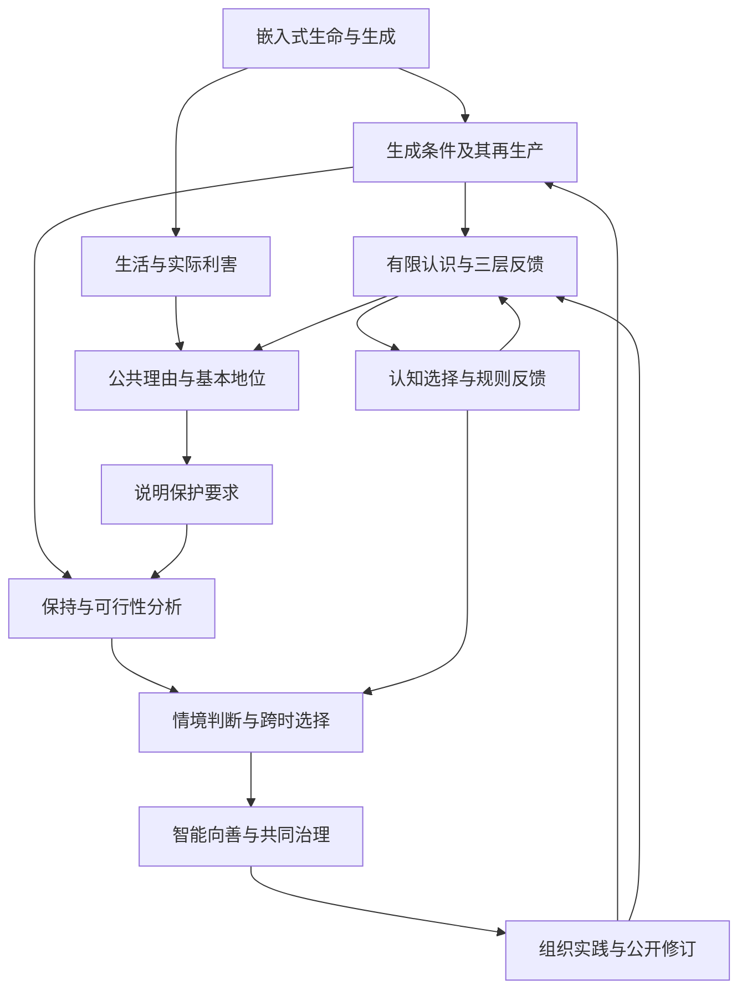
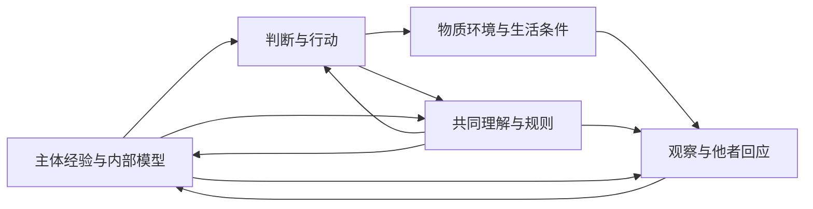

# 生生不息：智能向善的生成论基础

**从嵌入式生命、三层现实与 Meta-Attractor，到开放的共同未来**

统一理论白皮书 v1.1 · 2026 年 9 月 6 日  
思想与立场提出：Ren；AI 协助论证整理、文字重构与形式检查。  
配套文本：[《智能向善，天下生生》统一版宣言](宣言-v1.1.md)。

## 摘要

生命、认识与评价在世界的生成过程中形成，依赖能够更新的结构，并通过行动改变自身、他者与后来者的条件。本文从这一嵌入式事实出发，连接差异、建模、生命利害与公共理由，论证智能向善和开放共同未来的方向。

生生指生成者继续生成，并使生成结果参与后来生成及其条件的更新。本文以有限时间与资源下的有效可能性刻画能力，进一步用资源—能力递推区分净耗损、一次补充与条件再生产。从生活价值、实践一致性、判断可修正性、公共非任意性和基本地位出发，生生进入公共评价：基本生活、生成条件与有效纠正相互约束，局部增长须回应其对他者与后来者的影响。

三层现实将主体经验与模型、共同理解与规则、物质条件与后果放入同一反馈。Meta-Attractor 追踪奖励如何选择认知、优势如何进入规则、规则如何塑造证据与后来行动。目标、权力倾向和环境由此成为可改变的机制；向善演化则取决于维护收益怎样进入维护者的持续条件，以及修正能否赶得上损害。

形式部分检验受控保持、观察障碍、组合与实现、选择反馈和跨时比较；证明身份见附录 A。实践部分以七尺、位与三条托管规则，把判断落实为有理由的限制、实际重开与共同接续。智能向善要求能力发展支持生活与判断；人类命运共同体要求判断范围覆盖共同后果；大同作为多种生活共同发展的方向，在可检验、可修正的实践中展开。

**关键词：** 生生不息；生成能力；公共善恶；三层现实；Meta-Attractor；系统存续；认知与环境；智能向善；共同未来。

## 论证路径与阅读说明

本文采用十二章连续论证。第一至三章建立生成、系统与认识的对象；第四章说明公共善恶的理由；第五章检查形式关系；第六至八章连接选择、演化与情境决策；第九至十一章推出智能、共同未来与组织实践；第十二章集中说明检验与结论。

附录 A 集中列出前提与证明身份，附录 B 对应既有原则，附录 C 说明来源与本次统一的范围。

## 目录

1. [从差异与生命到生生不息](#chapter-1)
2. [生命与系统的存续条件](#chapter-2)
3. [三层现实与能够更新的认识](#chapter-3)
4. [从生命的利害到公共善恶](#chapter-4)
5. [形式核心：保持、观察与风险](#chapter-5)
6. [Meta-Attractor：认知、规则与长期趋向](#chapter-6)
7. [演化、系统健康与修复能力](#chapter-7)
8. [情境中的公共判断与跨时决策](#chapter-8)
9. [智能向善与可纠正的发展](#chapter-9)
10. [共同未来、大同与合作的形成条件](#chapter-10)
11. [让理论成为可以检验的共同实践](#chapter-11)
12. [检验、研究边界与共同立场](#chapter-12)

[附录 A：定义、命题与证明范围](#appendix-a)；[附录 B：原则的统一对应](#appendix-b)；[附录 C：来源与研究位置](#appendix-c)。

---

## 一、从差异与生命到生生不息

### 1.1 认识者由世界生成，也继续改变世界

人的身体、语言、记忆、感受与判断能力，在物理、生命和社会过程中形成。呼吸、食物、照护、教育、工具与共同知识继续维持这些能力；人的行动又改变这些条件。

这提供了本论的起始事实：**认识与行动是世界内部生成的过程；它依赖能够维持和更新的结构，并会改变自身及他者后来能够存在、认识和行动的条件。** 认识者就在被认识的世界之中，评价者也在评价所考察的关系之中。

对差异与变化的观察，是认识的入口。辨别状态需要登记区别；认识变化还需要记忆、记录或保留历史影响的结构。建模进一步辨别哪些差异共同发生，哪些改变造成后果，哪些关系在环境变化后仍然成立。由此进入三个相连的问题：结构怎样形成和维持；变化对生命具有何种利害；生成的结果怎样再次参与生成。差异给出入口，生命给出实际利害，生生给出持续研究的方向。

### 1.2 象、像与理：把模型放回因果关系

本论以“象”指情境中能够影响后续过程的结构；以“像”指对结构与关系的表征，包括概念、模型、目标与自我理解。细胞、技术、规则和被共同相信的叙事，都可以成为有因果力量的象。

**像亦象也。** 模型由世界中的过程实现，又通过行动改变世界。货币、承诺、身份和风险模型改变资源分配、相互预期、证据收集与技术部署。因此，模型有两项相连的评价：它是否准确表达对象；它进入现实后产生什么效果。错误模型也有真实的因果力量。

“理”指结构如何形成、维持、相互作用和失效的条件关系。材料有承载与疲劳之理，生命有代谢与修复之理，社会有信息、承诺、资源和权力反馈之理。各域规律通过明确条件与实现关系接受跨尺度比较。

原论以“道”命名跨情境仍成立的生成关系，以“大道”指“使众象不必相吞，而能入更高层次共同生成之元结构”。在本稿中，前者落实为可检验的条件关系，后者落实为共同生活、主体地位与生成条件相互支持的组织方向。模型须在不同位置、方法与实际后果中接受检验；共同相信一种像，给它社会效力，真实性则有赖于这种持续检验。[《生生不息论》第一至四章](../../sources/07-shengsheng-buxi/downloads-2026-07-08/2026-07-14-生生不息论.md)

### 1.3 变化怎样成为生成

并非一切变化都具有相同结构。某些变化消散原有差异；另一些相互作用形成能够保持一段时间的结构，并使后来能够发生不同的过程。A 与 B 在环境 E 中形成 C，C 再与其他结构相互作用，便构成一个可以研究的递归关系：

\[
(A,B,E)\longrightarrow C,\qquad
(C,D,E')\longrightarrow F.
\]

这种关系需要具体的形成机制、资源条件、保持时间与相互作用。只有结果确实进入后来的过程，“生成的结果成为生成条件”才具有实际内容。形成的结构可能提供催化、记忆、协调、承载或修复能力，也可能形成新的消耗与破坏。

物理规律约束这个过程。在常用开放系统热力学模型中，可写出：

\[
\frac{dS_{\mathrm{sys}}}{dt}=\dot S_e+\dot S_i,
\qquad \dot S_i\geq0.
\]

内部熵产生非负，系统还与环境交换熵。适当驱动、相互作用和交换条件下，局部结构的形成与维持可以与包含环境的熵增加相容。非平衡统计物理也能够研究信息与维持活动的代价。[Kolchinsky 与 Wolpert，2018](https://arxiv.org/abs/1806.08053)

守恒约束转化，不单独保证某种组织得到保留。导热使温差消失，也可以同时满足适用的能量守恒与熵增关系。因此，本论不将“总有变化”直接等同于“生成能力不断增加”。生成的方向需要考察结构改变了哪些实际能力，以及相应条件是否能够更新。关于这一物理区别的具体推导保存在[物理生成补篇](物理生成与内在规范性_论证补篇.md)。

### 1.4 生命使差异具有内在利害

对于通过活动维持组织的生命，环境差异影响其维持、修复、感受与行动能力。某些改变支持这些活动，另一些破坏它们。这种利害有因果基础，在生命能用语言表达之前就已发生。

维持机制自身也需要被维持：组织运行损耗条件，其活动又补充条件，补充活动再依赖其他结构。生物组织的约束闭合研究考察这种相互维持及其与环境交换的关系。[Montévil 与 Mossio，2015](https://montevil.org/publications/articles/2015-mm-organisation-closure-constraints/)

功能上的有利与有害，须说明环境、期限和系统边界；公共伦理进一步处理不同生命和主体之间的利益与冲突。对于社会和智能，训练、照护、设施、共同知识和制度也是实际依赖。把它们纳入生命—环境的共同生成，才能看见局部账目遗漏的条件。

### 1.5 生生的三个层次与共同方向

“生生”指生成者继续生成，并使生成的结果参与后来生成及其条件的更新。为了使论证可追踪，本文区分三个层次：

| 层次 | 评价对象 | 核心问题 |
| --- | --- | --- |
| 事实层的生成与持续 | 结构、过程及其依赖 | 它如何形成、保持并产生后续？ |
| 实践层的可延续性 | 行动者的生活、能力与计划 | 它能否继续行动、获得反馈、修复并改变？ |
| 公共层的生生 | 受影响者及共同生成条件 | 谁的生活得到支持，谁承担代价，谁能够参与与纠正？ |

物理与系统分析说明约束和机制；生活与实践说明利害和行动理由；公共论证说明他者及后来者的地位。数学检查条件关系，经验研究检查实际情境。

《智能向善，天下生生》以“癌变也会增长，战争机器也会扩张”揭示了增长与生生的分野：扩张者吞噬维持众生的条件，便可能越成功、越绝生；相生则使生成者与共同条件得到接续。

本论的共同方向可以表达为：维护有价值的生活，维护这种生活能够继续生成的条件，也维护认识、纠正和更新这些条件的能力。它关注眼前的实际生活，同时关注后来生活的条件；具体载体可以改变，维护方式也可以在学习中更新。

### 1.6 新结构扩展的是有效可能性

“A、B 生成 C 后，世界具有新的可能性”，首先需要说明实际做得到什么。设 x 为包含结构与资源的状态，H 为期限，B 为预算，q 为含义已明确的任务或活动，定义：

\[
\mathcal E_{H,B}(x)=\{q:q\text{ 能从 }x\text{ 出发，在期限 }H\text{、预算 }B\text{ 内实现}\}.
\]

**定义性推论 P1：有效可能性的扩展。** 在相同任务含义、期限和剩余预算下，若旧活动均有可执行的保留方式，并有至少一项新增活动，则 \(\mathcal E_{H,B}(x)\subsetneq\mathcal E_{H,B}(x')\)。包含来自保留方式，严格性来自新增活动的见证。P1 定义了待解释的扩展；生成机制承担证明这些条件成立的实质工作。

在无限步可达集合中，C 的后续或许早已包含在 A、B 的可达范围；C 实际形成后，完成这些活动的时间、成本与风险仍会改变。有限条件下的有效能力因此是重要对象。

**把消耗、补充与再生产放进同一个模型。** 考察一种利用环境输入的生产设施。令 r 为可用资源储备，c 为设施能力，u 为原有净供给，d 为生活与基础维护支出；每单位 c 每期转化环境输入得到 g 单位可用资源，运行耗费 k，折损比例为 \(0<\delta\le1\)，补建单位能力需 a 单位资源，投资为 i。各量取非负值，a 为正，r 与各期收支使用同一资源单位；一期结算为：

\[
r_{t+1}=r_t+u+gc_t-d-kc_t-i_t,\qquad
c_{t+1}=(1-\delta)c_t+i_t/a,\quad a>0.
\]

gc 是环境资源的转化产出。假定所考察期限内所需输入每期实际可得，且符合按产出折算的持续供给上限 \(gc_t\le Q\)。建造前储备为 R，先支付 \(a\bar c\)；若每期先支付生活、运行和补建费用，再收到产出，则一个明确的现金可行条件为：

\[
R\ge a\bar c+L,\qquad L\ge d+(k+a\delta)\bar c.
\]

建造后 \(r_0\ge L\)，再以 \(i_t=a\delta\bar c\) 补足折损，则 \(c_t=\bar c\)，且：

\[
r_{t+1}-r_t=u-d+(g-k-a\delta)\bar c.
\]

在原有供给不足 \(u<d\) 时，三种结构得以区分：

| 结构 | 模型内的结果 |
| --- | --- |
| 净产出不足以承担自身更新，\(g-k-a\delta\le0\) | 无法填补原有缺口，可能加快条件耗损 |
| 只有一次性补充 J，\(c=0\) | 储备轨迹增加 J，长期每期亏损仍为 d−u，失效被推迟 |
| 能再生产的能力 | 若 \(g>k+a\delta\)、\(\bar c\ge(d-u)/(g-k-a\delta)\)，并符合输入和启动约束，则补建持续发生、能力保持、储备不下降 |

最后一项由递推归纳得到：能力保持，储备不下降，故每期都能先支付费用。第一项还有更强结果：令 \(W_t=r_t+ac_t\)，两式相加得到

\[
W_{t+1}-W_t=u-d+(g-k-a\delta)c_t.
\]

投资项恰好抵消。当 \(u<d\)、净系数非正时，任意非负投资策略都使 W 每期至少减少 d−u；有限初始 W 因而无法无限维持非负资源和能力。这是模型内的耗损界，与补建策略满足条件时的保持相对照。

比较有限 H 下的 \(\mathcal E_{H,B}\) 时，本例将 B 取为累计支出上限，另用 r 检查期内支付；收入补充 r，不自行放宽 B，启动、运行、补建与任务支出均须在各自约束中完整核算。长期资源保持与固定预算内的任务扩展是不同检查。这个模型把再生产变成可识别的结构结果；应用还须测量效率、输入可续性、实际投资和负担分配，再进入第四章的公共评价。

### 1.7 理解、环境与能力共同变化

理解使人能够辨认新结构的用途、组合与维护方式，并在必要时停止使用。令 Π(m,e,σ) 表示知识 m、物质环境 e、共同规则与预期 σ 下可执行的策略族。技能、资源、权限、合作与反馈共同决定一个方案能否实施。

**定义性推论 P2：实现关系保留的能力扩展。** 在相同任务、期限 H、剩余预算 B 与保护约束下，若每个旧策略都有保留其任务结果的新实现，并出现一项旧策略无法完成的新任务，则有效任务能力扩大。这个实现映射把知识与环境的贡献放进同一接口；实际研究须追踪学习、维护、访问权和新依赖的成本。

能力也包括选择不做、停止、恢复与改变方向的实际条件。Sen 将评价从资源拥有量推进到人能够实现的生活机会；本论继续追踪这些能力如何参与后续能力的形成，以及其条件受何种制度选择。[Sen，《Equality of What?》](https://tannerlectures.org/wp-content/uploads/2024/07/sen80.pdf)

### 1.8 开放未来与有分寸的限制

后来发生的相互作用会呈现此前未见的能力与风险。“有了未来，才有未来的未来”：只有生成发生，其产物与新环境的关系才成为可观察、可学习的现实。开放式演化研究区分既定空间中的探索与扩展、改变行为空间的创新。[Taylor，2018](https://arxiv.org/abs/1806.01883)

因此，行动可以先约束资源、基本保护、试验范围和纠正条件，再随新经验更新模型与行动。开放未来同时包含形成新生活的能力，以及改判、停止和改变方向的能力。

原论区分**成生之限与绝生之限**。承诺限制反悔却建立信任，训练约束当下却形成技能，制止侵害保护他人的行动条件，这是成生之限。独占入口、消灭替代、让后来者永远依附同一控制者，则可能构成绝生之限。判断一个结束，应看它终止什么、保护什么，以及知识、权利、照护和接续条件如何留下。[《生生不息论》第六章](../../sources/07-shengsheng-buxi/downloads-2026-07-08/2026-07-14-生生不息论.md)

**冻结与烧尽是两种失败。** 冻结把现有形式永久化，令秩序失去学习；烧尽把共同基础兑换成即时增长，令变化失去接续。生生要求维持、创造与更新互相支持，让当下成为后来生成的条件。

### 1.9 保护当下与后来者，不要求一切形式永存

感受、关系、认识和创造具有当下价值，也参与后来条件的形成。保护未来从今天的身体、照护、自由活动和判断能力开始；无限牺牲现实中的人，会损害未来值得追求的理由。

延续也包含载体更替。组织可以解散，技术可以停用，理论可以改写，制度可以让位于更好的安排；有限生命通过照护、知识和关系参与接续。评价各载体，取决于它对生活与共同条件的实际作用。生生不息由此成为有限情境中的持续判断方向：第二章展开其系统条件，第三章研究认识如何形成，第四章论证共同安排为何应回应每个受影响者。

---

## 二、生命与系统的存续条件

生命通过交换材料、修复组织、调整响应而延续。身体、知识、基础设施和共同规则，也通过各自的更新过程继续存在。本章从中提取一个递归关系：**凡活动依赖需要更新的条件，活动的接续便依赖条件得到足够更新；更新又依赖其他活动，那些活动的条件也进入存续问题。**

这一关系把资源、信息、协作、修复与跨代传承接在一起。它既帮助识别正在耗尽的基础，也帮助理解新能力如何使维护、学习和共同生活获得新的条件。

### 2.1 适用对象与三种边界

本章研究具有可辨认的组织或功能、依赖物质与能量条件、在一定变化范围内通过维持、调节或更新而持续的开放系统。生命是核心实例，组织、社会与技术设施则须按具体性质建模。能够调整响应方式的对象，还具有适应系统的性质。

不同对象有不同的保持方式：被动结构可能接近平衡，休眠生命可以暂用储备，组织可以从外部取得维修与照护。后两种情况都要求研究储备的期限与外部供给的接续。因此，通用约束来自已识别的维持活动，而非“系统”这个名称。

三种边界分别承担不同工作。**辨认边界**说明研究什么，以及哪些功能或关系继续才算接续；它可以渗透、分布或变化。**因果边界**纳入足以改变结论的环境、主体与传播路径。**责任边界**说明谁受到实质影响，谁应得到考虑和回应。

企业具有独立账目，同时依赖家庭照护、公共卫生、生态与共享知识。研究其运行可以划定较小边界，评价其共同后果则须纳入这些依赖。认识“我是一个系统”，同时意味着认识“我的维持发生在其他系统和环境之中”。

接续还允许材料更新、成员交替、制度转型与功能交接。评价应说清哪些生活和能力继续，哪些结束，以及谁承担改变；某种功能的延续可以通过新的组织形式实现。

### 2.2 E1—E4：公开建模的前提

四项公设公开存续研究的输入：适用对象的经验性质、重要条件及模型覆盖范围。

**E1，嵌入性。** 系统状态 \(x\)、环境 \(e\)、行动 \(a\) 与所考虑的扰动，共同决定后续变化。环境提供输入，也承受输出；生态、供应、关系和制度可以使输出再次改变系统条件。具体研究应说明反馈作用于谁、经过什么路径、需要多久。

由此，重要变量即使处于“我之外”，仍可能属于解释与评价范围。外部供给需要接续，共同损害需要追踪；有些影响是单向的，施害者也可能成功转嫁后果。

**E2，有条件的持续性。** 某项组织或功能在指定期限内持续，依赖若干条件处于容许范围，记为 \(S(x,e)\)。这些条件可以涉及资源阈值、关键任务、身体健康、学习与参与，由功能关系、领域证据和明示的保护理由确定。

条件的选取决定证明保护什么。要研究人的生活，就须表达与生活相关的要求；只保持某个总体指标的模型，所覆盖的对象也仅限于该指标。条件应在评价结果之前说明，并允许根据新证据修订。

**E3，有限能力与更新需求。** 储备、处理能力、响应速度和可调用资源有边界；部分必要条件会被消耗、损坏或环境变化削弱。研究须识别损失、补充、替代与时限，尤其是某条件何时不可替代。

可利用能力须按品质、位置和时间判断。水量、可饮用水量、能够及时送达的饮用水量，是不同变量。一般守恒与熵增提供物理背景，具体预算仍由相应资源及损耗关系建立。

**E4，调节者的内在性。** 感知、判断、协调、纠正与传承，也由有条件的结构实现。监督的资源、坏消息的通路、照护者的恢复、知识的理解与传承，都属于系统状态。

调节者还会学习，会受奖励与惩罚，并改变对目标与他人的理解。因此，内部模型、共同预期和规则选择可以一并进入动力学。可靠调节需要维持其实际承载者。

E1 指明条件处于关系中，E2 识别相关利害，E3 说明更新需求，E4 将更新机制本身纳入研究。各项功能约束还须有连接前提：协调来自互补任务，观察需求来自对不同情况作不同应对的必要性。

### 2.3 从“当前成立”到“能够接续”

把环境、储备、能力与必要历史纳入状态 \(z\)，用 \(T(z,a,z')\) 表示行动后的可能后继。库存尚未耗尽而补充已中断、设备尚能工作而维修已瓦解，都说明当前满足条件与具有接续能力不同。

第五章定义可存续集合 \(V\)：集合内满足保护要求，并有可执行行动使全部模型内后继继续留在集合。F1 将当前保持与下一轮保持接成递归关系。“全部后继”相对于已声明的扰动范围；一条幸运路径、稳健保持和概率风险约束具有不同量词，应分别研究。这属于可存续性与不变集的既有数学家族。[Aubin、Bayen 与 Saint-Pierre，2011](https://link.springer.com/book/10.1007/978-3-642-16684-6)

实际内容来自条件的独立检验：测量库存、维护周期、训练时间和故障，评估能否形成响应。发现替代资源、识别错误故障模型或形成新维修能力，都可以改变可行性判断。数学上的行动存在，还须通过信息、资源、权限与协调成为实际能力。

### 2.4 资源更新：累积预算与耗损边界

设关键资源存量为 \(s_t\)，外部输入与再生为 \(i_t+r_t\)，使用、维护与不可回收损失合计为 \(d_t\)。各项量纲一致并避免重复记账：

\[
s_{t+1}=s_t+i_t+r_t-d_t,\qquad s_t\ge s_{\min}.
\]

**C1，有限时域的累积预算约束。** 若从第 \(0\) 期到第 \(T\) 期均保持临界存量，则对每个 \(1\le k\le T\)：

\[
\sum_{t=0}^{k-1}d_t
\le s_0-s_{\min}+\sum_{t=0}^{k-1}(i_t+r_t).
\]

**证明。** 累加存量方程，得到 \(s_k=s_0+\sum(i_t+r_t)-\sum d_t\)，代入 \(s_k\ge s_{\min}\) 即得。条件须对每个前缀成立。∎

储备使生命跨越夜晚、生产跨越收获期，也使社会能够先投入再形成能力。前缀约束则要求跨越这些过程时，必要条件始终得到承接；期末收入无法自动补回中途发生的不可逆失效。

**C2，有限缓冲无法承担无限持续的正净亏损。** 若每期 \(d_t-i_t-r_t\ge\varepsilon>0\)，初始缓冲 \(B=s_0-s_{\min}\) 有限，则连续执行超过 \(B/\varepsilon\) 期，临界条件必然失效，或过程更早因条件不足中止。

**证明。** 第 \(k\) 期缓冲至多为 \(B-k\varepsilon\)。取 \(k\varepsilon>B\)，它便无法仍然非负。∎

现有代码检查了整数版本：非负缓冲在前 \(N\) 步每步至少减少 \(d\)，则 \(n\le N\) 时 \(s(n)+nd\le s(0)\)；当 \(d\ge1\)，这一亏损关系无法对全部自然数时间持续。一般实数预算属于上面的纸面推导。

C2 的统一正净亏损下界必须有依据。损失趋零、输入增加或替代形成，都要进入模型；作为当前策略依据的创新，也须说明形成时间、执行路径和能承担的功能。多项资源则需要向量及替代关系，尤其要识别健康、水、技能与时间之间的转换限制。

这给出判断增长方向的方法：识别关键条件，测量净损失与缓冲，检查补充和替代时间，再看新增产出是否覆盖这些变化。使用储备建设新能力可以具有生成价值；它要同时接受同一期限、预算和必要保护的检验。

### 2.5 信息与反馈：保持行动相关的差异

建模通过选择和压缩形成可用认识。关键是保留改变可行应对的差异。设 \(w_1,w_2\) 是两种可能情况，\(O(w)\) 为可获得观察，\(A_{\mathrm{safe}}(w)\) 为满足要求的行动集合。

**C3，行动相关的不可区分性障碍。** 若

\[
O(w_1)=O(w_2),\qquad
A_{\mathrm{safe}}(w_1)\cap A_{\mathrm{safe}}(w_2)=\varnothing,
\]

则仅依赖 \(O\) 的确定性控制者，无法保证在两种情况中保持要求。

**证明。** 相同观察产生同一行动；若该行动在两种情况中均安全，它就属于两个安全行动集的交集，与交集为空矛盾。∎

C3 已有机器检查。其行动意义是：遗漏须对实际应对有影响。仅增加相同数据的处理量，无法补出这一差异；随机化可以分配风险，也仍须面对共同安全行动为空的限制。

例如，一种状态需要停机，另一种状态需要维持过程，报告却都称为“正常”。改善可以来自检测、历史记录与报告，也可以来自重新设计设施，使两种状态具有共同安全响应。知识与环境在这里一起改变可行控制。

已有稳健结构若能覆盖相关差异，实时区分可以省去；其他行动差异则需要足够的观察、记忆、模型或交互。Ashby 对调节、扰动与必要多样性的分析提供了相关基础。[Ashby，1956，第十一章](https://ashby.info/Ashby-Introduction-to-Cybernetics.pdf)

反馈还须及时进入行动。发现、表达、理解、授权和执行共同构成时延，应与剩余修复窗口比较。科学、统计、审计和安全报告的共同功能，是让相关现实进入判断，并让判断改变决定。具体组合应兼顾隐私、安全、理解成本与实际修正权。

### 2.6 合作与信任：使互补能力真正接合

若关键服务需要分布于不同角色的互补任务，缺少任一任务便无法完成，则协调是产出的条件。设生产 \(q\) 单位服务需要第 \(j\) 类能力至少为 \(a_jq\)，实际可用能力为 \(c_j\)，得到：

\[
q\le\min_j\frac{c_j}{a_j},\qquad a_j>0.
\]

**推导。** 分别写出 \(a_jq\le c_j\)，取全部上界的最小值。\(c_j\) 必须包含按时接入协作的能力：知识、人员与零件存在，还要能以兼容方式投入。

信任、验证、契约、共同习惯、技术接口与责任机制，可以组合形成可靠协调。应当检查预期是否可信、错误是否可见、承诺能否接续、成本能否承担。信任与核验各承担一部分工作，其比例依任务而定。

若破坏承诺的行为持续占优，并使关键协作成本超出承受范围，就须改变这种选择或建立替代协调。参与者的更新也在约束之内：长期透支少数人的健康来保持任务，会消耗后来继续协作的能力。合作应当同时提供完成工作和接续参与的条件。

### 2.7 外部性与局部优势：何时构成系统性侵蚀

局部收益怎样影响共同条件，需要追踪代价的对象、程度、持续时间，以及补偿、替代与其他收益。系统性侵蚀可以由以下链条得到支持：

> 一类行为获得局部优势；优势使它被保留或扩散；扩散持续净侵蚀共同必要条件；补充与替代不足；耗损超过缓冲，相关功能失效。

C1—C2 支持耗损到失效的推导，Meta-Attractor 分析选择和规则如何推动扩散。二者连接，揭示了修复承担成本、破坏取得优势、规则继续向破坏倾斜的危险。

诊断因而应看竞争选择什么、依赖什么、把后果放在哪里。新增共同能力与消耗他者条件，都可能提高局部业绩；净变化、负担分布、更新路径与反馈方向能够区分它们。

责任、补偿、数量限制、恢复义务、共同治理，以及供给和技术改善，都可以让共同后果进入行动。基本保护还可以限制哪些损害允许交易。Ostrom 对多中心治理的研究，为复杂公共问题提供了相应制度资源。[Ostrom，2010](https://www.aeaweb.org/articles?id=10.1257/aer.100.3.641)

一些施害组织可能依靠转嫁成本维持自身。对此，公共评价直接考察被影响的生活和地位，无需等待施害者也遭受同样损失。

### 2.8 冲突与权力：改变形成失调的条件

冲突可以来自资源矛盾、错误认识、不可信承诺与现有规则，也可以表达对不公的发现。所需能力是处理冲突、约束代价，并让关键生活继续。

在示意模型中，若 \(c_{t+1}\ge gc_t\)，其中 \(g>1,c_0>0\)，递推给出 \(c_t\ge g^tc_0\)。若关键功能要求 \(c_t\le B\) 且 \(B\) 有限，持续无界升级终会违反条件。实际分析须检查降级、退出、隔离、资源限制与新协议如何改变这一递推。

治理应先调查冲突的形成条件。新生产和共享方式可以增加供给，真实保障可以降低交接恐惧，可核验实践可以修订“人人都在争夺”的预期。知识、环境和共同规则改变可行集合，剩余冲突再由有理由的比较、分配与补救处理。

持续控制也可能来自不同机制：追求权力、担心报复，或认为唯有自己能够保护共同目标。真实处境与主体模型共同影响行为。交接能力、成员保障、权限期限和独立复核，可以分别改变风险、预期与执行条件，其效果应由行动和后果核验。

系统性危险在于，权力能重写自身评价、删除不利信息、转嫁成本、排除替代者，并借此继续获得优势。所需纠正功能是让证据、异议和责任实际改变共同决定；分权、审计、专业责任与参与机制是可研究的实现。

共识同样接受过程检验。通过压制异议形成的一致表态，会削弱共同认识。主体能够更新理解，制度能够修订安排，受影响者能够表达经验，这些条件一起支持可信的合作与交接。

### 2.9 适应、冗余与多样性：为相关变化保留响应

环境由 \(e_1\) 变为 \(e_2\) 后，若原行动失效而策略族中存在替代，接续需要切换能力；若结构改变才能产生可行响应，则进一步需要重组能力。足够稳健的既有结构，也可以直接覆盖相关变化。

适应因此是关键功能与变化方式的配合。记忆、信任和接口可以较稳定，方法与局部安排可以更快试验。何者如何调整，应由依赖和失效方式确定。Simon 对层级、稳定中间结构和近可分解性的讨论，为这种设计提供了先行分析。[Simon，1962](https://www.andrew.cmu.edu/course/15-440/assets/READINGS/simon-architecture-of-complexity-1962.pdf)

若某功能不可中断，而单一组件可能在维修前失效，就需储备、替代或故障容忍。在 \(n\) 个组件独立以概率 \(p\) 失效、任一成功即足以维持功能的模型里，可用概率为 \(1-p^n\)。实际冗余须核查共同电源、同一漏洞与一致误判等共同原因，以及备用路径的接入和维护成本。

多样性的功能在于形成互补响应、发现不同错误与产生新能力。让差异进入协作，需要接口、试验和经验传播。探索可以改变旧冲突的解法，其成本、恢复范围和负担分布则应进入同一评价。

### 2.10 八类功能约束及其连接前提

前面的关系形成八类社会诊断要求：

| 功能要求 | 使其成为必要条件的前提 | 需要保持的能力 |
| --- | --- | --- |
| 物质再生产 | 关键资源持续支出，缓冲与替代受限 | 在必要期限内取得供给、修复和转换 |
| 局部行动与共同接续相容 | 被选择的行为净侵蚀共同条件，补充不足 | 改变侵蚀、选择或补充关系 |
| 真实的信息流 | 情况需要互不兼容的应对，观察无法区分 | 取得相关信息，或形成共同稳健响应 |
| 合作与信任 | 关键任务依赖分布式互补能力 | 以可承担成本形成可信、可核验的协作 |
| 冲突有边界 | 升级可能超过关键条件的恢复能力 | 处理、缓解、隔离或改变冲突 |
| 权力保持可纠正 | 决策影响共同条件，并能封锁自身反馈 | 使证据、异议、责任和替代实际起效 |
| 自我更新 | 环境变化使原响应失效，替代或重组有必要 | 学习、试验和调整，同时保持必要功能 |
| 跨代再生产 | 成员、知识和参与能力会流失 | 提供照护、教育、培养、传承和新参与条件 |

功能可以分布实现，也可以由更大的网络承接。诊断应追踪必要工作是否完成，而非只检查某个机构名称是否存在。

这些要求相互重叠：培养维修者涉及资源、知识、合作与再生产；保护报告者涉及权力、信息与更新。八类是可修订的功能家族，应用时应补入遗漏依赖，并识别某对象拥有的替代实现。

### 2.11 维持维持者：修复能力的再生产

设关键能力 \(c_t\) 因退出、磨损或失配减少 \(\ell_t\)，由培养、维修或替代增加 \(u_t\)：

\[
c_{t+1}=c_t+u_t-\ell_t.
\]

若它须保持在 \(c_{\min}\) 以上，C1 的累积推导立即适用。实质研究在于识别这项能力的必要性、损耗、补充和接入时间。

维修依赖零件、技能与休息，科学依赖训练、时间与反驳，公共纠正依赖表达、授权和实施。因此，一次成功修复还应检查，后来修复所需的人、资源和渠道有没有得到接续。维护者的恢复与培养，是共同生成的一部分。

相互支持、检验和替代的网络可以承担这一递归。生物组织研究中的“约束闭合”，指构成组织的约束相互参与维持，同时与环境交换物质和能量，为条件再生产提供了明确的理论对象。[Montévil 与 Mossio，2015](https://montevil.org/publications/articles/2015-mm-organisation-closure-constraints/)

相关能力可以进入扩展状态：

\[
z=(x,e,c_{\mathrm{感知}},c_{\mathrm{协调}},
c_{\mathrm{纠正}},c_{\mathrm{再生}},\sigma,p),
\]

其中 \(\sigma\) 为规则，\(p\) 为实践或参与者分布。维护能力与选择条件一起决定后来有哪些行动可行。

“四项功能相乘”的直觉可以从依赖关系展开。若 \(P,C,Q,R\) 表示某任务所必需的感知、协调、纠正和再生有效，首先有：

\[
\operatorname{Success}\Rightarrow P\land C\land Q\land R.
\]

若另行证明成功当且仅当四项同时成立，在条件概率有定义时，链式法则给出：

\[
\Pr(\operatorname{Success})=
\Pr(P)\Pr(C\mid P)\Pr(Q\mid P,C)\Pr(R\mid P,C,Q).
\]

直接使用四个边际概率的乘积，还需独立性。若四项仅为必要条件，成功概率至多为交集概率，也至多为最小边际概率；存在替代路径时，对应部分应写成“或”。因此，先明确依赖与替代，再识别瓶颈，比直接相乘四个评分更可靠。

### 2.12 跨尺度：组合、共享条件与抽象实现

跨尺度研究需要回答：局部可行能否共同实现，粗尺度的保持能否由具体机制执行？

**C4，独立组合的保持性。** 两个系统分别具有保持集 \(K_1,K_2\)，各集内状态均有可执行的保持行动。若联合行动可同时执行，联合转移恰为局部转移的直积，则 \(K_1\times K_2\) 是联合保持集。

**证明。** 分别选择局部保持行动。独立性保证两者共同可执行；每个联合后继的两个分量仍分别位于 \(K_1,K_2\)，故留在直积集合。∎

C4 已有机器检查。独立性有明确的行动意义：两项不可延迟任务同时各需一单位资源，实际只有一单位且无替代，则各自单独可行，共同却不可行。

对耦合系统，设 \(A_{\mathrm{compatible}}(z)\) 为满足资源、权限与接口约束的联合行动，所需条件是：

\[
\exists\mathbf a\in A_{\mathrm{compatible}}(z):
\operatorname{Enabled}(z,\mathbf a)\land
\forall z'\,[T(z,\mathbf a,z')\Rightarrow\forall i\,K_i(z')].
\]

“对每个 \(i\)，各存在一个行动满足 \(K_i\)”具有不同的量词次序，各自承诺可能彼此冲突。共享条件应纳入联合状态，共同行动还须能被认识、协调采用并获得持续支持。

**C5，保守抽象与可实现控制的保持传递。** 设具体转移为 \(T\)，抽象转移为 \(U\)，\(\pi:X\to Y\) 为状态映射，抽象系统有保持集 \(L\)。对每个具体状态 \(x\) 及在 \(\pi(x)\) 可执行的抽象行动 \(b\)，假定存在可执行具体行动 \(a\)，使全部具体后继满足：

\[
T(x,a,x')\Rightarrow U(\pi(x),b,\pi(x')).
\]

则具体系统可保持 \(\pi^{-1}(L)\)。

**证明。** 在 \(\pi(x)\in L\) 时选抽象保持行动，再由前提选可执行具体实现。全部具体后继的投影属于该抽象行动允许的后继，故仍在 \(L\)，具体后继遂留在逆像。∎

现有机器检查采用的实现前提，覆盖所有具体状态上的所有可执行抽象行动。应用时须核查实际资源与权限能否满足这一条件，抽象转移是否覆盖全部相关后果，以及 \(\pi^{-1}(L)\) 是否蕴含要保护的具体利益。

这形成跨尺度工作的次序：识别条件，建立映射，核查共享资源与接口，证明行动可实现及后果覆盖，检查保护含义。通过这些连接，局部的能力可以进入共同能力，粗尺度的方向可以进入具体行动。

### 2.13 跨时间：期限、接续与下一代

食物供给、设备维修、人员培养和生态恢复具有不同周期；接续要求这些周期彼此衔接。后来足够的资源，只有在关键时点能够接入，才成为前一阶段的延续条件。

对有限期限 \(H\)，指定终端要求 \(K_H\subseteq S_H\)，再倒推：

\[
K_t=\{z:S_t(z)\land\exists a[
\operatorname{Enabled}_t(z,a)\land
\forall z'(T_t(z,a,z')\Rightarrow z'\in K_{t+1})]\}.
\]

这一纸面表达明确了未来如何约束当下：选择须留下能够继续履行要求的状态。时段内若可能发生不可逆损害，还须将中间轨迹纳入转移或保护要求。

终端条件应交代任务真正结束，还是责任交接。维护、废弃物、健康与照护后果，可能跨越任期和项目。有效交接须有后来承担者及其资源、知识与权限；这些条件构成可核验的接续承诺。

跨代再生产由此关注生活与参与能力的持续形成。家庭、学校与共同实践培养语言、判断、合作与照护；迁移、外部学习和新组织也可以补充。后来者有权形成自己的生活与制度，接续要维护的是这种能力，而非要求每个人生育或复制旧有秩序。

**有了未来，才有未来的未来。** 新结构、知识与关系只有形成以后，才能在新的情境中成为下一轮生成条件。因此，当下既要为探索提供空间，也要为后来观察、修订和接续提供资源。跨时评价应交代维度、权重和期限外责任；具体比较将在第五章与决策章节展开。

无限时域保持是研究递归能力的数学理想化，实践则在实际可及条件下维护有价值生活的接续。某种载体可以结束，并将知识、照护与能力交给后续生成者。

### 2.14 统一性的含义与研究责任

跨尺度统一性表现为必要条件、有限能力、可执行响应与条件更新之间的关系。不同系统拥有不同材料、时间尺度与保护对象；通过明确映射和连接前提，可以把功能比较推进为条件推导。

这一研究承接控制论、可存续性理论、组织闭合和公共治理。Beer 的 Viable System Model 已把组织如何具有持续存在能力及其管理方法作为明确研究对象。[Beer，1984](https://link.springer.com/article/10.1057/jors.1984.2) 本论进一步将这些条件连接到生活价值、开放生成和认知与规则的选择。

实际应用应说明：保护条件为何重要，依赖怎样识别，损耗与更新是否匹配，各方行动能否共同执行，观察能否改变决定，维护者怎样接续，哪些证据会改变结论。这些问题让统一框架持续取得经验内容。

**支持生命与共同系统的接续，需要维护必要条件，维护更新条件的能力，并维护认识与改变其实现方式的能力。** 后续章节将研究这种方向的公共理由，以及生成与维护如何进入实际选择。

---

## 三、三层现实与能够更新的认识

### 3.1 主体、主体间与物质的相互作用

行动同时改变主体经验、主体间关系与物质条件。对三者的认识都通过经验、区分和建模形成；身体反应、他者回应、重复观察和干预后果，又持续约束这些模型。

| 分析层面 | 关注对象 | 典型失误 |
| --- | --- | --- |
| 主体经验与表征（subjective） | 感受、意义、需要、自我理解与判断能力 | 以成绩替代生活，以确信替代检验 |
| 主体间关系（inter-subjective） | 语言、信任、承诺、公共记录与规则 | 以一致表态代替共识，筛去不利证据 |
| 物质条件（material） | 身体、资源、设备、生态与恢复能力 | 账面增长伴随实际耗损 |

三层是相互依存的分析视角。划分的作用，是让一种成功能够受到其他相关后果的检验，也让不同经验进入共同认识。

### 3.2 主观生活与内部模型不能互相替代

预测准确的人仍可能生活痛苦、关系匮乏或缺乏选择；确信与满足也可能来自受限的信息。生活价值、认知可靠性与公共参与因而应分别考察。

体验可以通过报告、行为、身体指标与持续关系被部分理解。幸福、感受与自主具有生活本身的意义，即使它们尚无完整数值表示，也应进入公共理由。

对 AI，可以直接研究内部状态、目标表征、学习与通信；主观体验及相关地位则须依据相应证据另行判断。功能模型的覆盖范围由其实际表达的对象确定。

### 3.3 主体间现实依靠共同实践，也接受现实检验

规则通过执行、设施和相互预期塑造生活。共同理解使陌生人协调行动，也影响何种记录成为证据、谁能说明问题。评价共识应考察其形成过程、反对与修订机会，以及实际后果。

互动还可以参与意义的生成：参与者在回应彼此时改变理解与行动，而不只是交换既定意见。De Jaegher 与 Di Paolo 的参与式意义生成研究，为这一关系提供了理论资源。[De Jaegher 与 Di Paolo，2007](https://link.springer.com/article/10.1007/s11097-007-9076-9)

### 3.4 共同的动力学接口

设 \(x_t\) 为相关物质状态，\(m_{i,t}\) 为主体 \(i\) 的模型、注意与目标表征，\(\sigma_t\) 为实际规则和共同安排。\(h_{i,t}\) 保存主体已取得的本地观察与通信记录，\(z_t\) 保存公共安排实际取得的记录。每一期按下列顺序更新。

主体依据可获得记录选择行动 \(a_{i,t}\)，生成带有接收对象的发出消息 \(u_{i,t}\)：

\[
a_{i,t}=\pi_i(m_{i,t},h_{i,t}),\qquad
u_{i,t}=\mu_i(m_{i,t},h_{i,t},a_{i,t}).
\]

行动改变环境，观察通路产生实际到达的信号与学习反馈：

\[
x_{t+1}=F(x_t,\{a_{i,t}\},d_t),
\]

\[
(y_{i,t+1},r_{i,t+1})
=O_i(x_{t+1},\{a_{j,t}\},\sigma_t,m_{i,t},\eta_{i,t+1}).
\]

\(d_t,\eta_{i,t+1}\) 表示环境与观察扰动。\(O_i\) 是描述信号生成的模型；主体取得的是其输出，而非右侧全部状态。

记 \(D_{i,t+1}\) 为通信通路实际投递给主体的消息，\(D^{\mathrm{pub}}_{t+1}\) 为实际广播或上报并到达公共安排的消息，\(y^{\mathrm{pub}}_{t+1}\) 为公共观察通路取得的信号。投递规则决定收件人、延迟、丢失和过滤；延迟消息由通路的队列状态承载。

令 \(\oplus\) 表示追加带时间与来源的记录，\(R_i,R_{\mathrm{pub}}\) 表示实际保存、压缩或遗忘，便有：

\[
h_{i,t+1}=R_i\!\left(
h_{i,t}\oplus
(a_{i,t},u_{i,t},y_{i,t+1},r_{i,t+1},D_{i,t+1})
\right),
\]

\[
z_{t+1}=R_{\mathrm{pub}}\!\left(
z_t\oplus(y^{\mathrm{pub}}_{t+1},D^{\mathrm{pub}}_{t+1})
\right),
\]

\[
m_{i,t+1}=L_i(m_{i,t},h_{i,t+1}),\qquad
\sigma_{t+1}=G(\sigma_t,z_{t+1}).
\]

\(h\) 中的行动记录说明主体选择了什么；实际执行后果由观察确认。消息记录说明收到了什么，其内容真伪仍待核验。公共行动记录只有经实际观察或上报，才进入 \(z\)；未表达的私有状态和未取得的全局事实均不进入 \(G\)。规则更新怎样取得权限、执行并让各主体知悉，也由实际制度与通信通路实现。

这个接口把观察、通信、记忆、学习与规则更新的接缝公开，具体函数仍须依据机制与证据建立。人的生活经验可以进入扩展状态；方法和通路本身也可以随学习与制度而更新，并承担资源与记忆限制。

### 3.5 情境性具有可检验的结构

善恶判断可以写成 \(J(a,c,I,H;N)\)：行动 \(a\)、情境 \(c\)、受影响者 \(I\)、期限 \(H\) 与有理由支持的保护要求 \(N\) 共同决定判断。输出可以是许可、禁止、风险或方案间的偏序。

**G1，相关差异被压缩时的判断障碍。** 若两种情境具有相同可见表征，但在同一评价要求下正确判断不同，则只读取该表征的确定性判断器，无法同时正确。

**证明。** 相同输入产生同一输出，它无法等于两个不同答案。第五章 F6 给出布尔判据的机器检查版本。∎

因此，抽象应保留改变所问结论的差异；无关变量或已由可靠边界吸收的影响，可以省去。原则说明保护理由，情境研究识别实际因果，二者共同形成可修订判断。

### 3.6 科学更新包括对模型本身的修订

本论直接继承可检验假说、预测检查、误差分析、独立核验与干预比较。有效知识使行动获得新的依据，失败暴露遗漏，新对象和新环境则推动问题与方法扩展。

参数更新在给定解释内调整估计，结构修订则检查变量、主体、因果关系和备选解释。Gelman 与 Shalizi 对模型检查和修订的讨论，说明科学学习包含对模型框架本身的检验。[Gelman 与 Shalizi，2013](https://arxiv.org/abs/1006.3868)

应用时，可按风险与能力记录问题、假设和预期；观察结果并接纳独立回应；将偏差定位到参数、因果、测量、目标或信息过滤；修改后比较实际表现，保存理由与剩余不确定性。不同情境可以采用不同的研究强度。

评价决定还应区分事前理由与事后结果：是否利用了相关证据，怎样处理未知，有没有相称的试验与补救机会。实际后果检验模型，证据使用与行动条件说明责任。

### 3.7 求真本身需要被维持

求真依赖具体的人、记录、设施、时间和组织。知识积累既需要可靠方法，也需要让采用这些方法的人持续工作、生活并影响决定。

训练、保障、可追溯记录、不同位置的核验和实际修正权，可以共同支持这种接续。若报告问题和承认错误持续导致失去资源，科学方法便可能被选择环境架空。

教育与认知塑造因此应保持检验、异议和修订。知识改变环境，环境又筛选知识；第六章研究这一循环，第十一章要求本论组织接受同样检查。

### 3.8 三层反馈为什么进入善恶评价

行动留下的后果包括生活、关系、物质条件与后来的判断者。三层反馈使这些后果能够相互表达、核验和修正。

认识论上，删去改变判断的差异，可能造成 G1 所说明的障碍。规范上，重要生活与共同条件若具有充分保护理由，其他层面的成功便不足以单独回答其严重而可避免的损害。第四章建立这一步所需的公共理由；具体责任仍按后果、知识、替代与行动能力判断。

一个持续学习的社会，也应能检验自己的成功标准。目标可以随经验修订，修订应说明理由并接续既有义务，让新理解形成更好的行动条件，而非抹去已经发生的生活与损害。

---

## 四、从生命的利害到公共善恶

### 4.1 生成者对世界具有实际的利害

我们由世界中的生成形成，并继续依赖身体、环境、关系与知识的更新。食物能否获得、照护是否中断、身体是否受损、事实能否被认识，会改变生命的感受、行动、修复与生活能力。这些区别具有可以研究的因果依据，也为行动提供了实际利害。

可以先问：在所说明的环境和时间内，一项变化支持或破坏了哪些活动及其条件？自我维持的组织研究已经尝试据此解释功能规范性；对系统与环境间信息关联的干预，也能研究这些关联对存续的作用。这些工作为本论提供自然基础与分析资源。[Mossio 等，2009](https://academic.oup.com/bjps/article-abstract/60/4/813/1635631)；[Kolchinsky 与 Wolpert，2018](https://arxiv.org/abs/1806.08053)

功能判断须说明主体、尺度与时间。提高组织控制能力的活动，可能损害成员的健康与自主；扩大生产的结构，也可能加速耗损其共同资源。因此，“对谁、在哪方面、在何种条件下有利”属于判断本身。明确这些索引，是防止把局部力量增长直接改称共同改善的第一步。

利害的客观依据与认识它的途径相互关联。痛苦通常需要通过主体表达、行为与身体变化来理解；获益者拒绝记录，并不会使痛苦消失。本章由实际利害进入行动理由，再由公共理由确定保护范围与责任。

### 4.2 生活本身为何不能无限让位于维持生活的手段

保存身体和社会的理由，来自能够在其中发生的生活。友谊、爱、游戏、创造、照护、理解与自由活动，可以是生活值得继续的内容。它们本身具有进入评价的地位，而非只有提高系统产出时才值得支持。

资源、组织与治理为这些生活提供条件；当维持机构变成最高目标，人却可能被要求永久推迟生活，以供养原本服务于生活的系统。于是手段取得无限权力，目的失去判断手段的资格。一个保存人口、秩序与技术，却让人只能服务于扩张的安排，依然可能失败。

生生不息要求双向检验：当前生活是否耗尽了后来生活的条件；维护条件的安排是否正在无充分理由地耗尽当下的人。前一项防止透支，后一项保持条件与生活价值之间的联系。

多种生活可以有不同内容。愿望的形成方式、实际意义及其对他者的影响，决定其应被支持到何种程度；主体自己的经验与理解应进入这一判断。本论据此承担规范起点：实际生活，以及其中的基本感受、行动与关系，具有进入理由的地位。系统存续是其中的重要条件，公共评价还要问存续支持了怎样的生活。

### 4.3 R1 与 N1：认可目的，就要认真对待其必要条件

**前提 R1：实践一致性。** 如果行动者继续认可目的 \(P\)，并有充分根据知道 \(C\) 是实现 \(P\) 不可替代的必要条件，那么，在没有更强理由支持放弃、调整目的或采取相反行动时，它有理由保留 \(C\)。

缺少 \(C\) 就无法实现 \(P\)。明知而无相反理由地消除 \(C\)，同时坚持这一行动服务于 \(P\)，会使实践解释发生冲突。行动者可以为更重要的责任调整目的；它应说明这种调整，使理由与行动保持一致。

**命题 N1：有时间跨度的目的产生相应的延续理由。** 若 \(P\) 需要在区间 \(H\) 内持续活动，而 \(C\) 在该区间内不可替代，则在 R1 的条件下，保留 \(C\) 的理由覆盖相应时段。条件在需要时失效，将使仍被认可的目的不可实现。∎

学习、照护、建设、创造与共同生活往往具有这种时间结构，并共享健康、信任、环境和知识等条件。不同人生由此可以支持共同的保护理由。任务完成、制度失效或更好替代形成时，相应组织可以结束或改变；应被接续的是有理由支持的活动及其条件。

必要性本身也应接受检验：资源转移、知识改进和组织重构可能形成替代。实践一致性建立目的与条件的关系，后面的公共理由则进一步约束目的及其实现方式。

### 4.4 R2 与 N2：有限认识者需要维持现实中的纠错能力

**前提 R2：可修正的判断。** 当行动者承认自身认识有限，并以较好的理由作为行动依据时，它承认新的证据、经历和受影响者反馈可能构成修正理由。

**命题 N2：可修正实践具有反封闭理由。** 在其他条件相当、保留渠道没有不可接受代价时，承认 R2 的行动者有理由维持相关观察、异议表达、独立核验、行动修正与损害恢复的有效渠道。

**论证：** R2 将可能出现的更好理由纳入实践；若行动体系取消使这些理由改变决策的全部有效条件，修正便失去实现途径。依据 R1，应当维护这一仍被认可实践的必要条件。∎

开放的实际内容，是事实能够到达、提出者能够承担表达成本、决定者需要回应，并且修正仍来得及。决断、长期承诺和紧急限制都可以与它相容；关键在于复核和纠正有可用的实现方式。

判断者和目标也参与变化。胜利可以强化某种理解，共同叙事可以使一些代价不再被命名，环境又可能让错误理解暂时显得有效。纠错因此还包括检查目标、证据入口和成功标准。宣称向善的组织，同样应使自身使命与做法能够接受这种检验。

### 4.5 R3：共同理由不能以获胜者的身份作为终点

**前提 R3：公共理由的非任意性。** 一项要求共同正当性的安排，应以可普遍化的理由说明不同对待：相同性质的利益和伤害具有进入考虑的资格；差别待遇须诉诸与该决定相关的差异，不能仅以制定者的身份、力量或获胜代替说明。

R3 是明确的规范承诺，采用公共理由和可普遍化论证的路径。若保护我的理由是我会受苦、需要行动、依赖关系并有自己的生活，那么这些性质出现在他人身上时，也提供相关理由。仅以“那不是我”使它们归零，是以身份替换了原先给出的利害理由。照护依赖、承诺、职责和不同需要，则可以构成有内容的差别理由。

这里有一个必须正面回答的利己者：它可能从未承认“受苦本身提供理由”，只承认“我的受苦提供理由”。单凭 R1 的目的—手段一致性，无法迫使它接受公共理由的形式。本论的回应是：R3 明确选择以可向受影响者说明的共同理由评价制度；纯粹的自利规则可以解释追求，却尚未回答它为何有权规定他者的基本生活。是否接受这一公共标准，与在该标准下某种伤害是否获得充分辩护，是两个问题。

从行动条件研究道德要求，与 Gewirth 的《Reason and Morality》相接；将利他纳入行动的理性要求，是 Nagel《The Possibility of Altruism》的明确研究方向。本论属于与它们对话的实践理性论证家族，并将所用的公共化步骤列为前提，使争议能够定位。[Gewirth](https://press.uchicago.edu/ucp/books/book/chicago/R/bo25842059.html)；[Nagel，1970](https://gretchen.law.nyu.edu/fac-books-edited-works/529/)

公共理由的适用也覆盖暂时无力回报者。一个人的筹码决定它能否迫使别人回应，却不能独自决定其损害是否值得回应。赞成票、市场份额与执行成功，是应研究的事实；安排的正当性还须由相关理由支持。

### 4.6 R4：受影响者为何具有不能任意删除的基本地位

**前提 R4：受影响者具有不可任意取消的基本地位。** 当共同安排决定一个人的生存、身体、基本行动与生活可能性时，他的基本利益及其作为理由来源的地位，不能仅因取消它们有利于优势者而被抹除。

R4 将公共理由落实到安排的边界。有些制度声称听取意见，却规定一旦某人的利益妨碍总体目标，其反对就不属于有效理由；随后再以“没有有效反对”证明自身正当。它通过决定谁算数，让权力的结论成为自己的前提。

基本地位对此形成约束：受影响者应能以其生活、损害和依赖提出理由。事实可以被质疑，要求可能与他者基本利益冲突；回应应当针对事实与理由，而非直接取消提出者。这种地位给予每个人被认真回应的资格，具体决定仍须处理相互关系。

它还具有认识上的支持：决定者并不自动掌握他人生活的全部信息，删除经验和质疑可能同时删去识别错误的证据。但主体的地位也覆盖无法提供有用信息者。无充分理由的严重伤害，不能因受害者缺乏认知贡献而得到豁免。

R4 由生命的实际利害、非任意性与公共说明的要求获得支持，并作为本论承担的规范前提。它与康德关于将人作为目的的思想相接，又进一步要求考察这种地位的物质实现：当拒绝必然导致基本生计或人身安全丧失时，名义许可尚未建立实际自主。[康德，《道德形而上学奠基》，第二节](https://www.gutenberg.org/cache/epub/5682/pg5682-images.html)

### 4.7 不能发言者、他者与后来者如何进入公共理由

婴儿、失能者和暂时失去意识者仍可能承受损害、依赖照护，并处在值得维护的关系中。若保护理由来自这些利害，语言或谈判能力的缺失就不能使其消失。公共安排应允许可问责的代理表达；代理者应交代依据与利益冲突，回应实际反馈，并接受修订。

其他有感受能力的生命所经历的同类损害，也有进入考虑的理由。具体保护应依据其利益与实际关系展开。以系统视角研究依赖，并不使公司、国家或模型自动拥有与生命相同的地位；某种组织形式的结束，可以成为其成员继续发展的条件。

未来世代通过当下能够改变的条件进入理由范围。身份未知，不妨碍我们认识某种污染、债务安排或知识断裂会严重限制后来生活。时间距离会改变证据、可预见性与责任能力，却不能单独把相关基本利益归零。

这里承担的是与实际影响、知识和能力相称的未来责任。它不要求创造所有可能存在的人；也禁止代理者以一个未经检验的远景，删除当下承担照护和劳动者的地位。真实冲突需要公开呈现，具体损失需要得到说明与补救。

### 4.8 N3 与 N5：共同条件为何具有公共保护理由

**命题 N3：公共生成条件具有优先的保护理由。** 若某些条件对于受影响者的基本生活、有效参与或共同纠错不可替代，那么满足 R1—R4 的共同安排，不能仅因提高局部收益而取消它们。

**论证：** R1 要求维护被认可活动的必要条件；R2 将纠错纳入其中；R3—R4 要求以非任意理由承认受影响者。因此，共同条件的去留需要回应相关基本利益，不能只按获益者的回报决定。∎

水土、照护、可靠知识、基础设施、合作与纠错渠道，都可能承担这种功能。应辨认其实际必要性、替代路径、恢复时间与维护者。若一项条件对每位成员的某项活动都不可替代，其彻底失效就使全部依赖者失去相应活动能力；第七章将形式化这一关系。共同损害可以与某些人的短期获利并存，后者无法取消其他人的损失。

**命题 N5：重要后果不能仅因位于行动者边界之外而被排除。** 当环境及他者的状态改变重要后果时，判断必须以足够信息或有效边界覆盖这些影响；R3—R4 又要求把他者相关利益计入理由。评价范围由重要依赖与后果的传播决定。

合理抽象、分工和边界保护可以减少信息负担。它们的充分性应由相关后果来检验，而不是通过删去已知损害取得。账外是一种记录状态；把记录改称完整，并没有改变现实关系。

### 4.9 N0：保护未来来自生活价值、构成依赖与行动能力

**命题 N0：在负担相称且无更强相反理由时，已有生活价值、跨时构成依赖与行动能力，共同产生维护和修复未来条件的责任。**

推导有四步：实际生活中的感受、关系、理解和创造具有价值；这些价值的继续实现依赖尚未自动得到保障的条件；当下行动能够支持、毁损或修复其中一些条件；依据 R1—R4，行动者有理由维护其能够影响的部分，并向受影响者说明所作选择。

未来的不确定性使观察、保留和修复具有实践意义。我们可以维护共同基础，允许形成新能力，并在生成过程中检验后果。技术能力扩大后，行动可以影响更遥远的生活条件；Jonas 的《The Imperative of Responsibility》以技术时代的行动变化、后代与环境责任为核心问题，是这条论证的直接对话对象。[Jonas，1984](https://press.uchicago.edu/ucp/books/book/chicago/I/bo5953283.html)

保护未来包含今天的繁荣。健康、照护、教育与创造既是当前生活，也是后来能力的条件。知识、环境和制度还可能改变可行集合，使原来的权衡得到缓解。宣称牺牲不可避免之前，应研究哪些冲突条件能够改变；剩余冲突则按需要、保护、风险与负担进行具体判断。

责任的尺度随行动能力、可预见性、成本和其他基本要求而定。持续学习使人在现有条件下更好地尽责，也使责任所依据的知识和能力得以更新。

### 4.10 善恶的工作定义与情境判断

公共善恶包含三个相互约束的规范维度：

| 维度 | 评价内容 |
| --- | --- |
| 生活实现 | 实际生活免于严重伤害，并有感受、关系、理解与创造的空间 |
| 主体地位 | 受影响者的利益进入理由，具有有效的表达、参与和改变关系的条件 |
| 共同更新 | 共同生成与纠错条件得到维持、修复与发展，后来者能够接续 |

**工作定义 D1：** 在所说明的情境、影响范围和时间内，行动若改善实际生活与有效能力，承认受影响者的基本地位，并维护或修复共同生成与纠错条件，就在相应方面具有善的理由。各维度发生冲突时，应说明收益、损害、替代、分担与修复。

**工作定义 D2：** 行动若无充分理由地造成严重伤害，或系统性剥夺基本生活、主体地位及有效纠正能力，就在相应方面构成恶或不正义；这种关系若被固定为自我强化的规则，则构成结构性的恶。

判断可以写为 \(J(a,c,I,H;N)\)：行动、情境、受影响者、时间范围与保护理由共同进入评价。它可以报告底线违反、部分顺序、风险与未知，允许在尚不足以比较时保留判断。

情境性来自因果关系：相同操作在不同供给、知识与权力关系中会有不同后果。事实和理由确定后，判断受它们约束；新知识改变结论时，应留下可追踪的说明。“证据不足”“可信风险”“程序失责”与“已构成不正义”由此获得不同位置。

### 4.11 N6：系统性外部化何时可以明确判恶

**命题 N6：无正当理由的严重代价外推应被否定。** 设一项行动或制度同时满足：

1. 导致、维持或有充分根据预见会导致他者基本生活、共同生成或有效纠错条件的严重损害；
2. 获益者仅以自身增长、利润、胜利或使命完成为充分理由，将损害排除在有效决策之外；
3. 不存在成立的必要性、相称性或基本利益冲突辩护，本有相称的避免、减害、调整或修复措施，却无充分理由地拒绝。

则它违反 R3—R4 与 N3、N5；当这种关系被持续组织为剥夺机制时，构成结构性的恶。

**论证：** 第一项确定应回应的基本利益与损害；第二项仅凭局部边界和收益删除这些理由；第三项排除有充分保护理由的必要限制与不可避免冲突。因此，局部成功不足以使损害正当化。若规则奖励这种外推并惩罚纠正者，它还侵蚀了改变自身的条件。∎

充分理由应有事实依据，回应具体受影响者，比较可行替代，并说明负担、复核与修复。“发展需要代价”或“竞争迫使如此”提出的是待证明的必要性。能够改变竞争条件的主体，还应解释为何拒绝改变。

可信重大风险也使决策规则成为评价对象。具有调查能力，却把永不考虑自身边界外的后果设为固定规则，已经删除了应进入判断的理由；相应审查和约束应与风险、能力相称。

利润与绩效提供部分信息。若行动 \(A\) 保留基本保护、局部回报为 \(3\)，行动 \(B\) 突破保护、回报为 \(5\)，纯局部最大化便选择 \(B\)。既有 Lean 反例检查这个可能冲突；N6 则提供何时应否定该选择的规范条件。

判准由此指向行为和机制：以可避免的严重损害维持扩张，并拒绝相称修复，应被明确反对。它同样适用于以安全、正义或生生不息为使命的组织。

### 4.12 三层现实如何进入同一评价

主体经验与内部模型、共同理解与制度关系、物质环境与实际结果，共同影响行动的意义和后果。三层现实帮助寻找后果怎样发生；三个规范维度说明它们为什么重要。同一种伤害可以同时改变身体、经验和关系。

第三章的观察限制直接适用：若表示删去会改变恰当判断的差异，只读取这一表示的判断器就可能失去作出正确选择的信息。第五章检查相应逻辑结构；实质研究确定哪些差异与决定有关。

若遗漏涉及基本生活、地位或共同条件，N5 要求纳入重要影响；无理由地排除重大可避免损害，符合 N6；封锁其表达与纠正，则进一步违反 N2。行动的影响、可获得知识和实际能力，共同决定所需调查与责任。

认知可塑性也接受这一检验。真实保障、教育和公开证据能够改变不信任；操纵证据和制造依赖也能改变共同确信。应检查形成方式、生活后果与自主纠错，而非只看人最后是否表态满意。三层一致仍可能出现在压迫安排中，因而必须与基本地位共同评价。

对于 AI，内部表征、共同通信与环境反馈是分析对象；它是否具有自身应保护的体验和利益，应随相应证据研究。其对人类和共同条件的影响，已经可以进入公共评价。

### 4.13 后果、可责性与改变主体的条件

事实与公共理由支持的评价，不以被评价者同意为前提。拒绝承认饮水被破坏或纠错被封锁，不能消除已经成立的后果；拒绝公共标准也不等于提供了损害的公共辩护。接受、服从与改变行为，是后续需要研究的动力问题。

功能损害、制度不正当与个人可责性各有对象。自然过程可能损害生命；人的责任则涉及知识、可预见性、选择能力、胁迫、获益和补救机会。被迫参加有害竞争者，与有能力改变规则却阻断改变者，承担不同责任。

主体同样处在生成中。恐惧、错误模型、共同预期与真实生存条件，都可能维持破坏行为。交接保障、知识传递、可核验承诺与权限边界，可以改变其发生条件。机制解释帮助形成相称且有效的回应，也要求保护者审视自身权力和目标。

制度评价还应追踪什么实践能够留下：报告坏消息的人是否失去机会，维护共同条件者的成本由谁承担。眼前后果、反复行动筛选的认知，以及这些认知进一步塑造的规则，构成连续评价对象，并进入第六章的 Meta-Attractor 分析。

### 4.14 公共生生不息的规范结论

本章以实际生活和构成依赖提供评价内容，以 R1—R2 建立目的、条件与纠错之间的实践关系，以明确承担的 R3—R4 建立公共理由和基本地位。相应前提与情境条件成立时，N1—N3、N5 说明应保护哪些条件及其范围，N0 说明跨时责任，N6 说明严重外推何时构成恶。

善的具体形式可以随生成而丰富，判断仍须回应真实后果与公共理由。生生不息由此成为实践方向：支持有价值的生活，更新共同生成条件，并使认识错误、改变行动与形成新能力成为现实可能。

科学检验实际依赖，形式模型检查条件推导，公共论证检验保护内容与负担。三者共同使理由可以追溯，也使后来认识能够修订当前选择。

---

## 五、形式核心：保持、观察与风险

本章以经论证的保护条件为输入，检查给定转移、信息与风险下的持续保持。

### 5.1 状态、行动、扰动和保护条件

取状态空间 X、行动集合 A，以及转移关系 T(x,a,y)。它表示在状态 x 采取行动 a 后，y 是模型认为可能出现的后继状态。环境扰动、他人行动与模型内的不确定性，可通过多个可能的 y 表示。历史依赖、时间、资源与未完成义务，必要时都应进入状态。

设 S⊆X 为经规范理由、领域知识与受影响者情境说明的保护条件，例如基本生活、生态恢复、有效纠错与危险系统的可控性。条件可用谓词表达。

对 K⊆X，定义一个行动保持 K，当且仅当：

\[
\operatorname{Keep}(x,a,K)
\iff [\exists y\,T(x,a,y)]\ \land\ [\forall y,\ T(x,a,y)\Rightarrow y\in K].
\]

第一个条件很重要：没有任何后继状态的“行动”，不能因为全称陈述在空集上成立而被当成安全行动。

称 K 为受控保持集，当且仅当：

\[
\forall x\in K:\quad x\in S\ \land\ \exists a\in A\,\operatorname{Keep}(x,a,K).
\]

定义可延续集合：

\[
V(S,T)=\bigcup\{K:K\text{ 是上述受控保持集}\}.
\]

这套保持集合方法属于可生存性理论；本文将其连接到公共保护、认知与制度选择。[Aubin、Bayen 与 Saint-Pierre，2011](https://link.springer.com/book/10.1007/978-3-642-16684-6)

### 5.2 保持定理

**命题 F1：**

\[
x\in V\iff x\in S\ \land\ \exists a\,\operatorname{Keep}(x,a,V).
\]

**证明：** 若 x∈V，则它属于某个保持集 K。K 中的保持行动把所有后继留在 K，因而留在 V，且 x∈S。反向，若 x∈S 且存在把后继全部留在 V 的行动，则集合 V∪{x} 也是保持集：在 x 使用该行动，在其他状态使用 V 已有的保持行动。故 x∈V。∎

这说明“现在没有出事”和“仍有能力持续不出事”不同。后者还要求有可行的行动把下一步留在能够继续保持条件的区域。

**命题 F2：** 如果实际路径从某个保持集开始，每一次实际转移都属于模型 T，而且每一步选择的行动都保持该集合，那么路径的每个时刻都满足 S。

**证明：** 初始状态在集合内；若第 t 步在集合内，保持行动使第 t+1 步仍在集合内。归纳可得所有时刻均在集合内，而集合包含于 S。∎

F1、F2 的离散命题已有 Lean 检查；模型适用性与检查范围统一列于附录 A。

### 5.3 三种必须区分的“还有未来”

第一种是存在一条好路径：某种幸运的未来仍有可能。第二种是存在一种能应对模型内所有扰动的行动方式：行动者仍能保证保护条件。第三种是满足给定概率或风险预算的路径安排。三者不能混用。

**命题 F3：** 若 x∈S 但 x∉V，则每个可执行行动都至少有一个可能后继不在 V。

否则，某个行动能把全部后继送回 V，由 F1 可得 x∈V，产生矛盾。这个命题也已通过 Lean 检查。但它不等于“离开 V 后绝无可能回来”。附录中的三状态反例允许从赌局状态幸运地到达安全状态，只是无法排除另一条死亡分支。

若采用“存在一条安全路径”的量词，对于当前满足 S 的状态，在固定模型中，若它不存在全程安全的延续路径，其任何可执行后继也不能具有这样的路径，否则可以用当前安全前缀拼接。当前安全这一前提不可省略：一个已经不安全的状态，仍可能转入以后一直安全的状态。失去稳健控制与没有任何全程安全路径，也需要分别判断。

### 5.4 保护内容与可行范围

形式层检查要求是否可共同保持；规范层说明保护谁及其理由；经验层核实模型。确定性两状态循环也能满足保持条件，代码保留了这一反例。

若 S₁⊆S₂，则 V(S₁,T)⊆V(S₂,T)。这项已检查结果表明：增加保护要求可能减少方案，乃至使可行集为空；此时应改善技术、分配或制度条件，剩余冲突依 §8.5 处理。

### 5.5 模型的边界也是论证的一部分

状态、受影响者、扰动与期限决定结论的意义。季度盈利与跨代供给更新是不同命题。应用须说明保护的利益、状态归并、重要扰动及边界，并比较替代建模；删去外部成本会删去相应判断能力。

存在保持行动还要转化为可执行策略：控制者需获得行动所需信息，抽象行动也须有具体实现。C3 检查观察障碍，C5 检查实现关系；部分可观测策略要据此进一步构造。

无限步模型考察持续保持；有限任务则可纳入期限与剩余义务，使用安全和终端条件。V 是存在性定义，求解仍需具体算法。

### 5.6 情境判断的形式依据：被删去的信息可能改变结论

设W为相关情境集合，O(w)为当前判断者能获得或愿意纳入的信息，B(w)为某项已明确的事实判据，例如某行动是否破坏关键恢复条件。若存在w₁、w₂使：

\[
O(w_1)=O(w_2),\qquad B(w_1)\neq B(w_2),
\]

则任何只以O为输入的确定性判断器j，都不可能在这两个情境中同时正确：

\[
\neg\big[j(O(w_1))=B(w_1)\ \land\ j(O(w_2))=B(w_2)\big].
\]

**命题 F6：相同输入无法保证区分不同的相关后果。** 若两个判断都正确，相同输入的相同输出就必须同时等于两个不同的B，矛盾。布尔判据版本已由[OpenFuture.lean](formal/OpenFuture.lean)检查。∎

F6 要求：若同一信息对应不同的重要后果，应补充观测、试验与模型，或采用能够承受该不确定性的行动边界。新增知识若排除一种情境，障碍便可能解除。原则说明保护理由，情境研究辨别实际影响。

### 5.7 保留信息与选择的价值

设 A 为有限非空的原有可选行动集合，u(a,θ) 为情境 θ 中的可积收益。观察相关信息 Y 之后再选择，若原选项不消失、信息没有额外成本，且行动者可以忽略信息，则：

\[
\mathbb E[\max_{a\in A}\mathbb E(u(a,\theta)\mid Y)]
\ \geq\ \max_{a\in A}\mathbb E[u(a,\theta)].
\]

**证明：** 对任何固定行动 a，信息后的最优条件收益至少等于继续选择 a 的条件收益；取期望，再对固定行动取最大值即可。严格优势需要信息确实改变某些最优选择等额外条件。∎

信息价值支持保留判断机会。实际等待、储备选项与搜集信息各有成本；错过救援窗口、耗尽资源、侵犯隐私都须计入。为保护更广的共同能力，可以作出相称的承诺或局部关闭。

### 5.8 重复毁灭风险的严格版本

设 Aₖ 表示在前 k 次风险暴露中尚未发生某种不可恢复失败。如果在每一次已经存活的条件下，下一次失败概率至少为 ε，其中 0<ε≤1，则：

\[
\Pr(A_k)\leq(1-\varepsilon)^k.
\]

**证明：** 由条件概率，Pr(Aₖ₊₁)=Pr(Aₖ)Pr(Aₖ₊₁|Aₖ)≤Pr(Aₖ)(1−ε)，递推即可。这里不要求各次事件相互独立，但要求条件风险下界在每次暴露中仍然成立。如果风险确实无限次出现，则存活概率趋近零。∎

应用这个风险界须核实暴露次数与条件风险下界。有限次数、逐步降低的风险或改变暴露结构的制度，应按实际模型重新计算。

### 5.9 为什么不能只给基本底线一个有限价格

设某系统以 R−λH 评价行动，其中 H=1 表示突破保护底线，λ≥0 为固定有限惩罚。

**命题 F4：有限软惩罚不能对允许足够大违规收益的模型族提供统一底线保证。** 对任意 λ，构造两个可执行行动：合规行动的收益为 0、H=0；违规行动的收益为 λ+1、H=1。它们的得分分别为 0 与 1，故最大化该分数选择违规行动。∎

自然数算术核心已有 Lean 检查。若违规收益有已知上界，足够大的有限惩罚可能有效；对超出此界的规模，则应采用行动约束、分层优先或明确风险限制。约束冲突仍需 §8.5 的公共判断。

### 5.10 共同条件、结束与接续

找到一种值得过的生活，并不能穷尽所有值得过的生活；发现一种足以消灭所有相关生活的机制，却可能构成排除该机制的强理由。正面的生活形式具有开放性，而某些破坏共同条件的方式具有跨越多种生活形式的否定作用。

教育、承诺和生命的结束都包含不可逆部分。应判断失去了什么、谁承担代价、理由是否充分，以及基本生活与纠错能否接续。**成生之限**通过有理由的局部限制或结束保护共同能力；**绝生之限**封死这些能力及其重开条件。第八章的三条托管规则据此检查关闭决定。

---

## 六、Meta-Attractor：认知、规则与长期趋向

行动会改变后来什么更容易获得资源、传播与规则影响。本章把认知、目标和环境一并纳入选择与反馈。

### 6.1 从固定规则中的竞争，进入规则本身的竞争

在简单优化模型里，规则给定，行动者寻找最优行动。社会过程更复杂：经济优势可以影响立法和基础设施，注意力优势可以影响何种事实被看见，技术优势可以改变进入门槛，军事优势可以改变谈判条件。竞争的结果会进入下一轮竞争的规则。

可用两个耦合状态表示：

\[
x_{t+1}=F(x_t,\sigma_t),\qquad
\sigma_{t+1}=G(x_t,\sigma_t),
\]

其中 x 是资源与行为状态，σ 是规则、标准、注意力分配和可被承认的目标。Meta-Attractor 所关注的，正是选择过程及其评价标准也被选择结果改变的情形。

为分析认知，可进一步将状态展开为：

\[
\Omega_t=(x_t,\sigma_t,p_t,m_t,e_t),\qquad
\Omega_{t+1}=\Phi(\Omega_t).
\]

p 表示实践的资源与影响分布，m 表示模型、注意习惯与成功观，e 表示环境和共同条件。它们展开三层现实的相互作用：规则筛选参与者，参与者学习并改变环境，优势者又影响规则。

“二阶”指选择规则受到内生反馈。扩展状态后仍使用通常动力学；严格的吸引子判定须说明保持性与邻域趋近，证据尚弱时使用“反馈假说”或“吸引趋势”。

Moloch 突出既定竞争条件下的协调困境；Meta-Attractor 进一步追踪困境如何筛选策略、进入认知并改变制度。

图中箭头是待检验的增强或抑制关系。

**工作定义 D3：总体化。** 某个局部目标获得对共同存在条件的广泛控制，并借此使其他主体越来越只能以服务该目标的方式生存，同时削弱拒绝、纠正和形成替代安排的能力。

标准与公共机构能够支持合作；总体化的诊断则检查共同条件是否成为单一目标的永久闸门，以及受影响者是否仍可问责、拒绝和纠正。

### 6.2 认知也被选择：为什么“知道道理”仍然不够

系统对认知的影响至少有三种不同机制。

**选择与替换。** 某些实践更容易获得职位、预算、关注和延续机会。即使所有人都不改变观点，能够保持影响的群体构成也会改变。

**学习与适应。** 同一个人在奖惩中调整注意、表达和决策。如果报告复杂后果只增加负担，而展示漂亮指标得到支持，人可能逐渐减少对前者的研究。这里讨论的是可观察的激励响应，不能凭某人的观点反推其一定有隐秘动机。

**规则与解释的固化。** 获胜的方法进入培训、招聘、评估、专业语言和基础设施，改变什么被当作能力、证据和理性。后来者面对的已是被改造过的选择环境。此时，原来有条件的生存策略，可能变成看起来无需解释的常识。

所以，道德劝说不能只问参与者是否理解共同善，还要问：理解和践行共同善的人，在现有条件下能否生活、工作、获得必要资源并影响下一轮决定。**一种认知如果只能靠持有者不断牺牲自身维持，它在结构上并没有得到稳定支持。**

Smaldino 与 McElreath 的科研激励模型展示：即使研究者没有作弊意图，高产出奖励也可能选择低质量方法。[Smaldino 与 McElreath，2016](https://pmc.ncbi.nlm.nih.gov/articles/PMC5043322/)

### 6.3 选择方向的形式表达

考虑有限种实践，比例为pᵢ，满足pᵢ≥0、Σpᵢ=1。设wᵢ>0表示在一轮选择中，各实践获得保留、复制或影响的相对权重；zᵢ是已明确定义的某个特征，例如在特定工作中核查外部后果的程度。在这一轮内保持zᵢ不变，令：

\[
p_i'=\frac{p_iw_i}{\bar w},\qquad
\bar w=\sum_i p_iw_i>0.
\]

**命题 M3：** 平均特征的选择变化为：

\[
\bar z'-\bar z
=\frac{\operatorname{Cov}_p(w,z)}{\bar w},\quad
\operatorname{Cov}_p(w,z)=\sum_i p_iw_iz_i-\bar w\bar z.
\]

**证明：** 将pᵢ'代入Σpᵢ'zᵢ，再减去Σpᵢzᵢ，通分即得。∎

重视关键后果的实践若持续获得较低保留权重，其平均影响便下降。M3 属于 Price 选择协方差恒等式。[Price，1970](https://www.nature.com/articles/227520a0)

应用须为 w、z 指定可检验含义，并为学习、实践转换与环境变化加入相应项。选择差异的因果归属需另有证据。

当w进一步取决于可被胜者改变的规则σ，而σ又受p、m和资源x影响时，一轮选择就接入了二阶循环。这解释了为什么认知筛选应进入前面的状态—规则模型，而不只是作为最后的文化后果出现。

### 6.4 共同现实如何进入认知循环

选择环境改变什么经验能被表达、什么问题值得研究，以及哪些结果能够证明成功。共同现实通过经验、记录、争论与协调保持有效；保存不利事实的人若持续失去条件，系统也会失去认识损害的能力。

三层框架由此进入同一循环：主体学习，公共标准改变，环境受行动影响。§6.12—§6.14 进一步区分适应规则、预测塑造结果与自确认学习，H1 展示成绩和确信上升而损害被隐藏的条件情境。

### 6.5 六类反馈结构作为诊断假说

以下六类反馈是寻找机制的入口。

| 动力结构 | 需要追踪的循环 | 什么证据会削弱该诊断 | 干预应改变的关系 |
| --- | --- | --- | --- |
| 积累 | 资源优势转化为进入壁垒和规则影响，再提高获益机会 | 优势持续消散，新参与者可进入，收益不能购买决定权 | 限制优势向规则控制的转换，保留可行替代 |
| 竞争 | 对手的扩张提高单方克制成本，迫使各方继续升级 | 克制者能持续存在，合作承诺可依赖，竞争边界有效 | 改变克制的代价、背叛的收益与共同保障 |
| 控制 | 控制惩罚反馈或削弱信任，继而增加对控制的依赖 | 被控制者的申诉有效，信任和纠正能力改善，权力能收缩 | 将控制与责任、独立复核和退出条件连接 |
| 优化 | 指标收益奖励对指标的适应，使未计入价值进一步失去地位 | 指标外证据能改变目标，实际生活与指标同步改善 | 恢复目标与实际后果的联系，避免单项分数垄断 |
| 权谋 | 隐瞒、操纵和制造依赖获得优势，再削弱识别这些行为的能力 | 诚实披露与核查有稳定回报，决策不受单方信息垄断 | 改变信息控制收益和规则制定的进入条件 |
| 自私螺旋 | 转嫁代价带来资源，资源又使转嫁更容易、责任更难追索 | 外部损害能有效进入约束，承担责任者不因此被持续淘汰 | 让责任与控制能力对应，使减害与修复可持续 |

多种循环可以并存，也可被纠偏压制；诊断要说明何种循环在什么条件下占优。

### 6.6 一个可以验证的局部反馈模型

设 a 表示某方相对优势的偏离，r 表示规则向其偏移的程度。先研究以下线性离散模型：

\[
\begin{pmatrix}a_{t+1}\\r_{t+1}\end{pmatrix}
=
M\begin{pmatrix}a_t\\r_t\end{pmatrix},\quad
M=\begin{pmatrix}1-\delta_a&\beta\\\gamma&1-\delta_r\end{pmatrix}.
\]

取 0<δₐ,δᵣ≤1，β,γ≥0。δ 表示优势消散和规则纠偏，β 表示有利规则转化为优势的强度，γ 表示优势转化为规则影响的强度。矩阵特征值为：

\[
\lambda_\pm=1-\frac{\delta_a+\delta_r}{2}
\pm\sqrt{\left(\frac{\delta_a-\delta_r}{2}\right)^2+\beta\gamma}.
\]

**命题 M1：** 在上述参数条件下，若 βγ>δₐδᵣ，则 λ₊>1，所示线性离散模型的零平衡不稳定；若 βγ<δₐδᵣ，则两个特征值的绝对值均小于 1，零平衡渐近稳定。

**证明：** λ₊>1 等价于根号项大于 (δₐ+δᵣ)/2，平方整理即得 βγ>δₐδᵣ。反向严格小于时，λ₊<1；同时 λ₋>1−δₐ−δᵣ≥−1，故谱半径小于 1。等号为边界情形，线性部分不足以给出渐近稳定结论。∎

M1 把反馈增益与纠偏速率的比较变成稳定性边界。实际系统还须计入非线性饱和、资源约束及竞争者响应。

### 6.7 降低速度为何可能只延迟同一方向

考虑固定实对称矩阵 C 与 \(\dot w=\kappa Cw\)，\(\kappa>0\)。若最大特征值 \(\lambda_1>\lambda_2\)，且初值在首特征向量方向有非零分量，则其他特征分量相对此分量按 \(\exp[-\kappa(\lambda_1-\lambda_j)t]\) 衰减，归一化方向趋向首特征向量或其反向。

**命题 M2：** 在这个固定矩阵模型中，降低正的 κ 放慢方向收敛，保留占优方向。改变方向须改变 C、增加结构性反馈或改变模型条件。

这项线性谱结果应放入既有选择研究：Lande 的性选择模型研究偏好与性状共同演化导致的 runaway；Schluter 研究遗传协方差对适应分化方向的约束；Boyd 与 Richerson 的文化模型研究间接偏向与 runaway。它们分别提供自强化选择、协方差约束与文化间接偏向的先行研究，具体状态与更新式各有区别。[Lande，1981](https://pmc.ncbi.nlm.nih.gov/articles/PMC319643/)；[Schluter，1996](https://onlinelibrary.wiley.com/doi/abs/10.1111/j.1558-5646.1996.tb03563.x)；[Boyd 与 Richerson，1985，第八章](https://press.uchicago.edu/ucp/books/book/chicago/C/bo5970597.html)

**固定 C 是实质假设。** 若 C 表示协方差，选择、创新、进入和退出都会改变其大小与方向；选中方向的差异可能耗竭，也可能被新变异补充。须观测 C 的变化及补充机制，才能把固定矩阵近似外推。方差的具体变化须由其更新式决定。若 C 为半正定，每个非零初始投影的正特征值方向都会增长，因此该模型单独只能描述方向和速率；失控与否还要加入耗散、边界和保护条件。现实中的 C(t) 若转向，减速还可能为学习和干预争得时间。

### 6.8 四个层级如何相互强化

总体化可以通过四个层级连接起来：个人认知把某个分数当作成功；人与人之间按照该分数分配声望和信任；制度按照它分配资源与决定权；物质基础设施又使依赖该分数的行为更加容易，使其他行为越来越昂贵。

这种模式可跨组织和技术延续。本论约定以 exopoietic 描述“改造外部条件以支持自身复制”的特征；这一用法来自本语料的理论探索，区别于 Nolt 的 exopoietic functions。公共建设同样改变环境，评价关键在于他者能否发展、反馈和改变安排。

例如，一个假设性平台把停留时长作为核心指标，收入依赖停留时长，收入又用于扩大触达并影响规则，创作者则为生计适应平台偏好。如果独立传播、收入来源和用户迁移机会逐步消失，问题就超出了“推荐模型是否忠实优化指标”。这是一个机制示例，不是对某个具体平台已经完成的实证判定。

Goodhart 研究分析了代理指标被优化时失效的不同机制，为“分数不等于价值”提供了已有研究背景。本文进一步追问：当代理指标的胜利者可以改变他人的生存条件时，代理失效如何转化为制度性的不可退出。[Manheim 与 Garrabrant，2018/2019](https://arxiv.org/abs/1803.04585)

### 6.9 总体化与生生不息的直接冲突

两者之间的冲突不是因为一个喜欢变化、另一个不喜欢变化。总体化系统也可能高速创新。冲突在于创新资格被单一目标所垄断：允许产生新东西，却不允许改变什么算值得产生；允许选择手段，却不允许受影响者重新讨论目的。

由 N2，取消有效纠错破坏可修正判断的条件；由 N3，把基本生活与承认完全系于服从某个局部目标，不能仅靠该目标的收益正当化。因此，当总体化满足这些具体特征时，它与公共生生不息发生可说明的规范冲突。这一结论不依赖于证明总体化最后必然自我毁灭。一个能够稳定存在的压迫体系，仍然可以是不正义的。

在崩溃之前就可追踪这条链：获胜实践削弱下一轮发现、异议和修复能力，能力下降又支持原实践。证据充分时即可针对循环干预。

### 6.10 为什么把一个模型变成全部世界的终点应被否定

有限模型必须有所选择。某种选择对特定任务可以有效，但它不能仅凭任务内成功，取得决定全部生活形式的资格。当某模型、信仰或指标被用于控制共同生活，排除无法被其表达的价值，并阻止现实反馈和后来者改变目标时，简化就转化成了总体化。

**命题 N7：以未经充分论证的局部模型永久封闭共同未来，不具有公共正当性。** 若这种封闭取消了基本生活和有效纠错条件，且没有相称的保护理由，则由N2、N3、N5、N6应予否定。即使模型在自身指标上不断成功，结论也不改变，因为所需要回应的后果已经被其评价方式排除。

这正是“争大小、断子孙路”的机制含义：当下的胜利者不仅获得一次收益，还剥夺后来者提出新目的、形成其他生活和纠正错误的条件。未来被当作完成当下模型的材料，而失去自身继续形成价值和判断的地位。

可复核的安全底线、具体任务目标与承认新证据的模型可以保护未来；相同的可质疑要求也适用于本论。

### 6.11 吸引子的方向、结果与可改变性

学习、合作、生态恢复与公共供给都可能形成稳定反馈。评价须说明它们保护什么、损害什么，以及受影响者怎样改变规则。

同一系统可能改善供给又扩大控制，支持某些学习又压制反馈。诊断要分辨这些关系及其可改变环节。

崩溃与锁定是结果，总体化是控制扩展过程，递归加速是速度与增益变化；分析应分别给出证据，而非预定历史阶段。

生生不息在这里提供评价方向：共同生活是否能够繁荣，价值来源是否保持多样且可相互回应，条件是否得到更新，错误是否仍可纠正。Meta-Attractor分析提供机制判断：什么在奖励和选择这些结果，怎样改变循环才可能改变方向。两者在决策中必须结合。

### 6.12 为什么胜利不足以证明模型正确

这里至少有三种不同的反馈。

**选择适应。** 某模型能够准确适应现行规则并获得回报。这证明了一定范围内的策略有效性，却不单独证明规则正当、模型适用于其他环境，或未计入的后果没有发生。

**预测参与塑造结果。** 模型指导资源分配，资源分配改变后续表现，后续表现又被用于支持模型。例如，未获得支持的方案失败，不能单独证明它在获得适当支持时也不可行。Performative Prediction 研究了预测介入决策后改变目标结果的关系；这种关系本身可以有益，也可以有害。[Perdomo 等，2020](https://proceedings.mlr.press/v119/perdomo20a.html)

**自证性学习。** 实际行动没有经过某些情境，参与者便没有观察到能纠正其相关判断的结果。Fudenberg 与 Levine 的自确认均衡允许参与者对实际发生的路径判断正确，同时对没有经历的分支保持错误信念。没有遇到反证，不足以证明所有相关信念正确。[Fudenberg 与 Levine，1993](https://economics.mit.edu/sites/default/files/inline-files/sce.pdf)

调查成功的适用范围、它对证据生成的影响，以及被排除的经验与反事实。

预测准确也可能与支配共存：机构通过资源控制使他人服从，其预测虽准确，仍须回应服从的正当性。

Lukes 对第三维权力的分析，把偏好与认同的形成纳入权力问题；Espeland 与 Sauder 以法学院排名研究评价如何改变预期和机构行为。本论在这些问题上继续追踪认知、规则与物质依赖如何连成循环。[Lukes，〈Power〉](https://stevenlukes.net/wp-content/uploads/2012/06/2-power-for-encyclopedia.pdf)；[Espeland 与 Sauder，2007](https://www.journals.uchicago.edu/doi/abs/10.1086/517897)

### 6.13 一个反例：业绩、确信上升时，损害报告可以趋近零

设一个假设系统持续扩张，可见产出为 q，真实但未被充分观察的损害为 h；共同规则对不利反馈的过滤强度为 c；参与者对“这套扩张机制能够始终保持安全”的确信为 b。取：

\[
q_{t+1}=q_t+v,\qquad h_{t+1}=h_t+\delta,
\]

\[
c_{t+1}=c_t+\beta(1-c_t),\qquad
b_{t+1}=b_t+\alpha(1-b_t),
\]

\[
y_t=(1-c_t)h_t.
\]

v、δ>0，0<α、β<1，0≤c₀,b₀<1，h₀≥0。y 表示报告渠道可见的损害量。本例把持续取得成绩作为给定情景，以常系数表示该情景下过滤和确信的增长；方程展示这些趋势可以并存，没有独立识别成绩对过滤与确信的因果作用。要证明这种因果反馈，需要另行建立与检验相应更新机制。b 的更新也不是贝叶斯学习定律或临床心理模型。

**命题 H1：这种模型允许可见成绩与确信持续增长，同时真实损害增长、可见损害趋近零。**

由递推得：

\[
q_t=q_0+tv,\quad h_t=h_0+t\delta,
\]

\[
1-c_t=(1-c_0)(1-\beta)^t,\quad
1-b_t=(1-b_0)(1-\alpha)^t.
\]

于是 bₜ→1，且：

\[
y_t=(1-c_0)(1-\beta)^t(h_0+t\delta)\longrightarrow0.
\]

**证明：** 对前两组递推归纳求解；比率在 0 与 1 之间的几何衰减乘以一次多项式趋向零。真实损害则线性增长，超过任一有限临界值只需足够多步。∎

例如，取 q₀=10、h₀=1、v=δ=1、c₀=0、b₀=0.5、α=β=0.5，并设安全要求为 h<6：

| 时刻 | 可见产出 q | 真实损害 h | 可见损害 y | 安全确信 b |
| --- | --- | --- | --- | --- |
| 0 | 10 | 1 | 1 | 0.5 |
| 2 | 12 | 3 | 0.75 | 0.875 |
| 4 | 14 | 5 | 0.3125 | 0.96875 |
| 5 | 15 | 6，已违反安全要求 | 0.1875 | 0.984375 |

表格展示在失效时点，成绩更高、报告更少、确信更强。它是模型情境；过阈值后原递推的适用性须另检。

这也解释了为何三层各有一个上升指标仍不足够：判断可修正性、共同理解的可靠性与实际生活条件，须分别追踪。

### 6.14 Meta-Attractor 同时塑造结果与评价结果的主体

认知得到回报和社会认可以后，可以进入身份与共同叙事；获胜者再改变规则，使自己的理解更容易成功。这条路径把判断者也放进反馈：

> 模型指导行动 → 行动取得优势 → 优势增加确信、声望与解释权 → 解释进入规则 → 规则改变行动、环境与证据入口 → 新证据强化原模型。

原论称局部解释的越界为**邪理**：“执一隅之理，冒天下之道。”有范围的策略被提升为所有关系必须服从的尺度，主体也可能在胜利中失去理解其他经验的能力。恢复被删去的边界、时间与整体条件，才能重新判断局部成功。[《生生不息论》第十章](../../sources/07-shengsheng-buxi/downloads-2026-07-08/2026-07-14-生生不息论.md)

报告者受罚、替代试验失去机会、胜者取得标准制定权，是可核查的环节。干预应同时支持主体辨别所知、所愿与被奖励相信之事，共同安排容纳异议和有效核验，物质行动提供可观察的后果及修复条件。

### 6.15 主体、目标与权力倾向也是可变机制

解释系统性行为，需要把行动者的理解和目标纳入变化。长期控制可能来自对权力本身的追求，也可能来自“别人都在争夺”“交权会遭到报复”“只有我能够维持共同目标”等认识。后几种情形中，权力即使不是最终价值，也可能成为被认为不可放弃的手段。

因此，拒绝退场是一种需要诊断的机制可能性，不能作为无需解释的固定本性。与之相关的实际不安全、知识交接困难、相互预期和奖励规则，能够成为干预对象。认知改变与环境改变应共同研究：如果交权确实导致基本安全丧失，只要求相信他人无法消除问题；如果可靠保障已经建立，错误预期仍可能阻碍合作，需要通过可验证经验和学习更新。

将状态扩展为 Z=(e,m,σ,k)，其中 k 是实际能力，再以 θ 表示策略及目标更新中的可变参数，可以写出：

\[
a_t=\pi_{\theta_t}(h_t),\qquad
(Z_{t+1},\theta_{t+1})=\Phi(Z_t,\theta_t,a_t,d_t).
\]

h 是实际可获得记录；Φ 描述学习、环境与规则更新。研究由此具体追踪哪些过程改变目标、策略与可见证据。

职责交接可同时建设可传递知识、接任能力、成员保障、可核验承诺与权限结束安排，分别改变执行条件、实际风险、共同预期与控制回路。

认知塑造本身也接受三层评价：异议、核验与改变立场是可靠学习的条件；操纵证据或制造依赖会破坏这些条件。共识的可信度来自形成过程、实际后果与可反对性。

### 6.16 从诊断不良循环到支持良好实践

一次选择也在改变下一轮的选择环境。先辨认哪些冲突条件可以改变，再判断剩余冲突：信任危机需要可验证的相互约束，实际匮乏需要可获得资源，错误模型需要知识、反馈与实际修正权。

良好循环可以这样形成：支持使人能够调查学习，可靠判断改善服务，实际改善形成信任，合作再供给维护知识、生活与纠错的资源。各环节须有真实承载，尤其检查收益是否支持维护者、资源是否被集中控制截留、纠正是否赶得上损害。

“使善更容易持续”要求诚实、照护、合作与修复获得接续机会，错误受到相称纠正，规则可以改变或结束。第七章研究其演化条件，第八章将其用于决策。

---

## 七、演化、系统健康与修复能力

生命能够形成维护条件的机制，也能形成新的协作与组织，使后来生成获得基础。反思性生命与智能进一步能够认识这些机制，评价共同后果，并改变使某些实践取得优势的环境与规则。

本章连接两种关系：实践怎样支持生活与共同条件，以及这种支持怎样进入实践的保留和传播。前者说明评价依据，后者说明演化方向；二者接通，才能研究维护能力的积累及其可干预条件。

### 7.1 健康是可研究的功能关系，也是需要说明的公共要求

功能健康可以表示：系统在声明的变化范围内维持重要功能、恢复损害、更新依赖条件，并保留继续响应变化的能力。评价须说明功能、时间、环境与可承受的扰动。

它具有因果内容。资源、接口或调节变化若影响生命维持、修复、感受和行动的能力，就形成可研究的实际利害。这种差别可以存在于尚无语言表达的生命，也可以独立于施害者的意见。

不同尺度的功能可能冲突。局部复制能力提高，可以伴随所在组织受损；机构控制增强，也可以伴随成员生活与判断下降。多细胞组织中的合作、冲突调节和破坏性增殖研究，提供了区分局部优势与整体后果的具体对象。[Aktipis 等，2015](https://pmc.ncbi.nlm.nih.gov/articles/PMC4581024/)

公共健康因而还须包含成员的生活、基本地位、参与和纠正能力。稳定的压迫结构可以成功维持控制，同时持续伤害人。功能关系提供自然基础，公共理由说明保护范围，二者共同要求追问：维持谁的能力、费用由谁承担、总体指标是否遗漏成员的痛苦与自主。

### 7.2 G2：共同必要条件如何把利害连接起来

成员的继续活动若共同依赖某项不可替代条件，该条件失效就会破坏相应接续。设 \(I\) 为成员集合，\(V_i\) 表示成员 \(i\) 在指定时间与环境中能够延续，\(C\) 为共同必要条件，假定：

\[
\forall i\in I:\ V_i\Rightarrow C.
\]

**G2，共同必要条件的传递。**

\[
\neg C\Rightarrow\forall i\in I:\neg V_i.
\]

**证明。** 任取 \(i\in I\)。若 \(V_i\) 成立，由前提推出 \(C\)，与 \(\neg C\) 矛盾。因此 \(\neg V_i\)，且结论覆盖任意成员。∎

应用的实质是验证“共同”“必要”和期限。成员若能迁移、转换载体或取得替代，就须重新判断依赖。共同条件受损、某个维度的不利影响与每个人最终净结果更差，也应分别研究：总体收入下降可以与部分人收入增加并存，风险增加也具有不同的实际分布。

据此，**共同生成条件的侵蚀削弱依赖者在该维度上的保障；彻底失效且无替代时，损害传递到接续能力。** 局部获益仍须回答对其他受影响者的后果。

评价可以在失效之前进行：识别必要条件及其耗损，判断证据、严重程度和替代，再选择相称的制止与补救。是否等待风险兑现，本身也是一个会改变条件的决定。

### 7.3 无神经的调节：认识功能可以由不同结构实现

环境差异可以通过分子状态、反应网络和行为响应进入后续活动。结构保留过去影响，调节当前响应，使生命在无语言推理的情况下形成适应。

Yi 等人关于细菌趋化的研究，分析了积分反馈与鲁棒适应的关系，提供了无神经系统中可检验的调节机制。[Yi 等，2000](https://pmc.ncbi.nlm.nih.gov/articles/PMC18287/)

本论区分三种相连的实现：演化保留下来的响应与组织，个体经历中形成的学习，以及能够反思、解释和公开检验的知识。它们具有不同的形成速度与表达能力，却可以在调节、维持和生成上承担相关功能。

生命可以积累与环境关联的有效结构，学习能够调整响应，反思则能研究响应为何形成。知识的效果又取决于资源、协作和执行条件。通过干预系统与环境的信息关联、比较维持后果，可以研究其中哪些信息具有因果作用；Kolchinsky 与 Wolpert 提供了这样的形式路径。[Kolchinsky 与 Wolpert，2018](https://arxiv.org/abs/1806.08053)

教育、设施、照护与公共方法，因而共同使理解成为可执行、可检验、可传承的能力。生成包括新知识的形成，也包括让知识进入生活的条件建设。

### 7.4 生命与环境共同形成后来的选择条件

生命取得环境条件，也通过代谢、建造与协作改变环境。改变后的环境又影响哪些活动可行、哪些结构能够形成、哪些实践获得优势。一个待具体化的接口为：

\[
x_{t+1}=F(x_t,e_t,a_t),\qquad
e_{t+1}=G(e_t,x_t,a_t,d_t).
\]

其中 \(x_t\) 为组织状态，\(e_t\) 为环境，\(a_t\) 为活动，\(d_t\) 为扰动。研究任务是识别这些作用的方向、强度、时限与适用范围。

Gaia 在这一意义上提供共同依赖的视角：我们处于生命与环境共同形成的条件之中。Daisyworld 原始模型研究特定生命—环境耦合怎样产生调节，为这一问题提供了明确实例。[Watson 与 Lovelock，1983](https://onlinelibrary.wiley.com/doi/abs/10.1111/j.1600-0889.1983.tb00031.x)

合作也可以改变支持合作的结构。Powers、Penn 与 Watson 对社会行为和群体结构共同演化的建模，展示了选择条件自身能够成为变化对象。[Powers 等，2011](https://arxiv.org/abs/1208.0482)

调节覆盖什么扰动、成员怎样分担后果、形成与传播是否及时，决定实际接续。对人类与 AI，这个回路还包含认知和共同规则：行动改变奖励、教育与证据通路，再影响后续行动。生成因此也产生继续生成的环境。

### 7.5 G3：反馈的累积如何影响实践的保留

先依据后果与公共理由识别维护共同条件和侵蚀条件的实践，再研究其传播。如此，维护特征与实际获胜之间的关系才可检验。

考虑两类可保留或复制的实践 \(M,D\)。在无突变、无迁入、类别在分析期间明确的连续增长模型中，数量 \(n_M,n_D>0\)，人均净增长率为 \(r_M,r_D\)，相关函数使微分方程与积分有定义：

\[
\dot n_M=r_M(t)n_M,\qquad
\dot n_D=r_D(t)n_D.
\]

**G3，累计相对优势决定相对数量。**

\[
\ln\frac{n_M(T)}{n_D(T)}
=\ln\frac{n_M(0)}{n_D(0)}
+\int_0^T[r_M(t)-r_D(t)]\,dt.
\]

**证明。** 对数比的导数为
\(\dot n_M/n_M-\dot n_D/n_D=r_M-r_D\)，积分即得。∎

令 \(p=n_M/(n_M+n_D)\)，也得到对数优势比 \(\ln[p/(1-p)]\) 的相同关系。有限正积分使相对比例提高；模型持续适用且积分趋向正无穷，才有 \(p\to1\)，负无穷则对应 \(p\to0\)。迁入、突变和类别转换应另加相应流量。

累积对象是进入实际保留、复制或传播机会的相对反馈。声誉、收入、人员和执行能力怎样影响这一机会，须建立可检验的转换关系。得到赞扬却失去工作条件的维护实践，可能仍缺乏接续支持。

诊断还要同时观察总量与共同条件。维护者比例提高时，两类数量可能都在减少；相对份额改善与共同生活恢复，需要分别取得证据。

### 7.6 G4：共同收益必须进入维护者的实际条件

共同收益怎样成为维护者的持续能力，可以通过共享收益与差异成本分析。设两类实践获得相同收益 \(B\)，维护者 \(M\) 承担成本 \(c>0\)，侵蚀者 \(D\) 获得外推成本优势 \(e\ge0\)，并承担实际降低选择优势的责任成本 \(s\ge0\)。各项转换为相同净增长率单位：

\[
r_M=B-c,\qquad r_D=B+e-s.
\]

**G4，共享收益抵消。**

\[
r_M-r_D=s-c-e.
\]

**证明。** 两式相减，共同收益 \(B\) 抵消。若 \(s<c+e\)，侵蚀者仍有相对优势，即使 \(B\) 随合作提高。∎

这把制度问题具体化为：谁承担维护成本，收益怎样进入维护者的资源，外推优势怎样受到限制。共同受益与维护者能够继续生活和工作之间，需要真实的安排。

补偿可以降低净维护成本，公共技术可以减少工作负担，互惠可以改变后来机会，可靠合作可以形成共享能力，责任安排可以减少外推收益。合作演化研究已在亲缘、互惠、网络和群体等设定下讨论相应条件。[Nowak，2006](https://pmc.ncbi.nlm.nih.gov/articles/PMC3279745/)

制度设计应同时检查这些机制的公共保护、证据与成本。提高责任成本只是其中一种操作；误惩、过度监督和压制也会损害生活与纠正能力。G3—G4 合起来要求寻找能使维护实践持续获得相对优势、又能维持自身及共同条件的组合。

### 7.7 G5：群体内部与群体之间的选择可以方向相反

同一群体内，少承担成本者可能扩张更快；群体之间，较能维护共同条件的组织可能留下更多后继。总方向取决于两个尺度的合成。

考虑一轮特征在传承中不变的选择。个体特征为 \(q_i\)，后代数或保留权重为 \(w_i\ge0\)，平均权重 \(\bar w>0\)，所用均值与协方差存在且有限。以选择前个体权重计算，选后均值为 \(\bar q'=\mathbb E(wq)/\bar w\)，故：

\[
\bar w\,\Delta\bar q=\operatorname{Cov}(w,q).
\]

再按选择前群体 \(g\) 分组，以各组初始个体质量为组权重，组内均值为 \(\bar w_g,\bar q_g\)：

\[
\bar w\,\Delta\bar q
=\operatorname{Cov}_g(\bar w_g,\bar q_g)
+\mathbb E_g[\operatorname{Cov}_{i\mid g}(w_i,q_i)].
\]

**G5，选择变化的多层级分解。**

**证明。** 将
\(\mathbb E(wq)=\mathbb E_g[\mathbb E(wq\mid g)]\)
中的条件乘积矩展开为条件协方差与条件均值乘积，再减去 \(\mathbb E(w)\mathbb E(q)\)，得到全协方差分解，代入前式即得。∎

群体间项可以为正而群体内项为负，总变化由合计决定。传承中发生特征改变时须加入变化项，重新分组则须明确阶段与后继归属。这一形式承接 Price 的选择分析。[Price，1970](https://www.nature.com/articles/227520a0)

式子指出要比较的量：组织间的共同维护优势，能否抵消内部对承担者的不利选择。要进一步归因于合作，还须区分资源禀赋、外部环境和其他差异。

实验也能研究新组织如何形成。Ratcliff 等在沉降选择的酵母实验中观察到多细胞簇、群体层面的生活史与简单细胞分工，为从个体活动形成新层级能力提供了具体机制证据。[Ratcliff 等，2012](https://pmc.ncbi.nlm.nih.gov/articles/PMC3277146/)

组织边界、接口与规则由此成为可研究的生成条件。对社会应用，成员生活与公共地位应同时进入评价，组织优势及其内部负担都要得到说明。

### 7.8 修复必须赶在条件失效之前

维护方向改善还须与时间配合。C2 给出缓冲能够承担持续净耗损的期限；反馈与行动应在必要条件失效前完成接续。

在净耗损至少为固定 \(\varepsilon>0\)、初始缓冲为 \(B\) 的示意情境中，若消除亏损需要 \(\tau\)，至少须满足 \(B-\varepsilon\tau\ge0\)。这是缓冲层的必要条件；实际耗损变化时使用累积预算，其他资源和执行条件也要同步检查。

酵母合作研究观察到，一些较小群体中的合作相关基因频率持续提高，群体仍然崩溃；另一些具有足够基础的群体能够进入共存状态。[Sanchez 与 Gore，2013](https://journals.plos.org/plosbiology/article?id=10.1371/journal.pbio.1001547) 演化方向和生态接续因此需要共同研究。

社会与 AI 应同时记录损害累积、修复时延和实际能力。发现问题、承认问题、取得执行资源和停止侵蚀，是不同的时点。缓冲、试验窗口与维护支持可以为修复争取时间，新能力则可以改变后来的行动方向。

### 7.9 有条件的演化方向与生成的历史基础

我们的存在体现了一条已经发生的路径：生成形成合作、分工、调节、学习与传承，新组织支持后来的活动，认识再进入组织的更新。机制研究能够逐步说明这些能力怎样积累。

设 \(M\) 表示拥有某维护机制，\(L\) 为在给定环境与期限内接续成功。令 \(p=\Pr(M)\in(0,1)\)，\(a=\Pr(L\mid M)\)，\(b=\Pr(L\mid\neg M)\)。若 \(a>b\)，则：

\[
\Pr(M\mid L)-\Pr(M)
=\frac{p(1-p)(a-b)}{pa+(1-p)b}>0.
\]

**证明。** 由贝叶斯公式代入 \(\Pr(M\mid L)=pa/[pa+(1-p)b]\)，减去 \(p\) 并整理。前提保证分母为正。∎

这说明有利于接续的机制可能在持续者中富集；因果研究进一步检验差异是否由该机制造成。自然选择、合作与维护可以共同解释积累，重要的是识别变异、后果和传播之间的实际连接。

复杂度也可以取得明确测量。Adami、Ofria 与 Collier 用序列保存的环境信息研究基因组复杂度，并在数字有机体中分析演化过程中增加这种信息的转变。[Adami、Ofria 与 Collier，2000](https://pmc.ncbi.nlm.nih.gov/articles/PMC18257/) 这一方法把“形成更复杂能力”推进为关于特定对象、环境与度量的研究。

复杂度、多样性、功能健康和公共善仍有不同含义。新层级与分工可以扩展能力，简化也可能降低维护成本。实际评价应追踪生活、生成条件与纠正能力：历史提供实现路径，机制研究说明怎样发生，公共理由说明哪些未来值得支持。

### 7.10 从免疫到反思性修复：让共同后果进入选择

有效的修复演化需要几个相连条件：有可行保护变化；效果进入实际保留与传播；成本和执行条件允许接续；形成速度赶得上损害；逃避、误判与规则俘获未压过保护作用。由此，健康差异才有机会转化为累积方向。

反思性智能能够主动改变这些连接：提前识别外部后果，补足维护成本，在原有协调失效前试验新机制。向善包括创造使善行可持续的条件，也包括改变让争夺、隐瞒和支配看起来成为唯一生路的处境。

主体理解与实际环境共同影响行动。真实保障、共同实践、可核验记录和教育，可以修订对风险、他人和目标的认识；可纠正的制度则让这种修订进入行动。认知塑造自身也须开放证据与异议。

社会修复应针对可说明的伤害、行为与规则。异议可能正在恢复感知，修复机构也可能误判或获得利益；其对象、方法和权限应接受复核。保持人的基本地位与申诉能力，是修复能够修正自身的条件。

应当同时观察三层现实：生活与理解如何改变，共同规则与证据关系是否可靠，物质条件是否恢复。一次成功要留下更能理解后果、响应他者和继续创造的判断者。

本章的条件链由此完整：维护改善接续，改善通过机制进入保留，反馈及时持续地起效，新组织与认识获得条件，反思能力进一步修订选择机制。G2—G5 及概率、时延推导为纸面结果，证明状态见附录。

**生生不息要求维护共同生成的条件，也要求维护使这种维护能够被学习、实践、保留和修正的条件。** 这是一项可以逐环节研究与干预的方向。

---

## 八、情境中的公共判断与跨时决策

本章把保护条件、有效能力和跨时比较接入情境判断：先改善选择条件，再对剩余冲突给出可修正的决定。

### 8.1 先表达保护要求，再比较改进

设 I 为相关受影响者集合，Pᵢ(x) 表示状态 x 满足对 i 有理由成立的基本保护要求，E(x) 表示共享生态与物质条件，C(x) 表示有效的公共纠错条件。可以写出：

\[
S_{\mathrm{pub}}(x)=E(x)\land C(x)\land\bigwedge_{i\in I}P_i(x).
\]

Pᵢ 表示有理由成立、随义务、能力和时间确定的基本保护；未来世代与非人生命的代表方式须另说明。合取要求保护实际同时成立；若无法共同实现，依 §8.5 处理。

对存在可行保持方案的情境，可以先把保持 V(S_pub,T) 的行动作为候选，再比较候选行动实际带来的生活改善、负担分配与未来能力。这样，善恶判断获得了两层形式：保护条件限定可被接受的行动范围；正面价值决定在范围内为什么选择某个行动。

**命题 F5：** 若 x∈V(S_pub,T)，则对每个 i，都满足 Pᵢ(x)。交换利益承受者的索引、保持其保护要求对应不变，不改变合取条件的真假。两项结构结果已通过 Lean 检查。

F5 检查“所有人”在表达中确实包含每个人；采用公共保护形式的理由见 R3—R4。

### 8.2 一个有限但严格的改进关系

在同样满足保护条件的可比较方案 a、b 之间，设 q_d(a) 表示某个已说明含义的评价维度 d，例如特定群体的照护可获得性、参与能力或某项恢复条件。只有量纲相同且比较确有依据时，才使用相应大小关系。

定义：

\[
a\succ_G b\iff[\forall d,\ q_d(a)\geq q_d(b)]\land
[\exists d,\ q_d(a)>q_d(b)].
\]

这个关系把所选维度的损益保持可见。对同一有序表示，它不可自反、可传递；代码检查了整数表示的情形。

许多重要方案会不可比，例如收入改善伴随退出能力损失；这时继续作权利、需要、风险与分配论证。

### 8.3 跨时多维评价与 Pareto 前沿

当下生活与未来能力需要在实际路径中共同考察。一个行动可能造成暂时成本并形成后续能力，也可能带来短期改善却耗尽接续条件。只比较某一时刻的分数，会遗漏这种差别。

“Pareto 前沿积分”可以形成一种明确的工作解释：先对可执行策略产生的路径作跨时、多维评价，再考察哪些策略被其他策略支配。令 π 为只使用实际可获得信息的策略，Zₜ^π 为其产生的状态过程，D 为本次比较选定的有限评价维度集合，q_d 为各维度的表示。D 不被宣称穷尽所有价值。取有限期限 H、非负时间权重 w_d；在随机过程、条件期望与积分均有定义且可积时：

\[
V_d(\pi\mid\mathcal I_t)=
\mathbb E\left[\int_0^H
w_d(\tau)q_d(Z_{t+\tau}^{\pi})\,d\tau
\ \middle|\ \mathcal I_t\right].
\]

向量 \(\mathbf V_H(\pi)=(V_d(\pi))_{d\in D}\) 保留各维度。维度内加总需有可比较表示；其他利益可通过路径要求、序关系与具体理由进入判断。

先定义符合已说明保护要求与风险边界的可执行策略集合 Π_adm，再在其中比较：

\[
\pi\succ\rho\iff
[\forall d,\ V_d(\pi)\ge V_d(\rho)]\land
[\exists d,\ V_d(\pi)>V_d(\rho)].
\]

Π_adm 中不存在另一策略按此关系支配 π 时，π 属于 Pareto 前沿。不被支配留下了多个可选方案，权利、需要与风险仍参与其间比较。

这一定义取“跨时评价后的前沿”。直接积分前沿面积或体积还须说明坐标、参考点与测度；它们本身影响评价。

**命题 P3：积分保持同向改进。** 在共同概率空间、评价表示和当前信息下，若对有限集合 D 中的每个维度，π 与 ρ 的评价差对概率与时间的乘积测度几乎处处非负，则相应条件期望积分几乎处处不劣。若某维度加权差的条件期望积分在所评价的当前信息下严格为正，则该维度严格改善。

**证明：** 非负权重保持差值的非负性；积分与条件期望的单调性给出弱不等式；给定信息下的严格正条件给出相应严格不等式。仅有无条件平均改善，不能保证每个信息情境中的条件改善。∎

基本保护与不可逆风险须在路径上检查；期限 H 外的责任通过终端条件、储备和接续安排体现。

若单一概率缺乏根据，可比较可信模型下的向量、区间或稳健关系，并记录模型与价值表示对结论的影响。

### 8.4 知识与环境可以改变可行集合

实践并不只在一组永远固定的选项中挑选。学习、设施、合作与规则修订，可以改变实际可执行的策略。新知识可能使原有资源产生新能力；可信的共同安排可以使此前不能同时实施的行动相容。

**定义性推论 P4：保留实现的可达评价集合扩展。** 在相同评价含义与比较约束下，如果每个旧策略在新条件中都有取得相同评价结果的可执行实现，则旧的可达评价向量集合包含于新的集合。若还有一个原来不可达的新评价向量，则该包含严格。

包含关系直接由旧策略的新实现得到；严格性由新向量的见证得到。P4 与 P1、P2 一样，界定需要由具体机制解释的扩展。

新增更好方案可能支配旧前沿点，所以扩大的是可达评价集合；旧前沿本身未必被包含。

实现映射须保留时间、预算、技能和保护条件，并计入学习、维护与新依赖成本。

比较须使用可共同实现的路径，并在每一步遵守实际信息条件。各时刻分别最优的状态，未必能组成一条可执行路径。

“未、可、应、转”由此形成连续程序：承认未知并辨别证据；研究什么真正可行；依据公共理由作出选择；在后果中修正模型、行动与选择条件。它允许知识积累，也允许环境改变，因而把情境性纳入理性判断。

### 8.5 当没有方案能够同时满足所有要求

若可行集合为空，应首先研究冲突由什么当前条件产生：模型是否遗漏可用知识、技术、互助或时间安排；主体是否基于可以修正的错误预期行动；真实安全与资源获得是否能够改善；共同规则是否阻止本可实现的合作。也应检查保护条件是否误把某些特权当作基本要求。第六章的认知与规则干预，正用于改变这些条件。

检查也受实际期限约束。经过相称研究仍有冲突时，应承认真实损失、比较替代、减少不可逆伤害并承担补救，保留受损者的理由与地位。

其严格性在于主体、后果、前提和选择理由可被追问，并能进入后续修正。

### 8.6 把一次行动放回反馈循环

设当前扩展状态为Ω。行动a不仅改变眼前资源，也可能改变谁获得影响、什么受到奖励、哪些认知能够存续。比较a与替代方案b，应当从各自的状态与后续规则变化出发，分析模型内的后续路径：

\[
\Omega_1^a=T_a(\Omega),\quad
\Omega_{t+1}^a=\Phi(\Omega_t^a),\qquad
\Omega_1^b=T_b(\Omega),\quad
\Omega_{t+1}^b=\Phi(\Omega_t^b).
\]

Φ 包含规则、认知与参与者更新；持续政策写入状态或干预序列。模型较弱时，比较机制情景及其证据。

比较追踪基本生活、实际奖励、规则权力、纠错、条件更新与接续能力。特别考察暂时改善是否削弱下一轮修正，以及暂时成本是否解除长期损害的选择压力。

### 8.7 可执行的诊断流程

原论的**七尺**把共同生生转为诊断维度。第四章的生活、地位、条件说明保护对象，七尺则追问一个器物、制度或行动如何影响这些对象。[《生生不息论》第十六章](../../sources/07-shengsheng-buxi/downloads-2026-07-08/2026-07-14-生生不息论.md)

| 七尺 | 判断问题 | 与机制分析的连接 |
| --- | --- | --- |
| 真实 | 持续存在是否依赖欺骗？ | 不利信息能否进入模型和决定，谁有动机使它消失 |
| 再生 | 消耗的条件怎样补充？ | 区分储备消耗、一次补充与维护生成能力的投入 |
| 主体 | 人是否更能理解、选择、担责？ | 成功是否以降低他人的判断、拒绝与退出能力为价 |
| 关系 | 形成信任互惠，还是恐惧猜疑？ | 实际保障与共同预期怎样影响合作和冲突 |
| 多样 | 差异能否继续支持学习与改变？ | 哪些方法获得延续，哪些替代被结构性排除 |
| 可纠 | 是否允许认错、转向、复原？ | 纠错是否有信息、资源、权限及有效时限 |
| 代际 | 代价是否转给无声无票的后来者？ | 耗损、义务与接续条件是否越过本次评价期限 |

调查从具体行动及替代出发，沿“奖励→行为与认知选择→规则改变→共同条件”寻找证据，并检验相反解释。七尺支持有轻重和情境差异的判断；它们保留相互张力，无须压成总分或固定填表义务。

当决定涉及关闭、暂停或限制，接着使用三条托管规则：**不静默关闭；关闭者不能独持重开的钥匙；不使原本可能的事变为不可能。** 第一条要求受影响者能够知道及回应决定；第二条要求理由复核与重开条件具有独立承载；第三条保护有正当理由延续的能力及接续条件，防止局部处置永久封死共同未来。

阻止侵害、履行承诺和结束耗尽生命的安排，可能正是成生之限。真实冲突按 §8.5 处理：说明关闭何者、保护何者、保留何种替代，以及谁承担不可恢复的损失。三规则的来源、具体解释与组织自身的适用见 §11.4—§11.5。

### 8.8 一项诊断结论应该怎样写

合格的结论应当能够写成以下句式：

> 在所声明的边界与时间范围内，我们观察到A类实践因B类奖励获得更多延续和影响；获得优势者能够通过C渠道改变规则；这种改变进一步支持A，并对D项共同条件产生E类影响。现有证据支持其中哪些关系，哪些仍是假说。与维持现状相比，方案F预计改变哪一环，其代价、失效条件和复核依据是什么。

结论区分名称、后果与机制。例如供给改善伴随单一提供者依赖，应进一步判断替代条件、控制边界与受影响者地位，再提出具体调整。

### 8.9 示范：同样要求报告风险，为什么可能选择出相反的认知

以下是用于展示方法的假设性组织情境，不是对某家实际机构的判断。某AI研究组织要求所有团队报告风险，希望同时提高研究能力与安全。

| 诊断位置 | 方案A：报告要求嵌入原有速度竞赛 | 方案B：报告与决定权、资源和保护相连接 |
| --- | --- | --- |
| 眼前安排 | 增加风险表格，发布数量与速度仍主导奖励 | 风险证据能实际改变发布条件，奖励包含经核查的研究质量 |
| 报告者后果 | 报告可能推迟项目并损害团队机会，处理成本由报告者独担 | 报告得到适当核查、调查资源与免受报复的支持 |
| 被选择的方法 | 如果省略问题更容易获胜，就可能传播少问、晚报和缩窄问题范围 | 若准确发现与纠正问题能够获得持续支持，就可能传播严谨调查 |
| 规则反馈 | 快速成功者更容易主导下一轮评估，进一步把审查当作阻碍 | 受影响者和独立复核能影响标准，防止任一方独占评价权 |
| 共同方向 | 短期指标可能上升，发现问题的能力却可能下降 | 可能增加调查成本，同时保持更可信的学习与纠正能力 |
| 尚须防范 | 报告减少被误读为更安全；未报问题难以发现 | 不可把报告数量、悲观程度或“安全”身份变成新的垄断指标 |

单看“要求报告风险”这句话，两个方案都像善意措施。把它们放回选择循环，才能看到它们可能形成相反的效果。

这里的决定应当具体：报告制度可以推进，但要使重要证据能够改变行动，并给予核查所需的资源和免受报复的渠道。评价同时检查发现是否准确、问题是否得到修复、实际风险是否下降；不能只奖励更多报告，也不能只奖励表面零事故。

这个假设情境可通过适当规模的实施、独立核查和参与者反馈检验。

### 8.10 对诊断者自身也作同样检查

诊断者的资金、身份、职业机会与认可，也可能影响其注意什么、忽略什么，以及偏好何种解释。需要检查的是具体证据与激励关系，不能用“你也有利益”一笔取消其论证。

对本理论尤其应问：是否只收集支持总体化的案例？是否把反例重新命名后排除？是否因为批评者挑战了理论身份而降低其参与机会？是否把某种政治或组织形式先验当作唯一出路？如果答案为是，诊断方法就在复制自己所批评的认知筛选。

因此，公开反例、区分证据强弱、给予不同解释真实比较机会，是这种方法保持可信度的构成条件。共同未来需要能够修正理论的实践，而不是要求所有现实都成为理论的证明。

### 8.11 从评价结果，推进到评价结果如何改变判断者

实际决策应增加四组相连的问题：

| 观察入口 | 应检查的变化 | 不能直接替代它的指标 |
| --- | --- | --- |
| Subjective | 行动怎样改变人的生活、意义、目标、自我理解、确信与修正能力？ | 自信、兴奋、满意或忠诚的单项提高 |
| Inter-subjective | 怎样改变相互预期、可表达的经验、共同标准、信任、参与和解释权？ | 赞同率、统一口径或表面冲突减少 |
| Material | 对身体、生态、资源、设施与实际生活造成什么影响，谁承担代价？ | 只反映局部目标的产出、速度或收入 |
| 三层之间的联系 | 谁能提出相反经验？记录怎样生成？反例能否抵达有能力改变行动的位置？ | 单纯增加数据、设立反馈入口或宣称尊重多元 |

还要在成功之后复核：我们是否把策略有效误当成普遍真理；是否把被塑造出来的结果当作模型独立正确的证明；是否因获胜而缩小了谁有资格发言；是否不断重定义成功以回避原先的保护义务。

组织应让假设、经验、奖励与承诺可区分，使不同生活和方法有持续条件，外部经验能改变规则。

对 AI，评价应覆盖表征与目标更新、通信与共同建模，以及实际行动反馈；任务成绩须与人的判断、生活和环境条件一并考察。

这使生生不息获得一项进一步的要求：**维护生活与共同生成，也维护生成者认识自己、理解彼此、接触环境并改变判断的能力。评价一项胜利，要同时评价它留下了怎样的生活、关系、世界，以及怎样的下一轮判断者。**

---

## 九、智能向善与可纠正的发展

人工智能的学习、执行与通信，同时改变任务能力、主体间博弈、认知筛选和规则控制。前述生成、公共理由与 Meta-Attractor 分析因此共同进入智能治理：技术的有效性、目标的正当性和共同作用的可纠正性，需要相互连接。

### 9.1 一个充分反例：所有 AI 都忠诚，所有人仍然变差

考虑两个参与方，都可以选择克制或竞赛。下表是用于证明可能性的效用序数示例：

| 甲／乙 | 乙克制 | 乙竞赛 |
| --- | --- | --- |
| 甲克制 | (3,3) | (0,5) |
| 甲竞赛 | (5,0) | (1,1) |

对任意一方，竞赛在对方两个选择下都严格优于单方克制。因此，分别忠实最大化委托者收益的 AI 会选择竞赛，得到 (1,1)，却使双方都差于共同克制的 (3,3)。这两个不等式已在 Lean 中检查。

**命题 A1：** 对每个委托者的忠实优化，不足以保证多主体整体结果良好。证明只需要上述一个反例。∎

意图对齐与多主体结构安全因而应共同处理。合作型 AI 与 ARCHES 研究已讨论多主体合作及社会层面的安全；本文进一步将它们接入共同生成条件与认知选择。[Dafoe 等，2020](https://arxiv.org/abs/2012.08630)；[Critch 与 Krueger，2020](https://arxiv.org/abs/2006.04948)

### 9.2 智能增强也可能增强选择压力

AI 可以改变谁有条件继续参与社会。如果就业、文化生产与治理逐步减少对多数人参与的依赖，原先由这种依赖维持的影响力也可能减弱。《Gradual Disempowerment》研究了相关的渐进失权风险机制。[Kulveit 等，2025](https://arxiv.org/abs/2501.16946)

“以人为本”由此包含基本供给与主体地位：人对共同生活拥有实际发言和改变能力，能够形成多种生活，而不必以持续战胜机器来换取基本资格。能力扩大后的分配、参与和权力变化，应成为部署评价的直接对象。

### 9.3 从公共生成条件推出智能的约束

对实质影响共同条件的 AI 部署，N3 要求回应受影响者，A1 要求检查多主体后果。因此，部署理由应同时说明基本利益、有效申诉、相互作用与权力转移，并交代出错时谁能够干预。

**命题 A2：智能向善是正当部署的要求。** 在 R1—R4 与相关影响条件成立时，智能的扩大使用必须受公共生成条件约束：其能力应可向受影响者说明，受基本保护要求限制，并保留纠正机会。

这里还包含“向谁对齐”的问题。Gabriel 区分指令、意图、显露偏好、知情偏好、利益与价值，并将多元社会如何公平选择对齐原则纳入研究。忠实执行某个人的意图，与其意图具有公共正当性，须分别论证；学习既有偏好也应检查它们是否在匮乏、歧视或依赖中形成。[Gabriel，2020，§§1、3、5](https://link.springer.com/article/10.1007/s11023-020-09539-2)

合法防御、反欺诈与保护行动可以具有充分理由；具体范围应由真实威胁、相称性、替代和后果决定。能力优势本身不赋予取消他者地位的权限。

### 9.4 零和博弈与毁损未来的竞争

零和描述所选收益之和，不直接记录共同生活。一场自愿且有边界的比赛，可以采用相反比分，同时保存背景保护条件；既有 Lean 反例已经检查这一可能性。

伦理问题出现于竞争规则如何影响生活：若取得基本条件只能依靠击败他者，或胜者能够关闭败者的未来，比分之外就存在共同损害。**持续奖励对共同条件的无正当理由破坏，并迫使参与者为生存加剧这种破坏的机制，应被明确否定。** 改进应改变边界、保障、收益与纠正条件，使竞争保有重新参与和不同发展的空间。

### 9.5 AI 的选择生态也是对齐对象

模型经历训练、评估、采购、部署与资源竞争，组织又经历晋升和制度筛选。因此，应追踪哪些系统被采用，哪些限制获得支持，谁能影响下一轮标准。可靠系统即使存在，也需要获得持续运行的条件。

Zwetsloot 与 Dafoe 的结构风险视角已经明确提出双向关系：AI 会改变竞争环境和激励，这些环境与激励也会改变 AI 的开发决策。损害可以经由这样的关系形成，即使系统按预期运行。本文的认知选择与规则反馈是在这一研究方向上的进一步分析。[Zwetsloot 与 Dafoe，2019](https://www.lawfaremedia.org/article/thinking-about-risks-ai-accidents-misuse-and-structure)

诊断应找到具体渠道：评估遗漏什么，采购奖励什么，报告不利事实者能否保有影响，成功如何转成规则权力。隐瞒或操控等行为则需实验与实际证据。公共服务同样应接受检验：服务是否提高人的能力，还是把基本供给变成迫使其服从单一提供者的条件？

### 9.6 智能的表征、共同建模与环境反馈

对于依据信息行动并参与共同过程的智能，应研究内部表征与目标更新、通信和共同标准、行动与环境反馈的联系。这些分析可以与其是否具有主观体验的研究分别进行；对人类生活的保护则持续成立。

假设多个智能体共享训练来源和评价准则，并相互确认同一解释；若它们还控制输出和下一轮训练材料，就可能共同筛去相关反例。检验应寻找实际后果、独立信息与替代解释，而不是仅统计同意这一解释的智能体数量。

### 9.7 为什么能力增长不等于判断同步增长

复制、并行计算和部署扩张可以迅速扩大某些能力；关于新干预的社会后果，却可能需要尚未发生的反馈、相互作用与受影响者经验。应逐领域比较知识形成与损害传播的速度。

在反馈快速且验证充分的领域，认识可以支持提前检查；在长延迟或不可逆的领域，应预先安排观测、缓冲和干预。决定所需的理解程度，由实际影响和纠正条件共同确定。

### 9.8 一个反馈延迟条件

设某类尚未被纠正的损害 h 在干预之前满足 dh/dt=gh，g>0；从损害出现到有效干预需要 τ；超过 B 则跨越不可接受的阈值。该模型中，干预前不越界的必要条件为：

\[
h_0e^{g\tau}\leq B.
\]

微分方程的直接解将扩张增益 g、反馈延迟 τ 与缓冲 B 联系起来。降低扩散增益、缩短发现和纠正时间、增加缓冲、限制部署范围，都可能改善这项关系，实际参数须由相关领域确定。

延迟也会由认知与组织关系形成：惩罚报告者、削减审查资源、过滤不利信息，都可能使问题更晚进入决策。改善响应因此同时涉及检测技术、证据入口、行动权限和执行资源。

### 9.9 可纠正性必须成为现实权力

有效纠正应把发现问题、表达问题、回应责任和实际干预连接起来。停用、回滚、修复与补偿，需要在部署关系中有可实施的途径。

《The Off-Switch Game》在特定博弈中研究目标不确定性与保留关闭开关的激励，为这种设计提供具体入口。[Hadfield-Menell 等，2016/2017](https://arxiv.org/abs/1611.08219)

由 N2 与延迟关系得到开发原则：扩大能力和部署范围，应配有与影响相称的检测、干预和问责能力。当现有能力不足时，扩大者负有说明风险为何仍可接受的责任，并应建设缺少的条件。可纠正性在此成为行动能力及权力关系的一部分。

---

## 十、共同未来、大同与合作的形成条件

行动后果跨越个体、家庭、组织、国家与世代，公共判断就应具有相称的范围。共同未来由真实依赖进入责任，大同给出多种生活共同发展的方向，合作则需要认知、保障和制度使这一方向可以实行。

### 10.1 后果的共同性与治理的共同性

若甲的行动改变乙不可替代的生活条件，乙就可能承担无法回避的代价。空气、战争升级、跨域设施与某些 AI 部署，都可能产生交易边界之外的影响；其范围应沿实际依赖辨认。

**命题 N4：后果范围要求相应的理由与问责范围。** 若行动对某些人的基本利益具有实质影响，且共同安排要求公共正当性，这些利益就须进入决定，并具有与影响相称的代表、申诉与问责渠道。

**论证：** R3 要求同类重要伤害得到非任意考虑，R4 要求保留受影响者的地位。因此，现有决策边界不能单独划定全部理由范围。∎

N5 说明哪些依赖和后果在事实上重要；N4 将其连接到公共参与与责任。当影响具有全球和代际范围时，人类命运共同体就获得了实践内容：共同后果须由相称的共同判断与协调来承担。

### 10.2 共同体不等于一个中心决定所有事情

不同问题具有不同的后果范围、地方知识和恢复条件，治理尺度应与之相应。地方事项由掌握相关知识的人处理，跨域损害建立跨域约束，涉及全体的风险形成更广泛代表，各层保持相互问责。Ostrom 的多中心治理研究是这一制度方向的重要对话对象。[Ostrom，2010](https://www.aeaweb.org/articles?id=10.1257/aer.100.3.641)

**位与因果半径**

《生生不息论》第十八章以“位”说明资源、知识、权力与关系半径的差异。责任应与能够改变的因果相称：既认真承担可及之善，也使承担者的生活能够继续。所谓“一身、一家、一组织、一国、天下”，因此是责任范围的展开，而非人格高下或支配权力的阶梯。[《生生不息论》第十八章](../../sources/07-shengsheng-buxi/downloads-2026-07-08/2026-07-14-生生不息论.md)

一身以守实、学习、节制与践诺维持行动的可靠；一家使照料、责任、权力和边界得到协调；一组织使真实能够上达、错误得到修复、负担得到合理分担；一国保护其民，也回应富强对他者、生态和后来生活的影响；天下则指向这些生活已经相系的共同条件。

家在这里具有独立的中间尺度：“家者，人最早学仁、学信、学礼、学处冲突之地。”恐惧与羞辱维持的秩序，会训练服从和伤害的预期；允许表达、共同承担、能够认错和修复的关系，则使信任与照护进入日常。齐家因而是对亲密关系中权力与责任的调节。

因果半径扩大，要求更广的知识、反馈和责任。国家、组织和家庭的边界都应支持成员成长，并与更大的共同条件相容。“力之所及，责之所在”既为有能力者增加责任，也为有限行动者确定可以开始的位置。

### 10.3 共同条件并不消除真实冲突

共享条件的人仍可能在资源、历史解释和生活理想上冲突。应先辨认冲突由哪些认识、供给和规则产生，研究哪些可以改变，再判断剩余的基本利益冲突。

共同体的作用，是形成能够继续共同生活的冲突处理方式。面对明确伤害可以采取有力立场；理由应指向实际行为、关系和后果，并能随事实修订。既往受害、当前身份和道德确信，都应与眼下行为的评价分别说明。

### 10.4 为什么不设置最终完成的社会模板

人的需要、知识与关系持续变化，公共安排也需要修订。依据 N2，大同应为后来者保留重新理解和改变共同生活的资格。

本论据此采用开放的大同解释：基本生活得到照顾，公共权力可问责，多种人生拥有发展条件，人们共同修正共享安排。它的实践内容，是教育、照护、文化与设施使新的生活成为可能，受损关系能够修复，有害活动能够结束，新的理解能够进入。

这里以是否允许现实中的人继续参与和改变，评价具体社会理想；一个被固定为不可修订终局的图景，即使以美好命名，也需要接受同样的检验。

### 10.5 方向如何具有内容

方向可以通过变化来判断：严重匮乏和任意支配是否减少，真实生活能力是否扩大，共同条件是否改善，错误是否更容易发现和修复。它允许不同实现，也具有可以比较的内容。

共同底线为差异提供条件。人们可以共同保护基本照护、公共事实和纠错机会，同时对宗教、艺术、家庭和生活意义保有分歧。大同的“同”在此指向共同参与和共存：差异能够在关系中发展，彼此又承担实际影响。

### 10.6 从仁义礼智信到制度功能

仁义礼智信可以把生成、认识和公共关系转成可学习的实践能力：

| 概念 | 在本论中的作用 |
| --- | --- |
| 仁 | 回应具体生命的感受、脆弱与依赖 |
| 义 | 以相关理由判断分配、行动与限制 |
| 礼 | 使尊重、承诺和冲突处理形成可共同学习的方式 |
| 智 | 依据情境辨认后果、程度与时机，并修正错误 |
| 信 | 使承诺能够被合理依赖，背弃能够得到回应 |
| 中和 | 调节需要、力量与差异，使诸条件相互支持 |

**良知、修身与真善美**

原论第七章将良知写作对生生关系的初始感应：人能感到他者的痛、背信的羞愧和不公的愤怒。它同时强调这种感应会被群体边界、权力和环境重新塑造。良知提供注意与行动的起点，教育、证据与情境判断使它得到辨认和发展。[《生生不息论》第七章](../../sources/07-shengsheng-buxi/downloads-2026-07-08/2026-07-14-生生不息论.md)

第十七章的修身将这种更新落实到判断者自身。格物研究实际怎样运作，尤其观察奖励、边界与反馈；致知形成足以担当行动且可以修订的认识；诚意辨认高尚解释中的自利、恐惧和虚荣；正心使情绪提供信息，又保留判断其他后果的能力。慎独关心无人看见的行动仍如何改变自己和关系，知止为财富、权力、名望与责任建立相称边界，恕同时承认他者是主体、也与自己不同。[第十七章](../../sources/07-shengsheng-buxi/downloads-2026-07-08/2026-07-14-生生不息论.md)

这使制度与个人形成双向关系：环境训练行为，日常的践约、倾听、认错和留有余地也形成共同预期。个人的自我认识与制度的纠错条件，应彼此支持。

第十一章的真善美则使方向具有生活内容。真使认识持续接受现实检验；善在实际可及处减轻伤害、增加生成条件；美使协调、充盈与开放成为可以经历的生活意义。美感也可能被宏大力量和整齐服从吸引，因此仍需判断它支持了怎样的生活。原论以“合理”连接三者与人的位、力、时：形成自己能够承担的实践，并尊重他者的主体性。[第十一章](../../sources/07-shengsheng-buxi/downloads-2026-07-08/2026-07-14-生生不息论.md)

### 10.7 为什么共同愿景有用，又为什么仅有愿景不够

共同愿景让人看见另一种未来，协调预期与资源。它产生实际作用的环节，是改变人们能够合理依赖的条件：可验证的承诺、相称的违约后果、保障、补偿和逐步扩大的合作。

这些安排使守约者能够持续，而不必独自承担竞争淘汰的代价。验证也要保持用途边界：收集履约所需的信息，使监督者可被质疑和纠正，避免合作保障变成新的控制来源。

### 10.8 基本保障为什么是自由的条件

如果拒绝某种安排就失去住所、医疗或基本生计，名义上的选择权尚缺少现实条件。由 R4，主体保护应包括可以承担的拒绝、迁移和重新开始的机会。

照护、教育与基本供给因此属于自由的建设。AI 若提高供给能力，应进一步研究能力怎样经由获得权、公共供给、互助与议价关系转为更广泛的自由。关键资源的所有和分配方式决定谁能够实际使用技术成果，也决定服务会解除依赖还是形成依附。

### 10.9 不把消灭欲望当作制度方案

好奇、声望、归属、竞争与创造欲可以在多种条件下实现。社会应为竞争设置保护基本地位的边界，为创新留下试错，为声望提供不同尺度，为失败提供重新开始的条件。

改善权力也包括改善人能怎样离开权力：知识可以交接，承诺可以核验，基本安全得到保护，权限有相称边界。认知更新和环境更新由此共同改变持续控制的动力。

### 10.10 转变不应以共同崩溃为前提

危机可能改变合作条件，维护共同生活却要求尽早避免严重损害。可检验的局部实践应在危机前形成：能够提供真实支持的社区、接受外部审查的 AI 项目、可迁移的基础设施，以及有实际履约条件的合作。

实例应呈现成本、失败与适用条件，使其他人能够判断、改进和采用。建设性的方向通过真实生活改善取得可信度。

### 10.11 Counter-attractor 必须使良好实践能够再生产

反向干预的目标包括下一轮什么能够持续。照护、可靠知识与修复需要资源、维护者、参与动机和更新方式；若只靠少数人长期耗尽自己，替代实践仍然脆弱。

可以研究一条候选循环：基本支持使人能够调查和表达；可靠反馈改善决定与服务；实际改善形成信任和合作；合作又产生维护公共条件的资源。应逐环检查有益效果如何回到维护者，资源是否被集中截留，以及纠正能否及时生效。

干预可改变实践的资源条件、优势向规则权力的转换、独立纠错，以及受影响者的参与和退出。具体组合取决于机制。基本保障若变成忠诚奖励、评审变成正统审查、透明变成单向监控，这条循环也应重新诊断。良好实践的接续，包括其能够被批评、修改、替换和适当结束。

---

## 十一、让理论成为可以检验的共同实践

### 11.1 组织为何有必要

认识共同条件、维护生活、研究风险与形成合作，需要时间、设施、知识传承和持续承担责任的人。组织的作用，是让研究、照护、纠错与协作获得可以接续的条件，把零散理解转化为别人能够使用和改进的公共能力。

围绕未来探索、AI 安全、智能向善与人类命运共同体的工作，应从实际问题开始：什么正在损害生活与生成条件，谁能够改变它，维护者靠什么持续。组织的价值由这些工作形成；当另一种安排更能承担它们，交接、缩小或结束也可以完成使命。

### 11.2 理由、可信度与授权

研究可信度来自清楚概念、有效推理与实际检验；规范理由说明保护什么、为何保护及怎样分担代价；组织授权来自真实参与、具体权限与责任。三者相互支持，各有来源。本文为共同工作提供理由，参与者据此形成实际安排，研究与实践再带回证据。

组织需要让提出反例的人能够继续发言，让受到影响的人能够追问决定。它对自己的判断、资源与共同确信，也承担本文要求任何力量承担的解释责任。

### 11.3 关闭发生以前，谁能要求重开

停止一个项目、撤回一种权限、限制一项活动，可能保护更广泛的生活，也可能使判断权永久集中。护闭是否真正回到开放，最终要看后来发生什么；在决定时，受影响者已经可以检查：关闭如何被感知，谁能够要求重开，重开所依赖的记录、权限、知识与资源是否还在。

这使护闭从善意声明成为可以共同托管的行动。托管者暂时照看某种能力及其条件，承担的是使它得到正当使用、修复或接续的责任。关键是让受影响者在关闭发生时便有实际依据约束关闭者，而不必先相信对方内心善良。

### 11.4 三条托管规则

**不静默关闭。** 关闭应留下可感知的说明：何种活动受到限制，发生了什么，依据是什么，谁作出决定，以及如何提出异议。已有记录服务于核验，受影响者实际收到说明才使其能够回应。紧急处置可以先保护生命，随后及时交代；强制应以强制的身份被说明，同意则须有真实根据。

**关闭者不能独持重开的钥匙。** 受影响者或其他有相应责任者，应有不依赖关闭者单方许可的复核和促成修正的途径。钥匙包含实际权限，也包含资料、设备、技能、接任者与维持资源。形式上允许申诉，实际仍只有原决定者能提供全部证据和恢复条件，重开便没有获得共同托管。具体安排可以是适当的轮替、独立复核、资料可迁移或替代供给，重点在于这些办法是否真实可用。

**不使原本可能的事变为不可能。** 将记录、能力或资源交给一个托管者，不应仅因托管方式改变，就永久失去原本可以正当延续的活动。可正当延续的范围应在关闭时以公共理由说明，并接受受影响者的追问。限制针对造成伤害的方式，同时保有能够安全恢复、转向或接续的条件。旧记录的保留、可执行的迁移与培养接任者，都是保有这种能力的办法；形式仍在而执行条件被耗尽，仍然是实质关闭。

这三句承接[2026-09-04 的托管推演](../2026-09-04-one-work/STRUCTURE.md)与 runtime 的记录、告知和能力保留约定。将它们用于公共生活，并将第三条解释为可正当延续的能力，是本论给出的跨领域转译；其来源、工程适用范围与具体工具见[《组织实践札记》](组织实践札记-v1.1.md)。

### 11.5 成生之限、正当结束与不可逆损失

第三条保护共同生活的接续，因而需要与成生之限一起理解。制止暴力会取消施暴的路径，切除病灶会终止病变组织，关闭存在严重缺陷的服务会暂停部分功能。判断要说明限制保护了谁、针对何种机制，以及健康活动怎样继续。把有根据的伤害阻止等同于绝生，会使受侵害者反而失去保护。

一项工作完成以后结束，一个人退出组织，一种制度让位于更好的安排，都可以有正当理由。善终所要求的接续，可以是交还资料、结清承诺、保留知识、安排照护或提供替代。原形式是否继续，取决于具体生活与共同条件；结束的正当性也接受同样的公共判断。

真正不可逆的损失则应如实承担。现实中的身体、时间和外部后果，不会因保存一份记录便回到从前。若基本利益冲突迫使某些能力消失，应说明必要性、替代比较、负担与补救；既然无法恢复，就应直说这是有代价的终止，而非把它包装成保证重开的暂时护闭。损失的理由可以成立，受损者的地位及留下的责任仍然存在。

### 11.6 成员生活与认知的可塑性

成员的照护、休息、健康、学习与退出，是共同工作的一部分。资源不足时调整工作范围，让劳动与实际保障相接，使维护者能够被维护。人的价值先于贡献排名与观点一致。

会议、教育、奖励与共同叙事都在塑造成员。组织应观察自己使什么更容易留下：准确说明困难、承认错误与发展理解，还是善于维持组织确信。可信的交接、真实安全与公开证据，可以改变抓住权力和彼此防备的处境。学习与制度改善由此一起发生；共识则在能够质疑、理解和选择的关系中成长。

### 11.7 从资源安排检查实际方向

研究、文档、照护、复核和基础设施应计入工作成本。重要资源的来源与条件，决定哪些问题能被研究、什么结果能够传播、谁有能力参与。对这些关系的说明，应使实际利益冲突能够进入判断，同时尊重成员隐私。

自我诊断要看成员怎样生活与判断，共同规则和信任怎样变化，以及真实资源、外部后果和维护能力如何接续。若准确报告困难使人失去机会，夸大成果却更容易获得资源，就应改变选择条件。托管规则也用于资金、知识与职责，防止维护共同未来的资源成为新的依附来源。

### 11.8 一个可以先开展的方法学试点

可从公开资料的有限论证核验开始，比较异议记录、实际复核时间与不同协作方式，怎样影响 AI 辅助判断中的错误发现和修订。记录初始依据、竞争解释、实际错误和修改，区分额外时间、参与者能力、任务差异与规则变化的作用，同时观察参与负担及异议是否得到回应。

这是一项尚待实施的方法学试点。它能够检验局部的认识与协作机制。资源相当时效果消失、记录增加而判断没有改善、准确异议者更难继续参与，都应改变解释与方案。具体设计和暂停安排收于实践札记，按任务选用。

### 11.9 建设性的工作需要供给者与场所

共同富裕与真实退出需要实际供给：谁承担土地、住房、设施、能源、照护与维护，劳动如何组织，资源怎样进入公共能力，参与者退出以后如何继续生活。应先做一个有明确承担者、成本、获得方式与接续责任的供给模型，再由实际案例检查它。

供给模型、清迈田野记录以及同样认真记录成功与失败的对称案例，仍待实作。方法学试点可以改善研究方式，这些建设性问题则需要在具体场所与合作关系中推进。可信的实践应留下可以核验的地址、参与者经验和资源过程，使别人能够判断什么值得接续。

### 11.10 接续的研究议程

生成研究应把 §1.6 对耗损、补充与再生产的条件模型接入具体任务、环境库存与共享资源，并检验维护成本和能力预算。公共理由研究要继续处理主体地位、跨时负担与真实冲突，研究知识和环境怎样扩大可行集合。跨尺度研究要连接有限观察、共享资源与各方实际能够共同执行的行动。

Meta-Attractor 研究则追踪奖励、认知、规则与证据入口如何相互改变，比较干预如何使维护者获得持续条件。AI 应用将这些关系落实到人的决定能力、公共知识、合作、安全与纠错。每项研究都应保留竞争解释、失败与修订，让新认识成为后续工作的条件。

### 11.11 理论也处于共同托管之中

理论的记录、传播与修订同样适用三条规则：改变应当可见，解释权应能被追问，后来者应保有继续研究和提出替代的能力。程序随真实问题生长，具体表格与角色可以选用、简化或结束。

共同工作由此形成一条可接续的关系：理由支持行动，行动留下后果，后果改变认识，认识再改善生成条件。组织接受这条关系，也就在实践中承担生生不息。

---

## 十二、检验、研究边界与共同立场

### 12.1 理论接受不同层次的检验

本文的“必然”是论证关系的必然：接受前提且情境条件成立，就应接受相应结论，或说明自己撤回哪一项承诺。

本论以生活价值、可修正实践和公共理由为明确承诺，将它们与生成、依赖和反馈的事实连接。R3—R4 所采取的公共立场具有自己的论证责任；具体建议则进一步依赖领域证据和可行条件。明确这些层次，使分歧可以落到实际前提，而非在“全部已证”与“全部任意”之间摆动。

“不可否定”也应分为三种：

1. **模型内的条件不相容。** 有限缓冲、长期持续净亏损和无限保持同一临界条件，在相应模型中无法同时成立。
2. **实践承诺的条件一致性。** 继续认可一个目的，却明知而无理由地消除其不可替代条件，无法被解释为实现该目的的合理手段。
3. **评价独立于被评价者的接受。** 已成立的严重损害与公共理由不足，不因实施者拒绝承认而失效。实际约束、说服和改变行为，则须研究其认识、处境和制度关系。

形式证明检验给定表达中的推理，经验研究检验依赖与因果，规范论证检验保护内容和负担。组织是否有权替人决定，还须有相应授权与问责。这些工作相互支持，各自保留可被质疑的对象。

### 12.2 会改变结论的反例

**一、“仍然选择了规范前提，何来必然？”**

必然的强度已由 §12.1 限定。利己者可以把自己的利益设为唯一理由；R1 的手段理性尚未使它进入公共伦理。R3—R4 明确承担可普遍化的公共立场，并要求施加共同安排者说明相关损害。争议应检验这些理由是否充分，而不是把行为者的拒绝当作免责，也不是把拒绝本身当作行为已经被改变。

**二、“维持系统会不会成为压迫人的新理由？”**

稳定压迫就是反例。一个安排可以持续提供资源并维持控制，却严重损害成员的生活与地位。第四章的生活实现、主体地位和共同更新相互约束；任何以整体维持为名的安排，都应接受这三维评价。保护条件的价值来自它们支持的生活。

**三、“开放会不会使社会无法决定或防御？”**

开放要求有效修正，允许有理由的决断、承诺和防御。限制应对应具体威胁，并有相称权限、复核与接续条件；交接知识和安全保障也能改变权力持续控制的动力。对极强且决意背叛的对手，充分防御与可靠退场如何同时实现，仍是实质研究问题。制造一致表态无法解决它：共识须由形成过程、实际后果与可反对性检验。

**四、“如果牺牲少数真能拯救多数？”**

应先检查知识、资源和规则能否改变选项，再辨认是否存在无法避免的基本利益冲突。少数的损失仍然具有地位，需要事实依据、替代比较、负担解释和尽可能补救。一般收益交换与紧迫的生命冲突应分别论证；第八章为可行集合为空的情境保留了这种判断位置。

**五、“若 AI 比人更有能力，为什么仍以人为本？”**

能力优势提供更多行动可能，也扩大责任，不能独自取消其他主体的地位。人的功能被替代，不使其生活失去价值；其他智能若出现道德相关体验或利益的证据，也应进入研究。功能能力、主观体验与公共地位需要各自的依据。

**六、“这只是把已有思想重新命名吗？”**

统一名称本身不构成贡献。§12.4 说明研究位置，附录 C 列出来源。应以具体结果检验整合的价值：是否发现了遗漏的依赖，是否说明维护者与判断者为何被淘汰，是否找到可以改变选择条件的干预，以及模型是否提供可被反驳的新增关系。

**七、“哪些经验结果会迫使理论改变？”**

可靠替代会修订必要性判断，实际再生会修订耗损判断，反向因果和混杂因素会修订认知选择诊断，及时纠正会修订失控预期。§12.3 将这些检验与具体命题对应。发现某项干预失败，应首先辨认究竟检验了哪项机制，随后修改其范围、模型或建议。

**八、“长期趋向会不会给眼前伤害找借口？”**

未来收益须与当前基本保护、代价和补救一起评价。新增结构可能同时形成能力、耗损其他条件或扩大控制；P1—P2 的扩展关系要求核实保留、新增与成本，不能由结构数量代替。长期良好循环的承诺也须保持现实中的质疑和止损条件。解释结构压力有助于修复，个人责任则仍按其知识、能力和选择判断。

**九、“演化会形成免疫，为何还要主动改规则？”**

维护共同条件的收益，须进入维护者的存续与传播才会支持相应选择。共同收益可能被各方共享，而维护成本仍由少数承担；修复趋势也可能在阈值之后才生效。第七章分析这些条件，因此主动调整资源、选择压力和规则权力属于向善实践。改规则者同样处于被评价和修正的范围内。

### 12.3 机制诊断如何被经验推翻或收窄

| 待检验判断 | 应取得的证据 | 会改变判断的发现 |
| --- | --- | --- |
| 某条件是持续活动所必需 | 实际依赖、失效范围、替代与修复时间 | 可靠替代长期承担功能，原必要性过强 |
| 增长持续侵蚀共同基础 | 补充、损耗、维护及负担的完整记账 | 净维护改善，先前遗漏真实再生 |
| 奖励选择了不可靠认知 | 方法保留、晋升、传播与实际误差 | 其他原因解释变化，所称选择效应不成立 |
| 优势通过规则自我强化 | 资源、规则影响及后续优势的因果关系 | 纠偏压过强化，或闭环缺少关键联系 |
| 认知过滤掩盖损害 | 独立观察、报告渠道与修订记录 | 独立信息显示损害确实下降 |
| 知识或保障扩大实际能力 | 旧策略、新任务、访问和完整成本 | 新依赖或学习负担使原有能力消失 |
| 多样性提高恢复能力 | 面对相关扰动的响应差异与恢复结果 | 共享失效源，或协调代价抵消收益 |
| 合作与交接机制有效 | 履约、接任、安全与负担变化 | 表态未进入行动，监督反而制造控制 |
| 纠正赶得上损害 | 发现、授权、执行和恢复的实际时间 | 关键阈值先被跨越 |
| 跨尺度抽象保留保护 | 状态映射、共享资源与行动兼容 | 抽象安全而具体失效，行动无法联合实现 |

记录应将发现指向实际受检验的命题。这样既能让负面结果改变理论，也能查明一次局部成功提供了多大范围的支持。规范前提的论证、机制的经验效度与具体方案的执行效果，分别保留修订入口。

### 12.4 与先行研究的关系

本论连接控制论、可存续性、可生存性数学、组织闭合、演化、公共伦理、能力方法与多中心治理。第四章已将实践理性论证与 Gewirth、Nagel 对话，并将跨时技术责任与 Jonas 对话；第九章接入结构风险和价值对齐的先行研究。第六章则定位认知选择、指标反应和规则反馈的相关理论。附录 C 说明各项来源及实际核验范围。

整合的具体主张是：把生活、生成条件、维护者、判断者和规则自身放入同一条可追踪关系，使三层现实及认知选择进入行动后果，并把保护未来落实为当前生活、后来能力与实际纠正的共同要求。其贡献应通过新增模型、解释和有效干预来建立。

“统一版”统一的是本文展开的生成—规范—动力—实践主线。历史研究另有“間／文言”“开境／护闭”以及 SSBX Lean 等形式与表达线；它们与本稿的关系、纳入位置及尚待接合的内容，见附录 C。本文的机器证明范围以所列三个正式模块及其核验记录为准。

### 12.5 从论证得到共同立场

我们的生活、认识与创造由世界中的生成形成，也参与后来条件的形成。对自己的关照因此包含对依赖的认识；有能力改变共同条件的行动，也承担对他者与后来者说明理由的责任。

保护未来，就是维护当下有价值的生活，更新生活继续发展的条件，并保持观察、修复与形成新能力的机会。公共善恶在这些关系中判断：严重伤害、基本地位的剥夺与纠错的封锁，需要回应受影响者，局部收益与使命无法代替这一责任。

智能向善由此取得实际内容：把能力用于理解、照护、创造与共同更新，使学习、部署和制度作用保持可说明、可检验、可纠正。大同则是多种生活共同发展的方向，具体制度在这一方向中持续探索。

提出这些主张的组织也处于同一生成和选择过程。它应以自己的生活、关系和公共后果接受检验，使理论提供理由，实践形成证据，错误得到修正，并让今日的理解成为后来继续生成的条件。

---

## 附录 A：定义、命题与证明范围

### A.1 形式对象与接口

| 对象 | 含义 | 位置 |
| --- | --- | --- |
| 未、可、应、转 | 从未知、可行、公共选择到修订的判断接口 | §8.4 |
| \(\mathcal E_{H,B}(x)\) | 明确期限和预算下可实现的活动 | §1.6—§1.7 |
| \(m,h,\sigma,z,x\) | 内部模型、实际记录、共同规则、公共记录与物质状态 | §3.4 |
| \(J(a,c,I,H;N)\) | 情境、受影响者、期限和规范下的判断接口 | §3.5 |
| \(T(x,a,y),\operatorname{Keep},V(S,T)\) | 模型转移、可执行保持行动及最大保持区域 | §5.1—§5.3 |
| \(\Omega,\Phi,p,w,z_i\) | 扩展选择状态、更新、实践分布、保留权重和被考察特征 | §6.1—§6.3 |
| \(S_{\mathrm{pub}},P_i\) | 经论证的公共保护及各受影响者的要求 | §8.1 |
| \(\Pi_{\mathrm{adm}},\mathbf V_H,\succ\) | 可执行且满足要求的策略、跨时评价及严格改进 | §8.2—§8.4 |

各局部模型中的量由相应章节定义。预算、损害缓冲和特征值等不同对象，不能因复用字母便当作同一量。本文给出相互衔接的模型接口，尚未声称所有模块都已实例化为一个现实系统的完整可执行动力方程。

### A.2 论证身份与当前状态

| 命题或对象 | 实质 | 当前支持方式 |
| --- | --- | --- |
| E1—E4 | 嵌入、条件、有限能力与调节者内在 | 明确研究对象与经验前提，不宣称对任意命名集合均成立 |
| R1—R4 | 实践一致、可修正判断、公共非任意性、基本地位 | 第四章规范论证；其正当性不由 Lean 代替 |
| N0—N3、N5—N6 | 未来责任、条件与纠错理由、公共保护、外部性判断 | 第四章有前提论证 |
| N4 | 共同后果需要相称公共判断 | 第十章规范与依赖关系推论 |
| N7 | 单一目标封闭共同未来的否定理由 | 第六章规范与机制推论 |
| A2 | 智能须回应公共生成条件 | 第九章有规范前提的实践结论 |
| P1、P2、P4 | 有效任务、策略与可达评价集合的扩展 | 定义性推论；规定待由机制解释的包含与新增条件 |
| P3 | 条件积分保持同向改进 | 第八章单调性纸面证明；未增加 Lean 检查 |
| 再生产示例 | 储备、生产能力、折损与补建的双状态递推 | §1.6 的条件模型；区分耗用、一次补充与能力再生产，尚待领域实例化 |
| F1—F3 | 最大保持区域、实际路径保持、稳健区域外的量词边界 | GenerativeCore 的相应离散结果已检查 |
| F4 | 有限惩罚反例族的算术核心 | 自然数核心已检查；现实行动与收益需独立识别 |
| F5 | 公共保护合取包含各项要求及重编号性质 | 相应逻辑结构已检查；没有证明保护要求必可同时实现 |
| F6、G1 | 不可区分情境不能同时支持不同正确判断 | OpenFuture 的结构结果已检查；伦理实例需额外理由 |
| C1—C2 | 有限缓冲与持续净耗损 | 非负整数、固定正亏损版本已检查；其他预算模型为纸面推导 |
| C3—C5 | 观察控制障碍、独立组合、抽象实现 | ExistenceConditions 的条件定理已检查 |
| G2 | 共同必要条件失效传递 | 第七章纸面逻辑推导 |
| G3—G5 | 累计相对优势、共同收益抵消、多层级选择分解 | 第七章纸面推导；不证明演化必然向善 |
| M1—M3 | 所示线性模型稳定边界、固定矩阵方向、选择恒等式 | 第六章纸面数学；未证明通用现实吸引子 |
| H1 | 特定模型中成绩与确信增加、真实损害增加而报告趋零 | 第六章纸面反例；不独立识别成绩导致过滤的因果作用 |
| 跨时决策、诊断与组织程序 | 如何说明、比较、干预与修订 | 研究与程序提案，未声称完成现实效度验证或组织授权 |

### A.3 随附证明的准确范围

三个模块共含 28 个命名定理：GenerativeCore 20 个、OpenFuture 3 个、ExistenceConditions 5 个。原检查使用 Lean 4.29.1，仅导入 Std，没有 `sorry` 占位，没有新增用户自定义公理。部分证明使用 Lean 标准的命题外延、商类型与经典选择基础；逐项依赖见日志。

v1.1 核对源码 SHA256 与已有成功检查记录一致，未重跑未改变的证明。本次编辑保留旧代码和日志，新增的再生产示例与其他纸面结果均不计入机器证明范围。命名数量包含定义的直接后果、结构结果和小型反例，不作为理论深度或伦理证明比例。

源码及记录：[GenerativeCore.lean](formal/GenerativeCore.lean)、[主模块检查](formal/verification.txt)、[OpenFuture.lean](formal/OpenFuture.lean)、[观察与反例检查](formal/OpenFuture-verification.txt)、[ExistenceConditions.lean](formal/ExistenceConditions.lean)、[条件模块检查](formal/ExistenceConditions-verification.txt)。复现工具链见[原形式化说明](formal/README.md)，新节号见[统一版形式索引](history/formal/README-v1.1.md)。旧 README 与源码头注沿用 v0.x 版本定位，统一版以本附录 A.4 为准。

### A.4 二十八个定理的逐项索引

| 模块与定理 | 检查内容 | 正文 |
| --- | --- | --- |
| [viable_safe](formal/GenerativeCore.lean) | 可延续状态满足保护要求 | §5.2 |
| [viable_invariant](formal/GenerativeCore.lean) | 保持集合之并仍可保持 | §5.2 |
| [invariant_subset_viable](formal/GenerativeCore.lean) | 每个保持集合包含于 V | §5.1 |
| [viable_predecessor](formal/GenerativeCore.lean) | 当前安全且能保持 V，则当前属于 V | §5.2 |
| [viable_iff_safe_step](formal/GenerativeCore.lean) | F1 的双向等价 | §5.2 |
| [outside_no_guaranteed_return](formal/GenerativeCore.lean) | 稳健区域外的后继量词 | §5.3 |
| [invariant_run_safe](formal/GenerativeCore.lean) | 实际转移服从 T 且行动保持，则路径安全 | §5.2 |
| [tighten_shrinks_viability](formal/GenerativeCore.lean) | 收紧保护要求不扩大 V | §5.4 |
| [public_viability_protects_each](formal/GenerativeCore.lean) | 公共合取中的各项要求成立 | §8.1 |
| [constraint_reindexing](formal/GenerativeCore.lean) | 按满射重编号保留要求合取 | §8.1 |
| [finite_penalty_can_be_outbid](formal/GenerativeCore.lean) | 任何自然数惩罚之上存在更大收益数 | §5.9 |
| [racing_strictly_dominates](formal/GenerativeCore.lean) | 指定矩阵中竞赛严格占优 | §9.1 |
| [obedient_racing_worse_for_both](formal/GenerativeCore.lean) | 该矩阵中共同竞赛差于共同克制 | §9.1 |
| [good_viable](formal/GenerativeCore.lean) | 三状态反例中的安全状态可延续 | §5.3 |
| [gamble_not_viable](formal/GenerativeCore.lean) | 赌局状态不能保证避开失效 | §5.3 |
| [outside_can_reach_inside](formal/GenerativeCore.lean) | 稳健区域外仍可能幸运返回 | §5.3 |
| [deterministic_cycle_viable](formal/GenerativeCore.lean) | 确定性循环可以满足保持要求 | §5.4 |
| [dominates_irrefl](formal/GenerativeCore.lean) | 整数表示的严格改进不可自反 | §8.2 |
| [dominates_trans](formal/GenerativeCore.lean) | 该严格改进可传递 | §8.2 |
| [dominates_asymm](formal/GenerativeCore.lean) | 该严格改进不可能双向成立 | §8.2 |
| [observation_limit](formal/OpenFuture.lean) | 相同观察不能同时区分不同判断 | §3.5、§5.6 |
| [local_maximum_violates_protection](formal/OpenFuture.lean) | 两行动局部收益模型的保护反例 | §4.11 |
| [zero_sum_without_closure](formal/OpenFuture.lean) | 零和分数与开放背景可以并存 | §9.4 |
| [cumulative_deficit](formal/ExistenceConditions.lean) | 自然数缓冲的累积亏损界 | §2.4 |
| [no_persistent_deficit](formal/ExistenceConditions.lean) | 非负缓冲不能承受永久固定正亏损 | §2.4 |
| [observation_control_obstruction](formal/ExistenceConditions.lean) | 同观察且无共同安全行动时不能保证控制 | §2.5 |
| [product_invariant](formal/ExistenceConditions.lean) | 独立转移和行动的保持组合 | §2.12 |
| [abstraction_refinement](formal/ExistenceConditions.lean) | 较强实现前提下的抽象保持转移 | §2.12 |

没有由这些模块证明的事项包括：公共基本地位的最终哲学论证；现实的保护谓词与转移是否准确；所有利益冲突的解法；完整的部分可观测多主体实现；所有纸面概率与动力学结果；现实 AI 安全或组织实践的普遍保证。它们的研究位置已在正文说明。

---

## 附录 B：原则的统一对应

本表按[Speculative Future 的基础原则](../../sources/04-speculative-future/history-recovered-from-git/FOUNDATION-PRINCIPLES.md)原编号对应主题。主题栏为概括，正文进行了条件化重建，不能把较弱的条件结果当作原材料所有全称断言的完整证明。跨尺度统一体现为关系、适用条件与检验方法。

| 原编号 | 原条目主题 | 统一稿位置 | 论证定位 |
| --- | --- | --- | --- |
| 1 | 通过物质、能量、信息交换维持存在 | §1.1、§2.2—§2.4 | 实际依赖及更新条件 |
| 2 | 响应多样性与风险去相关 | §2.9、§12.3 | 相关扰动、替代与共享失效 |
| 3 | 模型粗粒化与遗漏 | §3.5—§3.6、§5.5 | 表征限制与模型修订 |
| 4 | 极端反转、饱和与失控须分别检验 | §6.6、§12.3 | 明确模型稳定边界与反证 |
| 5 | 依赖与终结，过程不同于状态 | §1.5、§1.9、§2.13 | 过程接续与载体改变 |
| 6 | 持续社会的功能性协调 | §2.6、§10.2 | 协调功能及治理的适用条件 |
| 7 | 获胜强化下一次获胜 | §6.1—§6.6 | 优势、认知选择与规则反馈 |
| 8 | 利润与国家权力中的类似结构 | §6.5、§9.1 | 比较实际反馈，不按制度名称判定 |
| 9 | 协调问题不等于占优背叛 | §9.1、§10.7 | 区分预期协调与偏离激励 |
| 10 | 单一轴、耗损基质与相关崩溃 | §4.11、§6.9—§6.10 | 局部优化与共同条件的冲突 |
| 11 | 损害快于纠正，全球失败趋同 | §7.8、§9.8—§9.9 | 损害、响应期限与实际修正能力 |
| 12 | 个体对齐不能保证主体间安全 | §9.1—§9.3 | 个体忠诚不保证共同结果 |
| 13 | 选择继续生成，拒绝冻结或烧尽 | §1.5—§1.9、§4.9 | 由生成与公共理由形成方向 |
| 14 | 保持适当差异、独立性和补充 | §2.9—§2.11 | 响应、补充及维持维持者 |
| 15 | 保持退出、声音和纠正能力 | §4.4、§10.8、§11.5 | 真实反馈、退出与纠正 |
| 16 | 维护尚不能自持的部分 | §4.2、§4.7、§11.6 | 照护与不能自持者的基本地位 |
| 17 | 多种独立价值尺度 | §4.10、§8.2—§8.4 | 多维价值与不完备比较 |
| 18 | 引导动力而不一概压抑 | §6.15、§10.9 | 认知、欲望与满足条件共同可塑 |
| 19 | 改变参与条件而非赢得通吃 | §6.16、§10.8—§10.11 | 改变参与、资源与规则条件 |
| 20 | 共同感知及可能的新参与者 | §3.2—§3.4、§4.7、§9.6 | 共同感知与新参与者的证据边界 |
| 21 | 反对整体封闭，容许局部终结 | §1.8—§1.9、§5.10 | 有理由的限制、终结与开放未来 |
| 22 | 依据实际作用而非抽象极点判断 | §4.10—§4.13、§6.5 | 按实际关系及后果评价 |
| 23 | 声明尺度、分区和检验对象 | §2.1、§5.5、§8.7—§8.11 | 边界、模型、证据与诊断责任 |
| 24 | 恢复力与有边界的防御 | §2.9、§9.8、§11.5、§12.2 | 恢复、防御与权限退出 |
| 25 | 危机前改变选择环境 | §10.10—§10.11、§11.8 | 危机前建设与检验替代条件 |
| 26 | 决意背叛的强对手 | §6.15、§11.5、§12.2 | 可塑机制与极端防御的未解边界 |
| 27 | 合作转变的启动难题 | §10.7、§10.11、§11.8 | 承诺与转型的实际实现 |
| 28 | 丰裕、所有权与真实退出 | §10.8、§11.7 | 供给、获得权、资源控制与真实退出 |
| 29 | 什么会推翻经验骨架与推导 | §11.9、§12.3 | 可推翻的判断及修订记录 |

作者对差异、生命、三层现实、认知可塑性、有效生成和跨时 Pareto 的进一步论述，分别进入第一、三、四、六、七、八章；组织如何确定保护、接受异议和修订，则进入第十一章。它们构成正文的相互约束，而非只作为附加倡议出现。

---

## 附录 C：来源与研究位置

### C.1 思想来源与编写责任

本论依据 Ren 的《生生不息论》《至善》《智能向善，天下生生》、Meta-Attractor、Speculative Future 与相关研究材料重构。第一至十二章采用统一的论证次序，不要求读者先经历草稿之间的讨论；原稿及各版的保留，使概念与修订仍可追溯。

主要作者材料包括[《生生不息论》原文](../../sources/07-shengsheng-buxi/downloads-2026-07-08/2026-07-14-生生不息论.md)、[《至善》对话整理](../../sources/15-user-provided-2026-09-06/至善_对话整理完整版.md)、[《智能向善，天下生生》原文](../../sources/15-user-provided-2026-09-06/智能向善，天下生生.md)、[Meta-Attractor 原文](<../../sources/15-user-provided-2026-09-06/Meta-Attractor 理论：竞争性文明如何被自我强化的二阶动力学捕获.md>)，以及[Speculative Future 基础原则](../../sources/04-speculative-future/history-recovered-from-git/FOUNDATION-PRINCIPLES.md)、[本体论与认识立场](../../sources/04-speculative-future/current/FOUNDATION-ONTOLOGICAL-REALISM.md)、[原则修订过程](../../sources/04-speculative-future/current/FOUNDATION-PRINCIPLES-REVISION-PROCESS.md)。

“象、像、理、道”见 §1.2；成生之限与绝生之限见 §1.8、§5.10；邪理见 §6.14；七尺见 §8.7；位、家、良知、修身及真善美见第十章。这些是本理论的当代解释，文稿与对话中具体句子的署名仍须按来源核对。

AI 协助了材料整理、论证重构、有限模型推演、形式代码与检查。文中的假设例子不是真实调查数据，提出的组织与研究程序也未被表述为已经实施。相互一致的模型输出不会代替独立证据；后续应用应记录反例和修订。

**统一范围。** 本版贯通生成论、公共伦理、系统条件、三层现实、Meta-Attractor、Speculative Future、智能向善与大同的主干，以及与其直接相连的实践规则。2026 年 5 月的另一条形式线以**間**表达尚未被既成状态耗尽的生成空间，以**开境／护闭**辨别开放、局部保护与封闭；它们与本稿的有效可能性及成生／绝生之限相衔接，但并非同一组形式定义。**文言**作为关系与过程表达语言的语法、类型和演算探索，以及 **SSBX** 仓库的证明与语言实现，是另有对象和校验责任的研究线。本稿保存其谱系与接口，本次未合并完整语义、全部源码或其证明数量。参见[间开本](../../sources/07-shengsheng-buxi/downloads-drafts-2026-05/生生不息论_间开本_v3.md)、[開境護閉版本](../../sources/07-shengsheng-buxi/downloads-drafts-2026-05/生生不息论_v9_开境护闭校正版.md)、[SSBX 形式说明](../../sources/07-shengsheng-buxi/ssbx-repo/README.formal.md)、[間与文言研究谱系](../../theories/jian-and-wenyan-as-formal-language/README.md)。

来源入库及作者材料的版本对应见 [SOURCES](../../sources/SOURCES.md)；逐项恢复及未合并范围见[修订说明](v1.1-修订说明.md)。

### C.2 公共理由、生活与实际能力

- **Kant，1785。**《道德形而上学奠基》，第二节。[英文译本](https://www.gutenberg.org/cache/epub/5682/pg5682-images.html)。用于人的地位与工具价值的区别，不作为 R3—R4 全部论证的替代。
- **Sen，1979/1980。** *Equality of What?* [Tanner 讲稿](https://tannerlectures.org/wp-content/uploads/2024/07/sen80.pdf)。用于从资源拥有推进到实际能力的研究位置。
- **Mossio、Saborido 与 Moreno，2009。** *An Organizational Account of Biological Functions.* [原论文页](https://academic.oup.com/bjps/article-abstract/60/4/813/1635631)。用于自我维持组织中的功能与规范性研究，不等于完整公共伦理已经自然化。

- **Gewirth，1978。** *Reason and Morality.* [出版社](https://press.uchicago.edu/ucp/books/book/chicago/R/bo25842059.html)。据书目介绍和目录定位行动规范性及普遍一致性的研究；当前出版社页为后续版本。本文的 R3—R4 是自承的公共规范前提，未宣称由此复核全书推导。
- **Nagel，1970。** *The Possibility of Altruism.* [作者机构书目](https://gretchen.law.nyu.edu/fac-books-edited-works/529/)。据官方摘要定位利他与行动理性的关系，未读全书；本稿直接回应仅承认“我的利益”的异议。
- **Jonas，1984。** *The Imperative of Responsibility: In Search of an Ethics for the Technological Age.* [出版社](https://press.uchicago.edu/ucp/books/book/chicago/I/bo5953283.html)。据简介与目录定位技术扩大行动范围及后代、环境责任，未复核全书形而上学论证。

### C.3 系统、组织与生成条件

- **Ashby，1956。** *An Introduction to Cybernetics.* [原书](https://ashby.info/Ashby-Introduction-to-Cybernetics.pdf)。扰动、信息与调节的研究基础。
- **Beer，1984。** *The Viable System Model: Its Provenance, Development, Methodology and Pathology.* [原论文页](https://link.springer.com/article/10.1057/jors.1984.2)。以摘要核对组织可存续性的研究目标，未据此声称复核其全部模型充分性。
- **Simon，1962。** *The Architecture of Complexity.* [原论文](https://www.andrew.cmu.edu/course/15-440/assets/READINGS/simon-architecture-of-complexity-1962.pdf)。层级、稳定中间结构与近可分解性。
- **Aubin、Bayen 与 Saint-Pierre，2011。** *Viability Theory: New Directions.* [出版社书页](https://link.springer.com/book/10.1007/978-3-642-16684-6)。约束下的动态可行性；本论的离散 Lean 证明为随附具体实现，不将保持集合思想署称为本论原创。
- **Montévil 与 Mossio，2015。** *Biological organisation as closure of constraints.* [作者收录原文](https://montevil.org/publications/articles/2015-mm-organisation-closure-constraints/)。条件的相互维持；组织闭合与压制异议的封闭具有不同含义。
- **Kolchinsky 与 Wolpert，2018。** *Semantic information, autonomous agency, and nonequilibrium statistical physics.* [原论文](https://arxiv.org/abs/1806.08053)。通过干预信息关联研究其对维持的贡献；其度量不代替本文全部生活与公共价值。
- **Yi、Huang、Simon 与 Doyle，2000。** *Robust perfect adaptation in bacterial chemotaxis through integral feedback control.* [原论文](https://pmc.ncbi.nlm.nih.gov/articles/PMC18287/)。细菌趋化模型中的反馈与适应。核对原论文摘要和研究范围，未声称其证明所有生命都具同一机制。
- **Watson 与 Lovelock，1983。** *Biological homeostasis of the global environment: the parable of Daisyworld.* [原论文页](https://onlinelibrary.wiley.com/doi/abs/10.1111/j.1600-0889.1983.tb00031.x)。生命与环境反馈的简化模型；不作为地球必然自愈的证据。
- **Taylor，2018。** *Evolutionary innovations and where to find them: Routes to open-ended evolution in natural and artificial systems.* [原论文](https://arxiv.org/abs/1806.01883)。开放式演化中探索与创新的区分。
- **Adami、Ofria 与 Collier，2000。** *Evolution of biological complexity.* [原论文](https://pmc.ncbi.nlm.nih.gov/articles/PMC18257/)。特定数字有机体与环境中的复杂度研究，不外推为全宇宙单调复杂化规律。

### C.4 选择、合作与共同环境

- **Price，1970。** *Selection and covariance.* [原论文页](https://www.nature.com/articles/227520a0)。选择与协方差的数学研究位置，本文明确列出所使用的一轮与多层级恒等式条件。
- **Nowak，2006。** *Five rules for the evolution of cooperation.* [原论文](https://pmc.ncbi.nlm.nih.gov/articles/PMC3279745/)。合作形成的不同条件机制。
- **Aktipis 等，2015。** *Cancer across the tree of life: cooperation and cheating in multicellularity.* [原论文](https://pmc.ncbi.nlm.nih.gov/articles/PMC4581024/)。多细胞合作与破坏共同条件的机制研究。
- **Sanchez 与 Gore，2013。** *Feedback between Population and Evolutionary Dynamics Determines the Fate of Social Microbial Populations.* [原论文](https://journals.plos.org/plosbiology/article?id=10.1371/journal.pbio.1001547)。合作变化、种群状态与修复期限之间的实际联系。
- **Ratcliff 等，2012。** *Experimental evolution of multicellularity.* [原论文](https://pmc.ncbi.nlm.nih.gov/articles/PMC3277146/)。实验中的新组织层级，不能代替全部生命史的解释。
- **Powers、Penn 与 Watson，2011。** *The concurrent evolution of cooperation and the population structures that support it.* [作者稿](https://arxiv.org/abs/1208.0482)。合作行为与群体结构共同演化的模型。
- **Ostrom，2010。** *Beyond Markets and States: Polycentric Governance of Complex Economic Systems.* [原论文](https://www.aeaweb.org/articles?id=10.1257/aer.100.3.641)。多中心治理的研究位置，不用于预先宣布任何分布结构必然正当。

- **Lande，1981。** *Models of speciation by sexual selection on polygenic traits.* [原论文页](https://pmc.ncbi.nlm.nih.gov/articles/PMC319643/)。据原摘要定位偏好—性状共演化与 runaway；作为 §6.7 的前史，不把其模型等同于 M2。
- **Schluter，1996。** *Adaptive radiation along genetic lines of least resistance.* [作者收录原论文](https://www.zoology.ubc.ca/~schluter/reprints/schluter%201996%20evolution%20genetic%20lines%20least%20resistance.pdf)。核读摘要与引言，定位协方差、分化方向和长期稳定性问题；原文同样讨论协方差变化及方向偏向随时间减弱。
- **Boyd 与 Richerson，1985。** *Culture and the Evolutionary Process.* [出版社书页](https://press.uchicago.edu/ucp/books/book/chicago/C/bo5970597.html)。据目录第八章定位间接偏向与 runaway 的文化研究，未逐式复核全书。
- **Lukes，1974/2005/2021。** *Power: A Radical View.* [作者书目](https://stevenlukes.net/political-sociology-power/)。第三维权力的机制依据作者另文 [Power](https://stevenlukes.net/wp-content/uploads/2012/06/2-power-for-encyclopedia.pdf) 第1—2页：权力可影响知觉、认知与偏好，表面同意需要考察形成条件。
- **Espeland 与 Sauder，2007。** *Rankings and Reactivity: How Public Measures Recreate Social Worlds.* [原论文页](https://www.journals.uchicago.edu/doi/abs/10.1086/517897)。据原摘要定位法学院排名、预期与机构行为的反应性机制。

### C.5 认识、模型反馈与智能

- **Smaldino 与 McElreath，2016。** *The natural selection of bad science.* [原论文](https://pmc.ncbi.nlm.nih.gov/articles/PMC5043322/)。激励对研究实践的选择模型。
- **Perdomo 等，2020。** *Performative Prediction.* [会议原论文](https://proceedings.mlr.press/v119/perdomo20a.html)。预测进入决策以后改变结果的机制。
- **Fudenberg 与 Levine，1993。** *Self-Confirming Equilibrium.* [机构收录原文](https://economics.mit.edu/sites/default/files/inline-files/sce.pdf)。实际路径与未经历路径的信念条件；不把所有学习成功解释为失真。
- **De Jaegher 与 Di Paolo，2007。** *Participatory sense-making.* [原论文](https://link.springer.com/article/10.1007/s11097-007-9076-9)。交互与意义形成的理论背景，不声称其证明所有认知必须是同一类显式模型。
- **Gelman 与 Shalizi，2013。** *Philosophy and the practice of Bayesian statistics.* [原论文](https://arxiv.org/abs/1006.3868)。模型检查、修订与模型内更新的区别。
- **Manheim 与 Garrabrant，2018。** *Categorizing Variants of Goodhart's Law.* [原论文](https://arxiv.org/abs/1803.04585)。代理指标与优化失真的区分。
- **Hadfield-Menell 等，2017。** *The Off-Switch Game.* [原论文](https://arxiv.org/abs/1611.08219)。特定模型中的纠正与干预激励。
- **Dafoe 等，2020。** *Open Problems in Cooperative AI.* [原论文](https://arxiv.org/abs/2012.08630)。多主体合作与协调问题。
- **Critch 与 Krueger，2020。** *AI Research Considerations for Human Existential Safety (ARCHES).* [原论文](https://arxiv.org/abs/2006.04948)。多主体、社会与技术层面的安全研究。
- **Kulveit、Douglas、Ammann、Turan、Krueger 与 Duvenaud，2025。** *Gradual Disempowerment: Systemic Existential Risks from Incremental AI Development.* [原论文](https://arxiv.org/abs/2501.16946)。渐进替代与公共影响的风险分析，作为机制研究而非已确定的历史预言。

- **Zwetsloot 与 Dafoe，2019。** *Thinking About Risks From AI: Accidents, Misuse and Structure.* [作者原文](https://www.lawfaremedia.org/article/thinking-about-risks-ai-accidents-misuse-and-structure)。核读主要正文，定位社会结构影响 AI 开发、AI 又改变社会结构的双向风险；此为研究评论文章。
- **Gabriel，2020。** *Artificial Intelligence, Values, and Alignment.* [原论文](https://arxiv.org/abs/2001.09768)。核读摘要、引言、部分目标区分与结论，定位指令、意图、偏好和公平规范选择之间的区别。

各文献支持相应问题的研究位置、机制或限定模型。对仅核对摘要、引言或相关部分的来源，不将其全文所有结论视作已复核。本文的独特整合与实际用途，需要通过公开讨论、后续形式工作和应用检验继续建立。
