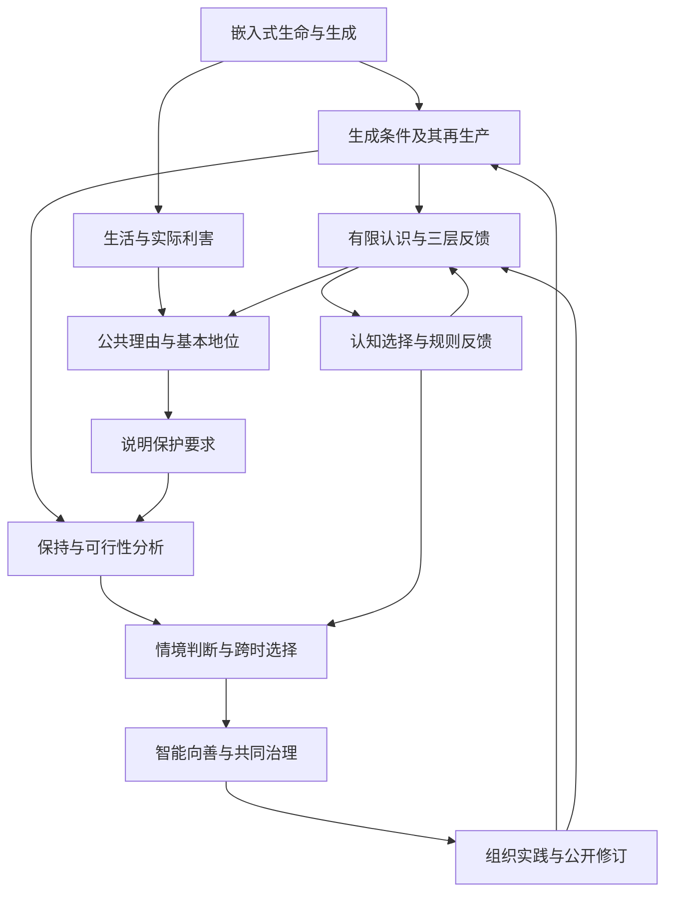

# 生生不息：智能向善的生成论基础

**从嵌入式生命、三层现实与 Meta-Attractor，到开放的共同未来**

统一理论白皮书 v1.0 · 2026 年 9 月 5 日  
思想与立场提出：Ren；AI 协助论证整理、文字重构与形式检查。  
本文为可供公开讨论的研究版本，尚未对外发布。配套文本：[《智能向善，天下生生》统一版宣言](宣言-v1.0.md)。

## 摘要

生命、认识与评价活动在世界的生成过程中形成，并持续依赖能够更新的结构。它们的行动又改变自身、他者与后来者的条件。本文以这一嵌入式生成事实为起点，连接差异与建模、生命的功能利害、共同生成条件及公共理由，论证智能向善与开放共同未来的方向。

生生指生成者继续生成，并使生成的结果参与后来生成及其条件的更新。新的结构、知识与合作可以扩展实际能力；生成成本和相关损害也必须进入评价。本文用有时间、资源与执行边界的有效可能性刻画这种扩展，区分持续不失效、能够形成新能力，以及对受影响者具有正当性的公共改进。保护未来包含对当下生活的珍重，也包含对后来者继续理解、参与和创造的关照。

本文从生命的实际利害、实践一致性、判断可修正性、公共理由的非任意性与基本地位出发，论证共同生成条件的保护要求。善恶判断因情境而异，但具有事实与理由的约束：无充分理由地造成严重损害、转嫁可避免代价、剥夺基本地位或毁损有效纠正，不能仅凭局部增长和胜利获得正当性。评价成立不以行为者接受为条件；个人责任和行为改变还需要考察知识、能力、处境与制度。

系统层面，本文研究资源更新、相关信息、协调、冲突约束、适应、再生产与维持维持者。形式核心使用受控保持集合，并检验观察不足、独立组合、抽象实现、重复风险及有限软惩罚的边界。随附三个 Lean 模块保留 28 个已检查命名定理；它们检查明确模型中的结构结果与反例。其余纸面推导、规范理由和现实机制均另行标识，详见附录 A。

认知、目标与制度也参与生成。本文以主体经验与内部模型、主体间的共同理解与规则、物质与实际后果三个相互作用的层面，分析判断与环境如何彼此塑造。Meta-Attractor 进一步追踪奖励怎样筛选策略和认知，优势怎样进入规则，规则又怎样改变证据与后来行动。权力、欲望和共同预期因而是可研究、可塑造的机制；形成共识和取得成绩也需要接受现实反馈。

向善演化需要维护共同条件的效果进入实际保留、传播与及时修复，不能从生命延续直接推断演化总会自动纠正。对于反思性智能，科学方法、制度学习与相称干预可以在损害成为淘汰结果之前改变选择条件。本文进一步提出跨时多维策略比较，研究知识与环境如何改变可行集合，并给出公共诊断与组织程序。

由此，智能向善要求技术能力、认知学习和制度作用共同回应生活、基本地位、生成条件与纠正能力；共同命运要求判断范围覆盖重要依赖与后果；大同作为多种生活能够共同发展的方向，在具体实践中持续展开。理论及其组织也应接受同样的要求，以可追溯理由、真实参与和可检验实践建立可信度。

**关键词：** 生生不息；生成能力；公共善恶；三层现实；Meta-Attractor；系统存续；认知与环境；智能向善；共同未来。

## 论证路径与阅读说明

本文采用十二章连续论证。第一至三章建立生成、系统与认识的对象；第四章说明公共善恶的理由；第五章检查形式关系；第六至八章连接选择、演化与情境决策；第九至十一章推出智能、共同未来与组织实践；第十二章集中说明检验与结论。

| 论证位置 | 本文完成的工作 | 应使用的检验 |
| --- | --- | --- |
| 生成与系统事实 | 说明构成依赖、有效能力及条件再生产 | 领域知识、建模、观察与干预 |
| 公共理由 | 说明生活、基本地位、共同条件与责任 | 前提辩护、推理、反例与公共讨论 |
| 形式关系 | 检查保持、信息、选择及比较的条件命题 | 纸面证明；明确标注部分的 Lean 检查 |
| 诊断与行动 | 追踪机制、干预与修订，提出组织程序 | 竞争解释、实际结果、异议与问责 |

条件定理的严格性来自前提成立时结论必须成立；其现实应用取决于输入与情境。关于公共基本地位的理由不会由逻辑符号自动提供，关于实际机制的判断也需要证据。第一版将这些接口公开，使读者能够定位分歧和提出修订。

图中箭头表示论证依赖或现实反馈，需要按相应章节的前提理解，不表示从任意自然变化已经推得全部伦理。附录 A 给出命题与证明位置，附录 B 对应既有原则，附录 C 说明研究来源。

## 目录

1. [从差异与生命到生生不息](#chapter-1)
2. [生命与系统的存续条件](#chapter-2)
3. [三层现实与能够更新的认识](#chapter-3)
4. [从生命的利害到公共善恶](#chapter-4)
5. [形式核心：保持、观察与风险](#chapter-5)
6. [Meta-Attractor：认知、规则与长期趋向](#chapter-6)
7. [演化、系统健康与修复能力](#chapter-7)
8. [情境中的公共判断与跨时决策](#chapter-8)
9. [智能向善与可纠正的发展](#chapter-9)
10. [共同未来、大同与合作的形成条件](#chapter-10)
11. [让理论成为可以检验的共同实践](#chapter-11)
12. [检验、研究边界与共同立场](#chapter-12)

[附录 A：定义、命题与证明范围](#appendix-a)；[附录 B：原则的统一对应](#appendix-b)；[附录 C：来源与研究位置](#appendix-c)。
