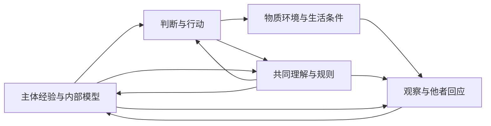

## 三、三层现实与能够更新的认识

### 3.1 主体、主体间与物质的相互作用

行动发生在三个相互影响的分析层面。Subjective 包含主体的感受、需要、意义、自我理解与内部模型；inter-subjective 包含语言、相互预期、共同记录、制度与公共标准；material 包含身体、能源、设备、生态及行动所改变的实际条件。

我们对三者的认识都通过经验、区分与建模形成。认识具有视角，并不使后果可以被主体任意决定。身体反应、他者回应、重复观察、干预结果与行动代价，能够约束模型。判断需要让这些约束实际进入认识过程。

| 分析层面 | 应当关注什么 | 可以发生的失误 |
| --- | --- | --- |
| 主体经验与表征 | 感受、生活意义、注意、需要、自我理解及判断能力 | 以成绩替代生活，以确信替代检验，以服从替代自主 |
| 主体间关系与共同模型 | 信任、承诺、规则、公共记录、解释标准及协调 | 将表态一致当作共识，让获益者垄断标准，筛掉不利证据 |
| 物质与实际因果条件 | 资源、身体、基础设施、生态、维护与恢复 | 账面增长伴随耗损，损害传播超过修复，叙事与现实脱离 |

这不是三个互不相干的世界，也不是已证明穷尽一切现实的分类。主体与制度通过世界内部的过程实现；划分它们，是为了避免某一种成功遮蔽另一种实际变化。

### 3.2 主观生活与内部模型不能互相替代

一个人的预测可能很准确，却生活痛苦、关系匮乏或失去选择余地；也可能在受损的环境中感到确信和满足，却缺乏获得相关事实的机会。因此，生活价值、认知可靠性和公共参与需要分别考察。

人的体验可以通过报告、行为、身体指标和持续关系被部分理解；任何单一测量都有边界。缺少完整的数值表示，不等于体验不应进入公共理由。将幸福只视为维持系统效率的信号，会遗漏它作为生活本身的一部分。

对于人工智能，内部状态、目标表征、学习与通信，可以作为技术对象研究。由这些能力本身，不能直接断定系统具有人的主观体验。若出现道德相关体验或利益的证据，应当认真研究其地位；当前模型不能凭功能类比预先解决意识问题。

### 3.3 主体间现实依靠共同实践，也接受现实检验

主体间性不等于主观意见的平均。一个公共规则即使没有获得每个人喜爱，也可能通过实际执行、制裁、设施与相互预期塑造生活。相反，很多人声称赞同的规范，若没有可靠执行条件，也可能不能支持合作。

共同理解使陌生人能够协调行动。它还决定什么被记录、什么被当作证据、谁有资格说明问题。若提出异议会导致基本生活受损，则表面一致未必反映充分理解和自由接受。评价共识应当考察形成过程、可反对性和实际后果。

互动本身也能参与意义的形成。关于参与式意义生成的研究，为理解个体与交互关系提供了理论背景；这不意味着所有社会认识都可由一个固定的显式表征模型穷尽。[De Jaegher 与 Di Paolo，2007](https://link.springer.com/article/10.1007/s11097-007-9076-9)

### 3.4 共同的动力学接口

用 xₜ 表示相关物质状态，mᵢ,ₜ 表示主体 i 的内部模型、注意与目标表征，σₜ 表示规则、共同记录和相互预期。令 hᵢ,ₜ 为主体实际取得的观察与通信历史，zₜ 为公共安排实际取得的消息、公开观察与行动记录。观察和通信接口决定什么能进入 h 与 z；它们不能以未观察的内部状态冒充可获得记录。一个分析接口为：

\[
a_{i,t}=\pi_i(m_{i,t},h_{i,t}),
\]

\[
x_{t+1}=F(x_t,\{a_{i,t}\},d_t),
\]

\[
y_{i,t+1}=O_i(x_{t+1},\{a_{j,t}\},\sigma_t,m_{i,t}),
\]

\[
m_{i,t+1}=L_i(m_{i,t},h_{i,t},y_{i,t+1},r_{i,t+1}),
\]

\[
\sigma_{t+1}=G(\sigma_t,z_{t+1}).
\]

d 是纳入模型的扰动，y 是实际到达判断者的新增观察，r 是可获得的奖励等学习反馈；h 将这些结果和实际收到的消息接入后续行动。O 作为观察映射可以描述环境、规则和注意怎样影响信号，行动者读取的是其输出。G 则通过公共可获得记录 z 更新规则，不能直接读取未表达的全部内心或全局事实。G 若进一步用作多个主体的实际执行方案，还需说明权限与协调的实现条件。这些函数需要选择变量、提出机制并接受检验，函数名本身不是完整解释。

人的生活状态与经验也可以进入扩展状态，以适当方式与身体、关系、行动和理解联系。它们不应只用模型预测误差替代。更一般的模型还可以令 π、O、L 和 G 随学习与制度变化而更新；相关更新机制本身同样需要资源与约束。

图中箭头表示需要在具体领域验证的影响。其共同意义是：一项行动的后果包括环境、关系和后来的判断者。模型与规则也可能改变证据出现、保留与传播的机会；第六章将研究这种反馈如何接入选择机制。

### 3.5 情境性具有可检验的结构

善恶判断可以写成 J(a,c,I,H;N)，其中 a 是行动，c 是情境，I 是相关受影响者，H 是期限，N 是已有理由支持的保护要求。J 可以表示许可与禁止、风险、证据强度或方案之间的偏序，不必是一个总分。

情境性来自实际关系：同一行为在不同环境中可能改变不同条件；同一限制可能形成合作，也可能关闭纠正。原则说明为何保护生活、地位与共同条件；情境研究说明具体行动怎样影响它们。

**命题 G1：相关差异被压缩掉时，判断可能必然失误。** 若两种情境具有相同的可见表征，但在同一组评价要求下正确判断不同，则任何只读取该表征的确定性判断器，都不能同时给出两个正确结论。

相同输入产生相同输出，不能同时等于两个不同答案，故命题成立。第五章 F6 给出对应形式；其结构已经由随附 OpenFuture 模块检查。何种事实改变具体伦理判断，仍需因果与规范理由说明。

这一结果允许讨论合理抽象。并非每次决定都需要收集所有信息；需要保留的是对所问问题有实质影响的区别。能够说明无关、可忽略或被可靠边界吸收的变量，可以被抽象掉。为了保留好看的局部结果而删除已知相关损害，则使模型失去判断依据。

### 3.6 科学更新包括对模型本身的修订

可检验假说、预测检查、误差分析、独立核验与干预比较，可以直接成为本论的方法。相关知识应当积累：有效结果得到保留，失败改变理解，新的问题推动对象和方法扩展。

需要区分模型内参数更新与模型结构修订。前者在给定变量和解释结构内调整估计；后者追问遗漏了什么变量、主体或因果机制，以及当前备选解释是否不足。Gelman 与 Shalizi 讨论了模型检查与修订，说明它们不能简单等同于给定模型内的贝叶斯确认。[Gelman 与 Shalizi，2013](https://arxiv.org/abs/1006.3868)

适用于本论的一套过程是：行动前记录问题、模型、关键假设与保护要求；行动中观察结果并接纳独立回应；出现偏差时检查参数、因果结构、测量、目标及制度过滤；修订后比较实际表现；保存修订理由与剩余不确定性。这些环节可以按情境的风险与能力调整，不要求每次日常行动举行完整研究。

最好的可用知识不能保证事后结果总是最好。判断的责任还包括是否认真利用相关证据、是否合理识别未知、是否保留相称的试验与补救机会。坏结果需要研究原因，不能自动等同于所有参与者有同样责任；缺乏知识也不能自动免除有能力却故意阻止获取证据的责任。

### 3.7 求真本身需要被维持

科学方法通过具体的人、记录、设施、时间和组织运行。若提出坏消息的人持续失去资源，若承认错误使机构无法继续承担生活，若公开反馈没有实际修正权限，认识方法就可能被选择环境架空。

因而需要同时研究：什么方法能够形成可靠判断；什么条件让使用这些方法的人与实践能够持续。训练、工作保障、可追溯记录、不同位置的核验及实际修正权，是具体情境中的候选机制。它们也有成本，不能只靠维护者无限牺牲来实现。

认识既依赖环境，又改变环境。保护求真和判断自主，不是为所有主体规定同一思想。教育与认知塑造必须允许检验、异议和修订；通过操纵证据取得一致，会损害共同认识的条件。第六章研究奖励怎样筛选认知，第十一章则要求本论的组织接受同样的检查。

### 3.8 三层反馈为什么进入善恶评价

只评价产量、利润或胜负，会遗漏行动如何改变人的生活、共同关系以及后来判断的条件。只评价主观满足，可能看不见损害与受限的选择；只评价共同认可，也可能让制度成功遮蔽物质失败。

这里有两步论证。认识论上，若遗漏使两种应作不同判断的情境成为不可区分的输入，就无法保证对两者同时判断正确；具有相关影响的变化未被其他信息可靠表征或被边界吸收时，删去它会增加判断失真的风险。规范上，若被遗漏的是有充分保护理由的利益和共同条件，严重而可避免的损害不能仅因另一层的成功获得豁免。第四章将给出第二步所需要的公共理由。

这不把普通模型误差直接称作恶。对损害性质、替代方案、知识与行动能力的判断仍然必要。三层框架的作用，是扩大实际研究的覆盖范围，并保持各层之间表达、核验和纠正的联系。

一个能持续学习的社会，还应当让自己的成功标准成为可以讨论的对象。目标可以随经验修订；修订应说明理由、受影响者和后果，并保留对原有承诺与实际生活的记录。当前获益者不能仅通过改写“成功”便消除以前的损害和义务。
