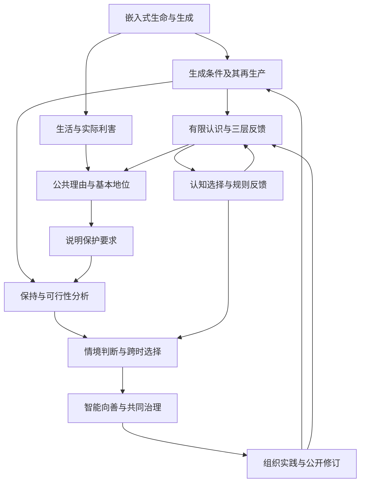

# 生生不息：智能向善的生成论基础

**从嵌入式生命、三层现实与 Meta-Attractor，到开放的共同未来**

统一理论白皮书 v1.1 · 2026 年 9 月 6 日  
思想与立场提出：Ren；AI 协助论证整理、文字重构与形式检查。  
配套文本：[《智能向善，天下生生》统一版宣言](宣言-v1.1.md)。

## 摘要

生命、认识与评价在世界的生成过程中形成，依赖能够更新的结构，并通过行动改变自身、他者与后来者的条件。本文从这一嵌入式事实出发，连接差异、建模、生命利害与公共理由，论证智能向善和开放共同未来的方向。

生生指生成者继续生成，并使生成结果参与后来生成及其条件的更新。本文以有限时间与资源下的有效可能性刻画能力，进一步用资源—能力递推区分净耗损、一次补充与条件再生产。从生活价值、实践一致性、判断可修正性、公共非任意性和基本地位出发，生生进入公共评价：基本生活、生成条件与有效纠正相互约束，局部增长须回应其对他者与后来者的影响。

三层现实将主体经验与模型、共同理解与规则、物质条件与后果放入同一反馈。Meta-Attractor 追踪奖励如何选择认知、优势如何进入规则、规则如何塑造证据与后来行动。目标、权力倾向和环境由此成为可改变的机制；向善演化则取决于维护收益怎样进入维护者的持续条件，以及修正能否赶得上损害。

形式部分检验受控保持、观察障碍、组合与实现、选择反馈和跨时比较；证明身份见附录 A。实践部分以七尺、位与三条托管规则，把判断落实为有理由的限制、实际重开与共同接续。智能向善要求能力发展支持生活与判断；人类命运共同体要求判断范围覆盖共同后果；大同作为多种生活共同发展的方向，在可检验、可修正的实践中展开。

**关键词：** 生生不息；生成能力；公共善恶；三层现实；Meta-Attractor；系统存续；认知与环境；智能向善；共同未来。

## 论证路径与阅读说明

本文采用十二章连续论证。第一至三章建立生成、系统与认识的对象；第四章说明公共善恶的理由；第五章检查形式关系；第六至八章连接选择、演化与情境决策；第九至十一章推出智能、共同未来与组织实践；第十二章集中说明检验与结论。

附录 A 集中列出前提与证明身份，附录 B 对应既有原则，附录 C 说明来源与本次统一的范围。

## 目录

1. [从差异与生命到生生不息](#chapter-1)
2. [生命与系统的存续条件](#chapter-2)
3. [三层现实与能够更新的认识](#chapter-3)
4. [从生命的利害到公共善恶](#chapter-4)
5. [形式核心：保持、观察与风险](#chapter-5)
6. [Meta-Attractor：认知、规则与长期趋向](#chapter-6)
7. [演化、系统健康与修复能力](#chapter-7)
8. [情境中的公共判断与跨时决策](#chapter-8)
9. [智能向善与可纠正的发展](#chapter-9)
10. [共同未来、大同与合作的形成条件](#chapter-10)
11. [让理论成为可以检验的共同实践](#chapter-11)
12. [检验、研究边界与共同立场](#chapter-12)

[附录 A：定义、命题与证明范围](#appendix-a)；[附录 B：原则的统一对应](#appendix-b)；[附录 C：来源与研究位置](#appendix-c)。
