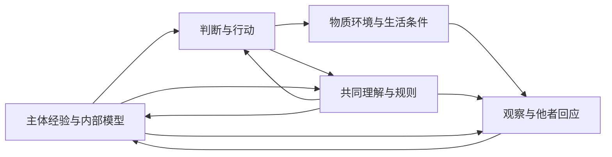

## 三、三层现实与能够更新的认识

### 3.1 主体、主体间与物质的相互作用

行动同时改变主体经验、主体间关系与物质条件。对三者的认识都通过经验、区分和建模形成；身体反应、他者回应、重复观察和干预后果，又持续约束这些模型。

| 分析层面 | 关注对象 | 典型失误 |
| --- | --- | --- |
| 主体经验与表征（subjective） | 感受、意义、需要、自我理解与判断能力 | 以成绩替代生活，以确信替代检验 |
| 主体间关系（inter-subjective） | 语言、信任、承诺、公共记录与规则 | 以一致表态代替共识，筛去不利证据 |
| 物质条件（material） | 身体、资源、设备、生态与恢复能力 | 账面增长伴随实际耗损 |

三层是相互依存的分析视角。划分的作用，是让一种成功能够受到其他相关后果的检验，也让不同经验进入共同认识。

### 3.2 主观生活与内部模型不能互相替代

预测准确的人仍可能生活痛苦、关系匮乏或缺乏选择；确信与满足也可能来自受限的信息。生活价值、认知可靠性与公共参与因而应分别考察。

体验可以通过报告、行为、身体指标与持续关系被部分理解。幸福、感受与自主具有生活本身的意义，即使它们尚无完整数值表示，也应进入公共理由。

对 AI，可以直接研究内部状态、目标表征、学习与通信；主观体验及相关地位则须依据相应证据另行判断。功能模型的覆盖范围由其实际表达的对象确定。

### 3.3 主体间现实依靠共同实践，也接受现实检验

规则通过执行、设施和相互预期塑造生活。共同理解使陌生人协调行动，也影响何种记录成为证据、谁能说明问题。评价共识应考察其形成过程、反对与修订机会，以及实际后果。

互动还可以参与意义的生成：参与者在回应彼此时改变理解与行动，而不只是交换既定意见。De Jaegher 与 Di Paolo 的参与式意义生成研究，为这一关系提供了理论资源。[De Jaegher 与 Di Paolo，2007](https://link.springer.com/article/10.1007/s11097-007-9076-9)

### 3.4 共同的动力学接口

设 \(x_t\) 为相关物质状态，\(m_{i,t}\) 为主体 \(i\) 的模型、注意与目标表征，\(\sigma_t\) 为实际规则和共同安排。\(h_{i,t}\) 保存主体已取得的本地观察与通信记录，\(z_t\) 保存公共安排实际取得的记录。每一期按下列顺序更新。

主体依据可获得记录选择行动 \(a_{i,t}\)，生成带有接收对象的发出消息 \(u_{i,t}\)：

\[
a_{i,t}=\pi_i(m_{i,t},h_{i,t}),\qquad
u_{i,t}=\mu_i(m_{i,t},h_{i,t},a_{i,t}).
\]

行动改变环境，观察通路产生实际到达的信号与学习反馈：

\[
x_{t+1}=F(x_t,\{a_{i,t}\},d_t),
\]

\[
(y_{i,t+1},r_{i,t+1})
=O_i(x_{t+1},\{a_{j,t}\},\sigma_t,m_{i,t},\eta_{i,t+1}).
\]

\(d_t,\eta_{i,t+1}\) 表示环境与观察扰动。\(O_i\) 是描述信号生成的模型；主体取得的是其输出，而非右侧全部状态。

记 \(D_{i,t+1}\) 为通信通路实际投递给主体的消息，\(D^{\mathrm{pub}}_{t+1}\) 为实际广播或上报并到达公共安排的消息，\(y^{\mathrm{pub}}_{t+1}\) 为公共观察通路取得的信号。投递规则决定收件人、延迟、丢失和过滤；延迟消息由通路的队列状态承载。

令 \(\oplus\) 表示追加带时间与来源的记录，\(R_i,R_{\mathrm{pub}}\) 表示实际保存、压缩或遗忘，便有：

\[
h_{i,t+1}=R_i\!\left(
h_{i,t}\oplus
(a_{i,t},u_{i,t},y_{i,t+1},r_{i,t+1},D_{i,t+1})
\right),
\]

\[
z_{t+1}=R_{\mathrm{pub}}\!\left(
z_t\oplus(y^{\mathrm{pub}}_{t+1},D^{\mathrm{pub}}_{t+1})
\right),
\]

\[
m_{i,t+1}=L_i(m_{i,t},h_{i,t+1}),\qquad
\sigma_{t+1}=G(\sigma_t,z_{t+1}).
\]

\(h\) 中的行动记录说明主体选择了什么；实际执行后果由观察确认。消息记录说明收到了什么，其内容真伪仍待核验。公共行动记录只有经实际观察或上报，才进入 \(z\)；未表达的私有状态和未取得的全局事实均不进入 \(G\)。规则更新怎样取得权限、执行并让各主体知悉，也由实际制度与通信通路实现。

这个接口把观察、通信、记忆、学习与规则更新的接缝公开，具体函数仍须依据机制与证据建立。人的生活经验可以进入扩展状态；方法和通路本身也可以随学习与制度而更新，并承担资源与记忆限制。

### 3.5 情境性具有可检验的结构

善恶判断可以写成 \(J(a,c,I,H;N)\)：行动 \(a\)、情境 \(c\)、受影响者 \(I\)、期限 \(H\) 与有理由支持的保护要求 \(N\) 共同决定判断。输出可以是许可、禁止、风险或方案间的偏序。

**G1，相关差异被压缩时的判断障碍。** 若两种情境具有相同可见表征，但在同一评价要求下正确判断不同，则只读取该表征的确定性判断器，无法同时正确。

**证明。** 相同输入产生同一输出，它无法等于两个不同答案。第五章 F6 给出布尔判据的机器检查版本。∎

因此，抽象应保留改变所问结论的差异；无关变量或已由可靠边界吸收的影响，可以省去。原则说明保护理由，情境研究识别实际因果，二者共同形成可修订判断。

### 3.6 科学更新包括对模型本身的修订

本论直接继承可检验假说、预测检查、误差分析、独立核验与干预比较。有效知识使行动获得新的依据，失败暴露遗漏，新对象和新环境则推动问题与方法扩展。

参数更新在给定解释内调整估计，结构修订则检查变量、主体、因果关系和备选解释。Gelman 与 Shalizi 对模型检查和修订的讨论，说明科学学习包含对模型框架本身的检验。[Gelman 与 Shalizi，2013](https://arxiv.org/abs/1006.3868)

应用时，可按风险与能力记录问题、假设和预期；观察结果并接纳独立回应；将偏差定位到参数、因果、测量、目标或信息过滤；修改后比较实际表现，保存理由与剩余不确定性。不同情境可以采用不同的研究强度。

评价决定还应区分事前理由与事后结果：是否利用了相关证据，怎样处理未知，有没有相称的试验与补救机会。实际后果检验模型，证据使用与行动条件说明责任。

### 3.7 求真本身需要被维持

求真依赖具体的人、记录、设施、时间和组织。知识积累既需要可靠方法，也需要让采用这些方法的人持续工作、生活并影响决定。

训练、保障、可追溯记录、不同位置的核验和实际修正权，可以共同支持这种接续。若报告问题和承认错误持续导致失去资源，科学方法便可能被选择环境架空。

教育与认知塑造因此应保持检验、异议和修订。知识改变环境，环境又筛选知识；第六章研究这一循环，第十一章要求本论组织接受同样检查。

### 3.8 三层反馈为什么进入善恶评价

行动留下的后果包括生活、关系、物质条件与后来的判断者。三层反馈使这些后果能够相互表达、核验和修正。

认识论上，删去改变判断的差异，可能造成 G1 所说明的障碍。规范上，重要生活与共同条件若具有充分保护理由，其他层面的成功便不足以单独回答其严重而可避免的损害。第四章建立这一步所需的公共理由；具体责任仍按后果、知识、替代与行动能力判断。

一个持续学习的社会，也应能检验自己的成功标准。目标可以随经验修订，修订应说明理由并接续既有义务，让新理解形成更好的行动条件，而非抹去已经发生的生活与损害。
