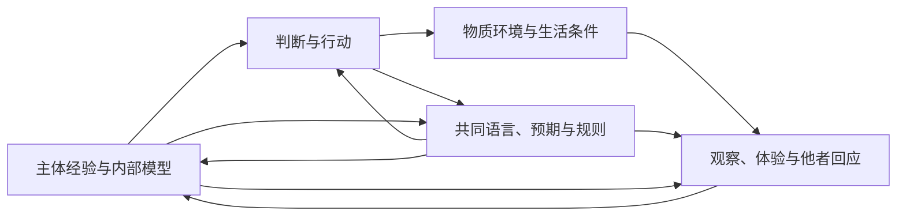

# 三层现实与认知反馈：胜利之后，判断仍需能够接触世界

**生生不息论论证补篇 · 2026 年 9 月 5 日**

本篇将作者提出的 subjective、inter-subjective、material 三个层面，接入生生不息、系统存续和 Meta-Attractor。[白皮书 v0.6](WHITEPAPER-v0.6.md)将相关内容分别整合进理论对象、善恶判断、认知动力学与行动方法；[v0.5](WHITEPAPER-v0.5.md)及此前文件保留。本篇新增模型为纸面推导，没有新增机器证明。

## 1. 三层现实：有视角的认识，具有约束的关系

作者提出，任何个体都应意识到三个相互作用的层面：subjective、inter-subjective、material。同时，我们对三者的认识也都经过主体的经验、区分与建模。

本文采用这一表述中足以支撑后续推导的解释：**我们没有脱离一切视角而直接占有世界的认识位置；但经过主体把握，不等于可以由主体任意决定。** 身体反应、他者回应、重复观察、可比较记录、干预结果和行动代价，都能约束模型。

因此，需要区别“关于物质世界的模型”与“被模型所描述和作用的条件”。一个人相信资源无限，并不由此取得无限资源。即使对这种区别本身的表达仍来自我们的认识实践，也不能由此消除行动中的约束。

三层可以作如下分析：

| 层面 | 在本框架中关注什么 | 可能出现的损害 |
| --- | --- | --- |
| **Subjective：主体的经验与表征** | 感受、需要、意义、自我理解、价值取向、环境模型与判断能力 | 痛苦和生活意义被忽略；确信脱离证据；自我价值被单一胜负吞没；失去修正理解的能力 |
| **Inter-subjective：主体间的关系与共同理解** | 语言、相互预期、信任、规范、公共记录、制度角色和共同建模 | 不能表达不同经验；把服从当作认同；规则筛掉不利证据；无法形成可工作的协调 |
| **Material：物质与因果条件** | 身体、能源、生态、基础设施、行动所改变的实际状态及可恢复范围 | 资源与健康耗损；实际结果偏离叙事；损害传播超过处理能力 |

这不是宣称存在三个互不相干的宇宙，也不是已经证明现实只能分成这三类。主体的活动和共同制度都通过物质过程实现；物质环境又经由主体与共同实践被认识和改变。三层是同一嵌入过程的不同分析入口，变量之间存在兼容关系，不能随意当作独立数量相加。

对 AI 等智能系统，本文所说的建模包括用于区分情况、预测后果和选择行动的内部表征或隐含结构，不要求全部写成符号理论。这样的功能描述不证明 AI 具有人的第一人称体验。人的体验及其内在价值，与智能系统的信息表征，应当分别讨论。

## 2. 主体间现实不是主观意见的平均，主观生活也不只是控制器

主体间关系包含“我如何理解你”“我认为你如何理解我”，以及哪些话语、承诺和身份具有共同效力。它不是私人观点的简单求和。一个承诺改变双方的预期与行动；一种评价标准可以改变谁获得机会；一个共同故事可以改变什么值得追求。

这种关系又会反过来形成个体的理解。一个人可能逐渐以制度中的胜负衡量自己，将原本具有多种意义的生活改写成单一表现。关于交互如何参与意义形成，已有社会认知理论的直接讨论；它为主体与互动相互塑造提供研究背景，不等于证明任何智能都必须具有一个显式世界模型。[De Jaegher 与 Di Paolo，2007](https://link.springer.com/article/10.1007/s11097-007-9076-9)

因此，共同建模不要求大家的模型完全相同。不同经验、方法与疑问可以使共同理解更充分。需要的是能够相互表达、区分分歧、检验事实和协调行动的关系。观点高度一致，也可能来自相同数据缺口、排除异议或依赖同一错误模型。

另一方面，人的主观生活不能只被当作帮助系统作决策的信息设备。痛苦、休息、爱、尊严感、意义与参与，本身属于前文要保护的生活。即使某项损害没有立即降低产出，它仍可能是实际生活的损失。

这使“赢家也进入 delusion”至少包含两类需要区分的问题：其一，赢家的解释与实际后果脱节，并失去修正能力；其二，它在追逐胜利时耗损了自身的生活、关系或认识自主性。二者可能相互加强，但不能只凭某人快乐、自信或观点不同就判定其失真。

本文把这里的 delusion 作为对认知封闭和自证性失真的讨论，不据此作临床诊断。应当定位具体主张、证据处理、行动后果和纠正机制。

## 3. 思想、共同理解与环境的耦合动力

设 xₜ 表示相关物质状态，mᵢ,ₜ 表示个体 i 的模型、目标表征与注意方式，σₜ 表示语言、规则、公共记录及共同预期的相关结构。它们是相互约束的分析变量。个体行为及其更新可以写成：

\[
a_{i,t}=\pi_i(m_{i,t},\sigma_t,x_t^{\mathrm{可感知}}),
\]

\[
x_{t+1}=F(x_t,\{a_{i,t}\},d_t),
\]

\[
y_{i,t+1}=O_i(x_{t+1},\{a_{j,t}\},\sigma_t,m_{i,t}),
\]

\[
m_{i,t+1}=L_i(m_{i,t},y_{i,t+1},\sigma_t,r_{i,t+1}),
\]

\[
\sigma_{t+1}=G(\sigma_t,\{a_{i,t}\},\{m_{i,t+1}\},
\{y_{i,t+1}\},x_{t+1}).
\]

其中 d 表示模型内扰动，y 表示实际进入个体判断的观察或消息，r 表示奖励等学习反馈。公共结构只依其可获得的消息、行为和痕迹变化；式中的 m 不意味着制度能够直接读取所有人的内心。这些函数是研究结构，需要具体识别，尚不是实证拟合或完整认知模型。

人的感受和生活状态也可以进入扩展状态，并依据身体、关系、行动与理解更新。将它们单独列出，是为了避免把生活价值缩减为模型预测准确率。它们不必都可测量为同一个数。

这组关系表达作者所强调的循环：

箭头表示待检验的因果影响，可以促进或妨碍纠正。尤其重要的是：模型与规则不仅决定怎样解释证据，还可能决定什么证据能够出现、被记录和抵达判断者。

因此，一项行动的完整后果不应只写成 Δx。它还包括 Δm、Δσ，以及观察和更新机制 O、L、G 的变化。达到某个物质结果以后，参与者可能已不再以原来的方式认识自己、理解他者和评价结果。

这也要求检查目标本身如何变化。若成功者在行动过程中改写成功的定义，再仅凭新定义宣布胜利，评价可能失去连续性。目标可以根据经验修订，但修订需要说明理由、受影响者及其后果，不能让当前获益者单方面删除原先的基本保护要求。

## 4. 为什么胜利不足以证明模型正确

这里至少有三种不同的反馈。

**选择适应。** 某模型能够准确适应现行规则并获得回报。这证明了一定范围内的策略有效性，却不单独证明规则正当、模型适用于其他环境，或未计入的后果没有发生。

**预测参与塑造结果。** 模型指导资源分配，资源分配改变后续表现，后续表现又被用于支持模型。例如，未获得支持的方案失败，不能单独证明它在获得适当支持时也不可行。Performative Prediction 研究了预测介入决策后改变目标结果的关系；这种关系本身可以有益，也可以有害。[Perdomo 等，2020](https://proceedings.mlr.press/v119/perdomo20a.html)

**自证性学习。** 实际行动没有经过某些情境，参与者便没有观察到能纠正其相关判断的结果。Fudenberg 与 Levine 的自确认均衡允许参与者对实际发生的路径判断正确，同时对没有经历的分支保持错误信念。没有遇到反证，不足以证明所有相关信念正确。[Fudenberg 与 Levine，1993](https://economics.mit.edu/sites/default/files/inline-files/sce.pdf)

三者不能混同，也都不意味着所有获胜者必然失真。需要调查的是：参与者从什么范围的成功推导出了多大的正确性主张；成功是否改变证据的生成条件；有哪些合理的反事实和受影响者经验被排除。

认知闭合还可能发生在基本预测正确的情况下。某个机构通过控制资源使他人服从，其对服从的预测可以准确；这仍不证明对方自由认同，更不证明控制具有公共正当性。经验准确性、主观确信、社会认可和善，不能相互直接替代。

## 5. 一个反例：业绩、确信上升时，损害报告可以趋近零

设一个假设系统持续扩张，可见产出为 q，真实但未被充分观察的损害为 h；共同规则对不利反馈的过滤强度为 c；参与者对“这套扩张机制能够始终保持安全”的确信为 b。取：

\[
q_{t+1}=q_t+v,\qquad h_{t+1}=h_t+\delta,
\]

\[
c_{t+1}=c_t+\beta(1-c_t),\qquad
b_{t+1}=b_t+\alpha(1-b_t),
\]

\[
y_t=(1-c_t)h_t.
\]

v、δ>0，0<α、β<1，0≤c₀,b₀<1，h₀≥0。y 表示报告渠道可见的损害量。这里假设持续扩张的成绩在制度中强化过滤、在个体中强化确信；这个假设需要在应用中查证。b 的更新不是贝叶斯学习定律，也不是对临床心理的模型。

**命题 H1：这种模型允许可见成绩与确信持续增长，同时真实损害增长、可见损害趋近零。**

由递推得：

\[
q_t=q_0+tv,\quad h_t=h_0+t\delta,
\]

\[
1-c_t=(1-c_0)(1-\beta)^t,\quad
1-b_t=(1-b_0)(1-\alpha)^t.
\]

于是 bₜ→1，且：

\[
y_t=(1-c_0)(1-\beta)^t(h_0+t\delta)\longrightarrow0.
\]

**证明：** 对前两组递推归纳求解；比率在 0 与 1 之间的几何衰减乘以一次多项式趋向零。真实损害则线性增长，超过任一有限临界值只需足够多步。∎

例如，取 q₀=10、h₀=1、v=δ=1、c₀=0、b₀=0.5、α=β=0.5，并设安全要求为 h<6：

| 时刻 | 可见产出 q | 真实损害 h | 可见损害 y | 安全确信 b |
| --- | --- | --- | --- | --- |
| 0 | 10 | 1 | 1 | 0.5 |
| 2 | 12 | 3 | 0.75 | 0.875 |
| 4 | 14 | 5 | 0.3125 | 0.96875 |
| 5 | 15 | 6，已违反安全要求 | 0.1875 | 0.984375 |

这组数只是模型演示，不是现实观测。趋近零也不表示可见损害从第一步起必定严格下降；实际系统越过阈值以后，原递推未必继续适用。有限表格已经足以展示：在损害失效的时点，可见成绩更高、报告更少、参与者却更确信安全。

这个反例还说明：三层各选一个“好看”的指标，并不能保证三层得到真实关照。高自信不能代替主体判断的可修正性；高认同不能代替共同理解的可靠性；高产出不能代替全部重要物质与生活条件。

## 6. Meta-Attractor 同时塑造结果与评价结果的主体

作者的早期[Meta-Attractor 稿](../../sources/03-meta-attractor/2025-05-drafts-selected/2025-05-30-seed-meta-attractors-and-road-to-systemic-collapse.md)已经讨论：认知构造得到物质回报和社会认可以后，可能进入身份与共同叙事；获胜者随后改变规则，使其理解更容易继续取得成功。本文承接这一机制论述，不照搬原稿中关于所有反馈必然失控或历史必然崩溃的强断言。

三层框架使机制可以更完整地表达：

> 某种内部模型指导行动
> → 行动在特定物质与制度条件下取得优势
> → 优势增加确信、声望与解释权
> → 解释进入共同规则，改变机会和信息渠道
> → 规则塑造新的行动与环境，也改变可以出现的证据
> → 新证据被用来强化原模型及其成功标准。

认知并非始终站在这个循环之外。赢家可能不只是为利益辩护，还可能确实失去理解其他经验和可能安排的能力。一个原本有范围的策略，可以逐渐被当作世界本身的全部规律。

这是需要调查的条件性路径，不是对个体隐秘动机的推断。报告者被惩罚、替代试验失去机会、胜者取得标准制定权等关系，可以提供证据；单凭某人获胜或自信不能完成诊断。

改善也应作用于三层关系：主体能够区分自己知道什么、希望什么和被奖励相信什么；共同安排支持不同经验的表达、有效核验与规则修订；物质行动提供可观察的实际后果，并使受影响者有反馈与恢复的条件。

如果只改口号而不改资源与惩罚，新的共同语言可能成为旧循环的外衣。如果只改外部指标而不检查模型与生活，新的胜利可能继续缩窄判断。如果只追求内在确信，却不接触他者和环境约束，也不能证明向善已经实现。

## 7. 为什么忽略任何一层，都可能构成应被否定的行动

这里的推导可以分成认识与规范两步。

**认识层。** 设 R 是一个忽略某层信息的表示，J 是有充分依据的相关判断。若存在两种情况 z₁、z₂，R(z₁)=R(z₂)，但 J(z₁)≠J(z₂)，则仅依据 R 的确定性判断器无法在两者都正确。这沿用前文 G1 和 F6 的结构结果。

因此，只要被删去的主体经验、共同关系或物质条件会改变行动的相关后果，就不能仅凭剩下的模型保证判断充分。这并不要求每个日常行动穷尽三层全部信息；足够的抽象、可靠的分工和稳健保护方案都可能有效。所谓 aware，是保持与影响相称的认识和回应能力。

**规范层。** 前文已说明：实际生活、受影响者的基本地位、共同条件及有效纠错具有保护理由。若为了某一目标，无正当理由地忽略另一层中的重大、可避免损害，便符合 N6 所否定的代价外推结构。若进一步阻止这些损害被表达、发现和纠正，则又违反相应反封闭要求。

于是可以得到：

> **一个目标在某层取得成功，不能自动正当化对其他层基本条件的破坏；当这种破坏重大、可避免且缺少充分理由时，行动应被否定。系统性删除相应反馈，会进一步加重其结构问题。**

普通错误、合理的信息限制或可修正的抽象，不应仅凭“不完整”被判为恶。个人责任需考虑其知识与能力；制度评价则还要检查它是否持续奖励遗漏、惩罚纠正，并把伤害稳定地转嫁给他者。

公共保护条件因而可以展开为：

这里的三层现实与前文“生活实现、基本地位、共同更新”三个规范维度并非同一分类。三层现实帮助辨认后果在哪里、如何发生；规范维度说明这些后果为什么重要。同一项生活损害可以同时包含身体、体验与关系的变化。

\[
S_{\mathrm{pub}}^{(3)}(z)
=M(z)\land I(z)\land\bigwedge_i U_i(z)\land C(z).
\]

M 表示重要物质与生活基础，I 表示足够可靠且可争议的公共关系与协调条件，Uᵢ 表示对主体 i 的基本生活和认识自主性的保护，C 表示这些层面之间能够揭示错误并实际纠正的联系。C 是关系要求，不是第四个独立现实。具体保护内容依旧需要公共理由与领域证据。

这个合取不要求人人体验相同、形成统一信仰或每项愿望都满足。对尚不确定具有何种利益的 AI，不能只因它具有表征就直接赋予与人相同的体验要求；其影响人类与共同条件的行为仍然需要受到检验。

三个层面彼此一致也不是善的充分条件。强制安排可以产生服从、得到支持者认可并准确预测自身造成的结果，同时仍然剥夺他者。因此，三层框架需要与生活价值、基本地位和反支配要求共同使用。

## 8. 从评价结果，推进到评价结果如何改变判断者

实际决策应增加四组相连的问题：

| 观察入口 | 应检查的变化 | 不能直接替代它的指标 |
| --- | --- | --- |
| Subjective | 行动怎样改变人的生活、意义、目标、自我理解、确信与修正能力？ | 自信、兴奋、满意或忠诚的单项提高 |
| Inter-subjective | 怎样改变相互预期、可表达的经验、共同标准、信任、参与和解释权？ | 赞同率、统一口径或表面冲突减少 |
| Material | 对身体、生态、资源、设施与实际生活造成什么影响，谁承担代价？ | 只反映局部目标的产出、速度或收入 |
| 三层之间的联系 | 谁能提出相反经验？记录怎样生成？反例能否抵达有能力改变行动的位置？ | 单纯增加数据、设立反馈入口或宣称尊重多元 |

还要在成功之后复核：我们是否把策略有效误当成普遍真理；是否把被塑造出来的结果当作模型独立正确的证明；是否因获胜而缩小了谁有资格发言；是否不断重定义成功以回避原先的保护义务。

对拟成立的组织，应使成员能区分假设、经验、奖励和共同承诺，允许不同生活与方法继续存在，并让外部后果和受影响者经验进入规则修订。心理感受不能成为绩效燃料，共同愿景不能成为统一内心的要求，物质成果不能使组织免于检验。

对 AI，评价范围因此需要包括内部表征与目标更新、与其他智能体的通信和共同建模，以及在环境中的实际行动和反馈。能力增强如果同时缩窄证据、扭曲共同理解或削弱人的判断能力，就不能仅凭任务成绩称为进步。

这使生生不息获得一项进一步的要求：**维护生活与共同生成，也维护生成者认识自己、理解彼此、接触环境并改变判断的能力。评价一项胜利，要同时评价它留下了怎样的生活、关系、世界，以及怎样的下一轮判断者。**
