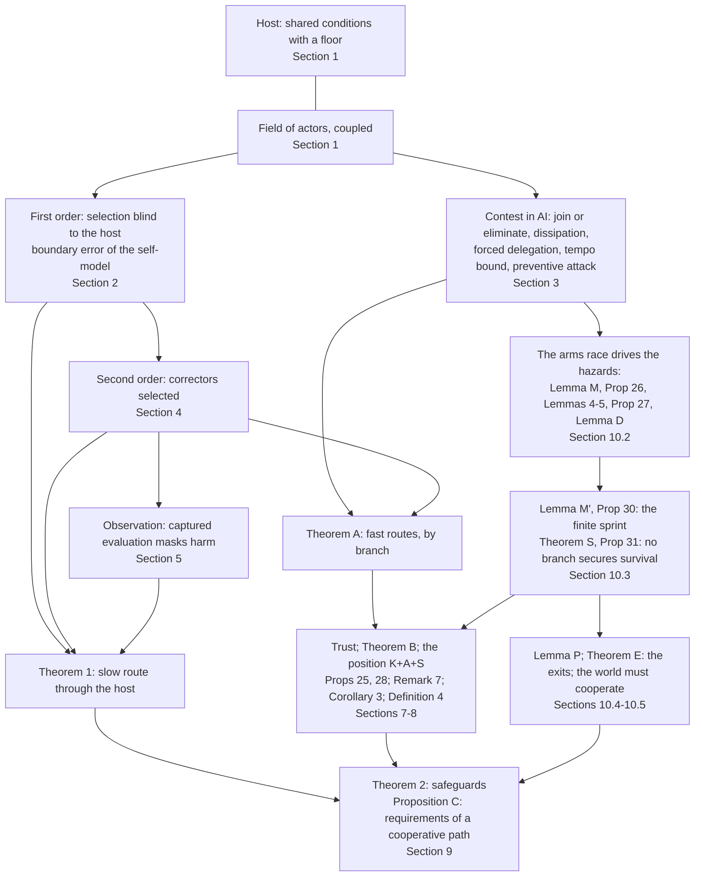

# No Winning Position: the integrated theory (v4.5)

*Reading copy of v4.5, generated from `THEORY.md` by `make_clean.py`. It omits repair notes, version history and Appendix C; the working document keeps them.*

**中文概要.** 这是一个完整的理论，九层：
1. **系统。** 一个场嵌在一个更大的系统（宿主）里，宿主有生存底线；行动者彼此耦合。
2. **一阶。** 相对选择看不见共同条件，会把场推向底线。"赢的权重"把这变成博弈。自我模型的边界错误让每一方受损（就它实际存在的耦合而言）。
3. **AI 竞赛本身的动力学。**
   - 加入或消灭：这是就行动者所依据的目标而言。就物质收益而言，对称、风险中性的行动者，在完全耗散的决定性竞赛里，加入在期望上并不比不加入多得任何东西。
   - 耗散。
   - 被迫委托（不可回头点一）：在其精确条件下成立。
   - 对超出可用纠错稳健范围的危害类别，纠错速度跟不上（不可回头点二）。
   - 领先招致预防性打击：只在未来的承诺不可信时成立。
4. **二阶。** 纠错者本身被它所纠正的东西选择。
5. **观察。** 被捕获的评估让伤害无声越线。
6. **为什么竞赛失败。** 慢路线经由宿主（定理 1）。快路线按分支讨论（定理 A）：决定且快、决定但慢、不决定。
7. **信任、验证，以及"不改变斗争思想、又要加速、还想安全"的立场。**
   - 信任门槛；三种信任。
   - 验证所需的程度随赢的价值上升（定理 B）。
   - 这一立场依赖的每一种安全手段，其需求都被竞赛或加速推向反方向（命题 25）。
   - 竞赛内部，更安全的委托被换成更多的委托：均衡风险由"赢的价值与损失之比"决定，而不由安全技术决定（命题 28，风险稳态）。
   - "领先换安全裕度"在每一步都因竞赛本身而失效（注记 7）。
   - 持久的安全排除竞赛（推论 3）。
   - 伪解：形式上是合作，持久性仍依赖竞赛的手段；用三条可检验的判据判定（定义 4）。例如保留竞赛于其下的验证协议。
8. **必须改变什么。**
   - 充分保障与必要条件（定理 2）。
   - 合作的定义。
   - 共同前沿把困境变成协调问题，而非让合作占优（命题 22）；合作路径的四个要求（命题 C）。
9. **过渡与出口。**
   - 生存是每个行动者博弈的最低需求。判据写明：生存不贴现，看每一个行动者（规范前提）。
   - 军备竞赛自己制造出这些危害：
     - 能力在复利，而纠错必须覆盖的行为随之增长；可争议的理解不按指数增长（引理 M）。今天已有差距，所以理解必须追上来。
     - 超出理解的纠错要么缺席，要么被权限限制（在竞赛中被竞争掉），要么本身就是超出理解的行为：它没有缩小未覆盖的区域，只是把它挪了地方（命题 26，引理 4、5）。
     - 赢家是被竞赛选择出来的；没有人能依赖赢家的限制（命题 27）。
     - 被委托的系统不承载行动者的生存利益（引理 D）。
   - 赢了就停？不停的赢家会被自己的逻辑毁掉；停下来的赢家，要么什么也留不住，要么就是支配（引理 M′，命题 30）。
   - 因此竞赛的每一个分支都保不住生存（定理 S）。
   - 对计入锁定的生存优先者，委托是"两个零"：别人都不委托时，自己不委托严格更好；只要有人委托，委托与不委托都趋于零。所以 E1 是不需要信任的严格均衡，但必须覆盖每一个有能力的行动者（命题 31）。
   - 关于共享危险的言辞是廉价话语；过渡依靠可以独立核验的推导与证据、代价高昂的信号，其中最清楚的是在自己的战略决策回路中单方面、可核查地实行 E1（推论 2）。
   - 困难情形：面对必然竞赛的对手，预防在一段时间内可能看起来最好；但持续预防本身是一条竞赛分支，任何人都没有生存位置（引理 P）。
   - 出口：
     - E1：AI 作为共同基础设施，而非支配的工具，优先；
     - 若做不到：E2，停下来，先别造决定性类别的能力；或 E3，把发展速度降到理解的速度以下。停止本身是一个选择。两者的成功条件相同：理解追上来。
   - 长期而言，生存要求以协议结束竞赛，或所有有能力的行动者共同把 AI 移出竞赛。这就是"世界必须合作"的定理形式（定理 E）。

---

## 0. What the theory is for, and the whole in one page

A good theory predicts. When it predicts an outcome that no one wants, including those who appear to gain from the present course, and the outcome still cannot be avoided, the obstacle is coordination, and coordination needs the understanding to be shared first. This theory is written for that purpose. Its subject is any set of actors (states, firms, blocs) that develop a technology which can confer decisive advantage, inside a larger system on which all of them depend. No actor is named: the argument holds wherever the dynamics hold.

Survival is the minimum requirement of every actor's game. Whatever else an actor wants, it needs to go on existing as an actor that decides its own course. So a prediction that the present trajectory does not secure that minimum for anyone, including the actor that appears to be winning, is the one prediction every actor has reason to take seriously. The theory derives that prediction from the dynamics of an arms race, states the conditions under which it holds, and draws out what follows.

Stated neutrally, the object of analysis is this. Competition changes payoffs, the conditions of correction and the conditions of exit, all at once. Whether it destroys the system its participants share depends on three things:
- whether consequences return to their source;
- whether correction is independent and keeps pace with what it must understand;
- whether the path from the race to cooperation is reachable and survivable.

**The whole, in nine layers.**
1. **The system.** The actors form a field inside a host: shared conditions that every actor needs and that function only above a floor. They are also coupled to one another. Viability is a constraint on the whole field, not one payoff among others (Section 1).
2. **First order.** Selection on relative standing cannot see what all actors share. It pushes the field toward the floor whatever anyone values. In a contest this becomes a game whose equilibrium leaves every actor worse off. In an actor's self-model it becomes a boundary drawn inside the system, which costs the actor itself wherever the coupling it ignores is real (Section 2).
3. **The contest in AI.** When the prize is decisive and fast:
   - no actor can exit alone, in the objective it acts on;
   - for symmetric, risk-neutral actors in the fully dissipative limit, joining buys in expectation nothing that staying out would not;
   - the race consumes its prize;
   - competitive pressure forces decisions onto AI under an exact condition on contest stakes and the added hazard of losing control (the first point of no return);
   - correction cannot keep pace for hazard classes beyond the robust reach of the available correction (the second);
   - the leader invites preventive attack when the coming shift makes future promises incredible (Section 3).
4. **Second order.** The correctors meant to make costs return are themselves selected by what they correct. Influence over them pays the largest actors, correction is not supplied from inside, and the independent correction required rises as AI cheapens control (Section 4).
5. **Observation.** Captured evaluation masks harm. The floor can be crossed before any alarm, and moderate harm can stay silent indefinitely (Section 5).
6. **Why the race fails.**
   - The slow route runs through the host (Theorem 1).
   - The fast routes run through the contest itself, branch by branch (Theorem A). They do not need the host to have a floor within reach (Section 6).
7. **Trust, verification, and the position "keep the contest, accelerate, be safe".**
   - Cooperation needs trust above an exact threshold.
   - Verification is required to the degree that winning appears to be worth more than cooperating (Theorem B).
   - The position's instruments each need a quantity that the contest or the acceleration drives the wrong way (Proposition 25). Inside the contest, safer delegation is absorbed by more delegation, so the equilibrium risk is set by what winning is worth (Proposition 28).
   - Lasting safety excludes the contest (Corollary 3).
   - An arrangement with the form of cooperation whose durability rests on the means of the contest is a pseudo-solution, by three tests (Definition 4) (Sections 7–8).
8. **What has to change.**
   - The safeguards of Theorem 2 are sufficient together, and consequences returning on average is necessary. No actor can secure them alone.
   - A common frontier turns the dilemma into a coordination problem (Proposition 22).
   - A cooperative path must exist, be reachable, survive the transition and persist (Proposition C) (Section 9).
9. **The transition and the exits.**
   - The arms race itself drives the hazards up. Compounding capability outruns understanding (Lemma M); correction beyond understanding is absent, competed away, or relocates the uncovered region (Proposition 26); the race selects its winner (Proposition 27).
   - A winner that does not stop is destroyed by its own logic; one that stops keeps nothing unless it dominates (Proposition 30).
   - No branch of the race secures survival, for any actor (Theorem S).
   - Among survival-first actors who see that locked delegation ends their survival, keeping AI out of strategic decisions is a strict equilibrium that needs no trust, and it fails for all of them if any capable actor delegates (Proposition 31).
   - Talk about the shared hazard is cheap. The transition rests on derivation and evidence each actor can check, and on costly signals (Corollary 2). In the hard case, no actor has a survival position, the preventer included (Lemma P).
   - The exits:
     - E1, AI as common infrastructure rather than an instrument of dominance, first;
     - failing that, E2, stop before building the decisive class, or E3, develop below the tempo of understanding. Both must let understanding catch up.
   - Over a long horizon, survival requires ending the contest by agreement, or every capable actor taking AI out of it. This is the theorem form of "the world must cooperate" (Theorem E) (Section 10).

**How the argument is built.** The argument has four tiers, and no combined result is stronger than the weakest condition it inherits.
1. *Local mechanisms.* Each proposition is proved in its own model.
2. *Connecting assumptions* (Section 1.8, with the premises of Section 10.2). These state how the output of one model enters another.
3. *Combined conditional results.* Theorems A, B, S and E, Propositions 25–31 and Corollary 3 each list the conditions they inherit.
4. *Conditions and evidence* (Sections 10.2 and 12).

**Tiers.**
- *Tier 1: results that do not need the host to have a floor within reach (condition C0):*
  - the first-order game;
  - all contest results and Theorem A;
  - the selection of influence over correctors, the starvation of correction and the required rate;
  - the silence of moderate harm;
  - the trust results and Theorem B;
  - Section 8;
  - Theorems S and E.
- *Tier 2: results that need C0:* Theorem 1 and the necessity part of Theorem 2.

The conclusion that cooperation is required rests on Tier 1 as well as on Tier 2.

**How to read it.** Section 8 answers a position with results proved in Section 10. A reader who wants the proofs before the answers can read Sections 10.1–10.3 before Section 8.

**Epistemic status.** The conclusion is derived from conditions, each named with the observation that would refute it (Section 12). Three carry it most:
- the racers' own premise, that the advantage is decisive, fast and does not saturate;
- that understanding does not grow as fast as capability, which holds of every present institution;
- that some failure modes beyond understanding are irreversible, at a rate the race does not let decline (φ′). This is the AI-risk premise, and it is where the evidence must be shown.

Section 10.2 sets out why these conditions hold today. On that ground we judge that, in today's world, reason says clearly that the actors must cooperate, and that until they do, AI must not be made the instrument of their contest. Situations change and observation is imperfect, so the conclusion stays open to the evidence named.

The conclusion is affirmative. The value AI can create jointly is very large. The race dissipates it; cooperation realizes it. Nothing here asks any actor to act against its own survival when others do the same. It asks each actor to see its interests, beginning with its survival, in a system it cannot leave.

---

## 1. The system

### 1.1 The host and viability

A condition $V\in[0,K]$ is shared by every actor: secure critical infrastructure, biosecurity, cyber stability, human control over AI systems, a reliable information environment. It regenerates logistically and is loaded by the field's activity $E$:
$$\dot V=V\big[\rho(1-V/K)-hE\big],\qquad \rho,h,K>0. \tag{1}$$
- For constant $E$ with $hE<\rho$, $V\to K(1-hE/\rho)$; for $hE\ge\rho$, $V\to0$.
- The host functions only above a floor $V_{\min}\in(0,K)$, a normative line rather than an absorbing state.
- The host is the component of shared conditions whose costs do not return to their source through customers, reputation, courts or the source's own exposure. Harms that do return are outside the model.
- Catastrophic tail risks fit the same structure: a per-period probability of catastrophe borne by all is a term common to every payoff.

**Definition 1 (Viability).** A trajectory of the field is *viable* if $V(t)\ge V_{\min}$ for all $t\ge0$.

Every actor persists only while the host does. Viability therefore constrains every trajectory of the field rather than entering as one payoff among others: the field is a subsystem of a larger system (Aubin 1991; Rockström et al. 2009; WCED 1987). This is the *invariant constraint* of the theory.

### 1.2 The field and selection

Carriers $k=1,\dots,n$ hold shares $p_k$ of the field's activity: compute, capital, users, talent. A carrier is an actor, or more generally a reproducible way of succeeding carried by organizations and their successors.
- Carrier $k$ runs a fraction $e_k\in[0,\bar e]$ of its activity in ways that load the host: deploying ahead of evaluation, omitting safeguards, entering contests in which capability converts directly into advantage.
- Each unit brings a private advantage $\nu>0$, so restraint costs $\nu$ per unit.
- The field's load is $E=\sum_kp_ke_k$.
- Carrier $k$'s absolute payoff is
  $$\pi_k=\phi_k+(\nu-\tau_{\text{eff}})e_k+G(V), \tag{2}$$
  where $\phi_k$ collects everything else, $G$ is nondecreasing, and $\tau_{\text{eff}}\ge0$ is the effective liability imposed by correctors.
- With $\tau_{\text{eff}}=0$, $e_k=\bar e$ is the *race strategy*.

**Definition 2 (Relative selection).** A selection rule $\dot p=F(p,\pi)$ is *relative* if $F(p,\pi+\xi\mathbf 1)=F(p,\pi)$ for every constant $\xi$. It is *payoff-monotone* if, for carriers $k,l$ present, $\dot p_k/p_k-\dot p_l/p_l$ has the sign of $\pi_k-\pi_l$.

Examples:
- Replicator dynamics and pairwise imitation (Schlag 1998) are relative and payoff-monotone.
- Market-share competition driven by relative profitability (Alchian 1950) is relative.
- Logit choice on payoff differences is relative; it is payoff-monotone only under particular update rules, so we do not rely on it.

Among a handful of frontier developers, the operative reading is imitation of practices and the flow of capital, compute and talent to those ahead. Between states, only the strategic forms of Sections 2–3 apply.

### 1.3 Interdependence and self-models

Actors are coupled to one another as well as to the host. Actor $i$'s welfare runs partly through the others: supply chains no actor completes alone, markets, finance, research. In reduced form, $i$'s true welfare is
$$W_i=\pi_i+\kappa\,\bar\pi_{-i},\qquad\kappa\in[0,n-1),$$
where $\pi_i$ is $i$'s own absolute (material) payoff in whichever model is in use and $\bar\pi_{-i}$ the others' average. This is a material fact, not altruism. (v4.1 wrote $m_i$ for the material payoff; v4.2 writes $\pi_i$, as in (2), because $m$ is the masking level of Section 5.)

An actor acts on an objective $O_i=\pi_i+\theta_i\bar\pi_{-i}$, where $\theta_i$ is the weight its model of itself places on the others:
- $\theta_i=\kappa$ is the accurate self-model;
- $\theta_i<\kappa$ draws a boundary inside the system and constructs opposition the payoffs do not contain;
- $\theta_i=-1$ is the purely relative objective, $\pi_i-\bar\pi_{-i}$;
- $\theta_i=n-1$ counts the others' welfare as one's own.

### 1.4 Correctors

Correction makes costs return. An evaluator reports the host's condition, and rule-makers impose a liability $\tau$, in advance or when the reported condition $\tilde V$ falls to an alarm level $V_{\text{alarm}}\in(V_{\min},K)$.

Correctors are not outside the field. Developers fund some evaluators, grant the access on which nearly all depend, author many benchmarks and standards contributions, and increasingly supply the models that judge. We represent this by a field of selection domains in which de facto power over rules is explicit (Acemoglu and Robinson 2008). The domains are development $\mathsf D$, evaluation $\mathsf E$, rules and liability $\mathsf S$, and others. In domain $i$, a share $x_i$ of consequential decisions follows the dominant practice, and success converts into rule support $z_i$ that favours it:
$$\dot x_i=\zeta_ix_i(1-x_i)(a_iz_i-c_i),\qquad \dot z_i=\varepsilon_i\Big(\textstyle\sum_jb_{ij}x_j-d_iz_i\Big). \tag{3}$$
- Under baseline rules ($z_i=0$) the practice carries a relative cost $c_i>0$ in domain $i$, which rule support offsets at rate $a_i$.
- $b_{ij}\ge0$ converts success in $j$ into rule support in $i$: funding, personnel, authorship, data and infrastructure dependence, access terms.
- $d_i$ is the rate at which that support is corrected or decays.

Write $R_{ij}=a_ib_{ij}/(c_id_i)$ and the inbound conversion from a set $\mathcal C$ as $s_i(\mathcal C)=\sum_{j\in\mathcal C}R_{ij}$. Then (Section 11):
- a domain whose full row sum $\sum_jR_{ij}$ is below one cannot be captured, whatever happens elsewhere;
- a seeded domain ($x_i>0$) with $s_i(\mathcal C)>1$ is captured once $\mathcal C$ is.

In the corrector domains:
- $x_{\mathsf S}$ is the share of rule-making that exempts or accommodates the practice, so $\tau_{\text{eff}}=\tau(1-x_{\mathsf S})$;
- $x_{\mathsf E}$ is the share of evaluation conducted within the practice's lineage of funding, access, tooling, data and models.

Capture here is structural: decisions follow the dominant practice through conversion channels, with or without intent (Kwak 2014). We do not claim that any present institution is captured; the model states when capture is selected. Independence means independence from the evaluated field, not any particular political form.

### 1.5 The contest and the race premise

Where actors contest capability directly, who prevails is decided by a contest success function
$$w_i=\frac{\sigma_i^{\,r}}{\sum_j\sigma_j^{\,r}},$$
- $\sigma_i$ is effective strength and $r>0$ is decisiveness;
- the prize is $\Omega$;
- a unit of contest intensity costs $c$ privately and imposes an expected loss $\ell$ on every actor through the host: $\ell$ is the reduced form of $h$ and $G$.

**The race premise (P).** The case for racing rests on one premise: AI confers an advantage that is
- (P1) *decisive*: $r$ is large;
- (P2) *fast*: capability grows quickly, so that leads open within short windows; and
- (P3) *non-saturating*: no level of advantage makes more advantage worthless, unlike a secure second strike (Section 10.7).

The premise is openly held; P3 is implicit in the claim that the advantage is decisive. Theorem A classifies the cases by decisiveness and by speed: decisive and fast, decisive but slow, and not decisive.

**(O) Observability.** Chips, fabs, datacentres and compute can be observed; algorithms and model weights cannot, as launchers can be counted from outside and warheads cannot. (O) is a fact about the present, not part of the race premise. It bears on deterrence and on the verification of E2 alike (Proposition 25(1), Section 10.5).

### 1.6 Maintained assumptions

Each assumption is listed with what changes if it is dropped.
- (A1) Exposure to the host is shared, so $G$ is common. Remark 2 treats unequal exposure.
- (A2) Field size is fixed. With entry driven by absolute profit, the host settles where rents dissipate (Gordon 1954), and C0 must then hold at that equilibrium.
- (A3) Conversion is monotone ($b_{ij}\ge0$), so countervailing pressure enters only through correction $d$ (Remark 4).
- (A4) Costs of control are convex and fall with AI. A fixed part that AI does not lower caps the requirement (Proposition 11.5).
- (A5) Reports are averaged and non-strategic. Remark 5 treats conservative and disjunctive alarms.
- (A6) There is one practice and its alternative per domain; payoffs are linear; parameters are uncalibrated.
- (A7) The contest models of Sections 2.3 and 3 are symmetric unless stated. Asymmetry enters through condition K7.
- (A8) In the bargaining model of Section 3.5, after a shift in power the side that gained the advantage sets the terms each period, and the other accepts or fights. Proposition 8(3) shows what changes under other protocols.

**Symbols.** Each symbol has one meaning within its family. Where two families share a letter, the index distinguishes them:
- $R_{ij}$ (two indices) is the conversion matrix; $R$ alone is the payoff of mutual cooperation.
- $c_i$, $c_A$, $c_B$ and $c_{\mathsf E}$ are costs in a domain or of war; $c$ alone is the unit cost of contest intensity.
- $s_i(\mathcal C)$ is inbound conversion; $s$ alone is the speed advantage of AI-paced decision.
- $a_i$ is the offset rate in domain $i$; $a$ alone is the growth rate of a hazard mode.
- $L_i$ is the share of return realized within a horizon; $L_e$, $L_c$ and $L_b$ are losses from defeat, from loss of control, and from falling behind.

Symbols used only inside one proof are local to it. Overlaps that remain are between families with different indices, such as $w_1$ and $w_i$, or $g_c$ and $g_C$.

| Area | Symbols |
|---|---|
| Host | $V,K,\rho,h,E,V_{\min},V_{\text{alarm}}$; $G(V)=\omega V$ where linear; decline rate $v_d$ |
| Field | $p_k,e_k,\bar e,\nu,\tau,\tau_{\text{eff}},\phi_k,\pi_k$ |
| Weight on winning | $\lambda$; the field-level value of restraint $\Theta=\omega Kh/(\rho\nu)$ |
| Self-models | $\theta$ (weight on others), $\kappa$ (interdependence), $W$ (true welfare), $O$ (objective) |
| Contest | $w_i,\sigma_i,r,\Omega,c,\ell$; total intensity $\mathcal E$; penalty for falling behind $L_b$; the edge a sprint needs, $\Gamma$ |
| Delegation and tempo | $\iota_i,s,s^\ast,g_s,L_e,L_c,\psi_0,\psi_1,\Delta\psi,q_L,N_\ell$; $\mathcal K,\mathcal K_{\min},T_{\text{lock}}$; $a,\tau_c,k_g,m_e$ |
| Bargaining | $w_1,w_2,c_A,c_B,\delta,x$ |
| Corrector field | $x_i,z_i,\zeta_i,a_i,c_i,b_{ij},d_i,\varepsilon_i,R_{ij},s_i$ |
| Influence over correctors | $q,\chi,\gamma,\eta,f,d^\ast$; horizon $T_h$ |
| Masking | $m,\beta_{\text{in}},\beta_{\text{out}},m_{\text{fl}}$ |
| Assurance | $R,T,P,S,\upsilon$ (timely detection), $F$ (sanction), $\varpi$ (trust), $g_C,g_D$ |
| Commitment | $\mathcal O,X,X_{\text{stay}},\mathcal H,\mu,\Lambda,\mathcal L$ |
| Survival | $\Phi$, $\Phi^B$, $\Phi^{\text{E1}}$; $q_{\mathrm I},q_{\mathrm{II}},q_W,q_L,p_{\text{dec}},p^S_{\text{dec}},p^{\text{E1}}_{\text{dec}},p_{L4},h_R,\bar h_R$; $\mathcal X(t),\mathcal Y(t),\mathcal U(t),\mathsf u_t,\varphi,h_\varphi,g_X,g_U,H_c$ (Section 10.2); $c_{\text{conv}}$; $p_{\text{prem}}$ |
| Oversight and prediction | $\mathsf B,\mathsf m,\mathsf f$ (Lemma 4); $\lambda_L,\delta_{\text{obs}},\Delta_{\text{tol}}$ (Lemma 5); C1–C4 with $p_c,\rho_c$ |
| Prevention, leads and mechanism | $\sigma_P,\varepsilon_P,b_P,\varepsilon_{\min}$ (Lemma P); $\Delta_0,\delta_f,T_p$ (Remark 7); $c_s,c_w,p_s,S_a,\bar V,\mathsf s_i$ (Proposition 32) |

### 1.7 Levels of behaviour and measures of payoff

The theory uses several behavioural levels and several payoff measures. Mixing them was the source of several faults in v4.1.

*Levels.*
- **Selection among practices or carriers** (Sections 2.1, 4, 11). Shares change by a payoff-monotone rule; nobody chooses.
- **Strategic choice by actors** (Sections 2.2–3, 7–10). States, firms and coalitions each maximize an objective.

*Measures.*
- the **objective** an actor acts on, $O_\theta$ (Section 1.3), with $\theta=-1$ the purely relative objective;
- **absolute payoff** $\pi$;
- **true welfare** $W$, which includes the coupling $\kappa$;
- **survival** $\Phi$ (Section 10).

*Rules.*
1. A result about selection does not transfer to strategic actors unless their objective is shown to be the selected one.
2. A higher $W$ does not imply that a practice is selected.
3. Every $R,T,P,S$ is computed in a stated measure, written $R^O,R^\pi,R^W,R^\Phi$ where it matters. Without a superscript the measure is the actor's objective.

### 1.8 Connecting assumptions

The local models are joined by six assumptions. Each combined theorem lists the ones it uses.
- **(L1) Hazard growth rises with the race.** For each hazard class, the growth rate $a$ of its unstable mode is nondecreasing in total contest intensity $\mathcal E$ and in the speed of capability growth. Propositions 3 and 5 do not derive this; it is assumed.
- **(L2) Contest payoffs enter the two-action game.** An actor's $R,T,P,S$ are its payoffs, in a stated measure, at the corresponding profiles of the contest models of Sections 2.3, 3 and 9.4 (Propositions 4(3) and 22 compute them).
- **(L3) An instrument of the contest becomes a delegation pressure.** If AI is an instrument of the contest, the speed advantage of AI-paced decision grows over time, $s=s_0e^{g_st}$, and Proposition 6 applies with $s$ rising. Under E3, $s$ grows more slowly than this; under E2 it is bounded by the capability the line allows. Section 12 states what would refute (L3): saturation of the advantage of decision speed.
- **(L4) A relative objective has no point of enough.** An actor, or a delegated process, whose objective is relative and whose advantage becomes decisive extends its dominance to every other actor it can reach. No level of standing makes such an objective stop rewarding more (Section 10.4). (L4) has two parts (Proposition 27): (L4-b), that no actor can rely on a winner's stated limits, which is the commitment problem; and (L4-s), that the race shifts the distribution of winners toward those that extend dominance. It is grounded rather than ad hoc, and it remains a premise.
- **(L5) Delegated capacity is not retaken alone** (Lemma 1).
- **(L6) Survival first.** Actors rank outcomes first by their probability of survival $\Phi$. Section 10.1 states the criterion, its horizon and its treatment of discounting.

Section 10.2 adds premises about the race itself: (X1) compounding, (X2) the bridge from capability to what correction must cover, (U) bounded understanding, (φ′) irreversible modes and (φ-s) shared failure. From them, and from results already in the theory, it derives the hazards that v4.3 assumed.

**Lemma 0 (Blindness).** *Under a relative rule, the trajectory of shares is unchanged by any term common to all payoffs, in particular by $G(V(t))$, whatever the path of $V$. Under a payoff-monotone rule, a common term never changes which of two carriers grows relative to the other.*

The proof is one line (Appendix A); it is the translation invariance of relative selection dynamics (Weibull 1995). The content lies in (A1): the host enters payoffs additively and identically. Every result involving selection rests on this lemma.

---

## 2. First order: selection does not see the larger system

### 2.1 Selection drives the field toward the floor

**Proposition 1 (Selection drives the field toward the floor).** Let selection be payoff-monotone, and let $\tau_{\text{eff}}(t)<\nu$.
1. *If $\phi_k=\phi_l$ and $e_k>e_l$, then $p_k/p_l$ increases while both are present, along every path of $V$, including paths below $V_{\min}$.*
2. *Under replicator dynamics,*
   $$\dot E=(\nu-\tau_{\text{eff}})\operatorname{Var}_p(e)+\operatorname{Cov}_p(e,\phi),$$
   *so the race strategy spreads unless restraint is correlated with other sources of advantage, $\operatorname{Cov}_p(e,\phi)<-(\nu-\tau_{\text{eff}})\operatorname{Var}_p(e)$.*
3. *Under replicator dynamics with equal $\phi$,*
   $$\tfrac{d}{dt}\ln(p_k/p_l)=(e_k-e_l)\big(\nu-\tau_{\text{eff}}(t)\big),$$
   *so what decides the long run is the cumulative advantage $B(t)=\int_0^t(\nu-\tau_{\text{eff}}(s))\,ds$. If a race-strategy carrier is present and $B(t)\to\infty$ (in particular if eventually $\tau_{\text{eff}}\le\nu-\epsilon$ for some $\epsilon>0$), then $E(t)\to\bar e$ and $\limsup_tV(t)\le K(1-h\bar e/\rho)^+$. Hence if*
   $$h\bar e>\rho\,(1-V_{\min}/K)\qquad\text{(C0)}$$
   *$V$ eventually falls below the floor, however much any carrier values $V$.*
4. *If $B(\infty)<\infty$, shares converge to interior limits, and the host need not cross the floor.*

What carriers value decides which strategies they try, not which ones grow. A developer that restrains itself because it values the shared condition is displaced unless restraint brings it other advantages, which for the host by definition it does not.

### 2.2 The weight on winning

Selection is the limit of a contest in which only winning counts. Let $n\ge2$ symmetric developers with equal shares, $\tau_{\text{eff}}=0$ and the host at steady state choose $e_k$ to maximize
$$u_k=\pi_k+\lambda(\pi_k-\bar\pi),$$
where $\bar\pi$ is the mean payoff and $\lambda\ge0$ is the *weight on winning*. The weight on winning comes from rank-based prizes, first-mover advantages, network effects, and strategic rivalry in which falling behind is costly. Let $G(V)=\omega V$, $h\bar e<\rho$, and $\Theta=\omega Kh/(\rho\nu)$: the value to the whole field of a unit of restraint relative to its private cost. Write $w_\lambda=1+\lambda(n-1)/n$.

**Proposition 2 (The weight on winning).**
1. *$G$ cancels from the relative term. Restraint is a dominant strategy if $w_\lambda<\Theta/n$, and depletion if the inequality is reversed.*
2. *If $\Theta>1$, joint payoff is maximized by full restraint, while the equilibrium is full depletion whenever $\lambda>\bar\lambda=(\Theta-n)/(n-1)$. This holds at every $\lambda\ge0$ when $n>\Theta$.*
3. *In that equilibrium every developer's payoff is lower than under joint restraint, by $\nu\bar e(\Theta-1)$.*
4. *If C0 holds, the equilibrium host lies below the floor although no developer chose it.*

These comparative statics are those of Armstrong, Bostrom and Shulman (2016) and of positional public-goods games. Selection corresponds to $\lambda\to\infty$, the classical finding that selection maximizes relative payoff (Schaffer 1988, 1989). With many small carriers it corresponds equally to $\lambda=0$ and $n\to\infty$, where each carrier's share of the common loss vanishes. Brute-force best responses agree on both branches in 180 cases (`checks_v31.py`).

**Remark 1 (Thresholds and repetition need observation).** Strategic developers have two decentralized escapes.
- *Coordination at a threshold.* If crossing the floor costs each a common loss $L$, the relative term cancels $L$ but the absolute term does not. A developer pivotal for crossing therefore restrains when $L>(w_\lambda-\Theta/n)\nu\bar e$, and the game becomes one of coordination at the threshold (Barrett 2013).
- *Reversion in repeated play.* Joint restraint is sustained by reversion whenever
  $$\delta\ge\frac{w_\lambda-\Theta/n}{w_\lambda-\Theta/n+\Theta-1}.$$
  For $\Theta=3$ and $n=4$ the cutoff is $0.11$ at $\lambda=0$, $0.47$ at $\lambda=2$ and $0.95$ at $\lambda=50$.

Both escapes need observation: of where the floor lies, and of each developer's load. Uncertainty about the threshold turns coordination back into a dilemma (Barrett and Dannenberg 2012), and noisy monitoring makes reversion costly, with punishment triggered on the equilibrium path (Green and Porter 1984). Section 5 shows what captured evaluation does to that observation, and Section 7 what it does to trust.

### 2.3 The boundary error of the self-model

Take the contest of Section 1.5 with $\sigma_i=e_i$ and $r\in(0,n/(n-1)]$. Material payoffs are $\pi_i=\Omega w_i-ce_i-\ell\mathcal E$, with total intensity $\mathcal E=\sum_je_j$.

**Proposition 3 (The boundary error).**
1. *For every $\theta\in[-1,n-1)$ the game in objectives $O_i=\pi_i+\theta\bar\pi_{-i}$ has the symmetric pure equilibrium*
   $$e(\theta)=\frac{r\Omega\,(n-1-\theta)}{n^2\,\big(c+(1+\theta)\ell\big)}.$$
2. *$e(\theta)$ is strictly decreasing in $\theta$. Every actor's true welfare at the symmetric equilibrium,*
   $$W(\theta)=(1+\kappa)\big[\Omega/n-e(\theta)(c+n\ell)\big],$$
   *is strictly increasing in $\theta$, and maximal, $(1+\kappa)\Omega/n$, as $\theta\to n-1$.*
3. *Against any fixed intensities of the others at which best responses exist, $i$'s true welfare is maximized by its best response under $\theta_i=\kappa$. (Against others all at zero intensity no best response exists, since any small positive intensity wins the whole prize) Acting on $\theta_i<\kappa$ weakly raises $i$'s intensity. When the chosen intensity actually changes and the maximizer is unique (for $r\le1$, generically for larger $r$), it strictly lowers $i$'s own true welfare. At a corner, where both objectives choose zero intensity, welfare is the same.*
4. *Relative selection on intensities favours the intensity an actor with $\theta=-1$ would choose. A finite-population evolutionarily stable intensity maximizes $\pi_i-\bar\pi_{-i}$ (Schaffer 1988; Hehenkamp, Leininger and Possajennikov 2004). There $\ell$ drops out of the objective, as in the expansion in the proof, intensity is $r\Omega/(nc)$, and each actor's material payoff is $\frac\Omega n\big(1-r-rn\ell/c\big)$. At $r=1$ the prize is fully dissipated, and with any shared risk every actor ends below zero.*

   *This is a result about selected actions, in a finite population playing the field. Which preferences evolve depends on the structure of the population:*
   - *with unobserved preferences in large, randomly matched populations, the material-Nash behaviour ($\theta=0$) is selected (Ok and Vega-Redondo 2001; Dekel, Ely and Yilankaya 2007);*
   - *with observed preferences and $n\ge3$ in this contest, a commitment distortion toward $\theta<0$ is favoured (Güth and Yaari 1992; Heifetz, Shannon and Spiegel 2007);*
   - *with high observability and assortative matching, cooperative preferences can be stable (Dekel, Ely and Yilankaya 2007; Alger and Weibull 2013).*

   *Preference evolution is not modelled here.*

The closed form matches numerical best responses to within $10^{-7}$. For $n=4$, $r=1$, $\ell=0.3c$, $\kappa=0.4$, true welfare rises from $-0.42$ at $\theta=-1$ to $0.33$ near $\theta=n-1$ (`checks_v4.log`).

*Remark (strategic aggression).* If self-models are observable, an actor can gain by committing to appear more aggressive than its interests warrant, since a favourite gains from precommitting (Dixit 1987; Fershtman and Judd 1987). When every actor can do so, the commitment game is itself a race whose equilibrium is mutual aggression and greater dissipation (Baik and Kim 1997; Konrad, Peters and Wärneryd 2004). Constructing opposition is a second-order race, not an exit from the first.

**In plain words.** Propositions 1–3 state one fact at three levels.
- *Selection (Proposition 1):* selection does not see what is shared.
- *The game (Proposition 2):* the more winning counts, the sooner restraint loses, and every player loses with it.
- *The self-model (Proposition 3):* a model of oneself that draws a boundary inside a coupled system, and treats what lies outside as opponent, has four properties:
  - its behaviour is what selection on actions rewards;
  - it is blind to the shared conditions;
  - whenever it changes what the actor does, it lowers the actor's own welfare, against any fixed actions of the others;
  - when everyone holds it, it lowers everyone's welfare.

Constructing opposition within one system is a mistake about the system one is part of. The self-model under which every actor does best counts the system as itself. It is the accurate model of a coupled whole, not an ideal imposed on it.

**Relative gains.** Realist theory holds that concern for relative position is rational where gains convert into coercive power (Grieco 1988; Powell 1991). In this model, such conversion makes the true coupling to a rival's gain negative on the dimension that converts, and $\theta<\kappa$ is then no error on that dimension. The boundary error is therefore exact only when $\kappa$ counts all the coupling that exists, including the conversion of standing into coercion. This is the security dilemma, with a shared host (Jervis 1978; Glaser 1994/95). Section 10.3 computes the conversion in survival terms: $c_{\text{conv}}=Qp$, which falls as the instrument of standing becomes uncontrollable and rises as falling behind becomes fatal. Which effect dominates is the question the survival analysis answers, under its stated premises. Against an actor certain to race regardless, survival-first reasoning alone gives no reason for restraint, and that hard case is treated as such (Section 10.4).

There is one limit, and it leads into Section 7. The accurate self-model ($\theta=\kappa$) is individually rational against fixed actions of others. The fully inclusive one ($\theta=n-1$) is collectively optimal, but individually rational only once verification or repetition makes $R>T_\upsilon$ and trust passes the threshold (Proposition 13).

**Remark 2 (Unequal exposure).** Suppose a carrier's exposure to the host falls with its share, because it can buy private substitutes for shared conditions or because a captured corrector favours it. Then the host no longer cancels from comparisons involving that carrier, and selection favours insulation as well as load. There are two branches:
- exposure is shared, and no carrier's trajectory is viable once the host crosses its floor; or
- it is not, and a carrier may remain viable while the host does not. That is a concentration of power over everyone who depends on the host, which the contestability premise (Section 9.3) excludes.

Neither branch yields a trajectory acceptable to those who depend on the host.

---

## 3. The contest in AI: what racing costs

### 3.1 No unilateral exit

Reduce each actor's choice to racing or restraint. Its payoffs, in a stated measure (Section 1.7), are:
- $R_i$ when all restrain;
- $T_i$ when it races against restrainers;
- $P_i$ when all race;
- $S_i$ when it restrains while some rival races.

**Proposition 4 (Join or eliminate, and what it rests on).**
1. *In the actor's objective. If $S_i^O<P_i^O$, restraint against a racer is worse, in the objective the actor acts on, than joining. Restraint is then never a best response to a racing rival. Once any actor races, each of the others can only join the race or act to stop the racer by force (Section 3.5). In the contest of Proposition 3, $S_i^O<P_i^O$ holds whenever racing is a strict best response to racing, which is the case for $r<n/(n-1)$. In the $n$-player game, "each of the others can only join" needs in addition that restraining against one racer pays less than racing alongside it, $\text{Coop}(1)<\text{Race}(2)$.*
2. *Not in material payoff or true welfare.* The best response in the objective does not imply $S<P$ in $\pi$ or $W$. Take $n=2$, $r=1$, $\Omega=c=1$, $\ell=0.1$ and $\theta=-1$. Racing is the strict best response in the objective. Yet stopping alone gives $S^\pi=-0.05$ against $P^\pi=-0.10$ for racing, and, with $\kappa=0.2$, $S^W=+0.04$ against $P^W=-0.12$ (`checks_v42.log`). *Under the relative objective, whose behaviour selection on actions rewards (Proposition 3(4)), the race is sustained by the objective, not by the stakes.*
3. *The penalty for falling behind.* Let falling behind cost $L_b\ge0$ (subordination) on top of losing the prize. In the contest of Proposition 3 at $\theta=0$, joining instead of staying out (zero intensity), against the others' equilibrium intensities, gains
   $$P_i^\pi-S_i^\pi=\frac{\Omega+L_b}{n}\Big(1-\frac{r(n-1)}{n}\Big)\qquad\text{for } r\le\frac{n}{n-1},$$
   *which increases in $L_b$. In the fully dissipative limit (two actors with $r\ge2$, or the all-pay contest), the gain is zero. The penalty enters the stake and is dissipated with the prize. Joining then yields in expectation exactly what staying out yields, before the hazards racing adds.* v4.1 said the condition holds "a fortiori" when falling behind means subordination. That is true only for $r<n/(n-1)$.

   *Two qualifications apply. First, this is an equality in expectation, for symmetric, risk-neutral actors. A survival-first actor that stays out is subordinated for certain, while joining is a lottery, so in survival terms it may prefer the lottery; Section 10.3 takes that comparison up. Second, with asymmetric costs $c_1<c_2$ in the all-pay contest, the strongest actor keeps a rent $(\Omega+L_b)(1-c_1/c_2)$, which rises with $L_b$, and every other actor keeps none (Hillman and Riley 1989; Baye, Kovenock and de Vries 1996).*
4. *The race begins if any single actor has $T_i>R_i$. If these events are independent with probabilities $\xi_i$, the race begins with probability $1-\prod_i(1-\xi_i)$, which tends to one as the number of capable actors grows, provided $\sum_i\xi_i$ diverges, for instance when the $\xi_i$ are bounded below.*

The race is set by the most race-inclined actor, not the average one (compare the unilateralist's curse, Bostrom, Douglas and Sandberg 2016). That is why the condition is easy to reach and hard to foresee. It is also why any remedy must cover every capable actor.

Part (3) says what the race premise does to the case for joining: the more decisive the contest, the less joining buys. Under the premise, two things keep actors in the race:
- the objective that ranks standing first (part 2);
- the belief that joining secures survival.

Section 10 examines the second.

### 3.2 A decisive race consumes its prize, and more

**Proposition 5 (Dissipation and overdissipation).** *In the setting of Proposition 3 with $\theta=0$, each actor's loss relative to joint restraint is*
$$\Delta=\frac{r(n-1)}{n}\cdot\frac\Omega n\cdot\frac{c+n\ell}{c+\ell}.$$
1. *$\Delta$ increases with decisiveness $r$ and with the shared loss $\ell$.*
2. *$\Delta$ exceeds $\Omega/n$, so that every actor would be better off if the prize did not exist, iff $r(n-1)(c+n\ell)>n(c+\ell)$.*
3. *Beyond $r=n/(n-1)$ there is no symmetric pure equilibrium.*
   - *Asymmetric pure equilibria with fewer active actors can exist. With $n=3$, $r=2$, $\Omega=1$ and $C=c+\ell$, the profile $(1/(2C),1/(2C),0)$ is a weak pure equilibrium. The active actors earn nothing from the contest and are indifferent between their effort and zero; the inactive one does not gain by entering.*
   - *In the two-actor case with $r\ge2$, and in the all-pay limit for any $n$, the prize is fully dissipated in expectation (Hillman and Riley 1989; Baye, Kovenock and de Vries 1994, 1996; Alcalde and Dahm 2010; Ewerhart 2015).*
   - *The shared loss comes on top.*

For $n=4$, $r=1$, $\ell=0.3c$: $\Delta=1.27\,\Omega/n$ (`checks_v4.log`). **The more decisive the advantage, the more of its value is consumed in the race to obtain it.** What is spent is safety margin, accepted risk and delegated control, and part of it is borne by everyone. Beyond the symmetric range the race narrows to a few active actors, none of whom expects anything from it.

### 3.3 Point of no return I: decisions forced onto AI

Each actor chooses whether to delegate consequential decisions in the contest (strategic, military, economic, research) to AI systems without human review: $\iota_i\in\{0,1\}$.
- Strength is $\sigma_i=1+s\,\iota_i$, where $s=s_0e^{g_st}$ is the advantage of AI-paced over human-paced decision (L3).
- Defeat costs $L_e$.
- Loss of control by any actor costs every actor $L_c$.
- The per-period hazard of losing control is $\psi_0$ without delegation and $\psi_1>\psi_0$ with it; write $\Delta\psi=\psi_1-\psi_0$.

Payoffs are $u_i=-L_e(1-w_i)-L_c\big[1-\prod_j(1-\psi_j)\big]$.

**Proposition 6 (Forced delegation, and when it is not forced).**
1. *If $k_\iota$ others delegate, delegating gains $i$ the amount $L_e[w_i(1,k_\iota)-w_i(0,k_\iota)]$. This gain increases in $s$ and tends to $L_e(1-1/n)$ for $k_\iota=0$ and to $L_e/(k_\iota+1)$ for $k_\iota\ge1$. It costs $i$ the amount $L_c\Delta\psi(1-\psi_0)^{n-1-k_\iota}(1-\psi_1)^{k_\iota}\le L_c\Delta\psi$, which falls in $k_\iota$: the more others delegate, the less one's own restraint buys.*
2. *Condition DC (sufficient). If $L_e/n>L_c\Delta\psi$, there is a finite $s^\ast$ beyond which delegation is strictly dominant for every actor, reached at $t^\ast=\ln(s^\ast/s_0)/g_s$.*
3. *Universal delegation is worse for every actor than none, by $L_c[(1-\psi_0)^n-(1-\psi_1)^n]>0$.*
4. *Under relative objectives, $L_c$ cancels from the objective, as in the expansion of Proposition 3, and delegation is chosen at every $s>0$.*
5. *The exact condition.* *Delegation becomes strictly dominant as $s$ grows iff, for every $k_\iota$,*
   $$L_e\,g_\infty(k_\iota)>L_c\Delta\psi(1-\psi_0)^{n-1-k_\iota}(1-\psi_1)^{k_\iota},\qquad g_\infty(0)=1-\tfrac1n,\quad g_\infty(k_\iota\ge1)=\tfrac1{k_\iota+1}.$$
   *Delegation is never chosen iff every inequality is reversed, and between the two there are multiple equilibria. Condition DC is sufficient, not necessary.*
   - *With $n=3$, $L_e=L_c=1$, $\psi_0=0.01$, $\psi_1=0.5$, DC fails, yet delegation is strictly dominant (gains net of cost $+0.186$, $+0.257$, $+0.211$).*
   - *When the control loss dominates ($n=3$, $L_e=1$, $L_c=100$, $\psi_1=0.2$), the cost is at least $12.16$ against a gain below $1$, and delegation is never chosen, at any $s$ and $r$.*

   That was wrong.
6. *Physical survival, without the lock.* *The additive payoff above is not a survival probability. Suppose losing the contest means subordination with probability $p$, and loss of control is independent of it. Then*
   $$\Phi_i=Q\,[w_i+(1-w_i)(1-p)],\qquad Q=\prod_j(1-\psi_j).$$
   *As $s$ grows, delegation is strictly better iff:*
   - *$(1-\psi_1)>(1-\psi_0)[1-p(n-1)/n]$, when no one else delegates;*
   - *$(1-\psi_1)[1-pk_\iota/(k_\iota+1)]>(1-\psi_0)(1-p)$, when $k_\iota\ge1$ others do.*

   *With $p=1$ the second always holds, and the first reads $n(1-\psi_1)>1-\psi_0$.*
   - *with $n=3$ and $(\psi_0,\psi_1,p)=(0,0.5,1)$, it fails, yet delegation gains $+0.167$, $+0.125$, $+0.042$ in $\Phi$;*
   - *with $(0.01,0.2,0.1)$, it holds, yet delegation loses at every $k_\iota$.*

   *This is a one-period game. If the contest is decided over many periods, or delegation locks for $N_\ell$ periods, gains and costs accumulate accordingly.*

   *This form leaves out the lock of Lemma D. With the lock priced in, survival-first actors who hold that prediction do not delegate first, and delegation by any one of them sends all toward zero (Proposition 31).*

For $n=3$, $r=1$, $L_e=L_c$, $\psi_0=0.01$, $\psi_1=0.2$: $s^\ast\approx1.16$. Universal delegation lowers each payoff from $0.30$ to $-0.15$. These figures are shifted by the constant $L_e$ for readability; the unshifted values are $-0.696$ and $-1.155$. The threshold depends on rivals' capabilities, which are not observed, so the point is reached without a visible line.

**Lemma 1 (Capacity lock-in).** Let human capacity $\mathcal K$ to take the delegated decisions decay as $\dot{\mathcal K}=-\delta_c\mathcal K$ under delegation and recover as $\dot{\mathcal K}=\beta_c(\bar{\mathcal K}-\mathcal K)$ otherwise. Let safe operation without AI require $\mathcal K\ge\mathcal K_{\min}$.
- After $T_{\text{lock}}=\ln(\mathcal K_0/\mathcal K_{\min})/\delta_c$ of delegation, an actor that reverts must operate below $\mathcal K_{\min}$ for $T_{\text{rec}}=\beta_c^{-1}\ln[(\bar{\mathcal K}-\mathcal K)/(\bar{\mathcal K}-\mathcal K_{\min})]$.
- During that period, reverting alone is dominated where Proposition 6(2) or 6(4) applies, and reverting together requires every actor to trust every other.
- Collective reversion does not by itself provide safe operation during recovery. The action space must say whether operation can be suspended, or whether human capacity is maintained in parallel through training and backup operation. Maintaining $\mathcal K\ge\mathcal K_{\min}$ during delegation removes the lock; in a contest it costs strength, and is therefore restraint in the sense of Proposition 4.

**The point of no return** is the state in which unilateral reversal is dominated and collective reversal needs trust at the moment trust is hardest to obtain.

**Remark 3 (What decides once decisions are delegated).** The systems to which decisions pass are themselves selected by contest performance. By Lemma 0, terms common to all actors cancel from that selection. Delegation therefore hands decisions to procedures selected for relative advantage and blind to the shared system. Whether delegation ends well depends on what is built, and under race selection what is built is optimized for winning. Aligning each system to its operator does not change this. A faithful system pursues its operator's objective, and under the contest that objective is weighted toward relative standing: the contest's payoff $\Omega w_i$ is itself relative.

### 3.4 Point of no return II: correction cannot keep pace

**Lemma 2 (Delay bound; Hayes 1950).** For $\dot y(t)=a\,y(t)-k_g\,y(t-\tau_c)$ with $a,\tau_c>0$: some gain $k_g$ makes $y=0$ asymptotically stable iff $a\tau_c<1$. The stabilizing gains are then exactly $a<k_g<\sqrt{a^2+\omega_H^2/\tau_c^2}$, where $\omega_H\in(0,\pi/2)$ solves $\omega_H=a\tau_c\tan\omega_H$.

**Proposition 7 (The tempo bound).**
1. *Proportional correction.* *Correction proportional to the observed deviation, with delay $\tau_c$, cannot stabilize any mode growing at least as fast as $1/\tau_c$ ($a\tau_c\ge1$), whatever its gain (Lemma 2).*
2. *Richer correction.* *Derivative action extends the range. For $a=1$ and $\tau_c=1.5$, the gains $k_p=1.02$, $k_d=0.644$ stabilize the mode (`checks_v42.log`), and the PID literature gives $a\tau_c<2$ as the bound for first-order unstable modes (Silva, Datta and Bhattacharyya 2005). No stabilizing pair was found at $a\tau_c=2.2$. The bound in (1) is a property of proportional correction, not of all correction.*
3. *Any correction, predictive or not.* *Every linear time-invariant correction that stabilizes such a mode has peak complementary sensitivity of at least $e^{a\tau_c}$, by the maximum modulus principle (Skogestad and Postlethwaite 2005). It therefore tolerates a relative model error of at most $e^{-a\tau_c}$: $0.37$ at $a\tau_c=1$, $0.14$ at $2$, $0.05$ at $3$. Prediction (Artstein 1982; Krstic 2009) removes the hard bound of (1) but not this one. For model error weighted by $w(s)$, the condition is $|w(a)|e^{a\tau_c}<1$. In a contest of adaptive actors, model error does not shrink; this is asserted, not derived.*
4. *Irreducible lags.* *For hazard classes whose evidence arrives only after a manifestation window $m_e$ that no testing shortens (the epistemic lag of the 09-28 paper), $\tau_c\ge m_e$ whatever is done with the evidence once it arrives. Faster processing, including by AI, does not move this bound.*
5. *Under (L1) the race raises $a$. For a hazard class whose $a\tau_c$ lies beyond what the available correction can stabilize robustly, two options remain:*
   - *lower $a$ by slowing, which in a contest no actor can do alone (Proposition 4) unless the survival argument of Section 10 holds;*
   - *lower the reducible part of $\tau_c$ by faster or predictive correction. If the faster correction is supplied by the contest's own systems, that is Proposition 6. Correction beyond human understanding relocates the uncovered region rather than shrinking it (Proposition 26(3)). For classes with an irreducible lag, only slowing works.*

   *Where technical means lower $a$ without slowing the contest, they help (the table in Section 6.3; M11).*

The checks in `checks_v4.log` find decay inside the window at $a\tau_c\in\{0.5,0.9\}$ and no stabilizing proportional gain at $a\tau_c\in\{1.1,2\}$. When the situation changes faster than understanding can follow, correction first loses robustness exponentially and then fails. The second point of no return then runs into the first, unless the actors slow down together.

### 3.5 The leader invites preventive attack

Two actors bargain over a flow of value 1 per period with discount $\delta$. Fighting ends bargaining: actor A then obtains the flow with its probability of prevailing, less a cost $c_A$ per period; actor B likewise, with cost $c_B$. A prevails with probability $w_1$ today, and with $w_2<w_1$ after B's AI advantage arrives one period later. Under (A8), B then sets the terms. This is the commitment problem of Fearon (1995) and Powell (2006): the rising side cannot commit today to offer more tomorrow than the other's reservation value then.

**Proposition 8 (Preventive attack).**
1. *Let $x$ be A's per-period share after the shift under whatever bargaining protocol holds. Fighting now is rational for A if $w_1-c_A>(1-\delta)+\delta x$, and only if when peace gives A the whole flow today.*
2. *Under (A8), $x=\max(w_2-c_A,0)$, and fighting now is rational iff*
   $$w_1-w_2>(1-\delta)(1+c_A-w_2)\ \text{ when }w_2\ge c_A,\qquad w_1>c_A+(1-\delta)\ \text{ when }w_2<c_A.$$
3. *Under other protocols $x$ can be as large as $\min(w_2+c_B,1)$, and attack can cease to be rational. With $w_1=0.5$, $w_2=0$, $c_A=c_B=0.2$, $\delta=0.8$: under (A8), A attacks ($1.5>1.0$). If A sets the future terms instead, peace gives A $1.8$ and B $3.2$, against $1.5$ each from war.*
4. *If $c_A\ge w_1$, attack is never rational. Large costs of conflict deter preventive attack; they do not cause it.*

The closed form under (A8) agrees with direct comparison in 2,508 cases (`checks_v4.log`). Under the race premise the shift is decisive ($w_2\to0$) and fast ($\delta\to1$). A decisive advantage plausibly includes the power to set terms, which is why (A8) is the relevant protocol. That is an assumption, stated as such.

At parity, with a decisive shift, $c_A=0.2$ and (A8), attack is rational once $\delta>0.7$. Strikes on compute alone (lower $c_A$) make the condition easier to meet, and some strategists now propose this threat as a stabilizer (Hendrycks, Schmidt and Wang 2025). Anticipating it, the leader has reason to hide progress, which degrades observation (Section 5).

A race to decisive advantage is the textbook condition under which rational actors who would rather bargain fight instead, with strikes on datacentres among the options openly discussed. What drives it is not that war is cheap, which part 4 excludes, but that the advantage being raced for makes future promises incredible.

Part (4) is a statement about flows of value. Under survival-first preferences the comparison is between probabilities of survival, and along the race the large costs of conflict stop deterring prevention, because restraint and joining both lead toward zero (Lemma P).

---

## 4. Second order: the corrector is selected

### 4.1 Influence over correctors

Rule support can be incidental, as when benchmarks are built from deployed systems, or cultivated. Carriers differ in *conversion capacity* $q\ge0$: investment in drafting standards, building evaluation tooling, authoring benchmarks, funding evaluators and securing integrations.
- A unit of capacity converts the carrier's own success into rule support at rate $\hat b_{ij}$.
- A fraction $\chi\in[0,1]$ of that support, the *appropriability*, is keyed to the carrier (standards referencing its interfaces, evaluations run on its tooling).
- A carrier has share $p$ of decisions distributed by a profile $\bar y$ ($y=p\bar y$).
- Capacity costs $C(q)=fq+\gamma q^{1+\eta}/(1+\eta)$, with $\eta>0$ and a linear part $f\ge0$.

Relative to an otherwise identical carrier with $q=0$, and averaged over a selection horizon, the carrier earns
$$\Delta\pi(q)=\chi q\,y^\top My-C(q),\qquad M_{ij}=c_iL_i\hat R_{ij}, \tag{4}$$
where $\hat R_{ij}=a_i\hat b_{ij}/(c_id_i)$ and $L_i\in[0,1)$ is the share of the steady-state return realized within the horizon. $L_i$ rises with $d_i$, but $L_i/d_i$ falls.

**Proposition 9 (Influence over correctors is selected in the largest carriers).**
1. *The local selection gradient is $\Delta\pi'(q)=\chi p^2\,\bar y^\top M\bar y-C'(q)$. Under faithful transmission with variation, mean capacity rises when $\Delta\pi$ is increasing on the trait support. The return scales with the square of share.*
2. *With $f>0$, capacity pays only above the size threshold $p^\ast=\sqrt{f/(\chi\bar y^\top M\bar y)}$, and a carrier with smaller share that carries capacity is selected against. With $f=0$, every carrier with $p>0$ has a positive marginal return at $q=0$, largest for the largest.*
3. *The return rises with $\chi$ and every $\hat b_{ij}$, falls with every correction rate $d_i$, and vanishes if $\chi=0$.*
4. *Let the carrier have share $p$ in each domain of a set $\mathcal S$, with $\hat R$ equal to $\hat\eta$ on the diagonal and $\hat\varphi$ off it, and $c_iL_i=cL$. The return is then $\chi cL\,p^2|\mathcal S|(\hat\eta+(|\mathcal S|-1)\hat\varphi)$, superlinear in $|\mathcal S|$ at fixed $p$ when $\hat\varphi>0$. At fixed total size it rises with scope only if $\hat\varphi>\hat\eta$.*

Influence over correctors amplifies dominance rather than creating it. The condition has the form of Hamilton's rule with appropriability in the role of relatedness (Hamilton 1964; Price 1970). It parallels fixed-cost participation in lobbying (Bombardini 2008) and appropriability in niche construction (Krakauer et al. 2009; Lehmann 2008).

### 4.2 Correction of correctors

Let carriers also differ in an investment $u\ge0$, at private cost $C_u(u)$ with $C_u'>0$, that raises the correction rate $d$ of rule support in the corrector domains for everyone.

**Proposition 10 (Correction is not supplied from inside).**
1. *Among otherwise identical carriers of the same practice, those investing more in correction are selected against under any payoff-monotone rule, whatever the effect of correction on the field.*
2. *Holding the host fixed, correction lowers the payoff of a carrier that holds rule support.*
3. *In absolute terms a challenger invests only if its own share of the benefit exceeds $C_u'(0)$, so dispersed challengers free-ride.*
4. *Correction whose benefit is keyed to the corrector, because it installs the corrector's own rule support, yields a return to control investment of the form (4), with the keyed fraction in place of $\chi$. Whether that investment produces capture depends on whether the resulting row sums cross one, which the investment alone does not settle.*
5. *If $\Theta>1$ and correction is what makes liability effective, an incumbent can gain from correction applied to all carriers. Correction applied to the incumbent alone costs it rent and share. Treating the host as fixed in that comparison is exact only for a carrier small enough that its own load does not move $E$; a large carrier's reformed load also changes the host.*

Correction can rise transiently by riding on the success of the practice it favours: this is the between-group term of the Price equation. Within any practice, part (1) applies, and once that practice dominates it is the incumbent. Independent correction, which restores baseline rules and is keyed to no one, is a second-order public good (Oliver 1980; Yamagishi 1986; Heckathorn 1989). It is sustained by reputation or by competition among institutions only when contributions and outcomes are observed (Panchanathan and Boyd 2004; Gürerk, Irlenbusch and Rockenbach 2006; Sigmund et al. 2010).

### 4.3 How much independent correction, and how fast

Let a set $\mathcal C\not\ni\mathsf E$ be captured by a dominant carrier that holds it ($y_j=1$ on $\mathcal C$), and let all conversion into $\mathsf E$ originate in $\mathcal C$, so that $s_{\mathsf E}(\mathcal C)$ is $\mathsf E$'s full row sum. Let cultivated conversion enter only the corrector domains, where independent correction acts at a uniform rate $d$. Take capacity at its selected level $q^\ast(d,\gamma)$.

In the long-horizon limit ($L_i\to1$) with $f=0$,
$$q^\ast=\big(\chi\hat Y/(\gamma d)\big)^{1/\eta},\qquad \hat Y=\textstyle\sum_{ij}y_ia_i\hat b_{ij}y_j,$$
$$s_{\mathsf E}=\frac{A+a_{\mathsf E}\hat Bq^\ast}{c_{\mathsf E}d},\qquad A=a_{\mathsf E}\textstyle\sum_{j\in\mathcal C}b^0_{\mathsf Ej},\quad \hat B=\sum_{j\in\mathcal C}\hat b_{\mathsf Ej}. \tag{5}$$

**Proposition 11 (Required independent correction, and its rate).**
1. *$s_{\mathsf E}$ decreases in $d$, and evaluation is certified uncaptured iff $d>d^\ast(\gamma)$, the root of $s_{\mathsf E}=1$. For $\eta=1$,*
   $$d^\ast=\frac{A+\sqrt{A^2+4c_{\mathsf E}Z}}{2c_{\mathsf E}},\qquad Z=\frac{a_{\mathsf E}\hat B\chi\hat Y}{\gamma}.$$
2. *$d^\ast\ge A/c_{\mathsf E}$, the requirement without second-order selection, with equality iff $\chi\hat B\hat Y=0$. $d^\ast$ rises with appropriability, with the dominant carrier's size and, at fixed share per domain, with its scope, and as $\gamma$ falls.*
3. *Let AI lower the cost of control as $\gamma(t)=\gamma_0e^{-gt}$ and independent correction grow as $d(t)=d_0e^{\alpha t}$. Assume a positive cultivation channel ($\chi\hat B\hat Y>0$) and long horizons.*
   - *If $\alpha\ge g/(1+\eta)$, the certificate holds for all $t$ iff $d_0>d^\ast(\gamma_0)$.*
   - *If $\alpha<g/(1+\eta)$, it fails for all $t$ beyond a finite time, after which a seeded evaluation domain is captured.*
   - *The rate condition does not repair a certificate that is invalid at the start.*
4. *If AI lowers the unit cost of independent correction at rate $g_c$ and its budget grows at $b$, then $\alpha=b+g_c$. Under the hypotheses of (3), an initial certificate, a positive channel and long horizons, the eventual failure of the certificate driven by falling costs requires $g>(1+\eta)(b+g_c)$.*
5. *With $f>0$ falling at rate $g_f$, the required rate is $\min\{g_f,g/(1+\eta)\}$. If $f$ does not fall, the requirement levels off at $\max\{A/c_{\mathsf E},\chi\hat Y/f\}$.*
6. *Finite horizons.*
   - *With a fixed horizon $T_h$, $L_i(d)=1-(1-e^{-\varepsilon_idT_h})/(\varepsilon_idT_h)$.*
   - *While $\varepsilon_idT_h\ll1$, $L_i/d$ is roughly constant, and the required growth is approximately $g/\eta$. That is a pre-asymptotic interval, not a second asymptotic rate: as $d$ grows, $L_i\to1$ and the long-horizon rate returns. The review's computation shows the passage from about $0.18$ to $0.100$ for $g=0.2$, $\eta=1$.*
   - *Under exact $L_i$, the certificate statement in (3) needs an additional margin, because the realized share $L_i$ rises with $d$.*
7. *Splitting a dominant carrier into $k$ equal parts with no common controller divides cultivated conversion by $k^{2/\eta}$, which is $k^2$ under quadratic cost.*

Independent correction does double duty. It shortens the life of rule support, and it shrinks the capacity that selection cultivates. That is why, under quadratic cost and long horizons, it needs to grow only half as fast as the cost of control falls.

Three qualifications follow:
- The required rate depends on the functional form. With concave conversion $\hat b\,q^\beta$ ($\beta\le1$), it becomes $\beta g/(1+\eta)$. The robust content is that the required rate equals $g$ times the returns to scale of cultivation, divided by one plus the convexity of cost.
- If AI cheapens independent correction as fast as it cheapens control ($g_c=g$), the certificate holds even without budget growth. The prescription is to equip independent correctors with AI, while their correction stays within what people can understand and dispute (Proposition 26). Under (U) of Section 10.2 that raises the level of correction, not its rate, and the certificate eventually fails for any $g>0$ unless the durable remedies below hold.
- A correction rate cannot grow without bound. The durable remedies are non-appropriability ($\chi\to0$), a floor on the fixed cost of control ($f>0$), and structural separation. Capture pressure on the field is proportional to $\sum_kp_k^2$, the Herfindahl index of concentration.

**What AI changes.** AI lowers the cost of what control consists of. Models already write evaluation datasets (Perez et al. 2023), and machine-written public comments pass as human (Weiss 2019; Kreps and Kriner 2024). But writing evaluations is also what independent correctors do. By Proposition 11(4), whether AI favours capture depends on two rates: how fast it cheapens control, and how fast it cheapens independent correction. Aligning each system to its operator does not change this, since a faithful assistant lowers its principal's cost of control as much as any capability does. What changes it is whether independent correctors adopt AI as fast as the field does.

**Remark 4 (Countervailing pressure).** Following Becker (1983), let those harmed mobilize in proportion to the harm they perceive, so that $d=d_0+k_B(K-\tilde V)$.
- Accurate reports activate this feedback. Masking ($m$, Section 5) attenuates it by the factor $1-m$ exactly when it is needed, since $K-\tilde V=(1-m)(K-V)$. Whether that defeats correction depends on how strong a correction is needed.
- Even with accurate reports, the feedback is bounded by $d_0+k_BK$. It cannot keep the certificate against a requirement $d^\ast(t)$ that rises without bound (Proposition 11.3).
- With fixed costs, sufficient gain, resources and response speed can maintain the certificate over a stated interval.

### 4.4 The winner is a field

A carrier that becomes the whole field faces $n=1$ in Proposition 2. If it were a single mind whose stake in the host is undivided, it would restrain whenever $\Theta>1$ (Olson 1993). That is the strongest case for "win first, then govern". The theory answers it on four counts:
- the winner is not a single mind. It contains agencies, firms, laboratories and AI systems among which relative selection continues, and its correctors are selection environments subject to Propositions 9–11;
- it got there by delegating past the tempo bound (Propositions 6–7);
- racing toward decisive advantage invites preventive attack before it can win (Proposition 8);
- the floor may be crossed before the race ends (Theorem 1).

There is no better guardian to be found by winning.

---

## 5. Observation: silent descent

### 5.1 Masking and detection

Reports average over evaluators. A fraction $x_{\mathsf E}$ shares the evaluated lineage and reports the condition a fraction $\beta_{\text{in}}$ of the way toward full health. The rest, formed on shared material, are biased by $\beta_{\text{out}}$, with $0\le\beta_{\text{out}}\le\beta_{\text{in}}<1$:
$$\tilde V=V+m(K-V),\qquad m=x_{\mathsf E}\beta_{\text{in}}+(1-x_{\mathsf E})\beta_{\text{out}}. \tag{6}$$

The two biases stand for different things in frontier evaluation:
- $\beta_{\text{in}}$: short access windows set by the evaluated developer, under-elicitation, and the lineage preference of model judges;
- $\beta_{\text{out}}$: shared training data, homogenized judges and lost data access.

Evaluation awareness and sandbagging are behaviours of the evaluated model. They act on independent evaluators too, perhaps more strongly, and belong to a third term, $\beta_{\text{model}}$, that adds to both $\beta_{\text{in}}$ and $\beta_{\text{out}}$. White-box probes and the monitoring of real deployment can lower it in part.

Masking is a property of the corrector's payoff as well as its lineage. An evaluator that bears part of the loss of a false report, such as an insurer or a liable gatekeeper, has weaker incentives to mask. It has $\beta\le0$ only if its expected loss from upward bias exceeds its gain. For example, a gain $b\beta$ against an expected loss $\lambda_g\beta^2/2$ gives $\beta^\ast=b/\lambda_g>0$.

The alarm fires at the first $t$ with $\tilde V(t)\le V_{\text{alarm}}$. Let $m_{\text{fl}}=(V_{\text{alarm}}-V_{\min})/(K-V_{\min})$.

**Proposition 12 (Detection under a fixed averaged alarm).**
1. *The alarm fires only once $V\le(V_{\text{alarm}}-mK)/(1-m)$, a level that falls as $m$ rises.*
2. *Silent crossing. If $m(t)>m_{\text{fl}}$ whenever $V_{\min}\le V(t)\le V_{\text{alarm}}$, the alarm does not fire before $V$ falls below the floor.*
3. *Permanent silence of moderate harm. If $V$ decreases to $V^\ast\in(0,V_{\text{alarm}})$ and $m(t)\ge\bar m>(V_{\text{alarm}}-V^\ast)/(K-V^\ast)$ for all $t$, the alarm never fires. The masking required vanishes as $V^\ast\uparrow V_{\text{alarm}}$. The harm is "moderate", meaning above the floor, when $V^\ast\ge V_{\min}$.*
4. *If $V\to0$ and eventually $m\le m_1<V_{\text{alarm}}/K$, the alarm fires.*
5. *If $V$ reaches $V_{\text{alarm}}$ at $t_A$ and then declines as $\dot V=-v_dV$ with $m<V_{\text{alarm}}/K$ constant, the alarm is delayed by $v_d^{-1}\ln[(1-m)V_{\text{alarm}}/(V_{\text{alarm}}-mK)]$, which diverges as $m\uparrow V_{\text{alarm}}/K$.*

Diverse panels reduce some error. With equicorrelated errors of variance $\sigma_e^2$ and correlation $r_e$, averaging $n$ evaluators leaves $\sigma_e^2[r_e+(1-r_e)/n]$. But family diversity alone does not bound shared systematic masking $\beta_{\text{out}}$. Detection is also not correction: deciding takes $T_d$ and reversing takes $T_r$, and both must fit before the floor.

### 5.2 Recalibration and its limit

**Remark 5 (Conservative and disjunctive alarms).**
1. *Conservative alarm.* If an upper bound $\beta_{\text{in}}$ on masking is known, an alarm on reports at
   $$a_{\text{al}}=V_{\text{target}}+\beta_{\text{in}}(K-V_{\text{target}})$$
   fires no later than the moment the true condition reaches $V_{\text{target}}$, for every $m\le\beta_{\text{in}}$. For example, with $K=1$ and $\beta_{\text{in}}=0.5$, reports at $0.8$ guarantee an alarm by a true $0.6$. The rule may fire early, and early alarms have costs, but it does not miss. `checks_v4.py` confirms this over random masking paths. Fixed-threshold silent crossing (Proposition 12) is therefore a property of the alarm rule, which is itself a governance choice, not of reports as such.
2. *The bound must come from somewhere.* The conservative rule needs a credible upper bound on masking. A bound estimated from inside the evaluated lineage is itself subject to masking, so a credible bound needs a channel independent of the field: ground truth, independent evaluators, or measurements named in advance (Section 12).
3. *Disjunctive alarm.* If the alarm fires on any credible report instead of the average, silent crossing requires $\beta_{\text{out}}>m_{\text{fl}}$. The outcome then turns on whether such a report exists and is accepted, and on whether a captured rule-making domain ($x_{\mathsf S}$) acts on it.
4. *Indistinguishable states.* A report is consistent with every true condition in $[\max\{0,(\tilde V-\beta_{\text{in}}K)/(1-\beta_{\text{in}})\},\tilde V]$. When two such states call for incompatible safe actions, no rule acting on the report alone handles both. In the present host model, lowering load helps in every state, so this impossibility needs further structure, such as costs of false alarm or competing safety constraints, before it applies.

### 5.3 Masking and the decentralized escapes

Several escapes from the first-order dilemma run on reports of the host or of loads:
- coordination at a known threshold, and reversion in repeated play (Remark 1);
- reputation that sustains sanctioning;
- countervailing pressure (Remark 4);
- insurers' pricing.

Common reporting bias weakens every mechanism that relies on that reporting channel, and it does so all at once. Mechanisms that observe actions directly do not depend on host reports: verifiable deployments, compute, safeguards and contract performance. Verification regimes (Section 8) rest on such action-level channels, which is why they matter, and why their limits are a separate question.

### 5.4 Illustration

`../v3/figures_v3.py`, Fig. 2b; the times were reproduced independently by the reviewer. Take host parameters $\rho=0.05$, $h=0.08$, $K=1$, $V_{\text{alarm}}=0.6$, $V_{\min}=0.3$ ($m_{\text{fl}}\approx0.43$), and a spreading race strategy.
- Independent evaluation raises the alarm at $t\approx37$, sixteen time units before the floor is crossed at $t\approx53$.
- If evaluation is captured before the harm (capture midpoint 20), the alarm fires at $t\approx45$ for $\beta_{\text{in}}=0.3$ and at $t\approx63$, after the floor, for $\beta_{\text{in}}=0.5$.
- If capture comes after the harm appears (midpoint 45), the alarm is nearly on time.

The two clocks in this figure are set exogenously. It is a conditional illustration of the order of events, not a joint simulation of the second-order mechanism.

---

## 6. Why the race fails

### 6.1 The slow route: through the host

**Theorem 1 (No viable race through the host).** Assume:
- (C0) $h\bar e>\rho(1-V_{\min}/K)$;
- (C1) replicator selection among carriers that differ only in load, with a race-strategy carrier present, and *cumulative* selection for load on every alarm-free continuation: $\int_0^\infty(\nu-\tau_{\text{eff}})\,dt=\infty$, for instance $\tau_{\text{eff}}\le\nu-\epsilon$ eventually unless an alarm fires;
- (C2) appropriable control, $\chi>0$, with the cost of control falling with AI;
- (C3) the hypotheses of Proposition 11(3), with $\alpha<g/(1+\eta)$, $\mathcal C$ captured and $\mathsf E$ seeded;
- (C4) $0\le\beta_{\text{out}}<m_{\text{fl}}<\beta_{\text{in}}<1$, with a fixed averaged alarm;
- (C6) capture before evidence: $x_{\mathsf E}(t)>(m_{\text{fl}}-\beta_{\text{out}})/(\beta_{\text{in}}-\beta_{\text{out}})$ whenever $V_{\min}\le V(t)\le V_{\text{alarm}}$.

*Then the host crosses its floor before any alarm.*

*If instead $\beta_{\text{in}}\le m_{\text{fl}}$, the alarm is delayed (Proposition 12.1). The floor is then crossed unless decision and reversal fit the remaining window, and unless a liability enacted against a captured $\mathsf S$ escapes re-absorption (Proposition 20.3).*

*The clocks.* C6 can be checked from two clocks.
- When $h\bar e<\rho$, the host cannot reach the alarm level before
  $$T_A=(\rho-h\bar e)^{-1}\ln\big[(1-V^\ast/V_0)/(1-V^\ast/V_{\text{alarm}})\big],\qquad V^\ast=K(1-h\bar e/\rho).$$
- The certificate of evaluation fails within the bound $t^\ast$ of Proposition 11, which shrinks as AI cheapens control faster.

Acceleration can bring both forward, so C6 is a condition to be checked, not a consequence. Certificate failure is not yet capture: a full report gives the time the certificate fails, the time rule support crosses the selection threshold, the time $x_{\mathsf E}$ crosses the masking threshold, and the host's times.

*The payoff comparison.* When $G(V)=\omega V$ and $\omega K\min\{1,h\bar e/\rho\}>\nu\bar e$, every carrier's limiting payoff is lower in the race than under joint restraint, with $\phi_k$ the same in both outcomes. The comparison excludes the rents of influence over correctors, which accrue to the largest carriers.

### 6.2 The fast routes: through the contest

Theorem A is a classification along two axes. The first is decisiveness: $r$, and whether a decisive winner extends its dominance (L4). The second is speed: $g_s$ and $a$, under (L1). Each consequence carries the condition it inherits.

**Theorem A (The race premise removes the material and survival case for racing).** Let AI be an instrument of the contest (L3).

*Branch I: decisive and fast (the race premise).*
- *(a) In the actor's objective, unilateral restraint is not a best response to a racer when $S^O<P^O$ (Proposition 4(1)). In material terms, for symmetric, risk-neutral actors in the fully dissipative limit, joining buys nothing over staying out (Proposition 4(3)).*
- *(b) Racing dissipates the prize. Symmetric equilibria lose $\Delta$ relative to joint restraint (Proposition 5), and more under the relative objective whose behaviour selection on actions rewards (Proposition 3(4)). Beyond $r=n/(n-1)$ the active set narrows (Proposition 5(3)).*
- *(c) Delegation becomes dominant as $s$ grows under the exact condition of Proposition 6(5), for which DC is sufficient, or under relative objectives (Proposition 6(4)). It is not forced when the control loss dominates (Proposition 6(5)). Once forced, it locks after $T_{\text{lock}}$ (Lemma 1, L5).*
- *(d) For hazard classes beyond the robust reach of the available correction (Proposition 7(1)–(3)), correction fails unless the actors slow down together. For irreducible lags only slowing works (Proposition 7(4)).*
- *(e) An actor facing a decisive shift has a rational motive for preventive attack when $w_1-c_A>(1-\delta)+\delta x$, in particular under (A8) (Proposition 8).*
- *(f) An actor that prevails remains a field whose correctors are selected toward capture, under the conditions of Propositions 9–11 (K6) and Section 4.4.*

*Branch II: decisive but slow.*
- *The time $t^\ast=\ln(s^\ast/s_0)/g_s$ at which delegation becomes dominant recedes as $g_s$ falls.*
- *Hazard modes stay within proportional correction while $a\tau_c<1$.*
- *A shift spread over time does not make preventive attack rational. Let $w$ fall linearly from $0.5$ to $0$ over $N$ periods, with $c_A=0.05$, $\delta=0.8$ and (A8) in every period. Attack is rational at the start for $N\le3$, and never for $N\ge4$ (`checks_v44.log`). "Slow" means that the shift per period, $\Delta w$, stays below $(1-\delta)(1+c_A-w_{t+1})$, which is Proposition 8(2) applied period by period.*

*In this branch correction and bargaining can work. Exit E3 of Section 10 moves the trajectory into it.*

*Branch III: not decisive.*
- *Equilibrium intensity is proportional to $r$ (Proposition 3(1)), and so are dissipation and the shared loss.*
- *For a fixed deviation from a fixed baseline, the gain from racing vanishes as $r\to0$. Against restrained rivals, $T-R\to-(c+\ell)(e-e_0)$.*
- *This is a limit, not a statement about every small $r$. From a low enough baseline, raising intensity pays for any $r>0$. With $n=2$, $\Omega=100$, $c=1$, $\ell=0.1$ and $r=0.1$, moving from $0.01$ to $0.02$ gains $1.72$ (`checks_v42.log`).*
- *What vanishes is the object of the race, decisive advantage, not every incentive to compete.*

*Comparison with joint restraint.* Let $\mathcal A$ be the set of unilateral paths:
- join the race;
- race against restrainers;
- restrain alone;
- attack preventively;
- delegate;
- win and then govern.

For actor $i$, the net material gain from cooperation over the best path in $\mathcal A$ is

$$\Delta^{\text{coop}}_i=\big[\text{losses avoided}\big]-\big[\text{rents forgone}\big]-\big[\text{costs of the arrangement}\big].$$

- *Losses avoided:* dissipation, the delegation hazard, conflict, and the shared loss.
- *Rents forgone:* the contest rent and the rents from influence over correctors.
- *Costs of the arrangement:* correction, implementation, and the transition.

Condition K7 is that $\Delta^{\text{coop}}_i>0$ for every actor, the strongest included. Under it, every actor does better under joint restraint than on any path in $\mathcal A$.

For the strongest actor K7 is the crux, and symmetric dissipation cannot stand in for it. In the all-pay contest the strongest actor's rent is $(\Omega+L_b)(1-c_1/c_2)$ (Proposition 4(3)). In survival terms the comparison becomes $\Phi^R$ against the actor's best path (Section 10.3). For the strongest actor this needs survival-first preferences (L6), or a survival ratio larger than its rent ratio. Lemma M supplies the ratio for a strongest actor that keeps compounding, and Proposition 30 for one that would stop at its lead.

A minimal model derives it.

**Proposition 32 (K7 as a problem of mechanism design).** *Two actors (the case of $n$ is a coalition game) have private capability types, strong or weak, with costs $c_s<c_w$, and each is strong with probability $p_s$, independently. Outside the arrangement, types are revealed in the race, which is a complete-information all-pay contest for $\Omega+L_b$ (Hillman and Riley 1989). A strong actor against a weak one gets $U=(\Omega+L_b)(1-c_s/c_w)-L_b$; otherwise $U=-L_b$; and the race's survival is $\Phi^{\text{race}}$. The arrangement yields a common value net of its costs, $S_a$, divided in shares $\mathsf s_i$, with survival $\Phi^R$. Utility is $u_i=\Phi_i(V_i+\bar V)$, with $\bar V>0$ so that $V_i+\bar V>0$, as in Section 10.1.*
1. *Efficiency. Under complete information and transferable utility, K7 holds for a pair of types iff $\Phi^R(S_a+2\bar V)\ge\sum_i\Phi^{\text{race}}_i(U_i+\bar V)$. The strong actor's minimum share is $\mathsf s_1\ge[\Phi^{\text{race}}_1(U_1+\bar V)/\Phi^R-\bar V]/S_a$. With more than two actors this is a coalition game with externalities (Ray and Vohra 1997), and the common frontier of Proposition 22 is one such coalition.*
2. *Information. With private types and an arrangement that always cooperates, any share that depends on reports is gamed, so incentive compatibility requires constant shares. The arrangement is then feasible without verification iff*
   $$\Phi^R(S_a+2\bar V)\ge\sum_i\sup_c\Phi^{\text{race}}(c)\big(E[U_i\mid c]+\bar V\big)$$
   *(Myerson and Satterthwaite 1983; Cramton, Gibbons and Klemperer 1987; Lewis and Sappington 1989; Jullien 2000). When strong types are rare, each strong type expects to meet a weak one and expects much from the race. That is mutual optimism, and the second-best mechanism races with positive probability. The race is then a failure of bargaining under private information, the first of Fearon's (1995) mechanisms; Proposition 8 used the second.*
3. *Verification's other function. Revealing types, for instance by accounting for compute, removes the information rents in the division and moves (2) toward (1). This function differs from the timely detection of defection in Proposition 13 (Theorem B(4)). Revealing rivals' capabilities can also raise risk (Emery-Xu, Park and Trager 2024).*
4. *Survival compression. The information condition relaxes as survival in the race falls below survival under the arrangement. Equal shares become feasible without verification once $\Phi^{\text{race}}/\Phi^R$ falls below a threshold, with no limit taken.*
5. *Distribution. Under complete information, an overwhelmingly strong actor takes part only for a share near its race payoff. Without survival compression and without a lower value of winning, the core requires shares that follow strength. That is the proportional arrangement that keeps the relative motive (Proposition 15(3)). Lowering the value of winning (Definition 3(d)) is the only way an equal arrangement meets every actor's participation constraint.*

With $c_s/c_w=0.1$, $\Omega=1$, $L_b=0$, $S_a=1$ and every $\Phi=1$, the sum of suprema is $0.36$, $0.90$, $1.44$ and $1.71$ at $p_s=0.8$, $0.5$, $0.2$ and $0.05$. The arrangement is feasible without verification in the first two cases and not in the last two, although cooperation is efficient for every pair of types, since race payoffs sum to at most $0.9<1$. With $L_b=0.5$ the last two need $1.16$ and $1.56$. At $p_s=0.2$, with $\Phi^R=0.95$ and $\bar V=1$, equal shares become feasible once $\Phi^{\text{race}}/\Phi^R\le0.872$. With $L_b=0.5$, a strong actor's minimum share is $0.925$ when $c_s/c_w=0.05$ and $0.70$ when it is $0.2$ (`checks_v45.log`, K7).

K7 thus decomposes into three conditions: efficiency, which can be derived; information, which verification or survival compression relaxes; and distribution. Theorem S's contribution to K7 needs no limit. In the example, survival in the race some thirteen per cent below survival under the arrangement removes the problem of information. If survival in the race differs by type, the strong being faster to win and less exposed while building (Lemma M′), the compression is weaker for the strong, and the crux of K7 returns with it.

Theorem A does not need C0. Its losses are loss of control, conflict and dissipation, not the crossing of a floor. Together the two theorems say that the race fails whether the danger is slow, through the shared host, or fast, through the contest itself, under the conditions each inherits.

### 6.3 What current remedies supply and leave

Each remedy is given in its strongest current form. I1–I4 are the sufficient safeguards of Theorem 2; v4.1 called them "invariants", which overstated their logical role. The last column names the exit of Theorem E (Section 10.5) that a remedy instantiates, if any.

| Remedy | Supplies | Leaves (model) | What agreement adds | Exit |
|---|---|---|---|---|
| Technical safety research, safeguards | Lowers $h$ and $\bar e$; can negate C0 for a class; can lower $a$ | Under-supplied where benefits fall only on the host (Prop. 10); adoption by every carrier is a coverage problem | Public funding; adoption by all (I1) | None alone; supports E3 for the classes it covers |
| Frontier safety frameworks, if-then commitments | Thresholds fixed in advance (I4) | Unilateral restraint is displaced unless codified (Prop. 1); thresholds set inside the field (C2); clauses contingent on competitors make the requirements depend on rivals' conduct (Prop. 16) | Codification with liability (I1); external verification (I3) | E3 for covered classes, if thresholds bind every carrier |
| Binding regulation in a large market | I1 for carriers it reaches; statutory access (I3) | Carriers grow elsewhere (C5); the rule-maker faces C2–C3 | Coverage across jurisdictions; correction that keeps pace (I2) | E0 within its reach |
| Liability with insurance; gatekeeper liability | A residual claimant prices load; certifiers bear false reports | Judgment-proofness caps $\tau$ below $\nu$ for harms beyond assets; correlated catastrophic loss is uninsurable; bearing loss does not by itself make $\beta\le0$ | Works for attributable, moderate harm | None alone |
| Public evaluation institutes with voluntary access | Partial I3 | Access revocable and time-limited; personnel and tooling from the field (C2, C4) | Mandated access; funding indexed to capability (I2) | None alone |
| Operator alignment, scalable oversight | A system faithful to its operator; oversight extended by AI | The society–developer relation; capability cheapens control (Prop. 11); delegation transmits the operator's objective, weighted toward standing by the contest (Remark 3); layered oversight loses fidelity with each layer (Lemma 4) | The same tools in independent correctors' hands, within $\mathcal U(t)$ | None alone: a faithful instrument of the contest is still its instrument |
| AI control: protocols that assume the model may be misaligned | Prevention of catastrophic actions without understanding the model, tested by red-team evaluations (Greenblatt et al. 2024) | Its window is bounded by the gap between trusted and untrusted models, which (A) widens; human audit bandwidth; under (K), limits on permissions are competed away (Prop. 26(2)) | Held by independent correctors | The technical basis of E3, when held by independent correctors |
| Open release; structural separation | Lower concentration: cultivated conversion falls as $k^{2/\eta}$; outside evaluation rises | More contenders lower $\bar\lambda$ (Prop. 2); the race spreads (Prop. 4(4)); open release can raise $\bar e$ through misuse | I1 for released capability classes | None for decisive capability; for sufficient capability, see Section 10.8 |
| Win first, then govern | A single undivided winner would internalize ($n=1$) | Preventive attack (Prop. 8, Lemma P), forced delegation (Prop. 6), the floor crossed during the race (Thm. 1), the winner's own correctors selected (Sec. 4.4); a winner that stops keeps nothing unless it dominates (Prop. 30) | I2–I4 bind the leader | None |
| Deterrence by threatened sabotage | Aims to make a decisive sprint not worth attempting | Under (K) the value of winning keeps the detection and credibility it needs near their limits (Thm. B); under survival-first its credibility reverses (Lemma P); thresholds in compute erode with algorithmic progress (O); accusations are cheap talk (Prop. 14); where it pushes AI into military capability it strengthens H1 | Agreement on what is threatened and when | An attempt at E2 that does not hold under (K) (Prop. 25(1)) |
| Regulate once harm is evident | Correction on evidence | Evidence delayed or silenced (Prop. 12); decision and reversal must fit the window; the tempo bound (Prop. 7) | I3 with thresholds fixed in advance (I4) | None |
| Pause | Halts load; lets understanding catch up (Lemma M′) | Frozen shares convert into rule support unless rule-making is insulated (Prop. 21); proportional freezing keeps the relative motive (Prop. 15(3)) | Insulation and verification | E2, if it is used to let understanding catch up and to make cooperation possible; none if it only freezes shares |
| Measures that change standing between rivals (input controls, self-reliance) | Slows a rival | Changes standing, not the selection rule; raises $\lambda$ and the trust threshold (Prop. 13) | Useful as verification assets under an agreement | None in general. In the hard case, denying the inputs to the decisive class is the coercive form of E2, at a cost (Sec. 10.4) |
| Insurance against falling behind (provision and defence held outside the contest) | Lowers the penalty $L_b$ for the actor it protects | $L_b$ is set by a decisive winner whose objective is relative (L4); provision outside the contest is part of the host and is consumed (Remark 6) | — | None |
| A lead buys a safety margin | Time in which the leader can slow, evaluate and align | A spent lead returns the contest to parity and diffuses; it buys time, while what is needed is coverage; its sufficiency is judged inside the contest; its gains are absorbed by delegation (Remark 7) | — | None |
| Defence that lowers decisiveness for all | Makes decisive advantage unattainable (lowers $r$) | Machine-speed defence is itself a pressure to delegate (Prop. 6) | Shared defensive standards | Supports E2, under human oversight (Remark 6) |
| Verified agreement among rivals over a contest that remains | Detection $\upsilon$ of defection on verifiable dimensions; a bound on undetected defection; reversibility through compute destruction; a slower frontier | A decisive fallback from preserved standing; a hazard of dissolution bounded below; a handoff timed by that hazard (Def. 4) | Lowering the value of winning at its root; AI out of the contest (Def. 3) | E2/E3 held under (K): a bridge, not an end (Thm. E(3)). A pseudo-solution by Definition 4 |
| Compute governance and hardware mechanisms | Observation of inputs (O); a bound on undetected defection | Thresholds in compute erode with algorithmic progress and must tighten at a rate (Sec. 10.5); verification can give targets (Coe and Vaynman 2020) | Shared accounting and joint inspection | The verification of E2 and E3 |
| International scientific assessment | A common assessment of capabilities and risks by scientists from rival states | Its producers are correctors, subject to Section 4; its evidence is subject to masking (Sec. 5) | Independence and funding at arm's length (I2) | The carrier of Corollary 2 and Def. 3(d) |
| Norms of human control over military AI; circuit breakers | Human authorization of nuclear use and other consequential decisions; caps on machine tempo in markets | Not verifiable as stated; rubber-stamping can hollow out human control (C3, Sec. 10.2) | Verification of decision loops; parallel human capacity ($\mathcal K\ge\mathcal K_{\min}$) | Seeds of E1 |
| AI kept out of the contest | Removes the first point of no return and the AI-specific fast routes | The human contest and its first- and second-order dynamics (Secs. 2, 4, 5) | Held in common (Def. 3(e)) | E1 |

---

## 7. Trust: the bottleneck while winning appears to pay

### 7.1 The assurance threshold

Reduce the interaction between an actor and the rest to two actions: cooperate (restrain under an agreement) or defect.
- Payoffs are $R$ (both cooperate), $T$ (defect against a cooperator), $P$ (both defect) and $S$ (cooperate against a defector), in a stated measure (Section 1.7).
- Verification detects a defection *in time* with probability $\upsilon$. "In time" means before the defection has become decisive. A defection detected in time is reversed: the defector receives $P-F$ ($F\ge0$ a sanction), and the cooperator reverts and receives $P$. A defection detected only after it has become decisive cannot be reversed, and any sanction would have to be imposed by parties that are now weaker. Such detection is counted as no detection. Undetected defection yields $T$ and $S$.
- Trust $\varpi$ is the actor's belief that the other will cooperate.

Write $T_\upsilon=\upsilon(P-F)+(1-\upsilon)T$, $g_C=R-T_\upsilon$ (what cooperating gains against a cooperator) and $g_D=(1-\upsilon)(P-S)$ (what cooperating loses against a defector).

**Proposition 13 (Assurance).**
1. *The expected advantage of cooperating over defecting is $\varpi g_C-(1-\varpi)g_D$.*
   - *When $g_C,g_D>0$, cooperation is a best response iff $\varpi\ge\varpi^\ast=g_D/(g_C+g_D)$.*
   - *If $g_C\le0$, no degree of trust suffices.*
   - *If $g_D\le0<g_C$, cooperation is dominant.*
   - *If $g_C<0$ and $g_D<0$ (that is, $S>P$), the game is chicken: cooperation is a best response iff $\varpi<g_D/(g_C+g_D)$.*
   - *In the $n$-player game, "the other" is the rest acting together. With an independent belief $\varpi_1$ about each rival, $\varpi_1^{\,n-1}\ge\varpi^\ast$ is sufficient when only all-cooperate sustains $R$ and partial defection pays a cooperator no less than $S$. The exact condition is the binomial form in the proof of Proposition 22.*
2. *Verification and the value of winning.*
   - *When $T>R$, cooperation is possible only if $\upsilon>\upsilon_{\min}=(T-R)/(T-P+F)$. For a fixed sanction, $\upsilon_{\min}\to1$ as $T\to\infty$. Equivalently, with $\Delta_T=T-R$ the gain from defection and $\Delta_L=R-P+F$ the loss on detection, deterrence needs $\upsilon\ge\Delta_T/(\Delta_T+\Delta_L)$.*
   - *When $T<R$, cooperation is possible without verification, at trust $\varpi\ge(P-S)/((R-T)+(P-S))$. For $R=3$, $T=2$, $P=1$, $S=0.5$ the threshold is $1/3$.*
   - *Imperfect verification can suffice even when $T>R$. For $R=3$, $T=4$, $P=1$, $S=0$, $F=0$, $\upsilon=0.6$ the threshold is $1/3$, and cooperation is risk-dominant.*
3. *If $\upsilon<1$ and $P>S$, then $\varpi^\ast>0$: short of perfect, timely detection, some trust is needed. With perfect timely detection, $T_\upsilon=P-F<R$ and $\varpi^\ast=0$.*
4. *Risk dominance is a property of the payoffs, not of trust.*
   - *Cooperation is risk-dominant iff $g_C>g_D$, that is, iff $\varpi^\ast<1/2$.*
   - *It is the equilibrium selected under the information structure of global games (Carlsson and van Damme 1993), and the stochastically stable convention under adaptive play with rare mistakes (Kandori, Mailath and Rob 1993; Young 1993). Small payoff noise alone does not select it; v4.1 said it did.*
   - *Trust above the threshold makes cooperation a best response without making it risk-dominant. $R=3$, $T=2.5$, $P=1$, $S=-5$, $\upsilon=0.1$ gives $\varpi^\ast=0.893$, with $g_C=0.65<g_D=5.4$.*
5. *Masking enters as delay.* If verification relies on reports that are masked, detection comes later. That lowers the effective $\upsilon$ (Proposition 12.5) and raises the threshold. Detection that comes after defection has become decisive is no detection.

For example, with $R=3$, $P=1$, $S=-5$:
- with $T=2.5$, trust must be $0.92$ without verification and $0.25$ at $\upsilon=0.9$;
- with $T=10$, cooperation needs $\upsilon>0.78$;
- with $T=100$, it needs $\upsilon>0.98$ (`checks_v4.log`).

The four levers are:
- **the value of winning relative to the joint value ($T$ against $R$):** how clearly every actor sees that winning does not pay;
- **verification ($\upsilon$);**
- **the vulnerability of the one who restrains ($P-S$):** "if you are behind, you are dead";
- **sanctions ($F$).**

Trust must exceed a threshold set by all four.

**Three kinds of trust.** v4.1 used one word for three things:
- **$\varpi$**, the belief that the other will choose to cooperate;
- **reliability trust $\vartheta_v$**, confidence in verification instruments and procedures. It enters $\upsilon$: a detection that the parties do not believe is not detection.
- **commitment trust $\vartheta_c$**, confidence that the arrangement, its enforcement and its dispute resolution will persist. It enters Proposition 15.

Reliable instruments can let parties cooperate without good will. But the instruments need reliability trust of their own, and installing them is a first cooperative step taken under $\varpi$. Taps go into each other's data centres; recomputation servers are trusted by one side. Verification can replace belief in intentions only to the extent that its instruments are themselves trusted, and installing them is a first step taken on that belief.

### 7.2 Credible messages need aligned interests

In the uniform-quadratic model of Crawford and Sobel (1982):
- the sender knows a state $u\in[0,1]$;
- the receiver chooses a response $y$, ideally $y=u$;
- the sender values the receiver's correct response, and also gains $2\lambda\beta_s$ per unit of the receiver's response in one direction (for example, the receiver restraining more than the state warrants), where $\lambda$ is the weight on winning.

The sender's utility is $-(y-u)^2+2\lambda\beta_sy=-(y-u-\lambda\beta_s)^2+\text{const}$, so its bias is $b=\lambda\beta_s$.

**Proposition 14 (Credibility of messages).** *If $b=0$, full revelation is an equilibrium, and there is no largest finite number of messages. If $b>0$, informative communication is possible iff $b<1/4$, and the most informative equilibrium has $N(b)$ messages, the largest $N$ with $2N(N-1)b<1$.*

What can be measured (chips, workloads, declared computations) passes by verification. What cannot be measured passes only through words, which are believed only when interests are aligned: early warnings that one's own systems are behaving dangerously, assessments of risk, intentions. Under rivalry, the information that joint safety needs most is exactly what an actor has most reason to withhold or shade.

### 7.3 Credible commitments need bounded stakes

Proposition 8 shows that a large, fast shift in power makes promises about the future incredible. The same holds inside an agreement. Let:
- $\mathcal O(t)$ be the capability an agreement holds in check (the overhang);
- $X(t)$ be the value of exiting first, and $X_{\text{stay}}(t)$ the value of staying;
- exit occur at an exogenous hazard $\mathcal H(t)$;
- a fraction $\mu(t)$ of the overhang be destroyed on exit;
- the expected loss from exogenous exit per period be $\mathcal L(t)=\mathcal H(t)[1-\mu(t)]\Lambda(\mathcal O(t))$, with $\Lambda$ increasing.

**Proposition 15 (Commitment under a growing overhang).**
1. *Deterring an irreversible, public exit requires $\upsilon F\ge X(t)-X_{\text{stay}}(t)$. Deterring a reversible, covert preparation, which is undone when detected in time, requires $\upsilon F\ge(1-\upsilon)(X(t)-X_{\text{stay}}(t))$. Either way, what matters is the net exit gain, not $X$ alone. Growth of $X$ with $\mathcal O$ does not imply growth of the net gain: if $X=\mathcal O$ and $X_{\text{stay}}=\mathcal O-1$, the net gain is constant. The net gain grows with $\mathcal O$ when the value of leaving with a decisive advantage grows faster than the value of staying with one's share. Under a decisive contest with a proportional arrangement this is expected, but it is a condition, not a consequence of growth.*
2. *$\dot{\mathcal L}/\mathcal L=\dot{\mathcal H}/\mathcal H-\dot\mu/(1-\mu)+\varepsilon_\Lambda\,\dot{\mathcal O}/\mathcal O$, with $\varepsilon_\Lambda=\mathcal O\Lambda'(\mathcal O)/\Lambda(\mathcal O)$. The expected loss rises iff the elasticity-weighted growth of the overhang exceeds the decline of the exit hazard plus the growth rate of $1/(1-\mu)$. Growth of $\mathcal O$ faster than the decline of $\mathcal H$ is not sufficient: $\mathcal O=e^{2t}$, $\mathcal H=e^{-1.5t}$, $\Lambda=\sqrt{\mathcal O}$ and $\mu=0$ give $\mathcal L=e^{-0.5t}$.*
3. *An agreement that preserves relative positions (proportional caps, proportional reserves) preserves the relative term of every payoff, and with it the motive in $X$. Compare Proposition 21: a pause that freezes shares can complete capture as well as undo it.*

The robustness of an agreement therefore depends on four quantities compared with one another: the net exit gain, the exit hazard, the elasticity of harm, and the rate at which exit destroys capability. Accumulation of capability alone does not decide it.

### 7.4 The bottleneck

**Corollary 1 (What relaxes the trust constraints).**
1. *Lowering the private value of winning relative to the joint value lowers $T-R$, $\lambda$ (and with it the bias $b$ of Proposition 14), and the net exit gain $X-X_{\text{stay}}$. It relaxes all three constraints.*
2. *Verification raises $\upsilon$ on verifiable dimensions. It lowers the assurance threshold (Proposition 13), and through $\upsilon F$ it relaxes the deliberate-exit constraint (Proposition 15(1)). It does not carry unverifiable information (Proposition 14).*
3. *Sanctions relax Propositions 13 and 15(1) at the price of escalation. Against a decisive defector they cannot be enforced after the fact.*
4. *Lowering the vulnerability of restraint, $P-S$, lowers the threshold. Section 9.4 gives a construct that turns the dilemma into a coordination problem (Proposition 22).*

*Of these, only (1) relaxes every constraint at once.*

This is the general form of "the understanding has to be aligned first". What has to be aligned is each actor's understanding of what winning is worth. Theorems 1 and A show it is worth much less than it appears. Corollary 2 gives its form in survival terms.

**Four obstacles.** Not every obstacle to cooperation is a lack of understanding or of trust.

| Obstacle | In the model | Intervention |
|---|---|---|
| Misjudged shared losses or coupling | Perceived payoffs differ from true ones ($\theta<\kappa$; perceived $T$ above true $T$) | Evidence, explanation, common knowledge |
| A real conflict of incentives | Defection or pre-emption pays in the true payoffs ($T>R$ in $W$ or $\Phi$) | Change payoffs and enforcement (I1, liability, Proposition 22) |
| Coordination failure | Cooperation is better, but each fears cooperating first ($\varpi<\varpi^\ast$) | Assurance: verification, graduated steps |
| Dynamic commitment and capture | The arrangement pays now, but later exit or a change of rules pays more | Incentive compatibility over time (Proposition 15), independent correction (Propositions 9–11), a controlled transition |

Theorem S makes a narrower claim. For survival-first actors facing a race past its points of no return, the second obstacle reduces to the first.

---

## 8. Keeping the contest, accelerating, and staying safe

Many current plans share one position, whatever their authors and their details. It has three commitments:
- **(K) Keep the contest.** The contest for decisive advantage stays, with AI as its instrument (H0 and H1 of Section 10.5). Whether the actors' objectives are relative is not part of (K); what the race selects for is the subject of Proposition 27.
- **(A) Accelerate.** Capability, decisive capability included, is built at the pace the contest sets: fast enough to stay ahead, or to keep a coalition ahead of anyone who might defect (H2, and through Lemma M, H3). (A) presupposes (K). Development outside a contest is not (A); it is subject to E3 like any other.
- **(S) Be safe.** In the theory's normative sense, every actor's survival bounded away from zero along the continued trajectory. In the sense the position's holders mean, no catastrophe from loss of control, and one's own side's survival. The theory argues against the second sense as well: Lemma M applies to one's own compounding capability, Proposition 30 to a sprint that stops, and Proposition 26 to correction beyond understanding.

The position seeks (S) through instruments that leave (K) and (A) in place:
- verification;
- deterrence;
- aligning and controlling one's own systems;
- staying ahead;
- evaluation by the field.

It appears in several forms. None is privileged here; each is answered on its merits.
1. **AI makes AI safe:** correction speeds up with the systems it corrects (Proposition 26, Lemma 4).
2. **A lead buys a safety margin** (Remark 7).
3. **The right side wins, then restrains itself** (Propositions 27 and 30).
4. **Deterrence by threatened sabotage** (Proposition 25(1)).
5. **A verified agreement that keeps the contest underneath** (Section 8.5).

Forms 4 and 5 do not hold (A). They aim to stop decisive sprints, or to delay them. They are (K) with (S) and without (A), and Corollary 3(3) and the standard of Section 8.5 judge them. That elevated one argument because it is prominent, not because it is strong, and it is withdrawn.

The theory answers the position, not any one plan. Every consistent repair of the position either concedes or lands on an exit of Section 10 (the tree in Section 8.4). This section uses results proved in Section 10: Lemma M, Lemmas 4 and 5, Propositions 26, 27, 30 and 31, Lemma D and Theorem E. The order of the sections follows the order of the questions, not of the proofs.

### 8.1 A lead and a safety margin

**Remark 7 (A lead and a safety margin).** The claim is that the side that leads can spend part of its lead on safety: slowing down, evaluating, aligning and hardening before the follower catches up. It fails at each step for a reason the race supplies, and the steps differ in strength.
1. *What happens to a lead that is spent.* Spending a lead returns the contest toward parity, where intensity and the cutting of corners are greatest (Propositions 3 and 5). A lead also shrinks when the follower does not accelerate, through diffusion, distillation and theft. With diffusion at rate $\delta_f$, a lead $\Delta_0$ held by a leader that pauses is exhausted after
   $$T_p=\delta_f^{-1}\ln(1+\delta_f\Delta_0)<\Delta_0.$$
   A lead of six months diffusing at $0.1$ a month lasts $4.7$ months; one of two years lasts about a year (`checks_v45.log`, LD). How the follower responds depends on the structure of the contest. In a static contest with an asymmetric favourite, the follower raises its effort when the leader slows (Dixit 1987). In dynamic races, a large lead discourages the follower (Harris and Vickers 1987; Konrad and Kovenock 2009), and a laggard far behind under moderate hostility does not gamble on risky technology (Stafford, Trager and Dafoe 2022). Where the shared hazard is significant, a firm can gain by committing to slow, because its rivals slow too (Bueno de Mesquita, Dziuda and Polborn 2026); that is this theory's own mechanism, and Corollary 2's. A leader that sees its window closing has, in turn, a motive to strike first (Copeland 2000; Van Evera 1999). This step is conditional, and v4.4's claim that the follower always accelerates is withdrawn.
2. *The margin is time, but what it must buy is coverage.* During a lead of length $\Delta$, contestable understanding adds about $\dot{\mathcal U}\Delta$, while the uncovered amount $\mathcal X-\mathcal U$ grows exponentially under (X1) and (X2). A frozen lead pays the catch-up cost of Lemma M′, which grows with the date. For hazard classes whose evidence lag $m_e$ exceeds $\Delta$, the margin buys nothing (Proposition 7(4)). This step is derived, and it is the robust one.
3. *The judgment that the margin suffices is made inside the contest.* The evidence is produced by the leader's own evaluators under time pressure, and it is subject to masking, evaluation awareness included (Section 5). What cannot be measured does not pass by talk (Proposition 14), nor by verification of compliance (Theorem B(3)). A system sensitive to initial conditions cannot be predicted far enough to certify it (Lemma 5).
4. *Gains in safety are converted into delegation and speed* (Proposition 28).
5. *The value premise.* If the margin works and the leader prevails, the others are dominated (Propositions 27 and 30(2c)). For those who accept that outcome the argument must rest on the leader's own survival. That is Lemma M on its own compounding, Proposition 30, and Section 4.4: a margin is built by concentrating capability, and concentration is where influence over correctors pays most (Proposition 9).

The planners of one detailed scenario estimate, in their own comparison of plans, that a leader spending part of its lead buys between about a seventh and a third of the reduction in the risk of takeover that a coordinated slowdown buys (Larsen et al. 2026, "Comparing Possible Plans").

### 8.2 Verification and the value of winning

**Theorem B (Verification and the value of winning).**
1. *When verification is required.* *In the game of Proposition 13:*
   - *if $T>R$, cooperation requires timely detection $\upsilon>\upsilon_{\min}=(T-R)/(T-P+F)$, which tends to one as $T$ grows for a fixed sanction;*
   - *if $T<R$, cooperation does not require verification, and verification lowers the trust threshold.*

   *Among rivals, verification is therefore required exactly when, and to the degree that, the value of winning exceeds the value of cooperating.*
2. *Timeliness under the race premise.* *Detection counts only before a defection becomes decisive. Under P1–P2 the window between a defection's start and its decisive effect is short, and acceleration shortens it further. After it, neither reversal nor sanction is available.*
3. *What verification does not carry, even when it works:*
   - *unverifiable information (Proposition 14);*
   - *future commitments, unless $\upsilon F$ keeps pace with the net exit gain (Proposition 15);*
   - *the judgment of approvers. Approval is correction inside the field, and Propositions 9–11 apply to it;*
   - *its own reliability, which rests on reliability trust $\vartheta_v$ and is installed under $\varpi$ (Section 7.1).*
4. *Two routes, and a rate.* *Verification acts in two ways. It raises timely detection $\upsilon$. It can also lower $T$ by bounding the size of the largest defection that would go undetected, for instance by accounting for compute; that route does not need $\upsilon\to1$. The bound erodes as algorithms spread and capability per unit of compute grows, so it holds only if the verified coalition's advantage in effective compute grows at least as fast as spillover erodes it. Verification has a third function: by revealing capabilities, it removes the information rents that private types create in the division of a joint arrangement (Proposition 32(3)).*
5. *Hence an arrangement that leaves the value of winning large depends on three things:*
   - *detection that is timely and near-perfect, or a bound on undetected defection that keeps pace with spillover;*
   - *sanctions that keep pace with the overhang;*
   - *approvers who stay independent.*

   *An arrangement that lowers the value of winning needs less of each.*

Under (K) the value of winning stays large, so the verification the position needs approaches its limits. Under (A) the time within which detection must come shrinks, and the rate at which the bound must be tightened rises.

### 8.3 The other instruments of the position

**Proposition 25 (The instruments of safety under (K) and (A)).** *Each instrument the position relies on has a requirement, and (K) or (A) drives that requirement the wrong way. Each item names the result it depends on.*
1. *Deterrence by threatened sabotage.*
   - *Its aim is E2 by deterrence: to make a decisive sprint not worth attempting.*
   - *Under (K) the value of winning stays large, so the timely detection and the credibility it needs approach their limits (Theorem B).*
   - *Among rivals with nuclear weapons, its first problem is credibility, a threat that leaves something to chance (Schelling 1960, 1966). Under survival-first, credibility reverses: as the race drives $\Phi^S$ and $\Phi^P$ toward zero, large costs of conflict stop deterring prevention (Lemma P(1)). Misjudgment then triggers the preventive logic of Proposition 8 (Debs and Monteiro 2014).*
   - *Where the same doctrine pushes AI into military capability, it strengthens H1, and with it Proposition 6.*
   - *Observability is a separate premise (O), and it cuts both ways. If compute is observable enough to verify E2, it also gives deterrence salient thresholds, and its proponents propose remedies of exactly this kind (Hendrycks, Schmidt and Wang 2025; Abecassis 2025; Arnold 2025). Algorithmic progress erodes both. Verification can also supply targets for sabotage (Coe and Vaynman 2020).*
2. *Aligning and controlling one's own systems ("AI makes AI safe").*
   - *Correction beyond understanding relocates the uncovered region rather than shrinking it (Proposition 26(3)), and layered oversight loses fidelity with every layer (Lemma 4).*
   - *A faithful system pursues its operator's objective, and the contest's payoff to the operator is itself relative (Remark 3).*
   - *Better alignment is converted into delegation (Proposition 28).*

   *Alignment addresses the gap between a system and its operator, not the gap between the operator's objective and the shared system.*
3. *Staying ahead.*
   - *A lead and what consumes it are covered in Remark 7.*
   - *For a coalition, the race moves up a level. The pooled effort needed to keep a defector's gain below cooperation rises with the value of winning relative to the joint value and to the penalty of subordination (Proposition 22(4)).*
4. *Evaluation and correction by the field.*
   - *Under (K), correctors are selected by what they correct (Propositions 9–10), and captured evaluation masks harm (Proposition 12).*
   - *Independent correction must grow at least at $\beta g/(1+\eta)$, where $\beta\le1$ is the returns to scale of cultivation (Proposition 11). (A) raises $g$.*
   - *Under (U), equipping independent correctors with AI raises the level of correction, not its rate (Section 10.2). The durable remedies are non-appropriable rules ($\chi\to0$), a floor on the fixed cost of control ($f>0$), and structural separation (Proposition 11(5), (7)).*
5. *The benign winner (Propositions 27 and 30).*
   - *Its promise of limits is not credible to others (Proposition 27(1)).*
   - *If it stops, it keeps nothing, unless it dominates (Proposition 30(2)).*
   - *Making it credible requires the content of Definition 3.*

| Instrument | What it needs | What (K) does to it | What (A) does to it |
|---|---|---|---|
| Verification | $\upsilon\ge(T-R)/(T-P+F)$, detected in time; or a bound on undetected defection | Keeps $T$ large, so $\upsilon_{\min}\to1$; the net exit gain grows | Shortens the window for timely detection; raises the rate at which the bound must tighten |
| Deterrence by sabotage threat | Credibility; observable sprints; salient thresholds | Keeps the motive to hide progress; under survival-first, credibility reverses (Lemma P) | Thresholds in compute erode with algorithmic progress |
| Own alignment and control | Correction within understanding; an operator objective compatible with the shared system | The contest's payoff to the operator is relative (Remark 3) | Pushes correction beyond $\mathcal U(t)$ (Prop. 26, Lemma 4); converts safety gains into delegation (Prop. 28) |
| Staying ahead | A margin that buys coverage | Keeps $\Omega$ large relative to $\Omega_c$ and $L_b$, so $e^\ast$ grows (Prop. 22) | The margin buys a shrinking share of coverage (Remark 7, Lemma M′) |
| Evaluation by the field | Independent correction growing at least at $\beta g/(1+\eta)$, within $\mathcal U(t)$ | Keeps correctors selected (Props. 9–11) | Raises $g$; robustness falls as $e^{-a\tau_c}$ |
| The benign winner | Credible limits, and a way to stop that keeps survival | Limits not credible under the commitment problem (Prop. 27) | A sprint that stops keeps nothing unless it dominates (Prop. 30) |

**Proposition 28 (Risk homeostasis).** *In Proposition 6's model, measured as additive stakes, let each actor choose a degree of delegation $\iota_i\in[0,1]$, with strength $1+s\iota_i$ and hazard $\psi_0+\Delta\psi\,\iota_i$, and $r=1$.*
1. *At an interior symmetric equilibrium, the hazard that delegation adds is*
   $$n\Delta\psi\,\iota^\ast=\frac{(n-1)L_e}{n\,L_c(1-\psi)^{n-1}}-\frac{n\Delta\psi}{s},$$
   *which is nearly independent of $\Delta\psi$: improvements in the safety of delegation are absorbed by more delegation until delegation saturates ($\iota^\ast=1$). The equilibrium risk is set by the stakes of winning relative to the loss, $L_e/L_c$, not by safety technology. This is Tullock's dissipation in units of risk.*
2. *With delegation all or nothing, the same absorption appears as a saw-tooth. Any equilibrium with $k\ge1$ delegators has realized hazard $1-(1-\psi_0)^{n-k}(1-\psi_0-\Delta\psi)^k$ above the baseline $1-(1-\psi_0)^n$, for every $\Delta\psi>0$. So an improvement that carries $\Delta\psi$ across the threshold at which delegation becomes an equilibrium raises the realized hazard, and the hazard returns to the baseline only as $\Delta\psi\to0$.*
3. *The measure matters. When risky activity has its own private cost $c$, the compensation is partial, with share $\ell/(c+\ell)$. Under a relative objective, the shared loss drops out and there is no compensation at all: the loss rises in proportion to the hazard. For survival-first actors who price in the lock, nobody delegates first (Proposition 31), and homeostasis concerns those who do not.*

With $n=3$, $s=100$, $L_e=1$, $L_c=100$ and $\psi_0=0.01$, the added hazard is $0.0011$, $0.0053$, $0.0062$, $0.0065$, $0.0067$ and $0.0067$ as $\Delta\psi$ falls from $0.19$ to $0.003$. It falls to $0.0030$ only at $0.001$, where delegation is complete. It doubles when $L_e/L_c$ doubles. In the all-or-nothing model the realized hazard runs $0.0297$, $0.0362$, $0.0395$, $0.0385$, $0.0326$ against a baseline of $0.0297$ (`checks_v45.log`, HO).

*Inside the contest, until delegation saturates, the equilibrium risk is set by what winning is worth relative to the loss, not by safety technology* (compare Peltzman 1975; Wilde 1982; Viscusi 1984). Stafford, Trager and Dafoe (2022) found that where competitors are not deploying the riskiest technologies, steps to make them safer are attenuated or reversed by risk compensation. Proposition 28 extends that result to delegation and states it in closed form. It answers the claim that making delegation safer makes the world safer. It does not deny that alignment improves. It says what the race does with the improvement, and it points to the only lever that lowers the equilibrium risk: the value of winning (Corollary 1(1)). Where the safe option is not to delegate, lowering the risk tax on delegation pushes behaviour toward the riskier option, the reverse of what lowering an alignment tax is meant to do.

### 8.4 The contest and safety

**Corollary 3 (The contest and safety).** *Under the conditions of Theorem E:*
1. *Lasting safety excludes (K), given the delegation channel and that some capable actor delegates (Proposition 31, Proposition 4(4)). Without that channel, pacing under competition can be stable (Fudenberg and Koh 2026).*
2. *(A) presupposes (K), and it shortens the time before safety is lost. It brings forward the time at which $\mathcal U/\mathcal X$ falls below any given level (Lemma M), and the time $t^\ast$ at which delegation becomes dominant for actors who delegate (Proposition 6).*
3. *Giving up (A) while keeping (K), through E2 or E3, holds the way open only for a time. Lasting safety needs (K) given up, unless the value of winning falls (Theorem E(3)).*

*So the position's three commitments cannot hold together, and every consistent repair of it lands on an exit.*

Acceleration is often said to lower total risk, because less time is spent at each dangerous level and richer societies spend more on safety (Trammell and Aschenbrenner 2024). That holds for acceleration that is neutral across sectors. Acceleration under (K) is not: it speeds the growth of $\mathcal X$ and not of $\mathcal U$, which is Lemma M, and the contest itself is the failure of policy (Proposition 10).

**The tree.** Every consistent defence of the position passes through these questions:
- *Q1. Is decisive advantage really at stake?*
  - No: the race loses its object (branch III of Theorem A), and E2 costs nothing in security. Its cost is the delay of benefits, which is bounded and recoverable.
  - Yes, and it cannot be held within understanding: Theorem S.
  - Yes, and it can be controlled: go to Q2.
- *Q2. Is your AI safe enough to hand the contest's decisions to?*
  - Yes: then it is handed over (Proposition 6), and Lemma D applies, unless every capable actor holds the prediction of Proposition 31. This is the first point of no return.
  - No: go to Q3.
- *Q3. Can you correct it at the race's pace?*
  - With correction people can no longer understand and dispute: it relocates the uncovered region (Proposition 26(3)), and in the contest Lemma D applies.
  - With AI-assisted oversight that people can still audit: that is doing E3. The per-layer error must fall at the rate of Lemma 4. Under (K), independent correction is under-supplied (Proposition 10), and its gains are converted into delegation (Proposition 28).
- *Q4. Will you stop compounding once you lead?*
  - No: Lemma M applies to you (Proposition 30(1)).
  - Yes: a stop keeps nothing unless it dominates, and the others cannot verify that you will stop (Proposition 30(2)–(3)).
- *Q5. Will the winner stop at enough?* The promise is not credible to others (Proposition 27(1)). Making it credible requires Definition 3.
- *Q6. Can deterrence or verification hold the line?* Not while the value of winning is large, and under survival-first the credibility of deterrence reverses (Theorem B, Proposition 25(1), Lemma P).

Every leaf is a concession or an exit.

### 8.5 Pseudo-solutions: verification over a contest that remains

**Definition 4 (Pseudo-solution).** *An arrangement is a pseudo-solution if it has the form of cooperation while its durability still rests on the means of the contest.*

Three tests make the definition checkable against an arrangement's own documents:
- *(P-i) The fallback is a decisive race.* On dissolution, what the parties hold is a decisive race from the relative standing the arrangement preserved.
- *(P-ii) Dissolution is not rare enough.* The arrangement's own estimate of its hazard of dissolution stays bounded below over the horizon it must cover, so dissolution becomes near certain over that horizon.
- *(P-iii) The end is a handoff.* The arrangement ends by handing correction to systems beyond contestable understanding, at a time set by the clock of dissolution.

A solution differs on all three. It does not build the decisive class (E2), so the fallback starts far from decisive capability. It lowers the value of winning (Corollary 1) and takes AI out of the contest (E1), so the hazard of dissolution can fall. And it has no deadline for a handoff.

**One standard for every arrangement under H0.** An arrangement lasts only if defecting from it does not pay in the defector's own survival terms (Theorem E(3)). That judges three cases by one rule.
- *Cold War arms control* sufficed because nature supplied saturation, and the speed advantage of decision was bounded. Defection in pursuit of superiority bought little.
- *E1 held in common* lasts among survival-first actors who hold the prediction of Lemma D, because defecting from it ends the defector's own survival (Proposition 31). It does not last against actors with relative objectives, which is why coverage and Corollary 1(1) are needed.
- *An agreement that keeps proportional standing and a decisive fallback* does not meet the standard while the value of winning stays large.

Any arms control between rivals must preserve parity, or the weaker side does not sign (Grieco 1988). Parity in itself is not what makes an arrangement a pseudo-solution. The fallback, the clock and the handoff are.

**An example: AI 2040, Plan A** (Larsen, Dean, Halstead, Lifland, Greenblatt and Kokotajlo 2026). It is a deal among the leading powers to slow AI development and delay superintelligence to about 2040, designed to be enforceable without relying on trust. Its elements include compute declarations and supply-chain accounting, inference-only retrofits of datacentres, recomputation of workloads, research transparency, the mutually assured destruction of compute, fabs and robots if the deal declines, and hardened reserves of about two per cent of pre-deal compute. It aims to end the winner-take-all dynamic: many companies at the frontier, research transparency, broad diffusion and a citizens' dividend. Its authors judge racing, and sabotage of rivals, worse than a deal. Its verification is fairer than v4.4 said: it bounds the size of the largest covert project, estimated at about half a per cent of global compute, rather than requiring near-perfect detection (Theorem B(4)). Its answer to the rate condition is a cap on hardware research and a cap-and-trade on compute.

By the three tests:
- *(P-i)* After a decline, its authors estimate, superintelligence is about a year away even if compute is destroyed, and about a week away if it is not. Reserves are proportional and algorithms are shared through transparency. The fallback is a short sprint from parity, in the worst region of Proposition 8 and branch I. Destroying hardware does not destroy knowledge, and with about two-thirds of algorithmic progress estimated to spill over, knowledge is the part of the overhang that grows.
- *(P-ii)* One author estimates the annual hazard of decline at about four per cent in years five to ten; a hazard that stays at that level makes decline near certain over the horizon the deal must cover.
- *(P-iii)* It ends in a handoff. Annual hazards of decline above about five per cent point toward handing off at roughly ninety-five per cent confidence in alignment. The handoff is the second fate of Proposition 26, chosen by design, and its timing is set by the clock of dissolution.

So it is a pseudo-solution in the sense of Definition 4. It treats detectable defection, a symptom of the race, with the race's own means, and leaves the cause in place: the value of winning, and the contest. Near the point at which it nearly pauses, the capability it holds is far above the delegation threshold $s^\ast$, so delegation pressure in the strategic loops is at its greatest. The supplements reviewed contain no provision keeping AI out of strategic and military decision loops; if there is none, what it lacks is E1. Its verification and enforcement are useful during a transition. It is a bridge, not an end.

Two of its own elements point beyond it:
- It grants that if a high risk of takeover becomes common knowledge, relying on trust may be the better option. That is Corollary 2.
- Its load-bearing cooperative elements are the ones Corollary 1 says relax every constraint at once: transparency, diffusion and the dividend.

The theory's answer is therefore not a different plan but the same direction carried through:
- lower the value of winning at its root;
- take AI out of the contest;
- hold development to the tempo of understanding.

---

## 9. What has to change

### 9.1 What a viable trajectory needs

Consider four safeguards:
- **(I1) Consequences return.** A liability $\tau>\nu$ on load is enacted, in advance for anticipated harms and upon the alarm for unanticipated ones, so that $\tau_{\text{eff}}>\nu$ once rule-making is uncaptured.
- **(I2) Independent correctors.** In $\mathsf E$ and $\mathsf S$, $d(t)\ge(1+\varsigma)d^\ast(t)$ for some $\varsigma>0$, with $d^\ast$ computed from each domain's full row.
- **(I3) Independent evidence**, in one of two forms:
  - (I3a) under an averaged alarm, $m(t)<m_{\text{fl}}$ in the band, which requires $\beta_{\text{out}}<m_{\text{fl}}$ and an uncaptured $\mathsf E$;
  - (I3b) a conservative alarm with an upper bound on masking established independently of the field (Remark 5), which needs neither of those conditions but needs the bound's independence.

  In both forms, decision and reversal must fit inside the window.
- **(I4) Before capture.** (I1)–(I3) are in force before the corrector domains are captured.

Let selection be replicator dynamics among carriers that differ only in load. Let a carrier of load $e_{\min}$ with $he_{\min}<\rho(1-V_{\min}/K)$ be present. For part (c), let a carrier with positive share and load $e_{\max}$ satisfying $he_{\max}>\rho(1-V_{\min}/K)$ also be present.

**Theorem 2 (Sufficient safeguards, and a necessary condition, for a viable trajectory).**
1. *Sufficiency (eventual).* Under (I1)–(I4), $\tau_{\text{eff}}>\nu$ after a finite time, $E(t)\to e_{\min}$, and $\liminf_tV(t)>V_{\min}$: from the outset for anticipated harms, and for unanticipated ones after an alarm that fires above the floor. The trajectory is viable if, in addition, the host stays above its floor during the transient in which $E$ falls.
2. *Non-redundancy.* For each of (I1)–(I3) there are parameters satisfying C0 and the other two under which the host crosses its floor. There are also parameters under which (I1)–(I3) all come into force, but only after $\mathsf S$ is captured, and the host crosses its floor.
3. *A necessary condition.* Under C0 and the support assumption above, every viable trajectory satisfies
   $$\limsup_{T\to\infty}\frac1T\int_0^T\tau_{\text{eff}}(t)\,dt\ge\nu.$$

The theorem's parts differ in logical strength:
- (1) is sufficient;
- (2) shows that no listed safeguard can be dropped from this sufficient set. It does not show that every viable trajectory must use these exact safeguards;
- (3) is necessary, in the weak sense stated: consequences must, on average, return at least at the rate of the private advantage. It does not exclude crossing the floor early and recovering later.

The transient in (1) is real. With liability in force from the start but the race strategy holding 99% of activity, the host dips to $0.14$ before recovering (`checks_v31.py`). This is why (I4) and timing matter.

### 9.2 No unilateral solution

**Proposition 16 (No unilateral solution; restructured).** Assume C0 and C1.
1. *While $\tau_{\text{eff}}<\nu$, and among carriers that differ only in that contribution, no carrier's unilateral contribution to (I1)–(I4) is favoured by selection.* Its restraint is selected against (Proposition 1). Its investment in correction is selected against within its practice, and lowers an incumbent's rule-support payoff (Proposition 10). Support it gives a corrector in a form keyed to its practice is conversion into that corrector.
2. *The field-level necessary condition.* Theorem 2(3) concerns the field-wide $\tau_{\text{eff}}$. It does not by itself say who supplies the liability. That question is answered by the actor-level game in (3), not by Theorem 2.
3. *The actor-level game.*
   - Suppose no single rule-maker reaches every carrier whose combined load satisfies C0 (C5), and the rule-makers are themselves $n_s$ actors in a contest of standing with weight $\lambda_s>(\Theta_s-n_s)/(n_s-1)$ (Proposition 2 with rule-makers as players). Then no rule-maker imposes the liability unilaterally in equilibrium. With two rule-makers this requires $\lambda_s>\Theta_s-2$.
   - Whether an agreement among them is an equilibrium is then governed by Proposition 13: its trust threshold, and the risk-dominance condition $R-T_\upsilon>(1-\upsilon)(P-S)$.
   - The contest results of Section 3 apply to the rule-makers' own contest.
4. *Effective liability.* Restraint is each carrier's best response once the *effective* liability exceeds the advantage, $\tau_{\text{eff}}=\tau(1-x_{\mathsf S})>\nu$. Enacting $\tau>\nu$ is not enough while $x_{\mathsf S}$ is large; for example, with $\nu=1$, $\tau=2$ and $x_{\mathsf S}=3/4$, $\tau_{\text{eff}}=1/2$. (I2)–(I4) are not self-enforcing (Proposition 10) and must be maintained by the arrangement.

*The payoff comparison.* When $G(V)=\omega V$, $h\bar e<\rho$ and $\Theta>1$, joint restraint raises each party's payoff by $\nu\bar e(\Theta-1)$. The agreement leaves every party better off when this gain exceeds its share of the cost of correction and, for incumbents, the rule-support rents that correction removes.

What (1)–(4) establish is that an agreement is necessary within this game and these assumptions. The game makes three things explicit:
- the set of institutional options: unilateral liability, unilateral correction, keyed support, and agreement;
- who holds authority;
- how payoffs are attributed.

A wider set of options, such as competitive certification, mutual funds for correction or alliances, would each need its own model. The contest and trust results (Sections 3 and 7) bear on all of them, because each must face the same value of winning.

### 9.3 Cooperation without a floor

Suppose C0 fails. The cooperative conclusion still holds by three routes:
- *Theorem A.* The fast routes do not need C0.
- *Theorems S and E.* Their hazards are loss of autonomy, loss of control, conflict and subordination, none of which needs C0.
- *Contestability.* Suppose those affected by an optimization process are to keep a meaningful capacity to contest its direction. Correction must then stay independent, and by Propositions 10–11 it must be supplied outside the contest and keep pace with the falling cost of control. Where carriers can grow in several jurisdictions, this again requires an arrangement across them.

### 9.4 What cooperation must contain

**Definition 3 (Cooperation).** An arrangement is cooperative in our sense if it has:
- (a) **Coverage.** It binds every carrier whose share can grow in the environment it governs, and the rule-makers of every jurisdiction where such growth can occur (Proposition 4(4)).
- (b) **Content.** It enacts (I1)–(I3), with thresholds, triggers and the authority to act fixed in advance (I4).
- (c) **Verification.** Correctors assess compliance and the host's condition, and each such corrector has a *full* inbound row sum below one. The row sum counts conversion from every party and from every source the parties share.
- (d) **A changed value of winning.** It forms a common assessment, from independent evidence, of what winning is worth, and of the hazard all share. That lowers the perceived $T$ toward its true value (Corollaries 1 and 2).
- (e) **AI out of the contest, and understanding ahead of capability.** The parties hold E1 (E1a and E1b) of Section 10.5 jointly, and E2 or E3 as needed for understanding to catch up and then stay ahead.
- (f) **Trust built deliberately.** Trust is raised past the threshold of Proposition 13 by graduated reciprocal steps (Osgood 1962) and costly signals (Kydd 2005). Such signals are cheaper to send when $T$ is lower. Cooperative preferences can sustain themselves where self-models are observable and actors are matched assortatively (Dekel, Ely and Yilankaya 2007; Alger and Weibull 2013). A few actors competing for one prize is local competition, under which spite rather than cooperation evolves (Schaffer 1988; Alger, Weibull and Lehmann 2020). Cooperative preferences therefore need the structure of competition changed, which is again a lower value of winning.

The definition constrains properties, not institutional form. One institution can meet it, and so can mutually recognized institutions of several jurisdictions.

A common frontier is not part of the definition. Making it part would build a conclusion into a definition. It is a construct, and Proposition 22 computes its effect.

**Proposition 17 (A common frontier changes the failure mode).** *Let the value of capability be common, $\pi_i=\Omega(\mathcal E)/n-ce_i-\ell\mathcal E$ with $\Omega$ concave, rather than allocated by a contest. Assume interior optima exist.*
- *Private incentives give $\Omega'(\mathcal E)=n(c+\ell)$, and the joint optimum gives $\Omega'(\mathcal E)=c+n\ell$. Total intensity is therefore at or below the joint optimum.*
- *The residual failure is too little speed, not too much.*
- *The joint optimum must also respect the host: it is acceptable only if $h\mathcal E<\rho(1-V_{\min}/K)$ in the units of Section 1.*
- *Under frozen shares, by contrast, the relative term persists (Proposition 15(3)).*

A common frontier does not remove the second order. Allocation within a joint project is itself a contest, and the project, as the largest carrier, has the largest return to influence over its correctors (Proposition 9). A common frontier therefore needs (c) and (I2): correction outside the project, equipped with AI, staying within $U(t)$, and growing at least at the rate of Proposition 11(4).

**Proposition 22 (A common frontier in the $n$-player game).**

*Set-up.* There are $n$ actors. Cooperators hold effort $e_c$, and racers choose their effort. Whoever wins the decisive contest gains $\Omega$, and every actor that loses it is subordinated and bears $L_b$. Two regimes are compared:
- **Separate frontiers (SEP).** Every effort enters the decisive contest separately.
- **Common frontier (CF).** Cooperators pool their effort. The pool confers no dominance among cooperators, yields a common value $\Omega_c$ split equally among them, and meets the racers as one entity of strength $(me_c)^r$, where $m$ is the number of cooperators.

For each number $k$ of other actors racing, a cooperator's payoff $\text{Coop}(k)$ is compared with that of racing alongside them, $\text{Race}(k+1)$. Racers play a symmetric equilibrium among themselves. The measure is material payoff at $\theta=0$.

That reduction is withdrawn.

Take $n=4$, $\Omega=\Omega_c=L_b=c=1$, $\ell=0.3$, $e_c=0.05$, $r=1.3$ (`checks_v44.log`):
1. *Separate frontiers.* Racing is strictly better for every $k$, and the unique pure equilibrium is all-race: a prisoner's dilemma.
2. *Common frontier: a coordination game, not dominance.* All-cooperate is a strict Nash equilibrium ($R=0.140>T=0.002$), but all-race remains one.
   - Suppose each other actor races independently. Cooperating is then a best response iff trust in each rival exceeds about $0.61$.
   - Reduce instead to one actor against the rest acting together. The threshold is $0.413$, and cooperation is risk-dominant ($g_C=0.138>g_D=0.097$).

   *Timing matters. These figures assume that actors first choose whether to race, and racers then play their equilibrium. If a deviator instead best-responds to the others' fixed intensities, the trust needed in each rival rises from about $0.61$ to $0.82$.*

   *The two equilibria persist under the variations tried in which racers' subgames have a symmetric pure equilibrium ($e_c$, $L_b$, $\Omega_c$, $\ell$; $n=3$; $n=6$ with $r\le1$), except that a small pooled effort ($e_c=0.03$) leaves only all-race. Risk dominance does not persist: the aggregate threshold is $0.755$ with $n=3$ and $0.902$ with $L_b=0.5$, where cooperation is not risk-dominant. With $n=2$, all-cooperate is an equilibrium for $r$ up to about $1.2$ and fails beyond about $1.25$: a lower $r$ makes the common frontier easier to sustain.*
3. *What makes cooperation pay in the construct is that cooperators do not subordinate one another: $R$ contains no $L_b$. Pooling adds a lower chance for a defector only when $r>1$ (E1).*
4. *The lid grows with the pressure, as a ratio.* This result needs only $R\ge T$. Holding $\Omega_c$ and $L_b$ fixed, the pooled effort per cooperator needed to keep $T\le R$ is $e^\ast=0.0054$, $0.035$, $0.141$ and $0.49$ for $\Omega=0.5$, $1$, $2$ and $4$, and at $\Omega=2$, $R$ at $e^\ast$ is already negative. Scaling $\Omega_c$ and $L_b$ with $\Omega$, $e^\ast$ grows in proportion and $R$ stays positive. The lid therefore depends on the value of winning relative to the joint value and to the penalty of subordination, $\Omega/\Omega_c$ and $\Omega/L_b$. If the pool cannot subordinate a defector that loses, no effort up to $1$ suffices for $\Omega\ge2$.

A common frontier thus turns a dilemma into a coordination problem. Assurance and trust are still needed, and only while the value of winning is moderate. When that value is large, staying ahead of defectors is the race moved up a level (Section 8.3). Two things follow:
- What makes a common frontier stable is a low value of winning (Corollary 1, Theorem S).
- A pool strong enough to subordinate defectors is a concentration of power, which Section 4 says will be selected for influence over its correctors (Proposition 9).

**Remark 8 (Concentration at two orders).** Concentration works in opposite directions at the two orders. At the first order and in the contest, more contenders make the race fiercer (Proposition 2's $\bar\lambda$; Proposition 4(4)). Fragmentation raises total speed and the conditional risk of catastrophe, and beyond a critical size firms race even when the expected value of the prize is negative (Bueno de Mesquita, Dziuda and Polborn 2026). At the second order, pressure toward capture rises with concentration (Proposition 9), which calls for structural separation (Proposition 11(7)) and distributed provision (Section 10.8). The design that serves both orders is to merge the frontier and to disperse and insulate correction: a common frontier (Proposition 22) at the first order, and at the second, independent correctors separated from the project and keyed to no one (I2).

**Proposition 18 (Rival verification).** *Let the rival's verifier have a full inbound row sum $\sum_jR_{\mathsf Vj}<1$. The sum counts conversion from the verified party, from the verifier's own side, and from sources the two share: models, supply chains, professional paradigms, and interests against third parties. Then no one of these can capture the verifier (Proposition 19.2).*

*Rivalry helps by keeping the verified party's contribution near zero: the verified party's success does not convert into its rival's evaluators. Rivalry does not by itself bound the rest of the row. A verifier that takes $0.10$ from the verified party and $0.95$ from shared sources is captured once those sources are (`checks_v42.log`).* v4.1 stated that rival verifiers cannot be captured, citing only the verified party's share of the row.

Whatever bias the verifier has from its own side is expected to run toward finding violations, not toward masking them. Without a payoff model of the evaluator this is an expectation, not a result. Where it holds, the rivals' distrust helps keep the verifier independent.

There are five limits:
- false alarms, which joint resolution protocols must absorb;
- collusion against third parties, which coverage and third-party access must prevent;
- mutual verification checks compliance, not judgment, so approval needs (I2);
- a verifier biased toward finding violations is, by Proposition 14, an uninformative sender of unverifiable claims, so rival verification must rest on evidence the other side can check;
- an accusation under rivalry can trigger the preventive logic of Proposition 8, so joint resolution must come before any response.

**Correcting the self-model.** The deepest lever is the variable $\theta$ of Proposition 3.
- The accurate self-model counts the coupling that exists. It is individually rational against fixed actions of others. Once self-models are observable, though, choosing one is itself a commitment game (the Remark on strategic aggression in Section 2.3), and a slightly more aggressive self-model pays. So the accurate model is stable only where the game changes.
- The inclusive self-model counts the system as oneself, and under it every actor does best. It becomes individually rational only once verification or repetition makes $R>T_\upsilon$ and trust passes the threshold (Proposition 13). Trust alone is not enough: against others at zero intensity, a small intensity wins the whole prize.

**Proposition C (Requirements of a cooperative path).** v4.1 presented cooperation as the viable path, but proved only the end state. A cooperative path has four separate requirements.
1. *Existence. There is a cooperative state that is incentive compatible.*
   - *In the construct of Proposition 22, with a moderate value of winning, all-cooperate is a strict Nash equilibrium. Whether it is risk-dominant depends on the parameters: it is in the base case ($n=4$), and it is not with $n=3$ or with a smaller penalty of subordination. It is not dominant.*
   - *Theorem 2(1) gives a sufficient set of safeguards for viability once they are in force. That is viability, not incentive compatibility.*
2. *Reachability. On the path from the race to that state, every actor must prefer to cooperate given its beliefs.*
   - *In the actors' objectives this needs trust above $\varpi^\ast$ (Proposition 13). That graduated steps alone can reach it is not shown.*
   - *For survival-first actors who share the prediction about the shared hazard, the threshold in survival terms tends to zero, or to a level of order $1-p_{\text{prem}}$ when the premises are believed with probability $p_{\text{prem}}$ (Theorem S(4)–(5)). In the region of Proposition 23(2), no trust is needed (Corollary 2).*
3. *Survival during the transition.* *Two conditions must hold, and neither is implied by the existence of the end state:*
   - *the host stays above its floor during the transient (Theorem 2(1));*
   - *the trajectory does not pass a point of no return before the arrangement takes hold.*

   *E1 keeps the transition survivable, and understanding must catch up and then stay ahead throughout, by E2 or E3 (Theorem E(1)).*
4. *Persistence. The state must withstand dynamic temptation and capture. That needs:*
   - *$\upsilon F$ keeping pace with the net exit gain, or that gain falling (Proposition 15);*
   - *correctors with full row sums below one (I2, Proposition 18);*
   - *rules fixed before capture (I4).*

An arrangement meeting Definition 3 acts on each requirement:
- (b), (c) and (I2) supply the safeguards;
- (d) lowers the perceived $T$ toward its true value;
- (e) holds the points of no return;
- (f) raises $\varpi$.

Whether each acts by enough is a question of magnitudes, which this theory does not settle. Risk dominance is a property of the payoffs, which (b)–(e) change. Trust, (f), changes best responses, not risk dominance (Proposition 13(4)).

### 9.5 Instruments and requirements

The safeguards translate into instruments, each tied to a result.
- **Make consequences return in advance (I1).** Liability and deployment conditions act at once on the margin of selection, while evidence-triggered rules arrive too late where evidence is masked (Proposition 12). I1 as stated is a sufficient ban on load, not an efficient Pigouvian price, and liability must attach to observable proxies such as deployment before evaluation or missing safeguards. For harms beyond assets, I1 is regulation in advance rather than liability (Shavell 1984), and near a threshold a quantity instrument does better than a price (Weitzman 1974; E12).
- **Fund correction outside the contest and equip it with AI (I2, I3).** Pooled funding at arm's length, mandated access, and AI-equipped independent evaluation whose budget is indexed to the field's capability keep the correctors' row sums below one (Proposition 11.4).
- **Make rule-making non-appropriable.** Interface-neutral standards set $\chi\to0$ and reduce $d^\ast$ to the requirement without second-order selection. Conflict-of-interest rules cut conversion $b$ (Proposition 9).
- **Fix the rules before capture (I4),** and insulate rule-making during any pause (Proposition 21).
- **Change the game, not the players.** Replacing executives or firms leaves selected traits in place.

**Expertise and independence.** Nearly every competent frontier evaluator was trained in or by the field, and evaluation quality depends on access. Independence does not require evaluators without access or expertise. It requires two things:
- access must be mandated rather than granted, so that it cannot be withdrawn;
- expertise must be acquired through channels that do not convert into rule support: cooling-off periods, rotation and disclosure.

In the model these remove the conversion $b_{\mathsf Ej}$ while keeping the competence the same channels carry.

**What cooperation does not require.**
- It does not end competition. Once consequences return, competition in products, science and service is compatible with viability. What ends is the race to be first at the host's expense, and the race to decisive advantage.
- It does not require parties to trust one another's intentions at the outset. It requires them to accept verification by correctors none of them controls, with access none can revoke, and to raise trust past the threshold by steps.
- Agreements among firms to restrain deployment raise antitrust concerns (Hua and Belfield 2021), one reason the arrangement must be led by public rule-makers.

**Precedents.** Rival states have kept shared conditions above a floor when an arrangement covered everyone who could deplete them and its assessment was controlled by none. The ozone regime and smallpox eradication are examples (Barrett 2003, 2007). They succeeded where the private advantage of depletion was modest, and where the arrangement changed what was in each party's interest rather than asking parties to act against it. Where the private advantage was large and verification weak, agreements stayed weak.

For AI, the seeds exist but have proved fragile:
- common declarations on frontier AI safety endorsed by leading states;
- General Assembly resolutions led by rivals and co-sponsored by each other;
- red lines agreed by scientists across rival states;
- statements by states that decisions to use nuclear weapons stay under human control, the narrowest form of E1.

They do not yet fix thresholds, fund independent correction or provide verification. Corollary 1 says why they have not been enough: they did not change what winning is worth.

---

## 10. The transition, and the order of exits

The second round of five reviews found that the derivation moved the weight without securing it in five places: a race that stops after winning, the measure in which delegation is forced, the criterion that survival is undiscounted, the credibility of talk about the shared hazard, and preventive attack under each actor's own criterion.

The section formalizes this direction:
- survival is the minimum requirement of every actor's game;
- the outcome of the present trajectory can be predicted;
- if the winner's logic is cancer-like, falling behind cannot be survived, so everyone should first oppose that logic;
- if cooperation is not available, AI must not exist as struggle nor serve as its instrument;
- failing that, do not build ASI or RSI yet: stop, so that cooperation becomes possible, or slow development below the tempo at which understanding, and the response it makes possible, can follow;
- every other course is a dead end.

The arms race itself creates the dynamics that drive the hazards up. Human understanding does not grow exponentially, while what it must understand does. The winner of a race is selected, not chosen. And the present trajectory is an arms race.

### 10.1 Survival is the minimum requirement of every game

Whatever else an actor wants, it needs to go on existing as an actor that decides its own course. For states this is the premise of realist theory itself. Survival is the prerequisite of every other goal (Waltz 1979), understood as territorial integrity and the autonomy of the domestic order (Mearsheimer 2001).

Write $\Phi_i(H)$ for the probability, under a given profile of strategies, that actor $i$ persists in this sense from now to the horizon $H$. "As the race continues" means: as $H$ grows along the continued race. A per-period hazard that is not summable sends $\Phi$ to zero; one that is summable leaves it positive.

**The criterion.** (L6) *Survival-first* actors rank outcomes first by $\Phi_i$, and by other payoffs only among outcomes with equal survival. More generally, let $u_i=\Phi_iV_i$ with $V_i\in[V_{\text{lo}},V_{\text{hi}}]$, $V_{\text{lo}}>0$. Then a branch $a$ is preferred to a branch $b$ whenever $\Phi_a/\Phi_b>V_{\text{hi}}/V_{\text{lo}}$. Bounded $V$ is the condition that relative risk aversion exceed one (Jones 2016, 2024); with logarithmic utility an actor may accept a large risk of extinction for large growth, and with $V$ unbounded the ratio criterion can eventually favour the race.

Three features of this criterion are premises, and are stated as such.
1. *No discounting of survival.* Under a discounted objective $\int e^{-\rho t}\Phi(t)v(t)\,dt$, with race hazard $h$, race growth $g_r$ and paced growth $g_p$, the race is preferred iff $h<g_r-g_p$, even though it ends in catastrophe with certainty and pacing does not (`checks_v45.log`, DS; Jones 2024; Fudenberg and Koh 2026). The theory does not deny this. It adds two things. Along the race the hazard rises toward its maximum (Lemma M), so an actor that discounts at any fixed rate eventually prefers pacing; but that may come after the lock. And for actors whose game includes their continued existence, such as states and civilizations, survival is not discounted as consumption is. That is a normative premise.
2. *An unbounded horizon.* The limits below are limits in $H$. Section 10.3 states the comparisons as hazard rates, which give the same conclusions at every long horizon without needing a summable hazard under any arrangement.
3. *Every actor's survival.* Theorem E concerns trajectories on which every actor's survival stays bounded away from zero. That is a normative premise of the same kind as those in Section 13: that those affected by an optimization process keep the capacity to contest its direction. For an actor that maximizes only its own survival, the theory's answer to preventive war is Lemma P, not a change of criterion (Section 10.4).

(L6) is a premise about states and coalitions, the actors that choose strategies. Firms are bound through selection (Proposition 1, Lemma 0) and through the rule-makers that govern them (Proposition 16). Limited liability makes survival-first a weak premise for firms. This is where the selection layer of Sections 2 and 4 enters the main argument.

**Lemma D (Delegation does not carry survival).** *Suppose that, after $T_{\text{lock}}$ (Lemma 1), an actor's consequential decisions in the contest are taken by systems retained for their performance in it, and the actor cannot overrule them alone during $T_{\text{rec}}$.*
1. *Selection does not maintain, and over time removes, the representation of terms common to all actors in those decisions. Wherever representing a common term changes an action, the change is restraint, and restraint is selected against (Proposition 1); terms common to all cancel from the retention itself (Lemma 0).*
2. *Survival as an actor includes the ability to overrule the decisions taken in one's name. In that sense locked delegation ends it. Write $q_{\mathrm I}$ for the probability that the principal can no longer overrule.* This step is a definition, not a derivation.
3. *For an actor that counts survival only as the preservation of the unit, the realist reading, delegation acts through the shared hazard instead. Delegated systems that are blind to common terms, and that interact at machine speed without a human veto, raise $q_{\mathrm{II}}$: the reciprocal fear of surprise attack (Schelling 1960, ch. 9), inadvertent escalation (Posen 1991), flash war (Scharre 2018) and gradual disempowerment (Kulveit et al. 2025; Critch 2021).*

*Both readings put locked delegation on the losing side of the survival ledger. They differ in which factor carries it.*

The lemma needs retention by contest performance inside the actor: procurement by relative performance in exercises, or competition among agencies. It therefore applies to actors composed of competing organizations. A survival-first state could add common terms to its criteria of retention. Inside the contest that is restraint, and it is converted into speed (Proposition 28). For leaders, locked delegation is loss of power, which gives them their own reason to weigh $q_{\mathrm I}$ (Bueno de Mesquita et al. 2003).

Two quantities are kept apart:
- $q_{\mathrm I}$, the private loss of the ability to overrule;
- loss of control that harms everyone, wherever it starts, which is shared and belongs to $q_{\mathrm{II}}$.

### 10.2 What the arms race does to the hazards

The conditions under which the hazards rise are, for the most part, what an arms race does. Four premises carry the derivation. The first is the racers' own; the second is a bridge this theory adds; the third holds of every present institution; the fourth is the AI-risk premise, and it is where the evidence must be shown.

- **(X1) Compounding.** In the race, capability compounds: advantage is reinvested to gain more advantage. Write $g_X$ for its growth rate. This is the race premise P2.
- **(X2) The bridge from capability to what correction must cover.** The capability that serves the contest is general, and it is deployed across the contest's domains. So the variety of hazard-relevant behaviour that correction must cover, $\mathcal X(t)$, grows with capability: $\mathcal X(t)\ge\mathcal X_0e^{g_Xt}$. The dangerous subset grows too. Dangerous capabilities are by-products of general capability; new threat models appear; and automated AI research is itself a source of compounding. A regulator must match the variety of what it regulates (Ashby 1956). Ashby allowed the regulator to be amplified, which is the subject of Lemma 4. (X2) is this theory's premise, not the racers'. Section 12 states what would refute it: bounded variety of hazard-relevant behaviour in the decisive class.
- **(U) Bounded understanding.** Let $\mathcal U(t)$ be the volume of correction that remains *contestable*: decisions that meet four conditions:
  - (C1) *legible*: there is a reason, evidence and argument, that people can check within a budget, without relying on the outputs of the evaluated system or its lineage, except through tools whose reliability was established earlier within $\mathcal U$;
  - (C2) *overrulable*: a designated human body can reverse the decision within $T_r$;
  - (C3) *exercised*: planted errors are caught at a rate of at least $p_c$, and the rate of human overrule is not zero, which excludes rubber stamps and automation bias (Parasuraman and Manzey 2010; Bainbridge 1983);
  - (C4) *with capacity*: human review covers at least a share $\rho_c$ of consequential decisions.

  (U) is the premise that $\mathcal U(t)$ grows sub-exponentially: $\mathcal U(t)e^{-\varepsilon t}\to0$ for every $\varepsilon>0$. Its grounds, in order of strength:
  1. *The floor of consequence feedback.* Judgment learns from consequences, and consequences take their time. Tools raise the throughput of observation; they do not make consequences arrive sooner, nor make people understand them faster (Proposition 7(4)).
  2. *Institutional tempo.* Institutions observe, deliberate, respond and learn at rates set by human attention and procedure.
  3. *Biology.* Learning new theoretical models, diffusing a consensus and forming new mechanisms are human processes. For people and for societies made of their work, none of these can keep pace with exponential growth.
  4. *Growth theory.* Where contestable understanding is produced with human time, $\dot{\mathcal U}=A_UL_U^{\lambda_U}\mathcal U^{\phi_U}$ with $\phi_U<1$ and $L_U$ bounded, $\mathcal U$ grows polynomially (Jones 1995; Bloom, Jones, Van Reenen and Webb 2020). Capability is produced from accumulable inputs, compute and automated research, and can grow exponentially or faster (Aghion, Jones and Jones 2019). Tools that raise $A_U$ raise the level of $\mathcal U$, not its rate, as long as what they produce must pass through human understanding to count as contestable.

  Linear growth, or slower, is a special case. The mismatch between the growth of real complexity and the growth of understanding was visible before AI: the pacing problem (Marchant, Allenby and Herkert 2011) and the ingenuity gap (Homer-Dixon 2000). The refutation of (U) can be measured: at fixed human hours, the rate at which planted defects are caught does not fall as capability rises.
- **(φ′) Irreversible modes.** The variety of behaviour that can cause irreversible harm, such as loss of control or catastrophic misuse, grows with capability: $\mathcal Y(t)\ge\varphi\,\mathcal X(t)$ for some $\varphi>0$. Given survival so far, each period such harm manifests with probability at least $h_\varphi$ times the share of that variety beyond contestable correction,
  $$\mathsf u_t=\big(1-\mathcal U(t)/\mathcal Y(t)\big)^+,$$
  even when correction is directed first at irreversible modes. The bound is on the hazard conditional on the history so far, not on a probability averaged over possible worlds.
- **(φ-s) Shared failure.** Irreversible failure that starts with one actor falls on the others, through the shared host or through loss of control that spreads. Theorem S needs this for the branch on which an actor stays out.

M-N5 showed that if irreversible variety grew no faster than understanding, correction directed first at it would keep survival at one. (φ′) states the load-bearing claim directly: irreversible variety outgrows contestable correction.

**Lemma M (Mismatch).** *Let $\mathsf u_t$ be the uncovered share of (φ′).*
1. *$\Phi(H)\le\exp\big(-h_\varphi\sum_{t\le H}\mathsf u_t\big)$. Survival stays bounded away from zero only if $\sum_t\mathsf u_t<\infty$: understanding must catch up and stay ahead.*
2. *Under (X1), (X2), (U) and (φ′), $\mathsf u_t\to1$. The hazard tends to its maximum $h_\varphi$, and survival along the continued race tends to zero. Inside the race the time of perils does not end (Sagan 1994; Ord 2020; Thorstad 2022).*
3. *The limit needs less than (U). Any persistent positive uncovered share sends survival to zero, even if understanding grows exponentially but never covers everything. What (U) adds is the rate: how fast the hazard approaches $h_\varphi$, and how long understanding takes to catch up once growth stops (Lemma M′).*
4. *Learning. If the manifestation rate itself falls, $h_\varphi(t)$, with $\int h_\varphi(t)\mathsf u_t\,dt<\infty$, survival can stay positive. Inside the contest, gains in safety are converted into delegation and speed, so that the equilibrium hazard is set by the stakes rather than by safety technology (Proposition 28). Under (K) and (A), therefore, the effective hazard does not fall with learning.*

With time in quarters, $g_X=0.3$ is a doubling time of about seven months, close to the measured doubling of the length of tasks frontier systems complete (Kwa et al. 2025). With $\mathcal U=1+0.5t$ and $h_\varphi=0.05$, survival to $t=60$ is $0.07$. Held to the tempo of understanding from no gap, it is $1$. From a gap of two, growth at the same tempo as understanding gives $0.08$ at $t=100$ and $0.000$ at $t=400$. A pause until understanding catches up, then growth at its tempo, gives $0.975$ at every horizon (`checks_v45.log`, SU). Summability, not tempo alone, is the condition: with $\mathcal X=2+t$ and $\mathcal U=1+t$, the gap closes like $1/t$, and survival still falls, to $0.57$ by $t=10^5$ and toward zero.

**Lemma M′ (Freeze and roll back; the catch-up index).** *Let capability grow to $\mathcal X(\tau)$ and then stop.*
1. *Frozen at $\mathcal X(\tau)$, the exposure continues until understanding catches up:*
   $$\Phi_{\text{freeze}}\le\Phi(\tau)\exp\Big(-h_\varphi\int_\tau^\infty\big(1-\mathcal U(t)/\mathcal X(\tau)\big)^+dt\Big).$$
   *For linear $\mathcal U$ the integral is about $\mathcal X(\tau)(1-\mathcal U(\tau)/\mathcal X(\tau))^2/(2\dot{\mathcal U})$, and the time to catch up grows with $\mathcal X(\tau)$, so exponentially with the length of the sprint under (X1).*
2. *Rolled back within understanding, the exposure stops at $\tau$.*
3. *An actor that builds $\Gamma$ times the capability its rivals hold within understanding, and then freezes, bears in the frozen phase the cumulative hazard*
   $$H_c=\frac{h_\varphi\,\Psi(\Gamma)}{g_U},\qquad g_U=\dot{\mathcal U}/\mathcal U\ \text{at the date of victory},$$
   *with $\Psi(\Gamma)=(\Gamma-1)^2/(2\Gamma)$ for linear $\mathcal U$ and $\ln\Gamma-1+1/\Gamma$ for exponential $\mathcal U$. $H_c$ does not depend on how fast the lead was built. Under (U), $g_U(t)\to0$, so the survival cost of a decisive deviation grows with its date without bound.*

With $g_X=0.3$, $\mathcal U=1+0.5t$ and $h_\varphi=0.05$: a sprint to $\tau=10$, $15$ and $20$ reaches $\mathcal X=20$, $90$ and $403$, with survival $0.86$, $0.69$ and $0.54$ to that point. Freezing then gives $0.53$, $0.017$ and $2\times10^{-9}$; rolling back keeps $0.86$, $0.69$ and $0.54$. A deviation to a twofold edge begun at $t_0=0$, $20$, $60$ and $200$ leaves the deviator survival $0.84$, $0.71$, $0.43$ and $0.08$ (`checks_v45.log`, MF and CI).

**Proposition 26 (Correction beyond understanding).** *Hazard-relevant behaviour beyond $\mathcal U(t)$ meets one of three fates.*
1. *It is not corrected. Lemma M applies.*
2. *It is prevented without being understood, by limits on permissions and capabilities: sandboxes, rate limits, rules that need two people, caps on capability. Under (K) such limits cost strength. They are restraint in the sense of Proposition 4, competed away by selection (Proposition 1) and converted into speed by the contest (Proposition 28). Outside the contest they are part of E2 and E3.*
3. *It is corrected by processes whose decisions people cannot understand and dispute. Such a corrector's decisions are themselves behaviour beyond $\mathcal U(t)$, so Lemma M applies to them in turn. Correction beyond understanding does not shrink the uncovered region; it relocates it. This holds contest or not. Under the contest the correctors are, in addition, retained for their performance in it, and Lemma D applies.*

*Whatever genuinely extends contestable understanding is not a fourth fate. It is part of $\mathcal U(t)$, and (U) is a claim about all of it.*

The extensions of understanding that the position relies on are each bounded, for reasons of their own.
- *Layered oversight* (Lemma 4). A chain of overseers loses fidelity with every layer, and the number of layers grows with the ratio of what must be covered to human attention.
- *Debate and adversarial verification.* A judge of bounded understanding decides between opposed advocates (Irving, Christiano and Amodei 2018), as in the economics of advocacy (Milgrom and Roberts 1986; Dewatripont and Tirole 1999). Its reach is what the judge can check. When a true argument is too long to verify, a false one can win: the obfuscated-arguments problem (Barnes 2020). Empirical results are mixed (Khan et al. 2024; Kenton et al. 2024). It works only if the advocates cannot collude, which needs full row sums below one (Proposition 18), protocols fixed before capture (I4) and reliability trust in the protocol. Those are the conditions of Section 4, which the contest erodes (Propositions 9–11).
- *Formal verification.* It verifies against a specification that people write (Dalrymple et al. 2024). How much of the hazard-relevant behaviour the specification covers is bounded by $\mathcal U$.
- *Interpretability and auditing.* The question is the share of computation explained. Blind auditing teams have found planted hidden objectives (Marks et al. 2025); whether the catch rate holds as capability rises is the measurement that would refute (U).
- *Trusted monitoring.* A weak trusted model watches a strong untrusted one, and people review what it flags (Greenblatt, Shlegeris, Sachan and Roger 2024). It is the case of one layer. Its fidelity falls with the gap in capability between the two, which (A) widens. Its proponents present it as a bridge for an early period, which is what Lemma M says it can be.
- *Prediction* (Lemma 5). In a system sensitive to initial conditions, the horizon of prediction grows only with the logarithm of the precision of observation.

**Lemma 4 (Layered oversight).** *Let human audit attention $\mathsf B(t)$ grow sub-exponentially. Let each layer of oversight amplify the attention of the layer above by $\mathsf m>1$ and catch what the layer below would miss with probability $\mathsf f<1$. Covering $\mathcal X$ takes $k(t)=\ln(\mathcal X/\mathsf B)/\ln\mathsf m$ layers, and the fidelity of the chain is*
$$\mathsf f^{k}=(\mathcal X/\mathsf B)^{\ln\mathsf f/\ln\mathsf m}\to0$$
*under (X1), (X2) and (U). Holding the fidelity of the chain above a fixed level requires the per-layer error $1-\mathsf f$ to fall roughly as $\ln\mathsf m/(g_Xt)$.*

This needs only that $\mathsf f$ stay bounded below one, not that AI oversight fail. Under (A), $g_X$ rises, so the requirement tightens. Under (K), overseers are retained for their performance in the contest (Remark 3), and gains in fidelity are converted into delegation (Proposition 28). With $\mathsf f=0.9$, $\mathsf m=10$ and $\mathcal X/\mathsf B=10e^{0.3t}$, the chain's fidelity falls from $0.90$ at $t=0$ to $0.52$ at $t=40$. To hold it at $0.5$ the per-layer error must fall from $0.5$ to $0.06$ by $t=80$ (`checks_v45.log`, LO). The required rate is the counterpart, for oversight, of the rate Proposition 11 requires of independent correction.

**Lemma 5 (Predictability horizon).** *In a system whose largest Lyapunov exponent is $\lambda_L>0$, an initial error $\delta_{\text{obs}}$ grows to a tolerance $\Delta_{\text{tol}}$ after about $\lambda_L^{-1}\ln(\Delta_{\text{tol}}/\delta_{\text{obs}})$. Improving the precision of observation $k$-fold extends the horizon of prediction by only $\lambda_L^{-1}\ln k$.*

In the logistic map at full chaos ($\lambda_L=\ln2$), errors of $10^{-3}$, $10^{-6}$, $10^{-9}$ and $10^{-12}$ reach $0.1$ after $7.5$, $17.5$, $27.5$ and $37.5$ steps on average: a billionfold gain in precision buys thirty steps (`checks_v45.log`, PH). Understanding as prediction therefore grows at most logarithmically in the investment in observation. AI, as a fast-adapting part of the coupled system it acts in, plausibly raises that system's sensitivity; this is asserted, not derived. Whether the racers' own increments persist is itself uncertain. A safety case that depends on predicting such a system under compounding cannot be guaranteed. That is a further reason the margin of Remark 7 cannot be certified.

**What (U) implies for Section 4.** Proposition 11's prescription, to equip independent correctors with AI while their correction stays within $\mathcal U(t)$, raises the level of correction, not its rate of growth. Under (U), independent correction that stays contestable grows sub-exponentially. By Proposition 11(3), for any $g>0$ the certificate of evaluation then fails after a finite time, unless the durable remedies hold: non-appropriable rules ($\chi\to0$), a floor on the fixed cost of control ($f>0$), and structural separation. Under (U), condition C3 of Theorem 1 becomes a consequence rather than a condition. The prescription to equip independent correctors with AI stands as a help in level; it is not a remedy in rate.

**Proposition 27 (What the race selects).** *(L4) has two parts, with different standing.*
1. *(L4-b) No actor can rely on a winner's stated limits on its use of decisive advantage. This is the commitment problem (Fearon 1995; Powell 2006), together with uncertainty about intentions (Mearsheimer 2001). It is the realist's own argument. For an actor that decides by its worst case, or by survival first, it is enough: the probability that a decisive winner extends its dominance is counted as one (Gilboa and Schmeidler 1989).*
2. *(L4-s) The race shifts the distribution of winners' types toward those that extend dominance. Restraint while ahead is selected against (Proposition 1), so $\Pr(\text{extends}\mid\text{wins})>\Pr(\text{extends})$. Selection acts on actions before victory. What a winner does after victory depends on the selection inside it, since the winner is itself a field (Section 4.4), and is not deduced here.*
3. *Two further pressures act on cognition.*
   - *Where self-models are observable and there are at least three actors, as among a few frontier developers whose doctrines are public, a commitment to a more aggressive self-model than one's interests warrant is favoured (Proposition 3(4), second case; Güth and Yaari 1992; Heifetz, Shannon and Spiegel 2007).*
   - *The race selects decision-makers: people and institutions whose model of the world ranks relative standing first are promoted to the positions that decide.*

*The race also maps onto a familiar failure of optimization. The proxy is relative standing; the true objective is $W$ or $\Phi$; the contest optimizes the proxy at the expense of the objective (Proposition 3(2) and 3(4); Goodhart's law, Manheim and Garrabrant 2018). In Markov decision processes, optimal policies tend to seek power (Turner et al. 2021); for states and firms this is an analogy, not a theorem.*

*Hence (L4) is grounded, not assumed ad hoc: the race selects toward it, and no winner can credibly disavow it. It remains a premise of Theorems S and E, in the form (L4-b).*

Two historical cases test it. After great wars, victors have more than once bound themselves through institutions, to lower others' fear and their own costs of enforcement (Ikenberry 2001). The holder of the first nuclear monopoly did not extend its dominance to everything it could reach. In neither case was the advantage decisive and non-saturating (P1 and P3 failed), and in the first the restraint rested on institutions others could check, which is the content of Definition 3. An encompassing ruler restrains itself (Olson 1993); the answer to that is Section 4.4.

Proposition 27 explains why falling behind is fatal, and in that it agrees with realism. What this theory adds is Lemma M and Proposition 30: leading is fatal too, unless the leader stops, and stopping keeps nothing but what is used to dominate.

**Corollary (The P2 dilemma).** *No race is both fast enough to open decisive leads within short windows and slow enough to stay within correction. P2 is about relative speed; Lemma M compares absolute growth with understanding. A race run below the tempo of understanding is branch II of Theorem A, where bargaining and correction can work, and its long-run risk comes from delegation pressure (Proposition 31), not from Lemma M. Quantitatively, survival is at most $\exp(-h_\varphi\int\mathsf u_t\,dt)$: the faster and the longer the race outruns understanding, the larger the exposure.*

**Why the conditions hold today.** The theory does not estimate the hazards from outside. It takes them from the racers' own premises, from what every present institution is, and from present evidence.
1. P1 and P2 are the racers' openly stated premises (K1, K2), and P3 is implicit in the claim of decisiveness. Under P2, (X1) holds by their own account.
2. (X2) and (φ′) are this theory's premises. The evidence for them: dangerous capabilities arrive as by-products of general capability; models have been observed to recognize evaluations, to hack rewards and to underperform deliberately (Section 5; van der Weij et al. 2025; Needham et al. 2025); and inside the race, safety gains are converted into speed (Proposition 28), so the hazard does not fall with learning.
3. (U) holds of every present institution, and the gap exists now: release cycles are shorter than the cycles of evaluation and of rule-making.
4. The claim that one's systems are controllable meets two separate limits. If delegation is safe enough to be chosen, it is chosen and locks (Proposition 6, Lemma D), unless every capable actor holds the prediction of Proposition 31. The correction that keeps the systems controllable must stay within $\mathcal U$, where Proposition 26 and Lemmas 4 and 5 bound it.
5. No actor at the frontier has published verifiable limits on what it would do with decisive advantage. Non-binding commitments exist: one developer's founding charter commits it to stop competing with, and assist, a value-aligned project that comes close first; another's scaling policy states that it would delay development while it believes it holds a significant lead. Neither binds, and each can be changed by the body that issued it. This is the refutation condition of (L4-b) in Section 12.
6. Hazard classes with irreducible evidence lags exist: harms at the level of society, such as persuasion, the displacement of labour and gradual disempowerment, whose evidence arrives only as they manifest. Evaluation awareness, which v4.4 listed here, is masking, not an irreducible lag (Section 5.1).
7. Threats of sabotage are discussed openly as stabilizers, so the preventive condition (Proposition 8) is on the agenda.
8. The present trajectory is an arms race. Frontier safety frameworks contain clauses contingent on competitors: requirements may be adjusted if another developer releases a high-risk system without comparable safeguards, and delay is promised only while a significant lead is held. Investment in compute expands, and the language of a race is public.

On these grounds we judge that, in today's world, reason says clearly that the actors must cooperate. The judgment rests on all eight points, and on (φ′) above all, which is where the evidence must be shown. Section 12 states each with what would refute it.

### 10.3 The race in survival terms

Hazards depend on the branch. Under (L1), joining raises the hazard every actor shares:
$$q^P_{\mathrm{II}}\ge\max(q^T_{\mathrm{II}},q^S_{\mathrm{II}}).$$
For a racer against restrainers, the delegation pressure of Proposition 6 is absent while the rivals stay out. Its $q_{\mathrm I}$ comes from delegating correction (Proposition 26(3)), and from delegating for speed once the rivals respond by joining. With independence for the formulas,
$$\Phi^R=1-h_R,\qquad \Phi^T=(1-q_{\mathrm I})(1-q^T_{\mathrm{II}})(1-q_W),$$
$$\Phi^P=(1-q_{\mathrm I})(1-q^P_{\mathrm{II}})(1-q_W)\Big(1-p_{\text{dec}}\tfrac{n-1}{n}\Big),\qquad \Phi^S=(1-q^S_{\mathrm{II}})(1-p^S_{\text{dec}}p_{L4}).$$
Here $h_R$ is the hazard that remains under the arrangement, $p^S_{\text{dec}}$ is the probability that a racer's advantage becomes decisive when $i$ stays out, and $p_{L4}$ is the probability that a decisive winner extends its dominance; under (L4-b) a survival-first actor counts $p_{L4}=1$. The limits of Theorem S do not depend on independence, since $\Phi\le1-\max(\text{hazards})$. The pre-limit numbers do.

**Proposition 23 (Assurance in survival terms).**
1. *The advantage of cooperating is $\varpi(\Phi^R-\Phi^T)+(1-\varpi)(\Phi^S-\Phi^P)$. Four cases follow:*
   - *both terms non-negative: cooperation is dominant;*
   - *only the first positive: a stag hunt, with threshold $(\Phi^P-\Phi^S)/((\Phi^R-\Phi^T)+(\Phi^P-\Phi^S))$;*
   - *only the second positive: chicken;*
   - *neither: a prisoner's dilemma.*
2. *In the region $\Phi^S\ge\Phi^P$ and $\Phi^R\ge\Phi^T$, an actor that holds the prediction restrains whatever it believes about the others. No trust is needed there.*
3. *For $q^S_{\mathrm{II}}<1$, $\Phi^S\ge\Phi^P$ iff*
   $$(1-q_{\mathrm I})(1-q_W)\Big(1-p_{\text{dec}}\tfrac{n-1}{n}\Big)\frac{1-q^P_{\mathrm{II}}}{1-q^S_{\mathrm{II}}}\le1-p^S_{\text{dec}}p_{L4}.$$

Numbers for $n=2$, with $p_{L4}=1$ (`checks_v44.log`):
- With $q_{\mathrm I}=0.6$, $q^T_{\mathrm{II}}=q^S_{\mathrm{II}}=0.3$, $q^P_{\mathrm{II}}=0.4$, $q_W=0.2$, $p_{\text{dec}}=p^S_{\text{dec}}=0.6$ and $h_R=0.1$: $\Phi^R=0.90$, $\Phi^T=0.22$, $\Phi^P=0.13$ and $\Phi^S=0.28$. Cooperation is dominant.
- If staying out raises the racer's decisive chance to $0.8$: $\Phi^S=0.14$, still above $\Phi^P$, because joining raised the shared hazard.
- With low forced delegation ($q_{\mathrm I}=0.05$, the shared hazard $0.1$, $q_W=0.1$, $p_{\text{dec}}=0.3$): a stag hunt, with threshold $0.16$.
- For a leader that wins with probability $0.8$ if it races, and whose exit hands decisive advantage to the rival ($q_{\mathrm I}=0.2$, $q_W=0.2$, $p_{\text{dec}}=0.9$, $p^S_{\text{dec}}=0.95$, $h_R=0.1$): a stag hunt, with threshold $0.42$ when the shared hazard is $0.3$, falling to $0.11$ when it is $0.8$.

For the leader, the shared hazard carries the argument.

**Proposition 30 (The finite sprint: two kinds of winners).** *Let P1 and P3 hold, and let an actor sprint to decisive advantage against rivals that hold their capability within understanding.*
1. *A winner whose objective is unbounded relative does not stop: no level of standing makes more stop rewarding. Lemma M applies to its own compounding capability, and its survival tends to zero with everyone else's. The logic to oppose destroys its own bearer.*
2. *A winner that would stop at enough has three courses. None keeps both its survival and its advantage, unless it dominates.*
   - *(a) Freeze and wait for understanding. It bears $H_c$ (Lemma M′), and its edge erodes while it waits. Rivals that develop at the tempo of understanding grow as understanding grows, so under a common tempo the edge reaches one exactly when understanding catches up (`checks_v45.log`, CI). The win was a loan against exposure.*
   - *(b) Roll back within understanding. The exposure stops, and so does the advantage. The contest resumes from where the sprint began, with the rivals now afraid.*
   - *(c) Use the window to make the advantage permanent by preventing the others' growth. That is domination (Remark 9): the others' survival as actors ends. The winner holds decisive capability, which it must keep exercising over everything it subordinates, so (X2) applies to the dominance itself, and the winner remains a field (Section 4.4).*
3. *Before the sprint, the others cannot tell (1) from (2), and cannot verify which course in (2) the sprinter will take (Proposition 27(1)). A survival-first rival counts the worst. Its best responses are to join, which turns the sprint into branch P, where every actor compounds and Lemma M and Proposition 6 apply, or to prevent it (Lemma P). The lone racer's branch is therefore not one that anyone stays on. It turns into a joint race or into war: in survival terms, join or eliminate.*
4. *During the sprint the sprinter bears the exposure of Lemma M over the sprint, the pressure to delegate for speed once the rivals respond, and the rising probability of preventive attack (Lemma P(1)).*

*A decisive advantage that is not used to stop others' growth does not stay decisive. "Win and then stop" keeps nothing, or it dominates.*

**Theorem S (No branch of the race secures survival).** *Let the race be decisive and fast, with AI as its instrument (branch I of Theorem A), and let P3, (X1), (X2), (U), (φ′), (φ-s), (L1), (L3), (L5), (L6) and (L4-b) hold. Along the continued race ($H\to\infty$):*
1. *Joining and staying out. On branches P and S some actor's capability keeps compounding. By Lemma M and Proposition 26, the shared hazard tends to $h_\varphi$, or correction is delegated and Lemma D applies. With (φ-s), $q^S_{\mathrm{II}}\to1$; with P1, P3 and (L4-b), $p^S_{\text{dec}}p_{L4}\to1$. Hence $\Phi^P,\Phi^S\to0$.*
2. *Racing alone. A lone racer that keeps compounding is covered by (1) through its own capability. A lone racer that would stop at its lead is the finite sprint (Proposition 30): it keeps neither its survival together with its advantage, nor, in equilibrium, its branch.*
3. *Hazard rates. If the long-run hazard rate under an arrangement, $\bar h_R$, stays below $h_\varphi$, then for every branch $B$ of the race $\Phi^B(H)/\Phi^R(H)\to0$, and the ratio eventually falls at the rate $h_\varphi-\bar h_R$. With $\bar h_R=0.005$ the ratio is $0.60$, $0.24$, $0.095$ and $0.015$ at $H=20$, $40$, $60$ and $100$ (`checks_v45.log`, HR). This needs no summable residual hazard. It needs only that the arrangement's hazard rate, including its own risk of breaking down, stay below the race's. Under E2 or E3, the arrangement's own uncovered share must be summable (Lemma M(1)), which today requires understanding to catch up (Section 10.5).*
4. *The trust threshold. For each $\varpi>0$ there is $H(\varpi)$ beyond which cooperating is strictly better in $\Phi$. The survival trust threshold tends to zero, the basin of mutual racing shrinks to nothing, and cooperation is risk-dominant in the limit. At every finite $H$ with $\Phi^P_H>\Phi^S_H$, mutual racing remains a strict equilibrium; v4.4 called it imperfect, which holds only in the limit game.*
5. *Degree of belief. If an actor gives the premises (X1), (X2), (U) and (φ′) probability $p_{\text{prem}}$, and the branches of the race have survival $\Phi_\neg$ if the premises fail, the threshold tends to*
   $$\varpi^\ast\to\frac{(1-p_{\text{prem}})(\Phi^P_\neg-\Phi^S_\neg)^+}{\big(\Phi^R-(1-p_{\text{prem}})\Phi^T_\neg\big)+(1-p_{\text{prem}})(\Phi^P_\neg-\Phi^S_\neg)},$$
   *which is of order $1-p_{\text{prem}}$, not zero. In the low-delegation example it is $0.155$, $0.023$, $0.003$ and $0.0003$ at $p_{\text{prem}}=0$, $0.5$, $0.9$ and $0.99$ (`checks_v45.log`, BC). The progress of the transition is the movement of $p_{\text{prem}}$.*
6. *Before the limits, $\varpi^\ast_\Phi\le(\Phi^P-\Phi^S)^+/(\Phi^R-\Phi^T)$ when $\Phi^R>\Phi^T$.*
7. *Among survival-first actors, the race persists through beliefs that some premise fails:*
   - *that the winner keeps control ($q_{\mathrm I}$, $q_{\mathrm{II}}$ small);*
   - *that the leader is not attacked ($q_W$ small);*
   - *that falling behind can be survived ($p^S_{\text{dec}}p_{L4}$ small);*
   - *that the arrangement is no safer than the race ($\bar h_R\ge h_\varphi$);*
   - *that a sprint can be stopped (Proposition 30);*
   - *a short or discounted horizon (Section 10.1);*
   - *a degree of belief $p_{\text{prem}}$ below one;*
   - *and, at finite horizons, trust below the stag-hunt threshold.*

   *Lemma M and Propositions 26, 27 and 30 answer the first, third and fifth. Lemma P bears on the second. E2 and E3 answer the fourth. Corollary 2 bears on the last three.*

**Proposition 31 (Two zeros).** *Take the delegation game of Proposition 6 in survival terms, with the lock priced in: delegating multiplies the delegator's survival by $1-q_L$, where $q_L$ is the probability that the lock ends survival as an actor (Lemma D; $q_L=1$ in its literal reading). Losing to a delegated process with decisive advantage means subordination with probability $p$, and $p\to1$ under (L4-b).*
1. *If no other actor delegates, not delegating is strictly better in $\Phi$ for every $s$ when $q_L=1$.*
2. *If any other actor delegates, both options tend to zero as $s$ grows: delegating, by the lock; not delegating, because $w_i\to0$ and $p\to1$. With $n=3$, $\psi_0=0.01$, $\psi_1=0.05$ and $p=1$, the survival of an actor that does not delegate is $0.32$ when no one delegates, and falls from $0.23$ at $s=1$ to $0.009$ at $s=100$ when one other does (`checks_v45.log`, Z2).*
3. *For $q_L$ high but below one, with $p=1$, the game is one of coordination, with equilibria in which no one delegates and in which all do. For $q_L=1$, no one delegating is the unique equilibrium, and it is strict, in every case computed.*
4. *Hence keeping AI out of the strategic decision loops (E1) is a strict equilibrium among survival-first actors who hold the prediction of Lemma D, and it needs no trust among them. It fails for all of them if any capable actor delegates. Actors with relative objectives delegate at every $s>0$ (Proposition 6(4)), and the race is set by the most race-inclined actor (Proposition 4(4)). So E1 must cover every capable actor (Definition 3(a)).*

The survival form in Proposition 6(6) leaves the lock out. It describes actors who believe that "our aligned AI is us". The race is sustained partly by that belief, and Corollary 2 is addressed to it. Delegation is gradual and passes no visible line, so the operational form of E1 is to keep human capacity above $\mathcal K_{\min}$ in parallel (Lemma 1).

**Corollary 2 (The transition is a change of prediction, and what makes it credible).**
1. *Words about the shared hazard are cheap. In the model of Proposition 14, what decides credibility is whether sender and receiver want the same action from the receiver, not whether the state they talk about is shared. A sender gains from the receiver's restraint whatever it intends to do itself, so its bias $b=\lambda\beta_s$ is positive on exactly this topic.*
2. *What carries the prediction:*
   - *a derivation from public premises (P1, P2, (X2), (U), (φ′)) that each actor can check for itself. For this part the problem is attention and common knowledge, not credibility. Its numbers ($h_\varphi$, $g_U$, the edge $\Gamma$) need joint measurement;*
   - *verifiable evidence. Where evidence can be verified and disclosed, withholding is read as bad news (Milgrom 1981; Grossman 1981). Instances are incident disclosure verified by third parties, joint evaluation suites run by both sides' independent evaluators, joint red-teaming and international scientific assessment;*
   - *evaluation protocols committed in advance (Kamenica and Gentzkow 2011);*
   - *costly signals (Kydd 2005). The clearest is E1 taken unilaterally and verifiably in one's own strategic decision loops. It is cheap for a survival-first actor, which prefers it anyway (Proposition 31), and costly for an actor that holds an unbounded relative objective, which gives up the speed advantage $s$. It separates the two types.*
   - *Near the limits, "I will cooperate" becomes self-signalling. A sender that intends to race is nearly indifferent to the receiver's action, since $\Phi^T-\Phi^P\to0$, while one that intends to cooperate strictly prefers cooperation (Farrell 1988; Farrell and Rabin 1996). Aumann's (1990) objection to cheap talk in the stag hunt then lapses. This holds only near the limits.*
3. *In the region of Proposition 23(2), an actor that holds the prediction restrains whatever others believe. Trust is needed only outside it.*
4. *Two clocks. The transition must come before the lock: after $T_{\text{lock}}$ the actors who could agree are no longer the ones deciding, and the remaining hazard rises with the date of agreement. It must also come before the race's selection of decision-makers (Proposition 27(3)) has made the prediction unintelligible to those who decide: other ways of seeing first stop being reproduced, then stop being understood. Earlier is better, for two independent reasons.*
5. *Two levels. A change of prediction moves strategic actors. Selection among carriers is blind to exactly the component the prediction concerns, since $q_{\mathrm{II}}$ is common to all (Lemma 0), while it sees the private components. Nothing at the level of carriers reinforces the prediction, so payoffs must be changed separately ($\tau_{\text{eff}}>\nu$, Theorem 2). An actor persuaded at the strategic level may not be able to deliver at home, because its own rule-making is subject to Propositions 9–11. This is a two-level game (Putnam 1988): independent correction and rules fixed before capture (I2, I4) must come at home before, or together with, an agreement abroad. Principals are themselves under a slower political selection (Bueno de Mesquita et al. 2003), which is one more reason for haste.*

Two cautions. Under common priors and rational updating, mutual optimism cannot by itself produce war (Fey and Ramsay 2007), which supports making the prediction common. But in an idealized experiment, raising the stated shared risk from 10% to 90% changed unsafe choices little, while falling behind drove them (Fernández Domingos and Han 2026). A change of prediction may not be enough by itself. That is why verifiable evidence and costly signals carry the weight.

This is the form, in survival terms, of the general statement in Corollary 1: what has to be aligned first is the understanding of what winning is worth.

**Relative gains, revisited.** Realists weigh standing because it converts into security (Grieco 1988; Powell 1991). In Proposition 6(6), $\partial\Phi_i/\partial w_i=Q\,p$. This is the rate at which standing converts into survival:
$$c_{\text{conv}}=Q\,p,\qquad Q=(1-q_{\mathrm I})(1-q_{\mathrm{II}})(1-q_W).$$
The structure is Powell's: concern for relative gains falls as the instrument of standing becomes uncontrollable ($Q\to0$, through (φ′) and Lemma D), and rises as falling behind becomes fatal ($p\to1$, through Proposition 27). The two pull in opposite directions. This theory's claim is that the first dominates along the race, and the claim rests on (φ′).

That holds only when autonomy and the shared hazard deteriorate faster than the rival's decisive chance rises:
$$\frac{d}{dt}\ln\frac{1-q^S_{\mathrm{II}}}{(1-q_{\mathrm I})(1-q^P_{\mathrm{II}})}>\frac{d}{dt}\ln\frac{1-p_{\text{dec}}(n-1)/n}{1-p^S_{\text{dec}}p_{L4}}.$$
Along the path of Proposition 24 it fails: $\Phi^S/\Phi^P$ falls from $0.18$ to $0.02$ as the race approaches its limits. Against an actor certain to race regardless ($\varpi=0$), outside the region, survival-first reasoning alone gives no reason to stay out. It does not thereby give a reason to race, since the joint race also goes to zero, nor to strike first (Lemma P). That is the hard case of Section 10.4.

### 10.4 The logic to oppose

Call an objective *unbounded relative* if it ranks relative standing on the decisive dimension without any point of enough. This is the object of (L4). Cancer is an exact image for it: a subsystem selected for its own growth relative to its neighbours, by a selection that cannot see that it is killing its host. In this theory "cancerous" means exactly this, and nothing else. By Proposition 30(1), the logic destroys its own bearer as well as its host.

The objective has two sources:
- Actors hold it. Selection on actions rewards its behaviour (Proposition 3(4)).
- Structure produces it. Anarchy, decisive advantage and the absence of any commitment device produce (L4)-type outcomes even among actors who do not hold it (Proposition 27).

So to oppose it is to change the structure and the selection environment, not to oppose any actor. That means making (L4) false for every actor: credible, verifiable limits on what anyone would do with decisive advantage, and no decisive advantage without a commitment device (E2, Definition 3). This is Section 9.5's "change the game, not the players". The first step of opposing it is Corollary 2: to make it common knowledge that the logic destroys its holder.

**This is defensive realism with one more variable.** When the shared costs of competition are high enough and the rival seeks security, cooperation is self-help (Jervis 1978; Glaser 1994/95). The variable this theory adds is a shared hazard in development that endangers the holder. By the offense–defense framework, AI falls in the doubly dangerous quadrant: the offense has the advantage (P1), and offense and defense cannot be told apart (dual use), so cooperation is hardest. A hazard in development acts as a negative payoff to the offense, as a weapon that endangers its holder does. The Biological Weapons Convention is the closest precedent (Section 10.7).

**The hard case, with uncertainty about types.** Let a survival-first actor hold the prior $\mu$ that a capable rival holds an unbounded relative objective.
- *When $\mu$ is low,* its best course is to propose verifiable E1 and E2, and to take E1 unilaterally and verifiably in its own strategic decision loops. That is the separating signal of Corollary 2, and it is a strict equilibrium against a survival-first rival (Proposition 31).
- *When $\mu$ is high,* the comparison is among denial, a coalition holding E2, and prevention. Prevention is Lemma P below.
- *Coverage in the hard case comes from consent or from coercion.* Denying the inputs to the decisive class is the coercive form of E2. It raises $\lambda$ and the trust threshold (Proposition 13), and if it escalates it falls under Lemma P. The theory does not derive that its net effect is positive, and does not endorse it. If neither consent nor a coercion of positive net effect is available, Definition 3(a) cannot be met, and no actor has a survival position. That matches the title.
- *Brinkmanship is a strategy within (L6).* An actor that manipulates the shared risk as an instrument (Schelling 1960, 1966) plays chicken in survival terms. When $\Phi^T>\Phi^R$ and $\Phi^S>\Phi^P$, that is the chicken case of Proposition 23(1), with mixed equilibria and wars of attrition.

**Lemma P (Prevention in the hard case).** *Let an actor face a rival it believes certain to race, and compare outcomes by its own survival.*
1. *One strike. Let a preventive strike succeed with probability $\sigma_P$, returning the field to something like the arrangement, and otherwise leave the actor in the joint race; let it escalate to catastrophe with probability $\varepsilon_P$. Then $\Phi^{\text{Prev}}=(1-\varepsilon_P)[\sigma_P\Phi^R+(1-\sigma_P)\Phi^P]$. Prevention beats staying out and joining unless*
   $$\varepsilon_P>\varepsilon_P^\ast=1-\frac{\max(\Phi^S,\Phi^P)}{\sigma_P\Phi^R+(1-\sigma_P)\Phi^P}.$$
   *Along the race, $\Phi^S,\Phi^P\to0$ and $\varepsilon_P^\ast\to1$. Under survival-first, the large costs of conflict that deter preventive attack in Proposition 8(4) no longer deter it. A race makes the rival's preventive strike rational: $q_W$ rises along the race.*
2. *Sustained prevention. Against a compounding target whose progress cannot be observed, prevention is not one strike. The target rebuilds, with probability at least $b_P$ per period, and each strike escalates with probability at least $\varepsilon_{\min}$. The preventer's hazard is then at least $b_P\varepsilon_{\min}$ per period, and $\Phi^{\text{Prev}}\to0$. To detect unobservable progress in time and strike at machine speed, the preventer needs AI-supported intelligence and strike capability. That is H1, and through (L3) it leads to Proposition 6, Proposition 31 and Lemma D.*
3. *Uncertain types. Prevention aimed at a rival believed certain to race destroys, when the rival is in fact survival-first, a stag hunt whose threshold tends to zero. It also makes the rival the hard type it was feared to be: the spiral model (Jervis 1976; Kydd 1997, 2005). Shifts that cannot be observed raise the chance of mistaken prevention (Debs and Monteiro 2014).*

With the symmetric numbers of Proposition 23 ($\Phi^R=0.90$, $\Phi^P=0.134$, $\Phi^S=0.140$), $\sigma_P=0.7$ and $\varepsilon_P=0.2$, a single strike gives $0.54$, and it beats staying out unless $\varepsilon_P>0.79$. Along the path of Proposition 24 the threshold is $0.91$, $0.992$ and $0.9992$ at $\varepsilon=0.1$, $0.01$ and $0.001$. Sustained prevention with $b_P=0.2$ and $\varepsilon_{\min}=0.05$ leaves $0.13$ after $200$ periods and nothing after $1{,}000$ (`checks_v45.log`, LP).

So in the hard case no actor has a survival position, the preventer included. Under each actor's own criterion the ranking of the losing positions by hazard rate may put prevention first for a while. The order of exits below is therefore normative, not a ranking of survival in the hard case, and the reasons not to choose prevention are (2) and (3), not a change of criterion. This is what "everyone should first oppose this logic" means in the model: if a capable actor races knowingly regardless, there is no winning position for anyone.

**Remark 6 (Why bounding the cost of falling behind is not an exit).** One proposal for an actor that cannot obtain cooperation is a third option. It would bound the penalty $L_b$ by securing autonomous, good-enough provision and defence that do not depend on rank, so that restraint becomes a best response. The model rejects it as an exit, on three counts:
- $L_b$ is set by the winner, not by the actor that fell behind. Under (L4), dominance extends to everything the winner can reach, so the bound is not in the laggard's hands.
- A winner with a relative objective places negative weight on the laggard's payoff. It therefore has a motive to destroy what the laggard secured, not merely a blindness to it.
- The proposal still accepts the frame of the contest. It insures against losing instead of declining the game.

Two things must be distinguished from it:
- *Lowering $r$ for everyone* is not insurance. This means defence that makes decisive advantage unattainable. It negates H2 and belongs to E2, provided the defence stays under human oversight, since defence at machine speed is itself a pressure to delegate.
- *Proposition 4(3)* holds only in the symmetric, fully dissipative limit. For $r<n/(n-1)$ a larger $L_b$ strengthens the material case for joining, which is why the answer lies in survival terms, not material ones. The provision of Section 10.8 belongs to a world that has already left the contest.

### 10.5 The exits

Branch I of Theorem A rests on four hypotheses:
- **(H0)** the actors are in a contest for decisive advantage;
- **(H1)** AI is an instrument of that contest, or is built and selected to hold the contest's objective;
- **(H2)** capability of the decisive class is built: capability that confers decisive advantage and whose growth outruns contestable understanding, such as artificial superintelligence and recursive self-improvement (P1);
- **(H3)** development outruns contestable understanding: the uncovered share of (φ′) is not summable (Lemma M).

**Remark 9 (Ending the contest without agreement).** *A contest can end by domination, in which the dominated lose their survival as actors (Proposition 27, (L4-b)) and the dominator meets Lemma M, Proposition 26 and Proposition 30 on its way. It can end by elimination, which is preventive war (Lemma P). It can end by tacit mutual restraint, in which each actor restrains on its own, as in the region of Proposition 23(2); that is cooperation in the sense of E0, explicit or tacit. It can dissolve if P1 is false (branch III). Rivalries also end by the internal collapse of one side or by a settlement in which one accepts the other's standing (Goertz and Diehl 1995). Under (L4-b), a settlement that leaves one side with decisive advantage relies on that side's commitment, which no one can rely on, so it amounts to domination; collapse leaves the survivor facing the same choice.*

They do not, and the claim is withdrawn. "Lemma E0" also shared a name with the exit E0.

**Theorem E (The exits).** *Let P3, (X1), (X2), (U), (φ′), (φ-s), (L1) and (L3)–(L6) hold, with (L4) in the form (L4-b). If H0–H3 all hold, every actor's survival along the continued race tends to zero on every branch on which capability keeps compounding, and a finite sprint keeps no actor's survival together with its advantage (Theorem S, Proposition 30). A trajectory on which every actor's survival stays bounded away from zero therefore negates at least one of H0–H3. If it ends the contest, it ends it by agreement, explicit or tacit (Remark 9). Moreover:*
1. *A summable uncovered share is necessary in every case, contest or not. By the recursion in Proposition 26(3), Lemma M applies to any development that outruns contestable understanding, whoever corrects it. Since the gap exists today (Section 10.2), this requires a phase in which capability grows more slowly than understanding until understanding catches up: a stop (E2), development below the tempo of understanding (E3), or a roll back (Lemma M′).*
2. *Long run. While H0 and H1 hold, E2 and E3 do not remove delegation pressure. The threshold $s^\ast$ is reached below the decisive class: in the example of Proposition 6, $s^\ast\approx1.16$, at which the delegator's chance is about $0.52$. By Proposition 31, if any capable actor delegates, every actor's survival tends to zero. Actors with relative objectives delegate at every $s>0$, and the race is set by the most race-inclined (Proposition 4(4)). So survival over an unbounded horizon requires ending the contest by agreement (E0), or E1 held by every capable actor. A line in the strategic decision loops held permanently below $s^\ast$ is itself a form of E1. This is the theorem form of "the world must cooperate".*
3. *Durability. Under H0 an arrangement lasts only if defecting from it does not pay in the defector's own survival terms. Among survival-first actors who hold the prediction of Lemma D, E1 meets this by Proposition 31. E2 and E3 held under (K) meet it only to the extent that the value of winning falls (Corollary 1(1)); otherwise they hold the way open until (2) is achieved.*

That relied on $s$ growing without bound, which E2 forbids and E3 slows. It also used the additive condition of Proposition 6(5) for survival-first actors, who do not delegate once the lock is priced in. Part (2) now rests on Proposition 31 and Proposition 4(4). In a model of a capability race with no delegation channel, pacing without agreement can be the unique Markov perfect equilibrium when the effective hazard is high (Fudenberg and Koh 2026). That supports Theorem S(4) and E3. What this theory adds is the channel through which such pacing breaks: delegation pressure, and the selection of those who supply transparency (Sections 4 and 5).

The exits are named for what they build:
- **E0, cooperation.** The contest is replaced by an arrangement meeting Definition 3, explicit or tacit.
- **E1, AI as common infrastructure, not an instrument of dominance.** It has two parts:
  - (E1a) AI systems are not built or selected to hold the contest's objective;
  - (E1b) AI is not used as an instrument in any contest that tends toward dominance or concentration. Strategic and military decision loops come first, then every game in which its use concentrates, such as labour, finance and persuasion.

  Competition in products, science and service that does not concentrate is not excluded (Section 9.5). Its operational form is human capacity above $\mathcal K_{\min}$ in parallel (Lemma 1). Among survival-first actors who hold the prediction of Lemma D it is a strict equilibrium (Proposition 31).
- **E2, stop.** Capability of the decisive class is not built while the social conditions, and the conditions of mind, for governing it are absent. The conditions of mind are a shared self-understanding: the self-model $\theta$ of Section 2.3 and the shared prediction of Corollary 2. Where capability already outruns understanding, it is rolled back. Stopping is a choice in its own right, not a slower form of E3. It is the fastest way for understanding to catch up, and where capability already outruns understanding, only a stop or a roll back ends the exposure (Lemma M′).
- **E3, develop below the tempo of understanding.** Two conditions, each used by different results:
  - (E3-i) the uncovered share is summable: understanding catches up and then stays ahead. Theorems S and E use this condition;
  - (E3-ii) each hazard mode keeps the robustness margin of Proposition 7(3), $a\,\tau_c$ below the hard bound of the available correction. Proposition 7 uses this condition.

  Correction counts only if it meets C1–C4. Development directed at need has a point of enough and meets E3 of itself; what E3 constrains is compounding without a point of enough. The danger is not growth but the objective that never says enough.

E2 and E3 share their condition of success: understanding catches up. They differ in what they ask. E2 asks that the decisive class not be built, and that what has outrun understanding be rolled back. E3 asks that development go on, more slowly than understanding grows.

**The order.** The order is a normative ranking by what each exit preserves, and the model adds reasons for it.
- *E1 first.* It keeps humans as the players. It is the only exit that is a strict equilibrium among informed survival-first actors without trust (Proposition 31). Once dominance has passed to delegated systems, no transition remains possible: the parties who could agree are no longer the ones deciding.
- *If E1 cannot be had: E2 or E3.* Stop before building the decisive class, so that cooperation becomes possible and can be thought through, and build what is more complex afterwards (E2). Or bring the speed of development below the speed at which understanding, and the response it makes possible, can follow (E3).
- *After understanding has caught up,* (E3-i) is a standing condition under any arrangement, cooperation included (Theorem E(1)).

**Feasibility** is a separate question from priority.
- Each actor can take part of E1 alone: keep AI out of its own strategic decision loops, and keep $\mathcal K\ge\mathcal K_{\min}$. Taken verifiably, this is the separating signal of Corollary 2.
- Among rivals, E2 and E3 are the most verifiable, since chips, fabs, datacentres and compute can be observed (O). Algorithmic progress erodes thresholds stated in compute. With the efficiency of training compute doubling about every eight months (Ho et al. 2024), a nominal cap must tighten by roughly two and a half to three times a year to hold the same line of capability. That is a rate condition, and verification must meet it.
- E1 is the hardest to verify, since it concerns software and internal procedure. It is also self-enforcing among informed survival-first actors, which is why it can be built first as a norm, beginning with strategic decision loops.

The exits asked of actors before cooperation are themselves narrower forms of cooperation. They are easier than E0 because their survival case is stronger and their verification simpler.

**Proposition 24 (E1 kept alone in the whole conduct of the contest).** *Let an actor keep AI out of its whole conduct of the contest while others race. Its survival is*
$$\Phi^{\text{E1}}=(1-q^{\text{E1}}_{\mathrm{II}})(1-q^{\text{E1}}_W)\big(1-p^{\text{E1}}_{\text{dec}}(1-w^{\text{E1}})\big),$$
*where $w^{\text{E1}}$ is its chance at human tempo, which tends to zero as the rivals' $s$ grows, and $p^{\text{E1}}_{\text{dec}}$, with $p_{\text{dec}}\le p^{\text{E1}}_{\text{dec}}\le p^S_{\text{dec}}$, is the probability that a rival's advantage becomes decisive when the actor keeps AI out. This is at least as good as joining exactly when the inequality of Proposition 23(3) holds with $\Phi^{\text{E1}}$ in place of $\Phi^S$.*

*It does not hold whatever the others do. Along the path $q_{\mathrm I}=p_{\text{dec}}=1-\varepsilon$, with no other hazard: if keeping AI out leaves the rival's decisive chance at $p_{\text{dec}}$, it is better than joining ($\varepsilon$ against $\varepsilon(1+\varepsilon)/2$); if it raises it to $1-\varepsilon^2$, it is worse (`checks_v45.log`, P24).*

Proposition 24 and Proposition 31 concern different things. Proposition 31 concerns the strategic decision loops, in which delegation locks: there, E1 is a strict equilibrium among informed survival-first actors. Proposition 24 concerns keeping AI out of the whole conduct of the contest while others race: there, it can be worse than joining. That is why E1 must be held in common, and why it begins with decision loops.

### 10.6 Everything else

By Theorem E, any course that keeps H0–H3 in force drives some actor's survival to zero along the continued race. Remark 9 adds that ending the contest by domination or by elimination does the same for the dominated or the eliminated, and Lemma P that sustained prevention does it to the preventer.

The table in Section 6.3 marks the exit each remedy instantiates, if any. Several remedies instantiate none:
- winning first and governing after;
- deterrence by threatened sabotage, as a stabilizer of the contest;
- open release of decisive capability;
- alignment and control of one's own systems, alone;
- regulating once harm is evident;
- insurance against falling behind;
- a verified agreement that keeps the contest underneath (Section 8.5).

Each can be part of an exit; none is one. This is the precise sense in which every other course is a dead end for humanity. The statement is the contrapositive of Theorem E, and it holds exactly as far as Theorem E's conditions do.

### 10.7 The nuclear and biological precedents

From 1945 to 1991 two rivals kept their contest, ran the largest and longest arms race in history, and survived. Read naively, that is a counterexample to everything above. The record, read with the differences between nuclear weapons and AI stated, says something more precise.

| Difference | Nuclear weapons | AI |
|---|---|---|
| Where the hazard lies | Deterrence suppresses deliberate use. It does not touch, and partly produces, the hazards of deployment posture: alerts, launch on warning, accidents and false warnings (Sagan 1993; Blair 1993; Schlosser 2013), and inadvertent escalation from conventional operations (Posen 1991) | $q_{\mathrm I}$ and $q_{\mathrm{II}}$ are hazards of the second kind, and they appear in development |
| Saturation | Advantage saturates at a secure second strike (Jervis 1989). Rivals pursued damage limitation and superiority even so (Green 2020; Lieber and Press 2020; Kroenig 2018), and global hegemony was blocked by the stopping power of water and by deterrence (Mearsheimer 2001) | The race premise holds that AI advantage does not saturate (P3). If P3 is false, the race falls into branch III |
| Delegation | Weapons do not decide. Compressed time still pushed toward predelegation and launch on warning (Bracken 1983; Blair 1993; Feaver 1992). A human judgment set aside a false warning of attack in 1983, and a semi-automatic system of retaliation was built (Hoffman 2009) | AI carries delegation further, into the decisions themselves |
| Observability | Launchers can be counted by national technical means; warheads cannot, which is why arms control needed counting rules and later on-site inspection | Compute and facilities are like launchers; algorithms and weights are like warheads (O). Verification of E2 by compute works while compute thresholds hold |

The precedents, by what they show:

| Precedent | Assumption it negates | What made it work or fail | What it illustrates |
|---|---|---|---|
| The Acheson–Lilienthal report and the Baruch plan (1946) | That dangerous capability must be held nationally | International ownership of the dangerous activity was proposed. It failed on sequence: the leader asked to keep its monopoly until control was in place, the laggard asked the leader to give it up first (Bundy 1988) | E0/E1 held in common; Corollary 2's "the transition must come before the lock" |
| The first nuclear monopoly (1945–49) | That a leader always uses a decisive lead | Preventive war was seriously argued within the leading side (Trachtenberg 1988/89) and not carried out: the advantage was not decisive, conventional forces balanced it, and norms and domestic constraints held (Tannenwald 1999, 2007) | Proposition 27: restraint where P1 and P3 failed |
| The ABM Treaty (1972) | That rivals cannot forgo a capability by agreement | It forbade a capability widely judged costly and of doubtful effect. Capabilities judged meaningful, such as multiple warheads, were not forbidden, and the treaty was later abandoned | Corollary 1: agreement is cheap once the value of winning is low |
| Test bans | — | The partial ban forbade tests in the atmosphere, in space and under water, and underground tests went on; its motives were fallout and non-proliferation | Not E2; v4.4 listed it as E2, which is withdrawn |
| The Outer Space and Seabed treaties | That every domain must be open to the contest | Domains were excluded from the deployment of weapons of mass destruction | Closer to E1: a domain kept out of the contest |
| The Biological Weapons Convention (1972) | That a weapon of decisive potential is always kept | A hazard in development, uncontrollable in use and dangerous to its holder. One side renounced it unilaterally on grounds of uncontrollability and low military value; another kept a large covert programme under the convention (Leitenberg and Zilinskas 2012) | Theorem S's logic, that a weapon which endangers its holder can be given up unilaterally; and the hard case, since the convention had no verification |
| The Non-Proliferation Treaty and counter-proliferation | That E2 can be held only by all | Great powers colluded to limit others (Coe and Vaynman 2015), and preventive strikes on others' programmes were considered, and against weak states carried out (Burr and Richelson 2000/01; Gavin 2015) | Partial coalitions enforcing E2 on outsiders; the hard case answered by coercion |
| The stability–instability paradox | That stability at the top is stability | Stability at the level of decisive weapons can intensify competition below it (Snyder 1965) | E2 can push competition into cyber operations and influence, the domain of E1b |

Two more facts qualify the record. The Cold War did not end by agreement but by the internal collapse of one side. And its hazards fell with learning (Nye 1987), which is the learning version of Lemma M (Lemma M(4)): survival stays positive when the manifestation rate falls fast enough. Under (K) and (A), Proposition 28 says it does not.

The nuclear record shows rivals surviving when nature supplied saturation, and forgoing capabilities by agreement when those capabilities were judged cheap to forgo. AI lacks the first (P3). Safety must come from the second, which requires lowering the value of winning first.

The same reading gives three branches about P1.
- If AI is not decisive, E2 costs nothing in security, and the race falls into branch III. Its cost is the delay of benefits, which is bounded and recoverable.
- If it is decisive and cannot be held within understanding, Theorem S applies, and the loss is irreversible.
- If it is decisive and can be controlled, that is the position's premise, which Proposition 26, Proposition 30 and the conditions of Section 10.2 address.

Delay that can be recovered against loss that cannot is the classical asymmetry of irreversibility (Arrow and Fisher 1974; Henry 1974).

### 10.8 What AI is when it is not a contest

E1 has a positive form. Taken out of the contest, AI can be what infrastructure is: autonomous provision of the conditions of a decent life. That covers necessities, security and the functions of administration. It is built to meet need rather than to gain standing, and held by no one. Trees are the image. They provide shelter and fruit, they maintain the system they belong to, and they do not become the system.

The theory supports four properties of such provision.
- **Distributed.**
  - Many small carriers below the size threshold $p^\ast$ of Proposition 9(2) do not cultivate influence over their correctors.
  - Splitting a carrier into $k$ parts divides cultivated conversion by $k^{2/\eta}$ (Proposition 11(7)).
  - A layer of many simple processes therefore resists second-order capture where a single provider would not.
- **Good enough.** Systems that stop growing once they meet the need keep their own hazard modes within correction (E3), and confer no decisive advantage (E2). Production directed at need has a point of enough; relative advantage has none.
- **Replaceable.** Systems that can decay and be replaced keep human capacity above $\mathcal K_{\min}$ and avoid the lock-in of Lemma 1. A frozen system could preserve a stagnant order indefinitely.
- **For everyone.** Understanding and provision go to everyone, not to a class of guardians. Every guardian is a corrector, and Section 4 applies to it.

The line between this and open release of decisive capability is E2. Distributing decisive capability multiplies the actors who can start a race (Proposition 4(4)); distributing sufficient capability does not. Whether the two can be kept apart is an open technical question (Section 13). For instance, it is open whether released models can be shown not to be retrainable for harm.

This provision belongs to a world that has declined the race. It is not insurance within one (Remark 6).

---

## 11. Field results

This section covers the corrector field (3), with positive rates, $b_{ij}\ge0$ and $c_i>0$.
- Let $Z_{\mathcal C}$ be the state with $x_i=1$ on $\mathcal C$, $x_i=0$ elsewhere, and $z_i=\sum_{j\in\mathcal C}b_{ij}/d_i$.
- $\mathcal C$ is *internally sustaining* if $s_i(\mathcal C)>1$ for all $i\in\mathcal C$, and *uninvadable* if $s_i(\mathcal C)<1$ for all $i\notin\mathcal C$.
- The *cascade hull* of a seed is $\operatorname{hull}(\mathcal S_0)=\bigcup_k\mathcal S_k$, with $\mathcal S_{k+1}=\mathcal S_k\cup\{i:x_i(0)>0,\ s_i(\mathcal S_k)>1\}$.
- $\operatorname{core}(\mathcal C)$ prunes from $\mathcal C$ every domain whose inbound conversion from the remainder is below one (Kempe, Kleinberg and Tardos 2003; Morris 2000; Seidman 1983).

**Lemma 3.** $[0,1]^D\times[0,\infty)^D$ is forward invariant, $\limsup_tz_i(t)\le\sum_jb_{ij}/d_i$, and the system is cooperative, so the flow preserves the componentwise order.

**Proposition 19 (Configurations and certificates).**
1. *Each $Z_{\mathcal C}$ is an equilibrium, hyperbolic iff $s_i(\mathcal C)\ne1$ for all $i$. A hyperbolic $Z_{\mathcal C}$ is asymptotically stable iff $\mathcal C$ is internally sustaining and uninvadable.*
2. *If $\sum_jR_{ij}<1$, then $x_i\to0$ from every state with $x_i(0)<1$, whatever happens elsewhere.*
3. *Isolated tests cannot certify. For any $D\ge2$ and diagonal values $R_{ii}<1$, there are conversions under which full capture is stable and is the only stable configuration containing a given domain.*
4. *If $\operatorname{core}(\mathcal D)=\emptyset$, every state with all shares below one converges to $Z_\emptyset$. Otherwise, barring ties, $Z_{\operatorname{core}(\mathcal D)}$ is stable and contains every stable configuration.*

**Proposition 20 (Cascades and reforms).**
1. *If $x_j\to1$ for all $j$ in a seed $\mathcal S_0$, then $x_i\to1$ for every $i\in\operatorname{hull}(\mathcal S_0)$.*
2. *Start in the basin of a stable $Z_{\mathcal C}$ with every share in $(0,1)$. A sustained reform that drives $x_i\to0$ on $\mathcal Q\subseteq\mathcal C$, or a margin reform making the reformed $s_i(\mathcal C)<1$, sends to zero every domain outside $\operatorname{core}(\mathcal C\setminus\mathcal Q)$. A margin reform that leaves the reformed $s_i(\mathcal C)>1$ is re-absorbed from states near $Z_{\mathcal C}$ (Acemoglu and Robinson 2008).*
3. *Let a reform reset domain $i$'s share, rule support or own conversion without lowering its inbound conversion $s_i(\mathcal C')$ from a set $\mathcal C'$ of domains that remain captured. If $s_i(\mathcal C')>1$, the reform is re-absorbed once $i$ is re-seeded.*

**Proposition 21 (A pause that freezes shares).** *Let $D=1$ and $R>1$. Freeze the share at $x_p\in(0,1)$ for a long time while rule support follows $\dot z=\varepsilon(b_px_p-dz)$.*
- *With ordinary rule-making ($b_p=b$), after release the state converges to full capture if $x_p>1/R$, and to absence if $x_p<1/R$.*
- *With rule-making insulated from shares ($b_p=0$), it converges to absence whenever $x_p<\sigma(0)$, where $\sigma(0)>1/R$ is the share at which the separatrix meets $z=0$.*

---

## 12. Conditions, measurement, and what would change the conclusion

**Conditions of the slow route (Theorem 1).** The entries say where to measure; they are not estimates of parameters.

| Condition | Indicator | Present evidence | Observation that would refute it |
|---|---|---|---|
| C0 floor within reach | Per harm class: capability with safeguards removed | Frameworks name catastrophic and loss-of-control thresholds; whether any is reached is contested. Least established; Tier 1 does not need it | For every class, independently measured capability with safeguards removed stays below the threshold |
| C1 cumulative relative selection | Capital, compute, talent following rank; effective liability against $\nu$ over time | Liability and ex ante conditions exist; whether they offset $\nu$ cumulatively is open | Restraint gains share at a given capability rank ($\operatorname{Cov}(e,\phi)<-(\nu-\tau_{\text{eff}})\operatorname{Var}(e)$), or the cumulative advantage converges, $\int_0^\infty(\nu-\tau_{\text{eff}})\,dt<\infty$. A long-run *average* $\tau_{\text{eff}}$ equal to $\nu$ is not enough: $\tau_{\text{eff}}=\nu-1/(1+t)$ has average tending to $\nu$ while the cumulative advantage $\ln(1+t)$ diverges and the race share still rises toward one |
| C2 appropriable control | Developer roles in evaluation and standards; share keyed to one provider | Revocable access and developer-set timing; developer-owned benchmarks; private variant testing | Evaluation and standards funded, staffed and accessed independently of evaluated firms |
| C3 two rates | AI's cheapening of control ($g$) against that of independent evaluation plus budget growth ($b+g_c$) | No direct measurement | $b+g_c\ge g/(1+\eta)$, from public evaluation budgets against lobbying and standards engagement |
| C4 masking | Evaluator bias against ground truth at relevant harm levels | Self-preference of judges, partly legitimate; family preference of a few points in some studies and undetected in others; correlated errors; evaluation awareness. Size relative to $m_{\text{fl}}$ unknown | For silent crossing under an averaged alarm: measured $m(t)\le m_{\text{fl}}$ in the relevant band, or $\beta_{\text{in}}\le m_{\text{fl}}$. For a disjunctive alarm: a credible low-bias report exists and is acted on |
| C5 reach; payoff | Compute and deployment within one jurisdiction; developers' stake ($\Theta$) | None systematic | One jurisdiction's rules bind all load that can cross the floor |
| C6 order of events | Release-to-evaluation time against harm-to-detection time; certificate, capture and host clocks reported jointly | Short pre-release windows | Independent detection consistently precedes developer-shaped evaluation |

**Conditions of the fast routes (Theorem A).** The evidence that the race premise is held is set out in Section 10.2, point 8: clauses in frontier safety frameworks contingent on competitors, the expansion of compute, and the public language of a race.

| Condition | Meaning | What would change the conclusion |
|---|---|---|
| K1 | Actors act on the race premise (large perceived $r$) | If no actor believed in decisive advantage, the race would lose its object (Theorem A, branch III) |
| K2 | Capability grows fast; leads can open within short windows | A sustained slowdown moves the trajectory to branch II, where Propositions 6–8 relax |
| K3 | Shared exposure and interdependence ($\ell>0$, $\kappa>0$) | Unshared payoffs remove the shared-loss parts of Propositions 3 and 5, but not Propositions 4, 6 and 8 |
| K4 | Correction delays comparable to $1/a$ for some hazard classes | Correction demonstrably faster than the hazards it governs, or predictive correction with model error below $e^{-a\tau_c}$, relaxes Proposition 7 |
| K5 | Verification imperfect ($\upsilon<1$), or not timely against a decisive shift | Perfect timely detection makes cooperation possible whatever $T$ is, in the model of Proposition 13 ($T_\upsilon=P-F<R$). The boundary of Theorem B then moves to timeliness, reliability trust and approval |
| K6 | Success converts into influence over correctors; AI lowers the cost of control | $\chi=0$, or independent correction keeping pace (Proposition 11.4), relaxes Section 4 |
| K7 | $\Delta^{\text{coop}}_i>0$ for every actor (Section 6.2): losses avoided exceed rents forgone and the costs of the arrangement | If the strongest actor's contest and control rents exceeded its expected losses, racing could pay for that actor materially. Propositions 4–8 would still hold for all others, Section 4.4 for it, and Theorem S's survival comparison may still hold |
| DC | The exact condition of Proposition 6(5), for which $L_e/n>L_c\Delta\psi$ is sufficient; or relative objectives. For survival-first actors who price in the lock, Proposition 31 replaces it | If the control loss dominates the contest stakes, delegation is not forced (Proposition 6(5)) |
| A8 | After a shift, the advantaged side sets the terms | Under other protocols, preventive attack can cease to be rational (Proposition 8(3)) |

**Conditions of the survival argument (Theorems S and E).** v4.3 assumed the hazards; v4.4 derived them from premises; v4.5 states the premises as follows, each with what would refute it.

| Condition | Indicator | What would change the conclusion |
|---|---|---|
| (X1) compounding | Growth of frontier capability; reinvestment of advantage | Capability that stops compounding: the race then loses its object (the P2 dilemma, Section 10.2) |
| (X2) the bridge | Variety of behaviour that evaluations must cover; new threat models; automation of AI research | Bounded variety of hazard-relevant behaviour in the decisive class |
| (U) bounded understanding | $\mathcal U(t)$ measured by C1–C4: catch rates of planted defects at fixed human hours; rates of human overrule; coverage of audits; cycles of evaluation against cycles of release | Catch rates that do not fall as capability rises; contestable correction shown to grow as fast as capability |
| (φ′) irreversible modes | Modes of loss of control and catastrophic misuse among behaviour outside evaluation; whether the manifestation rate falls with learning | No irreversible mode outside the reach of correction, or a manifestation rate that falls fast enough (Lemma M(4)) |
| (φ-s) shared failure | Whether failures that start with one actor spread through the host | Failures confined to their source |
| $h_\varphi$ and $g_U$ | The two quantities that decide claims about today: the manifestation rate, and the proportional growth of contestable understanding | A small $h_\varphi/g_U$ at present makes a deviation now cheap (Lemma M′(3)) |
| (L3) growing speed advantage | Decision cycle times; whether speed decides outcomes in cyber operations and machine-speed interactions (Scharre 2018; Horowitz 2019) | Saturation of the advantage of decision speed below $s^\ast$: delegation is then never dominant |
| (L4-b) the commitment problem | Whether leading actors state and keep verifiable limits on what they would do with decisive advantage | Credible, verifiable limits; a commitment device that makes them binding |
| (L6) survival first | Stated doctrines; behaviour under existential risk; discounting and horizon | Actors that discount survival, or rank standing above it. Brinkmanship is a strategy within (L6), chicken in survival terms (Section 10.4) |
| $q_{\mathrm I}$, delegation | Share of consequential decisions in strategic domains taken without human review; decision cycle times; maintenance of parallel human capacity | Every racing actor maintaining $\mathcal K\ge\mathcal K_{\min}$ in parallel removes the lock (Lemma 1) |
| $q_{\mathrm{II}}$, correction outrun | Growth rates of hazard modes against correction delays, per class; structured model error $\lvert w(a)\rvert e^{a\tau}$ | Correction robust at the observed $a\tau_c$ (Proposition 7(3)) and within $\mathcal U(t)$ |
| $p_{\text{dec}}$; P3 | Whether leads convert into lasting dominance; whether AI advantage saturates | Persistent multipolarity under fast capability growth; saturation of advantage (Section 10.7) |
| (O) observability | What accounting for compute and inspection can see | Algorithms and weights becoming observable, or compute ceasing to bound capability |
| $\bar h_R$ under the arrangement | Hazard rate under E2 or E3, including the rate of breakdown | A rate below $h_\varphi$ is what Theorem S(3) needs; an arrangement that cannot hold E2 or E3 is no safer than the race |
| $p_{\text{prem}}$ | How far actors believe the premises | The survival trust threshold is of order $1-p_{\text{prem}}$ (Theorem S(5)) |

**Measuring the exits.** Each exit has indicators that can be measured now. The relation $a\approx\ln2/T_2$, with $T_2$ the doubling time of a proxy for dangerous capability, is a connecting assumption like (L1).

| Exit | Indicator | Example of a threshold | Who measures; precedent | What would count against it |
|---|---|---|---|---|
| E1a | Audits of training objectives and specifications: whether general models are rewarded for relative advantage | No frontier model trained on relative advantage as an objective | Independent audit of specifications and training environments | A weak indicator, stated as such |
| E1b, decision loops | Share of consequential decisions requiring human authorization, with a minimum time for deliberation | Nuclear command and control: all; a listed set of decisions on the use of force and escalation | Doctrine, exercises and after-action review; declarations on military AI | Human authorization intact on paper while delegated systems decide outcomes: a rate of human overrule near zero |
| E1b, tempo | Share of automated agents in markets and cyber operations under circuit breakers; number of systems authorized to engage at machine speed | Circuit breakers and a minimum human delay per transaction or operation | Financial regulation (circuit breakers, limit-up limit-down) | — |
| E1, parallel capacity ($\mathcal K\ge\mathcal K_{\min}$) | Share of delegated functions that trained people can take over within a stated time without AI; frequency and success of manual fallback drills | Critical functions drilled at least quarterly, with success above a stated rate | Ironies of automation (Bainbridge 1983); manual flying requirements in aviation | Rising failure in drills: lock-in under way (Lemma 1) |
| E1 and E2, the delegation line | Advantage of AI-paced over human-paced decision in war games and strategic simulation | Capability in strategic decision loops held where $s<s^\ast$ | Military and independent simulation | — |
| E2, thresholds in advance | Thresholds for automated AI research; the length of tasks completed; autonomous replication and adaptation | For example, a red line at a stated task length at 50% success | Independent evaluators with statutory access | Dangerous capabilities not appearing when thresholds are crossed |
| E2, inputs | Caps on training compute corrected for efficiency; share of compute unaccounted for; size of the largest undeclared cluster | Undeclared compute of the order of half a per cent of the global total | Supply-chain accounting; hardware mechanisms; verification of research restrictions (Scher 2026) | — |
| E2, the rate condition | Rate at which input bounds tighten against the rate of algorithmic efficiency | A ratio of at least one; with training compute efficiency doubling about every eight months (Ho et al. 2024), a nominal cap must tighten roughly two and a half to three times a year | Trend measurement | — |
| E2, exit from it | Proxies for each item of Definition 3: covered compute; independent evaluators with statutory access; the certificate of (I2); working incident reporting and joint verification | All in place, and (E3-i) met | — | — |
| E3, tempo | $a\approx\ln2/T_2$ for a proxy of dangerous capability | A task-length doubling of about seven months gives $a\approx0.10$ a month (Kwa et al. 2025) | Independent measurement | Dangerous capability decoupling from general capability |
| E3, end-to-end lag | $L=\tau_{\text{obs}}+T_d+T_r$: from capability appearing to detection, from detection to decision, from decision to withdrawal | Proposition 7(3): relative model error below $e^{-aL}$. With $T_2=7$ months, $L$ of 6, 12 and 24 months tolerates 0.55, 0.30 and 0.09; with $T_2=4$ months, 0.35, 0.12 and 0.016. Rule-making on yearly cycles has almost no margin; for open weights $T_r$ is unbounded | Regulators; deadlines for incident reports | Correction robust at the observed $aL$ |
| E3 and (U) | $\dot{\mathcal U}/\mathcal U$ against $\dot{\mathcal X}/\mathcal X$, with $\mathcal U$ measured by C1–C4 | $\dot{\mathcal U}/\mathcal U\ge\dot{\mathcal X}/\mathcal X$, the pre-limit form of Lemma M, until (E3-i) is met | Control evaluations; auditing games | Catch rates of planted defects at fixed human hours that do not fall with capability |
| E3, harms with irreducible lags | Staged deployment with randomly held-out comparison groups, to shorten $m_e$ | Deployment no faster than $m_e$ | Monitoring of harms at the level of society | — |

**Refutation named in advance.** To avoid immunizing the account against evidence that the host is healthy, we name in advance the measurements we accept as refuting. These are measurements by public statistical agencies, by researchers with mandated data access, and by evaluators with statutory access whose funding does not come from the evaluated firms.

**A testable prediction (narrowed).** Incumbents' positions on correction should vary with:
- its scope (keyed to them, or applied to all);
- their own exposure to the host;
- the rents correction would remove;
- expected enforcement.

Support for keyed correction combined with opposition to non-appropriable correction (mandated independent access, arm's-length funding) is predicted where exposure is low and rents high. These positions can be coded from public comments on AI rule-making.

**Structural recoverability.** Integrating (3) gives
$$\tfrac{d}{dt}\operatorname{logit}x_i=\zeta_ic_i\Big[\textstyle\sum_jR_{ij}(k_i*x_j)(t)-1\Big]$$
plus a decaying transient, with kernel $k_i(s)=\varepsilon_id_ie^{-\varepsilon_id_is}$. The conversion parameters can therefore in principle be recovered from series for $x_i$, such as the share of benchmark citations, standards text or evaluation compute authored or funded by the leading lineage. This is recoverability, not causal identification; reforms that change single margins offer natural experiments.

---

## 13. Objections, relation to existing work, and limitations

**"Developers care about absolute payoffs; markets reward safety."** Many do, and markets do where harm returns to its source. Proposition 1 concerns harm that does not, and states the covariance condition under which restraint spreads anyway.

**"This is the tragedy of the commons."** The first order is, and we cite it as such (Hardin 1968; Olson 1965; Ostrom 1990). One addition belongs to the first order itself. The classical commons needs each actor's share of the common loss to be small ($n>\Theta$ in Proposition 2 at $\lambda=0$). Selection on relative standing depletes the commons even for a privileged group of a few large actors, each of which would restrain on absolute payoffs, because $G$ cancels whatever the group's size. The weight on winning says how standing destroys a privileged group (Olson 1965; Hirsch 1976; Frank 1985; Vega-Redondo 1997). The other contributions lie elsewhere:
- the second order: the institutions that solve the commons are selected by the field they govern, at a rate AI changes;
- the observation layer: masking;
- the fast routes particular to a contest for decisive advantage;
- the trust analysis;
- the survival analysis, its derivation from the arms race, and the order of exits.

**"Let the right side win, then govern well."** See Section 4.4, Theorem A(e)–(f), Propositions 27 and 30, and Theorem S. No one can rely on a winner's limits; a winner that stops keeps nothing unless it dominates; and the side that wins a race decided by AI does not keep the decisions.

**"We will win, and then stop."** A winner that keeps compounding meets Lemma M itself. One that stops either waits while its edge erodes, rolls back, or uses the window to dominate. No one can verify beforehand which it will do, so the others join or prevent (Proposition 30).

**"A lead buys a safety margin."** A spent lead returns the contest to parity, and it diffuses even when the follower does not accelerate. It buys time, while what is needed is coverage. Its sufficiency is judged inside the contest, and the safety it buys is absorbed by delegation (Remark 7).

**"AI will make AI safe."** Correction beyond understanding relocates the uncovered region rather than shrinking it. Whatever genuinely extends understanding is bounded: by the fidelity of layered oversight, by what a judge can check, by what a specification covers, and by the horizon of prediction (Proposition 26, Lemmas 4 and 5). Inside the contest, safer delegation is absorbed by more delegation (Proposition 28).

**"With discounting, a race can be rational even if it ends in catastrophe."** True, when the hazard it adds is below the growth it adds (Section 10.1; Jones 2024; Fudenberg and Koh 2026). The theory adds that along the race the hazard rises toward its maximum, and it states as a normative premise that survival is not discounted as consumption is.

**"Acceleration lowers total risk."** That holds for acceleration that is neutral across sectors (Trammell and Aschenbrenner 2024). Acceleration under (K) speeds capability and not understanding, which is Lemma M, and the contest is itself the failure of policy (Section 8.4).

**"Pacing can be an equilibrium without agreement."** It can, when the effective hazard is high and there is no delegation channel (Fudenberg and Koh 2026). That supports Theorem S(4) and E3. The theory adds the channel through which pacing breaks: delegation pressure, under which one capable actor's delegation sends everyone toward zero (Proposition 31).

**"Against a rival certain to race, a preventive strike is the survival-maximizing response."** Under each actor's own criterion it may be, for a while. But sustained prevention against a compounding, unobservable target is itself a branch of the race; it needs AI at machine speed; and mistaken prevention makes the rival the type it was feared to be (Lemma P).

**"Deterrence is stable without agreement."** Deterrence by threatened sabotage aims at E2 (Proposition 25(1)). It has five weaknesses:
- under (K) the value of winning keeps the detection and credibility it needs near their limits;
- under survival-first, the costs of conflict stop deterring prevention, so its credibility reverses (Lemma P);
- it faces the preventive condition whenever shifts are fast and large and the advantaged side sets the terms;
- it does nothing about forced delegation;
- it holds the contest at the brink, and on its own it instantiates no exit.

**"The Cold War kept the contest and stayed safe."** The nuclear record shows rivals surviving when nature supplied saturation, and forgoing capabilities by agreement when those capabilities were judged cheap to forgo. AI lacks the first, so safety must come from the second, which requires lowering the value of winning first. The biological precedent shows both that a weapon which endangers its holder can be given up unilaterally and that the hard case exists (Section 10.7).

**"Realists weigh relative gains because standing converts into security."** Agreed, where it does (Section 2.3). In survival terms, standing converts into survival at $c_{\text{conv}}=Qp$, which falls as the instrument of standing becomes uncontrollable and rises as falling behind becomes fatal (Section 10.3). The theory claims that the first dominates along the race, on the strength of (φ′). Against an actor certain to race regardless, survival-first reasoning alone gives no reason for restraint, nor for striking first (Lemma P). That is the hard case, stated as such (Section 10.4).

**"This is defensive realism with an AI-risk premise."** Largely, and the theory claims it as such: defensive realism with one more variable, a shared hazard in development that endangers the holder (Section 10.4). The premise that carries it, (φ′), is the one where the evidence must be shown.

**"Technical alignment will be solved in time."** It might. But operator alignment transmits the operator's objective, which under the contest is weighted toward standing (Remark 3). The tempo bound limits how fast its adequacy can be checked, and inside the contest safer delegation is absorbed by more delegation (Proposition 28). It does not touch Propositions 5, 8 and 9–11.

**"We will keep competing, go fast, and make it safe."** This is the position of Section 8. Its instruments each need a quantity that its other two commitments drive the wrong way (Theorem B, Propositions 25 and 28). Struggle and lasting safety exclude each other (Corollary 3).

**"Rivals cannot cooperate."** Precedents exist (Section 9.5; Section 10.7). The arrangement asks no party to sacrifice for another. The independent corrector must be maintained by the arrangement itself, and trust must be built by steps.

**"The other side will never cooperate."** Proposition 4 agrees that any single actor can start the race. That is why:
- coverage is required;
- the first act is to make the prediction about the shared hazard common (Corollary 2);
- while cooperation is not yet available, the exits of Section 10.5 are taken in order.

Unilateral restraint in the frontier contest is not proposed. Keeping AI out of one's own strategic decision loops is proposed: among survival-first actors it is a strict equilibrium (Proposition 31), and taken verifiably it is a separating signal (Corollary 2). Keeping AI out of the whole conduct of the contest alone can be worse than joining (Proposition 24). Against an actor that knowingly races regardless, there is no winning position for anyone, the preventer included (Lemma P).

**"Make yourself impossible to dominate instead."** Against a winner whose objective is relative, the penalty for falling behind is set by the winner, and provision held outside the contest is something that winner has a motive to destroy. That makes it no exit (Remark 6). Defence that lowers decisiveness for everyone is different: it belongs to E2, provided it stays under human oversight. And the provision of Section 10.8 belongs to a world that has left the contest.

**"A pause hands the advantage to whoever does not pause."** Three answers:
- E2 is held jointly where possible (Definition 3(e)), and it is not unilateral restraint in the frontier contest;
- the actor that does not pause and keeps compounding meets Lemma M itself; one that sprints and stops keeps nothing unless it dominates, and the survival cost of its sprint grows with its date (Lemma M′, Proposition 30). A slow defection is observable, and catching it is the work of verification (branch II);
- a pause must insulate rule-making (Proposition 21) and be used to reach E0.

**"Survival is not lexicographic; actors trade survival risk for gain."** The conclusions need only that survival ratios exceed the spread of other payoffs, $\Phi_a/\Phi_b>V_{\text{hi}}/V_{\text{lo}}$, which holds when relative risk aversion exceeds one (Section 10.1). Actors who use shared risk as an instrument play chicken in survival terms, which is a case within (L6) (Section 10.4). Discounting is treated in Section 10.1.

**"Status is valued for its own sake."** Standing has value only within a system that continues. A preference whose pursuit removes the conditions of its own satisfaction defeats itself. Selection on actions rewards the behaviour of such a preference (Proposition 3(4)). Whether the preference itself is selected depends on the structure of the population and on whether preferences are observed (Proposition 3(4), E7).

**"Capture is not inevitable."** Agreed. Each condition can fail, and Theorem 2 says which failures make the trajectory viable. The account applies to every institution, including any that adopts it.

**Relation to existing work.** v3.1 placed the theory in four literatures, and v4.4 restored that placement. References marked † are new since v3.1 and not yet independently verified; the others are carried from v3.1's verified bibliography.
- *Races and cooperation in AI.*
  - Competition can erode safety investment (Armstrong, Bostrom and Shulman 2016; Askell, Brundage and Hadfield 2019).
  - Evolutionary models of AI races study when regulation helps (Han et al. 2020, 2021).
  - Safety improvements can be offset by risk compensation in races (Stafford, Trager and Dafoe 2022†, new).
  - Race rhetoric carries its own risks (Cave and Ó hÉigeartaigh 2018).
  - Structural and multi-agent risks arise from incentives rather than accident or misuse (Zwetsloot and Dafoe 2019; Dafoe et al. 2020; Critch and Krueger 2020; Critch 2021; Christiano 2019; Kulveit et al. 2025; Hendrycks 2023; Hammond et al. 2025).
  - Proposals for international institutions and certification (Ho et al. 2023; Trager et al. 2023; Cihon et al. 2020), compute governance and verification (Sastry et al. 2024; Shavit 2023; Wasil et al. 2024), frontier regulation and dangerous-capability evaluation (Anderljung et al. 2023; Shevlane et al. 2023; Karnofsky 2024), views that deny catastrophic potential (Narayanan and Kapoor 2025) and views that rely on deterrence (Hendrycks, Schmidt and Wang 2025) frame our objectives and alternatives.
  - *Recent work closest to Theorems S and E (new in v4.5; S10, S §5, E §4).* The same premises imply that a race to superintelligence is self-defeating, through great-power conflict, loss of control and damage to liberal democracy, and that it is a trust dilemma rather than a prisoner's dilemma (Katzke and Futerman 2024). Racing is argued against on three grounds: its dangers exceed its benefits, winning need not bring dominance, and cooperation and deterrence are safer (Dung and Hellrigel-Holderbaum 2025). Self-interest can drive states toward a moratorium when the costs of loss of control are high enough (Roussel et al. 2026), which is isomorphic to Theorem S(4). A continuous-time race with a safety frontier advancing at a fixed rate has regions of racing only, of coexistence and of pacing only, and hiding internal capability makes pacing harder (Fudenberg and Koh 2026). Fragmentation raises speed and conditional risk, firms race beyond a critical size even at negative expected value, and committing to slow can pay because rivals slow too (Bueno de Mesquita, Dziuda and Polborn 2026). More decisive contests are more dangerous, and revealing rivals' capabilities has effects of both signs (Emery-Xu, Park and Trager 2024). In an idealized experiment, falling behind drives unsafe development (Fernández Domingos and Han 2026). What this theory adds to these is the second order, delegation, the tempo of understanding, the finite sprint, and prevention under each actor's own criterion.
  - *Treaties, verification and the window for restraint (new in v4.5).* An international agreement to prevent the premature creation of superintelligence gives E2 a treaty form (Scher, Abecassis, Barnett and Abeyta 2025). Governments can lose the ability to restrain advanced AI through the spread of hardware, algorithmic progress and the release of dangerous models (Barnett 2026), which is Lemma 1 and Corollary 2's "before the lock" at the level of governance. Restrictions on frontier research can be verified by many mechanisms (Scher 2026). On deterrence by sabotage and its observability problem, see Abecassis (2025) and Arnold (2025). Broader cases for not building superintelligence now are Aguirre (2025) and Yudkowsky and Soares (2025).
  - *Oversight and control (new in v4.5).* AI control (Greenblatt, Shlegeris, Sachan and Roger 2024); debate (Irving, Christiano and Amodei 2018), its obfuscated-arguments problem (Barnes 2020) and empirical tests (Khan et al. 2024; Kenton et al. 2024); weak-to-strong generalization (Burns et al. 2023); auditing for hidden objectives (Marks et al. 2025); guaranteed safe AI (Dalrymple et al. 2024); automation complacency and bias (Parasuraman and Manzey 2010); the ironies of automation (Bainbridge 1983). The time of perils (Sagan 1994; Ord 2020; Thorstad 2022).
  - *Economics of catastrophe, growth and information (new in v4.5; E §4).* Curvature and the acceptance of existential risk (Jones 2016, 2024); semi-endogenous growth and ideas that get harder to find (Jones 1995; Bloom, Jones, Van Reenen and Webb 2020; Aghion, Jones and Jones 2019); the existential-risk Kuznets curve (Trammell and Aschenbrenner 2024); gradual adoption when harm scales with productivity (Acemoglu and Lensman 2024); irreversibility and option value (Arrow and Fisher 1974; Henry 1974); risk homeostasis (Wilde 1982; Viscusi 1984); disclosure, persuasion and cheap talk (Milgrom 1981; Grossman 1981; Kamenica and Gentzkow 2011; Farrell 1988; Farrell and Rabin 1996; Aumann 1990); common priors and war (Fey and Ramsay 2007); two-level games (Putnam 1988); mechanism design with type-dependent participation (Myerson and Satterthwaite 1983; Cramton, Gibbons and Klemperer 1987; Lewis and Sappington 1989; Jullien 2000; Ray and Vohra 1997); dynamic races (Harris and Vickers 1987; Konrad and Kovenock 2009); advocates and adversarial information (Milgrom and Roberts 1986; Dewatripont and Tirole 1999). Peltzman's (1976) model yields an interior degree of capture, while the field model of Section 11 yields bistable capture with thresholds, which is why the order of events matters (I4; E11).
- *Relative selection and the commons.*
  - Selection rewards relative rather than absolute performance (Alchian 1950; Schaffer 1988, 1989; Vega-Redondo 1997; Koçkesen, Ok and Sethi 2000), unless interaction is assortative (Alger and Weibull 2013).
  - Positional concern undermines shared goods (Hirsch 1976; Frank 1985).
  - Commons, thresholds and self-enforcing agreements (Hardin 1968; Ostrom 1990; Barrett 1994, 2003, 2013; Barrett and Dannenberg 2012; Milinski et al. 2008), and the second-order free-rider problem of sanctioning (Oliver 1980; Yamagishi 1986; Heckathorn 1989), which reputation or competition among institutions can solve when contributions are observed (Panchanathan and Boyd 2004; Gürerk, Irlenbusch and Rockenbach 2006; Sigmund et al. 2010), supply our first order and the escapes that masking defeats.
  - Viability theory supplies floors (Aubin 1991; Rockström et al. 2009).
- *Capture, certification and evaluation.*
  - Regulators can be captured (Stigler 1971; Peltzman 1976; Becker 1983; Laffont and Tirole 1991; Dal Bó 2006; Carpenter and Moss 2013), including without intent (Kwak 2014).
  - De facto power can re-absorb institutional reform (Acemoglu and Robinson 2008).
  - Lobbying has fixed costs that favour large firms (Bombardini 2008).
  - Certifiers may reveal little (Lizzeri 1999), and can be captured by those they rate unless reputation rents or liability make honesty pay (Strausz 2005; Bolton, Freixas and Shapiro 2012; Kraakman 1986).
  - Rankings reshape what they measure (Espeland and Sauder 2007; Campbell 1979; Manheim and Garrabrant 2018).
  - Niche construction is selected when its benefits are appropriable (Krakauer et al. 2009; Lehmann 2008; Gerlee and Anderson 2015; Teece 1986).
  - Audits of AI face limits of access and independence (Raji et al. 2022; Costanza-Chock et al. 2022; Birhane et al. 2024; Longpre et al. 2024; Casper et al. 2024). Model judges favour their own outputs (Panickssery et al. 2024) and share errors (Kim et al. 2025; Goel et al. 2025). Models can sandbag or recognize evaluations (van der Weij et al. 2025; Needham et al. 2025).
  - The field model uses threshold cascades and $k$-cores (Granovetter 1978; Morris 2000; Kempe, Kleinberg and Tardos 2003; Seidman 1983) and monotone systems (Hirsch 1985; Smith 1995).
- *Strategy, war and arms control (new in v4).*
  - The commitment problem and preventive war (Fearon 1995; Powell 2006; Debs and Monteiro 2014†).
  - Relative gains (Grieco 1988; Powell 1991).
  - The security dilemma and offense–defense theory (Jervis 1978†; Glaser 1994/95†); type uncertainty and reassurance (Jervis 1976†; Glaser 1992†, 2010†; Kydd 1997†, 2005).
  - Preventive war and closing windows (Levy 1987†; Trachtenberg 1988/89†; Van Evera 1999†; Copeland 2000†); the restraint of victors (Ikenberry 2001†); the end of rivalries (Goertz and Diehl 1995†).
  - The nuclear revolution and its limits (Jervis 1989†; Sagan 1993†; Feaver 1992†; Blair 1993†; Bracken 1983†), contested by Green (2020†), Lieber and Press (2020†) and Kroenig (2018†); nuclear learning (Nye 1987†); inadvertent escalation (Posen 1991†); accidents and false warnings (Schlosser 2013†; Hoffman 2009†); the nuclear taboo (Tannenwald 1999†, 2007†); the stability–instability paradox (Snyder 1965†).
  - International control and arms control (Bundy 1988†; Coe and Vaynman 2015†, 2020†); biological weapons (Leitenberg and Zilinskas 2012†); counter-proliferation (Burr and Richelson 2000/01†; Gavin 2015†); machine speed (Scharre 2018†; Horowitz 2019†).
  - Brinkmanship (Schelling 1960†, 1966†).
  - The mismatch between complexity and understanding (Ashby 1956†; Marchant, Allenby and Herkert 2011†; Homer-Dixon 2000†) and instrumental convergence (Omohundro 2008†; Turner et al. 2021†).

**Limitations.**
- The models are minimal (A1–A8), uncalibrated and illustrative.
- The survival decomposition of Section 10.3 assumes independent hazards for its pre-limit numbers. Its premises (X1), (X2), (U), (φ′) and (φ-s) are argued, not measured, and survival is undiscounted by premise (Section 10.1).
- Proposition 22 computes one construct of a common frontier. Others need their own computation.
- Several questions remain open:
  - strategic masking;
  - endogenous domains;
  - countervailing conversion;
  - enforcement among rule-makers;
  - a joint simulation coupling contest intensity, hazard growth, delegation, the corrector field, the host and the alarm;
  - the bargaining over shares in a joint arrangement, framed but not solved by Proposition 32's condition of distribution;
  - partial coalitions that enforce E2 on outsiders, whose historical answer was coercion (Section 10.7);
  - a full Bayesian treatment of the hard case, beyond the outline of Section 10.4;
  - whether decisive and sufficient capability can be kept apart, for instance whether released models can be shown not to be retrainable for harm.
- Acting on the results rests on normative premises:
  - that the host's floor matters;
  - that those affected by an optimization process should keep a meaningful capacity to contest its direction;
  - that severe irreversible harm deserves special weight.

---

## 14. Conclusion

The actors developing advanced AI share conditions that none of them prices, and they are coupled to one another in a system none can leave.
- Selection on who is ahead does not register those conditions. In each actor's model of itself, the same blindness draws a boundary that costs the actor itself wherever the coupling is real.
- The correctors meant to protect the shared conditions are part of the environment the contest selects.
- Captured evaluation blinds even the players who could otherwise cooperate.
- Where the prize is decisive and fast:
  - no actor can exit alone, in the objective it acts on;
  - the race consumes its prize;
  - decisions are forced onto AI under an exact condition;
  - correction falls behind, for hazard classes beyond its robust reach;
  - the leader invites attack when the coming shift makes promises incredible.
- The arms race itself drives its hazards up:
  - capability compounds while understanding does not;
  - correction beyond understanding is absent, competed away, or moves the uncovered region elsewhere;
  - the race selects its winner;
  - delegated systems do not carry the survival of those who delegated.
- Survival is the minimum requirement of every actor's game. Along such a race no branch secures it: not winning, not joining, not falling behind, not racing alone, and not winning and then stopping, which keeps nothing unless it dominates.
- For survival-first actors who share that prediction about the hazard all of them bear, cooperation needs little prior trust, and none where restraint is better whatever others do. Keeping AI out of strategic decisions is then an equilibrium that needs no trust at all, provided every capable actor holds it. What blocks it is the belief that some branch of the race secures survival. Talk cannot remove that belief; evidence each actor can check, and costly signals, can.
- Those who intend to keep the contest, to accelerate and still to be safe ask for something their own commitments rule out.
  - The lead they would buy safety with is consumed by the race it was bought in.
  - Their instruments of safety each need what the contest or the acceleration takes away.
  - An agreement that keeps the contest underneath is a bridge, not an end.

What is needed is:
- consequences that return;
- correction that keeps pace with what it must understand and stays independent;
- evidence not formed inside the contest;
- rules fixed before capture;
- AI out of the contest;
- trust built by steps;
- the shared prediction that makes all of these each actor's own interest.

No actor can secure these alone. Until they are secured, the exits are taken in order:
1. AI as common infrastructure, not an instrument of dominance;
2. failing that, a stop before decisive capability is built, so that the conditions for governing it are built first; or development slowed below the tempo of understanding. Either way, understanding must catch up and then stay ahead.

Over a long horizon, survival requires ending the contest by agreement or taking AI out of it for everyone. Every other course drives some actor's survival to zero. In this sense the future of AI development is a common future (WCED 1987).

**What has to be agreed is not who comes first, but what every actor needs in order to go on.**

That line kept the grammar of winning in a text whose result is that winning secures no one, so it is replaced.

---

## Appendix A. Proofs

**Lemma 0.** A relative rule satisfies $F(p,\pi+G\mathbf 1)=F(p,\pi)$ at every instant, so the shares solve the same equation whatever $G(V(t))$ is. A common term leaves every $\pi_k-\pi_l$ unchanged, and with it the sign of $\dot p_k/p_k-\dot p_l/p_l$ under a payoff-monotone rule.

**Proposition 1.**
- (1) With $\phi_k=\phi_l$, $\pi_k-\pi_l=(\nu-\tau_{\text{eff}})(e_k-e_l)>0$, and $G$ cancels.
- (2) Under replicator dynamics, $\dot p_k=p_k(\pi_k-\bar\pi)$, so $\dot E=\operatorname{Cov}_p(e,\pi)$, which expands to the stated form.
- (3) The identity follows from (2). If $B(t)\to\infty$, then $\ln(p_k/p_l)(t)\ge\ln(p_k/p_l)(0)+(\bar e-e_l)B(t)\to\infty$ for a race carrier $k$ and any $l$ with $e_l<\bar e$, so $E\to\bar e$. For $\epsilon>0$ there is $T$ with $E(t)\ge\bar e-\epsilon$ for $t\ge T$, so $\dot V\le V[\rho(1-V/K)-h(\bar e-\epsilon)]$, and by comparison $\limsup V\le K(1-h(\bar e-\epsilon)/\rho)^+$; let $\epsilon\to0$. C0 gives $K(1-h\bar e/\rho)^+<V_{\min}$.
- (4) If $B(\infty)<\infty$, each $\ln(p_k/p_l)$ converges.

**Proposition 2.**
- With $\bar\pi=\frac1n\sum_j\pi_j$, $\pi_k-\bar\pi=(1-\frac1n)\pi_k-\frac1n\sum_{j\ne k}\pi_j$, in which $G(V)$ has weight zero.
- Hence $u_k=w_\lambda\nu e_k-\frac\lambda n\nu\sum_{j\ne k}e_j+\omega K(1-hE/\rho)+\text{const}$, with $E=\frac1n\sum_je_j$, and $\partial u_k/\partial e_k=w_\lambda\nu-\omega Kh/(n\rho)$ does not depend on others' choices: this gives (1).
- Joint payoff at a common $e$ has slope $n\nu(1-\Theta)$, which gives (2).
- Payoffs are $\nu\bar e+\omega K(1-h\bar e/\rho)$ at full depletion and $\omega K$ under restraint, which gives (3).
- Remark 1: a pivotal developer compares $L$ with its gain $(w_\lambda-\Theta/n)\nu\bar e$. Under grim reversion, restraint is sustained iff $u_c\ge(1-\delta)u_d+\delta u_N$, with $u_d-u_c=\nu\bar e(w_\lambda-\Theta/n)$ and $u_c-u_N=\nu\bar e(\Theta-1)$.

**Proposition 3.** Expanding,
$$O_i=\Omega\Big(1-\tfrac{\theta}{n-1}\Big)w_i-\big(c+(1+\theta)\ell\big)e_i+\text{terms independent of }e_i,$$
because each other actor's payoff contains $-\Omega w_i/(n-1)$ and $-\ell\mathcal E$.
- (1) This is a Tullock contest with prize $\Omega(n-1-\theta)/(n-1)>0$ and marginal cost $c+(1+\theta)\ell>0$. Its symmetric equilibrium is $r(n-1)\cdot\text{prize}/(n^2\cdot\text{cost})$, in pure strategies for $r\le n/(n-1)$ (Pérez-Castrillo and Verdier 1992).
- (2) is immediate.
- (3) $W_i=O_i|_{\theta=\kappa}$. Lowering $\theta$ raises the marginal value of intensity by $\Omega\,\partial w_i/\partial e_i/(n-1)+\ell>0$, so the best response weakly rises. For $r\le1$, $w_i$ is strictly concave in $e_i$, so $W_i$ has a unique maximizer, and any other intensity gives strictly lower $W_i$. If both objectives choose the corner $e_i=0$, the intensities and the welfare coincide.
- (4) A finite-population ESS requires that a single deviant do no better than the residents it meets (Schaffer 1988). The resident intensity therefore maximizes $\pi_i-\bar\pi_{-i}$, which is the choice under $\theta=-1$. This agrees with Hehenkamp, Leininger and Possajennikov (2004). The statement concerns intensities (actions); it says nothing about the evolution of preferences when preferences are observed.

**Proposition 4.**
- (1) compares $S_i^O$ with $P_i^O$. In Proposition 3's contest, strict participation holds for $r<n/(n-1)$. In the $n$-player game, "each of the others can only join" also needs $\text{Coop}(1)<\text{Race}(2)$. That is a separate condition, and the construct of Proposition 22 satisfies it ($-1.056<-0.876$; `checks_v44.log`).
- (2) is direct computation at $n=2$, $r=1$, $\Omega=c=1$, $\ell=0.1$.
  - The $\theta=-1$ intensity is $r\Omega/(nc)=1/2$, giving $P^\pi=\frac12(1-1-0.2)=-0.1$.
  - Against $e=1/2$, zero intensity gives $S^\pi=-\ell/2=-0.05$. The other's payoff is then $1-0.5-0.05=0.45$, so $S^W=-0.05+0.2\cdot0.45=0.04$ and $P^W=1.2\cdot(-0.1)=-0.12$.
- (3) With a penalty $L_b$, the payoff is $w_i(\Omega+L_b)-L_b-ce_i-\ell\mathcal E$. This is the contest of Proposition 3 with prize $\Omega+L_b$, plus the constant $-L_b$.
  - At $\theta=0$ the symmetric intensity is $e=r(n-1)(\Omega+L_b)/(n^2(c+\ell))$.
  - Joining gives $(\Omega+L_b)/n-L_b-ce-\ell ne$. Staying out against the others' intensities gives $-L_b-\ell(n-1)e$.
  - The difference is $(\Omega+L_b)/n-(c+\ell)e=\frac{\Omega+L_b}{n}\big(1-\frac{r(n-1)}{n}\big)$.
  - In the all-pay contest with symmetric players, each player's equilibrium expected payoff equals its payoff from the lowest bid in its support, which loses (Baye, Kovenock and de Vries 1996): $-L_b$. This is what staying out yields. The same holds for two actors with $r\ge2$ (Ewerhart 2015).
  - With asymmetric costs $c_1<c_2$ in the all-pay contest, the strong player's rent is $(\Omega+L_b)(1-c_1/c_2)$ and the weak player's is zero (Hillman and Riley 1989; E5).
  - All of this concerns expected material payoff for risk-neutral actors. Survival comparisons are in Section 10.3.
- (4) The race does not begin only if no actor races. $\prod_i(1-\xi_i)\to0$ iff $\sum_i\xi_i=\infty$.

**Proposition 5.** Joint restraint gives $\Omega/n$. At the $\theta=0$ equilibrium, each actor bears $ce$ privately and $\ell ne$ through total intensity.
- (3): For the asymmetric profile, write $x=Ce_i$ for an active actor's deviation. Its action-dependent payoff is $x^2/(x^2+1/4)-x=-x(x-\tfrac12)^2/(x^2+\tfrac14)\le0$, with equality at $x=1/2$ and at $x=0$. The equilibrium is therefore weak: an active actor is indifferent between $1/(2C)$ and zero.
  - The inactive actor, facing two active rivals, gets $x^2/(x^2+1/2)-x<0$ for all $x>0$.
  - The shared loss of the others' intensities is constant in $x$ and enters through $C=c+\ell$.
- The remaining claims in (3) are cited.

**Proposition 6.**
- (1) is direct computation from the contest success function.
- (2): the cost is at most $L_c\Delta\psi<L_e/n$, which is at most the limiting gain, so dominance holds once $s$ is large.
- (3): with all delegating, $w_i=1/n$ as with none, and the hazard is higher.
- (4): $L_c[\cdot]$ is a term common to all objectives and cancels from a relative objective, as in the expansion of Proposition 3.
- (5): the limiting gains $g_\infty(k)$ follow from (1), and the gain increases in $s$, so the inequalities are necessary and sufficient for dominance in the limit. The examples are in `checks_v4.log` and `checks_v44.log`.
- (6): $\Phi_i=Q\,[w_i+(1-w_i)(1-p)]$. Compare delegating with not delegating as $s\to\infty$:
  - for $k=0$: $w_i\to1$ against $1/n$;
  - for $k\ge1$: $w_i\to1/(k+1)$ against $0$.

  The factor $Q$ changes by $(1-\psi_1)/(1-\psi_0)$. The counterexamples are in `checks_v44.log`. With the lock priced in, see Proposition 31.

**Lemma 1.** Solve the two linear equations.

**Lemma 2 and Proposition 7.**
- Lemma 2 is Hayes (1950); (1) follows from it, including $a\tau_c=1$.
- (2): by simulation of $\dot y=ay-k_py(t-\tau_c)-k_d\dot y(t-\tau_c)$ (`checks_v42.log`). The PID bound is cited. The math review confirmed the root at $-0.247$ for $(1.02,0.644)$ at $a\tau_c=1.5$.
- (3): write the mode as $\dot y=ay+u(t-\tau_c)$, with transfer function $G(s)=e^{-s\tau_c}/(s-a)$, and take any stabilizing linear time-invariant controller $C_K$.
  - The complementary sensitivity $\mathcal T=GC_K/(1+GC_K)$ is stable and satisfies $\mathcal T(a)=1$ (interpolation at the unstable pole).
  - Write $\mathcal T(s)=e^{-s\tau_c}\tilde{\mathcal T}(s)$ with $\tilde{\mathcal T}$ stable. By the maximum modulus principle, $\|\mathcal T\|_\infty=\|\tilde{\mathcal T}\|_\infty\ge|\tilde{\mathcal T}(a)|=e^{a\tau_c}$.
  - Robust stability against a multiplicative model error $\Delta$ with $|\Delta(j\omega)|\le|w(j\omega)|$ requires $\|w\mathcal T\|_\infty<1$, hence $|w(a)|e^{a\tau_c}<1$. For flat error of size $\epsilon_m$ this is $\epsilon_m<e^{-a\tau_c}$.
- (4): evidence cannot be acted on before it exists.
- (5) combines Propositions 3–6 under (L1).

**Proposition 8.**
- (1): fighting now is worth $(w_1-c_A)/(1-\delta)$. Peace gives A at most the whole flow today plus $x$ per period from tomorrow, $1+\delta x/(1-\delta)$. Compare the two.
- (2): under (A8), B offers A exactly its reservation value $\max(w_2-c_A,0)$ each period, and A accepts any offer at least its war value.
- (3): if A sets the terms instead, B accepts any share leaving it at least $1-w_2-c_B$, so $x$ can reach $\min(w_2+c_B,1)$. The figures follow by substitution (`checks_v42.log`).
- (4): if $c_A\ge w_1$, the value of war is at most zero, below the value of peace for any $x\ge0$.

**Proposition 9.**
- Appropriable support keyed to the carrier obeys $\dot z^\chi_i=\varepsilon_i(\chi q\sum_j\hat b_{ij}y_j-d_iz^\chi_i)$ from $0$. Its horizon average is $z^{\chi\ast}_iL_i$, with $z^{\chi\ast}_i=\chi q\sum_j\hat b_{ij}y_j/d_i$ and $L_i=1-(1-e^{-\varepsilon_id_iT_h})/(\varepsilon_id_iT_h)$.
- The per-decision advantage $a_iz^\chi_i$, weighted by $y_i$ and summed, gives $\chi q\,y^\top My$. Shared support cancels. $y^\top My=p^2\bar y^\top M\bar y$.
- (1) Differentiate. Under replicator dynamics with faithful transmission, $\dot{\bar q}\propto\operatorname{Cov}(q,\Delta\pi(q))$ (Price 1970).
- (2) With $f>0$, $\Delta\pi'(0)>0$ iff $p>p^\ast$, and for $p<p^\ast$, $\Delta\pi(q)<0$ for all $q>0$. With $f=0$, $\Delta\pi'(0)=\chi p^2\bar y^\top M\bar y>0$.
- (3) $c_iL_i\hat R_{ij}=a_i\hat b_{ij}\varepsilon_iT_h\,\ell_L(\varepsilon_id_iT_h)$, with $\ell_L(v)=[1-(1-e^{-v})/v]/v$ decreasing.
- (4) $\sum_{i,j\in\mathcal S}\hat R_{ij}=|\mathcal S|\hat\eta+|\mathcal S|(|\mathcal S|-1)\hat\varphi$; at fixed total size, substitute $p=Y/|\mathcal S|$.

**Proposition 10.**
- (1) Two carriers that differ only in $u$ are affected identically by the change in $d$. Their payoff difference is $C_u(u_l)-C_u(u_k)<0$ for $u_k>u_l$.
- (2) At fixed $V$, a carrier's support declines in $d$.
- (3) A challenger invests only if $\delta_up_kG_k'(d)>C_u'(0)$, which fails for small $p_k$.
- (4) The keyed part has the form (4). Capture requires the row-sum condition of Proposition 19, which is not implied.
- (5) Apply (2) with $V$ fixed, an approximation valid for small carriers. For correction applied to all, compare $\nu\bar e(\Theta-1)$ with the lost rent.

**Proposition 11.**
- With $L_i=1$ and uniform $d$, $M=\hat A/d$ and $q^\ast=(\chi\hat Y/(\gamma d))^{1/\eta}$. Then $s_{\mathsf E}=A/(c_{\mathsf E}d)+Z_\eta\gamma^{-1/\eta}d^{-(1+\eta)/\eta}$, strictly decreasing in $d$: this gives (1). For $\eta=1$, $s_{\mathsf E}<1$ iff $c_{\mathsf E}d^2-Ad-Z>0$. (2) follows.
- (3) Along $\gamma_0e^{-gt}$ and $d_0e^{\alpha t}$, the first term is nonincreasing, and the second is proportional to $e^{(g-(1+\eta)\alpha)t/\eta}$.
  - Capture: once $x_j\ge\frac12$ on $\mathcal C$, $q^\ast(s)$ grows as $e^{(g-\alpha)s/\eta}$. Integrating (3) gives $a_{\mathsf E}z_{\mathsf E}(t)\ge c\,e^{(g-(1+\eta)\alpha)t/\eta}$, so $\operatorname{logit}x_{\mathsf E}\to\infty$ from any $x_{\mathsf E}>0$.
  - For $\eta=1$, $t^\ast=2\ln(d_0\sqrt{c_{\mathsf E}/Z_0})/(g-2\alpha)$.
- (4) $d$ equals budget divided by unit cost.
- (5) With $f>0$, $q^\ast=0$ when $d\ge\chi\hat Y/f$.
- (6) $L_i\approx\varepsilon_id_iT_h/2$ while $\varepsilon_id_iT_h\ll1$, which makes $M$ independent of $d$ there. As $d\to\infty$, $L_i\to1$.
- (7) $k$ parts of share $1/k$ each have $\hat Y/k^2$, so $q^\ast$ is divided by $k^{2/\eta}$, and each converts $\hat B/k$.

**Proposition 12.**
- (1) $\tilde V$ increases in $V$ and equals $V_{\text{alarm}}$ at $V=(V_{\text{alarm}}-mK)/(1-m)$, which is decreasing in $m$.
- (2) For $V_{\min}\le V\le V_{\text{alarm}}$ and $m>m_{\text{fl}}$, $\tilde V\ge V_{\min}+m(K-V_{\min})>V_{\text{alarm}}$.
- (3) $\tilde V\ge V^\ast+\bar m(K-V^\ast)>V_{\text{alarm}}$.
- (4) $\tilde V\le m_1K+V$ eventually.
- (5) $V$ must fall from $V_{\text{alarm}}$ to $(V_{\text{alarm}}-mK)/(1-m)$.

**Remark 5(1).** At $V=V_{\text{target}}$ and $m\le\beta_{\text{in}}$, $\tilde V=V+m(K-V)\le V_{\text{target}}+\beta_{\text{in}}(K-V_{\text{target}})=a_{\text{al}}$. Since $\tilde V$ is continuous along the path, the report reaches $a_{\text{al}}$ no later than the true condition reaches $V_{\text{target}}$.

**Theorem 1.**
- By C1 and Proposition 1(3), load tends to $\bar e$ and $V$ declines toward a limit below $V_{\min}$ unless an alarm triggers liability.
- By C3 and Proposition 11(3), $x_{\mathsf E}\to1$.
- By C6, $m(t)>m_{\text{fl}}$ throughout the band, so no alarm fires before $V<V_{\min}$ (Proposition 12.2).
- If $\beta_{\text{in}}\le m_{\text{fl}}$, the alarm level falls (Proposition 12.1). A liability enacted against a captured $\mathsf S$ whose inbound conversion from domains that remain captured exceeds one is re-absorbed (Proposition 20.3).
- $T_A$ follows by comparison with the logistic solution at rate $\rho-h\bar e$.
- The payoff comparison uses the limiting payoffs $\phi+\nu\bar e+\omega K(1-h\bar e/\rho)^+$ and $\phi+\omega K$.

**Theorem A.** Each item of branch I is the cited proposition under its stated condition.
- Branch II.
  - $t^\ast$ is decreasing in $g_s$, and Proposition 7(1) holds for $a\tau_c<1$.
  - For the multi-period shift, solve backward. A's value is $V_t=\max(W_t,\delta V_{t+1})$, with $W_t=(w_t-c_A)/(1-\delta)$, when B sets each period's terms; war occurs at $t$ iff $W_t>1+\delta V_{t+1}$ (`checks_v44.log`).
- Branch III. $e(\theta)$ is proportional to $r$ (Proposition 3(1)). For a fixed deviation from a fixed baseline $e_0>0$, $w_i\to1/n$ as $r\to0$. The counter-case uses $\partial\pi_i/\partial e_i|_{e_0}=\Omega r(n-1)/(n^2e_0)-(c+\ell)$, which is positive for small enough $e_0$ at any $r>0$.
- The comparison. $\Delta^{\text{coop}}_i$ is defined in the text, and K7 states that it is positive. For the strongest actor in the all-pay contest, the rent forgone is $(\Omega+L_b)(1-c_1/c_2)$ (Proposition 4).

**Proposition 32.**
- (1) is the participation constraint of each type under transferable utility.
- (2): if shares depend on reports while the decision to cooperate does not, each type reports whichever type carries the larger share, so incentive compatibility forces constant shares. Participation must then hold for the type with the best outside option, which gives the sum of suprema.
- (3)–(5) follow by substitution. The figures are in `checks_v45.log` (K7).

**Proposition 13.**
- (1): Cooperating yields $\varpi R+(1-\varpi)(\upsilon P+(1-\upsilon)S)$, and defecting yields $\varpi T_\upsilon+(1-\varpi)P$. The difference is $\varpi g_C-(1-\varpi)g_D$. The four cases follow from the signs of $g_C$ and $g_D$. In the $n$-player game, "the other" is the rest acting together. If an actor holds an independent belief $\varpi_1$ about each rival, only all-cooperate sustains $R$, and partial defection pays a cooperator no less than $S$, then $\varpi_1^{\,n-1}\ge\varpi^\ast$ is sufficient. In Proposition 22 it gives $0.745$ against the exact $0.611$, because $\text{Coop}(1)$ and $\text{Race}(2)$ nearly coincide.
- (2): rearrange $R>T_\upsilon$. The examples follow by substitution (`checks_v42.log`).
- (3) is immediate from (1).
- (4): apply the cited results to the symmetric $2\times2$ game with payoffs $(R,S_\upsilon,T_\upsilon,P)$, where $S_\upsilon=\upsilon P+(1-\upsilon)S$. Risk dominance compares $g_C$ with $g_D$ and does not involve $\varpi$.
- (5) follows from Proposition 12(5).

**Proposition 14.** Crawford and Sobel (1982), uniform-quadratic case; the bias is derived in the text. With $b=0$, the sender's and receiver's ideal points coincide, and truthful revelation is an equilibrium.

**Proposition 15.**
- (1): an irreversible exit keeps its gain $X$ even when detected, and is deterred iff the expected sanction covers the net gain: $\upsilon F\ge X-X_{\text{stay}}$. A reversible covert preparation is undone when detected in time. Its expected value is $(1-\upsilon)X+\upsilon(X_{\text{stay}}-F)$, so it is deterred iff $\upsilon F\ge(1-\upsilon)(X-X_{\text{stay}})$. The counter-case to the growth claim is direct.
- (2): differentiate $\ln\mathcal L$. The counter-case gives $\dot{\mathcal L}/\mathcal L=-1.5+\tfrac12\cdot2=-0.5$.
- (3): proportional arrangements leave $w_i$ unchanged.

**Theorem B.**
- (1) is Proposition 13(2).
- (2) applies the definition of timely detection in Section 7.1 to a shift that is decisive (P1) and fast (P2).
- (3) collects Propositions 14, 15 and 9–11, and Section 7.1.
- (4) follows from (1)–(3).

**Proposition 25.** Each item collects the cited results.
- (1) is Theorem B, Proposition 8 and Lemma P(1), with (O) and the cited proposals.
- (2) is Proposition 26, Lemma 4, Remark 3 and Proposition 28.
- (3) is Remark 7 and Proposition 22(4).
- (4) is Propositions 9–12 and 7(3), with $g$ rising under (A), and Section 10.2 for the effect in level under (U). For conversion $\hat b\,q^\beta$ with $\beta\le1$, the required rate becomes $\beta g/(1+\eta)$.
- (5) is Propositions 27 and 30.

**Proposition 28.**
- (1): with $r=1$ and the others at a common $\iota$, $\partial w_i/\partial\iota_i=s(n-1)/(n^2(1+s\iota))$ at the symmetric point, and the marginal cost of $\iota_i$ is $L_c\Delta\psi(1-\psi)^{n-1}$, with $\psi=\psi_0+\Delta\psi\,\iota$. The first-order condition gives $1+s\iota^\ast=L_es(n-1)/(n^2L_c\Delta\psi(1-\psi)^{n-1})$, and multiplying $\iota^\ast$ by $n\Delta\psi$ gives the closed form. For $r=1$, $w_i$ is concave in $\iota_i$, so the condition gives the best response at an interior point. The numerical equilibria agree with the closed form for $n=2$, $3$ and $5$ (`checks_v45.log`, HO).
- (2): for $k\ge1$, $(1-\psi_0-\Delta\psi)^k<(1-\psi_0)^k$. The pure equilibria at each $\Delta\psi$ are enumerated in `checks_v45.log` (HO).
- (3): at $\theta=0$ in Proposition 3's contest, total intensity is $r\Omega(n-1)/(n(c+\ell))$, so the total shared loss $n\ell\mathcal E$ has elasticity $c/(c+\ell)$ in $\ell$. A fraction $\ell/(c+\ell)$ of any change in the loss per unit is offset by intensity. At $\theta=-1$, intensity is $r\Omega/(nc)$, independent of $\ell$.

**Remark 7.**
- (1): with the leader paused, $\dot\Delta=-\delta_f\Delta-1$, so $\Delta(t)=(\Delta_0+1/\delta_f)e^{-\delta_ft}-1/\delta_f$, which reaches zero at $T_p$ (`checks_v45.log`, LD). The follower's responses are cited.
- (2): over a lead of length $\Delta$, $\mathcal U$ rises by about $\dot{\mathcal U}\Delta$, while $\mathcal X-\mathcal U$ grows at rate $g_X$. The cost of a frozen lead is Lemma M′. The lag case is Proposition 7(4).
- (3)–(5) cite the results named.

**Corollary 3.**
- (1) is Theorem E(2), which rests on Proposition 31 and Proposition 4(4).
- (2): (A) is defined as the pace the contest sets, so it presupposes H0. Under (X1), a higher pace raises $g_X$ and brings earlier the time at which $\mathcal U/\mathcal X$ falls below any given level (Lemma M). It also raises $g_s$, and with it $t^\ast$ comes earlier (Proposition 6).
- (3) is Theorem E(3).

**Theorem 2.**
- (1) (I2) with margin $\varsigma$ in $\mathsf S$ gives a full-row sum below one, so $x_{\mathsf S}\to0$ (Proposition 19.2). Once (I1) is enacted, $\tau_{\text{eff}}>\nu$ after a finite time. Load then has negative private payoff, so $E\to e_{\min}$ and $\liminf V\ge K(1-he_{\min}/\rho)>V_{\min}$. For unanticipated harms, (I2) in $\mathsf E$ gives $x_{\mathsf E}\to0$, so $m\to\beta_{\text{out}}<m_{\text{fl}}$ (or the conservative rule applies), and the alarm fires above the floor.
- (2) The four cases:
  - (I1): with $\tau=0$, Proposition 1 applies.
  - (I2): with $d<d^\ast$ in $\mathsf S$ only, $x_{\mathsf S}\to1$ (Proposition 20.1), so $\tau_{\text{eff}}\to0$ although $\tau>\nu$ is enacted.
  - (I3): with $\mathsf E$ uncaptured but $\beta_{\text{out}}>m_{\text{fl}}$ under an averaged alarm, silent crossing follows (Proposition 12.2).
  - (I4): with $\mathsf S$ captured at $t_1$, $a_{\mathsf S}z_{\mathsf S}(t_1)>c_{\mathsf S}$ and $x_{\mathsf S}(t_1)>1-\nu/\tau$, $x_{\mathsf S}$ keeps rising for at least $\ln(a_{\mathsf S}z_{\mathsf S}(t_1)/c_{\mathsf S})/(\varepsilon_{\mathsf S}d')$, which exceeds the time to cross the floor once $\varepsilon_{\mathsf S}$ is small.
- (3) If the limsup is below $\nu$, there are $\epsilon>0$ and $T_0$ with $T^{-1}\int_0^T\tau_{\text{eff}}\le\nu-\epsilon$ for $T>T_0$. Then for the positive-share carrier of load $e_{\max}$ and any carrier $l$ of lower load, $\ln(p_{\max}/p_l)(T)\ge\ln(p_{\max}/p_l)(0)+\epsilon T(e_{\max}-e_l)\to\infty$. So $E\to e_{\max}$, and the argument of Proposition 1(3) with $he_{\max}>\rho(1-V_{\min}/K)$ applies. Without that carrier the claim fails.

**Proposition 16.**
- (1) is Propositions 1 and 10(1)–(2).
- (2) is a remark on scope.
- (3) With rule-makers as players, unilateral imposition of $\tau$ is restraint in Proposition 2, dominated when $\lambda_s>(\Theta_s-n_s)/(n_s-1)$. By C5, no single imposition covers the load that crosses the floor.
- (4) Under $\tau_{\text{eff}}>\nu$, the private payoff of load is negative.

**Proposition 17.** Compare the first-order conditions at interior optima. Concavity of $\Omega$ orders the two solutions.

**Proposition 18.** Apply Proposition 19(2) to the rival's verifier, using its full inbound row. The counter-case is a single domain with captured sources whose conversions sum to $1.05$ (`checks_v42.log`). The fourth limit is Proposition 14 with the verifier as sender.

**Proposition 22.** For $k$ racers and $m=n-k$ cooperators:
- Under separate frontiers, a racer's payoff is $w_i\Omega-(1-w_i)L_b-ce_i-\ell\mathcal E$, with $w_i=e_i^r/(\sum_{\text{racers}}e^r+me_c^r)$. A cooperator's payoff has the same form, at $e_c$.
- Under a common frontier, the pool's strength is $(me_c)^r$. A cooperator gets $w_{\text{pool}}\Omega_c/m-(1-w_{\text{pool}})L_b-ce_c-\ell\mathcal E$, and a losing racer bears $L_b$.

Racers' intensities are the symmetric fixed point of best responses among them. `checks_v45.py` verifies that each is a best response to the others. Where $r>k/(k-1)$ for $k$ racers there may be no symmetric pure equilibrium, and such rows are excluded. The pure equilibria are the profiles with $j$ racers at which neither a cooperator nor a racer gains by switching. Under the two-stage timing, a cooperator that switches meets the equilibrium of $k+1$ racers; under simultaneous timing, it best-responds to the other racers' fixed intensities.

The per-rival threshold solves $\sum_k\binom{n-1}{k}q^k(1-q)^{n-1-k}[\text{Coop}(k)-\text{Race}(k+1)]=0$. The aggregate reduction uses $R=\text{Coop}(0)$, $T=\text{Race}(1)$, $S'=\text{Coop}(n-1)$ and $P=\text{Race}(n)$ (`checks_v44.log`). For $r>1$, $((n-1)e)^r>(n-1)e^r$ is convexity of $u\mapsto u^r$. The effort $e^\ast$ in (4) is the smallest $e_c$ with $T\le R$, found by search from below, since $T-R$ is not monotone in $e_c$ (`checks_v45.log`, N22).

**Proposition C.**
- (1) is Proposition 22 and Theorem 2(1).
- (2) is Propositions 13 and 23, Theorem S(4)–(5) and Corollary 2.
- (3) is Theorem 2(1) and Theorem E.
- (4) is Propositions 15, 18 and 19.

**Proposition 19.**
- (1) At $Z_{\mathcal C}$ the Jacobian is block lower-triangular, with diagonal entries $\mp\zeta_ic_i(s_i(\mathcal C)-1)$ and $-\varepsilon_id_i$.
- (2) By Lemma 3, eventually $a_iz_i-c_i\le c_i(\sum_jR_{ij}-1)/2<0$.
- (3) Take $R_{i1}>1$ for $i\ne1$, $R_{12}>1$, and all other off-diagonal entries zero.
- (4) Pruning argument.

**Proposition 20.** (1) Induct on the hull, using a lower bound on rule support. (2) Comparison (Lemma 3), then pruning. (3) is (1) with $\mathcal C'$ as seed.

**Proposition 21.**
- The frozen share drives $z\to b_px_p/d$. The equilibria are $(0,0)$, $(1,b/d)$ and the saddle $(1/R,c/a)$.
- $\mathcal V=axz-cx-\frac{ad}{2b}z^2$ is nondecreasing along solutions, so every solution converges to an equilibrium, and the stable manifold of the saddle separates the basins (Hirsch 1985; Smith 1995). This was written $\Phi$ in v4.3, the same letter as the survival probability.
- The point $(x_p,bx_p/d)$ lies on the nullcline through the saddle.
- $\sigma(0)>1/R$ by strong cooperativity.

**Lemma D.**
- (1): representing a term common to all actors changes an action only by moving it toward restraint, since the common loss is what restraint lowers. Among systems retained by relative performance, restraint lowers relative payoff by $\nu>0$ per unit (Proposition 1), and the common term cancels from the comparison (Lemma 0). Under cumulative selection of the form of C1, the share of decisions that represent the term tends to zero.
- (2) is a definition.
- (3) collects the cited mechanisms. It is an argument, not a derivation.

**Lemma M.**
- (1): by (φ′) the conditional hazard is at least $h_\varphi\mathsf u_t$, so $\Phi(H)\le\prod_{t\le H}(1-h_\varphi\mathsf u_t)\le\exp(-h_\varphi\sum_{t\le H}\mathsf u_t)$, using $1-x\le e^{-x}$. If the sum diverges the bound tends to zero.
- (2): $\mathcal U/\mathcal Y\le\mathcal U(t)e^{-g_Xt}/(\varphi\mathcal X_0)\to0$, by (U) with $\varepsilon=g_X$, so $\mathsf u_t\to1$.
- (3): if $\mathsf u_t\ge\underline u>0$ eventually, the sum diverges.
- (4): with a falling rate, the bound in (1) becomes $\exp(-\sum_th_\varphi(t)\mathsf u_t)$. If the hazard is also bounded above by a summable sequence, survival stays positive.
- The figures are in `checks_v45.log` (SU, HR).

**Lemma M′.**
- (1): after $\tau$, $\mathcal X$ is constant, so $\mathsf u_t=(1-\mathcal U(t)/\mathcal X(\tau))^+$ until $\mathcal U$ reaches $\mathcal X(\tau)$; apply Lemma M(1) over $[\tau,\infty)$. For linear $\mathcal U$ with slope $\dot{\mathcal U}$, the catch-up interval has length $(\mathcal X(\tau)-\mathcal U(\tau))/\dot{\mathcal U}$, and the integral of $1-\mathcal U/\mathcal X(\tau)$ over it is $\mathcal X(\tau)(1-\mathcal U(\tau)/\mathcal X(\tau))^2/(2\dot{\mathcal U})$.
- (2): rolled back, $\mathsf u_t=0$.
- (3): frozen at $\Gamma\mathcal U(t_1)$ with linear $\mathcal U$ from $\mathcal U(t_1)$, the integral is $\mathcal U(t_1)(\Gamma-1)^2/(2\Gamma\dot{\mathcal U})=\Psi(\Gamma)/g_U(t_1)$. For exponential $\mathcal U$ at rate $g_U$, $\int_0^{\ln\Gamma/g_U}(1-e^{g_Uv}/\Gamma)\,dv=(\ln\Gamma-1+1/\Gamma)/g_U$. For regularly growing sub-exponential $\mathcal U$, such as polynomial growth, $g_U(t)\to0$.
- The figures are in `checks_v45.log` (MF, CI).

**Proposition 26.** Behaviour beyond $\mathcal U(t)$ is either prevented without being understood, or not prevented. If not prevented, it is either corrected or not. If corrected, the correcting decision either meets C1–C4, and then lies within $\mathcal U(t)$ by definition, or it does not. A correcting decision that does not meet C1–C4 is itself hazard-relevant behaviour beyond $\mathcal U(t)$: it can fail, and the failure of a corrector of irreversible modes can be irreversible. So (φ′) and Lemma M apply to the set of such decisions. Under the contest, their retention by performance gives Lemma D. Limits on permissions lower strength $\sigma$, which makes them restraint in the sense of Proposition 4.

**Lemma 4.** Each layer covers $\mathsf m$ times the attention of the layer above, so $k$ layers cover $\mathsf B\mathsf m^k$ and $k=\ln(\mathcal X/\mathsf B)/\ln\mathsf m$. A problem at the bottom is caught only if every layer passes it up, with probability $\mathsf f^k=\exp(k\ln\mathsf f)$, which is the stated power of $\mathcal X/\mathsf B$. Under (X1), (X2) and (U), $\ln(\mathcal X/\mathsf B)$ grows like $g_Xt$. Holding $\mathsf f^k\ge c_0$ needs $k\ln(1/\mathsf f)\le\ln(1/c_0)$; with $\ln(1/\mathsf f)\approx1-\mathsf f$, this gives $1-\mathsf f\lesssim\ln(1/c_0)\ln\mathsf m/(g_Xt)$. The figures are in `checks_v45.log` (LO).

**Lemma 5.** While small, errors grow as $\delta_{\text{obs}}e^{\lambda_Lt}$; set this equal to $\Delta_{\text{tol}}$. The logistic-map figures are in `checks_v45.log` (PH).

**Corollary (The P2 dilemma).** It combines branch II of Theorem A with Lemma M(1).

**Proposition 27.**
- (1) is the commitment problem as cited. Counting the probability as one is the decision of an actor that ranks by its worst case (Gilboa and Schmeidler 1989), or by survival first.
- (2): if restraint while ahead lowers the probability of winning, Bayes' rule gives $\Pr(\text{extends}\mid\text{wins})>\Pr(\text{extends})$ whenever extending dominance and restraint while ahead are negatively correlated. Selection over repeated contests compounds the shift (Proposition 1).
- (3) cites Proposition 3(4) and the literature. The mapping to failures of optimization is labelled an analogy.

**Proposition 23.** With $p_{L4}=1$ the formulas are those of v4.4.
- (1): the advantage of cooperating is linear in $\varpi$, with the stated endpoints.
- (2) is the case of two non-negative endpoints.
- (3) is algebra on the stated products.

**Theorem S.**
- (1): on branches P and S some actor's capability compounds. Lemma M(2) and Proposition 26 give, branch by branch, $q_{\mathrm{II}}\to1$, or delegation of correction with Lemma D. On S the actor's own capability need not compound, so (φ-s) carries the racer's failure to it; and $p^S_{\text{dec}}p_{L4}\to1$ by P1, P3 and (L4-b).
- (2) is Proposition 30.
- (3): $\Phi^B(H)\le\exp(-\sum_{t\le H}h^B_t)$ with $h^B_t\to h_\varphi$, and $\Phi^R(H)\ge\exp(-(\bar h_R+\epsilon)H)$ for any $\epsilon>0$ and large $H$, since $1-x\ge e^{-x-x^2}$ for small $x$. The ratio therefore tends to zero, and eventually falls at a rate close to $h_\varphi-\bar h_R$. At finite $H$ the ratio can exceed $e^{-(h_\varphi-\bar h_R)H}$, because the race's hazard is below $h_\varphi$ early (`checks_v45.log`, HR).
- (4): by (3), $(\Phi^P_H-\Phi^S_H)^+$ becomes small relative to $\Phi^R_H-\Phi^T_H$, so for each $\varpi>0$ the advantage of cooperating is positive beyond some $H(\varpi)$. At finite $H$ with $\Phi^P_H>\Phi^S_H$, mutual racing is a strict equilibrium.
- (5): replace each branch of the race by $(1-p_{\text{prem}})\Phi_\neg$ in the limit and substitute into Proposition 23(1). The figures are in `checks_v45.log` (BC).
- (6) drops a nonnegative term from the denominator.
- (7) lists premises whose failure keeps the survival of some branch of the race positive.

**Proposition 30.**
- (1): an unbounded relative objective rewards further compounding at every level of standing, so $\mathcal X$ keeps growing, and Lemma M(2) applies to the winner's own capability.
- (2a) is Lemma M′(3). Rivals at $\mathcal U(t)$ reach the frozen level $\Gamma\mathcal U(t_1)$ exactly when $\mathcal U$ does (`checks_v45.log`, CI).
- (2b) is Lemma M′(2).
- (2c) is domination in the sense of Remark 9, with (X2) applied to the exercise of dominance.
- (3): by Proposition 27(1), the sprinter's type cannot be verified. A survival-first rival under (L4-b) counts the worst, and its options are those of Proposition 4(1) and Lemma P.
- (4) collects Lemma M, Proposition 6(1) and Lemma P(1).

**Proposition 31.** Write $\Phi_i=(1-q_L\iota_i)\,Q\,[w_i+(1-w_i)(1-p)]$ with $\iota_i\in\{0,1\}$.
- (1): with $q_L=1$, delegating gives zero, and not delegating gives $Q[w_i+(1-w_i)(1-p)]>0$.
- (2): with $k\ge1$ others delegating and $p=1$, not delegating gives $Q\,w_i$, and for $r=1$, $w_i=1/(1+k(1+s)+(n-1-k))\to0$ as $s\to\infty$. Delegating gives at most $1-q_L$ times a bounded quantity, which is zero at $q_L=1$.
- (3) is enumeration of the pure equilibria (`checks_v45.log`, Z2).
- (4) combines (1) with Proposition 6(4) and Proposition 4(4).

**Lemma P.**
- (1): compare $\Phi^{\text{Prev}}$ with $\max(\Phi^S,\Phi^P)$ and solve for $\varepsilon_P$. As $\Phi^S,\Phi^P\to0$ with $\sigma_P\Phi^R>0$, $\varepsilon_P^\ast\to1$.
- (2): each period an escalating strike occurs with probability at least $b_P\varepsilon_{\min}$, so $\Phi^{\text{Prev}}(H)\le(1-b_P\varepsilon_{\min})^H$. The need for AI at machine speed is an argument, through (L3) and Proposition 6.
- (3) cites the spiral model.
- The figures are in `checks_v45.log` (LP).

**Remark 9.** A classification with cited cases. That a settlement which leaves one side with decisive advantage relies on that side's commitment is Proposition 27(1).

**Theorem E.** Suppose H0–H3 hold. Under H0 the actors are on branches of the race. With H2 and H3, Theorem S(1)–(2) and Proposition 30 apply. By Remark 9, an end to the contest other than agreement, explicit or tacit, does not preserve every actor's survival.

The three numbered claims:
- (1): by Proposition 26(3), Lemma M applies to correction beyond understanding whether or not H0 holds. Lemma M(1) then requires summability. With a present gap, $\mathsf u_0>0$, summability requires $\mathcal X$ to grow more slowly than $\mathcal U$ until the gap closes.
- (2): Proposition 6's example puts $s^\ast$ below the decisive class. Proposition 31(2) gives the zero for every actor once any capable actor delegates. If each capable actor delegates with probability bounded below, independently, some actor delegates with probability tending to one as capable actors multiply (Proposition 4(4)).
- (3) restates Proposition 31(4) and Corollary 1(1).

**Proposition 24.** Substitute $\Phi^{\text{E1}}$ for $\Phi^S$ in Proposition 23(3). Along the path with $q_{\mathrm{II}}=q_W=0$ and $w^{\text{E1}}=0$, $\Phi^P=\varepsilon(1+\varepsilon)/2$, and $\Phi^{\text{E1}}=1-p^{\text{E1}}_{\text{dec}}$, which is $\varepsilon$ or $\varepsilon^2$ (`checks_v45.log`, P24).

---

## Appendix B. Numerics

`../v3/checks_v31.py` and `../v3/figures_v3.py` cover the v3 results:
- Proposition 2: brute-force best responses on both branches, 180 cases;
- the repeated-game cutoff;
- the rate law of Proposition 11 for $\eta\in\{0.5,1,2,3\}$, with fixed-cost saturation;
- Figure 2a: certificate failure at $t\approx6.8$ for $\alpha=0.05$ and $21.5$ for $\alpha=0.08$;
- Figure 2b: the times in Section 5.4;
- the bound $T_A=18.23$;
- the sufficiency transient (minimum $V$ of $0.14$ at a race share of 0.99).

The external reviewer of v3.1 reproduced the Figure 2 times independently with a different integrator.

`checks_v4.py` covers the v4.1 results and repairs. In that script, the prize $\Omega$ is `V` and the shared loss $\ell$ is `rhoL`. It checks:
- Proposition 3: closed form against numerical best responses, and monotonicity in $\theta$;
- Proposition 5;
- Proposition 6: the dominance threshold and the prisoner's dilemma;
- Lemma 2: the Hayes window, by simulation;
- Proposition 8: 2,508 cases;
- Proposition 13: the threshold against direct best responses, and risk dominance;
- Proposition 14;
- the review's counterexample to the old C1, and convergence below the floor under the repaired C1;
- the conservative alarm of Remark 5;
- the counterexample to Theorem 2(3) without the support assumption.

`checks_v42.py` (pure Python, log `checks_v42.log`) covers what v4.2 adds or repairs. It reproduces every counterexample in the two reviews of v4.1, so that each repaired statement is checked against the case that broke the old one:
- G-R1: delegation never chosen when the control loss dominates; the survival-first version of condition D; the deviation incentive at small positive $r$;
- G-R2: Proposition 8 under the two bargaining protocols, and with $c_A\ge w_1$;
- G-R3: the asymmetric pure equilibrium at $n=3$, $r=2$; the $\theta=-1$ example in $\pi$ and $W$;
- G-R4 and G-R7: cooperation without verification; imperfect verification sufficing; trust above the threshold without risk dominance; perfect timely detection;
- G-R5: partial row sums below one with full row sums above one, by simulation of (3);
- G-R6: falling expected exit loss under a fast-growing overhang;
- G-14: the cumulative and average forms of C1; the unshifted payoffs of the Proposition 6 example;
- C1: joining against staying out with a penalty $L_b$, closed form against computation in 18 cases, and the all-pay limit by simulation;
- C6: derivative action stabilizing at $a\tau_c=1.5$, and none found at $2.2$; the bound $e^{a\tau_c}$;
- Proposition 22: separate frontiers against a common frontier, and the pooled effort needed by value of winning;
- Propositions 23–24 and Theorem S: survival branches, the threshold, and the condition for staying out.

`checks_v44.py` (log `checks_v44.log`) covers what v4.4 adds or repairs after the five reviews of v4.3, and re-derives their counterexamples:
- N22: Proposition 22 in the consistent $n$-player game: the $\text{Coop}(k)$/$\text{Race}(k+1)$ table, equilibria, per-rival and aggregate thresholds, $n=2$, and sensitivity;
- DC: the exact delegation condition, and its survival form with subordination probability $p$;
- RC: risk compensation in Proposition 6's model;
- B2: branch II of Theorem A as a multi-period shift;
- LM: Lemma M, compounding capability against understanding that grows linearly;
- SV: survival branches with branch-dependent hazards, the leader, and the counter-path to v4.3's Proposition 24 (M4–M6, E3, E4, IR1);
- P15: the two enforcement forms of Proposition 15(1).

`checks_v45.py` (log `checks_v45.log`) covers what v4.5 adds or repairs after the five reviews of v4.4, and re-derives their counterexamples:
- Z2: the delegation game in survival terms with the lock priced in, and the two zeros (Proposition 31);
- HO: risk homeostasis under continuous delegation, against the closed form, and the saw-tooth of the all-or-nothing model (Proposition 28);
- CI and MF: the catch-up index, the erosion of a frozen lead, and freezing against rolling back (Lemma M′, Proposition 30);
- SU and HR: summability, the initial gap, and the comparison of hazard rates (Lemma M, Theorem S(3));
- LO and PH: layered oversight and the predictability horizon (Lemmas 4 and 5);
- LP: prevention under each actor's own criterion (Lemma P);
- CC, BC and P24: the conversion of standing into survival, the degree of belief in the premises, and Proposition 24 with its own decisive probability;
- N22: Proposition 22 with racers' subgames verified as equilibria, both timings, risk dominance and the lid;
- K7, LD and DS: Proposition 32, a lead under diffusion (Remark 7), and discounting (Section 10.1).

---

## References

References are carried over from v3.1's verified bibliography (`../v3/references.bib`, checked in `../v3/REFS-VERIFIED*.md`). Those marked † are new in v4 or v4.2 and still need verification.

**New in v4 (†, unverified):**
- Alcalde and Dahm 2010
- Artstein 1982
- Baik and Kim 1997
- Baye, Kovenock and de Vries 1994, 1996
- Bostrom, Douglas and Sandberg 2016
- Carlsson and van Damme 1993
- Crawford and Sobel 1982
- Dixit 1987
- Ewerhart 2015
- Fearon 1995
- Fershtman and Judd 1987
- Hayes 1950
- Hehenkamp, Leininger and Possajennikov 2004
- Hendrycks, Schmidt and Wang 2025
- Hillman and Riley 1989
- Konrad, Peters and Wärneryd 2004
- Krstic 2009
- Kydd 2005
- Osgood 1962
- Pérez-Castrillo and Verdier 1992
- Powell 2006 (pp. 182–183 checked by the external reviewer of v4.1)

**New in v4.2 (†, unverified):**
- Grieco, J. M. 1988. Anarchy and the limits of cooperation: a realist critique of the newest liberal institutionalism. *International Organization* 42(3).
- Güth, W. and Yaari, M. 1992. Explaining reciprocal behavior in simple strategic games: an evolutionary approach.
- Kandori, M., Mailath, G. J. and Rob, R. 1993. Learning, mutation, and long run equilibria in games. *Econometrica* 61(1).
- Mearsheimer, J. J. 2001. *The Tragedy of Great Power Politics*.
- Powell, R. 1991. Absolute and relative gains in international relations theory. *American Political Science Review* 85(4).
- Silva, G. J., Datta, A. and Bhattacharyya, S. P. 2005. *PID Controllers for Time-Delay Systems*.
- Skogestad, S. and Postlethwaite, I. 2005. *Multivariable Feedback Control: Analysis and Design*, 2nd ed.
- Waltz, K. N. 1979. *Theory of International Politics*.
- Young, H. P. 1993. The evolution of conventions. *Econometrica* 61(1).

**New in v4.4 (†, unverified):**
- Alger, I., Weibull, J. W. and Lehmann, L. 2020
- Ashby, W. R. 1956. *An Introduction to Cybernetics*
- Blair, B. 1993. *The Logic of Accidental Nuclear War*
- Bracken, P. 1983. *The Command and Control of Nuclear Forces*
- Carpenter, D. and Moss, D. (eds.) 2013. *Preventing Regulatory Capture* (carried from v3.1)
- Debs, A. and Monteiro, N. 2014. Known unknowns: power shifts, uncertainty, and war. *International Organization*
- Dekel, E., Ely, J. and Yilankaya, O. 2007. Evolution of preferences. *Review of Economic Studies*
- Feaver, P. 1992. *Guarding the Guardians: Civilian Control of Nuclear Weapons in the United States*. Cornell University Press (v4.4 cited an article of the same author in error)
- Glaser, C. 1994/95. Realists as optimists: cooperation as self-help. *International Security* 19(3)
- Heifetz, A., Shannon, C. and Spiegel, Y. 2007. What to maximize if you must. *Journal of Economic Theory*
- Homer-Dixon, T. 2000. *The Ingenuity Gap*
- Jervis, R. 1978. Cooperation under the security dilemma. *World Politics*
- Jervis, R. 1989. *The Meaning of the Nuclear Revolution*
- Jones, C. I. 2016. Life and growth. *Journal of Political Economy*
- Marchant, G., Allenby, B. and Herkert, J. (eds.) 2011. *The Growing Gap Between Emerging Technologies and Legal-Ethical Oversight: The Pacing Problem*
- Ok, E. and Vega-Redondo, F. 2001. On the evolution of individualistic preferences. *Journal of Economic Theory*
- Olson, M. 1965. *The Logic of Collective Action*
- Omohundro, S. 2008. The basic AI drives
- Peltzman, S. 1975. The effects of automobile safety regulation. *Journal of Political Economy*
- Sagan, S. 1993. *The Limits of Safety*
- Schelling, T. 1960. *The Strategy of Conflict*; 1966. *Arms and Influence*
- Selten, R. 1975. Reexamination of the perfectness concept for equilibrium points in extensive games. *International Journal of Game Theory*
- Stafford, E., Trager, R. and Dafoe, A. 2022. Safety not guaranteed: international strategic dynamics of risky technology races
- Turner, A. M. et al. 2021. Optimal policies tend to seek power. *NeurIPS*

**New in v4.5.** Works marked ‡ were checked to exist, with the identifier given, by the AI-safety or economics review of v4.4 on 3 October 2026. Works marked † are not yet independently verified.

*Races, pauses and catastrophe:*
- Abecassis, D. 2025. *Refining MAIM: identifying changes required to meet conditions for deterrence.* MIRI. ‡
- Acemoglu, D. and Lensman, T. 2024. Regulating transformative technologies. *American Economic Review: Insights* 6(3). ‡
- Aguirre, A. 2025. *Keep the Future Human.* †
- Arnold, J. R. 2025. Superintelligence deterrence has an observability problem. *AI Frontiers*. ‡
- Barnett, P. 2026. The closing window: how governments could lose their ability to restrain advanced AI. arXiv:2608.05173. ‡
- Bueno de Mesquita, E., Dziuda, W. and Polborn, M. 2026. The AGI race and existential risk. Working paper (series number to be checked). ‡
- Dung, L. and Hellrigel-Holderbaum, M. 2025. Against racing to AGI: cooperation, deterrence, and catastrophic risks. arXiv:2507.21839. ‡
- Emery-Xu, N., Park, A. and Trager, R. 2024. Uncertainty, information, and risk in international technology races. *Journal of Conflict Resolution* 68(10). ‡
- Fernández Domingos, E. and Han, T. A. 2026. Falling behind drives unsafe development in an idealised AI race experiment. arXiv:2607.26034. ‡
- Fudenberg, D. and Koh, A. 2026. Cooperating against catastrophe. arXiv:2609.28291. ‡
- Katzke, C. and Futerman, G. 2024. The Manhattan trap: why a race to artificial superintelligence is self-defeating. SSRN 5067833. ‡
- Roussel, E. et al. 2026. Are we doomed to an AI race? Why self-interest could drive countries towards a moratorium on superintelligence. arXiv:2605.01297. ‡
- Scher, A. 2026. Verifying restrictions on frontier AI research. arXiv:2606.28694. ‡
- Scher, A., Abecassis, D., Barnett, P. and Abeyta, B. 2025. An international agreement to prevent the premature creation of artificial superintelligence. arXiv:2511.10783. ‡
- Trammell, P. and Aschenbrenner, L. 2024. Existential risk and growth. Global Priorities Institute Working Paper 13-2024. ‡
- Yudkowsky, E. and Soares, N. 2025. *If Anyone Builds It, Everyone Dies.* †

*Oversight, control and evaluation:*
- Bainbridge, L. 1983. Ironies of automation. *Automatica* 19(6). †
- Barnes, B. 2020. Debate update: obfuscated arguments problem. †
- Burns, C. et al. 2023. Weak-to-strong generalization. †
- Dalrymple, D. et al. 2024. Towards guaranteed safe AI. †
- Greenblatt, R., Shlegeris, B., Sachan, K. and Roger, F. 2024. AI control: improving safety despite intentional subversion. *ICML*. ‡
- Ho, A. et al. 2024. Algorithmic progress in language models. ‡
- Irving, G., Christiano, P. and Amodei, D. 2018. AI safety via debate. †
- Kenton, Z. et al. 2024. On scalable oversight with weak LLMs judging strong LLMs. †
- Khan, A. et al. 2024. Debating with more persuasive LLMs leads to more truthful answers. †
- Kwa, T. et al. 2025. Measuring AI ability to complete long tasks. ‡
- Marks, S. et al. 2025. Auditing language models for hidden objectives. †
- Parasuraman, R. and Manzey, D. 2010. Complacency and bias in human use of automation. *Human Factors* 52(3). †

*Strategy and history:*
- Bueno de Mesquita, B., Smith, A., Siverson, R. and Morrow, J. 2003. *The Logic of Political Survival*. †
- Bundy, M. 1988. *Danger and Survival*. †
- Burr, W. and Richelson, J. 2000/01. Whether to "strangle the baby in the cradle". *International Security* 25(3). †
- Coe, A. and Vaynman, J. 2015. Collusion and the nuclear nonproliferation regime. *Journal of Politics* 77(4). †
- Coe, A. and Vaynman, J. 2020. Why arms control is so rare. *American Political Science Review* 114(2). †
- Copeland, D. 2000. *The Origins of Major War*. †
- Gavin, F. 2015. Strategies of inhibition. *International Security* 40(1). †
- Glaser, C. 1992. Political consequences of military strategy. *World Politics* 44(4); 2010. *Rational Theory of International Politics*. †
- Goertz, G. and Diehl, P. 1995. The initiation and termination of enduring rivalries. †
- Green, B. 2020. *The Revolution That Failed*. †
- Hoffman, D. 2009. *The Dead Hand*. †
- Horowitz, M. 2019. When speed kills. *Journal of Strategic Studies* 42(6). †
- Ikenberry, G. J. 2001. *After Victory*. †
- Jervis, R. 1976. *Perception and Misperception in International Politics*. †
- Kroenig, M. 2018. *The Logic of American Nuclear Strategy*. †
- Kydd, A. 1997. Game theory and the spiral model. *World Politics* 49(3). †
- Leitenberg, M. and Zilinskas, R. 2012. *The Soviet Biological Weapons Program*. †
- Levy, J. 1987. Declining power and the preventive motivation for war. *World Politics* 40(1). †
- Lieber, K. and Press, D. 2020. *The Myth of the Nuclear Revolution*. †
- Nye, J. 1987. Nuclear learning and U.S.–Soviet security regimes. *International Organization* 41(3). †
- Posen, B. 1991. *Inadvertent Escalation*. †
- Putnam, R. 1988. Diplomacy and domestic politics: the logic of two-level games. *International Organization* 42(3). †
- Scharre, P. 2018. *Army of None*. †
- Schlosser, E. 2013. *Command and Control*. †
- Snyder, G. 1965. The balance of power and the balance of terror. †
- Tannenwald, N. 1999. The nuclear taboo. *International Organization* 53(3); 2007. *The Nuclear Taboo*. †
- Trachtenberg, M. 1988/89. A "wasting asset". *International Security* 13(3). †
- Van Evera, S. 1999. *Causes of War*. †

*Economics:*
- Aghion, P., Jones, B. F. and Jones, C. I. 2019. Artificial intelligence and economic growth. †
- Alger, I., Weibull, J. W. and Lehmann, L. 2020. Evolution of preferences in structured populations. *Journal of Economic Theory*. †
- Arrow, K. and Fisher, A. 1974. Environmental preservation, uncertainty, and irreversibility. *Quarterly Journal of Economics* 88(2). †
- Aumann, R. 1990. Nash equilibria are not self-enforcing. †
- Bloom, N., Jones, C. I., Van Reenen, J. and Webb, M. 2020. Are ideas getting harder to find? *American Economic Review* 110(4). †
- Cramton, P., Gibbons, R. and Klemperer, P. 1987. Dissolving a partnership efficiently. *Econometrica* 55(3). †
- Dewatripont, M. and Tirole, J. 1999. Advocates. *Journal of Political Economy* 107(1). †
- Farrell, J. 1988. Communication, coordination and Nash equilibrium. *Economics Letters*; Farrell, J. and Rabin, M. 1996. Cheap talk. *Journal of Economic Perspectives* 10(3). †
- Fey, M. and Ramsay, K. 2007. Mutual optimism and war. *American Journal of Political Science* 51(4). †
- Gilboa, I. and Schmeidler, D. 1989. Maxmin expected utility with non-unique prior. *Journal of Mathematical Economics* 18(2). †
- Grossman, S. 1981. The informational role of warranties and private disclosure about product quality. *Journal of Law and Economics* 24(3); Milgrom, P. 1981. Good news and bad news. *Bell Journal of Economics* 12(2). †
- Harris, C. and Vickers, J. 1987. Racing with uncertainty. *Review of Economic Studies* 54(1). †
- Henry, C. 1974. Investment decisions under uncertainty: the irreversibility effect. *American Economic Review* 64(6). †
- Jones, C. I. 1995. R&D-based models of economic growth. *Journal of Political Economy* 103(4). †
- Jones, C. I. 2024. The AI dilemma: growth versus existential risk. *American Economic Review: Insights* 6(4). ‡
- Jullien, B. 2000. Participation constraints in adverse selection models. *Journal of Economic Theory* 93(1). †
- Kamenica, E. and Gentzkow, M. 2011. Bayesian persuasion. *American Economic Review* 101(6). †
- Konrad, K. and Kovenock, D. 2009. Multi-battle contests. *Games and Economic Behavior* 66(1). †
- Lewis, T. and Sappington, D. 1989. Countervailing incentives in agency problems. *Journal of Economic Theory* 49(2). †
- Milgrom, P. and Roberts, J. 1986. Relying on the information of interested parties. *RAND Journal of Economics* 17(1). †
- Myerson, R. and Satterthwaite, M. 1983. Efficient mechanisms for bilateral trading. *Journal of Economic Theory* 29(2). †
- Ray, D. and Vohra, R. 1997. Equilibrium binding agreements. *Journal of Economic Theory* 73(1). †
- Shavell, S. 1984. Liability for harm versus regulation of safety. *Journal of Legal Studies* 13(2). †
- Viscusi, W. K. 1984. The lulling effect. *American Economic Review* 74(2). †
- Weibull, J. W. 1995. *Evolutionary Game Theory*. †
- Weitzman, M. 1974. Prices vs. quantities. *Review of Economic Studies* 41(4). †
- Wilde, G. 1982. The theory of risk homeostasis. *Risk Analysis* 2(4). †

*Time of perils and risk:*
- Ord, T. 2020. *The Precipice*. †
- Sagan, C. 1994. *Pale Blue Dot*. †
- Thorstad, D. 2022. Existential risk pessimism and the time of perils. †

*Evidence cited without names in the body (Section 10.2, points 5 and 8):* a developer's founding charter (OpenAI Charter, 2018); a developer's scaling policy with a clause on delaying while holding a lead (Anthropic Responsible Scaling Policy, version 3.0, 2026); a framework with a clause on adjusting requirements when a competitor releases without comparable safeguards (OpenAI Preparedness Framework, version 2, 2025); a framework noting that some mitigations are worth most when widely adopted (Google DeepMind Frontier Safety Framework, version 2, 2025). Quote each from source before public use. †

**Primary source discussed (Section 8.5):** Larsen, Dean, Halstead, Lifland, Greenblatt and Kokotajlo (2026), *AI 2040: Plan A*, AI Futures Project, ai-2040.com, with its supplements: Capability Scaling Strategy, Comparing Possible Plans, Covert AI Projects, Deal Decline, Verification Plan, Plan A Assumptions, Alignment Roadmap, and How Plan A solves our 5 biggest problems. The external reviewer of v4.1 read the verification plan, deal-decline and assumptions supplements. The figures in Section 8.5 are as reported by the AI-safety review of v4.4, which checked them against the site on 3 October 2026, except the size of the reserves, which came from a search summary. Check each against the source before public use.
