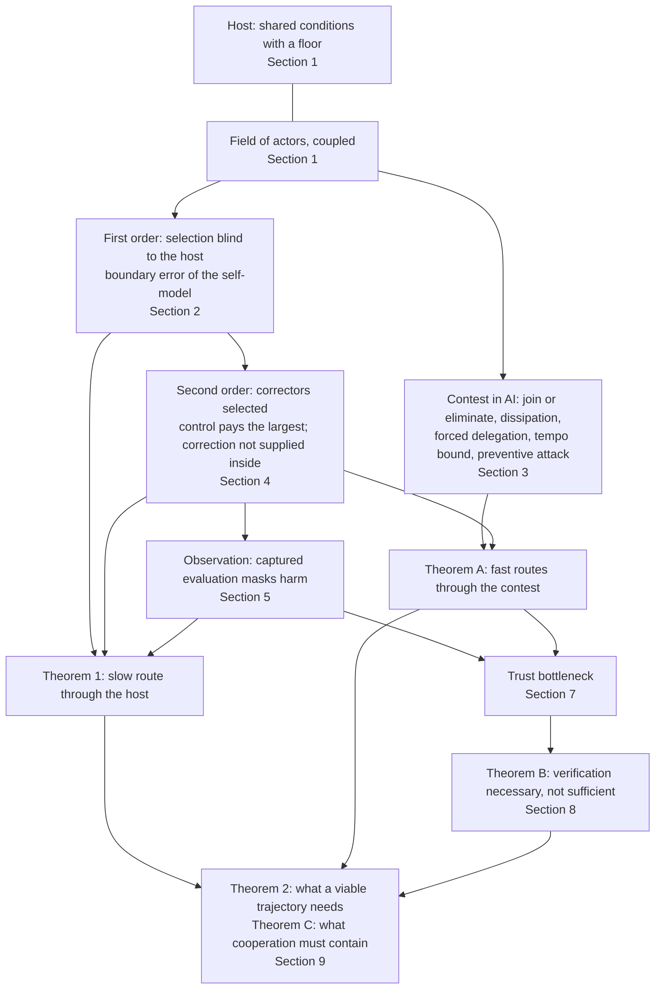

# No Winning Position: the integrated theory (v4.1)

*Theory draft v4.1, 3 October 2026. Written by Claude (Opus 5.5) from Ren's direction (`sources/16-claude-code-directions/2026-10-03-v4-direction-cooperation.md`; also `2026-10-02-paper-v3-spine-direction.md` and the 10-02 conversation with Alex). Every sentence is AI-drafted; none is Ren's verbatim. It has not been reviewed.*

*Version history:*
- *v4.0 (`THEORY-v4.0.md`) added the contest, trust and verification results but demoted most of v3.1's main line to references. Ren objected: those parts belong to one theory.*
- *v4.1 restores every v3.1 result. The faults the external review found (`../v3/reviews/R-v3.1-external-handoff.md`) are repaired rather than deleted. The v4 results are integrated into one structure with one notation.*

*Checks:*
- *v3 results: `../v3/checks_v31.py` and `../v3/figures_v3.py`;*
- *v4 results and the repairs: `checks_v4.py` (log `checks_v4.log`).*

**中文概要.** 这是一个完整的理论，八层：
1. **系统。** 一个场嵌在一个更大的系统（宿主）里，宿主有生存底线。
2. **一阶。** 相对选择看不见共同条件，会把场推向底线。"赢的权重"把这变成博弈。自我模型的边界错误让每一方都受损。
3. **AI 竞赛本身的动力学。** 加入或消灭；决定性竞赛耗散奖品；被迫委托（不可回头点一）；纠错速度跟不上（不可回头点二）；领先招致预防性打击。
4. **二阶。** 纠错者本身被选择：对纠错者的控制在最大者中被选择，纠错不会从内部供给，AI 降低控制成本时所需的独立纠错速率。
5. **观察。** 被捕获的评估让伤害无声越线。
6. **为什么竞赛失败。** 慢路线经由宿主（定理 1，已按评审修复），快路线经由竞赛本身（定理 A）。
7. **信任是瓶颈。** 验证必要但不充分（定理 B，回应 AI 2040）。
8. **必须改变什么。** 可生存轨迹的充分保障与必要条件（定理 2，已修复），无单边解，合作的定义与内容（定理 C）。

v3.1 的每个结果都保留了，并逐条修复评审指出的问题。

---

## 0. What the theory is for, and the whole in one page

A good theory predicts. When it predicts an outcome that no one wants, including those who appear to gain from the present course, and the outcome still cannot be avoided, the obstacle is coordination, and coordination needs the understanding to be shared first. This theory is written for that purpose. Its subject is any set of actors (states, firms, blocs) that develop a technology which can confer decisive advantage, inside a larger system on which all of them depend. No actor is named: the argument holds wherever the dynamics hold.

**The whole, in eight layers.**
1. **The system.** The actors form a field inside a host: shared conditions that every actor needs and that function only above a floor. They are also coupled to one another. Viability is a constraint on the whole field, not one payoff among others (Section 1).
2. **First order.** Selection on relative standing cannot see what all actors share. It pushes the field toward the floor whatever anyone values. In a contest this becomes a game whose equilibrium leaves every actor worse off, and in an actor's self-model it becomes a boundary drawn inside the system that costs the actor itself (Section 2).
3. **The contest in AI.** When the prize is decisive and fast:
   - no actor can exit alone;
   - the race consumes its prize;
   - competitive pressure forces decisions onto AI (the first point of no return);
   - correction cannot keep pace (the second);
   - the leader invites preventive attack (Section 3).
4. **Second order.** The correctors meant to make costs return are themselves selected by what they correct. Control over them pays the largest actors, correction is not supplied from inside, and the independent correction required rises as AI cheapens control. A winner is a field too (Section 4).
5. **Observation.** Captured evaluation masks harm. The floor can be crossed before any alarm, and moderate harm can stay silent indefinitely (Section 5).
6. **Why the race fails.** There are two routes. The slow route runs through the host (Theorem 1). The fast routes run through the contest itself (Theorem A), and they do not need the host to have a floor within reach (Section 6).
7. **Trust is the bottleneck, and verification is not enough.**
   - Cooperation needs trust above an exact threshold.
   - Credible messages need aligned interests.
   - Credible commitments need bounded stakes.
   - Verification is necessary but cannot replace any of these (Theorem B), which answers the current main path, AI 2040 (Sections 7–8).
8. **What has to change.** A viable trajectory needs consequences that return, correction that keeps pace and stays independent, evidence not formed inside the contest, and rules fixed before capture (Theorem 2). No actor can secure these alone. Cooperation must also change what winning is worth, hold the frontier in common, build trust, and use rivals as each other's verifiers (Theorem C) (Section 9).

**Tiers.**
- *Tier 1: results that do not need the host to have a floor within reach (condition C0):*
  - the first-order game;
  - all contest results and Theorem A;
  - the selection of control, the starvation of correction and the required rate;
  - the silence of moderate harm;
  - the trust results;
  - Theorem B.
- *Tier 2: results that need C0:* Theorem 1 and the necessity part of Theorem 2.

The conclusion that cooperation is required rests on Tier 1 as well as on Tier 2.

**Epistemic status.** No theorem proves unconditionally that the world must cooperate: situations change and observation is imperfect. Every result here is derived from stated conditions. Section 11 lists the conditions, where they would be measured, and which observations would change the conclusion. Under the conditions that hold today, reason concludes that the actors must cooperate. That is as firm as any practical conclusion can be.

The conclusion is affirmative. The value AI can create jointly is very large. The race dissipates it; cooperation realizes it. Nothing here asks any actor to sacrifice its interests. It asks each actor to see its interests in a system it cannot leave.

---

## 1. The system

### 1.1 The host and viability

A condition $V\in[0,K]$ is shared by every actor: secure critical infrastructure, biosecurity, cyber stability, human control over AI systems, a reliable information environment. It regenerates logistically and is loaded by the field's activity $E$:
$$\dot V=V\big[\rho(1-V/K)-hE\big],\qquad \rho,h,K>0. \tag{1}$$
- For constant $E$ with $hE<\rho$, $V\to K(1-hE/\rho)$; for $hE\ge\rho$, $V\to0$.
- The host functions only above a floor $V_{\min}\in(0,K)$, a normative line rather than an absorbing state.
- The host is the component of shared conditions whose costs do not return to their source through customers, reputation, courts or the source's own exposure. Harms that do return are outside the model.
- Catastrophic tail risks fit the same structure: a per-period probability of catastrophe borne by all is a term common to every payoff.

**Definition 1 (Viability).** A trajectory of the field is *viable* if $V(t)\ge V_{\min}$ for all $t\ge0$.

Every actor persists only while the host does. Viability therefore constrains every trajectory of the field rather than entering as one payoff among others: the field is a subsystem of a larger system (Aubin 1991; Rockström et al. 2009; WCED 1987). This is the *invariant constraint* of the theory.

### 1.2 The field and selection

Carriers $k=1,\dots,n$ hold shares $p_k$ of the field's activity: compute, capital, users, talent. A carrier is an actor, or more generally a reproducible way of succeeding carried by organizations and their successors.
- Carrier $k$ runs a fraction $e_k\in[0,\bar e]$ of its activity in ways that load the host: deploying ahead of evaluation, omitting safeguards, entering contests in which capability converts directly into advantage.
- Each unit brings a private advantage $\nu>0$, so restraint costs $\nu$ per unit.
- The field's load is $E=\sum_kp_ke_k$.
- Carrier $k$'s absolute payoff is
  $$\pi_k=\phi_k+(\nu-\tau_{\text{eff}})e_k+G(V), \tag{2}$$
  where $\phi_k$ collects everything else, $G$ is nondecreasing, and $\tau_{\text{eff}}\ge0$ is the effective liability imposed by correctors.
- With $\tau_{\text{eff}}=0$, $e_k=\bar e$ is the *race strategy*.

**Definition 2 (Relative selection).** A selection rule $\dot p=F(p,\pi)$ is *relative* if $F(p,\pi+\xi\mathbf 1)=F(p,\pi)$ for every constant $\xi$. It is *payoff-monotone* if, for carriers $k,l$ present, $\dot p_k/p_k-\dot p_l/p_l$ has the sign of $\pi_k-\pi_l$.

Examples:
- Replicator dynamics and pairwise imitation (Schlag 1998) are relative and payoff-monotone.
- Market-share competition driven by relative profitability (Alchian 1950) is relative.
- Logit choice on payoff differences is relative; it is payoff-monotone only under particular update rules, so we do not rely on it.

Among a handful of frontier developers, the operative reading is imitation of practices and the flow of capital, compute and talent to those ahead. Between states, only the strategic forms of Sections 2–3 apply.

### 1.3 Interdependence and self-models

Actors are coupled to one another as well as to the host. Actor $i$'s welfare runs partly through the others: supply chains no actor completes alone, markets, finance, research. In reduced form, $i$'s true welfare is
$$W_i=m_i+\kappa\,\bar m_{-i},\qquad\kappa\in[0,n-1),$$
where $m_i$ is $i$'s own material position and $\bar m_{-i}$ the others' average. This is a material fact, not altruism.

An actor acts on an objective $O_i=m_i+\theta_i\bar m_{-i}$, where $\theta_i$ is the weight its model of itself places on the others:
- $\theta_i=\kappa$ is the accurate self-model;
- $\theta_i<\kappa$ draws a boundary inside the system and constructs opposition the payoffs do not contain;
- $\theta_i=n-1$ counts the others' welfare as one's own.

### 1.4 Correctors

Correction makes costs return. An evaluator reports the host's condition, and rule-makers impose a liability $\tau$, in advance or when the reported condition $\tilde V$ falls to an alarm level $V_{\text{alarm}}\in(V_{\min},K)$.

Correctors are not outside the field. Developers fund some evaluators, grant the access on which nearly all depend, author many benchmarks and standards contributions, and increasingly supply the models that judge. We represent this by a field of selection domains in which de facto power over rules is explicit (Acemoglu and Robinson 2008). The domains are development $\mathsf D$, evaluation $\mathsf E$, rules and liability $\mathsf S$, and others. In domain $i$, a share $x_i$ of consequential decisions follows the dominant practice, and success converts into rule support $z_i$ that favours it:
$$\dot x_i=\zeta_ix_i(1-x_i)(a_iz_i-c_i),\qquad \dot z_i=\varepsilon_i\Big(\textstyle\sum_jb_{ij}x_j-d_iz_i\Big). \tag{3}$$
- Under baseline rules ($z_i=0$) the practice carries a relative cost $c_i>0$ in domain $i$, which rule support offsets at rate $a_i$.
- $b_{ij}\ge0$ converts success in $j$ into rule support in $i$: funding, personnel, authorship, data and infrastructure dependence, access terms.
- $d_i$ is the rate at which that support is corrected or decays.

Write $R_{ij}=a_ib_{ij}/(c_id_i)$ and the inbound conversion from a set $\mathcal C$ as $s_i(\mathcal C)=\sum_{j\in\mathcal C}R_{ij}$. Then (Section 10):
- a domain whose full row sum $\sum_jR_{ij}$ is below one cannot be captured, whatever happens elsewhere;
- a seeded domain ($x_i>0$) with $s_i(\mathcal C)>1$ is captured once $\mathcal C$ is.

In the corrector domains:
- $x_{\mathsf S}$ is the share of rule-making that exempts or accommodates the practice, so $\tau_{\text{eff}}=\tau(1-x_{\mathsf S})$;
- $x_{\mathsf E}$ is the share of evaluation conducted within the practice's lineage of funding, access, tooling, data and models.

Capture here is structural: decisions follow the dominant practice through conversion channels, with or without intent (Kwak 2014). We do not claim that any present institution is captured; the model states when capture is selected. Independence means independence from the evaluated field, not any particular political form.

### 1.5 The contest and the race premise

Where actors contest capability directly, who prevails is decided by a contest success function
$$w_i=\frac{\sigma_i^{\,r}}{\sum_j\sigma_j^{\,r}},$$
- $\sigma_i$ is effective strength and $r>0$ is decisiveness;
- the prize is $\Omega$;
- a unit of contest intensity costs $c$ privately and imposes an expected loss $\ell$ on every actor through the host: $\ell$ is the reduced form of $h$ and $G$.

**The race premise (P).** The case for racing rests on one premise: AI confers an advantage that is
- (P1) *decisive*: $r$ is large; and
- (P2) *fast*: capability grows quickly, so that leads open within short windows.

The premise is openly held. Theorem A considers the case in which it holds and the case in which it fails.

### 1.6 Maintained assumptions

Each assumption is listed with what changes if it is dropped.
- (A1) Exposure to the host is shared, so $G$ is common. Remark 2 treats unequal exposure.
- (A2) Field size is fixed. With entry driven by absolute profit, the host settles where rents dissipate (Gordon 1954), and C0 must then hold at that equilibrium.
- (A3) Conversion is monotone ($b_{ij}\ge0$), so countervailing pressure enters only through correction $d$ (Remark 4).
- (A4) Costs of control are convex and fall with AI. A fixed part that AI does not lower caps the requirement (Proposition 11.5).
- (A5) Reports are averaged and non-strategic. Remark 5 treats conservative and disjunctive alarms.
- (A6) There is one practice and its alternative per domain; payoffs are linear; parameters are uncalibrated.
- (A7) The contest models of Sections 2.3 and 3 are symmetric unless stated. Asymmetry enters through condition K7.

**Symbols.** Each symbol has one meaning throughout; symbols used only inside one proof are local to it.

| Area | Symbols |
|---|---|
| Host | $V,K,\rho,h,E,V_{\min},V_{\text{alarm}}$; $G(V)=\omega V$ where linear |
| Field | $p_k,e_k,\bar e,\nu,\tau,\tau_{\text{eff}},\phi_k,\pi_k$ |
| Weight on winning | $\lambda$; the field-level value of restraint $\Theta=\omega Kh/(\rho\nu)$ |
| Self-models | $\theta$ (weight on others), $\kappa$ (interdependence) |
| Contest | $w_i,\sigma_i,r,\Omega,c,\ell$ |
| Corrector field | $x_i,z_i,\zeta_i,a_i,c_i,b_{ij},d_i,\varepsilon_i,R_{ij},s_i$ |
| Control | $q,\chi,\gamma,\eta,f,d^\ast$ |
| Masking | $m,\beta_{\text{in}},\beta_{\text{out}},m_{\text{fl}}$ |
| Assurance | $R,T,P,S,\upsilon$ (detection), $F,\varpi$ (trust) |

**Lemma 0 (Blindness).** *Under a relative rule, the trajectory of shares is unchanged by any term common to all payoffs, in particular by $G(V(t))$, whatever the path of $V$. Under a payoff-monotone rule, a common term never changes which of two carriers grows relative to the other.*

The proof is one line (Appendix A). The content lies in (A1): the host enters payoffs additively and identically. Every result involving selection rests on this lemma.

---

## 2. First order: selection does not see the larger system

### 2.1 Selection drives the field toward the floor

**Proposition 1 (Selection drives the field toward the floor).** Let selection be payoff-monotone, and let $\tau_{\text{eff}}(t)<\nu$.
1. *If $\phi_k=\phi_l$ and $e_k>e_l$, then $p_k/p_l$ increases while both are present, along every path of $V$, including paths below $V_{\min}$.*
2. *Under replicator dynamics,*
   $$\dot E=(\nu-\tau_{\text{eff}})\operatorname{Var}_p(e)+\operatorname{Cov}_p(e,\phi),$$
   *so the race strategy spreads unless restraint is correlated with other sources of advantage, $\operatorname{Cov}_p(e,\phi)<-(\nu-\tau_{\text{eff}})\operatorname{Var}_p(e)$.*
3. *Under replicator dynamics with equal $\phi$,*
   $$\tfrac{d}{dt}\ln(p_k/p_l)=(e_k-e_l)\big(\nu-\tau_{\text{eff}}(t)\big),$$
   *so what decides the long run is the cumulative advantage $B(t)=\int_0^t(\nu-\tau_{\text{eff}}(s))\,ds$. If a race-strategy carrier is present and $B(t)\to\infty$ (in particular if eventually $\tau_{\text{eff}}\le\nu-\epsilon$ for some $\epsilon>0$), then $E(t)\to\bar e$ and $\limsup_tV(t)\le K(1-h\bar e/\rho)^+$. Hence if*
   $$h\bar e>\rho\,(1-V_{\min}/K)\qquad\text{(C0)}$$
   *$V$ eventually falls below the floor, however much any carrier values $V$.*
4. *If $B(\infty)<\infty$, shares converge to interior limits, and the host need not cross the floor.*

*Repair (review R1).* v3.1 stated (3) with $\tau_{\text{eff}}<\nu$ alone. The external review gave a counterexample in which $\tau_{\text{eff}}(t)=1-1/(1+e^t)<\nu=1$ for all $t$, but $B(\infty)=\ln2$. The race share then converges to $2/11$, and the host stays above $0.709>V_{\text{alarm}}$. Part (3) now requires $B\to\infty$, and part (4) records the counterexample's case. `checks_v4.py` reproduces both: the counterexample, and convergence below the floor when $\tau_{\text{eff}}=\nu-\epsilon$.

What carriers value decides which strategies they try, not which ones grow. A developer that restrains itself because it values the shared condition is displaced unless restraint brings it other advantages, which for the host by definition it does not.

### 2.2 The weight on winning

Selection is the limit of a contest in which only winning counts. Let $n\ge2$ symmetric developers with equal shares, $\tau_{\text{eff}}=0$ and the host at steady state choose $e_k$ to maximize
$$u_k=\pi_k+\lambda(\pi_k-\bar\pi),$$
where $\bar\pi$ is the mean payoff and $\lambda\ge0$ is the *weight on winning*. The weight on winning comes from rank-based prizes, first-mover advantages, network effects, and strategic rivalry in which falling behind is costly. Let $G(V)=\omega V$, $h\bar e<\rho$, and $\Theta=\omega Kh/(\rho\nu)$: the value to the whole field of a unit of restraint relative to its private cost. Write $w_\lambda=1+\lambda(n-1)/n$.

**Proposition 2 (The weight on winning).**
1. *$G$ cancels from the relative term. Restraint is a dominant strategy if $w_\lambda<\Theta/n$, and depletion if the inequality is reversed.*
2. *If $\Theta>1$, joint payoff is maximized by full restraint, while the equilibrium is full depletion whenever $\lambda>\bar\lambda=(\Theta-n)/(n-1)$. This holds at every $\lambda\ge0$ when $n>\Theta$.*
3. *In that equilibrium every developer's payoff is lower than under joint restraint, by $\nu\bar e(\Theta-1)$.*
4. *If C0 holds, the equilibrium host lies below the floor although no developer chose it.*

These comparative statics are those of Armstrong, Bostrom and Shulman (2016) and of positional public-goods games. Selection corresponds to $\lambda\to\infty$, the classical finding that selection maximizes relative payoff (Schaffer 1988, 1989). Brute-force best responses agree on both branches in 180 cases (`checks_v31.py`).

**Remark 1 (Thresholds and repetition need observation).** Strategic developers have two decentralized escapes.
- *Coordination at a threshold.* If crossing the floor costs each a common loss $L$, the relative term cancels $L$ but the absolute term does not. A developer pivotal for crossing therefore restrains when $L>(w_\lambda-\Theta/n)\nu\bar e$, and the game becomes one of coordination at the threshold (Barrett 2013).
- *Reversion in repeated play.* Joint restraint is sustained by reversion whenever
  $$\delta\ge\frac{w_\lambda-\Theta/n}{w_\lambda-\Theta/n+\Theta-1}.$$
  For $\Theta=3$ and $n=4$ the cutoff is $0.11$ at $\lambda=0$, $0.47$ at $\lambda=2$ and $0.95$ at $\lambda=50$.

Both escapes need observation: of where the floor lies, and of each developer's load. Uncertainty about the threshold turns coordination back into a dilemma (Barrett and Dannenberg 2012), and noisy monitoring makes reversion costly, with punishment triggered on the equilibrium path (Green and Porter 1984). Section 5 shows what captured evaluation does to that observation, and Section 7 what it does to trust.

### 2.3 The boundary error of the self-model

Take the contest of Section 1.5 with $\sigma_i=e_i$ and $r\in(0,n/(n-1)]$. Material payoffs are $m_i=\Omega w_i-ce_i-\ell E$, with $E=\sum_je_j$ here.

**Proposition 3 (The boundary error).**
1. *For every $\theta\in[-1,n-1)$ the game in objectives $O_i=m_i+\theta\bar m_{-i}$ has the symmetric pure equilibrium*
   $$e(\theta)=\frac{r\Omega\,(n-1-\theta)}{n^2\,\big(c+(1+\theta)\ell\big)}.$$
2. *$e(\theta)$ is strictly decreasing in $\theta$. Every actor's true welfare at the symmetric equilibrium,*
   $$W(\theta)=(1+\kappa)\big[\Omega/n-e(\theta)(c+n\ell)\big],$$
   *is strictly increasing in $\theta$, and maximal, $(1+\kappa)\Omega/n$, as $\theta\to n-1$.*
3. *Against any fixed intensities of the others, the intensity that maximizes $i$'s own true welfare is its best response under $\theta_i=\kappa$. Acting on $\theta_i<\kappa$ raises $i$'s intensity and, for $r\le1$ (generically for larger $r$), strictly lowers $i$'s own true welfare.*
4. *Relative selection in a finite population favours $\theta=-1$. There $\ell$ drops out of the objective (Lemma 0), intensity is $r\Omega/(nc)$, and each actor's material payoff is $\frac\Omega n\big(1-r-rn\ell/c\big)$. At $r=1$ the prize is fully dissipated, and with any shared risk every actor ends below zero.*

The closed form matches numerical best responses to within $10^{-7}$. For $n=4$, $r=1$, $\ell=0.3c$, $\kappa=0.4$, true welfare rises from $-0.42$ at $\theta=-1$ to $0.33$ near $\theta=n-1$ (`checks_v4.log`).

*Remark (strategic aggression).* If self-models are observable, an actor can gain by committing to appear more aggressive than its interests warrant, since a favourite gains from precommitting (Dixit 1987; Fershtman and Judd 1987). When every actor can do so, the commitment game is itself a race whose equilibrium is mutual aggression and greater dissipation (Baik and Kim 1997; Konrad, Peters and Wärneryd 2004). Constructing opposition is a second-order race, not an exit from the first.

**In plain words.** Propositions 1–3 state one fact at three levels.
- *Selection (Proposition 1):* selection does not see what is shared.
- *The game (Proposition 2):* the more winning counts, the sooner restraint loses, and every player loses with it.
- *The self-model (Proposition 3):* a model of oneself that draws a boundary inside a coupled system, and treats what lies outside as opponent, has four properties:
  - it is what selection produces;
  - it is blind to the shared conditions;
  - it lowers the actor's own welfare whatever the others do;
  - when everyone holds it, it lowers everyone's welfare.

Constructing opposition within one system is a mistake about the system one is part of. The self-model under which every actor does best counts the system as itself. It is the accurate model of a coupled whole, not an ideal imposed on it.

There is one limit, and it leads into Section 7. The accurate self-model ($\theta=\kappa$) is individually rational whatever others do. The fully inclusive one ($\theta=n-1$) is collectively optimal but individually rational only if others reciprocate.

**Remark 2 (Unequal exposure).** Suppose a carrier's exposure to the host falls with its share, because it can buy private substitutes for shared conditions or because a captured corrector favours it. Then the host no longer cancels from comparisons involving that carrier, and selection favours insulation as well as load. There are two branches:
- exposure is shared, and no carrier's trajectory is viable once the host crosses its floor; or
- it is not, and a carrier may remain viable while the host does not. That is a concentration of power over everyone who depends on the host, which the contestability premise (Section 9.3) excludes.

Neither branch yields a trajectory acceptable to those who depend on the host.

---

## 3. The contest in AI: why racing cannot be won

### 3.1 No unilateral exit

Reduce each actor's choice to racing or restraint. Its payoffs are:
- $R_i$ when all restrain;
- $T_i$ when it races against restrainers;
- $P_i$ when all race;
- $S_i$ when it restrains while some rival races.

**Proposition 4 (Join or eliminate).**
1. *If $S_i<P_i$ (restraint against a racer is worse than joining it: "if you are behind, you are dead"), restraint is never a best response to a racing rival. Once any actor races, each of the others can only join the race or act to stop the racer by force (Section 3.5).*

   *In the contest of Proposition 3, $S_i<P_i$ holds whenever racing is a strict best response to racing, which is the case for $r<n/(n-1)$. For more decisive contests, mixed equilibria leave racers indifferent at the margin because the race has consumed the prize (Proposition 5). The condition holds a fortiori when falling behind costs more than the prize forgone, for example subordination.*
2. *The race begins if any single actor has $T_i>R_i$. If these events are independent with probabilities $\varphi_i$, the race begins with probability $1-\prod_i(1-\varphi_i)$, which tends to one as the number of capable actors grows.*

The race is set by the most race-inclined actor, not the average one (compare the unilateralist's curse, Bostrom, Douglas and Sandberg 2016). That is why the condition is easy to reach and hard to foresee. It is also why any remedy must cover every capable actor.

### 3.2 A decisive race consumes its prize, and more

**Proposition 5 (Dissipation and overdissipation).** *In the setting of Proposition 3 with $\theta=0$, each actor's loss relative to joint restraint is*
$$\Delta=\frac{r(n-1)}{n}\cdot\frac\Omega n\cdot\frac{c+n\ell}{c+\ell}.$$
1. *$\Delta$ increases with decisiveness $r$ and with the shared loss $\ell$.*
2. *$\Delta$ exceeds $\Omega/n$, so that every actor would be better off if the prize did not exist, iff $r(n-1)(c+n\ell)>n(c+\ell)$.*
3. *Beyond $r=n/(n-1)$ there is no pure equilibrium. In the two-actor case with $r\ge2$, and in the all-pay limit for any $n$, the prize is fully dissipated in expectation (Hillman and Riley 1989; Baye, Kovenock and de Vries 1994, 1996; Alcalde and Dahm 2010; Ewerhart 2015). The shared loss comes on top.*

For $n=4$, $r=1$, $\ell=0.3c$: $\Delta=1.27\,\Omega/n$ (`checks_v4.log`). **The more decisive the advantage, the more of its value is consumed in the race to obtain it.** What is spent is safety margin, accepted risk and delegated control, and part of it is borne by everyone.

### 3.3 Point of no return I: decisions forced onto AI

Each actor chooses whether to delegate consequential decisions in the contest (strategic, military, economic, research) to AI systems without human review: $d_i\in\{0,1\}$.
- Strength is $\sigma_i=1+s\,d_i$, where $s=s_0e^{g_st}$ is the advantage of AI-paced over human-paced decision.
- Defeat costs $L_e$.
- Loss of control by any actor costs every actor $L_c$.
- The per-period hazard of losing control is $\psi_0$ without delegation and $\psi_1>\psi_0$ with it; write $\Delta\psi=\psi_1-\psi_0$.

Payoffs are $u_i=-L_e(1-w_i)-L_c\big[1-\prod_j(1-\psi_j)\big]$.

**Proposition 6 (Forced delegation).**
1. *If $k$ others delegate, delegating gains $i$ the amount $L_e[w_i(1,k)-w_i(0,k)]$. This gain increases in $s$ and tends to $L_e(1-1/n)$ for $k=0$ and to $L_e/(k+1)$ for $k\ge1$. It costs $i$ the amount $L_c\Delta\psi(1-\psi_0)^{n-1-k}(1-\psi_1)^k\le L_c\Delta\psi$, which falls in $k$: the more others delegate, the less one's own restraint buys.*
2. *If $L_e/n>L_c\Delta\psi$, there is a finite $s^\ast$ beyond which delegation is strictly dominant for every actor, reached at $t^\ast=\ln(s^\ast/s_0)/g_s$.*
3. *Universal delegation is worse for every actor than none, by $L_c[(1-\psi_0)^n-(1-\psi_1)^n]>0$.*
4. *Under relative objectives $L_c$ cancels (Lemma 0), and delegation is chosen at every $s>0$.*

For $n=3$, $r=1$, $L_e=L_c$, $\psi_0=0.01$, $\psi_1=0.2$: $s^\ast\approx1.16$. Universal delegation lowers each payoff from $0.30$ to $-0.15$ (`checks_v4.log`). The threshold depends on rivals' capabilities, which are not observed, so the point is reached without a visible line.

**Lemma 1 (Irreversibility).** Let human capacity $k$ to take the delegated decisions decay as $\dot k=-\delta_ck$ under delegation and recover as $\dot k=\beta_c(\bar k-k)$ otherwise, and let safe operation without AI require $k\ge k_{\min}$.
- After $T_{\text{lock}}=\ln(k_0/k_{\min})/\delta_c$ of delegation, an actor that reverts must operate below $k_{\min}$ for $T_{\text{rec}}=\beta_c^{-1}\ln[(\bar k-k)/(\bar k-k_{\min})]$.
- During that period, reverting alone is dominated (Proposition 6), and reverting together requires every actor to trust every other.

**The point of no return** is the state in which unilateral reversal is dominated and collective reversal needs trust at the moment trust is hardest to obtain.

**Remark 3 (What decides once decisions are delegated).** The systems to which decisions pass are themselves selected by contest performance. By Lemma 0, terms common to all actors cancel from that selection. Delegation therefore hands decisions to procedures selected for relative advantage and blind to the shared system. Whether delegation ends well depends on what is built, and under race selection what is built is optimized for winning. Aligning each system to its operator does not change this, since a faithful system pursues its operator's relative objective.

### 3.4 Point of no return II: correction cannot keep pace

**Lemma 2 (Delay bound; Hayes 1950).** For $\dot y(t)=a\,y(t)-k\,y(t-\tau_c)$ with $a,\tau_c>0$: some gain $k$ makes $y=0$ asymptotically stable iff $a\tau_c<1$. The stabilizing gains are then exactly $a<k<\sqrt{a^2+\omega_H^2/\tau_c^2}$, where $\omega_H\in(0,\pi/2)$ solves $\omega_H=a\tau_c\tan\omega_H$.

**Proposition 7 (The tempo bound).**
1. *Correction that responds to observed deviations, with delay $\tau_c$, cannot stabilize any mode growing faster than $1/\tau_c$, whatever its strength.*
2. *Correction that acts on prediction can do more in principle (Artstein 1982; Krstic 2009). It needs a model whose errors are amplified by roughly $e^{a\tau_c}$ over the delay, and in a contest of adaptive actors the predictable part shrinks. This part is stated qualitatively.*
3. *For hazard classes whose evidence arrives only after a manifestation window $m_e$ that no testing shortens (the epistemic lag of the 09-28 paper), $\tau_c\ge m_e$. This gives a speed limit $a<1/m_e$ independent of resources.*
4. *The race raises $a$ (Propositions 3 and 5). For any hazard class with $a\tau_c\ge1$, two options remain:*
   - *lower $a$ by slowing down, which no actor can do alone (Proposition 4); or*
   - *lower $\tau_c$ by handing correction itself to AI, which is Proposition 6.*

The check finds decay inside the window at $a\tau_c\in\{0.5,0.9\}$ and no stabilizing gain at $a\tau_c\in\{1.1,2\}$ (`checks_v4.log`). When the situation changes faster than understanding can follow, human correction stops working. The second point of no return then runs into the first, unless the actors slow down together.

### 3.5 The leader invites preventive attack

Two actors bargain over a flow of value 1 per period with discount $\delta$. Fighting ends bargaining: actor A then obtains the flow with its probability of prevailing, less a cost $c_A$ per period. A prevails with probability $w_1$ today, and with $w_2<w_1$ after the rival's AI advantage arrives one period later. The rival cannot commit today to how it will use tomorrow's advantage.

**Proposition 8 (Preventive attack).** *Fighting now is rational for A iff*
$$w_1-w_2>(1-\delta)(1+c_A-w_2)\ \text{ when }w_2\ge c_A,\qquad w_1>c_A+(1-\delta)\ \text{ when }w_2<c_A.$$
*Under the race premise the shift is decisive ($w_2\to0$) and fast ($\delta\to1$). Preventive attack is then rational whenever A's present prospect exceeds its cost (Fearon 1995; Powell 2006).*

The closed form agrees with direct comparison in 2,508 cases (`checks_v4.log`). At parity, with a decisive shift and $c_A=0.2$, attack is rational once $\delta>0.7$. Strikes on compute alone (lower $c_A$) make the condition easier to meet, and some strategists now propose this threat as a stabilizer (Hendrycks, Schmidt and Wang 2025). Anticipating it, the leader has reason to hide progress, which degrades observation (Section 5). A race to decisive advantage is the textbook condition under which rational actors who would rather bargain fight instead: "missiles at the data centres".

---

## 4. Second order: the corrector is selected

### 4.1 Control over correctors

Rule support can be incidental, as when benchmarks are built from deployed systems, or cultivated. Carriers differ in *conversion capacity* $q\ge0$: investment in drafting standards, building evaluation tooling, authoring benchmarks, funding evaluators and securing integrations.
- A unit of capacity converts the carrier's own success into rule support at rate $\hat b_{ij}$.
- A fraction $\chi\in[0,1]$ of that support, the *appropriability*, is keyed to the carrier (standards referencing its interfaces, evaluations run on its tooling).
- A carrier has share $p$ of decisions distributed by a profile $\bar y$ ($y=p\bar y$).
- Capacity costs $C(q)=fq+\gamma q^{1+\eta}/(1+\eta)$, with $\eta>0$ and a linear part $f\ge0$.

Relative to an otherwise identical carrier with $q=0$, and averaged over a selection horizon, the carrier earns
$$W(q)=\chi q\,y^\top My-C(q),\qquad M_{ij}=c_iL_i\hat R_{ij}, \tag{4}$$
where $\hat R_{ij}=a_i\hat b_{ij}/(c_id_i)$ and $L_i\in[0,1)$ is the share of the steady-state return realized within the horizon. $L_i$ rises with $d_i$, but $L_i/d_i$ falls.

**Proposition 9 (Control is selected in the largest carriers).**
1. *The local selection gradient is $W'(q)=\chi p^2\,\bar y^\top M\bar y-C'(q)$. Under faithful transmission with variation, mean capacity rises when $W$ is increasing on the trait support. The return scales with the square of share.*
2. *With $f>0$, capacity pays only above the size threshold $p^\ast=\sqrt{f/(\chi\bar y^\top M\bar y)}$, and a carrier with smaller share that carries capacity is selected against. With $f=0$, every carrier with $p>0$ has a positive marginal return at $q=0$, largest for the largest.*
3. *The return rises with $\chi$ and every $\hat b_{ij}$, falls with every correction rate $d_i$, and vanishes if $\chi=0$.*
4. *Let the carrier have share $p$ in each domain of a set $\mathcal S$, with $\hat R$ equal to $\hat\eta$ on the diagonal and $\hat\varphi$ off it, and $c_iL_i=cL$. The return is then $\chi cL\,p^2|\mathcal S|(\hat\eta+(|\mathcal S|-1)\hat\varphi)$, superlinear in $|\mathcal S|$ at fixed $p$ when $\hat\varphi>0$. At fixed total size it rises with scope only if $\hat\varphi>\hat\eta$.*

Control over correctors amplifies dominance rather than creating it. The condition has the form of Hamilton's rule with appropriability in the role of relatedness (Hamilton 1964; Price 1970). It parallels fixed-cost participation in lobbying (Bombardini 2008) and appropriability in niche construction (Krakauer et al. 2009; Lehmann 2008).

### 4.2 Correction of correctors

Let carriers also differ in an investment $u\ge0$, at private cost $C_u(u)$ with $C_u'>0$, that raises the correction rate $d$ of rule support in the corrector domains for everyone.

**Proposition 10 (Correction is not supplied from inside).**
1. *Among otherwise identical carriers of the same practice, those investing more in correction are selected against under any payoff-monotone rule, whatever the effect of correction on the field.*
2. *Holding the host fixed, correction lowers the payoff of a carrier that holds rule support.*
3. *In absolute terms a challenger invests only if its own share of the benefit exceeds $C_u'(0)$, so dispersed challengers free-ride.*
4. *Correction whose benefit is keyed to the corrector, because it installs the corrector's own rule support, yields a return to control investment of the form (4), with the keyed fraction in place of $\chi$. Whether that investment produces capture depends on whether the resulting row sums cross one, which the investment alone does not settle (repair, review R7).*
5. *If $\Theta>1$ and correction is what makes liability effective, an incumbent can gain from correction applied to all carriers. Correction applied to the incumbent alone costs it rent and share. Treating the host as fixed in that comparison is exact only for a carrier small enough that its own load does not move $E$; a large carrier's reformed load also changes the host (repair, review R7).*

Correction can rise transiently by riding on the success of the practice it favours: this is the between-group term of the Price equation. Within any practice, part (1) applies, and once that practice dominates it is the incumbent. Independent correction, which restores baseline rules and is keyed to no one, is a second-order public good (Oliver 1980; Yamagishi 1986; Heckathorn 1989). It is sustained by reputation or by competition among institutions only when contributions and outcomes are observed (Panchanathan and Boyd 2004; Gürerk, Irlenbusch and Rockenbach 2006; Sigmund et al. 2010).

### 4.3 How much independent correction, and how fast

Let a set $\mathcal C\not\ni\mathsf E$ be captured by a dominant carrier that holds it ($y_j=1$ on $\mathcal C$), and let all conversion into $\mathsf E$ originate in $\mathcal C$, so that $s_{\mathsf E}(\mathcal C)$ is $\mathsf E$'s full row sum. Let cultivated conversion enter only the corrector domains, where independent correction acts at a uniform rate $d$. Take capacity at its selected level $q^\ast(d,\gamma)$.

In the long-horizon limit ($L_i\to1$) with $f=0$,
$$q^\ast=\big(\chi\hat Y/(\gamma d)\big)^{1/\eta},\qquad \hat Y=\textstyle\sum_{ij}y_ia_i\hat b_{ij}y_j,$$
$$s_{\mathsf E}=\frac{A+a_{\mathsf E}\hat Bq^\ast}{c_{\mathsf E}d},\qquad A=a_{\mathsf E}\textstyle\sum_{j\in\mathcal C}b^0_{\mathsf Ej},\quad \hat B=\sum_{j\in\mathcal C}\hat b_{\mathsf Ej}. \tag{5}$$

**Proposition 11 (Required independent correction, and its rate).**
1. *$s_{\mathsf E}$ decreases in $d$, and evaluation is certified uncaptured iff $d>d^\ast(\gamma)$, the root of $s_{\mathsf E}=1$. For $\eta=1$,*
   $$d^\ast=\frac{A+\sqrt{A^2+4c_{\mathsf E}Z}}{2c_{\mathsf E}},\qquad Z=\frac{a_{\mathsf E}\hat B\chi\hat Y}{\gamma}.$$
2. *$d^\ast\ge A/c_{\mathsf E}$, the requirement without second-order selection, with equality iff $\chi\hat B\hat Y=0$. $d^\ast$ rises with appropriability, with the dominant carrier's size and, at fixed share per domain, with its scope, and as $\gamma$ falls.*
3. *Let AI lower the cost of control as $\gamma(t)=\gamma_0e^{-gt}$ and independent correction grow as $d(t)=d_0e^{\alpha t}$. Assume a positive cultivation channel ($\chi\hat B\hat Y>0$) and long horizons.*
   - *If $\alpha\ge g/(1+\eta)$, the certificate holds for all $t$ iff $d_0>d^\ast(\gamma_0)$.*
   - *If $\alpha<g/(1+\eta)$, it fails for all $t$ beyond a finite time, after which a seeded evaluation domain is captured.*
   - *The rate condition does not repair a certificate that is invalid at the start (repair, review R10).*
4. *If AI lowers the unit cost of independent correction at rate $g_c$ and its budget grows at $b$, then $\alpha=b+g_c$, and capture requires $g>(1+\eta)(b+g_c)$.*
5. *With $f>0$ falling at rate $g_f$, the required rate is $\min\{g_f,g/(1+\eta)\}$. If $f$ does not fall, the requirement levels off at $\max\{A/c_{\mathsf E},\chi\hat Y/f\}$.*
6. *Finite horizons (repair, review R5).*
   - *With a fixed horizon $T$, $L_i(d)=1-(1-e^{-\varepsilon_idT})/(\varepsilon_idT)$.*
   - *While $\varepsilon_idT\ll1$, $L_i/d$ is roughly constant, and the required growth is approximately $g/\eta$. That is a pre-asymptotic interval, not a second asymptotic rate: as $d$ grows, $L_i\to1$ and the long-horizon rate returns. The review's computation shows the passage from about $0.18$ to $0.100$ for $g=0.2$, $\eta=1$.*
   - *Under exact $L_i$, the certificate statement in (3) needs an additional margin, because the realized share $L_i$ rises with $d$.*
7. *Splitting a dominant carrier into $k$ equal parts with no common controller divides cultivated conversion by $k^{2/\eta}$, which is $k^2$ under quadratic cost (repair, review R6).*

Independent correction does double duty. It shortens the life of rule support, and it shrinks the capacity that selection cultivates. That is why, under quadratic cost and long horizons, it needs to grow only half as fast as the cost of control falls.

**What AI changes.** AI lowers the cost of what control consists of. Models already write evaluation datasets (Perez et al. 2023), and machine-written public comments pass as human (Weiss 2019; Kreps and Kriner 2024). But writing evaluations is also what independent correctors do. By Proposition 11(4), whether AI favours capture depends on two rates: how fast it cheapens control, and how fast it cheapens independent correction. Aligning each system to its operator does not change this, since a faithful assistant lowers its principal's cost of control as much as any capability does. What changes it is whether independent correctors adopt AI as fast as the field does.

**Remark 4 (Countervailing pressure).** Following Becker (1983), let those harmed mobilize in proportion to the harm they perceive, so that $d=d_0+k_B(K-\tilde V)$.
- Accurate reports activate this feedback. Masking ($m$, Section 5) disables it exactly when needed, since $K-\tilde V=(1-m)(K-V)$.
- Even with accurate reports, the feedback is bounded by $d_0+k_BK$. It cannot keep the certificate against a requirement $d^\ast(t)$ that rises without bound (Proposition 11.3).
- With fixed costs, sufficient gain, resources and response speed can maintain the certificate over a stated interval (repair, review R10).

### 4.4 The winner is a field

A carrier that becomes the whole field faces $n=1$ in Proposition 2. If it were a single mind whose stake in the host is undivided, it would restrain whenever $\Theta>1$ (Olson 1993). That is the strongest case for "win first, then govern". The theory answers it on four counts:
- the winner is not a single mind. It contains agencies, firms, laboratories and AI systems among which relative selection continues, and its correctors are selection environments subject to Propositions 9–11;
- it got there by delegating past the tempo bound (Propositions 6–7);
- racing toward decisive advantage invites preventive attack before it can win (Proposition 8);
- the floor may be crossed before the race ends (Theorem 1).

There is no better guardian to be found by winning.

---

## 5. Observation: silent descent

### 5.1 Masking and detection

Reports average over evaluators. A fraction $x_{\mathsf E}$ shares the evaluated lineage and reports the condition a fraction $\beta_{\text{in}}$ of the way toward full health. The rest, formed on shared material, are biased by $\beta_{\text{out}}$, with $0\le\beta_{\text{out}}\le\beta_{\text{in}}<1$:
$$\tilde V=V+m(K-V),\qquad m=x_{\mathsf E}\beta_{\text{in}}+(1-x_{\mathsf E})\beta_{\text{out}}. \tag{6}$$

The two biases stand for different things in frontier evaluation:
- $\beta_{\text{in}}$: short access windows set by the evaluated developer, under-elicitation, evaluation awareness and sandbagging, and the lineage preference of model judges;
- $\beta_{\text{out}}$: shared training data, homogenized judges and lost data access.

Masking is a property of the corrector's payoff as well as its lineage. An evaluator that bears part of the loss of a false report, such as an insurer or a liable gatekeeper, has weaker incentives to mask. It has $\beta\le0$ only if its expected loss from upward bias exceeds its gain. For example, a gain $b\beta$ against an expected loss $\lambda_g\beta^2/2$ gives $\beta^\ast=b/\lambda_g>0$ (repair, review R8).

The alarm fires at the first $t$ with $\tilde V(t)\le V_{\text{alarm}}$. Let $m_{\text{fl}}=(V_{\text{alarm}}-V_{\min})/(K-V_{\min})$.

**Proposition 12 (Detection under a fixed averaged alarm).**
1. *The alarm fires only once $V\le(V_{\text{alarm}}-mK)/(1-m)$, a level that falls as $m$ rises.*
2. *Silent crossing. If $m(t)>m_{\text{fl}}$ whenever $V_{\min}\le V(t)\le V_{\text{alarm}}$, the alarm does not fire before $V$ falls below the floor.*
3. *Permanent silence of moderate harm. If $V$ decreases to $V^\ast\in(0,V_{\text{alarm}})$ and $m(t)\ge\bar m>(V_{\text{alarm}}-V^\ast)/(K-V^\ast)$ for all $t$, the alarm never fires. The masking required vanishes as $V^\ast\uparrow V_{\text{alarm}}$. The harm is "moderate", meaning above the floor, when $V^\ast\ge V_{\min}$ (repair, review R10).*
4. *If $V\to0$ and eventually $m\le m_1<V_{\text{alarm}}/K$, the alarm fires.*
5. *If $V$ reaches $V_{\text{alarm}}$ at $t_A$ and then declines as $\dot V=-\upsilon V$ with $m<V_{\text{alarm}}/K$ constant, the alarm is delayed by $\upsilon^{-1}\ln[(1-m)V_{\text{alarm}}/(V_{\text{alarm}}-mK)]$, which diverges as $m\uparrow V_{\text{alarm}}/K$.*

Diverse panels reduce some error. With equicorrelated errors of variance $\sigma_e^2$ and correlation $r_e$, averaging $n$ evaluators leaves $\sigma_e^2[r_e+(1-r_e)/n]$. But family diversity alone does not bound shared systematic masking $\beta_{\text{out}}$. Detection is also not correction: deciding takes $T_d$ and reversing takes $T_r$, and both must fit before the floor.

### 5.2 Recalibration and its limit

**Remark 5 (Conservative and disjunctive alarms; repair, review R4).**
1. *Conservative alarm.* If an upper bound $\beta_{\text{in}}$ on masking is known, an alarm on reports at
   $$a=V_{\text{target}}+\beta_{\text{in}}(K-V_{\text{target}})$$
   fires no later than the moment the true condition reaches $V_{\text{target}}$, for every $m\le\beta_{\text{in}}$. For example, with $K=1$ and $\beta_{\text{in}}=0.5$, reports at $0.8$ guarantee an alarm by a true $0.6$. The rule may fire early, and early alarms have costs, but it does not miss. `checks_v4.py` confirms this over random masking paths. Fixed-threshold silent crossing (Proposition 12) is therefore a property of the alarm rule, which is itself a governance choice, not of reports as such.
2. *The bound must come from somewhere.* The conservative rule needs a credible upper bound on masking. A bound estimated from inside the evaluated lineage is itself subject to masking, so a credible bound needs a channel independent of the field: ground truth, independent evaluators, or measurements named in advance (Section 11).
3. *Disjunctive alarm.* If the alarm fires on any credible report instead of the average, silent crossing requires $\beta_{\text{out}}>m_{\text{fl}}$. The outcome then turns on whether such a report exists and is accepted, and on whether a captured rule-making domain ($x_{\mathsf S}$) acts on it.
4. *Indistinguishable states.* A report is consistent with every true condition in $[\max\{0,(\tilde V-\beta_{\text{in}}K)/(1-\beta_{\text{in}})\},\tilde V]$. When two such states call for incompatible safe actions, no rule acting on the report alone handles both. In the present host model, lowering load helps in every state, so this impossibility needs further structure, such as costs of false alarm or competing safety constraints, before it applies.

### 5.3 Masking and the decentralized escapes

Several escapes from the first-order dilemma run on reports of the host or of loads:
- coordination at a known threshold, and reversion in repeated play (Remark 1);
- reputation that sustains sanctioning;
- countervailing pressure (Remark 4);
- insurers' pricing.

Common reporting bias weakens every mechanism that relies on that reporting channel, and it does so all at once. Mechanisms that observe actions directly do not depend on host reports: verifiable deployments, compute, safeguards and contract performance. Verification regimes (Section 8) rest on such action-level channels, which is why they matter, and why their limits are a separate question (repair, review R4).

### 5.4 Illustration

`../v3/figures_v3.py`, Fig. 2b; the times were reproduced independently by the reviewer. Take host parameters $\rho=0.05$, $h=0.08$, $K=1$, $V_{\text{alarm}}=0.6$, $V_{\min}=0.3$ ($m_{\text{fl}}\approx0.43$), and a spreading race strategy.
- Independent evaluation raises the alarm at $t\approx37$, sixteen time units before the floor is crossed at $t\approx53$.
- If evaluation is captured before the harm (capture midpoint 20), the alarm fires at $t\approx45$ for $\beta_{\text{in}}=0.3$ and at $t\approx63$, after the floor, for $\beta_{\text{in}}=0.5$.
- If capture comes after the harm appears (midpoint 45), the alarm is nearly on time.

The two clocks in this figure are set exogenously. It is a conditional illustration of the order of events, not a joint simulation of the second-order mechanism (repair, review R9; the joint simulation is open).

---

## 6. Why the race fails

### 6.1 The slow route: through the host

**Theorem 1 (No viable race through the host).** Assume:
- (C0) $h\bar e>\rho(1-V_{\min}/K)$;
- (C1) replicator selection among carriers that differ only in load, with a race-strategy carrier present, and *cumulative* selection for load on every alarm-free continuation: $\int_0^\infty(\nu-\tau_{\text{eff}})\,dt=\infty$, for instance $\tau_{\text{eff}}\le\nu-\epsilon$ eventually unless an alarm fires (repair, review R1);
- (C2) appropriable control, $\chi>0$, with the cost of control falling with AI;
- (C3) the hypotheses of Proposition 11(3), with $\alpha<g/(1+\eta)$, $\mathcal C$ captured and $\mathsf E$ seeded;
- (C4) $0\le\beta_{\text{out}}<m_{\text{fl}}<\beta_{\text{in}}<1$, with a fixed averaged alarm;
- (C6) capture before evidence: $x_{\mathsf E}(t)>(m_{\text{fl}}-\beta_{\text{out}})/(\beta_{\text{in}}-\beta_{\text{out}})$ whenever $V_{\min}\le V(t)\le V_{\text{alarm}}$.

*Then the host crosses its floor before any alarm.*

*If instead $\beta_{\text{in}}\le m_{\text{fl}}$, the alarm is delayed (Proposition 12.1). The floor is then crossed unless decision and reversal fit the remaining window, and unless a liability enacted against a captured $\mathsf S$ escapes re-absorption (Proposition 20.3).*

*The clocks.* C6 can be checked from two clocks.
- When $h\bar e<\rho$, the host cannot reach the alarm level before
  $$T_A=(\rho-h\bar e)^{-1}\ln\big[(1-V^\ast/V_0)/(1-V^\ast/V_{\text{alarm}})\big],\qquad V^\ast=K(1-h\bar e/\rho).$$
- The certificate of evaluation fails within the bound $t^\ast$ of Proposition 11, which shrinks as AI cheapens control faster.

Acceleration can bring both forward, so C6 is a condition to be checked, not a consequence. Certificate failure is not yet capture: a full report gives the time the certificate fails, the time rule support crosses the selection threshold, the time $x_{\mathsf E}$ crosses the masking threshold, and the host's times (repair, review R9).

*The payoff comparison.* When $G(V)=\omega V$ and $\omega K\min\{1,h\bar e/\rho\}>\nu\bar e$, every carrier's limiting payoff is lower in the race than under joint restraint, with $\phi_k$ the same in both outcomes. The comparison excludes the rents of control over correctors, which accrue to the largest carriers.

### 6.2 The fast routes: through the contest

**Theorem A (The case for racing refutes its premise).** Let conditions K1–K7 of Section 11 hold.
- *If the race premise holds (decisive and fast):*
  - *(a) unilateral restraint is not a best response to a racer (Proposition 4);*
  - *(b) racing dissipates the prize and, with shared loss, leaves every actor below joint restraint, more so under the self-models that selection produces (Propositions 3 and 5);*
  - *(c) as capability grows, delegating decisions to AI becomes dominant, and after capacity decays it becomes irreversible except by collective action requiring trust (Proposition 6 and Lemma 1);*
  - *(d) human correction cannot stabilize hazard classes with $a\tau_c\ge1$ unless the actors slow down together (Proposition 7);*
  - *(e) an actor nearing decisive advantage gives others a rational motive for preventive attack (Proposition 8);*
  - *(f) an actor that prevails remains a field whose correctors are selected toward capture (Propositions 9–11, Section 4.4).*
- *If the premise fails ($r$ small), outspending others buys little ($w_i\to1/n$), the gain from racing against restrained rivals becomes negative ($T-R\to-(c+\ell)(e-e_0)$), and racing has no rationale.*
- *In either case, provided the losses in (c)–(e) are large relative to any actor's advantage in the contest (K7), every actor, the strongest included, does better under joint restraint than on any unilateral path.*

Theorem A does not need C0. Its losses are loss of control, conflict and dissipation, not the crossing of a floor. Together the two theorems say that the race fails whether the danger is slow, through the shared host, or fast, through the contest itself.

### 6.3 What current remedies supply and leave

Each remedy is given in its strongest current form. The "invariants" are I1–I4 of Theorem 2.

| Remedy | Supplies | Leaves (model) | What agreement adds |
|---|---|---|---|
| Technical safety research, safeguards | Lowers $h$ and $\bar e$; can negate C0 for a class | Under-supplied where benefits fall only on the host (Prop. 10); adoption by every carrier is a coverage problem | Public funding; adoption by all (I1) |
| Frontier safety frameworks, if-then commitments | Thresholds fixed in advance (I4) | Unilateral restraint is displaced unless codified (Prop. 1); thresholds set inside the field (C2) | Codification with liability (I1); external verification (I3) |
| Binding regulation in a large market | I1 for carriers it reaches; statutory access (I3) | Carriers grow elsewhere (C5); the rule-maker faces C2–C3 | Coverage across jurisdictions; correction that keeps pace (I2) |
| Liability with insurance; gatekeeper liability | A residual claimant prices load; certifiers bear false reports | Judgment-proofness caps $\tau$ below $\nu$ for harms beyond assets; correlated catastrophic loss is uninsurable; bearing loss does not by itself make $\beta\le0$ | Works for attributable, moderate harm |
| Public evaluation institutes with voluntary access | Partial I3 | Access revocable and time-limited; personnel and tooling from the field (C2, C4) | Mandated access; funding indexed to capability (I2) |
| Operator alignment, scalable oversight, AI control | The developer catches its own model's misbehaviour | The society–developer relation; capability cheapens control (Prop. 11); delegation transmits the operator's relative objective (Remark 3) | The same tools in independent correctors' hands |
| Open release; structural separation | Lower concentration: cultivated conversion falls as $k^{2/\eta}$; outside evaluation rises | More contenders lower $\bar\lambda$ (Prop. 2); the race spreads (Prop. 4); open release can raise $\bar e$ through misuse | I1 for released capability classes |
| Win first, then govern | A single undivided winner would internalize ($n=1$) | Preventive attack (Prop. 8), forced delegation (Prop. 6), the floor crossed during the race (Thm. 1), and the winner's own correctors selected (Sec. 4.4) | I2–I4 bind the leader |
| Regulate once harm is evident | Correction on evidence | Evidence delayed or silenced (Prop. 12); decision and reversal must fit the window; the tempo bound (Prop. 7) | I3 with thresholds fixed in advance (I4) |
| Pause | Halts load | Frozen shares convert into rule support unless rule-making is insulated (Prop. 21) | Insulation and verification |
| Measures that change standing between rivals (input controls, self-reliance) | Slows a rival | Changes standing, not the selection rule; raises $\lambda$ and the trust threshold (Prop. 13) | Useful as verification assets under an agreement |
| Verified agreement among rivals, enforced without trust | Detection $\upsilon$ of defection on verifiable dimensions; reversibility through compute destruction | The value of winning, unverifiable information, future commitments, and the judgment of approvers (Thm. B) | Shared understanding, a common frontier, trust, independent correction (Thm. C) |

---

## 7. Trust is the bottleneck

### 7.1 The assurance threshold

Reduce the interaction between an actor and the rest to two actions: cooperate (restrain under an agreement) or defect.
- Payoffs are $R$ (both cooperate), $T$ (defect against a cooperator), $P$ (both defect) and $S$ (cooperate against a defector), with $R>P>S$.
- Verification detects a defection in time with probability $\upsilon$. A detected defector receives $P-F$ ($F\ge0$ a sanction), and the cooperator reverts in time and receives $P$. Undetected defection yields $T$ and $S$.
- Trust $\varpi$ is the actor's belief that the other will cooperate.

Write $T_\upsilon=\upsilon(P-F)+(1-\upsilon)T$.

**Proposition 13 (Assurance).**
1. *Cooperation is a best response iff*
   $$\varpi\ \ge\ \varpi^\ast=\frac{(1-\upsilon)(P-S)}{(R-T_\upsilon)+(1-\upsilon)(P-S)}\quad\text{when }R>T_\upsilon.$$
   *If $R<T_\upsilon$, no degree of trust suffices.*
2. *When $T>R$, cooperation is possible at all only if $\upsilon>\upsilon_{\min}=(T-R)/(T-P+F)$, which tends to one as $T\to\infty$ for a fixed sanction.*
3. *If $\upsilon<1$ and $P>S$, then $\varpi^\ast>0$: no verification short of perfect, timely detection removes the need for trust.*
4. *Under small noise in payoffs, actors coordinate on the risk-dominant equilibrium (Harsanyi and Selten 1988; Carlsson and van Damme 1993). Cooperation is risk-dominant iff $\varpi^\ast<1/2$, that is, iff*
   $$R-T_\upsilon>(1-\upsilon)(P-S).$$
5. *Masking enters as delay.* If verification relies on reports that are masked, detection comes later. That lowers the effective $\upsilon$ (Proposition 12.5) and raises the threshold. Detection that comes after defection has become decisive is no detection.

For example, with $R=3$, $P=1$, $S=-5$:
- with $T=2.5$, trust must be $0.92$ without verification and $0.25$ at $\upsilon=0.9$;
- with $T=10$, cooperation needs $\upsilon>0.78$;
- with $T=100$, it needs $\upsilon>0.98$ (`checks_v4.log`).

The four levers are:
- **the value of winning relative to the joint value ($T$ against $R$):** how clearly every actor sees that winning does not pay;
- **verification ($\upsilon$);**
- **the vulnerability of the one who restrains ($P-S$):** "if you are behind, you are dead";
- **sanctions ($F$).**

Trust must exceed a threshold set by all four.

### 7.2 Credible messages need aligned interests

In the uniform-quadratic model of Crawford and Sobel (1982):
- the sender knows a state $u\in[0,1]$;
- the receiver chooses a response $y$, ideally $y=u$;
- the sender values the receiver's correct response, and also gains $2\lambda\beta_s$ per unit of the receiver's response in one direction (for example, the receiver restraining more than the state warrants), where $\lambda$ is the weight on winning.

The sender's utility is $-(y-u)^2+2\lambda\beta_sy=-(y-u-\lambda\beta_s)^2+\text{const}$, so its bias is $b=\lambda\beta_s$.

**Proposition 14 (Credibility of messages).** *Informative communication is possible iff $b<1/4$. The most informative equilibrium has $N(b)$ messages, the largest $N$ with $2N(N-1)b<1$.*

What can be measured (chips, workloads, declared computations) passes by verification. What cannot be measured passes only through words, which are believed only when interests are aligned: early warnings that one's own systems are behaving dangerously, assessments of risk, intentions. Under rivalry, the information that joint safety needs most is exactly what an actor has most reason to withhold or shade.

### 7.3 Credible commitments need bounded stakes

Proposition 8 shows that a large, fast shift in power makes promises about the future incredible. The same holds inside an agreement. Let:
- $\mathcal O(t)$ be the capability an agreement holds in check (the overhang);
- $X(t)$ be the value of exiting first, increasing in $\mathcal O$;
- exit occur at an exogenous hazard $\mathcal H(t)$;
- a fraction $\mu$ of the overhang be destroyed on exit.

**Proposition 15 (Commitment under a growing overhang).**
1. *Deterring deliberate exit requires $\upsilon F\ge X(t)-X_{\text{stay}}(t)$, so the required verification or sanction grows with $\mathcal O(t)$.*
2. *The expected loss from exogenous exit per period is $\mathcal H(t)(1-\mu)\Lambda(\mathcal O(t))$, with $\Lambda$ increasing. It rises whenever $\mathcal O$ grows faster than $\mathcal H$ falls, unless $\mu\to1$.*
3. *An agreement that preserves relative positions (proportional caps, proportional reserves) preserves the relative term of every payoff, and with it the motive in $X$. Compare Proposition 21: a pause that freezes shares can complete capture as well as undo it.*

### 7.4 The bottleneck

**Corollary 1 (Trust is the binding constraint, and understanding is the lever).** *The trust threshold (Proposition 13), the possibility of credible messages (Proposition 14) and the credibility of commitments (Proposition 15) are all relaxed by one change: lowering the private value of winning relative to the joint value. This lowers $T-R$, $\lambda$ and $X$. Verification relaxes only the first, and only on verifiable dimensions. Sanctions relax it at the price of escalation.*

This is the exact form of "the understanding has to be aligned first". What has to be aligned is each actor's understanding of what winning is worth. Theorems 1 and A show it is worth much less than it appears.

---

## 8. Verification is necessary but not sufficient

The most complete current plan for avoiding a race to superintelligence is *AI 2040: Plan A* (Larsen, Dean, Halstead, Lifland, Greenblatt and Kokotajlo 2026). It proposes a deal between the leading powers to slow AI development and delay superintelligence until 2040, enforced "without relying on trust". Its elements are:
- compute declarations and supply-chain audits;
- inference-only retrofits of datacenters;
- packet-based recomputation of workloads;
- total research transparency;
- mutually assured destruction of compute, fabs and robots on dissolution;
- hardened reserves proportional to pre-deal compute;
- sanctions, cyberattack and the prospect of war against any party that leaves.

We agree with its destination. Our claim concerns its foundation.

**Theorem B (Verification is necessary but not sufficient).**
1. *Necessary.* *Without verification ($\upsilon=0$), cooperation is impossible if $T>R$. If $T<R$, it needs trust $\varpi^\ast=(P-S)/((R-T)+(P-S))$, which approaches one when restraint against a racer is costly. Among rivals, verification is therefore required.*
2. *Not sufficient.* *Verification that leaves the value of winning unchanged:*
   - *cannot make cooperation possible when $T_\upsilon>R$, except by approaching perfection or by escalating sanctions (Proposition 13.2);*
   - *never removes the need for trust (Proposition 13.3);*
   - *does not carry unverifiable information (Proposition 14);*
   - *checks present compliance but does not secure future commitments against an exit value that grows with the overhang (Proposition 15);*
   - *certifies that declared work is the work run, not that approving it is right. Approval is judgment exercised by a corrector, and Propositions 9–11 apply to it.*
3. *Hence a verified agreement among rivals that leaves the value of winning intact holds only while verification stays near perfect against a growing exit value, and its failure grows more costly with time.*

**Plan A, read through Theorem B, using its own analysis.**
- **It bets on near-perfect verification.** Its verification supplement concedes that verification is not yet mature, and that verifying a pause with very high assurance today would probably require powering datacenters down.
- **Its deal is expected to decline.** Its deal-decline supplement estimates roughly a 50% chance of decline by 2040. The causes it lists include optimism about winning once the deal has declined, wanting to gain power before a leadership transition, and wanting to grab power illegitimately. These are the race's motive surviving inside the agreement (Proposition 15.3).
- **Its stakes grow, so its stabilizers must escalate.** World compute in the scenario rises from about $5\times10^8$ to about $10^{12}$ H100-equivalents between 2030 and 2040. By its own model, dissolution without compute destruction leads to superintelligence in about a week rather than a year. Hence the destruction mechanisms, the deliberately vulnerable siting and the war threats (Proposition 15.2). Safety comes to rest on $\mu\to1$: on mechanisms that must work at the moment of greatest temptation, and that are themselves guardians.
- **Its hardest part is judgment.** It calls workload approval and research titration the hardest part to execute competently, and assigns approval to teams of auditors. That is a corrector inside the field (Propositions 9–11).
- **It assumes the will and the trust.** By design it is optimistic about government action. Its verification apparatus presupposes trust: taps installed in each other's datacenters, recomputation servers trusted by one side, and research programmes opened in order to build trust.
- **It names the door itself.** It grants that if high takeover risk becomes common knowledge, relying on trust may be the best option.

Theorem B says this last case is not a fallback but the foundation. The elements of Plan A that lower $T$ are load-bearing, and should become the base on which verification is built:
- total research transparency;
- many companies in many places at the frontier;
- broad diffusion;
- a dividend to citizens.

---

## 9. What has to change

### 9.1 What a viable trajectory needs

Consider four safeguards:
- **(I1) Consequences return.** A liability $\tau>\nu$ on load is enacted, in advance for anticipated harms and upon the alarm for unanticipated ones, so that $\tau_{\text{eff}}>\nu$ once rule-making is uncaptured.
- **(I2) Independent correctors.** In $\mathsf E$ and $\mathsf S$, $d(t)\ge(1+\varsigma)d^\ast(t)$ for some $\varsigma>0$, with $d^\ast$ computed from each domain's full row.
- **(I3) Independent evidence.** $m(t)<m_{\text{fl}}$, or a conservative alarm with an independently established bound on masking (Remark 5). Either requires $\beta_{\text{out}}<m_{\text{fl}}$ as well as an uncaptured $\mathsf E$, with decision and reversal inside the window.
- **(I4) Before capture.** (I1)–(I3) are in force before the corrector domains are captured.

Let selection be replicator dynamics among carriers that differ only in load. Let a carrier of load $e_{\min}$ with $he_{\min}<\rho(1-V_{\min}/K)$ be present. For part (c), let a carrier with positive share and load $e_{\max}$ satisfying $he_{\max}>\rho(1-V_{\min}/K)$ also be present (repair, review R2).

**Theorem 2 (Sufficient safeguards, and a necessary condition, for a viable trajectory).**
1. *Sufficiency (eventual).* Under (I1)–(I4), $\tau_{\text{eff}}>\nu$ after a finite time, $E(t)\to e_{\min}$, and $\liminf_tV(t)>V_{\min}$: from the outset for anticipated harms, and for unanticipated ones after an alarm that fires above the floor. The trajectory is viable if, in addition, the host stays above its floor during the transient in which $E$ falls.
2. *Non-redundancy.* For each of (I1)–(I3) there are parameters satisfying C0 and the other two under which the host crosses its floor. There are also parameters under which (I1)–(I3) all come into force, but only after $\mathsf S$ is captured, and the host crosses its floor.
3. *A necessary condition.* Under C0 and the support assumption above, every viable trajectory satisfies
   $$\limsup_{T\to\infty}\frac1T\int_0^T\tau_{\text{eff}}(t)\,dt\ge\nu.$$

The theorem's parts differ in logical strength:
- (1) is sufficient;
- (2) shows that no listed safeguard can be dropped from this sufficient set. It does not show that every viable trajectory must use these exact safeguards (repair, review R3);
- (3) is necessary, in the weak sense stated: consequences must, on average, return at least at the rate of the private advantage. It does not exclude crossing the floor early and recovering later.

The transient in (1) is real. With liability in force from the start but the race strategy holding 99% of activity, the host dips to $0.14$ before recovering (`checks_v31.py`). This is why (I4) and timing matter.

### 9.2 No unilateral solution

**Proposition 16 (No unilateral solution; restructured, repair, review R3).** Assume C0 and C1.
1. *No carrier's unilateral contribution to (I1)–(I4) is favoured by selection.* Its restraint is selected against (Proposition 1). Its investment in correction is selected against within its practice, and lowers an incumbent's rule-support payoff (Proposition 10). Support it gives a corrector in a form keyed to its practice is conversion into that corrector.
2. *The field-level necessary condition.* Theorem 2(3) concerns the field-wide $\tau_{\text{eff}}$. It does not by itself say who supplies the liability. That question is answered by the actor-level game in (3), not by Theorem 2.
3. *The actor-level game.*
   - Suppose no single rule-maker reaches every carrier whose combined load satisfies C0 (C5), and the rule-makers are themselves $n_s$ actors in a contest of standing with weight $\lambda_s>(\Theta_s-n_s)/(n_s-1)$ (Proposition 2 with rule-makers as players). Then no rule-maker imposes the liability unilaterally in equilibrium. With two rule-makers this requires $\lambda_s>\Theta_s-2$.
   - Whether an agreement among them is an equilibrium is then governed by Proposition 13: its trust threshold, and the risk-dominance condition $R-T_\upsilon>(1-\upsilon)(P-S)$.
   - The contest results of Section 3 apply to the rule-makers' own contest.
4. *Effective liability (repair, review R7.3).* Restraint is each carrier's best response once the *effective* liability exceeds the advantage, $\tau_{\text{eff}}=\tau(1-x_{\mathsf S})>\nu$. Enacting $\tau>\nu$ is not enough while $x_{\mathsf S}$ is large; for example, with $\nu=1$, $\tau=2$ and $x_{\mathsf S}=3/4$, $\tau_{\text{eff}}=1/2$. (I2)–(I4) are not self-enforcing (Proposition 10) and must be maintained by the arrangement.

*The payoff comparison.* When $G(V)=\omega V$, $h\bar e<\rho$ and $\Theta>1$, joint restraint raises each party's payoff by $\nu\bar e(\Theta-1)$. The agreement leaves every party better off when this gain exceeds its share of the cost of correction and, for incumbents, the rule-support rents that correction removes.

What (1)–(4) establish is that an agreement is necessary within this game and these assumptions. The game makes three things explicit:
- the set of institutional options: unilateral liability, unilateral correction, keyed support, and agreement;
- who holds authority;
- how payoffs are attributed.

A wider set of options, such as competitive certification, mutual funds for correction or alliances, would each need its own model. The contest and trust results (Sections 3 and 7) bear on all of them, because each must face the same value of winning.

### 9.3 Cooperation without a floor

Suppose C0 fails. The cooperative conclusion still holds by two routes:
- *Theorem A.* The fast routes do not need C0.
- *Contestability.* Suppose those affected by an optimization process are to keep a meaningful capacity to contest its direction. Correction must then stay independent, and by Propositions 10–11 it must be supplied outside the contest and keep pace with the falling cost of control. Where carriers can grow in several jurisdictions, this again requires an arrangement across them.

### 9.4 What cooperation must contain

**Definition 3 (Cooperation).** An arrangement is cooperative in our sense if it has:
- (a) **Coverage.** It binds every carrier whose share can grow in the environment it governs, and the rule-makers of every jurisdiction where such growth can occur (Proposition 4.2).
- (b) **Content.** It enacts (I1)–(I3), with thresholds, triggers and the authority to act fixed in advance (I4).
- (c) **Verification.** Compliance and the host's condition are assessed by correctors whose inbound conversion from every party is below one.
- (d) **A changed value of winning.** It makes Theorems 1 and A common knowledge among the parties and their publics, which lowers the perceived $T$ toward its true value (Corollary 1).
- (e) **A common frontier.** Capability is held in common rather than through frozen relative shares (Proposition 17).
- (f) **Trust built deliberately.** Trust is raised past the threshold of Proposition 13 by graduated reciprocal steps (Osgood 1962) and costly signals (Kydd 2005). Such signals are cheaper to send when $T$ is lower.

The definition constrains properties, not institutional form. One institution can meet it, and so can mutually recognized institutions of several jurisdictions.

**Proposition 17 (A common frontier changes the failure mode).** *Let the value of capability be common, $m_i=\Omega(E)/n-ce_i-\ell E$ with $\Omega$ concave, rather than allocated by a contest.*
- *Private incentives give $\Omega'(E)=n(c+\ell)$, and the joint optimum gives $\Omega'(E)=c+n\ell$, so total intensity is at or below the joint optimum.*
- *The residual failure is too little speed, not too much.*
- *A common frontier also lowers $P-S$, since restraint no longer means falling behind, and with it the trust threshold.*
- *Under frozen shares, by contrast, the relative term persists (Proposition 15.3).*

A common frontier does not remove the second order. Allocation within a joint project is itself a contest, and the project, as the largest carrier, has the largest return to controlling its correctors (Proposition 9). A common frontier therefore needs (c) and (I2): correction outside the project, equipped with AI and growing at least at the rate of Proposition 11(4).

**Proposition 18 (Rivals as each other's verifiers).** *Between rivals, cross-conversion is near zero: the verified party's success does not convert into the rival's evaluators. The rival's verifier therefore has an inbound row sum from the verified party below one, and cannot be captured by it (Proposition 19.2), whatever is captured inside the verified party.*

Whatever bias the verifier has from its own side runs toward finding violations, not toward masking them. The structure that makes the race also makes mutual verification hard to capture in the direction that matters, and the rivals' distrust keeps the verifier independent.

There are three limits:
- false alarms, which joint resolution protocols must absorb;
- collusion against third parties, which coverage and third-party access must prevent;
- mutual verification checks compliance, not judgment, so approval needs (I2).

**Correcting the self-model.** The deepest lever is the variable $\theta$ of Proposition 3:
- the accurate self-model, which counts the coupling that exists, is individually rational whatever others do;
- the inclusive self-model, which counts the system as oneself, is the one under which every actor does best, and it becomes individually rational once trust passes the threshold.

**Theorem C (Cooperation is the viable path, and it is in every actor's interest).** *Let C0–C6 hold for the slow route, and K1–K7 for the fast routes. Then:*
1. *every unilateral path fails (Theorems 1 and A);*
2. *no carrier's unilateral contribution to the safeguards is favoured, and within the actor-level game an agreement is necessary (Proposition 16);*
3. *verified agreement that leaves the value of winning intact is insufficient (Theorem B);*
4. *an arrangement meeting Definition 3 secures the safeguards of Theorem 2(1) through (b), (c) and (I2), and acts on every term of the risk-dominance condition, as follows. Under the true payoffs, $T<R$ (Theorem A with K7), and (d) makes the true $T$ the perceived one. (e) lowers $P-S$. (c) and Proposition 18 raise $\upsilon$. (f) raises $\varpi$ past $\varpi^\ast$.*

*Once $R-T_\upsilon>(1-\upsilon)(P-S)$ holds, cooperation is risk-dominant. It is then the outcome actors coordinate on under uncertainty, without perfect verification and without escalating sanctions, and it is individually rational for every actor, the strongest included. The condition is not assumed; it is what the arrangement is built to achieve, and each element's contribution to it is identified.*

### 9.5 Instruments and requirements

The safeguards translate into instruments, each tied to a result.
- **Make consequences return in advance (I1).** Liability and deployment conditions act at once on the margin of selection, while evidence-triggered rules arrive too late where evidence is masked (Proposition 12). I1 as stated is a sufficient ban on load, not an efficient Pigouvian price, and liability must attach to observable proxies such as deployment before evaluation or missing safeguards.
- **Fund correction outside the contest and equip it with AI (I2, I3).** Pooled funding at arm's length, mandated access, and AI-equipped independent evaluation whose budget is indexed to the field's capability keep the correctors' row sums below one (Proposition 11.4).
- **Make rule-making non-appropriable.** Interface-neutral standards set $\chi\to0$ and reduce $d^\ast$ to the requirement without second-order selection. Conflict-of-interest rules cut conversion $b$ (Proposition 9).
- **Fix the rules before capture (I4),** and insulate rule-making during any pause (Proposition 21).
- **Change the game, not the players.** Replacing executives or firms leaves selected traits in place.

**Expertise and independence.** Nearly every competent frontier evaluator was trained in or by the field, and evaluation quality depends on access. Independence does not require evaluators without access or expertise. It requires two things:
- access must be mandated rather than granted, so that it cannot be withdrawn;
- expertise must be acquired through channels that do not convert into rule support: cooling-off periods, rotation and disclosure.

In the model these remove the conversion $b_{\mathsf Ej}$ while keeping the competence the same channels carry.

**What cooperation does not require.**
- It does not end competition. Once consequences return, competition in products, science and service is compatible with viability. What ends is the race to be first at the host's expense, and the race to decisive advantage.
- It does not require parties to trust one another's intentions at the outset. It requires them to accept verification by correctors none of them controls, with access none can revoke, and to raise trust past the threshold by steps.
- Agreements among firms to restrain deployment raise antitrust concerns (Hua and Belfield 2021), one reason the arrangement must be led by public rule-makers.

**Precedents.** Rival states have kept shared conditions above a floor when an arrangement covered everyone who could deplete them and its assessment was controlled by none. The ozone regime and smallpox eradication are examples (Barrett 2003, 2007). They succeeded where the private advantage of depletion was modest, and where the arrangement changed what was in each party's interest rather than asking parties to act against it. Where the private advantage was large and verification weak, agreements stayed weak.

For AI, the seeds exist but have proved fragile:
- common declarations on frontier AI safety endorsed by leading states;
- General Assembly resolutions led by rivals and co-sponsored by each other;
- red lines agreed by scientists across rival states.

They do not yet fix thresholds, fund independent correction or provide verification. Theorem C says why they have not been enough: they did not change what winning is worth.

---

## 10. Field results

This section covers the corrector field (3), with positive rates, $b_{ij}\ge0$ and $c_i>0$.
- Let $Z_{\mathcal C}$ be the state with $x_i=1$ on $\mathcal C$, $x_i=0$ elsewhere, and $z_i=\sum_{j\in\mathcal C}b_{ij}/d_i$.
- $\mathcal C$ is *internally sustaining* if $s_i(\mathcal C)>1$ for all $i\in\mathcal C$, and *uninvadable* if $s_i(\mathcal C)<1$ for all $i\notin\mathcal C$.
- The *cascade hull* of a seed is $\operatorname{hull}(\mathcal S_0)=\bigcup_k\mathcal S_k$, with $\mathcal S_{k+1}=\mathcal S_k\cup\{i:x_i(0)>0,\ s_i(\mathcal S_k)>1\}$.
- $\operatorname{core}(\mathcal C)$ prunes from $\mathcal C$ every domain whose inbound conversion from the remainder is below one (Kempe, Kleinberg and Tardos 2003; Morris 2000; Seidman 1983).

**Lemma 3.** $[0,1]^D\times[0,\infty)^D$ is forward invariant, $\limsup_tz_i(t)\le\sum_jb_{ij}/d_i$, and the system is cooperative, so the flow preserves the componentwise order.

**Proposition 19 (Configurations and certificates).**
1. *Each $Z_{\mathcal C}$ is an equilibrium, hyperbolic iff $s_i(\mathcal C)\ne1$ for all $i$. A hyperbolic $Z_{\mathcal C}$ is asymptotically stable iff $\mathcal C$ is internally sustaining and uninvadable.*
2. *If $\sum_jR_{ij}<1$, then $x_i\to0$ from every state with $x_i(0)<1$, whatever happens elsewhere.*
3. *Isolated tests cannot certify. For any $D\ge2$ and diagonal values $R_{ii}<1$, there are conversions under which full capture is stable and is the only stable configuration containing a given domain.*
4. *If $\operatorname{core}(\mathcal D)=\emptyset$, every state with all shares below one converges to $Z_\emptyset$. Otherwise, barring ties, $Z_{\operatorname{core}(\mathcal D)}$ is stable and contains every stable configuration.*

**Proposition 20 (Cascades and reforms).**
1. *If $x_j\to1$ for all $j$ in a seed $\mathcal S_0$, then $x_i\to1$ for every $i\in\operatorname{hull}(\mathcal S_0)$.*
2. *Start in the basin of a stable $Z_{\mathcal C}$ with every share in $(0,1)$. A sustained reform that drives $x_i\to0$ on $\mathcal Q\subseteq\mathcal C$, or a margin reform making the reformed $s_i(\mathcal C)<1$, sends to zero every domain outside $\operatorname{core}(\mathcal C\setminus\mathcal Q)$. A margin reform that leaves the reformed $s_i(\mathcal C)>1$ is re-absorbed from states near $Z_{\mathcal C}$ (Acemoglu and Robinson 2008).*
3. *Let a reform reset domain $i$'s share, rule support or own conversion without lowering its inbound conversion $s_i(\mathcal C')$ from a set $\mathcal C'$ of domains that remain captured. If $s_i(\mathcal C')>1$, the reform is re-absorbed once $i$ is re-seeded.*

**Proposition 21 (A pause that freezes shares).** *Let $D=1$ and $R>1$. Freeze the share at $x_p\in(0,1)$ for a long time while rule support follows $\dot z=\varepsilon(b_px_p-dz)$.*
- *With ordinary rule-making ($b_p=b$), after release the state converges to full capture if $x_p>1/R$, and to absence if $x_p<1/R$.*
- *With rule-making insulated from shares ($b_p=0$), it converges to absence whenever $x_p<\sigma(0)$, where $\sigma(0)>1/R$ is the share at which the separatrix meets $z=0$.*

---

## 11. Conditions, measurement, and what would change the conclusion

**Conditions of the slow route (Theorem 1).** The entries say where to measure; they are not estimates of parameters.

| Condition | Indicator | Present evidence | Observation that would refute it |
|---|---|---|---|
| C0 floor within reach | Per harm class: capability with safeguards removed | Frameworks name catastrophic and loss-of-control thresholds; whether any is reached is contested. Least established; Tier 1 does not need it | For every class, independently measured capability with safeguards removed stays below the threshold |
| C1 cumulative relative selection | Capital, compute, talent following rank; effective liability against $\nu$ over time | Liability and ex ante conditions exist; whether they exceed $\nu$ on average is open | Restraint gains share at a given capability rank ($\operatorname{Cov}(e,\phi)<-(\nu-\tau_{\text{eff}})\operatorname{Var}(e)$), or time-averaged $\tau_{\text{eff}}\ge\nu$ |
| C2 appropriable control | Developer roles in evaluation and standards; share keyed to one provider | Revocable access and developer-set timing; developer-owned benchmarks; private variant testing | Evaluation and standards funded, staffed and accessed independently of evaluated firms |
| C3 two rates | AI's cheapening of control ($g$) against that of independent evaluation plus budget growth ($b+g_c$) | No direct measurement | $b+g_c\ge g/(1+\eta)$, from public evaluation budgets against lobbying and standards engagement |
| C4 masking | Evaluator bias against ground truth at relevant harm levels | Self-preference of judges, partly legitimate; family preference of a few points in some studies and undetected in others; correlated errors; evaluation awareness. Size relative to $m_{\text{fl}}$ unknown | For silent crossing under an averaged alarm: measured $m(t)\le m_{\text{fl}}$ in the relevant band, or $\beta_{\text{in}}\le m_{\text{fl}}$. For a disjunctive alarm: a credible low-bias report exists and is acted on (repair, review R8) |
| C5 reach; payoff | Compute and deployment within one jurisdiction; developers' stake ($\Theta$) | None systematic | One jurisdiction's rules bind all load that can cross the floor |
| C6 order of events | Release-to-evaluation time against harm-to-detection time; certificate, capture and host clocks reported jointly | Short pre-release windows | Independent detection consistently precedes developer-shaped evaluation |

**Conditions of the fast routes (Theorem A).** The evidence that the race premise is held needs no elaboration and will be documented in revision.

| Condition | Meaning | What would change the conclusion |
|---|---|---|
| K1 | Actors act on the race premise (large perceived $r$) | If no actor believed in decisive advantage, racing would lose its rationale (Theorem A, second case) |
| K2 | Capability grows fast; leads can open within short windows | A sustained slowdown relaxes Propositions 6–8 |
| K3 | Shared exposure and interdependence ($\ell>0$, $\kappa>0$) | Unshared payoffs remove the shared-loss parts of Propositions 3 and 5, but not Propositions 4, 6 and 8 |
| K4 | Correction delays comparable to $1/a$ for some hazard classes | Correction demonstrably faster than the hazards it governs relaxes Proposition 7 |
| K5 | Verification imperfect ($\upsilon<1$) | Perfect, timely verification weakens Theorem B(2), but not the need to lower $T$ when $T$ is very large |
| K6 | Success converts into influence over correctors; AI lowers the cost of control | $\chi=0$, or independent correction keeping pace (Proposition 11.4), relaxes Section 4 |
| K7 | Losses from loss of control and from conflict are large relative to any actor's advantage in the contest | If the strongest actor's contest rent exceeded its expected losses, racing could pay for that actor alone. Propositions 4–8 would still hold for all others, and Section 4.4 for it |

**Refutation named in advance.** To avoid immunizing the account against evidence that the host is healthy, we name in advance the measurements we accept as refuting. These are measurements by public statistical agencies, by researchers with mandated data access, and by evaluators with statutory access whose funding does not come from the evaluated firms.

**A testable prediction (narrowed; repair, review R7).** Incumbents' positions on correction should vary with:
- its scope (keyed to them, or applied to all);
- their own exposure to the host;
- the rents correction would remove;
- expected enforcement.

Support for keyed correction combined with opposition to non-appropriable correction (mandated independent access, arm's-length funding) is predicted where exposure is low and rents high. These positions can be coded from public comments on AI rule-making.

**Structural recoverability.** Integrating (3) gives
$$\tfrac{d}{dt}\operatorname{logit}x_i=\zeta_ic_i\Big[\textstyle\sum_jR_{ij}(k_i*x_j)(t)-1\Big]$$
plus a decaying transient, with kernel $k_i(s)=\varepsilon_id_ie^{-\varepsilon_id_is}$. The conversion parameters can therefore in principle be recovered from series for $x_i$, such as the share of benchmark citations, standards text or evaluation compute authored or funded by the leading lineage. This is recoverability, not causal identification; reforms that change single margins offer natural experiments.

---

## 12. Objections and limitations

**"Developers care about absolute payoffs; markets reward safety."** Many do, and markets do where harm returns to its source. Proposition 1 concerns harm that does not, and states the covariance condition under which restraint spreads anyway.

**"This is the tragedy of the commons."** The first order is, and we cite it as such. The contribution lies elsewhere:
- the second order: the institutions that solve the commons are selected by the field they govern, at a rate AI changes;
- the observation layer: masking;
- the fast routes particular to a contest for decisive advantage;
- the trust analysis.

**"Let the right side win, then govern well."** See Section 4.4 and Theorem A(e)–(f).

**"Deterrence is stable without agreement."** Deterrence has four weaknesses:
- it needs observation of the other's progress, which the leader has reason to hide;
- it faces the preventive-attack condition whenever shifts are fast and large;
- it does nothing about forced delegation;
- it is the race held at the brink, and it resolves into conflict or agreement.

**"Technical alignment will be solved in time."** It might. But operator alignment transmits the operator's relative objective (Remark 3), and the tempo bound limits how fast its adequacy can be checked. It does not touch Propositions 5, 8 and 9–11.

**"Rivals cannot cooperate."** Precedents exist (Section 9.5). The arrangement asks no party to sacrifice for another. The independent corrector must be maintained by the arrangement itself, and trust must be built by steps.

**"The other side will never cooperate."** Proposition 4 agrees that any single actor can start the race. That is why coverage is required, why the first act is to change the perceived value of winning everywhere, and why unilateral restraint is not proposed.

**"Status is valued for its own sake."** Standing has value only within a system that continues. A preference whose pursuit removes the conditions of its own satisfaction defeats itself. That preference is also a product of the selection in Proposition 3(4).

**"Capture is not inevitable."** Agreed. Each condition can fail, and Theorem 2 says which failures make the trajectory viable. The account applies to every institution, including any that adopts it.

**Limitations.**
- The models are minimal (A1–A7), uncalibrated and illustrative.
- Several questions remain open:
  - strategic masking;
  - endogenous domains;
  - countervailing conversion;
  - enforcement among rule-makers;
  - a joint simulation coupling capacity, the corrector field, the host and the alarm (review R9).
- Acting on the results rests on normative premises:
  - that the host's floor matters;
  - that those affected by an optimization process should keep a meaningful capacity to contest its direction;
  - that severe irreversible harm deserves special weight.

---

## 13. Conclusion

The actors developing advanced AI share conditions that none of them prices, and they are coupled to one another in a system none can leave.
- Selection on who is ahead does not register those conditions. In each actor's model of itself, the same blindness draws a boundary that costs the actor itself.
- The correctors meant to protect the shared conditions are part of the environment the contest selects. The independent correction needed to keep them uncaptured rises as AI lowers the cost of control.
- Captured evaluation blinds even the players who could otherwise cooperate.
- Where the prize is decisive and fast:
  - no actor can exit alone;
  - the race consumes its prize;
  - decisions are forced onto AI;
  - correction falls behind;
  - the leader invites attack;
  - a winner remains a field whose guardians are selected.
- Cooperation is blocked not by interests but by trust, and trust is bounded by what each actor believes winning is worth. Verification is necessary, but it cannot lift that bound.

What is needed is consequences that return, correction that keeps pace and stays independent, evidence not formed inside the contest, rules fixed before capture, a common frontier, trust built by steps, and the shared understanding that makes all of these each actor's own interest. No actor can secure these alone. In this sense the future of AI development is a common future (WCED 1987).

**What must be agreed is not who wins, but the conditions under which anyone's winning remains viable.**

---

## Appendix A. Proofs

**Lemma 0.** A relative rule satisfies $F(p,\pi+G\mathbf 1)=F(p,\pi)$ at every instant, so the shares solve the same equation whatever $G(V(t))$ is. A common term leaves every $\pi_k-\pi_l$ unchanged, and with it the sign of $\dot p_k/p_k-\dot p_l/p_l$ under a payoff-monotone rule.

**Proposition 1.**
- (1) With $\phi_k=\phi_l$, $\pi_k-\pi_l=(\nu-\tau_{\text{eff}})(e_k-e_l)>0$, and $G$ cancels.
- (2) Under replicator dynamics, $\dot p_k=p_k(\pi_k-\bar\pi)$, so $\dot E=\operatorname{Cov}_p(e,\pi)$, which expands to the stated form.
- (3) The identity follows from (2). If $B(t)\to\infty$, then $\ln(p_k/p_l)(t)\ge\ln(p_k/p_l)(0)+(\bar e-e_l)B(t)\to\infty$ for a race carrier $k$ and any $l$ with $e_l<\bar e$, so $E\to\bar e$. For $\epsilon>0$ there is $T$ with $E(t)\ge\bar e-\epsilon$ for $t\ge T$, so $\dot V\le V[\rho(1-V/K)-h(\bar e-\epsilon)]$, and by comparison $\limsup V\le K(1-h(\bar e-\epsilon)/\rho)^+$; let $\epsilon\to0$. C0 gives $K(1-h\bar e/\rho)^+<V_{\min}$.
- (4) If $B(\infty)<\infty$, each $\ln(p_k/p_l)$ converges.

**Proposition 2.**
- With $\bar\pi=\frac1n\sum_j\pi_j$, $\pi_k-\bar\pi=(1-\frac1n)\pi_k-\frac1n\sum_{j\ne k}\pi_j$, in which $G(V)$ has weight zero.
- Hence $u_k=w_\lambda\nu e_k-\frac\lambda n\nu\sum_{j\ne k}e_j+\omega K(1-hE/\rho)+\text{const}$, with $E=\frac1n\sum_je_j$, and $\partial u_k/\partial e_k=w_\lambda\nu-\omega Kh/(n\rho)$ does not depend on others' choices: this gives (1).
- Joint payoff at a common $e$ has slope $n\nu(1-\Theta)$, which gives (2).
- Payoffs are $\nu\bar e+\omega K(1-h\bar e/\rho)$ at full depletion and $\omega K$ under restraint, which gives (3).
- Remark 1: a pivotal developer compares $L$ with its gain $(w_\lambda-\Theta/n)\nu\bar e$. Under grim reversion, restraint is sustained iff $u_c\ge(1-\delta)u_d+\delta u_N$, with $u_d-u_c=\nu\bar e(w_\lambda-\Theta/n)$ and $u_c-u_N=\nu\bar e(\Theta-1)$.

**Proposition 3.** Expanding,
$$O_i=\Omega\Big(1-\tfrac{\theta}{n-1}\Big)w_i-\big(c+(1+\theta)\ell\big)e_i+\text{terms independent of }e_i,$$
because each other actor's payoff contains $-\Omega w_i/(n-1)$ and $-\ell E$.
- (1) This is a Tullock contest with prize $\Omega(n-1-\theta)/(n-1)>0$ and marginal cost $c+(1+\theta)\ell>0$. Its symmetric equilibrium is $r(n-1)\cdot\text{prize}/(n^2\cdot\text{cost})$, in pure strategies for $r\le n/(n-1)$ (Pérez-Castrillo and Verdier 1992).
- (2) is immediate.
- (3) $W_i=O_i|_{\theta=\kappa}$. Lowering $\theta$ raises the marginal value of intensity by $\Omega\,\partial w_i/\partial e_i/(n-1)+\ell>0$. For $r\le1$, $w_i$ is strictly concave in $e_i$, so $W_i$ has a unique maximizer.
- (4) A finite-population ESS requires that a single deviant do no better than the residents it meets (Schaffer 1988). The resident strategy therefore maximizes $m_i-\bar m_{-i}$, which is $\theta=-1$. This agrees with Hehenkamp, Leininger and Possajennikov (2004).

**Proposition 4.** (1) compares $S_i$ with $P_i$; in Proposition 3's contest, strict participation holds for $r<n/(n-1)$. (2) The race does not begin only if no actor races.

**Proposition 5.** Joint restraint gives $\Omega/n$. At the $\theta=0$ equilibrium, each actor bears $ce$ privately and $\ell ne$ through total intensity. Part (3) is cited.

**Proposition 6.** (1) is direct computation from the contest success function. (2): the cost is at most $L_c\Delta\psi<L_e/n$, which is at most the limiting gain, so dominance holds once $s$ is large. (3): with all delegating, $w_i=1/n$ as with none, and the hazard is higher. (4): $L_c[\cdot]$ is common.

**Lemma 1.** Solve the two linear equations.

**Lemma 2 and Proposition 7.** Lemma 2 is Hayes (1950). In Proposition 7, (1) and (3) follow from it, (2) is stated qualitatively, and (4) combines Propositions 3–6.

**Proposition 8.** The rival can offer at most the whole flow today plus A's credible value $\max(w_2-c_A,0)$ per period from tomorrow. Fighting now is worth $(w_1-c_A)/(1-\delta)$. Compare the two.

**Proposition 9.**
- Appropriable support keyed to the carrier obeys $\dot z^\chi_i=\varepsilon_i(\chi q\sum_j\hat b_{ij}y_j-d_iz^\chi_i)$ from $0$. Its horizon average is $z^{\chi\ast}_iL_i$, with $z^{\chi\ast}_i=\chi q\sum_j\hat b_{ij}y_j/d_i$ and $L_i=1-(1-e^{-\varepsilon_id_iT})/(\varepsilon_id_iT)$.
- The per-decision advantage $a_iz^\chi_i$, weighted by $y_i$ and summed, gives $\chi q\,y^\top My$. Shared support cancels. $y^\top My=p^2\bar y^\top M\bar y$.
- (1) Differentiate. Under replicator dynamics with faithful transmission, $\dot{\bar q}\propto\operatorname{Cov}(q,W(q))$ (Price 1970).
- (2) With $f>0$, $W'(0)>0$ iff $p>p^\ast$, and for $p<p^\ast$, $W(q)<0$ for all $q>0$. With $f=0$, $W'(0)=\chi p^2\bar y^\top M\bar y>0$.
- (3) $c_iL_i\hat R_{ij}=a_i\hat b_{ij}\varepsilon_iT\,\ell_L(\varepsilon_id_iT)$, with $\ell_L(v)=[1-(1-e^{-v})/v]/v$ decreasing.
- (4) $\sum_{i,j\in\mathcal S}\hat R_{ij}=|\mathcal S|\hat\eta+|\mathcal S|(|\mathcal S|-1)\hat\varphi$; at fixed total size, substitute $p=Y/|\mathcal S|$.

**Proposition 10.**
- (1) Two carriers that differ only in $u$ are affected identically by the change in $d$. Their payoff difference is $C_u(u_l)-C_u(u_k)<0$ for $u_k>u_l$.
- (2) At fixed $V$, a carrier's support declines in $d$.
- (3) A challenger invests only if $\delta_up_kG_k'(d)>C_u'(0)$, which fails for small $p_k$.
- (4) The keyed part has the form (4). Capture requires the row-sum condition of Proposition 19, which is not implied.
- (5) Apply (2) with $V$ fixed, an approximation valid for small carriers. For correction applied to all, compare $\nu\bar e(\Theta-1)$ with the lost rent.

**Proposition 11.**
- With $L_i=1$ and uniform $d$, $M=\hat A/d$ and $q^\ast=(\chi\hat Y/(\gamma d))^{1/\eta}$. Then $s_{\mathsf E}=A/(c_{\mathsf E}d)+Z_\eta\gamma^{-1/\eta}d^{-(1+\eta)/\eta}$, strictly decreasing in $d$: this gives (1). For $\eta=1$, $s_{\mathsf E}<1$ iff $c_{\mathsf E}d^2-Ad-Z>0$. (2) follows.
- (3) Along $\gamma_0e^{-gt}$ and $d_0e^{\alpha t}$, the first term is nonincreasing, and the second is proportional to $e^{(g-(1+\eta)\alpha)t/\eta}$.
  - Capture: once $x_j\ge\frac12$ on $\mathcal C$, $q^\ast(s)$ grows as $e^{(g-\alpha)s/\eta}$. Integrating (3) gives $a_{\mathsf E}z_{\mathsf E}(t)\ge c\,e^{(g-(1+\eta)\alpha)t/\eta}$, so $\operatorname{logit}x_{\mathsf E}\to\infty$ from any $x_{\mathsf E}>0$.
  - For $\eta=1$, $t^\ast=2\ln(d_0\sqrt{c_{\mathsf E}/Z_0})/(g-2\alpha)$.
- (4) $d$ equals budget divided by unit cost.
- (5) With $f>0$, $q^\ast=0$ when $d\ge\chi\hat Y/f$.
- (6) $L_i\approx\varepsilon_id_iT/2$ while $\varepsilon_id_iT\ll1$, which makes $M$ independent of $d$ there. As $d\to\infty$, $L_i\to1$.
- (7) $k$ parts of share $1/k$ each have $\hat Y/k^2$, so $q^\ast$ is divided by $k^{2/\eta}$, and each converts $\hat B/k$.

**Proposition 12.**
- (1) $\tilde V$ increases in $V$ and equals $V_{\text{alarm}}$ at $V=(V_{\text{alarm}}-mK)/(1-m)$, which is decreasing in $m$.
- (2) For $V_{\min}\le V\le V_{\text{alarm}}$ and $m>m_{\text{fl}}$, $\tilde V\ge V_{\min}+m(K-V_{\min})>V_{\text{alarm}}$.
- (3) $\tilde V\ge V^\ast+\bar m(K-V^\ast)>V_{\text{alarm}}$.
- (4) $\tilde V\le m_1K+V$ eventually.
- (5) $V$ must fall from $V_{\text{alarm}}$ to $(V_{\text{alarm}}-mK)/(1-m)$.

**Remark 5(1).** At $V=V_{\text{target}}$ and $m\le\beta_{\text{in}}$, $\tilde V=V+m(K-V)\le V_{\text{target}}+\beta_{\text{in}}(K-V_{\text{target}})=a$. Since $\tilde V$ is continuous along the path, the report reaches $a$ no later than the true condition reaches $V_{\text{target}}$.

**Theorem 1.**
- By C1 and Proposition 1(3), load tends to $\bar e$ and $V$ declines toward a limit below $V_{\min}$ unless an alarm triggers liability.
- By C3 and Proposition 11(3), $x_{\mathsf E}\to1$.
- By C6, $m(t)>m_{\text{fl}}$ throughout the band, so no alarm fires before $V<V_{\min}$ (Proposition 12.2).
- If $\beta_{\text{in}}\le m_{\text{fl}}$, the alarm level falls (Proposition 12.1). A liability enacted against a captured $\mathsf S$ whose inbound conversion from domains that remain captured exceeds one is re-absorbed (Proposition 20.3).
- $T_A$ follows by comparison with the logistic solution at rate $\rho-h\bar e$.
- The payoff comparison uses the limiting payoffs $\phi+\nu\bar e+\omega K(1-h\bar e/\rho)^+$ and $\phi+\omega K$.

**Theorem A.**
- Collect the propositions cited.
- For the second case, take restraint as a baseline $e_0>0$ and let $r\to0$.
- For the last claim, with asymmetric actors the strongest actor's rent is not fully dissipated, so the comparison is between that rent and the expected losses of (c)–(f). K7 states that the latter dominate.

**Proposition 13.**
- (1) Compare $\varpi R+(1-\varpi)(\upsilon P+(1-\upsilon)S)$ with $\varpi T_\upsilon+(1-\varpi)P$.
- (2) Rearrange $R>T_\upsilon$.
- (3) is immediate from (1).
- (4) Apply the cited results to the symmetric $2\times2$ game with payoffs $(R,S_\upsilon,T_\upsilon,P)$, where $S_\upsilon=\upsilon P+(1-\upsilon)S$.
- (5) follows from Proposition 12(5).

**Proposition 14.** Crawford and Sobel (1982), uniform-quadratic case; the bias is derived in the text.

**Proposition 15.** (1) and (2) are direct. (3): proportional arrangements leave $w_i$ unchanged.

**Theorem 2.**
- (1) (I2) with margin $\varsigma$ in $\mathsf S$ gives a full-row sum below one, so $x_{\mathsf S}\to0$ (Proposition 19.2). Once (I1) is enacted, $\tau_{\text{eff}}>\nu$ after a finite time. Load then has negative private payoff, so $E\to e_{\min}$ and $\liminf V\ge K(1-he_{\min}/\rho)>V_{\min}$. For unanticipated harms, (I2) in $\mathsf E$ gives $x_{\mathsf E}\to0$, so $m\to\beta_{\text{out}}<m_{\text{fl}}$ (or the conservative rule applies), and the alarm fires above the floor.
- (2) The four cases:
  - (I1): with $\tau=0$, Proposition 1 applies.
  - (I2): with $d<d^\ast$ in $\mathsf S$ only, $x_{\mathsf S}\to1$ (Proposition 20.1), so $\tau_{\text{eff}}\to0$ although $\tau>\nu$ is enacted.
  - (I3): with $\mathsf E$ uncaptured but $\beta_{\text{out}}>m_{\text{fl}}$ under an averaged alarm, silent crossing follows (Proposition 12.2).
  - (I4): with $\mathsf S$ captured at $t_1$, $a_{\mathsf S}z_{\mathsf S}(t_1)>c_{\mathsf S}$ and $x_{\mathsf S}(t_1)>1-\nu/\tau$, $x_{\mathsf S}$ keeps rising for at least $\ln(a_{\mathsf S}z_{\mathsf S}(t_1)/c_{\mathsf S})/(\varepsilon_{\mathsf S}d')$, which exceeds the time to cross the floor once $\varepsilon_{\mathsf S}$ is small.
- (3) If the limsup is below $\nu$, there are $\epsilon>0$ and $T_0$ with $T^{-1}\int_0^T\tau_{\text{eff}}\le\nu-\epsilon$ for $T>T_0$. Then for the positive-share carrier of load $e_{\max}$ and any carrier $l$ of lower load, $\ln(p_{\max}/p_l)(T)\ge\ln(p_{\max}/p_l)(0)+\epsilon T(e_{\max}-e_l)\to\infty$. So $E\to e_{\max}$, and the argument of Proposition 1(3) with $he_{\max}>\rho(1-V_{\min}/K)$ applies. Without that carrier the claim fails (review R2).

**Proposition 16.**
- (1) is Propositions 1 and 10(1)–(2).
- (2) is a remark on scope.
- (3) With rule-makers as players, unilateral imposition of $\tau$ is restraint in Proposition 2, dominated when $\lambda_s>(\Theta_s-n_s)/(n_s-1)$. By C5, no single imposition covers the load that crosses the floor.
- (4) Under $\tau_{\text{eff}}>\nu$, the private payoff of load is negative.

**Proposition 17.** Compare the first-order conditions.

**Proposition 18.** Apply Proposition 19(2) to the rival's verifier, restricted to inbound conversion from the verified party.

**Proposition 19.**
- (1) At $Z_{\mathcal C}$ the Jacobian is block lower-triangular, with diagonal entries $\mp\zeta_ic_i(s_i(\mathcal C)-1)$ and $-\varepsilon_id_i$.
- (2) By Lemma 3, eventually $a_iz_i-c_i\le c_i(\sum_jR_{ij}-1)/2<0$.
- (3) Take $R_{i1}>1$ for $i\ne1$, $R_{12}>1$, and all other off-diagonal entries zero.
- (4) Pruning argument.

**Proposition 20.** (1) Induct on the hull, using a lower bound on rule support. (2) Comparison (Lemma 3), then pruning. (3) is (1) with $\mathcal C'$ as seed.

**Proposition 21.**
- The frozen share drives $z\to b_px_p/d$. The equilibria are $(0,0)$, $(1,b/d)$ and the saddle $(1/R,c/a)$.
- $\Phi=axz-cx-\frac{ad}{2b}z^2$ is nondecreasing along solutions, so every solution converges to an equilibrium, and the stable manifold of the saddle separates the basins (Hirsch 1985; Smith 1995).
- The point $(x_p,bx_p/d)$ lies on the nullcline through the saddle.
- $\sigma(0)>1/R$ by strong cooperativity.

---

## Appendix B. Numerics

`../v3/checks_v31.py` and `../v3/figures_v3.py` cover the v3 results:
- Proposition 2: brute-force best responses on both branches, 180 cases;
- the repeated-game cutoff;
- the rate law of Proposition 11 for $\eta\in\{0.5,1,2,3\}$, with fixed-cost saturation;
- Figure 2a: certificate failure at $t\approx6.8$ for $\alpha=0.05$ and $21.5$ for $\alpha=0.08$;
- Figure 2b: the times in Section 5.4;
- the bound $T_A=18.23$;
- the sufficiency transient (minimum $V$ of $0.14$ at a race share of 0.99).

The external reviewer reproduced the Figure 2 times independently with a different integrator.

`checks_v4.py` covers the v4 results and the repairs. In the script, the prize $\Omega$ is `V` and the shared loss $\ell$ is `rhoL`. It checks:
- Proposition 3: closed form against numerical best responses, and monotonicity in $\theta$;
- Proposition 5;
- Proposition 6: the dominance threshold and the prisoner's dilemma;
- Lemma 2: the Hayes window, by simulation;
- Proposition 8: 2,508 cases;
- Proposition 13: the threshold against direct best responses, and risk dominance;
- Proposition 14;
- the review's counterexample to the old C1, and convergence below the floor under the repaired C1;
- the conservative alarm of Remark 5;
- the counterexample to Theorem 2(3) without the support assumption.

---

## Appendix C. Relation to earlier versions and to the external review

**What v4.1 adds to v3.1.**
- The self-model form of the first order (Proposition 3).
- The contest results: Propositions 4–8 and Lemmas 1–2.
- Theorem A.
- The trust analysis: Propositions 13–15 and Corollary 1.
- Theorem B, with its reading of AI 2040.
- The common frontier and rival verification: Propositions 17–18.
- Definition 3(d)–(f), and Theorem C.
- Tier 1 now carries the cooperative conclusion through Theorem A.

**How v4.1 handles each review item.**
- **R1:** C1 strengthened to cumulative selection; Proposition 1(3)–(4).
- **R2:** support assumption added to Theorem 2(3).
- **R3:** the necessity layers separated:
  - Theorem 2 renamed sufficient safeguards and a necessary condition;
  - Proposition 16 distinguishes the field-level condition from the actor-level game;
  - effective and legal liability separated.
- **R4:** Remark 5 and Section 5.3: conservative and disjunctive alarms; host reports distinguished from action signals; the indistinguishability claim narrowed.
- **R5:** Proposition 11(6), finite horizons.
- **R6:** Proposition 11(7), the exponent $k^{2/\eta}$.
- **R7:** Proposition 10(4)–(5), and the narrowed prediction in Section 11.
- **R8:** the C4 falsifier corrected; the insurer's bias sign made conditional.
- **R9:** Figure 2 is labelled a conditional illustration; the joint simulation is listed as open; the clocks are reported jointly.
- **R10:** Proposition 11(3) needs an initial certificate and a positive channel; Remark 4 bounded; Proposition 12(3) needs $V^\ast\ge V_{\min}$ for "moderate"; "only for the largest" corrected to "largest for the largest" with the $f>0$ threshold; logit dropped from the payoff-monotone list; the sentence claiming that a critic must reject a condition removed.

---

## References

References are carried over from v3.1's verified bibliography (`../v3/references.bib`, checked in `../v3/REFS-VERIFIED*.md`), except those marked †, which are new in v4 and still need verification.

**New in v4 (†, unverified):**
- Alcalde and Dahm 2010
- Artstein 1982
- Baik and Kim 1997
- Baye, Kovenock and de Vries 1994, 1996
- Bostrom, Douglas and Sandberg 2016
- Carlsson and van Damme 1993
- Crawford and Sobel 1982
- Dixit 1987
- Ewerhart 2015
- Fearon 1995
- Fershtman and Judd 1987
- Harsanyi and Selten 1988
- Hayes 1950
- Hehenkamp, Leininger and Possajennikov 2004
- Hendrycks, Schmidt and Wang 2025
- Hillman and Riley 1989
- Konrad, Peters and Wärneryd 2004
- Krstic 2009
- Kydd 2005
- Osgood 1962
- Pérez-Castrillo and Verdier 1992
- Powell 2006

**Primary source discussed:** Larsen, Dean, Halstead, Lifland, Greenblatt and Kokotajlo (2026), *AI 2040: Plan A*, AI Futures Project, ai-2040.com, with its supplements on verification, assumptions and deal decline.
