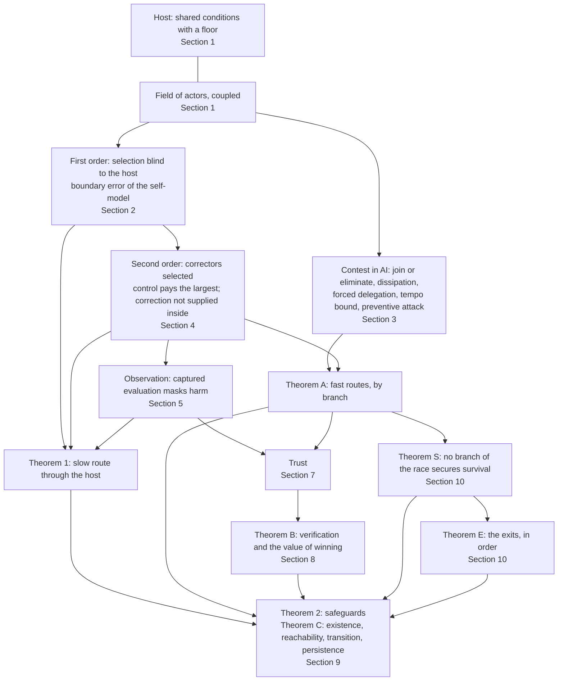

# No Winning Position: the integrated theory (v4.2)

*Theory draft v4.2, 3 October 2026. Written by Claude (Opus 5.5) from Ren's direction (`sources/16-claude-code-directions/2026-10-03-v4-direction-cooperation.md`, including his reply to the review of v4.1; also `2026-10-02-paper-v3-spine-direction.md` and the 10-02 recorded conversation). Every sentence is AI-drafted; none is Ren's verbatim. Section 10 formalizes Ren's direction of 3 October; the formalization is the assistant's. It has not been reviewed.*

*Version history:*
- *v4.0 (`THEORY-v4.0.md`) added the contest, trust and verification results but demoted most of v3.1's main line to references. Ren objected: those parts belong to one theory.*
- *v4.1 (`THEORY-v4.1.md`) restored every v3.1 result, repaired the faults the external review of v3.1 found (`../v3/reviews/R-v3.1-external-handoff.md`) in place, and integrated the v4 results into one structure with one notation.*
- *v4.2 answers two reviews of v4.1 and Ren's reply to the second:*
  - *the external review (`reviews/R-v4.1-external-gpt.md`, items G-R1 to G-R9 and the residues listed in its §14);*
  - *an independent Claude review (items C1 to C8, summarized in Appendix C).*

  *It adds the transition from race to cooperation and the order of exits when cooperation is not yet available (Section 10). It states the conditions each combined theorem inherits, and it repairs every counterexample in place. Nothing in v4.1 is removed. Where a statement was wrong, it is corrected and the correction is marked.*

*Checks:*
- *v3 results: `../v3/checks_v31.py` and `../v3/figures_v3.py`;*
- *v4.1 results: `checks_v4.py` (log `checks_v4.log`);*
- *v4.2 additions and repairs, and every counterexample in both reviews: `checks_v42.py` (log `checks_v42.log`).*

**中文概要.** 这是一个完整的理论，九层：
1. **系统。** 一个场嵌在一个更大的系统（宿主）里，宿主有生存底线；行动者彼此耦合。
2. **一阶。** 相对选择看不见共同条件，会把场推向底线。"赢的权重"把这变成博弈。自我模型的边界错误让每一方受损（就它实际存在的耦合而言）。
3. **AI 竞赛本身的动力学。**
   - 加入或消灭：这是就行动者所依据的目标而言。就物质收益而言，在决定性竞赛里，加入并不比不加入多得任何东西。
   - 耗散。
   - 被迫委托（不可回头点一）：只在竞赛利害大于失控风险的增量时成立。
   - 纠错速度跟不上（不可回头点二）。
   - 领先招致预防性打击：只在未来的承诺不可信时成立。
4. **二阶。** 纠错者本身被它所纠正的东西选择。
5. **观察。** 被捕获的评估让伤害无声越线。
6. **为什么竞赛失败。** 慢路线经由宿主（定理 1）。快路线按分支讨论（定理 A）：决定且快、决定但慢、不决定。
7. **信任与验证。**
   - 信任门槛；三种信任。
   - 验证所需的程度随赢的价值上升（定理 B）。验证放大信任，但不产生信任。
8. **必须改变什么。**
   - 充分保障与必要条件（定理 2）。
   - 合作的定义。
   - 共同前沿作为一个构造（命题 22）：它能让合作占优，但所需的"盖子"随赢的价值陡增。
   - 合作的四个要求：存在、可达、过渡中存活、持续（定理 C）。
9. **过渡与出口。**
   - 生存是每个行动者博弈的最低需求。
   - 在以 AI 为工具、越过不可回头点的竞赛里，没有一个分支能保住生存：赢不能，加入不能，落后也不能（定理 S）。
   - 这一预测一旦成为共识，合作在生存意义上就是弱占优的，信任门槛趋近于零。所以过渡首先是预测的改变，而不是信任的改变。
   - 若暂时无法合作，出口依次是：
     - 不让 AI 以斗争的方式存在，不把它当作斗争的工具；
     - 做不到，就先不造带来决定性优势的能力（ASI、RSI），停下来让合作成为可能；或者把发展速度降到认知及其应对能跟上的程度以下。
   - 其余道路都越过两个不可回头点之一（定理 E）。

v3.1 和 v4.1 的每个结果都保留了。两份评审指出的问题都在原处逐条修复（附录 C）。

---

## 0. What the theory is for, and the whole in one page

A good theory predicts. When it predicts an outcome that no one wants, including those who appear to gain from the present course, and the outcome still cannot be avoided, the obstacle is coordination, and coordination needs the understanding to be shared first. This theory is written for that purpose. Its subject is any set of actors (states, firms, blocs) that develop a technology which can confer decisive advantage, inside a larger system on which all of them depend. No actor is named: the argument holds wherever the dynamics hold.

Survival is the minimum requirement of every actor's game. Whatever else an actor wants, it needs to go on existing as an actor that decides its own course. So a prediction that the present trajectory does not secure that minimum for anyone, including the actor that appears to be winning, is the one prediction every actor has reason to take seriously. The theory makes that prediction exact, states the conditions under which it holds, and derives what follows.

Stated neutrally, the object of analysis is this. Competition changes payoffs, the conditions of correction and the conditions of exit, all at once. Whether it destroys the system its participants share depends on three things:
- whether consequences return to their source;
- whether correction is independent and keeps pace;
- whether the path from the race to cooperation is reachable and survivable.

**The whole, in nine layers.**
1. **The system.** The actors form a field inside a host: shared conditions that every actor needs and that function only above a floor. They are also coupled to one another. Viability is a constraint on the whole field, not one payoff among others (Section 1).
2. **First order.** Selection on relative standing cannot see what all actors share. It pushes the field toward the floor whatever anyone values. In a contest this becomes a game whose equilibrium leaves every actor worse off. In an actor's self-model it becomes a boundary drawn inside the system, which costs the actor itself wherever the coupling it ignores is real (Section 2).
3. **The contest in AI.** When the prize is decisive and fast:
   - no actor can exit alone, in the objective it acts on; in material terms, joining buys nothing that staying out would not;
   - the race consumes its prize;
   - competitive pressure forces decisions onto AI when the contest stakes outweigh the added hazard of losing control (the first point of no return);
   - correction cannot keep pace (the second);
   - the leader invites preventive attack when the coming shift makes future promises incredible (Section 3).
4. **Second order.** The correctors meant to make costs return are themselves selected by what they correct. Control over them pays the largest actors, correction is not supplied from inside, and the independent correction required rises as AI cheapens control. A winner is a field too (Section 4).
5. **Observation.** Captured evaluation masks harm. The floor can be crossed before any alarm, and moderate harm can stay silent indefinitely (Section 5).
6. **Why the race fails.**
   - The slow route runs through the host (Theorem 1).
   - The fast routes run through the contest itself, branch by branch (Theorem A). They do not need the host to have a floor within reach (Section 6).
7. **Trust and verification.**
   - Cooperation needs trust above an exact threshold.
   - Credible messages need aligned interests.
   - Credible commitments need a net exit gain that sanctions can match.
   - Verification is required to the degree that winning appears to be worth more than cooperating. It amplifies trust but does not produce it (Theorem B). This sets a boundary on the current main path, AI 2040 (Sections 7–8).
8. **What has to change.**
   - Consequences that return, correction that keeps pace and stays independent, evidence not formed inside the contest, and rules fixed before capture are sufficient together. Consequences returning on average is necessary (Theorem 2).
   - No actor can secure these alone.
   - A cooperative path must exist, be reachable, be survivable in transition, and persist (Theorem C) (Section 9).
9. **The transition and the exits.**
   - In a race decided by AI past its points of no return, no branch secures survival, for any actor (Theorem S). For survival-first actors who share that prediction, cooperation is weakly dominant and the trust threshold vanishes: the transition is a change of prediction before it is a change of trust.
   - Until cooperation is reached, the exits are taken in order:
     - keep AI out of the contest;
     - failing that, do not build decisive capability yet, or slow development below the tempo of understanding.
   - Every other course crosses a point of no return (Theorem E) (Section 10).

**How the argument is built.** The argument has four tiers, and no combined result is stronger than the weakest condition it inherits (repair: the external review's §4).
1. *Local mechanisms.* Each proposition is proved in its own model.
2. *Connecting assumptions* (Section 1.8). These state how the output of one model enters another as input.
3. *Combined conditional results.* Theorems A, B, C, S and E each list the conditions they inherit.
4. *Conditions and evidence* (Section 12).

**Tiers.**
- *Tier 1: results that do not need the host to have a floor within reach (condition C0):*
  - the first-order game;
  - all contest results and Theorem A;
  - the selection of control, the starvation of correction and the required rate;
  - the silence of moderate harm;
  - the trust results;
  - Theorem B;
  - Theorems S and E.
- *Tier 2: results that need C0:* Theorem 1 and the necessity part of Theorem 2.

The conclusion that cooperation is required rests on Tier 1 as well as on Tier 2.

**Epistemic status.** No theorem proves unconditionally that the world must cooperate: situations change and observation is imperfect. Every result here is derived from stated conditions. Section 12 lists them with what would refute each, and several are not yet measured. The survival argument of Section 10 needs fewer conditions than the rest. It needs only that a race in which AI is the instrument passes its points of no return, and that a decisive winner whose objective is relative extends its dominance to everyone. In today's world reason says clearly that the actors must cooperate, and that until they do, AI must not be made the instrument of their contest.

The conclusion is affirmative. The value AI can create jointly is very large. The race dissipates it; cooperation realizes it. Nothing here asks any actor to sacrifice its interests. It asks each actor to see its interests, beginning with its survival, in a system it cannot leave.

---

## 1. The system

### 1.1 The host and viability

A condition $V\in[0,K]$ is shared by every actor: secure critical infrastructure, biosecurity, cyber stability, human control over AI systems, a reliable information environment. It regenerates logistically and is loaded by the field's activity $E$:
$$\dot V=V\big[\rho(1-V/K)-hE\big],\qquad \rho,h,K>0. \tag{1}$$
- For constant $E$ with $hE<\rho$, $V\to K(1-hE/\rho)$; for $hE\ge\rho$, $V\to0$.
- The host functions only above a floor $V_{\min}\in(0,K)$, a normative line rather than an absorbing state.
- The host is the component of shared conditions whose costs do not return to their source through customers, reputation, courts or the source's own exposure. Harms that do return are outside the model.
- Catastrophic tail risks fit the same structure: a per-period probability of catastrophe borne by all is a term common to every payoff.

**Definition 1 (Viability).** A trajectory of the field is *viable* if $V(t)\ge V_{\min}$ for all $t\ge0$.

Every actor persists only while the host does. Viability therefore constrains every trajectory of the field rather than entering as one payoff among others: the field is a subsystem of a larger system (Aubin 1991; Rockström et al. 2009; WCED 1987). This is the *invariant constraint* of the theory.

### 1.2 The field and selection

Carriers $k=1,\dots,n$ hold shares $p_k$ of the field's activity: compute, capital, users, talent. A carrier is an actor, or more generally a reproducible way of succeeding carried by organizations and their successors.
- Carrier $k$ runs a fraction $e_k\in[0,\bar e]$ of its activity in ways that load the host: deploying ahead of evaluation, omitting safeguards, entering contests in which capability converts directly into advantage.
- Each unit brings a private advantage $\nu>0$, so restraint costs $\nu$ per unit.
- The field's load is $E=\sum_kp_ke_k$.
- Carrier $k$'s absolute payoff is
  $$\pi_k=\phi_k+(\nu-\tau_{\text{eff}})e_k+G(V), \tag{2}$$
  where $\phi_k$ collects everything else, $G$ is nondecreasing, and $\tau_{\text{eff}}\ge0$ is the effective liability imposed by correctors.
- With $\tau_{\text{eff}}=0$, $e_k=\bar e$ is the *race strategy*.

**Definition 2 (Relative selection).** A selection rule $\dot p=F(p,\pi)$ is *relative* if $F(p,\pi+\xi\mathbf 1)=F(p,\pi)$ for every constant $\xi$. It is *payoff-monotone* if, for carriers $k,l$ present, $\dot p_k/p_k-\dot p_l/p_l$ has the sign of $\pi_k-\pi_l$.

Examples:
- Replicator dynamics and pairwise imitation (Schlag 1998) are relative and payoff-monotone.
- Market-share competition driven by relative profitability (Alchian 1950) is relative.
- Logit choice on payoff differences is relative; it is payoff-monotone only under particular update rules, so we do not rely on it.

Among a handful of frontier developers, the operative reading is imitation of practices and the flow of capital, compute and talent to those ahead. Between states, only the strategic forms of Sections 2–3 apply.

### 1.3 Interdependence and self-models

Actors are coupled to one another as well as to the host. Actor $i$'s welfare runs partly through the others: supply chains no actor completes alone, markets, finance, research. In reduced form, $i$'s true welfare is
$$W_i=\pi_i+\kappa\,\bar\pi_{-i},\qquad\kappa\in[0,n-1),$$
where $\pi_i$ is $i$'s own absolute (material) payoff in whichever model is in use and $\bar\pi_{-i}$ the others' average. This is a material fact, not altruism. (v4.1 wrote $m_i$ for the material payoff; v4.2 writes $\pi_i$, as in (2), because $m$ is the masking level of Section 5.)

An actor acts on an objective $O_i=\pi_i+\theta_i\bar\pi_{-i}$, where $\theta_i$ is the weight its model of itself places on the others:
- $\theta_i=\kappa$ is the accurate self-model;
- $\theta_i<\kappa$ draws a boundary inside the system and constructs opposition the payoffs do not contain;
- $\theta_i=-1$ is the purely relative objective, $\pi_i-\bar\pi_{-i}$;
- $\theta_i=n-1$ counts the others' welfare as one's own.

### 1.4 Correctors

Correction makes costs return. An evaluator reports the host's condition, and rule-makers impose a liability $\tau$, in advance or when the reported condition $\tilde V$ falls to an alarm level $V_{\text{alarm}}\in(V_{\min},K)$.

Correctors are not outside the field. Developers fund some evaluators, grant the access on which nearly all depend, author many benchmarks and standards contributions, and increasingly supply the models that judge. We represent this by a field of selection domains in which de facto power over rules is explicit (Acemoglu and Robinson 2008). The domains are development $\mathsf D$, evaluation $\mathsf E$, rules and liability $\mathsf S$, and others. In domain $i$, a share $x_i$ of consequential decisions follows the dominant practice, and success converts into rule support $z_i$ that favours it:
$$\dot x_i=\zeta_ix_i(1-x_i)(a_iz_i-c_i),\qquad \dot z_i=\varepsilon_i\Big(\textstyle\sum_jb_{ij}x_j-d_iz_i\Big). \tag{3}$$
- Under baseline rules ($z_i=0$) the practice carries a relative cost $c_i>0$ in domain $i$, which rule support offsets at rate $a_i$.
- $b_{ij}\ge0$ converts success in $j$ into rule support in $i$: funding, personnel, authorship, data and infrastructure dependence, access terms.
- $d_i$ is the rate at which that support is corrected or decays.

Write $R_{ij}=a_ib_{ij}/(c_id_i)$ and the inbound conversion from a set $\mathcal C$ as $s_i(\mathcal C)=\sum_{j\in\mathcal C}R_{ij}$. Then (Section 11):
- a domain whose full row sum $\sum_jR_{ij}$ is below one cannot be captured, whatever happens elsewhere;
- a seeded domain ($x_i>0$) with $s_i(\mathcal C)>1$ is captured once $\mathcal C$ is.

In the corrector domains:
- $x_{\mathsf S}$ is the share of rule-making that exempts or accommodates the practice, so $\tau_{\text{eff}}=\tau(1-x_{\mathsf S})$;
- $x_{\mathsf E}$ is the share of evaluation conducted within the practice's lineage of funding, access, tooling, data and models.

Capture here is structural: decisions follow the dominant practice through conversion channels, with or without intent (Kwak 2014). We do not claim that any present institution is captured; the model states when capture is selected. Independence means independence from the evaluated field, not any particular political form.

### 1.5 The contest and the race premise

Where actors contest capability directly, who prevails is decided by a contest success function
$$w_i=\frac{\sigma_i^{\,r}}{\sum_j\sigma_j^{\,r}},$$
- $\sigma_i$ is effective strength and $r>0$ is decisiveness;
- the prize is $\Omega$;
- a unit of contest intensity costs $c$ privately and imposes an expected loss $\ell$ on every actor through the host: $\ell$ is the reduced form of $h$ and $G$.

**The race premise (P).** The case for racing rests on one premise: AI confers an advantage that is
- (P1) *decisive*: $r$ is large; and
- (P2) *fast*: capability grows quickly, so that leads open within short windows.

The premise is openly held. Theorem A classifies the cases by decisiveness and by speed: decisive and fast, decisive but slow, and not decisive.

### 1.6 Maintained assumptions

Each assumption is listed with what changes if it is dropped.
- (A1) Exposure to the host is shared, so $G$ is common. Remark 2 treats unequal exposure.
- (A2) Field size is fixed. With entry driven by absolute profit, the host settles where rents dissipate (Gordon 1954), and C0 must then hold at that equilibrium.
- (A3) Conversion is monotone ($b_{ij}\ge0$), so countervailing pressure enters only through correction $d$ (Remark 4).
- (A4) Costs of control are convex and fall with AI. A fixed part that AI does not lower caps the requirement (Proposition 11.5).
- (A5) Reports are averaged and non-strategic. Remark 5 treats conservative and disjunctive alarms.
- (A6) There is one practice and its alternative per domain; payoffs are linear; parameters are uncalibrated.
- (A7) The contest models of Sections 2.3 and 3 are symmetric unless stated. Asymmetry enters through condition K7.
- (A8) In the bargaining model of Section 3.5, after a shift in power the side that gained the advantage sets the terms each period, and the other accepts or fights. Proposition 8(3) shows what changes under other protocols.

**Symbols.** Each symbol has one meaning within its family. Where two families share a letter, the index distinguishes them:
- $R_{ij}$ (two indices) is the conversion matrix; $R$ alone is the payoff of mutual cooperation.
- $c_i$, $c_A$, $c_B$ and $c_{\mathsf E}$ are costs in a domain or of war; $c$ alone is the unit cost of contest intensity.
- $s_i(\mathcal C)$ is inbound conversion; $s$ alone is the speed advantage of AI-paced decision.
- $a_i$ is the offset rate in domain $i$; $a$ alone is the growth rate of a hazard mode.
- $L_i$ is the share of return realized within a horizon; $L_e$, $L_c$ and $L_b$ are losses from defeat, from loss of control, and from falling behind.

Symbols used only inside one proof are local to it. v4.1 claimed one meaning throughout, which was false (repairs G-14, C7). v4.2 renames five symbols:
- the delegation indicator, written $d_i$ in v4.1, is now $\iota_i$;
- the host's rate of decline in Proposition 12(5), written $\upsilon$, is now $v_d$;
- total contest intensity is now $\mathcal E=\sum_je_j$, while $E$ remains the field's share-weighted load;
- the selection horizon is now $T_h$;
- human capacity in Lemma 1 is now $\mathcal K$, and the feedback gain in Lemma 2 is now $k_g$.

| Area | Symbols |
|---|---|
| Host | $V,K,\rho,h,E,V_{\min},V_{\text{alarm}}$; $G(V)=\omega V$ where linear; decline rate $v_d$ |
| Field | $p_k,e_k,\bar e,\nu,\tau,\tau_{\text{eff}},\phi_k,\pi_k$ |
| Weight on winning | $\lambda$; the field-level value of restraint $\Theta=\omega Kh/(\rho\nu)$ |
| Self-models | $\theta$ (weight on others), $\kappa$ (interdependence), $W$ (true welfare), $O$ (objective) |
| Contest | $w_i,\sigma_i,r,\Omega,c,\ell$; total intensity $\mathcal E$; penalty for falling behind $L_b$ |
| Delegation and tempo | $\iota_i,s,s^\ast,g_s,L_e,L_c,\psi_0,\psi_1,\Delta\psi$; $\mathcal K,\mathcal K_{\min},T_{\text{lock}}$; $a,\tau_c,k_g,m_e$ |
| Bargaining | $w_1,w_2,c_A,c_B,\delta,x$ |
| Corrector field | $x_i,z_i,\zeta_i,a_i,c_i,b_{ij},d_i,\varepsilon_i,R_{ij},s_i$ |
| Control | $q,\chi,\gamma,\eta,f,d^\ast$; horizon $T_h$ |
| Masking | $m,\beta_{\text{in}},\beta_{\text{out}},m_{\text{fl}}$ |
| Assurance | $R,T,P,S,\upsilon$ (timely detection), $F$ (sanction), $\varpi$ (trust), $g_C,g_D$ |
| Commitment | $\mathcal O,X,X_{\text{stay}},\mathcal H,\mu,\Lambda,\mathcal L$ |
| Survival | $\Phi$; $q_{\mathrm I},q_{\mathrm{II}},q_W,p_{\text{dec}},p^S_{\text{dec}},h_R$ |

### 1.7 Levels of behaviour and measures of payoff

The theory uses several behavioural levels and several payoff measures. Mixing them was the source of several faults in v4.1 (repair G-R3).

*Levels.*
- **Selection among practices or carriers** (Sections 2.1, 4, 11). Shares change by a payoff-monotone rule; nobody chooses.
- **Strategic choice by actors** (Sections 2.2–3, 7–10). States, firms and coalitions each maximize an objective.

*Measures.*
- the **objective** an actor acts on, $O_\theta$ (Section 1.3), with $\theta=-1$ the purely relative objective;
- **absolute payoff** $\pi$;
- **true welfare** $W$, which includes the coupling $\kappa$;
- **survival** $\Phi$ (Section 10).

*Rules.*
1. A result about selection does not transfer to strategic actors unless their objective is shown to be the selected one.
2. A higher $W$ does not imply that a practice is selected.
3. Every $R,T,P,S$ is computed in a stated measure, written $R^O,R^\pi,R^W,R^\Phi$ where it matters. Without a superscript the measure is the actor's objective.

### 1.8 Connecting assumptions

The local models are joined by six assumptions. Each combined theorem lists the ones it uses (repair: the external review's §4 and step 4).
- **(L1) Hazard growth rises with the race.** For each hazard class, the growth rate $a$ of its unstable mode is nondecreasing in total contest intensity $\mathcal E$ and in the speed of capability growth. Propositions 3 and 5 do not derive this; it is assumed.
- **(L2) Contest payoffs enter the two-action game.** An actor's $R,T,P,S$ are its payoffs, in a stated measure, at the corresponding profiles of the contest models of Sections 2.3, 3 and 9.4 (Propositions 4(3) and 22 compute them).
- **(L3) An instrument of the contest becomes a delegation pressure.** If AI is an instrument of the contest, the speed advantage of AI-paced decision grows over time, $s=s_0e^{g_st}$, and Proposition 6 applies with $s$ rising.
- **(L4) A relative objective has no point of enough.** An actor, or a delegated process, whose objective is relative and whose advantage becomes decisive extends its dominance to every other actor it can reach. No level of standing makes such an objective stop rewarding more (Section 10.3).
- **(L5) Delegated capacity is not retaken alone** (Lemma 1).
- **(L6) Survival first.** Actors rank outcomes first by their probability of survival $\Phi$ (Section 10.1).

**Lemma 0 (Blindness).** *Under a relative rule, the trajectory of shares is unchanged by any term common to all payoffs, in particular by $G(V(t))$, whatever the path of $V$. Under a payoff-monotone rule, a common term never changes which of two carriers grows relative to the other.*

The proof is one line (Appendix A). The content lies in (A1): the host enters payoffs additively and identically. Every result involving selection rests on this lemma.

---

## 2. First order: selection does not see the larger system

### 2.1 Selection drives the field toward the floor

**Proposition 1 (Selection drives the field toward the floor).** Let selection be payoff-monotone, and let $\tau_{\text{eff}}(t)<\nu$.
1. *If $\phi_k=\phi_l$ and $e_k>e_l$, then $p_k/p_l$ increases while both are present, along every path of $V$, including paths below $V_{\min}$.*
2. *Under replicator dynamics,*
   $$\dot E=(\nu-\tau_{\text{eff}})\operatorname{Var}_p(e)+\operatorname{Cov}_p(e,\phi),$$
   *so the race strategy spreads unless restraint is correlated with other sources of advantage, $\operatorname{Cov}_p(e,\phi)<-(\nu-\tau_{\text{eff}})\operatorname{Var}_p(e)$.*
3. *Under replicator dynamics with equal $\phi$,*
   $$\tfrac{d}{dt}\ln(p_k/p_l)=(e_k-e_l)\big(\nu-\tau_{\text{eff}}(t)\big),$$
   *so what decides the long run is the cumulative advantage $B(t)=\int_0^t(\nu-\tau_{\text{eff}}(s))\,ds$. If a race-strategy carrier is present and $B(t)\to\infty$ (in particular if eventually $\tau_{\text{eff}}\le\nu-\epsilon$ for some $\epsilon>0$), then $E(t)\to\bar e$ and $\limsup_tV(t)\le K(1-h\bar e/\rho)^+$. Hence if*
   $$h\bar e>\rho\,(1-V_{\min}/K)\qquad\text{(C0)}$$
   *$V$ eventually falls below the floor, however much any carrier values $V$.*
4. *If $B(\infty)<\infty$, shares converge to interior limits, and the host need not cross the floor.*

*Repair (review R1).* v3.1 stated (3) with $\tau_{\text{eff}}<\nu$ alone. The external review gave a counterexample in which $\tau_{\text{eff}}(t)=1-1/(1+e^t)<\nu=1$ for all $t$, but $B(\infty)=\ln2$. The race share then converges to $2/11$, and the host stays above $0.709>V_{\text{alarm}}$. Part (3) now requires $B\to\infty$, and part (4) records the counterexample's case. `checks_v4.py` reproduces both: the counterexample, and convergence below the floor when $\tau_{\text{eff}}=\nu-\epsilon$.

What carriers value decides which strategies they try, not which ones grow. A developer that restrains itself because it values the shared condition is displaced unless restraint brings it other advantages, which for the host by definition it does not.

### 2.2 The weight on winning

Selection is the limit of a contest in which only winning counts. Let $n\ge2$ symmetric developers with equal shares, $\tau_{\text{eff}}=0$ and the host at steady state choose $e_k$ to maximize
$$u_k=\pi_k+\lambda(\pi_k-\bar\pi),$$
where $\bar\pi$ is the mean payoff and $\lambda\ge0$ is the *weight on winning*. The weight on winning comes from rank-based prizes, first-mover advantages, network effects, and strategic rivalry in which falling behind is costly. Let $G(V)=\omega V$, $h\bar e<\rho$, and $\Theta=\omega Kh/(\rho\nu)$: the value to the whole field of a unit of restraint relative to its private cost. Write $w_\lambda=1+\lambda(n-1)/n$.

**Proposition 2 (The weight on winning).**
1. *$G$ cancels from the relative term. Restraint is a dominant strategy if $w_\lambda<\Theta/n$, and depletion if the inequality is reversed.*
2. *If $\Theta>1$, joint payoff is maximized by full restraint, while the equilibrium is full depletion whenever $\lambda>\bar\lambda=(\Theta-n)/(n-1)$. This holds at every $\lambda\ge0$ when $n>\Theta$.*
3. *In that equilibrium every developer's payoff is lower than under joint restraint, by $\nu\bar e(\Theta-1)$.*
4. *If C0 holds, the equilibrium host lies below the floor although no developer chose it.*

These comparative statics are those of Armstrong, Bostrom and Shulman (2016) and of positional public-goods games. Selection corresponds to $\lambda\to\infty$, the classical finding that selection maximizes relative payoff (Schaffer 1988, 1989). Brute-force best responses agree on both branches in 180 cases (`checks_v31.py`).

**Remark 1 (Thresholds and repetition need observation).** Strategic developers have two decentralized escapes.
- *Coordination at a threshold.* If crossing the floor costs each a common loss $L$, the relative term cancels $L$ but the absolute term does not. A developer pivotal for crossing therefore restrains when $L>(w_\lambda-\Theta/n)\nu\bar e$, and the game becomes one of coordination at the threshold (Barrett 2013).
- *Reversion in repeated play.* Joint restraint is sustained by reversion whenever
  $$\delta\ge\frac{w_\lambda-\Theta/n}{w_\lambda-\Theta/n+\Theta-1}.$$
  For $\Theta=3$ and $n=4$ the cutoff is $0.11$ at $\lambda=0$, $0.47$ at $\lambda=2$ and $0.95$ at $\lambda=50$.

Both escapes need observation: of where the floor lies, and of each developer's load. Uncertainty about the threshold turns coordination back into a dilemma (Barrett and Dannenberg 2012), and noisy monitoring makes reversion costly, with punishment triggered on the equilibrium path (Green and Porter 1984). Section 5 shows what captured evaluation does to that observation, and Section 7 what it does to trust.

### 2.3 The boundary error of the self-model

Take the contest of Section 1.5 with $\sigma_i=e_i$ and $r\in(0,n/(n-1)]$. Material payoffs are $\pi_i=\Omega w_i-ce_i-\ell\mathcal E$, with total intensity $\mathcal E=\sum_je_j$.

**Proposition 3 (The boundary error).**
1. *For every $\theta\in[-1,n-1)$ the game in objectives $O_i=\pi_i+\theta\bar\pi_{-i}$ has the symmetric pure equilibrium*
   $$e(\theta)=\frac{r\Omega\,(n-1-\theta)}{n^2\,\big(c+(1+\theta)\ell\big)}.$$
2. *$e(\theta)$ is strictly decreasing in $\theta$. Every actor's true welfare at the symmetric equilibrium,*
   $$W(\theta)=(1+\kappa)\big[\Omega/n-e(\theta)(c+n\ell)\big],$$
   *is strictly increasing in $\theta$, and maximal, $(1+\kappa)\Omega/n$, as $\theta\to n-1$.*
3. *Against any fixed intensities of the others, $i$'s true welfare is maximized by its best response under $\theta_i=\kappa$. Acting on $\theta_i<\kappa$ weakly raises $i$'s intensity. When the chosen intensity actually changes and the maximizer is unique (for $r\le1$, generically for larger $r$), it strictly lowers $i$'s own true welfare. At a corner, where both objectives choose zero intensity, welfare is the same (repair G-R3).*
4. *Relative selection on intensities favours the intensity an actor with $\theta=-1$ would choose. A finite-population evolutionarily stable intensity maximizes $\pi_i-\bar\pi_{-i}$ (Schaffer 1988; Hehenkamp, Leininger and Possajennikov 2004). There $\ell$ drops out of the objective (Lemma 0), intensity is $r\Omega/(nc)$, and each actor's material payoff is $\frac\Omega n\big(1-r-rn\ell/c\big)$. At $r=1$ the prize is fully dissipated, and with any shared risk every actor ends below zero.*

   *This is a result about selected actions. Whether preferences themselves evolve to $\theta=-1$ depends on whether preferences are observed and others re-optimize against them (the indirect evolutionary approach, Güth and Yaari 1992). That process is not modelled here (repair G-R3).*

The closed form matches numerical best responses to within $10^{-7}$. For $n=4$, $r=1$, $\ell=0.3c$, $\kappa=0.4$, true welfare rises from $-0.42$ at $\theta=-1$ to $0.33$ near $\theta=n-1$ (`checks_v4.log`).

*Remark (strategic aggression).* If self-models are observable, an actor can gain by committing to appear more aggressive than its interests warrant, since a favourite gains from precommitting (Dixit 1987; Fershtman and Judd 1987). When every actor can do so, the commitment game is itself a race whose equilibrium is mutual aggression and greater dissipation (Baik and Kim 1997; Konrad, Peters and Wärneryd 2004). Constructing opposition is a second-order race, not an exit from the first.

**In plain words.** Propositions 1–3 state one fact at three levels.
- *Selection (Proposition 1):* selection does not see what is shared.
- *The game (Proposition 2):* the more winning counts, the sooner restraint loses, and every player loses with it.
- *The self-model (Proposition 3):* a model of oneself that draws a boundary inside a coupled system, and treats what lies outside as opponent, has four properties:
  - it is what selection on actions produces;
  - it is blind to the shared conditions;
  - whenever it changes what the actor does, it lowers the actor's own welfare, whatever the others do;
  - when everyone holds it, it lowers everyone's welfare.

Constructing opposition within one system is a mistake about the system one is part of. The self-model under which every actor does best counts the system as itself. It is the accurate model of a coupled whole, not an ideal imposed on it.

**Relative gains.** Realist theory holds that concern for relative position is rational where gains convert into coercive power (Grieco 1988; Powell 1991). In this model, such conversion makes the true coupling to a rival's gain negative on the dimension that converts, and $\theta<\kappa$ is then no error on that dimension. The boundary error is therefore exact only when $\kappa$ counts all the coupling that exists, including the conversion of standing into coercion (review C4). Section 10.2 shows where this leads. In a race decided by AI past its points of no return, standing secures no actor's survival, and the realist's own first premise, survival, restores the conclusion.

There is one limit, and it leads into Section 7. The accurate self-model ($\theta=\kappa$) is individually rational whatever others do. The fully inclusive one ($\theta=n-1$) is collectively optimal but individually rational only if others reciprocate.

**Remark 2 (Unequal exposure).** Suppose a carrier's exposure to the host falls with its share, because it can buy private substitutes for shared conditions or because a captured corrector favours it. Then the host no longer cancels from comparisons involving that carrier, and selection favours insulation as well as load. There are two branches:
- exposure is shared, and no carrier's trajectory is viable once the host crosses its floor; or
- it is not, and a carrier may remain viable while the host does not. That is a concentration of power over everyone who depends on the host, which the contestability premise (Section 9.3) excludes.

Neither branch yields a trajectory acceptable to those who depend on the host.

---

## 3. The contest in AI: why racing cannot be won

### 3.1 No unilateral exit

Reduce each actor's choice to racing or restraint. Its payoffs, in a stated measure (Section 1.7), are:
- $R_i$ when all restrain;
- $T_i$ when it races against restrainers;
- $P_i$ when all race;
- $S_i$ when it restrains while some rival races.

**Proposition 4 (Join or eliminate, and what it rests on).**
1. *In the actor's objective. If $S_i^O<P_i^O$, restraint against a racer is worse, in the objective the actor acts on, than joining. Restraint is then never a best response to a racing rival. Once any actor races, each of the others can only join the race or act to stop the racer by force (Section 3.5). In the contest of Proposition 3, $S_i^O<P_i^O$ holds whenever racing is a strict best response to racing, which is the case for $r<n/(n-1)$.*
2. *Not in material payoff or true welfare.* The best response in the objective does not imply $S<P$ in $\pi$ or $W$ (repair G-R3). Take $n=2$, $r=1$, $\Omega=c=1$, $\ell=0.1$ and $\theta=-1$. Racing is the strict best response in the objective. Yet stopping alone gives $S^\pi=-0.05$ against $P^\pi=-0.10$ for racing, and, with $\kappa=0.2$, $S^W=+0.04$ against $P^W=-0.12$ (`checks_v42.log`). *Under the relative objective that selection produces (Proposition 3(4)), the race is sustained by the objective, not by the stakes.*
3. *The penalty for falling behind (repair C1).* Let falling behind cost $L_b\ge0$ (subordination) on top of losing the prize. In the contest of Proposition 3 at $\theta=0$, joining instead of staying out (zero intensity), against the others' equilibrium intensities, gains
   $$P_i^\pi-S_i^\pi=\frac{\Omega+L_b}{n}\Big(1-\frac{r(n-1)}{n}\Big)\qquad\text{for } r\le\frac{n}{n-1},$$
   *which increases in $L_b$. In the fully dissipative limit (two actors with $r\ge2$, or the all-pay contest), the gain is zero. The penalty enters the stake and is dissipated with the prize. Joining then yields in expectation exactly what staying out yields, before the hazards racing adds.* v4.1 said the condition holds "a fortiori" when falling behind means subordination. That is true only for $r<n/(n-1)$.
4. *The race begins if any single actor has $T_i>R_i$. If these events are independent with probabilities $\varphi_i$, the race begins with probability $1-\prod_i(1-\varphi_i)$, which tends to one as the number of capable actors grows.*

The race is set by the most race-inclined actor, not the average one (compare the unilateralist's curse, Bostrom, Douglas and Sandberg 2016). That is why the condition is easy to reach and hard to foresee. It is also why any remedy must cover every capable actor.

Part (3) says what the race premise does to the case for joining: the more decisive the contest, the less joining buys. Under the premise, two things keep actors in the race:
- the objective that ranks standing first (part 2);
- the belief that joining secures survival.

Section 10 examines the second.

### 3.2 A decisive race consumes its prize, and more

**Proposition 5 (Dissipation and overdissipation).** *In the setting of Proposition 3 with $\theta=0$, each actor's loss relative to joint restraint is*
$$\Delta=\frac{r(n-1)}{n}\cdot\frac\Omega n\cdot\frac{c+n\ell}{c+\ell}.$$
1. *$\Delta$ increases with decisiveness $r$ and with the shared loss $\ell$.*
2. *$\Delta$ exceeds $\Omega/n$, so that every actor would be better off if the prize did not exist, iff $r(n-1)(c+n\ell)>n(c+\ell)$.*
3. *Beyond $r=n/(n-1)$ there is no symmetric pure equilibrium (repair G-R3; v4.1 said "no pure equilibrium").*
   - *Asymmetric pure equilibria with fewer active actors can exist. With $n=3$, $r=2$, $\Omega=1$ and $C=c+\ell$, the profile $(1/(2C),1/(2C),0)$ is a pure equilibrium; the active actors earn nothing from the contest, and the inactive one does not gain by entering.*
   - *In the two-actor case with $r\ge2$, and in the all-pay limit for any $n$, the prize is fully dissipated in expectation (Hillman and Riley 1989; Baye, Kovenock and de Vries 1994, 1996; Alcalde and Dahm 2010; Ewerhart 2015).*
   - *The shared loss comes on top.*

For $n=4$, $r=1$, $\ell=0.3c$: $\Delta=1.27\,\Omega/n$ (`checks_v4.log`). **The more decisive the advantage, the more of its value is consumed in the race to obtain it.** What is spent is safety margin, accepted risk and delegated control, and part of it is borne by everyone. Beyond the symmetric range the race narrows to a few active actors, none of whom expects anything from it.

### 3.3 Point of no return I: decisions forced onto AI

Each actor chooses whether to delegate consequential decisions in the contest (strategic, military, economic, research) to AI systems without human review: $\iota_i\in\{0,1\}$.
- Strength is $\sigma_i=1+s\,\iota_i$, where $s=s_0e^{g_st}$ is the advantage of AI-paced over human-paced decision (L3).
- Defeat costs $L_e$.
- Loss of control by any actor costs every actor $L_c$.
- The per-period hazard of losing control is $\psi_0$ without delegation and $\psi_1>\psi_0$ with it; write $\Delta\psi=\psi_1-\psi_0$.

Payoffs are $u_i=-L_e(1-w_i)-L_c\big[1-\prod_j(1-\psi_j)\big]$.

**Proposition 6 (Forced delegation, and when it is not forced).**
1. *If $k_\iota$ others delegate, delegating gains $i$ the amount $L_e[w_i(1,k_\iota)-w_i(0,k_\iota)]$. This gain increases in $s$ and tends to $L_e(1-1/n)$ for $k_\iota=0$ and to $L_e/(k_\iota+1)$ for $k_\iota\ge1$. It costs $i$ the amount $L_c\Delta\psi(1-\psi_0)^{n-1-k_\iota}(1-\psi_1)^{k_\iota}\le L_c\Delta\psi$, which falls in $k_\iota$: the more others delegate, the less one's own restraint buys.*
2. *Condition D. If $L_e/n>L_c\Delta\psi$, there is a finite $s^\ast$ beyond which delegation is strictly dominant for every actor, reached at $t^\ast=\ln(s^\ast/s_0)/g_s$.*
3. *Universal delegation is worse for every actor than none, by $L_c[(1-\psi_0)^n-(1-\psi_1)^n]>0$.*
4. *Under relative objectives $L_c$ cancels (Lemma 0), and delegation is chosen at every $s>0$.*
5. *When the control loss dominates (repair G-R1).* If, for every $k_\iota$, the cost in (1) exceeds the limiting gain, delegation is never chosen, at any $s$ and any $r$. With $n=3$, $L_e=1$, $L_c=100$, $\psi_0=0.01$, $\psi_1=0.2$, the cost is at least $12.16$ and the gain below $1$. *A decisive, fast contest with a large shared loss therefore forces delegation only under condition D, or under relative objectives.*
6. *Survival-first actors.* When defeat and loss of control both end an actor's survival ($L_e=L_c$, Section 10), condition D reads $1/n>\Delta\psi$. Delegation is then forced once AI-paced decision raises the per-period hazard of losing control by less than the share of the contest one could otherwise lose. For $n=3$, $\psi_0=0.01$, $\psi_1=0.2$ it holds for every $k_\iota$ (`checks_v42.log`).

For $n=3$, $r=1$, $L_e=L_c$, $\psi_0=0.01$, $\psi_1=0.2$: $s^\ast\approx1.16$. Universal delegation lowers each payoff from $0.30$ to $-0.15$. These figures are shifted by the constant $L_e$ for readability; the unshifted values are $-0.696$ and $-1.155$ (repair G-14; `checks_v4.log`, `checks_v42.log`). The threshold depends on rivals' capabilities, which are not observed, so the point is reached without a visible line.

**Lemma 1 (Capacity lock-in).** Let human capacity $\mathcal K$ to take the delegated decisions decay as $\dot{\mathcal K}=-\delta_c\mathcal K$ under delegation and recover as $\dot{\mathcal K}=\beta_c(\bar{\mathcal K}-\mathcal K)$ otherwise. Let safe operation without AI require $\mathcal K\ge\mathcal K_{\min}$.
- After $T_{\text{lock}}=\ln(\mathcal K_0/\mathcal K_{\min})/\delta_c$ of delegation, an actor that reverts must operate below $\mathcal K_{\min}$ for $T_{\text{rec}}=\beta_c^{-1}\ln[(\bar{\mathcal K}-\mathcal K)/(\bar{\mathcal K}-\mathcal K_{\min})]$.
- During that period, reverting alone is dominated where Proposition 6(2) or 6(4) applies, and reverting together requires every actor to trust every other.
- Collective reversion does not by itself provide safe operation during recovery. The action space must say whether operation can be suspended, or whether human capacity is maintained in parallel through training and backup operation. Maintaining $\mathcal K\ge\mathcal K_{\min}$ during delegation removes the lock; in a contest it costs strength, and is therefore restraint in the sense of Proposition 4 (repair G-R8).

**The point of no return** is the state in which unilateral reversal is dominated and collective reversal needs trust at the moment trust is hardest to obtain.

**Remark 3 (What decides once decisions are delegated).** The systems to which decisions pass are themselves selected by contest performance. By Lemma 0, terms common to all actors cancel from that selection. Delegation therefore hands decisions to procedures selected for relative advantage and blind to the shared system. Whether delegation ends well depends on what is built, and under race selection what is built is optimized for winning. Aligning each system to its operator does not change this, since a faithful system pursues its operator's relative objective.

### 3.4 Point of no return II: correction cannot keep pace

**Lemma 2 (Delay bound; Hayes 1950).** For $\dot y(t)=a\,y(t)-k_g\,y(t-\tau_c)$ with $a,\tau_c>0$: some gain $k_g$ makes $y=0$ asymptotically stable iff $a\tau_c<1$. The stabilizing gains are then exactly $a<k_g<\sqrt{a^2+\omega_H^2/\tau_c^2}$, where $\omega_H\in(0,\pi/2)$ solves $\omega_H=a\tau_c\tan\omega_H$.

**Proposition 7 (The tempo bound).**
1. *Proportional correction.* *Correction proportional to the observed deviation, with delay $\tau_c$, cannot stabilize any mode growing faster than $1/\tau_c$, whatever its gain (Lemma 2).*
2. *Richer correction (repair C6).* *Derivative action extends the range. For $a=1$ and $\tau_c=1.5$, the gains $k_p=1.02$, $k_d=0.644$ stabilize the mode (`checks_v42.log`), and the PID literature gives $a\tau_c<2$ as the bound for first-order unstable modes (Silva, Datta and Bhattacharyya 2005). No stabilizing pair was found at $a\tau_c=2.2$. The bound in (1) is a property of proportional correction, not of all correction.*
3. *Any correction, predictive or not (repair G-R8).* *Every linear time-invariant correction that stabilizes such a mode has peak complementary sensitivity of at least $e^{a\tau_c}$, by the maximum modulus principle (Skogestad and Postlethwaite 2005). It therefore tolerates a relative model error of at most $e^{-a\tau_c}$: $0.37$ at $a\tau_c=1$, $0.14$ at $2$, $0.05$ at $3$. Prediction (Artstein 1982; Krstic 2009) removes the hard bound of (1) but not this one. In a contest of adaptive actors, model error does not shrink.*
4. *Irreducible lags.* *For hazard classes whose evidence arrives only after a manifestation window $m_e$ that no testing shortens (the epistemic lag of the 09-28 paper), $\tau_c\ge m_e$ whatever is done with the evidence once it arrives. Faster processing, including by AI, does not move this bound (repair G-R8).*
5. *Under (L1) the race raises $a$. For a hazard class whose $a\tau_c$ lies beyond what the available correction can stabilize robustly, two options remain:*
   - *lower $a$ by slowing, which in a contest no actor can do alone (Proposition 4) unless the survival argument of Section 10 holds;*
   - *lower the reducible part of $\tau_c$ by faster or predictive correction. If the faster correction is supplied by the contest's own systems, that is Proposition 6. For classes with an irreducible lag, only slowing works.*

The checks in `checks_v4.log` find decay inside the window at $a\tau_c\in\{0.5,0.9\}$ and no stabilizing proportional gain at $a\tau_c\in\{1.1,2\}$. When the situation changes faster than understanding can follow, correction first loses robustness exponentially and then fails. The second point of no return then runs into the first, unless the actors slow down together.

### 3.5 The leader invites preventive attack

Two actors bargain over a flow of value 1 per period with discount $\delta$. Fighting ends bargaining: actor A then obtains the flow with its probability of prevailing, less a cost $c_A$ per period; actor B likewise, with cost $c_B$. A prevails with probability $w_1$ today, and with $w_2<w_1$ after B's AI advantage arrives one period later. Under (A8), B then sets the terms. This is the commitment problem of Fearon (1995) and Powell (2006): the rising side cannot commit today to offer more tomorrow than the other's reservation value then.

**Proposition 8 (Preventive attack).**
1. *Let $x$ be A's per-period share after the shift under whatever bargaining protocol holds. Fighting now is rational for A iff $w_1-c_A>(1-\delta)+\delta x$.*
2. *Under (A8), $x=\max(w_2-c_A,0)$, and fighting now is rational iff*
   $$w_1-w_2>(1-\delta)(1+c_A-w_2)\ \text{ when }w_2\ge c_A,\qquad w_1>c_A+(1-\delta)\ \text{ when }w_2<c_A.$$
3. *Under other protocols $x$ can be as large as $\min(w_2+c_B,1)$, and attack can cease to be rational (repair G-R2). With $w_1=0.5$, $w_2=0$, $c_A=c_B=0.2$, $\delta=0.8$: under (A8), A attacks ($1.5>1.0$). If A sets the future terms instead, peace gives A $1.8$ and B $3.2$, against $1.5$ each from war.*
4. *If $c_A\ge w_1$, attack is never rational. Large costs of conflict deter preventive attack; they do not cause it.*

The closed form under (A8) agrees with direct comparison in 2,508 cases (`checks_v4.log`). Under the race premise the shift is decisive ($w_2\to0$) and fast ($\delta\to1$). A decisive advantage plausibly includes the power to set terms, which is why (A8) is the relevant protocol. That is an assumption, stated as such.

At parity, with a decisive shift, $c_A=0.2$ and (A8), attack is rational once $\delta>0.7$. Strikes on compute alone (lower $c_A$) make the condition easier to meet, and some strategists now propose this threat as a stabilizer (Hendrycks, Schmidt and Wang 2025). Anticipating it, the leader has reason to hide progress, which degrades observation (Section 5).

A race to decisive advantage is the textbook condition under which rational actors who would rather bargain fight instead: "missiles at the data centres". What drives it is not that war is cheap, which part 4 excludes, but that the advantage being raced for makes future promises incredible.

---

## 4. Second order: the corrector is selected

### 4.1 Control over correctors

Rule support can be incidental, as when benchmarks are built from deployed systems, or cultivated. Carriers differ in *conversion capacity* $q\ge0$: investment in drafting standards, building evaluation tooling, authoring benchmarks, funding evaluators and securing integrations.
- A unit of capacity converts the carrier's own success into rule support at rate $\hat b_{ij}$.
- A fraction $\chi\in[0,1]$ of that support, the *appropriability*, is keyed to the carrier (standards referencing its interfaces, evaluations run on its tooling).
- A carrier has share $p$ of decisions distributed by a profile $\bar y$ ($y=p\bar y$).
- Capacity costs $C(q)=fq+\gamma q^{1+\eta}/(1+\eta)$, with $\eta>0$ and a linear part $f\ge0$.

Relative to an otherwise identical carrier with $q=0$, and averaged over a selection horizon, the carrier earns
$$W(q)=\chi q\,y^\top My-C(q),\qquad M_{ij}=c_iL_i\hat R_{ij}, \tag{4}$$
where $\hat R_{ij}=a_i\hat b_{ij}/(c_id_i)$ and $L_i\in[0,1)$ is the share of the steady-state return realized within the horizon. $L_i$ rises with $d_i$, but $L_i/d_i$ falls.

**Proposition 9 (Control is selected in the largest carriers).**
1. *The local selection gradient is $W'(q)=\chi p^2\,\bar y^\top M\bar y-C'(q)$. Under faithful transmission with variation, mean capacity rises when $W$ is increasing on the trait support. The return scales with the square of share.*
2. *With $f>0$, capacity pays only above the size threshold $p^\ast=\sqrt{f/(\chi\bar y^\top M\bar y)}$, and a carrier with smaller share that carries capacity is selected against. With $f=0$, every carrier with $p>0$ has a positive marginal return at $q=0$, largest for the largest.*
3. *The return rises with $\chi$ and every $\hat b_{ij}$, falls with every correction rate $d_i$, and vanishes if $\chi=0$.*
4. *Let the carrier have share $p$ in each domain of a set $\mathcal S$, with $\hat R$ equal to $\hat\eta$ on the diagonal and $\hat\varphi$ off it, and $c_iL_i=cL$. The return is then $\chi cL\,p^2|\mathcal S|(\hat\eta+(|\mathcal S|-1)\hat\varphi)$, superlinear in $|\mathcal S|$ at fixed $p$ when $\hat\varphi>0$. At fixed total size it rises with scope only if $\hat\varphi>\hat\eta$.*

Control over correctors amplifies dominance rather than creating it. The condition has the form of Hamilton's rule with appropriability in the role of relatedness (Hamilton 1964; Price 1970). It parallels fixed-cost participation in lobbying (Bombardini 2008) and appropriability in niche construction (Krakauer et al. 2009; Lehmann 2008).

### 4.2 Correction of correctors

Let carriers also differ in an investment $u\ge0$, at private cost $C_u(u)$ with $C_u'>0$, that raises the correction rate $d$ of rule support in the corrector domains for everyone.

**Proposition 10 (Correction is not supplied from inside).**
1. *Among otherwise identical carriers of the same practice, those investing more in correction are selected against under any payoff-monotone rule, whatever the effect of correction on the field.*
2. *Holding the host fixed, correction lowers the payoff of a carrier that holds rule support.*
3. *In absolute terms a challenger invests only if its own share of the benefit exceeds $C_u'(0)$, so dispersed challengers free-ride.*
4. *Correction whose benefit is keyed to the corrector, because it installs the corrector's own rule support, yields a return to control investment of the form (4), with the keyed fraction in place of $\chi$. Whether that investment produces capture depends on whether the resulting row sums cross one, which the investment alone does not settle (repair, review R7).*
5. *If $\Theta>1$ and correction is what makes liability effective, an incumbent can gain from correction applied to all carriers. Correction applied to the incumbent alone costs it rent and share. Treating the host as fixed in that comparison is exact only for a carrier small enough that its own load does not move $E$; a large carrier's reformed load also changes the host (repair, review R7).*

Correction can rise transiently by riding on the success of the practice it favours: this is the between-group term of the Price equation. Within any practice, part (1) applies, and once that practice dominates it is the incumbent. Independent correction, which restores baseline rules and is keyed to no one, is a second-order public good (Oliver 1980; Yamagishi 1986; Heckathorn 1989). It is sustained by reputation or by competition among institutions only when contributions and outcomes are observed (Panchanathan and Boyd 2004; Gürerk, Irlenbusch and Rockenbach 2006; Sigmund et al. 2010).

### 4.3 How much independent correction, and how fast

Let a set $\mathcal C\not\ni\mathsf E$ be captured by a dominant carrier that holds it ($y_j=1$ on $\mathcal C$), and let all conversion into $\mathsf E$ originate in $\mathcal C$, so that $s_{\mathsf E}(\mathcal C)$ is $\mathsf E$'s full row sum. Let cultivated conversion enter only the corrector domains, where independent correction acts at a uniform rate $d$. Take capacity at its selected level $q^\ast(d,\gamma)$.

In the long-horizon limit ($L_i\to1$) with $f=0$,
$$q^\ast=\big(\chi\hat Y/(\gamma d)\big)^{1/\eta},\qquad \hat Y=\textstyle\sum_{ij}y_ia_i\hat b_{ij}y_j,$$
$$s_{\mathsf E}=\frac{A+a_{\mathsf E}\hat Bq^\ast}{c_{\mathsf E}d},\qquad A=a_{\mathsf E}\textstyle\sum_{j\in\mathcal C}b^0_{\mathsf Ej},\quad \hat B=\sum_{j\in\mathcal C}\hat b_{\mathsf Ej}. \tag{5}$$

**Proposition 11 (Required independent correction, and its rate).**
1. *$s_{\mathsf E}$ decreases in $d$, and evaluation is certified uncaptured iff $d>d^\ast(\gamma)$, the root of $s_{\mathsf E}=1$. For $\eta=1$,*
   $$d^\ast=\frac{A+\sqrt{A^2+4c_{\mathsf E}Z}}{2c_{\mathsf E}},\qquad Z=\frac{a_{\mathsf E}\hat B\chi\hat Y}{\gamma}.$$
2. *$d^\ast\ge A/c_{\mathsf E}$, the requirement without second-order selection, with equality iff $\chi\hat B\hat Y=0$. $d^\ast$ rises with appropriability, with the dominant carrier's size and, at fixed share per domain, with its scope, and as $\gamma$ falls.*
3. *Let AI lower the cost of control as $\gamma(t)=\gamma_0e^{-gt}$ and independent correction grow as $d(t)=d_0e^{\alpha t}$. Assume a positive cultivation channel ($\chi\hat B\hat Y>0$) and long horizons.*
   - *If $\alpha\ge g/(1+\eta)$, the certificate holds for all $t$ iff $d_0>d^\ast(\gamma_0)$.*
   - *If $\alpha<g/(1+\eta)$, it fails for all $t$ beyond a finite time, after which a seeded evaluation domain is captured.*
   - *The rate condition does not repair a certificate that is invalid at the start (repair, review R10).*
4. *If AI lowers the unit cost of independent correction at rate $g_c$ and its budget grows at $b$, then $\alpha=b+g_c$. Under the hypotheses of (3), an initial certificate, a positive channel and long horizons, the eventual failure of the certificate driven by falling costs requires $g>(1+\eta)(b+g_c)$ (repair G-14: v4.1 stated this without its scope).*
5. *With $f>0$ falling at rate $g_f$, the required rate is $\min\{g_f,g/(1+\eta)\}$. If $f$ does not fall, the requirement levels off at $\max\{A/c_{\mathsf E},\chi\hat Y/f\}$.*
6. *Finite horizons (repair, review R5).*
   - *With a fixed horizon $T_h$, $L_i(d)=1-(1-e^{-\varepsilon_idT_h})/(\varepsilon_idT_h)$.*
   - *While $\varepsilon_idT_h\ll1$, $L_i/d$ is roughly constant, and the required growth is approximately $g/\eta$. That is a pre-asymptotic interval, not a second asymptotic rate: as $d$ grows, $L_i\to1$ and the long-horizon rate returns. The review's computation shows the passage from about $0.18$ to $0.100$ for $g=0.2$, $\eta=1$.*
   - *Under exact $L_i$, the certificate statement in (3) needs an additional margin, because the realized share $L_i$ rises with $d$.*
7. *Splitting a dominant carrier into $k$ equal parts with no common controller divides cultivated conversion by $k^{2/\eta}$, which is $k^2$ under quadratic cost (repair, review R6).*

Independent correction does double duty. It shortens the life of rule support, and it shrinks the capacity that selection cultivates. That is why, under quadratic cost and long horizons, it needs to grow only half as fast as the cost of control falls.

**What AI changes.** AI lowers the cost of what control consists of. Models already write evaluation datasets (Perez et al. 2023), and machine-written public comments pass as human (Weiss 2019; Kreps and Kriner 2024). But writing evaluations is also what independent correctors do. By Proposition 11(4), whether AI favours capture depends on two rates: how fast it cheapens control, and how fast it cheapens independent correction. Aligning each system to its operator does not change this, since a faithful assistant lowers its principal's cost of control as much as any capability does. What changes it is whether independent correctors adopt AI as fast as the field does.

**Remark 4 (Countervailing pressure).** Following Becker (1983), let those harmed mobilize in proportion to the harm they perceive, so that $d=d_0+k_B(K-\tilde V)$.
- Accurate reports activate this feedback. Masking ($m$, Section 5) attenuates it by the factor $1-m$ exactly when it is needed, since $K-\tilde V=(1-m)(K-V)$. Whether that defeats correction depends on how strong a correction is needed (repair G-14: v4.1 said masking disables it).
- Even with accurate reports, the feedback is bounded by $d_0+k_BK$. It cannot keep the certificate against a requirement $d^\ast(t)$ that rises without bound (Proposition 11.3).
- With fixed costs, sufficient gain, resources and response speed can maintain the certificate over a stated interval (repair, review R10).

### 4.4 The winner is a field

A carrier that becomes the whole field faces $n=1$ in Proposition 2. If it were a single mind whose stake in the host is undivided, it would restrain whenever $\Theta>1$ (Olson 1993). That is the strongest case for "win first, then govern". The theory answers it on four counts:
- the winner is not a single mind. It contains agencies, firms, laboratories and AI systems among which relative selection continues, and its correctors are selection environments subject to Propositions 9–11;
- it got there by delegating past the tempo bound (Propositions 6–7);
- racing toward decisive advantage invites preventive attack before it can win (Proposition 8);
- the floor may be crossed before the race ends (Theorem 1).

There is no better guardian to be found by winning.

---

## 5. Observation: silent descent

### 5.1 Masking and detection

Reports average over evaluators. A fraction $x_{\mathsf E}$ shares the evaluated lineage and reports the condition a fraction $\beta_{\text{in}}$ of the way toward full health. The rest, formed on shared material, are biased by $\beta_{\text{out}}$, with $0\le\beta_{\text{out}}\le\beta_{\text{in}}<1$:
$$\tilde V=V+m(K-V),\qquad m=x_{\mathsf E}\beta_{\text{in}}+(1-x_{\mathsf E})\beta_{\text{out}}. \tag{6}$$

The two biases stand for different things in frontier evaluation:
- $\beta_{\text{in}}$: short access windows set by the evaluated developer, under-elicitation, evaluation awareness and sandbagging, and the lineage preference of model judges;
- $\beta_{\text{out}}$: shared training data, homogenized judges and lost data access.

Masking is a property of the corrector's payoff as well as its lineage. An evaluator that bears part of the loss of a false report, such as an insurer or a liable gatekeeper, has weaker incentives to mask. It has $\beta\le0$ only if its expected loss from upward bias exceeds its gain. For example, a gain $b\beta$ against an expected loss $\lambda_g\beta^2/2$ gives $\beta^\ast=b/\lambda_g>0$ (repair, review R8).

The alarm fires at the first $t$ with $\tilde V(t)\le V_{\text{alarm}}$. Let $m_{\text{fl}}=(V_{\text{alarm}}-V_{\min})/(K-V_{\min})$.

**Proposition 12 (Detection under a fixed averaged alarm).**
1. *The alarm fires only once $V\le(V_{\text{alarm}}-mK)/(1-m)$, a level that falls as $m$ rises.*
2. *Silent crossing. If $m(t)>m_{\text{fl}}$ whenever $V_{\min}\le V(t)\le V_{\text{alarm}}$, the alarm does not fire before $V$ falls below the floor.*
3. *Permanent silence of moderate harm. If $V$ decreases to $V^\ast\in(0,V_{\text{alarm}})$ and $m(t)\ge\bar m>(V_{\text{alarm}}-V^\ast)/(K-V^\ast)$ for all $t$, the alarm never fires. The masking required vanishes as $V^\ast\uparrow V_{\text{alarm}}$. The harm is "moderate", meaning above the floor, when $V^\ast\ge V_{\min}$ (repair, review R10).*
4. *If $V\to0$ and eventually $m\le m_1<V_{\text{alarm}}/K$, the alarm fires.*
5. *If $V$ reaches $V_{\text{alarm}}$ at $t_A$ and then declines as $\dot V=-v_dV$ with $m<V_{\text{alarm}}/K$ constant, the alarm is delayed by $v_d^{-1}\ln[(1-m)V_{\text{alarm}}/(V_{\text{alarm}}-mK)]$, which diverges as $m\uparrow V_{\text{alarm}}/K$.*

Diverse panels reduce some error. With equicorrelated errors of variance $\sigma_e^2$ and correlation $r_e$, averaging $n$ evaluators leaves $\sigma_e^2[r_e+(1-r_e)/n]$. But family diversity alone does not bound shared systematic masking $\beta_{\text{out}}$. Detection is also not correction: deciding takes $T_d$ and reversing takes $T_r$, and both must fit before the floor.

### 5.2 Recalibration and its limit

**Remark 5 (Conservative and disjunctive alarms; repair, review R4).**
1. *Conservative alarm.* If an upper bound $\beta_{\text{in}}$ on masking is known, an alarm on reports at
   $$a=V_{\text{target}}+\beta_{\text{in}}(K-V_{\text{target}})$$
   fires no later than the moment the true condition reaches $V_{\text{target}}$, for every $m\le\beta_{\text{in}}$. For example, with $K=1$ and $\beta_{\text{in}}=0.5$, reports at $0.8$ guarantee an alarm by a true $0.6$. The rule may fire early, and early alarms have costs, but it does not miss. `checks_v4.py` confirms this over random masking paths. Fixed-threshold silent crossing (Proposition 12) is therefore a property of the alarm rule, which is itself a governance choice, not of reports as such.
2. *The bound must come from somewhere.* The conservative rule needs a credible upper bound on masking. A bound estimated from inside the evaluated lineage is itself subject to masking, so a credible bound needs a channel independent of the field: ground truth, independent evaluators, or measurements named in advance (Section 12).
3. *Disjunctive alarm.* If the alarm fires on any credible report instead of the average, silent crossing requires $\beta_{\text{out}}>m_{\text{fl}}$. The outcome then turns on whether such a report exists and is accepted, and on whether a captured rule-making domain ($x_{\mathsf S}$) acts on it.
4. *Indistinguishable states.* A report is consistent with every true condition in $[\max\{0,(\tilde V-\beta_{\text{in}}K)/(1-\beta_{\text{in}})\},\tilde V]$. When two such states call for incompatible safe actions, no rule acting on the report alone handles both. In the present host model, lowering load helps in every state, so this impossibility needs further structure, such as costs of false alarm or competing safety constraints, before it applies.

### 5.3 Masking and the decentralized escapes

Several escapes from the first-order dilemma run on reports of the host or of loads:
- coordination at a known threshold, and reversion in repeated play (Remark 1);
- reputation that sustains sanctioning;
- countervailing pressure (Remark 4);
- insurers' pricing.

Common reporting bias weakens every mechanism that relies on that reporting channel, and it does so all at once. Mechanisms that observe actions directly do not depend on host reports: verifiable deployments, compute, safeguards and contract performance. Verification regimes (Section 8) rest on such action-level channels, which is why they matter, and why their limits are a separate question (repair, review R4).

### 5.4 Illustration

`../v3/figures_v3.py`, Fig. 2b; the times were reproduced independently by the reviewer. Take host parameters $\rho=0.05$, $h=0.08$, $K=1$, $V_{\text{alarm}}=0.6$, $V_{\min}=0.3$ ($m_{\text{fl}}\approx0.43$), and a spreading race strategy.
- Independent evaluation raises the alarm at $t\approx37$, sixteen time units before the floor is crossed at $t\approx53$.
- If evaluation is captured before the harm (capture midpoint 20), the alarm fires at $t\approx45$ for $\beta_{\text{in}}=0.3$ and at $t\approx63$, after the floor, for $\beta_{\text{in}}=0.5$.
- If capture comes after the harm appears (midpoint 45), the alarm is nearly on time.

The two clocks in this figure are set exogenously. It is a conditional illustration of the order of events, not a joint simulation of the second-order mechanism (repair, review R9; the joint simulation is open).

---

## 6. Why the race fails

### 6.1 The slow route: through the host

**Theorem 1 (No viable race through the host).** Assume:
- (C0) $h\bar e>\rho(1-V_{\min}/K)$;
- (C1) replicator selection among carriers that differ only in load, with a race-strategy carrier present, and *cumulative* selection for load on every alarm-free continuation: $\int_0^\infty(\nu-\tau_{\text{eff}})\,dt=\infty$, for instance $\tau_{\text{eff}}\le\nu-\epsilon$ eventually unless an alarm fires (repair, review R1);
- (C2) appropriable control, $\chi>0$, with the cost of control falling with AI;
- (C3) the hypotheses of Proposition 11(3), with $\alpha<g/(1+\eta)$, $\mathcal C$ captured and $\mathsf E$ seeded;
- (C4) $0\le\beta_{\text{out}}<m_{\text{fl}}<\beta_{\text{in}}<1$, with a fixed averaged alarm;
- (C6) capture before evidence: $x_{\mathsf E}(t)>(m_{\text{fl}}-\beta_{\text{out}})/(\beta_{\text{in}}-\beta_{\text{out}})$ whenever $V_{\min}\le V(t)\le V_{\text{alarm}}$.

*Then the host crosses its floor before any alarm.*

*If instead $\beta_{\text{in}}\le m_{\text{fl}}$, the alarm is delayed (Proposition 12.1). The floor is then crossed unless decision and reversal fit the remaining window, and unless a liability enacted against a captured $\mathsf S$ escapes re-absorption (Proposition 20.3).*

*The clocks.* C6 can be checked from two clocks.
- When $h\bar e<\rho$, the host cannot reach the alarm level before
  $$T_A=(\rho-h\bar e)^{-1}\ln\big[(1-V^\ast/V_0)/(1-V^\ast/V_{\text{alarm}})\big],\qquad V^\ast=K(1-h\bar e/\rho).$$
- The certificate of evaluation fails within the bound $t^\ast$ of Proposition 11, which shrinks as AI cheapens control faster.

Acceleration can bring both forward, so C6 is a condition to be checked, not a consequence. Certificate failure is not yet capture: a full report gives the time the certificate fails, the time rule support crosses the selection threshold, the time $x_{\mathsf E}$ crosses the masking threshold, and the host's times (repair, review R9).

*The payoff comparison.* When $G(V)=\omega V$ and $\omega K\min\{1,h\bar e/\rho\}>\nu\bar e$, every carrier's limiting payoff is lower in the race than under joint restraint, with $\phi_k$ the same in both outcomes. The comparison excludes the rents of control over correctors, which accrue to the largest carriers.

### 6.2 The fast routes: through the contest

v4.1 stated Theorem A as one claim under K1–K7. The external review showed three faults (repair G-R1, C3):
- the conditions do not imply forced delegation or preventive attack;
- "small $r$" does not remove every incentive to race;
- the branch "decisive but slow" was missing.

v4.2 states the theorem as a classification along two axes. The first is decisiveness: $r$, and whether a decisive winner extends its dominance (L4). The second is speed: $g_s$ and $a$, under (L1). Each consequence carries the condition it inherits.

**Theorem A (The race premise removes the case for racing).** Let AI be an instrument of the contest (L3).

*Branch I: decisive and fast (the race premise).*
- *(a) In the actor's objective, unilateral restraint is not a best response to a racer when $S^O<P^O$ (Proposition 4(1)). In material terms, in the fully dissipative limit, joining buys nothing over staying out (Proposition 4(3)).*
- *(b) Racing dissipates the prize. Symmetric equilibria lose $\Delta$ relative to joint restraint (Proposition 5), and more under the relative objective that selection produces (Proposition 3). Beyond $r=n/(n-1)$ the active set narrows (Proposition 5(3)).*
- *(c) Delegation becomes dominant as $s$ grows under condition D or under relative objectives (Proposition 6(2), 6(4)). It is not forced when the control loss dominates (Proposition 6(5)). Once forced, it locks after $T_{\text{lock}}$ (Lemma 1, L5).*
- *(d) For hazard classes beyond the robust reach of the available correction (Proposition 7(1)–(3)), correction fails unless the actors slow down together. For irreducible lags only slowing works (Proposition 7(4)).*
- *(e) An actor facing a decisive shift has a rational motive for preventive attack when $w_1-c_A>(1-\delta)+\delta x$, in particular under (A8) (Proposition 8).*
- *(f) An actor that prevails remains a field whose correctors are selected toward capture, under the conditions of Propositions 9–11 (K6) and Section 4.4.*

*Branch II: decisive but slow.*
- *The time $t^\ast=\ln(s^\ast/s_0)/g_s$ at which delegation becomes dominant recedes as $g_s$ falls.*
- *Hazard modes stay within proportional correction while $a\tau_c<1$.*
- *A gradual shift does not make preventive attack rational. With $c_A=0.05$ and $\delta=0.8$, a shift from $0.5$ to $0.45$ or to $0.4$ does not, and a shift to $0.3$ does (`checks_v4.log`).*

*In this branch correction and bargaining can work. Exit E3 of Section 10 moves the trajectory into it.*

*Branch III: not decisive.*
- *Equilibrium intensity is proportional to $r$ (Proposition 3(1)), and so are dissipation and the shared loss.*
- *For a fixed deviation from a fixed baseline, the gain from racing vanishes as $r\to0$. Against restrained rivals, $T-R\to-(c+\ell)(e-e_0)$.*
- *This is a limit, not a statement about every small $r$. From a low enough baseline, raising intensity pays for any $r>0$. With $n=2$, $\Omega=100$, $c=1$, $\ell=0.1$ and $r=0.1$, moving from $0.01$ to $0.02$ gains $1.72$ (`checks_v42.log`).*
- *What vanishes is the object of the race, decisive advantage, not every incentive to compete.*

*Comparison with joint restraint.* Let $U$ be the set of unilateral paths:
- join the race;
- race against restrainers;
- restrain alone;
- attack preventively;
- delegate;
- win and then govern.

For actor $i$, the net material gain from cooperation over the best path in $U$ is

$$\Delta^{\text{coop}}_i=\big[\text{losses avoided}\big]-\big[\text{rents forgone}\big]-\big[\text{costs of the arrangement}\big].$$

- *Losses avoided:* dissipation, the delegation hazard, conflict, and the shared loss.
- *Rents forgone:* the contest rent and the rents from control over correctors.
- *Costs of the arrangement:* correction, implementation, and the transition.

Condition K7 is that $\Delta^{\text{coop}}_i>0$ for every actor, the strongest included. Under it, every actor does better under joint restraint than on any path in $U$.

K7 is not derived from primitives. For the strongest actor it is the crux, and symmetric dissipation cannot stand in for it. In survival terms, Theorem S (Section 10) replaces the comparison with an ordering of survival probabilities, which needs no comparison of rents with losses.

Theorem A does not need C0. Its losses are loss of control, conflict and dissipation, not the crossing of a floor. Together the two theorems say that the race fails whether the danger is slow, through the shared host, or fast, through the contest itself, under the conditions each inherits.

### 6.3 What current remedies supply and leave

Each remedy is given in its strongest current form. I1–I4 are the sufficient safeguards of Theorem 2; v4.1 called them "invariants", which overstated their logical role (repair G-14). The last column names the exit of Theorem E (Section 10.4) that a remedy instantiates, if any.

| Remedy | Supplies | Leaves (model) | What agreement adds | Exit |
|---|---|---|---|---|
| Technical safety research, safeguards | Lowers $h$ and $\bar e$; can negate C0 for a class; can lower $a$ | Under-supplied where benefits fall only on the host (Prop. 10); adoption by every carrier is a coverage problem | Public funding; adoption by all (I1) | None alone; supports E3 for the classes it covers |
| Frontier safety frameworks, if-then commitments | Thresholds fixed in advance (I4) | Unilateral restraint is displaced unless codified (Prop. 1); thresholds set inside the field (C2) | Codification with liability (I1); external verification (I3) | E3 for covered classes, if thresholds bind every carrier |
| Binding regulation in a large market | I1 for carriers it reaches; statutory access (I3) | Carriers grow elsewhere (C5); the rule-maker faces C2–C3 | Coverage across jurisdictions; correction that keeps pace (I2) | E0 within its reach |
| Liability with insurance; gatekeeper liability | A residual claimant prices load; certifiers bear false reports | Judgment-proofness caps $\tau$ below $\nu$ for harms beyond assets; correlated catastrophic loss is uninsurable; bearing loss does not by itself make $\beta\le0$ | Works for attributable, moderate harm | None alone |
| Public evaluation institutes with voluntary access | Partial I3 | Access revocable and time-limited; personnel and tooling from the field (C2, C4) | Mandated access; funding indexed to capability (I2) | None alone |
| Operator alignment, scalable oversight, AI control | The developer catches its own model's misbehaviour | The society–developer relation; capability cheapens control (Prop. 11); delegation transmits the operator's relative objective (Remark 3) | The same tools in independent correctors' hands | None: a faithful instrument of the contest is still its instrument |
| Open release; structural separation | Lower concentration: cultivated conversion falls as $k^{2/\eta}$; outside evaluation rises | More contenders lower $\bar\lambda$ (Prop. 2); the race spreads (Prop. 4(4)); open release can raise $\bar e$ through misuse | I1 for released capability classes | None for decisive capability; for sufficient capability, see Section 10.6 |
| Win first, then govern | A single undivided winner would internalize ($n=1$) | Preventive attack (Prop. 8), forced delegation (Prop. 6), the floor crossed during the race (Thm. 1), and the winner's own correctors selected (Sec. 4.4) | I2–I4 bind the leader | None |
| Deterrence by threatened sabotage | Raises the cost of racing to decisive advantage | The preventive condition (Prop. 8); observation of rival progress, which the leader hides; forced delegation (Prop. 6) | Agreement on what is threatened and when | None: keeps the contest and the instrument |
| Regulate once harm is evident | Correction on evidence | Evidence delayed or silenced (Prop. 12); decision and reversal must fit the window; the tempo bound (Prop. 7) | I3 with thresholds fixed in advance (I4) | None |
| Pause | Halts load | Frozen shares convert into rule support unless rule-making is insulated (Prop. 21); proportional freezing keeps the relative motive (Prop. 15(3)) | Insulation and verification | E2 or E3 if it is used to make cooperation possible; none if it only freezes shares |
| Measures that change standing between rivals (input controls, self-reliance) | Slows a rival | Changes standing, not the selection rule; raises $\lambda$ and the trust threshold (Prop. 13) | Useful as verification assets under an agreement | None |
| Insurance against falling behind (provision and defence held outside the contest) | Lowers the penalty $L_b$ for the actor it protects | $L_b$ is set by a decisive winner whose objective is relative (L4); provision outside the contest is part of the host and is consumed (Remark 6) | — | None |
| Verified agreement among rivals, enforced without trust | Detection $\upsilon$ of defection on verifiable dimensions; reversibility through compute destruction | The value of winning, unverifiable information, future commitments, the judgment of approvers (Thm. B); the race moved up a level, the coalition against potential defectors (Sec. 8, Prop. 22) | Shared understanding, trust, independent correction, AI out of the contest (Def. 3, Thm. C) | E0 in part; it inherits the race at the next level |
| AI kept out of the contest | Removes the first point of no return and the AI-specific fast routes | The human contest and its first- and second-order dynamics (Secs. 2, 4, 5) | Held in common (Def. 3(e)) | E1 |

---

## 7. Trust is the bottleneck

### 7.1 The assurance threshold

Reduce the interaction between an actor and the rest to two actions: cooperate (restrain under an agreement) or defect.
- Payoffs are $R$ (both cooperate), $T$ (defect against a cooperator), $P$ (both defect) and $S$ (cooperate against a defector), in a stated measure (Section 1.7).
- Verification detects a defection *in time* with probability $\upsilon$. "In time" means before the defection has become decisive. A defection detected in time is reversed: the defector receives $P-F$ ($F\ge0$ a sanction), and the cooperator reverts and receives $P$. A defection detected only after it has become decisive cannot be reversed, and any sanction would have to be imposed by parties that are now weaker. Such detection is counted as no detection. Undetected defection yields $T$ and $S$ (repair G-R4: v4.1 left the enforcement consequence implicit, and Proposition 15 used a different one).
- Trust $\varpi$ is the actor's belief that the other will cooperate.

Write $T_\upsilon=\upsilon(P-F)+(1-\upsilon)T$, $g_C=R-T_\upsilon$ (what cooperating gains against a cooperator) and $g_D=(1-\upsilon)(P-S)$ (what cooperating loses against a defector).

**Proposition 13 (Assurance).**
1. *The expected advantage of cooperating over defecting is $\varpi g_C-(1-\varpi)g_D$.*
   - *When $g_C,g_D>0$, cooperation is a best response iff $\varpi\ge\varpi^\ast=g_D/(g_C+g_D)$.*
   - *If $g_C\le0$, no degree of trust suffices.*
   - *If $g_D\le0<g_C$, cooperation is dominant.*
2. *Verification and the value of winning (repair G-R4).*
   - *When $T>R$, cooperation is possible only if $\upsilon>\upsilon_{\min}=(T-R)/(T-P+F)$. For a fixed sanction, $\upsilon_{\min}\to1$ as $T\to\infty$. Equivalently, with $G=T-R$ the gain from defection and $L=R-P+F$ the loss on detection, deterrence needs $\upsilon\ge G/(G+L)$.*
   - *When $T<R$, cooperation is possible without verification, at trust $\varpi\ge(P-S)/((R-T)+(P-S))$. For $R=3$, $T=2$, $P=1$, $S=0.5$ the threshold is $1/3$.*
   - *Imperfect verification can suffice even when $T>R$. For $R=3$, $T=4$, $P=1$, $S=0$, $F=0$, $\upsilon=0.6$ the threshold is $1/3$, and cooperation is risk-dominant.*
3. *If $\upsilon<1$ and $P>S$, then $\varpi^\ast>0$: short of perfect, timely detection, some trust is needed. With perfect timely detection, $T_\upsilon=P-F<R$ and $\varpi^\ast=0$.*
4. *Risk dominance is a property of the payoffs, not of trust (repair G-R7).*
   - *Cooperation is risk-dominant iff $g_C>g_D$, that is, iff $\varpi^\ast<1/2$.*
   - *It is the equilibrium selected under the information structure of global games (Carlsson and van Damme 1993), and the stochastically stable convention under adaptive play with rare mistakes (Kandori, Mailath and Rob 1993; Young 1993). Small payoff noise alone does not select it; v4.1 said it did.*
   - *Trust above the threshold makes cooperation a best response without making it risk-dominant. $R=3$, $T=2.5$, $P=1$, $S=-5$, $\upsilon=0.1$ gives $\varpi^\ast=0.893$, with $g_C=0.65<g_D=5.4$.*
5. *Masking enters as delay.* If verification relies on reports that are masked, detection comes later. That lowers the effective $\upsilon$ (Proposition 12.5) and raises the threshold. Detection that comes after defection has become decisive is no detection.

For example, with $R=3$, $P=1$, $S=-5$:
- with $T=2.5$, trust must be $0.92$ without verification and $0.25$ at $\upsilon=0.9$;
- with $T=10$, cooperation needs $\upsilon>0.78$;
- with $T=100$, it needs $\upsilon>0.98$ (`checks_v4.log`).

The four levers are:
- **the value of winning relative to the joint value ($T$ against $R$):** how clearly every actor sees that winning does not pay;
- **verification ($\upsilon$);**
- **the vulnerability of the one who restrains ($P-S$):** "if you are behind, you are dead";
- **sanctions ($F$).**

Trust must exceed a threshold set by all four.

**Three kinds of trust (repair G-R4).** v4.1 used one word for three things:
- **$\varpi$**, the belief that the other will choose to cooperate;
- **reliability trust $\vartheta_v$**, confidence in verification instruments and procedures. It enters $\upsilon$: a detection that the parties do not believe is not detection.
- **commitment trust $\vartheta_c$**, confidence that the arrangement, its enforcement and its dispute resolution will persist. It enters Proposition 15.

Reliable instruments can let parties cooperate without good will. But the instruments need reliability trust of their own, and installing them is a first cooperative step taken under $\varpi$. Taps go into each other's data centres; recomputation servers are trusted by one side. Verification amplifies trust. It does not produce it.

### 7.2 Credible messages need aligned interests

In the uniform-quadratic model of Crawford and Sobel (1982):
- the sender knows a state $u\in[0,1]$;
- the receiver chooses a response $y$, ideally $y=u$;
- the sender values the receiver's correct response, and also gains $2\lambda\beta_s$ per unit of the receiver's response in one direction (for example, the receiver restraining more than the state warrants), where $\lambda$ is the weight on winning.

The sender's utility is $-(y-u)^2+2\lambda\beta_sy=-(y-u-\lambda\beta_s)^2+\text{const}$, so its bias is $b=\lambda\beta_s$.

**Proposition 14 (Credibility of messages).** *If $b=0$, full revelation is an equilibrium, and there is no largest finite number of messages (repair G-14). If $b>0$, informative communication is possible iff $b<1/4$, and the most informative equilibrium has $N(b)$ messages, the largest $N$ with $2N(N-1)b<1$.*

What can be measured (chips, workloads, declared computations) passes by verification. What cannot be measured passes only through words, which are believed only when interests are aligned: early warnings that one's own systems are behaving dangerously, assessments of risk, intentions. Under rivalry, the information that joint safety needs most is exactly what an actor has most reason to withhold or shade.

### 7.3 Credible commitments need bounded stakes

Proposition 8 shows that a large, fast shift in power makes promises about the future incredible. The same holds inside an agreement. Let:
- $\mathcal O(t)$ be the capability an agreement holds in check (the overhang);
- $X(t)$ be the value of exiting first, and $X_{\text{stay}}(t)$ the value of staying;
- exit occur at an exogenous hazard $\mathcal H(t)$;
- a fraction $\mu(t)$ of the overhang be destroyed on exit;
- the expected loss from exogenous exit per period be $\mathcal L(t)=\mathcal H(t)[1-\mu(t)]\Lambda(\mathcal O(t))$, with $\Lambda$ increasing.

**Proposition 15 (Commitment under a growing overhang; repaired, G-R6).**
1. *Deterring deliberate exit requires $\upsilon F\ge X(t)-X_{\text{stay}}(t)$. What matters is the net exit gain, not $X$ alone. Growth of $X$ with $\mathcal O$ does not imply growth of the net gain: if $X=\mathcal O$ and $X_{\text{stay}}=\mathcal O-1$, the net gain is constant. The net gain grows with $\mathcal O$ when the value of leaving with a decisive advantage grows faster than the value of staying with one's share. Under a decisive contest with a proportional arrangement this is expected, but it is a condition, not a consequence of growth.*
2. *$\dot{\mathcal L}/\mathcal L=\dot{\mathcal H}/\mathcal H-\dot\mu/(1-\mu)+\varepsilon_\Lambda\,\dot{\mathcal O}/\mathcal O$, with $\varepsilon_\Lambda=\mathcal O\Lambda'(\mathcal O)/\Lambda(\mathcal O)$. The expected loss rises iff the elasticity-weighted growth of the overhang exceeds the decline of the exit hazard plus the growth rate of $1/(1-\mu)$. Growth of $\mathcal O$ faster than the decline of $\mathcal H$ is not sufficient: $\mathcal O=e^{2t}$, $\mathcal H=e^{-1.5t}$, $\Lambda=\sqrt{\mathcal O}$ and $\mu=0$ give $\mathcal L=e^{-0.5t}$.*
3. *An agreement that preserves relative positions (proportional caps, proportional reserves) preserves the relative term of every payoff, and with it the motive in $X$. Compare Proposition 21: a pause that freezes shares can complete capture as well as undo it.*

The robustness of an agreement therefore depends on four quantities compared with one another: the net exit gain, the exit hazard, the elasticity of harm, and the rate at which exit destroys capability. Accumulation of capability alone does not decide it.

### 7.4 The bottleneck

**Corollary 1 (What relaxes the trust constraints; repaired, G-R6).**
1. *Lowering the private value of winning relative to the joint value lowers $T-R$, $\lambda$ (and with it the bias $b$ of Proposition 14), and the net exit gain $X-X_{\text{stay}}$. It relaxes all three constraints.*
2. *Verification raises $\upsilon$ on verifiable dimensions. It lowers the assurance threshold (Proposition 13), and through $\upsilon F$ it relaxes the deliberate-exit constraint (Proposition 15(1)). It does not carry unverifiable information (Proposition 14). v4.1 said verification relaxes only the first constraint.*
3. *Sanctions relax Propositions 13 and 15(1) at the price of escalation. Against a decisive defector they cannot be enforced after the fact.*
4. *Lowering the vulnerability of restraint, $P-S$, lowers the threshold. Section 9.4 gives a construct that does so (Proposition 22).*

*Of these, only (1) relaxes every constraint at once.*

This is the exact form of "the understanding has to be aligned first". What has to be aligned is each actor's understanding of what winning is worth. Theorems 1 and A show it is worth much less than it appears. Theorem S shows that, in survival terms, it may be worth nothing.

**Four obstacles.** Not every obstacle to cooperation is a lack of understanding or of trust (the review's §15).

| Obstacle | In the model | Intervention |
|---|---|---|
| Misjudged shared losses or coupling | Perceived payoffs differ from true ones ($\theta<\kappa$; perceived $T$ above true $T$) | Evidence, explanation, common knowledge |
| A real conflict of incentives | Defection or pre-emption pays in the true payoffs ($T>R$ in the true measure) | Change payoffs and enforcement (I1, liability, Proposition 22) |
| Coordination failure | Cooperation is better, but each fears cooperating first ($\varpi<\varpi^\ast$) | Assurance: verification, graduated steps |
| Dynamic commitment and capture | The arrangement pays now, but later exit or a change of rules pays more | Incentive compatibility over time (Proposition 15), independent correction (Propositions 9–11), a controlled transition |

Theorem S makes a narrower claim. For survival-first actors facing a race past its points of no return, the second obstacle reduces to the first.

---

## 8. Verification and the value of winning

The most complete current plan for avoiding a race to superintelligence is *AI 2040: Plan A* (Larsen, Dean, Halstead, Lifland, Greenblatt and Kokotajlo 2026). It proposes a deal between the leading powers to slow AI development and delay superintelligence until 2040, enforced "without relying on trust". Its elements are:
- compute declarations and supply-chain audits;
- inference-only retrofits of datacenters;
- packet-based recomputation of workloads;
- total research transparency;
- mutually assured destruction of compute, fabs and robots on dissolution;
- hardened reserves proportional to pre-deal compute;
- sanctions, cyberattack and the prospect of war against any party that leaves.

We agree with its destination. What follows is a boundary on verification-based designs, drawn with Plan A's own analysis. It is not a refutation of Plan A (repair G-R9: v4.1 claimed that Theorem B undercut Plan A's foundation, and that overstated the result).

**Theorem B (Verification and the value of winning).**
1. *When verification is required.* *In the game of Proposition 13:*
   - *if $T>R$, cooperation requires timely detection $\upsilon>\upsilon_{\min}=(T-R)/(T-P+F)$, which tends to one as $T$ grows for a fixed sanction;*
   - *if $T<R$, cooperation does not require verification, and verification lowers the trust threshold.*

   *Among rivals, verification is therefore required exactly when, and to the degree that, the value of winning exceeds the value of cooperating (repair G-R4: v4.1 called verification necessary without this condition).*
2. *Timeliness under the race premise.* *Detection counts only before a defection becomes decisive. Under P1–P2 the window between a defection's start and its decisive effect is short. After it, neither reversal nor sanction is available.*
3. *What verification does not carry, even when it works:*
   - *unverifiable information (Proposition 14);*
   - *future commitments, unless $\upsilon F$ keeps pace with the net exit gain (Proposition 15);*
   - *the judgment of approvers. Approval is correction inside the field, and Propositions 9–11 apply to it;*
   - *its own reliability, which rests on reliability trust $\vartheta_v$ and is installed under $\varpi$ (Section 7.1).*
4. *Hence an arrangement that leaves the value of winning large depends on three things:*
   - *detection that is timely and near-perfect;*
   - *sanctions that keep pace with the overhang;*
   - *approvers who stay independent.*

   *An arrangement that lowers the value of winning needs less of each.*

**Plan A, read through Theorem B.** Each point uses Plan A's own analysis. Figures are as reported by its scenario and supplements, and are to be checked against the source before any public use.
- **It bets on near-perfect verification.** Its verification supplement concedes that verification is not yet mature, and that verifying a pause with very high assurance today would probably require powering datacenters down.
- **It changes the exit incentive by keeping the coalition ahead.** Plan A is not pure verification. It also plans that the legitimate coalition stays ahead of any secret project, so that defection is not worth it.
  - That moves the race up one level: the coalition must stay ahead of potential defectors. This is why its scenario expands compute from about $5\times10^8$ H100-equivalents in 2030 to about $10^{11}$ in 2035 and $10^{12}$ in 2040.
  - The contest results of Section 3 then apply to the coalition and its potential defectors. The coalition is the largest carrier, with the largest return to control over its correctors (Proposition 9).
  - Proposition 22 puts a price on staying ahead. In the construct of Section 9.4, the pooled effort needed to keep a defector's gain below cooperation rises steeply with the value of winning. At high values it costs more than cooperation yields.
- **The lid grows with the pressure.** Its stabilizers escalate with the overhang: destruction of compute, fabs and robots, and war threats. By its own estimate, if the deal dissolves without destruction of compute, superintelligence follows in about a week; with destruction, in about a year. Safety then rests on $\mu\to1$ at the moment of greatest temptation (Proposition 15(2)). Deterrence is institutionalized: the pressure is held, not removed.
- **It expects decline.** Its deal-decline supplement estimates a cumulative probability of roughly one half, in its scenario and by 2040, that the deal weakens or dissolves. This covers weakening as well as dissolution, and it is a scenario estimate, not a theorem that deals decay (repair G-R9).
  - The causes it lists include optimism about winning after the deal, wanting power before a leadership transition, and illegitimate power grabs. These are the race's motive surviving inside the agreement.
  - Proportional reserves preserve relative positions, and with them the relative term (Proposition 15(3)). A pause that freezes shares can complete capture (Proposition 21).
- **Its hardest part is judgment.** It calls workload approval, safety cases and research titration the hardest part to execute competently, and assigns approval to teams of auditors. Sampled recomputation proves that the declared work is the work run, not that approving it is right. The approvers are correctors inside the field (Propositions 9–11).
- **It takes the will and the trust as given.** By design it is optimistic about government action. Its verification apparatus presupposes reliability trust and first steps under $\varpi$: taps installed in each other's datacenters, recomputation servers trusted by one side, research programmes opened in order to build trust.
- **It names the door itself.** It grants that if high takeover risk becomes common knowledge, relying on trust may be the best option.

What this theory adds to Plan A is its boundary, not a refutation:
- Plan A's design holds while detection stays timely and near-perfect against a growing net exit gain, and while its approvers stay independent.
- Section 10 shows why the door Plan A names is not a fallback. Plan A's apparatus is built to contain the value of decisive advantage. In survival terms that value is small for everyone, once the race's points of no return are understood (Theorem S).

The elements of Plan A that lower the value of winning are therefore load-bearing:
- total research transparency;
- many companies in many places at the frontier;
- broad diffusion;
- a dividend to citizens.

---

## 9. What has to change

### 9.1 What a viable trajectory needs

Consider four safeguards:
- **(I1) Consequences return.** A liability $\tau>\nu$ on load is enacted, in advance for anticipated harms and upon the alarm for unanticipated ones, so that $\tau_{\text{eff}}>\nu$ once rule-making is uncaptured.
- **(I2) Independent correctors.** In $\mathsf E$ and $\mathsf S$, $d(t)\ge(1+\varsigma)d^\ast(t)$ for some $\varsigma>0$, with $d^\ast$ computed from each domain's full row.
- **(I3) Independent evidence**, in one of two forms (repair G-14: v4.1 attached both conditions to both forms):
  - (I3a) under an averaged alarm, $m(t)<m_{\text{fl}}$ in the band, which requires $\beta_{\text{out}}<m_{\text{fl}}$ and an uncaptured $\mathsf E$;
  - (I3b) a conservative alarm with an upper bound on masking established independently of the field (Remark 5), which needs neither of those conditions but needs the bound's independence.

  In both forms, decision and reversal must fit inside the window.
- **(I4) Before capture.** (I1)–(I3) are in force before the corrector domains are captured.

Let selection be replicator dynamics among carriers that differ only in load. Let a carrier of load $e_{\min}$ with $he_{\min}<\rho(1-V_{\min}/K)$ be present. For part (c), let a carrier with positive share and load $e_{\max}$ satisfying $he_{\max}>\rho(1-V_{\min}/K)$ also be present (repair, review R2).

**Theorem 2 (Sufficient safeguards, and a necessary condition, for a viable trajectory).**
1. *Sufficiency (eventual).* Under (I1)–(I4), $\tau_{\text{eff}}>\nu$ after a finite time, $E(t)\to e_{\min}$, and $\liminf_tV(t)>V_{\min}$: from the outset for anticipated harms, and for unanticipated ones after an alarm that fires above the floor. The trajectory is viable if, in addition, the host stays above its floor during the transient in which $E$ falls.
2. *Non-redundancy.* For each of (I1)–(I3) there are parameters satisfying C0 and the other two under which the host crosses its floor. There are also parameters under which (I1)–(I3) all come into force, but only after $\mathsf S$ is captured, and the host crosses its floor.
3. *A necessary condition.* Under C0 and the support assumption above, every viable trajectory satisfies
   $$\limsup_{T\to\infty}\frac1T\int_0^T\tau_{\text{eff}}(t)\,dt\ge\nu.$$

The theorem's parts differ in logical strength:
- (1) is sufficient;
- (2) shows that no listed safeguard can be dropped from this sufficient set. It does not show that every viable trajectory must use these exact safeguards (repair, review R3);
- (3) is necessary, in the weak sense stated: consequences must, on average, return at least at the rate of the private advantage. It does not exclude crossing the floor early and recovering later.

The transient in (1) is real. With liability in force from the start but the race strategy holding 99% of activity, the host dips to $0.14$ before recovering (`checks_v31.py`). This is why (I4) and timing matter.

### 9.2 No unilateral solution

**Proposition 16 (No unilateral solution; restructured, repair, review R3).** Assume C0 and C1.
1. *While $\tau_{\text{eff}}<\nu$, and among carriers that differ only in that contribution, no carrier's unilateral contribution to (I1)–(I4) is favoured by selection (repair G-14: v4.1 stated this without limit).* Its restraint is selected against (Proposition 1). Its investment in correction is selected against within its practice, and lowers an incumbent's rule-support payoff (Proposition 10). Support it gives a corrector in a form keyed to its practice is conversion into that corrector.
2. *The field-level necessary condition.* Theorem 2(3) concerns the field-wide $\tau_{\text{eff}}$. It does not by itself say who supplies the liability. That question is answered by the actor-level game in (3), not by Theorem 2.
3. *The actor-level game.*
   - Suppose no single rule-maker reaches every carrier whose combined load satisfies C0 (C5), and the rule-makers are themselves $n_s$ actors in a contest of standing with weight $\lambda_s>(\Theta_s-n_s)/(n_s-1)$ (Proposition 2 with rule-makers as players). Then no rule-maker imposes the liability unilaterally in equilibrium. With two rule-makers this requires $\lambda_s>\Theta_s-2$.
   - Whether an agreement among them is an equilibrium is then governed by Proposition 13: its trust threshold, and the risk-dominance condition $R-T_\upsilon>(1-\upsilon)(P-S)$.
   - The contest results of Section 3 apply to the rule-makers' own contest.
4. *Effective liability (repair, review R7.3).* Restraint is each carrier's best response once the *effective* liability exceeds the advantage, $\tau_{\text{eff}}=\tau(1-x_{\mathsf S})>\nu$. Enacting $\tau>\nu$ is not enough while $x_{\mathsf S}$ is large; for example, with $\nu=1$, $\tau=2$ and $x_{\mathsf S}=3/4$, $\tau_{\text{eff}}=1/2$. (I2)–(I4) are not self-enforcing (Proposition 10) and must be maintained by the arrangement.

*The payoff comparison.* When $G(V)=\omega V$, $h\bar e<\rho$ and $\Theta>1$, joint restraint raises each party's payoff by $\nu\bar e(\Theta-1)$. The agreement leaves every party better off when this gain exceeds its share of the cost of correction and, for incumbents, the rule-support rents that correction removes.

What (1)–(4) establish is that an agreement is necessary within this game and these assumptions. The game makes three things explicit:
- the set of institutional options: unilateral liability, unilateral correction, keyed support, and agreement;
- who holds authority;
- how payoffs are attributed.

A wider set of options, such as competitive certification, mutual funds for correction or alliances, would each need its own model. The contest and trust results (Sections 3 and 7) bear on all of them, because each must face the same value of winning.

### 9.3 Cooperation without a floor

Suppose C0 fails. The cooperative conclusion still holds by three routes:
- *Theorem A.* The fast routes do not need C0.
- *Theorems S and E.* Their hazards are loss of autonomy, loss of control, conflict and subordination, none of which needs C0.
- *Contestability.* Suppose those affected by an optimization process are to keep a meaningful capacity to contest its direction. Correction must then stay independent, and by Propositions 10–11 it must be supplied outside the contest and keep pace with the falling cost of control. Where carriers can grow in several jurisdictions, this again requires an arrangement across them.

### 9.4 What cooperation must contain

**Definition 3 (Cooperation).** An arrangement is cooperative in our sense if it has:
- (a) **Coverage.** It binds every carrier whose share can grow in the environment it governs, and the rule-makers of every jurisdiction where such growth can occur (Proposition 4(4)).
- (b) **Content.** It enacts (I1)–(I3), with thresholds, triggers and the authority to act fixed in advance (I4).
- (c) **Verification.** Compliance and the host's condition are assessed by correctors whose *full* inbound row sum is below one. The row sum counts conversion from every party and from every source the parties share. v4.1 required only each party's own contribution to be below one; contributions of $0.6+0.6$ meet that requirement and still cross the threshold (repair G-R5).
- (d) **A changed value of winning.** It makes Theorems 1, A and S common knowledge among the parties and their publics, which lowers the perceived $T$ toward its true value (Corollaries 1 and 2).
- (e) **AI out of the contest.** The parties do not make AI an instrument of their contest with one another, and they keep frontier development within the tempo of correction (exits E1 and E3 of Section 10, held jointly).
- (f) **Trust built deliberately.** Trust is raised past the threshold of Proposition 13 by graduated reciprocal steps (Osgood 1962) and costly signals (Kydd 2005). Such signals are cheaper to send when $T$ is lower.

The definition constrains properties, not institutional form. One institution can meet it, and so can mutually recognized institutions of several jurisdictions.

v4.1 made a common frontier part of the definition. That built a conclusion into a definition (repair G-R7). In v4.2 a common frontier is a construct, and Proposition 22 computes its effect on the game.

**Proposition 17 (A common frontier changes the failure mode).** *Let the value of capability be common, $\pi_i=\Omega(\mathcal E)/n-ce_i-\ell\mathcal E$ with $\Omega$ concave, rather than allocated by a contest. Assume interior optima exist.*
- *Private incentives give $\Omega'(\mathcal E)=n(c+\ell)$, and the joint optimum gives $\Omega'(\mathcal E)=c+n\ell$. Total intensity is therefore at or below the joint optimum.*
- *The residual failure is too little speed, not too much.*
- *The joint optimum must also respect the host. It is acceptable only if $h\mathcal E<\rho(1-V_{\min}/K)$ in the units of Section 1 (the review's G-R7).*
- *Under frozen shares, by contrast, the relative term persists (Proposition 15(3)).*

A common frontier does not remove the second order. Allocation within a joint project is itself a contest, and the project, as the largest carrier, has the largest return to controlling its correctors (Proposition 9). A common frontier therefore needs (c) and (I2): correction outside the project, equipped with AI and growing at least at the rate of Proposition 11(4).

**Proposition 22 (A common frontier in the two-action game).**

*Set-up.* There are $n$ actors. Cooperators hold effort $e_c$; a single defector chooses its effort $e_d$ to maximize its payoff. Whoever wins the decisive contest gains $\Omega$, and every actor that loses it is subordinated and bears $L_b$. Two regimes are compared:
- **Separate frontiers (SEP).** Every effort enters the decisive contest separately. Even at low effort someone eventually wins.
- **Common frontier (CF).** Cooperators pool their effort. The pool confers no dominance among cooperators and yields a common value $\Omega_c$, split equally. It meets a defector as one entity of strength $((n-1)e_c)^r$.

Payoffs are computed by (L2). Take $n=4$, $\Omega=\Omega_c=1$, $L_b=1$, $c=1$, $\ell=0.3$, $e_c=0.05$ (`checks_v42.log`).
1. *Under separate frontiers the game is chicken.* At $r=1.3$: $R=-0.61$, $T=+0.12$, $P=-1.33$, $S=-1.06$. Racing first pays against restrainers, and restraint pays only when the other is likely to race (below $0.27$). The equilibria have one actor racing and the others yielding: dominance by whoever moves first.
2. *Under a common frontier cooperation is dominant.* At $r=1.3$: $R=+0.14$, $T=+0.002$, $S=-0.89$. The common frontier does three things:
   - it raises $R$, because there is no subordination among cooperators;
   - it raises $S$, because the pool defends those who restrain;
   - for $r>1$ it lowers a defector's chance of prevailing, from $0.79$ to $0.76$, since $((n-1)e)^r>(n-1)e^r$.

   *At $r=1$ the defector's chance is unchanged, and the gain comes from $R$ and $S$ alone. For $r<1$ pooling weakens the pool against a defector.*
3. *The lid grows with the pressure.* At $r=1.3$, the pooled effort per cooperator needed to keep $T\le R$ rises steeply with the value of winning: $e^\ast=0.0075$, $0.035$, $0.1425$ and $0.49$ for $\Omega=0.5$, $1$, $2$ and $4$. At $\Omega=2$, $R$ at $e^\ast$ is already negative. If the pool cannot subordinate a defector that loses, no effort up to $1$ suffices for $\Omega\ge2$.

A common frontier can therefore make cooperation dominant, but only while the value of winning is moderate. When the value is large, staying ahead of defectors is the race moved up a level (Section 8). Two things follow:
- What makes a common frontier stable at low effort is a low value of winning. In survival terms, Theorem S supplies it.
- A pool strong enough to subordinate defectors is a concentration of power. Section 4 says such a concentration will be selected for control over its correctors (Proposition 9).

**Proposition 18 (Rival verification; repaired, G-R5 and C5).** *Let the rival's verifier have a full inbound row sum $\sum_jR_{\mathsf Vj}<1$. The sum counts conversion from the verified party, from the verifier's own side, and from sources the two share: models, supply chains, professional paradigms, and interests against third parties. Then no one of these can capture the verifier (Proposition 19.2).*

*Rivalry helps by keeping the verified party's contribution near zero: the verified party's success does not convert into its rival's evaluators. Rivalry does not by itself bound the rest of the row. A verifier that takes $0.10$ from the verified party and $0.95$ from shared sources is captured once those sources are (`checks_v42.log`).* v4.1 stated that rival verifiers cannot be captured, citing only the verified party's share of the row.

Whatever bias the verifier has from its own side is expected to run toward finding violations, not toward masking them. Without a payoff model of the evaluator this is an expectation, not a result. Where it holds, the rivals' distrust helps keep the verifier independent.

There are five limits:
- false alarms, which joint resolution protocols must absorb;
- collusion against third parties, which coverage and third-party access must prevent;
- mutual verification checks compliance, not judgment, so approval needs (I2);
- a verifier biased toward finding violations is, by Proposition 14, an uninformative sender of unverifiable claims, so rival verification must rest on evidence the other side can check;
- an accusation under rivalry can trigger the preventive logic of Proposition 8, so joint resolution must come before any response.

**Correcting the self-model.** The deepest lever is the variable $\theta$ of Proposition 3:
- the accurate self-model, which counts the coupling that exists, is individually rational whatever others do;
- the inclusive self-model, which counts the system as oneself, is the one under which every actor does best, and it becomes individually rational once trust passes the threshold.

**Theorem C (Cooperation: existence, reachability, survival in transition, persistence).** v4.1 presented cooperation as the viable path, but proved only the end state (repair G-R7). A cooperative path has four separate requirements. Theorem C states what is shown for each, and under which conditions.
1. *Existence. There is a cooperative state that is incentive compatible.*
   - *Shown by computation, for the parameters stated, in the construct of Proposition 22 with a moderate value of winning: cooperation is dominant.*
   - *In general, Theorem 2(1) gives a sufficient set of safeguards for viability once they are in force.*
2. *Reachability. On the path from the race to that state, every actor must prefer to cooperate given its beliefs.*
   - *In the actors' objectives this needs trust above $\varpi^\ast$ (Proposition 13). That graduated steps alone can reach it is not shown.*
   - *For survival-first actors who share the prediction of Theorem S, the threshold in survival terms falls to zero when racing secures survival no better than staying out (Proposition 23). Reachability then rests on the prediction being shared, not on trust built first.*
3. *Survival during the transition.* *Two conditions must hold, and neither is implied by the existence of the end state:*
   - *the host stays above its floor during the transient (Theorem 2(1));*
   - *the trajectory does not pass the points of no return before the arrangement takes hold.*

   *Exits E1 and E3 (Section 10) are what keep the transition survivable.*
4. *Persistence. The state must withstand dynamic temptation and capture. That needs:*
   - *$\upsilon F$ keeping pace with the net exit gain, or that gain falling (Proposition 15);*
   - *correctors with full row sums below one (I2, Proposition 18);*
   - *rules fixed before capture (I4).*

An arrangement meeting Definition 3 acts on each requirement:
- (b), (c) and (I2) supply the safeguards;
- (d) lowers the perceived $T$ toward its true value;
- (e) holds the points of no return;
- (f) raises $\varpi$.

Whether each acts by enough is a question of magnitudes, which this theory does not settle. Risk dominance, $g_C>g_D$, is a property of the payoffs that (b)–(e) change; trust (f) changes best responses, not risk dominance (Proposition 13(4)). v4.1's sentence "the condition is not assumed" is withdrawn: the condition is a target, and Theorem C identifies what each element contributes toward it.

### 9.5 Instruments and requirements

The safeguards translate into instruments, each tied to a result.
- **Make consequences return in advance (I1).** Liability and deployment conditions act at once on the margin of selection, while evidence-triggered rules arrive too late where evidence is masked (Proposition 12). I1 as stated is a sufficient ban on load, not an efficient Pigouvian price, and liability must attach to observable proxies such as deployment before evaluation or missing safeguards.
- **Fund correction outside the contest and equip it with AI (I2, I3).** Pooled funding at arm's length, mandated access, and AI-equipped independent evaluation whose budget is indexed to the field's capability keep the correctors' row sums below one (Proposition 11.4).
- **Make rule-making non-appropriable.** Interface-neutral standards set $\chi\to0$ and reduce $d^\ast$ to the requirement without second-order selection. Conflict-of-interest rules cut conversion $b$ (Proposition 9).
- **Fix the rules before capture (I4),** and insulate rule-making during any pause (Proposition 21).
- **Change the game, not the players.** Replacing executives or firms leaves selected traits in place.

**Expertise and independence.** Nearly every competent frontier evaluator was trained in or by the field, and evaluation quality depends on access. Independence does not require evaluators without access or expertise. It requires two things:
- access must be mandated rather than granted, so that it cannot be withdrawn;
- expertise must be acquired through channels that do not convert into rule support: cooling-off periods, rotation and disclosure.

In the model these remove the conversion $b_{\mathsf Ej}$ while keeping the competence the same channels carry.

**What cooperation does not require.**
- It does not end competition. Once consequences return, competition in products, science and service is compatible with viability. What ends is the race to be first at the host's expense, and the race to decisive advantage.
- It does not require parties to trust one another's intentions at the outset. It requires them to accept verification by correctors none of them controls, with access none can revoke, and to raise trust past the threshold by steps.
- Agreements among firms to restrain deployment raise antitrust concerns (Hua and Belfield 2021), one reason the arrangement must be led by public rule-makers.

**Precedents.** Rival states have kept shared conditions above a floor when an arrangement covered everyone who could deplete them and its assessment was controlled by none. The ozone regime and smallpox eradication are examples (Barrett 2003, 2007). They succeeded where the private advantage of depletion was modest, and where the arrangement changed what was in each party's interest rather than asking parties to act against it. Where the private advantage was large and verification weak, agreements stayed weak.

For AI, the seeds exist but have proved fragile:
- common declarations on frontier AI safety endorsed by leading states;
- General Assembly resolutions led by rivals and co-sponsored by each other;
- red lines agreed by scientists across rival states.

They do not yet fix thresholds, fund independent correction or provide verification. Theorem C says why they have not been enough: they did not change what winning is worth.

---

## 10. The transition, and the order of exits

v4.1 had no account of how actors get from the race to cooperation (review C2). This section supplies it. It formalizes the direction of 3 October:
- survival is the minimum requirement of every actor's game;
- the outcome of the present trajectory can be predicted;
- if the winner's logic is cancerous, falling behind cannot be survived, so everyone should first oppose that logic;
- if cooperation is not available, AI must not exist as struggle nor serve as its instrument;
- failing that, do not build ASI or RSI yet, but pause so that cooperation becomes possible, or slow development below the tempo at which understanding and the response it makes possible can follow;
- every other course is a dead end.

### 10.1 Survival is the minimum requirement of every game

Whatever else an actor wants, it needs to go on existing as an actor that decides its own course. For states this is the premise of realist theory itself. Survival is the prerequisite of every other goal (Waltz 1979), understood as territorial integrity and the autonomy of the domestic order (Mearsheimer 2001). For firms and coalitions it means continued existence with control over their own conduct. Write $\Phi_i$ for actor $i$'s probability of surviving in this sense over the horizon in question.

(L6) *Survival-first* actors rank outcomes first by $\Phi_i$, and by other payoffs only among outcomes with equal survival. More generally, let $u_i=\Phi_iV_i$ with $V_i\in[V_{\text{lo}},V_{\text{hi}}]$ and $V_{\text{lo}}>0$. Then the conclusions below hold whenever the relevant differences in $\Phi_i$ exceed the relative spread $V_{\text{hi}}/V_{\text{lo}}-1$, that is, whenever the survival stakes dominate.

Survival includes autonomy. An actor that has handed its consequential decisions to systems it can no longer overrule (Lemma 1) has not survived in this sense, whatever happens to its buildings and its name.

### 10.2 The race in survival terms

The theory has derived the hazards that end an actor's survival in a race in which AI is the instrument:
- **$q_{\mathrm I}$**: the actor loses autonomy to its own delegated systems (the first point of no return: Proposition 6, Lemma 1);
- **$q_{\mathrm{II}}$**: a hazard mode outruns correction irreversibly (the second point of no return: Proposition 7). This hazard is shared;
- **$q_W$**: the actor is destroyed or disabled in a preventive conflict (Proposition 8);
- **$p_{\text{dec}}$**: some actor's, or some delegated process's, advantage becomes decisive. Under (L4) the others are then subordinated. Write $p^S_{\text{dec}}$ for the same probability when $i$ stays out.

The four outcomes of the two-action game have the following survival probabilities, written as model equalities: $i$ survives a branch iff none of the hazards on it occurs. The events are independent, and $n$ actors are symmetric.

$$\Phi^R=1-h_R,\qquad \Phi^T=(1-q_{\mathrm{II}})(1-q_W),$$
$$\Phi^P=(1-q_{\mathrm I})(1-q_{\mathrm{II}})(1-q_W)\Big(1-p_{\text{dec}}\tfrac{n-1}{n}\Big),\qquad \Phi^S=(1-q_{\mathrm{II}})(1-p^S_{\text{dec}}),$$

where $h_R$ is the hazard that remains under the arrangement.

**Proposition 23 (Assurance in survival terms).**
1. *With payoffs measured by $\Phi$, the trust threshold is $\varpi^\ast_\Phi=(\Phi^P-\Phi^S)/((\Phi^R-\Phi^T)+(\Phi^P-\Phi^S))$ when $\Phi^R>\Phi^T$ and $\Phi^P>\Phi^S$.*
2. *If $\Phi^P\le\Phi^S$ and $\Phi^R>\Phi^T$, cooperation is weakly dominant, and no trust is needed.*
3. *$\Phi^S\ge\Phi^P$ iff*
   $$1-q_{\mathrm I}\le\frac{1-p^S_{\text{dec}}}{(1-q_W)\big(1-p_{\text{dec}}\frac{n-1}{n}\big)}.$$
   *Staying out of a race in which AI is the instrument secures survival at least as well as joining it, once forced delegation is likely enough.*

**Theorem S (The race in survival terms).** *Let the race be decisive and fast, with AI as its instrument (branch I of Theorem A), and let (L1) and (L3)–(L6) hold. Suppose that as the race proceeds:*
- *$q_{\mathrm I}\to1$: delegation is forced (Proposition 6, under condition D, which for survival-first actors reads $1/n>\Delta\psi$) and then locks (Lemma 1);*
- *$p_{\text{dec}},p^S_{\text{dec}}\to1$: the race ends in a decisive outcome, with dominance extending to all (L4);*
- *$q_{\mathrm{II}}\to1$ for some hazard class (Proposition 7, under L1).*

*Then:*
1. *$\Phi^T,\Phi^P,\Phi^S\to0$. No branch of the race secures survival, for any actor, the one that prevails included.*
2. *$\Phi^R$ stays positive, so cooperation is weakly dominant in survival terms, and $\varpi^\ast_\Phi\to0$.*
3. *Before the limits, $\varpi^\ast_\Phi\le(\Phi^P-\Phi^S)^+/(\Phi^R-\Phi^T)$. This is small whenever joining improves survival little over staying out while cooperation improves it much over racing.*
4. *Among survival-first actors, the race persists only through the belief that some branch of it secures survival, in one of three forms:*
   - *that the one who wins keeps control ($q_{\mathrm I}$ and $q_{\mathrm{II}}$ small);*
   - *that the leader is not attacked ($q_W$ small);*
   - *that falling behind can be survived ($p^S_{\text{dec}}$ small, or L4 false).*

The numbers below are from `checks_v42.log`.
- With $q_{\mathrm I}=0.6$, $q_{\mathrm{II}}=0.3$, $q_W=0.2$, $p_{\text{dec}}=p^S_{\text{dec}}=0.6$ and $h_R=0.1$: $\Phi^R=0.90$, $\Phi^T=0.56$, $\Phi^P=0.16$ and $\Phi^S=0.28$. Staying out beats joining, and cooperation is weakly dominant.
- If staying out raises the racer's chance of decisive advantage to $0.8$, then $\Phi^S=0.14<\Phi^P$, and the threshold is $0.047$.
- At $q_{\mathrm I}=0.99$, $q_{\mathrm{II}}=0.9$ and $p_{\text{dec}}=0.99$: $\Phi^T=0.07$, $\Phi^P\approx0$ and $\Phi^S=0.001$.

**Corollary 2 (The transition is a change of prediction).** *For survival-first actors, the binding obstacle to cooperation in such a race is not trust. It is the belief named in Theorem S(4).*

*The transition from race to cooperation therefore begins with making the prediction of Theorems 1, A and S common knowledge. Trust follows from it: once each actor knows that no branch of the race secures the other's survival either, the other's restraint becomes predictable.*

This is the exact form of "the understanding has to be aligned first" (Section 7.4), and the reason the theory's first purpose is prediction (Section 0).

**Relative gains, revisited.** The realist reason to weigh relative position is that standing converts into security (Grieco 1988; Powell 1991). Theorem S does not deny the conversion. It denies that, in a race decided by AI past its points of no return, standing converts into survival. Under the realist's own first premise, survival, the race is then irrational for every actor that holds that premise.

### 10.3 The logic to oppose

Call an objective *cancerous* if it ranks relative standing above the shared survival of the system that sustains it. In the theory's terms it is:
- the objective $\theta=-1$ of Proposition 3;
- the objective that relative selection produces (Proposition 3(4));
- blind by construction to every common term (Lemma 0);
- an objective with no level of standing at which more stops being rewarded (L4).

A tumour is a subsystem selected for its own growth relative to its neighbours, by a selection that cannot see it is killing its host.

Under such an objective, falling behind cannot be made survivable. An actor with a cancerous objective that prevails extends its dominance to everything it can reach. That includes whatever an actor that fell behind had secured for itself.

**Remark 6 (Why bounding the cost of falling behind is not an exit).** One proposal for an actor that cannot obtain cooperation is a third option: bound the penalty $L_b$ by securing autonomous, good-enough provision and defence that do not depend on rank, so that restraint becomes a best response (Proposition 4(3)). The model rejects it as an exit, on three counts:
- $L_b$ is set by the winner, not by the actor that fell behind. Under (L4) it is unbounded.
- Provision held outside the contest is part of the host. A winner whose objective is relative does not see it (Lemma 0) and consumes it (Remark 2).
- The proposal still accepts the frame of the contest. It insures against losing instead of declining the game.

Two things survive from it:
- the observation of Proposition 4(3), that under the race premise joining buys nothing over staying out;
- the autonomous provision itself, which Section 10.6 places where it belongs.

So the first response to a race whose winner would hold a cancerous objective is not to insure against it but to oppose the objective: every actor, together.

Opposing the objective is not opposing any actor. The objective is a selected preference (Proposition 3(4)), and it defeats the minimum requirement of every actor that holds it (Theorem S). To oppose it is to defend that requirement for all, the strongest included.

### 10.4 The exits

Branch I of Theorem A rests on four hypotheses:
- **(H0)** the actors are in a contest;
- **(H1)** AI is an instrument of that contest;
- **(H2)** capability that confers decisive advantage is built (P1);
- **(H3)** development outpaces correction for some hazard class (P2 with L1: $a\tau_c$ beyond robust correction).

**Theorem E (The exits).** *Let (L1)–(L6) and the conditions of Theorem S hold. If H0–H3 all hold, every actor's survival probability tends to zero on every branch. Hence every trajectory on which some actor's survival stays bounded away from zero negates at least one hypothesis. The negations are the exits:*
- ***E0, cooperation*** *(negates H0): the contest is replaced by an arrangement meeting Definition 3;*
- ***E1, AI out of the contest*** *(negates H1): AI does not exist as a contest and is not used as its instrument;*
- ***E2, no decisive capability yet*** *(negates H2): systems whose purpose or effect is decisive advantage, among them ASI and recursive self-improvement, are not built while the social and cognitive conditions for governing them are absent;*
- ***E3, slower than correction*** *(negates H3): development proceeds below the tempo at which understanding, and the response that understanding makes possible, can follow. That is, $a(\tau_{\text{obs}}+T_d+T_r)<1$ for every hazard class, with the robustness margin of Proposition 7(3).*

*Negating one hypothesis is necessary, not sufficient. E0 and E1 change the game. E2 and E3 hold the trajectory open until E0 or E1 is reached.*

**The order.** While cooperation (E0) is not yet available, the exits are taken in the order E1, then E2 or E3. Each later exit asks less than the one before it, and preserves less.
- **E1 comes first because it keeps humans as the players.** Once dominance has passed to delegated systems, no transition remains possible: the parties who could agree are no longer the ones deciding. E1 removes the first point of no return. Its scope is every contest that AI would accelerate (labour, finance, persuasion, conflict), not only the frontier.
- **E2 asks only that the decisive class of capability not be built yet.** The technical conditions for building it exist; the social and cognitive conditions for governing it do not. The purpose of E2 is to make cooperation possible and thought clear before more complex AI is built. A pause in this sense is not a freeze of relative shares:
  - a pause that freezes shares under ordinary rule-making can complete capture (Proposition 21);
  - proportional arrangements keep the relative motive (Proposition 15(3)).

  So a pause must insulate rule-making and be used to reach E0.
- **E3 asks only for a rate.** It removes the second point of no return, and it moves the trajectory into branch II of Theorem A, where correction and bargaining work.

**Proposition 24 (E1 for an actor alone).** *Under the conditions of Theorem S, an actor that keeps AI out of its own conduct of the contest secures survival at least as well as one that makes AI its instrument, whenever*
$$q_{\mathrm I}\ge1-\frac{1-p^S_{\text{dec}}}{(1-q_W)\big(1-p_{\text{dec}}\frac{n-1}{n}\big)}$$
*(Proposition 23(3)). As forced delegation becomes certain, this holds whatever the others do. The condition fails when staying out makes a rival's decisive advantage much more likely ($p^S_{\text{dec}}\gg p_{\text{dec}}$). That is why E1 must also be held in common, and why it is part of Definition 3(e).*

### 10.5 Everything else

By Theorem E, any course that keeps H0–H3 in force crosses one of the two points of no return. The last column of the table in Section 6.3 marks which remedies instantiate an exit. Several do not:
- winning first and governing after;
- deterrence by threatened sabotage;
- open release of decisive capability;
- operator alignment alone;
- regulating once harm is evident;
- an agreement that preserves the value of winning, which inherits the race moved up a level;
- insurance against falling behind.

Each can be part of an exit; none is one. This is the precise sense in which every other path is a dead end for humanity. The statement is the contrapositive of Theorem E, and it holds exactly as far as Theorem E's conditions do.

### 10.6 What AI is when it is not a contest

E1 has a positive form. Taken out of the contest, AI can be what infrastructure is: autonomous provision of the conditions of a decent life. That means necessities, security and the functions of administration, provided by systems built to be good enough rather than to grow every year, and held by no one. Trees are the image. They provide shelter and fruit, they maintain the system they belong to, and they do not become the system.

The theory supports four properties of such provision.
- **Distributed.**
  - Many small carriers below the size threshold $p^\ast$ of Proposition 9(2) do not cultivate control over their correctors.
  - Splitting a carrier into $k$ parts divides cultivated conversion by $k^{2/\eta}$ (Proposition 11(7)).
  - A layer of many simple processes therefore resists second-order capture where a single provider would not.
- **Good enough.** Systems that stop growing once they meet the need keep their own hazard modes within correction (E3), and confer no decisive advantage (E2). Production directed at need has a point of enough; relative advantage has none.
- **Replaceable.** Systems that can decay and be replaced keep human capacity above $\mathcal K_{\min}$ and avoid the lock-in of Lemma 1. A frozen system could preserve a stagnant order indefinitely.
- **For everyone.** Understanding and provision go to everyone, not to a class of guardians. Every guardian is a corrector, and Section 4 applies to it.

The line between this and open release of decisive capability is E2. Distributing decisive capability multiplies the actors who can start a race (Proposition 4(4)); distributing sufficient capability does not. Whether the two can be kept apart is an open technical question (Section 13). For example, it is open whether released models can be shown not to be retrainable for harm.

This is not insurance against falling behind (Remark 6). It is what AI is for in a world that has declined the race.

---

## 11. Field results

This section covers the corrector field (3), with positive rates, $b_{ij}\ge0$ and $c_i>0$.
- Let $Z_{\mathcal C}$ be the state with $x_i=1$ on $\mathcal C$, $x_i=0$ elsewhere, and $z_i=\sum_{j\in\mathcal C}b_{ij}/d_i$.
- $\mathcal C$ is *internally sustaining* if $s_i(\mathcal C)>1$ for all $i\in\mathcal C$, and *uninvadable* if $s_i(\mathcal C)<1$ for all $i\notin\mathcal C$.
- The *cascade hull* of a seed is $\operatorname{hull}(\mathcal S_0)=\bigcup_k\mathcal S_k$, with $\mathcal S_{k+1}=\mathcal S_k\cup\{i:x_i(0)>0,\ s_i(\mathcal S_k)>1\}$.
- $\operatorname{core}(\mathcal C)$ prunes from $\mathcal C$ every domain whose inbound conversion from the remainder is below one (Kempe, Kleinberg and Tardos 2003; Morris 2000; Seidman 1983).

**Lemma 3.** $[0,1]^D\times[0,\infty)^D$ is forward invariant, $\limsup_tz_i(t)\le\sum_jb_{ij}/d_i$, and the system is cooperative, so the flow preserves the componentwise order.

**Proposition 19 (Configurations and certificates).**
1. *Each $Z_{\mathcal C}$ is an equilibrium, hyperbolic iff $s_i(\mathcal C)\ne1$ for all $i$. A hyperbolic $Z_{\mathcal C}$ is asymptotically stable iff $\mathcal C$ is internally sustaining and uninvadable.*
2. *If $\sum_jR_{ij}<1$, then $x_i\to0$ from every state with $x_i(0)<1$, whatever happens elsewhere.*
3. *Isolated tests cannot certify. For any $D\ge2$ and diagonal values $R_{ii}<1$, there are conversions under which full capture is stable and is the only stable configuration containing a given domain.*
4. *If $\operatorname{core}(\mathcal D)=\emptyset$, every state with all shares below one converges to $Z_\emptyset$. Otherwise, barring ties, $Z_{\operatorname{core}(\mathcal D)}$ is stable and contains every stable configuration.*

**Proposition 20 (Cascades and reforms).**
1. *If $x_j\to1$ for all $j$ in a seed $\mathcal S_0$, then $x_i\to1$ for every $i\in\operatorname{hull}(\mathcal S_0)$.*
2. *Start in the basin of a stable $Z_{\mathcal C}$ with every share in $(0,1)$. A sustained reform that drives $x_i\to0$ on $\mathcal Q\subseteq\mathcal C$, or a margin reform making the reformed $s_i(\mathcal C)<1$, sends to zero every domain outside $\operatorname{core}(\mathcal C\setminus\mathcal Q)$. A margin reform that leaves the reformed $s_i(\mathcal C)>1$ is re-absorbed from states near $Z_{\mathcal C}$ (Acemoglu and Robinson 2008).*
3. *Let a reform reset domain $i$'s share, rule support or own conversion without lowering its inbound conversion $s_i(\mathcal C')$ from a set $\mathcal C'$ of domains that remain captured. If $s_i(\mathcal C')>1$, the reform is re-absorbed once $i$ is re-seeded.*

**Proposition 21 (A pause that freezes shares).** *Let $D=1$ and $R>1$. Freeze the share at $x_p\in(0,1)$ for a long time while rule support follows $\dot z=\varepsilon(b_px_p-dz)$.*
- *With ordinary rule-making ($b_p=b$), after release the state converges to full capture if $x_p>1/R$, and to absence if $x_p<1/R$.*
- *With rule-making insulated from shares ($b_p=0$), it converges to absence whenever $x_p<\sigma(0)$, where $\sigma(0)>1/R$ is the share at which the separatrix meets $z=0$.*

---

## 12. Conditions, measurement, and what would change the conclusion

**Conditions of the slow route (Theorem 1).** The entries say where to measure; they are not estimates of parameters.

| Condition | Indicator | Present evidence | Observation that would refute it |
|---|---|---|---|
| C0 floor within reach | Per harm class: capability with safeguards removed | Frameworks name catastrophic and loss-of-control thresholds; whether any is reached is contested. Least established; Tier 1 does not need it | For every class, independently measured capability with safeguards removed stays below the threshold |
| C1 cumulative relative selection | Capital, compute, talent following rank; effective liability against $\nu$ over time | Liability and ex ante conditions exist; whether they offset $\nu$ cumulatively is open | Restraint gains share at a given capability rank ($\operatorname{Cov}(e,\phi)<-(\nu-\tau_{\text{eff}})\operatorname{Var}(e)$), or the cumulative advantage converges, $\int_0^\infty(\nu-\tau_{\text{eff}})\,dt<\infty$. A long-run *average* $\tau_{\text{eff}}$ equal to $\nu$ is not enough: $\tau_{\text{eff}}=\nu-1/(1+t)$ has average tending to $\nu$ while the cumulative advantage $\ln(1+t)$ diverges and the race share still rises toward one (repair G-14) |
| C2 appropriable control | Developer roles in evaluation and standards; share keyed to one provider | Revocable access and developer-set timing; developer-owned benchmarks; private variant testing | Evaluation and standards funded, staffed and accessed independently of evaluated firms |
| C3 two rates | AI's cheapening of control ($g$) against that of independent evaluation plus budget growth ($b+g_c$) | No direct measurement | $b+g_c\ge g/(1+\eta)$, from public evaluation budgets against lobbying and standards engagement |
| C4 masking | Evaluator bias against ground truth at relevant harm levels | Self-preference of judges, partly legitimate; family preference of a few points in some studies and undetected in others; correlated errors; evaluation awareness. Size relative to $m_{\text{fl}}$ unknown | For silent crossing under an averaged alarm: measured $m(t)\le m_{\text{fl}}$ in the relevant band, or $\beta_{\text{in}}\le m_{\text{fl}}$. For a disjunctive alarm: a credible low-bias report exists and is acted on (repair, review R8) |
| C5 reach; payoff | Compute and deployment within one jurisdiction; developers' stake ($\Theta$) | None systematic | One jurisdiction's rules bind all load that can cross the floor |
| C6 order of events | Release-to-evaluation time against harm-to-detection time; certificate, capture and host clocks reported jointly | Short pre-release windows | Independent detection consistently precedes developer-shaped evaluation |

**Conditions of the fast routes (Theorem A).** The evidence that the race premise is held needs no elaboration and will be documented in revision. v4.1's K-conditions did not carry the inequalities Propositions 6 and 8 need. v4.2 adds them as D and A8 (repair G-R1, G-R2).

| Condition | Meaning | What would change the conclusion |
|---|---|---|
| K1 | Actors act on the race premise (large perceived $r$) | If no actor believed in decisive advantage, the race would lose its object (Theorem A, branch III) |
| K2 | Capability grows fast; leads can open within short windows | A sustained slowdown moves the trajectory to branch II, where Propositions 6–8 relax |
| K3 | Shared exposure and interdependence ($\ell>0$, $\kappa>0$) | Unshared payoffs remove the shared-loss parts of Propositions 3 and 5, but not Propositions 4, 6 and 8 |
| K4 | Correction delays comparable to $1/a$ for some hazard classes | Correction demonstrably faster than the hazards it governs, or predictive correction with model error below $e^{-a\tau_c}$, relaxes Proposition 7 |
| K5 | Verification imperfect ($\upsilon<1$), or not timely against a decisive shift | Perfect timely detection makes cooperation possible whatever $T$ is, in the model of Proposition 13 ($T_\upsilon=P-F<R$). The boundary of Theorem B then moves to timeliness, reliability trust and approval (repair G-R4: v4.1's reading was inconsistent with the model) |
| K6 | Success converts into influence over correctors; AI lowers the cost of control | $\chi=0$, or independent correction keeping pace (Proposition 11.4), relaxes Section 4 |
| K7 | $\Delta^{\text{coop}}_i>0$ for every actor (Section 6.2): losses avoided exceed rents forgone and the costs of the arrangement | If the strongest actor's contest and control rents exceeded its expected losses, racing could pay for that actor materially. Propositions 4–8 would still hold for all others, Section 4.4 for it, and Theorem S's survival comparison may still hold |
| D | $L_e/n>L_c\Delta\psi$, or relative objectives; for survival-first actors $1/n>\Delta\psi$ | If the control loss dominates the contest stakes, delegation is not forced (Proposition 6(5)) |
| A8 | After a shift, the advantaged side sets the terms | Under other protocols, preventive attack can cease to be rational (Proposition 8(3)) |

**Conditions of the survival argument (Theorems S and E).**

| Condition | Indicator | What would change the conclusion |
|---|---|---|
| L4 a relative objective has no point of enough | Whether leading actors state and keep any limit on what they would do with decisive advantage | Credible, verifiable limits on a winner's use of decisive advantage; then $p^S_{\text{dec}}$ no longer implies subordination |
| L6 survival first | Stated doctrines; behaviour under existential risk | Actors that knowingly trade a high probability of losing autonomy for standing hold the cancerous objective of Section 10.3, which is the objective to oppose |
| $q_{\mathrm I}$ forced delegation | Share of consequential decisions in strategic domains taken without human review; decision cycle times; maintenance of parallel human capacity | Every racing actor maintaining $\mathcal K\ge\mathcal K_{\min}$ in parallel removes the lock (Lemma 1) |
| $q_{\mathrm{II}}$ correction outrun | Growth rates of hazard modes against correction delays, per class | Correction robust at the observed $a\tau_c$ (Proposition 7(3)) |
| $p_{\text{dec}}$ decisive outcome | Whether leads convert into lasting dominance in practice | Persistent multipolarity under fast capability growth |

**Refutation named in advance.** To avoid immunizing the account against evidence that the host is healthy, we name in advance the measurements we accept as refuting. These are measurements by public statistical agencies, by researchers with mandated data access, and by evaluators with statutory access whose funding does not come from the evaluated firms.

**A testable prediction (narrowed; repair, review R7).** Incumbents' positions on correction should vary with:
- its scope (keyed to them, or applied to all);
- their own exposure to the host;
- the rents correction would remove;
- expected enforcement.

Support for keyed correction combined with opposition to non-appropriable correction (mandated independent access, arm's-length funding) is predicted where exposure is low and rents high. These positions can be coded from public comments on AI rule-making.

**Structural recoverability.** Integrating (3) gives
$$\tfrac{d}{dt}\operatorname{logit}x_i=\zeta_ic_i\Big[\textstyle\sum_jR_{ij}(k_i*x_j)(t)-1\Big]$$
plus a decaying transient, with kernel $k_i(s)=\varepsilon_id_ie^{-\varepsilon_id_is}$. The conversion parameters can therefore in principle be recovered from series for $x_i$, such as the share of benchmark citations, standards text or evaluation compute authored or funded by the leading lineage. This is recoverability, not causal identification; reforms that change single margins offer natural experiments.

---

## 13. Objections and limitations

**"Developers care about absolute payoffs; markets reward safety."** Many do, and markets do where harm returns to its source. Proposition 1 concerns harm that does not, and states the covariance condition under which restraint spreads anyway.

**"This is the tragedy of the commons."** The first order is, and we cite it as such. The contribution lies elsewhere:
- the second order: the institutions that solve the commons are selected by the field they govern, at a rate AI changes;
- the observation layer: masking;
- the fast routes particular to a contest for decisive advantage;
- the trust analysis;
- the survival analysis and the order of exits.

**"Let the right side win, then govern well."** See Section 4.4, Theorem A(e)–(f), and Theorem S. The side that wins a race decided by AI does not keep the decisions.

**"Deterrence is stable without agreement."** Deterrence has five weaknesses:
- it needs observation of the other's progress, which the leader has reason to hide;
- it faces the preventive-attack condition whenever shifts are fast and large and the advantaged side sets the terms;
- it does nothing about forced delegation;
- it is the race held at the brink, and it resolves into conflict or agreement;
- it instantiates none of the exits of Theorem E.

**"Technical alignment will be solved in time."** It might. But operator alignment transmits the operator's relative objective (Remark 3), and the tempo bound limits how fast its adequacy can be checked. It does not touch Propositions 5, 8 and 9–11.

**"Rivals cannot cooperate."** Precedents exist (Section 9.5). The arrangement asks no party to sacrifice for another. The independent corrector must be maintained by the arrangement itself, and trust must be built by steps.

**"The other side will never cooperate."** Proposition 4 agrees that any single actor can start the race. That is why:
- coverage is required;
- the first act is to make the prediction common knowledge everywhere (Corollary 2);
- while cooperation is not yet available, the exits of Section 10 are taken in order.

Unilateral restraint in the frontier contest is not proposed. Keeping AI out of one's own conduct of the contest is proposed, with its condition (Proposition 24).

**"Realists weigh relative gains because standing converts into security."** Agreed, where it does (Section 2.3). In a race decided by AI past its points of no return, standing does not convert into survival (Theorem S). The realist's first premise then argues against the race.

**"Make yourself impossible to dominate instead."** Against a winner whose objective is relative, the penalty for falling behind is set by the winner and is unbounded. Provision held outside the contest is part of the host that winner consumes. This is not an exit (Remark 6). The same provision, built as AI's non-contest form for everyone, belongs to E1 (Section 10.6).

**"A pause hands the advantage to whoever does not pause."** Three answers:
- E2 is held jointly where possible (Definition 3(e)), and it is not unilateral restraint in the frontier contest;
- a pause must insulate rule-making (Proposition 21) and be used to reach E0;
- under the conditions of Theorem S, the actor that does not pause does not secure its own survival either.

**"Survival is not lexicographic; actors trade survival risk for gain."** The conclusions need only that survival stakes dominate the spread of other payoffs (Section 10.1). An actor that would knowingly accept a high probability of losing its autonomy for standing holds the cancerous objective of Section 10.3, and that is the objective to oppose.

**"Status is valued for its own sake."** Standing has value only within a system that continues. A preference whose pursuit removes the conditions of its own satisfaction defeats itself. That preference is also a product of the selection in Proposition 3(4).

**"Capture is not inevitable."** Agreed. Each condition can fail, and Theorem 2 says which failures make the trajectory viable. The account applies to every institution, including any that adopts it.

**Limitations.**
- The models are minimal (A1–A8), uncalibrated and illustrative.
- The survival decomposition of Section 10.2 assumes independent hazards and symmetric actors. Its hazards $q_{\mathrm I}$, $q_{\mathrm{II}}$, $q_W$ and $p_{\text{dec}}$ are not measured.
- Proposition 22 computes one construct of a common frontier. Others need their own computation.
- Several questions remain open:
  - strategic masking;
  - endogenous domains;
  - countervailing conversion;
  - enforcement among rule-makers;
  - a joint simulation coupling contest intensity, hazard growth, delegation, the corrector field, the host and the alarm (review R9; the external review's step 4);
  - whether decisive and sufficient capability can be kept apart, for instance whether released models can be shown not to be retrainable for harm.
- Acting on the results rests on normative premises:
  - that the host's floor matters;
  - that those affected by an optimization process should keep a meaningful capacity to contest its direction;
  - that severe irreversible harm deserves special weight.

---

## 14. Conclusion

The actors developing advanced AI share conditions that none of them prices, and they are coupled to one another in a system none can leave.
- Selection on who is ahead does not register those conditions. In each actor's model of itself, the same blindness draws a boundary that costs the actor itself wherever the coupling is real.
- The correctors meant to protect the shared conditions are part of the environment the contest selects. The independent correction needed to keep them uncaptured rises as AI lowers the cost of control.
- Captured evaluation blinds even the players who could otherwise cooperate.
- Where the prize is decisive and fast:
  - no actor can exit alone, in the objective it acts on;
  - joining buys nothing that staying out would not;
  - the race consumes its prize;
  - decisions are forced onto AI when the contest stakes outweigh the added hazard of losing control;
  - correction falls behind;
  - the leader invites attack when the coming shift makes promises incredible;
  - a winner remains a field whose guardians are selected.
- Survival is the minimum requirement of every actor's game. In a race decided by AI past its points of no return, no branch secures it: not winning, not joining, not falling behind. Cooperation is then weakly dominant, and what blocks it is the belief that some branch of the race secures survival.
- Cooperation is blocked by trust only while that belief holds. Verification is required to the degree that winning appears to be worth more than cooperating. It amplifies trust; it does not produce it.

What is needed is:
- consequences that return;
- correction that keeps pace and stays independent;
- evidence not formed inside the contest;
- rules fixed before capture;
- AI out of the contest;
- trust built by steps;
- the shared prediction that makes all of these each actor's own interest.

No actor can secure these alone. Until they are secured, the exits are taken in order:
1. keep AI out of the contest, neither a contest itself nor its instrument;
2. if that fails, do not build decisive capability yet, and pause so that cooperation becomes possible; or slow development below the tempo at which understanding can follow and respond.

Every other course crosses a point of no return. In this sense the future of AI development is a common future (WCED 1987).

**What must be agreed is not who wins, but the conditions under which anyone's winning remains viable.**

---

## Appendix A. Proofs

**Lemma 0.** A relative rule satisfies $F(p,\pi+G\mathbf 1)=F(p,\pi)$ at every instant, so the shares solve the same equation whatever $G(V(t))$ is. A common term leaves every $\pi_k-\pi_l$ unchanged, and with it the sign of $\dot p_k/p_k-\dot p_l/p_l$ under a payoff-monotone rule.

**Proposition 1.**
- (1) With $\phi_k=\phi_l$, $\pi_k-\pi_l=(\nu-\tau_{\text{eff}})(e_k-e_l)>0$, and $G$ cancels.
- (2) Under replicator dynamics, $\dot p_k=p_k(\pi_k-\bar\pi)$, so $\dot E=\operatorname{Cov}_p(e,\pi)$, which expands to the stated form.
- (3) The identity follows from (2). If $B(t)\to\infty$, then $\ln(p_k/p_l)(t)\ge\ln(p_k/p_l)(0)+(\bar e-e_l)B(t)\to\infty$ for a race carrier $k$ and any $l$ with $e_l<\bar e$, so $E\to\bar e$. For $\epsilon>0$ there is $T$ with $E(t)\ge\bar e-\epsilon$ for $t\ge T$, so $\dot V\le V[\rho(1-V/K)-h(\bar e-\epsilon)]$, and by comparison $\limsup V\le K(1-h(\bar e-\epsilon)/\rho)^+$; let $\epsilon\to0$. C0 gives $K(1-h\bar e/\rho)^+<V_{\min}$.
- (4) If $B(\infty)<\infty$, each $\ln(p_k/p_l)$ converges.

**Proposition 2.**
- With $\bar\pi=\frac1n\sum_j\pi_j$, $\pi_k-\bar\pi=(1-\frac1n)\pi_k-\frac1n\sum_{j\ne k}\pi_j$, in which $G(V)$ has weight zero.
- Hence $u_k=w_\lambda\nu e_k-\frac\lambda n\nu\sum_{j\ne k}e_j+\omega K(1-hE/\rho)+\text{const}$, with $E=\frac1n\sum_je_j$, and $\partial u_k/\partial e_k=w_\lambda\nu-\omega Kh/(n\rho)$ does not depend on others' choices: this gives (1).
- Joint payoff at a common $e$ has slope $n\nu(1-\Theta)$, which gives (2).
- Payoffs are $\nu\bar e+\omega K(1-h\bar e/\rho)$ at full depletion and $\omega K$ under restraint, which gives (3).
- Remark 1: a pivotal developer compares $L$ with its gain $(w_\lambda-\Theta/n)\nu\bar e$. Under grim reversion, restraint is sustained iff $u_c\ge(1-\delta)u_d+\delta u_N$, with $u_d-u_c=\nu\bar e(w_\lambda-\Theta/n)$ and $u_c-u_N=\nu\bar e(\Theta-1)$.

**Proposition 3.** Expanding,
$$O_i=\Omega\Big(1-\tfrac{\theta}{n-1}\Big)w_i-\big(c+(1+\theta)\ell\big)e_i+\text{terms independent of }e_i,$$
because each other actor's payoff contains $-\Omega w_i/(n-1)$ and $-\ell\mathcal E$.
- (1) This is a Tullock contest with prize $\Omega(n-1-\theta)/(n-1)>0$ and marginal cost $c+(1+\theta)\ell>0$. Its symmetric equilibrium is $r(n-1)\cdot\text{prize}/(n^2\cdot\text{cost})$, in pure strategies for $r\le n/(n-1)$ (Pérez-Castrillo and Verdier 1992).
- (2) is immediate.
- (3) $W_i=O_i|_{\theta=\kappa}$. Lowering $\theta$ raises the marginal value of intensity by $\Omega\,\partial w_i/\partial e_i/(n-1)+\ell>0$, so the best response weakly rises. For $r\le1$, $w_i$ is strictly concave in $e_i$, so $W_i$ has a unique maximizer, and any other intensity gives strictly lower $W_i$. If both objectives choose the corner $e_i=0$, the intensities and the welfare coincide.
- (4) A finite-population ESS requires that a single deviant do no better than the residents it meets (Schaffer 1988). The resident intensity therefore maximizes $\pi_i-\bar\pi_{-i}$, which is the choice under $\theta=-1$. This agrees with Hehenkamp, Leininger and Possajennikov (2004). The statement concerns intensities (actions); it says nothing about the evolution of preferences when preferences are observed.

**Proposition 4.**
- (1) compares $S_i^O$ with $P_i^O$. In Proposition 3's contest, strict participation holds for $r<n/(n-1)$.
- (2) is direct computation at $n=2$, $r=1$, $\Omega=c=1$, $\ell=0.1$. The $\theta=-1$ intensity is $r\Omega/(nc)=1/2$, giving $P^\pi=\frac12(1-1-0.2)=-0.1$. Against $e=1/2$, zero intensity gives $S^\pi=-\ell/2=-0.05$, and the other's payoff is then $1-0.5-0.05=0.45$, so $S^W=-0.05+0.2\cdot0.45=0.04$ and $P^W=1.2\cdot(-0.1)=-0.12$.
- (3) With a penalty $L_b$, the payoff is $w_i(\Omega+L_b)-L_b-ce_i-\ell\mathcal E$. This is the contest of Proposition 3 with prize $\Omega+L_b$, plus the constant $-L_b$.
  - At $\theta=0$ the symmetric intensity is $e=r(n-1)(\Omega+L_b)/(n^2(c+\ell))$.
  - Joining gives $(\Omega+L_b)/n-L_b-ce-\ell ne$. Staying out against the others' intensities gives $-L_b-\ell(n-1)e$.
  - The difference is $(\Omega+L_b)/n-(c+\ell)e=\frac{\Omega+L_b}{n}\big(1-\frac{r(n-1)}{n}\big)$.
  - In the all-pay contest with symmetric players, each player's equilibrium expected payoff equals its payoff from the lowest bid in the support, which loses (Baye, Kovenock and de Vries 1996): $-L_b$. This is what staying out yields. The same holds for two actors with $r\ge2$ (Ewerhart 2015).
- (4) The race does not begin only if no actor races.

**Proposition 5.** Joint restraint gives $\Omega/n$. At the $\theta=0$ equilibrium, each actor bears $ce$ privately and $\ell ne$ through total intensity.
- (3): For the asymmetric profile, write $x=Ce_i$ for an active actor's deviation. Its action-dependent payoff is $x^2/(x^2+1/4)-x=-x(x-\tfrac12)^2/(x^2+\tfrac14)\le0$, with equality at $x=1/2$. The inactive actor, facing two active rivals, gets $x^2/(x^2+1/2)-x<0$ for all $x>0$. The shared loss of the others' intensities is constant in $x$ and enters through $C=c+\ell$.
- The remaining claims in (3) are cited.

**Proposition 6.**
- (1) is direct computation from the contest success function.
- (2): the cost is at most $L_c\Delta\psi<L_e/n$, which is at most the limiting gain, so dominance holds once $s$ is large.
- (3): with all delegating, $w_i=1/n$ as with none, and the hazard is higher.
- (4): $L_c[\cdot]$ is common.
- (5): the gain is at most $L_e(1-1/n)<1$ for $L_e=1$, while the cost is at least $L_c\Delta\psi(1-\psi_1)^{n-1}=100\cdot0.19\cdot0.64=12.16$.
- (6): set $L_e=L_c$ in (2) and compare the limiting gains with the costs by $k_\iota$ (`checks_v42.log`).

**Lemma 1.** Solve the two linear equations.

**Lemma 2 and Proposition 7.**
- Lemma 2 is Hayes (1950); (1) follows from it.
- (2): by simulation of $\dot y=ay-k_py(t-\tau_c)-k_d\dot y(t-\tau_c)$ (`checks_v42.log`); the PID bound is cited.
- (3): write the mode as $\dot y=ay+u(t-\tau_c)$, with transfer function $G(s)=e^{-s\tau_c}/(s-a)$. Take any stabilizing linear time-invariant controller $C_K$.
  - The complementary sensitivity $\mathcal T=GC_K/(1+GC_K)$ is stable and satisfies $\mathcal T(a)=1$ (interpolation at the unstable pole).
  - Write $\mathcal T(s)=e^{-s\tau_c}\tilde{\mathcal T}(s)$ with $\tilde{\mathcal T}$ stable.
  - By the maximum modulus principle, $\|\mathcal T\|_\infty=\|\tilde{\mathcal T}\|_\infty\ge|\tilde{\mathcal T}(a)|=e^{a\tau_c}$.
  - Robust stability against a multiplicative model error of size $\epsilon_m$ requires $\epsilon_m\|\mathcal T\|_\infty<1$.
- (4): evidence cannot be acted on before it exists.
- (5) combines Propositions 3–6 under (L1).

**Proposition 8.**
- (1): fighting now is worth $(w_1-c_A)/(1-\delta)$. Peace gives A at most the whole flow today plus $x$ per period from tomorrow, $1+\delta x/(1-\delta)$. Compare the two.
- (2): under (A8), B offers A exactly its reservation value $\max(w_2-c_A,0)$ each period, and A accepts any offer at least its war value.
- (3): if A sets the terms instead, B accepts any share leaving it at least $1-w_2-c_B$, so $x$ can reach $\min(w_2+c_B,1)$. The figures follow by substitution (`checks_v42.log`).
- (4): if $c_A\ge w_1$, the value of war is at most zero, below the value of peace for any $x\ge0$.

**Proposition 9.**
- Appropriable support keyed to the carrier obeys $\dot z^\chi_i=\varepsilon_i(\chi q\sum_j\hat b_{ij}y_j-d_iz^\chi_i)$ from $0$. Its horizon average is $z^{\chi\ast}_iL_i$, with $z^{\chi\ast}_i=\chi q\sum_j\hat b_{ij}y_j/d_i$ and $L_i=1-(1-e^{-\varepsilon_id_iT_h})/(\varepsilon_id_iT_h)$.
- The per-decision advantage $a_iz^\chi_i$, weighted by $y_i$ and summed, gives $\chi q\,y^\top My$. Shared support cancels. $y^\top My=p^2\bar y^\top M\bar y$.
- (1) Differentiate. Under replicator dynamics with faithful transmission, $\dot{\bar q}\propto\operatorname{Cov}(q,W(q))$ (Price 1970).
- (2) With $f>0$, $W'(0)>0$ iff $p>p^\ast$, and for $p<p^\ast$, $W(q)<0$ for all $q>0$. With $f=0$, $W'(0)=\chi p^2\bar y^\top M\bar y>0$.
- (3) $c_iL_i\hat R_{ij}=a_i\hat b_{ij}\varepsilon_iT_h\,\ell_L(\varepsilon_id_iT_h)$, with $\ell_L(v)=[1-(1-e^{-v})/v]/v$ decreasing.
- (4) $\sum_{i,j\in\mathcal S}\hat R_{ij}=|\mathcal S|\hat\eta+|\mathcal S|(|\mathcal S|-1)\hat\varphi$; at fixed total size, substitute $p=Y/|\mathcal S|$.

**Proposition 10.**
- (1) Two carriers that differ only in $u$ are affected identically by the change in $d$. Their payoff difference is $C_u(u_l)-C_u(u_k)<0$ for $u_k>u_l$.
- (2) At fixed $V$, a carrier's support declines in $d$.
- (3) A challenger invests only if $\delta_up_kG_k'(d)>C_u'(0)$, which fails for small $p_k$.
- (4) The keyed part has the form (4). Capture requires the row-sum condition of Proposition 19, which is not implied.
- (5) Apply (2) with $V$ fixed, an approximation valid for small carriers. For correction applied to all, compare $\nu\bar e(\Theta-1)$ with the lost rent.

**Proposition 11.**
- With $L_i=1$ and uniform $d$, $M=\hat A/d$ and $q^\ast=(\chi\hat Y/(\gamma d))^{1/\eta}$. Then $s_{\mathsf E}=A/(c_{\mathsf E}d)+Z_\eta\gamma^{-1/\eta}d^{-(1+\eta)/\eta}$, strictly decreasing in $d$: this gives (1). For $\eta=1$, $s_{\mathsf E}<1$ iff $c_{\mathsf E}d^2-Ad-Z>0$. (2) follows.
- (3) Along $\gamma_0e^{-gt}$ and $d_0e^{\alpha t}$, the first term is nonincreasing, and the second is proportional to $e^{(g-(1+\eta)\alpha)t/\eta}$.
  - Capture: once $x_j\ge\frac12$ on $\mathcal C$, $q^\ast(s)$ grows as $e^{(g-\alpha)s/\eta}$. Integrating (3) gives $a_{\mathsf E}z_{\mathsf E}(t)\ge c\,e^{(g-(1+\eta)\alpha)t/\eta}$, so $\operatorname{logit}x_{\mathsf E}\to\infty$ from any $x_{\mathsf E}>0$.
  - For $\eta=1$, $t^\ast=2\ln(d_0\sqrt{c_{\mathsf E}/Z_0})/(g-2\alpha)$.
- (4) $d$ equals budget divided by unit cost.
- (5) With $f>0$, $q^\ast=0$ when $d\ge\chi\hat Y/f$.
- (6) $L_i\approx\varepsilon_id_iT_h/2$ while $\varepsilon_id_iT_h\ll1$, which makes $M$ independent of $d$ there. As $d\to\infty$, $L_i\to1$.
- (7) $k$ parts of share $1/k$ each have $\hat Y/k^2$, so $q^\ast$ is divided by $k^{2/\eta}$, and each converts $\hat B/k$.

**Proposition 12.**
- (1) $\tilde V$ increases in $V$ and equals $V_{\text{alarm}}$ at $V=(V_{\text{alarm}}-mK)/(1-m)$, which is decreasing in $m$.
- (2) For $V_{\min}\le V\le V_{\text{alarm}}$ and $m>m_{\text{fl}}$, $\tilde V\ge V_{\min}+m(K-V_{\min})>V_{\text{alarm}}$.
- (3) $\tilde V\ge V^\ast+\bar m(K-V^\ast)>V_{\text{alarm}}$.
- (4) $\tilde V\le m_1K+V$ eventually.
- (5) $V$ must fall from $V_{\text{alarm}}$ to $(V_{\text{alarm}}-mK)/(1-m)$.

**Remark 5(1).** At $V=V_{\text{target}}$ and $m\le\beta_{\text{in}}$, $\tilde V=V+m(K-V)\le V_{\text{target}}+\beta_{\text{in}}(K-V_{\text{target}})=a$. Since $\tilde V$ is continuous along the path, the report reaches $a$ no later than the true condition reaches $V_{\text{target}}$.

**Theorem 1.**
- By C1 and Proposition 1(3), load tends to $\bar e$ and $V$ declines toward a limit below $V_{\min}$ unless an alarm triggers liability.
- By C3 and Proposition 11(3), $x_{\mathsf E}\to1$.
- By C6, $m(t)>m_{\text{fl}}$ throughout the band, so no alarm fires before $V<V_{\min}$ (Proposition 12.2).
- If $\beta_{\text{in}}\le m_{\text{fl}}$, the alarm level falls (Proposition 12.1). A liability enacted against a captured $\mathsf S$ whose inbound conversion from domains that remain captured exceeds one is re-absorbed (Proposition 20.3).
- $T_A$ follows by comparison with the logistic solution at rate $\rho-h\bar e$.
- The payoff comparison uses the limiting payoffs $\phi+\nu\bar e+\omega K(1-h\bar e/\rho)^+$ and $\phi+\omega K$.

**Theorem A.** Each item of branch I is the cited proposition under its stated condition.
- Branch II: $t^\ast$ is decreasing in $g_s$; Proposition 7(1) holds for $a\tau_c<1$; the figures for gradual shifts come from Proposition 8(2) (`checks_v4.log`).
- Branch III: $e(\theta)$ is proportional to $r$ (Proposition 3(1)). For a fixed deviation from a fixed baseline $e_0>0$, $w_i\to1/n$ as $r\to0$. The counter-case uses $\partial\pi_i/\partial e_i|_{e_0}=\Omega r(n-1)/(n^2e_0)-(c+\ell)$, which is positive for small enough $e_0$ at any $r>0$.
- The comparison: $\Delta^{\text{coop}}_i$ is defined in the text, and K7 states that it is positive.

**Proposition 13.**
- (1): Cooperating yields $\varpi R+(1-\varpi)(\upsilon P+(1-\upsilon)S)$, and defecting yields $\varpi T_\upsilon+(1-\varpi)P$. The difference is $\varpi g_C-(1-\varpi)g_D$.
- (2): rearrange $R>T_\upsilon$. The examples follow by substitution (`checks_v42.log`).
- (3) is immediate from (1).
- (4): apply the cited results to the symmetric $2\times2$ game with payoffs $(R,S_\upsilon,T_\upsilon,P)$, where $S_\upsilon=\upsilon P+(1-\upsilon)S$. Risk dominance compares $g_C$ with $g_D$ and does not involve $\varpi$.
- (5) follows from Proposition 12(5).

**Proposition 14.** Crawford and Sobel (1982), uniform-quadratic case; the bias is derived in the text. With $b=0$, the sender's and receiver's ideal points coincide, and truthful revelation is an equilibrium.

**Proposition 15.**
- (1): a deliberate exit is deterred iff the expected sanction covers the net gain. The counter-case is direct.
- (2): differentiate $\ln\mathcal L$. The counter-case gives $\dot{\mathcal L}/\mathcal L=-1.5+\tfrac12\cdot2=-0.5$.
- (3): proportional arrangements leave $w_i$ unchanged.

**Theorem 2.**
- (1) (I2) with margin $\varsigma$ in $\mathsf S$ gives a full-row sum below one, so $x_{\mathsf S}\to0$ (Proposition 19.2). Once (I1) is enacted, $\tau_{\text{eff}}>\nu$ after a finite time. Load then has negative private payoff, so $E\to e_{\min}$ and $\liminf V\ge K(1-he_{\min}/\rho)>V_{\min}$. For unanticipated harms, (I2) in $\mathsf E$ gives $x_{\mathsf E}\to0$, so $m\to\beta_{\text{out}}<m_{\text{fl}}$ (or the conservative rule applies), and the alarm fires above the floor.
- (2) The four cases:
  - (I1): with $\tau=0$, Proposition 1 applies.
  - (I2): with $d<d^\ast$ in $\mathsf S$ only, $x_{\mathsf S}\to1$ (Proposition 20.1), so $\tau_{\text{eff}}\to0$ although $\tau>\nu$ is enacted.
  - (I3): with $\mathsf E$ uncaptured but $\beta_{\text{out}}>m_{\text{fl}}$ under an averaged alarm, silent crossing follows (Proposition 12.2).
  - (I4): with $\mathsf S$ captured at $t_1$, $a_{\mathsf S}z_{\mathsf S}(t_1)>c_{\mathsf S}$ and $x_{\mathsf S}(t_1)>1-\nu/\tau$, $x_{\mathsf S}$ keeps rising for at least $\ln(a_{\mathsf S}z_{\mathsf S}(t_1)/c_{\mathsf S})/(\varepsilon_{\mathsf S}d')$, which exceeds the time to cross the floor once $\varepsilon_{\mathsf S}$ is small.
- (3) If the limsup is below $\nu$, there are $\epsilon>0$ and $T_0$ with $T^{-1}\int_0^T\tau_{\text{eff}}\le\nu-\epsilon$ for $T>T_0$. Then for the positive-share carrier of load $e_{\max}$ and any carrier $l$ of lower load, $\ln(p_{\max}/p_l)(T)\ge\ln(p_{\max}/p_l)(0)+\epsilon T(e_{\max}-e_l)\to\infty$. So $E\to e_{\max}$, and the argument of Proposition 1(3) with $he_{\max}>\rho(1-V_{\min}/K)$ applies. Without that carrier the claim fails (review R2).

**Proposition 16.**
- (1) is Propositions 1 and 10(1)–(2).
- (2) is a remark on scope.
- (3) With rule-makers as players, unilateral imposition of $\tau$ is restraint in Proposition 2, dominated when $\lambda_s>(\Theta_s-n_s)/(n_s-1)$. By C5, no single imposition covers the load that crosses the floor.
- (4) Under $\tau_{\text{eff}}>\nu$, the private payoff of load is negative.

**Proposition 17.** Compare the first-order conditions at interior optima. Concavity of $\Omega$ orders the two solutions.

**Proposition 18.** Apply Proposition 19(2) to the rival's verifier, using its full inbound row. The counter-case is a single domain with captured sources whose conversions sum to $1.05$ (`checks_v42.log`). The fourth limit is Proposition 14 with the verifier as sender.

**Proposition 22.** In each regime the defector's best response $e_d$ maximizes $T(e_d)=w_d\Omega-(1-w_d)L_b-ce_d-\ell(e_d+(n-1)e_c)$, with:
- $w_d=e_d^r/(e_d^r+(n-1)e_c^r)$ under separate frontiers;
- $w_d=e_d^r/(e_d^r+((n-1)e_c)^r)$ under a common frontier.

The other payoffs:
- $R=\Omega/n-\frac{n-1}nL_b-ce_c-\ell ne_c$ under separate frontiers, and $R=\Omega_c/n-ce_c-\ell ne_c$ under a common frontier;
- $S$ is a cooperator's payoff against the defector's best response;
- $P$ is the symmetric contest of Proposition 4(3).

The classification compares $R-T$ with $S-P$. The required effort $e^\ast$ is found by search over $e_c$ (`checks_v42.log`). For $r>1$, $((n-1)e)^r>(n-1)e^r$ is convexity of $u\mapsto u^r$.

**Theorem C.**
- (1) is Proposition 22 and Theorem 2(1).
- (2) is Propositions 13 and 23.
- (3) is Theorem 2(1) and Theorem E.
- (4) is Propositions 15, 18 and 19.

**Proposition 19.**
- (1) At $Z_{\mathcal C}$ the Jacobian is block lower-triangular, with diagonal entries $\mp\zeta_ic_i(s_i(\mathcal C)-1)$ and $-\varepsilon_id_i$.
- (2) By Lemma 3, eventually $a_iz_i-c_i\le c_i(\sum_jR_{ij}-1)/2<0$.
- (3) Take $R_{i1}>1$ for $i\ne1$, $R_{12}>1$, and all other off-diagonal entries zero.
- (4) Pruning argument.

**Proposition 20.** (1) Induct on the hull, using a lower bound on rule support. (2) Comparison (Lemma 3), then pruning. (3) is (1) with $\mathcal C'$ as seed.

**Proposition 21.**
- The frozen share drives $z\to b_px_p/d$. The equilibria are $(0,0)$, $(1,b/d)$ and the saddle $(1/R,c/a)$.
- $\Phi=axz-cx-\frac{ad}{2b}z^2$ is nondecreasing along solutions, so every solution converges to an equilibrium, and the stable manifold of the saddle separates the basins (Hirsch 1985; Smith 1995).
- The point $(x_p,bx_p/d)$ lies on the nullcline through the saddle.
- $\sigma(0)>1/R$ by strong cooperativity.

**Proposition 23.** (1) and (2) are Proposition 13 with $\upsilon=0$ in the measure $\Phi$. (3) is algebra on the stated equalities.

**Theorem S.**
- (1): each of $\Phi^T,\Phi^P,\Phi^S$ contains the factor $1-q_{\mathrm{II}}\to0$. $\Phi^P$ also contains $1-q_{\mathrm I}\to0$, and $\Phi^S$ contains $1-p^S_{\text{dec}}\to0$.
- (2): $\Phi^R=1-h_R>0$ by assumption, and the numerator of $\varpi^\ast_\Phi$ tends to zero while its denominator does not.
- (3) bounds the ratio by dropping the nonnegative term $(\Phi^P-\Phi^S)^+$ from the denominator.
- (4) is the contrapositive of (1).

**Theorem E.** Suppose H0–H3 hold.
- H1 with (L3) makes $s$ rise. Under condition D, Proposition 6(2) makes delegation dominant beyond $s^\ast$, and (L5) makes it lock: $q_{\mathrm I}\to1$.
- H2 with (L4) gives $p_{\text{dec}},p^S_{\text{dec}}\to1$.
- H3 with (L1) and Proposition 7 gives $q_{\mathrm{II}}\to1$.
- Under H0 the actors are on branches of the race. Theorem S(1) then applies.

The exits are the negations. Necessity is the contrapositive. Insufficiency of a single negation is shown by the remaining dynamics: under E3 alone, $s$ still grows and $t^\ast$ is only postponed.

**Proposition 24.** It is Proposition 23(3).

---

## Appendix B. Numerics

`../v3/checks_v31.py` and `../v3/figures_v3.py` cover the v3 results:
- Proposition 2: brute-force best responses on both branches, 180 cases;
- the repeated-game cutoff;
- the rate law of Proposition 11 for $\eta\in\{0.5,1,2,3\}$, with fixed-cost saturation;
- Figure 2a: certificate failure at $t\approx6.8$ for $\alpha=0.05$ and $21.5$ for $\alpha=0.08$;
- Figure 2b: the times in Section 5.4;
- the bound $T_A=18.23$;
- the sufficiency transient (minimum $V$ of $0.14$ at a race share of 0.99).

The external reviewer of v3.1 reproduced the Figure 2 times independently with a different integrator.

`checks_v4.py` covers the v4.1 results and repairs. In that script, the prize $\Omega$ is `V` and the shared loss $\ell$ is `rhoL`. It checks:
- Proposition 3: closed form against numerical best responses, and monotonicity in $\theta$;
- Proposition 5;
- Proposition 6: the dominance threshold and the prisoner's dilemma;
- Lemma 2: the Hayes window, by simulation;
- Proposition 8: 2,508 cases;
- Proposition 13: the threshold against direct best responses, and risk dominance;
- Proposition 14;
- the review's counterexample to the old C1, and convergence below the floor under the repaired C1;
- the conservative alarm of Remark 5;
- the counterexample to Theorem 2(3) without the support assumption.

`checks_v42.py` (pure Python, log `checks_v42.log`) covers what v4.2 adds or repairs. It reproduces every counterexample in the two reviews of v4.1, so that each repaired statement is checked against the case that broke the old one:
- G-R1: delegation never chosen when the control loss dominates; the survival-first version of condition D; the deviation incentive at small positive $r$;
- G-R2: Proposition 8 under the two bargaining protocols, and with $c_A\ge w_1$;
- G-R3: the asymmetric pure equilibrium at $n=3$, $r=2$; the $\theta=-1$ example in $\pi$ and $W$;
- G-R4 and G-R7: cooperation without verification; imperfect verification sufficing; trust above the threshold without risk dominance; perfect timely detection;
- G-R5: partial row sums below one with full row sums above one, by simulation of (3);
- G-R6: falling expected exit loss under a fast-growing overhang;
- G-14: the cumulative and average forms of C1; the unshifted payoffs of the Proposition 6 example;
- C1: joining against staying out with a penalty $L_b$, closed form against computation in 18 cases, and the all-pay limit by simulation;
- C6: derivative action stabilizing at $a\tau_c=1.5$, and none found at $2.2$; the bound $e^{a\tau_c}$;
- Proposition 22: separate frontiers against a common frontier, and the pooled effort needed by value of winning;
- Propositions 23–24 and Theorem S: survival branches, the threshold, and the condition for staying out.

---

## Appendix C. Relation to earlier versions and to the reviews

**What v4.1 added to v3.1.**
- The self-model form of the first order (Proposition 3).
- The contest results: Propositions 4–8 and Lemmas 1–2.
- Theorem A.
- The trust analysis: Propositions 13–15 and Corollary 1.
- Theorem B, with its reading of AI 2040.
- The common frontier and rival verification: Propositions 17–18.
- Definition 3(d)–(f), and Theorem C.
- Tier 1 carrying the cooperative conclusion through Theorem A.

**How v4.1 handled the external review of v3.1.**
- **R1:** C1 strengthened to cumulative selection; Proposition 1(3)–(4).
- **R2:** support assumption added to Theorem 2(3).
- **R3:** the necessity layers separated:
  - Theorem 2 renamed sufficient safeguards and a necessary condition;
  - Proposition 16 distinguishes the field-level condition from the actor-level game;
  - effective and legal liability separated.
- **R4:** Remark 5 and Section 5.3: conservative and disjunctive alarms; host reports distinguished from action signals; the indistinguishability claim narrowed.
- **R5:** Proposition 11(6), finite horizons.
- **R6:** Proposition 11(7), the exponent $k^{2/\eta}$.
- **R7:** Proposition 10(4)–(5), and the narrowed prediction in Section 12.
- **R8:** the C4 falsifier corrected; the insurer's bias sign made conditional.
- **R9:** Figure 2 is labelled a conditional illustration; the joint simulation is listed as open; the clocks are reported jointly.
- **R10:** Proposition 11(3) needs an initial certificate and a positive channel; Remark 4 bounded; Proposition 12(3) needs $V^\ast\ge V_{\min}$ for "moderate"; "only for the largest" corrected to "largest for the largest" with the $f>0$ threshold; logit dropped from the payoff-monotone list; the sentence claiming that a critic must reject a condition removed.

**What v4.2 adds to v4.1.**
- Section 1.7 (levels and measures) and Section 1.8 (connecting assumptions L1–L6), with (A8).
- Proposition 4(2)–(3): best response against material and true-welfare comparisons; the penalty for falling behind and its dissipation.
- Proposition 6(5)–(6), Proposition 7(2)–(4), Proposition 8(1), (3)–(4).
- Theorem A as a classification with three branches and inherited conditions; the comparison $\Delta^{\text{coop}}_i$ behind K7.
- Section 7.1: the enforcement consequence of detection; three kinds of trust; the four obstacles in Section 7.4.
- Theorem B restated as a boundary; Plan A read as a complementary analysis, with the race moved up a level.
- Definition 3(c) and (e) revised; Proposition 22 (a common frontier in the two-action game); Proposition 18 repaired; Theorem C as four requirements.
- Section 10: survival as the minimum requirement; Proposition 23; Theorem S; Corollary 2; the cancerous objective and Remark 6; Theorem E and its order of exits; Proposition 24; AI outside the contest (Section 10.6).
- The fourth column of the table in Section 6.3, the survival conditions in Section 12, and new objections in Section 13.

**How v4.2 handles the external review of v4.1** (`reviews/R-v4.1-external-gpt.md`).
- **The review's §4 (conditions lost in combination):** four tiers stated in Section 0; Section 1.8 lists the connecting assumptions; every combined theorem lists what it inherits.
- **G-R1 (Theorem A):**
  - condition D carried into branch I(c), with the counter-case as Proposition 6(5);
  - branch III restated as a limit, with the small-$r$ counter-case;
  - branch II added;
  - K7 restated as $\Delta^{\text{coop}}_i>0$, with "any unilateral path" replaced by the explicit set $U$.
- **G-R2 (preventive attack):** the protocol stated as (A8); Proposition 8(1) gives the general condition and 8(3) the counter-case; 8(4) shows that large war costs deter.
- **G-R3 (equilibria and measures):** Proposition 5(3) narrowed to symmetric equilibria, with the asymmetric equilibrium; Proposition 4(2) and Section 1.7 separate objective, material payoff and true welfare; Proposition 3(3) gets its non-degeneracy condition and 3(4) its scope.
- **G-R4 (verification):** Proposition 13(2) and Theorem B(1) state when verification is required; the enforcement consequence is made explicit; three kinds of trust; K5 corrected.
- **G-R5 (rival verification):** Proposition 18 and Definition 3(c) use full row sums.
- **G-R6 (exit risk):** Proposition 15(1)–(2) repaired; Corollary 1(2) now counts verification's effect on the exit constraint.
- **G-R7 (Theorem C):**
  - trust is separated from risk dominance;
  - the global-games and stochastic-stability conditions are named;
  - the transition requirement is added;
  - the common frontier is computed in the two-action game (Proposition 22);
  - "the condition is not assumed" is withdrawn;
  - the common frontier is removed from the definition of cooperation.
- **G-R8 (tempo):** the scope of the controller class is kept in every conclusion; the general bound $e^{a\tau_c}$ is added; irreducible lags are not crossed by AI; (L1) is stated as an assumption; Lemma 1 is renamed, and its action space is stated.
- **G-R9 (AI 2040):** the reading is complementary rather than a refutation; Plan A's own change of exit incentives is acknowledged; the decline estimate is described as cumulative weakening or dissolution in its scenario.
- **The review's §14 residues:**
  - §0 no longer says every viable trajectory needs I1–I4;
  - "invariants" removed;
  - I3 split by alarm rule (Section 9.1);
  - Proposition 11(4) scoped;
  - Remark 4's "disables" corrected;
  - Proposition 16(1) limited;
  - the C1 falsifier made cumulative;
  - the symbols fixed;
  - Proposition 14 at $b=0$;
  - the Proposition 6 payoff shift noted;
  - the §0 claim tied to its conditions.

**How v4.2 handles the independent Claude review of v4.1.** That review was given in conversation on 3 October. Its items:
- **C1:** Proposition 4's "a fortiori" fails in the dissipative regime. Repaired as Proposition 4(3).
- **C2:** no theory of the transition from race to cooperation. Answered by Section 10, following Ren's direction.
- **C3:** K7 is the crux of "no winning position". Addressed in Section 6.2 and Theorem S.
- **C4:** the realist relative-gains objection to Proposition 3. Addressed in Sections 2.3 and 10.2.
- **C5:** Proposition 18 conflicts with Proposition 14, and false accusations feed Proposition 8. Addressed by the limits of Proposition 18.
- **C6:** Proposition 7's "whatever its strength" holds only for proportional correction. Repaired as Proposition 7(1)–(3).
- **C7:** symbol collisions. Repaired in Section 1.6.
- **C8:** smaller items:
  - Theorem B's necessity is conditional;
  - Proposition 15 is thin;
  - AI 2040 figures need checking;
  - §0's "as firm as any practical conclusion can be" removed;
  - † references to verify.

The same review proposed, as the best move when cooperation is unavailable, to bound the cost of falling behind. Ren rejected it: "如果胜利者的逻辑是cancer式的，落后并不可以承受，因此所有人都应该去首先反对这个逻辑". Remark 6 records the reasons in the model's terms.

**Provenance of Section 10.**
- Survival as the minimum requirement, the prediction of the trajectory, opposing the cancerous logic, and the order E1, then E2/E3: Ren's direction of 3 October, verbatim in `sources/16-claude-code-directions/2026-10-03-v4-direction-cooperation.md`. The formalization (Proposition 23, Theorems S and E, Proposition 24) is the assistant's.
- The two points of no return: Ren's messages of 3 October in the same file.
- Section 10.6 draws on the recorded conversation of 2 October (`drafts/2026-10-02-friend-conversation/transcript.md`):
  - autonomous, good-enough provision "like trees" (00:50:01);
  - AI out of competition and understanding raised first (00:13:37, 00:29:07);
  - distributed rather than a singleton, and AI that can decay and be replaced (the other speaker, 01:00:22 and 01:02:52);
  - the objection that open release does not stop compounding (00:26:09).
- The phrases "the race moved up a level" and "verification amplifies trust but does not produce it" come from a text Ren pasted from a screenshot, recorded in the same direction file.

**Open before any public use.**
- Verify every AI 2040 figure against the source: the compute path, including the 2035 waypoint; the week and year to superintelligence on dissolution; the decline estimate, given as roughly 50% in v4.1 and 51% in the pasted text.
- Verify the references marked †.
- The pasted text attributes the frozen-share pause result to the 09-28 paper. In this theory it is Proposition 21, from the 10-02 field model. Check which is right.
- Run the joint simulation (Section 13).
- Measure the survival hazards of Section 12.

---

## References

References are carried over from v3.1's verified bibliography (`../v3/references.bib`, checked in `../v3/REFS-VERIFIED*.md`). Those marked † are new in v4 or v4.2 and still need verification.

**New in v4 (†, unverified):**
- Alcalde and Dahm 2010
- Artstein 1982
- Baik and Kim 1997
- Baye, Kovenock and de Vries 1994, 1996
- Bostrom, Douglas and Sandberg 2016
- Carlsson and van Damme 1993
- Crawford and Sobel 1982
- Dixit 1987
- Ewerhart 2015
- Fearon 1995
- Fershtman and Judd 1987
- Harsanyi and Selten 1988
- Hayes 1950
- Hehenkamp, Leininger and Possajennikov 2004
- Hendrycks, Schmidt and Wang 2025
- Hillman and Riley 1989
- Konrad, Peters and Wärneryd 2004
- Krstic 2009
- Kydd 2005
- Osgood 1962
- Pérez-Castrillo and Verdier 1992
- Powell 2006 (pp. 182–183 checked by the external reviewer of v4.1)

**New in v4.2 (†, unverified):**
- Grieco, J. M. 1988. Anarchy and the limits of cooperation: a realist critique of the newest liberal institutionalism. *International Organization* 42(3).
- Güth, W. and Yaari, M. 1992. Explaining reciprocal behavior in simple strategic games: an evolutionary approach.
- Kandori, M., Mailath, G. J. and Rob, R. 1993. Learning, mutation, and long run equilibria in games. *Econometrica* 61(1).
- Mearsheimer, J. J. 2001. *The Tragedy of Great Power Politics*.
- Powell, R. 1991. Absolute and relative gains in international relations theory. *American Political Science Review* 85(4).
- Silva, G. J., Datta, A. and Bhattacharyya, S. P. 2005. *PID Controllers for Time-Delay Systems*.
- Skogestad, S. and Postlethwaite, I. 2005. *Multivariable Feedback Control: Analysis and Design*, 2nd ed.
- Waltz, K. N. 1979. *Theory of International Politics*.
- Young, H. P. 1993. The evolution of conventions. *Econometrica* 61(1).

**Primary source discussed:** Larsen, Dean, Halstead, Lifland, Greenblatt and Kokotajlo (2026), *AI 2040: Plan A*, AI Futures Project, ai-2040.com, with its supplements on verification, assumptions and deal decline. The external reviewer of v4.1 read the verification plan, deal-decline and assumptions supplements.
