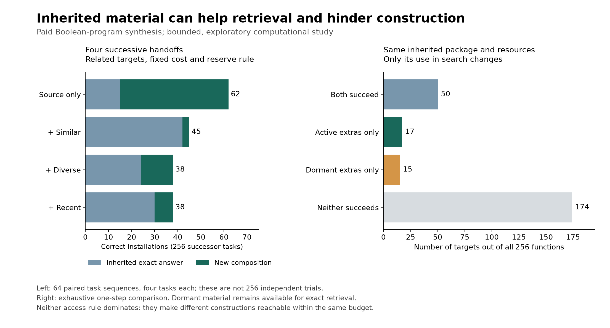

# Constructive succession under paid inheritance

This exploratory computational experiment constructs Boolean programs, removes each predecessor, and tests four successors on changed specifications. It charges construction, exhaustive checking, installation and source transfer to a carried resource balance. The result is conditional: **retained intermediate work can improve later responses, but making all of it active in search can also impede new construction**. Successor capability depends on the inherited package and how it is used.

All arms inherit inspectable successful source and may reuse its subexpressions. The baseline is therefore capable of construction; it is not an opaque product artificially denied reconstruction. Additional archives contain only actually generated components, selected before the next target is available. The primitive language, operator competence and search machinery remain supplied in every generation.

## Main results

The grid contains 7,740 trajectories and 30,960 successor episodes across five inheritance policies, three archive prices, two work flows, two reserve rules and three task families. The random families use the same 64 paired seed clusters across configurations. Repeated targets are deterministic and run once per configuration. These counts do not denote 7,740 independent experiments. There are 180 configuration groups.

The following illustrative comparisons use related tasks, archive price two, and a quarter-work search reserve. Each cell covers 64 sequences of four successor tasks. The larger grid is reported without pooling across task families in [summary.json](results/summary.json).

| Work per generation | Inheritance policy | Correct installations | New compositions | Direct inherited reuse |
|---|---|---:|---:|---:|
| 300 | Successful source | 26 / 256 | 11 | 15 |
| 300 | Source plus similar candidates | 42 / 256 | 2 | 40 |
| 1,200 | Successful source | 62 / 256 | 47 | 15 |
| 1,200 | Source plus similar candidates | 45 / 256 | 3 | 42 |
| 1,200 | Source plus diverse candidates | 38 / 256 | 14 | 24 |

These are selected contrasts illustrating both directions of the effect, not a claim of universally best policy. The archive's benefit at the smaller allowance largely comes from retrieving answers. At the larger allowance the same retention rule can reduce successful new compositions. Counts of new compositions have different opportunities across arms because some tasks are already inherited; they are not a matched conditional causal effect by themselves.

Some settings also improve new construction: with related tasks, no search reserve, flow 1,200 and archive price 16, diverse inheritance completes 79 tasks, including 62 new compositions, against 63 and 48 for source only. The price change alters which material can be retained and its search consequences; it does not show that making preservation expensive is generally beneficial.

Repeated tasks succeed in every arm. At archive price two and flow 300, source only ends with 1,216 work units; similar-candidate inheritance ends with 886. Both answer all four repeat tasks. Keeping extra material can therefore cost resources without improving this specified task family.

## Same material with different access

The supplementary [access intervention](check_access.py) holds the initial package and balance exactly fixed and changes only whether extra inherited functions automatically enter pairwise construction search. Dormant extras remain available for exact retrieval. If needed, the learner can reconstruct them through active components. This is an imposed access policy, not a learned rule for deciding relevance.

Across all 256 possible next targets, one diverse package at flow 1,200 and no search reserve succeeds on 67 targets with all extras active and 65 with extras dormant. Fifty targets are solved by both, 17 only by the active policy, and 15 only by the dormant policy. Neither policy dominates. This supports an access-and-search mechanism separately from material storage cost. Final onward archives may differ; this intervention establishes a one-step result.

The full supplementary grid contains 3,072 matched target pairs over three packages, two work flows and two reserve rules. See [access results](results-access/summary.json).



## Reproduction and records

The model and tests use Python's standard library. From a fresh directory without generated result folders:

```sh
python3 -m unittest -v test_model.py
python3 analyze.py
python3 check_access.py
```

The main run uses the exact source and protocol preserved in [results/inputs](results/inputs). Its source hashes are recorded in [summary.json](results/summary.json). The later access extension adds an optional argument whose default preserves main-run behavior. The access run has its own [input snapshot](results-access/inputs) and hashes. Reproduce either study with its snapshot, rather than silently substituting a later version. The six tests verify independent circuit semantics, serialized predecessor removal, recovery after a failed task, source-dependency payments and resource balances.

- [Protocol](PROTOCOL.md), [model](model.py), and [mechanism tests](test_model.py).
- [Main trajectories](results/runs.jsonl) and [access records](results-access/runs.json).
- [Original development runs](development.json), preserved before the reserve comparison was added.
- [Plot source](plot_results.py), [PNG](results/constructive-succession.png), and [SVG](results/constructive-succession.svg). Plotting uses matplotlib and numpy; the runtime used was `/private/tmp/meta-attractor-plot-env/bin/python`.
- [Research synthesis](../../_process/research/2026-10-05-generative-health/succession/ANSWER.md), [design review](../../_process/research/2026-10-05-generative-health/succession/DESIGN-REVIEW.md), and [primary literature](../../_process/research/2026-10-05-generative-health/succession/PRIOR-ART.md).

## Scope

The complete target truth table is supplied after paying eight observation units. This is finite synthesis from specification and exact verification, not empirical discovery or noisy validation. The language contains at most 256 truth functions and candidate programs are limited to 32 NAND nodes. Future task distributions, external resource flows, archive prices and search procedures are stipulated. Archive ranking, source traversal and other bookkeeping are free. Failed tasks preserve the incumbent and can be followed by recovery; they are not physical death.

The main experiment does not establish indefinite succession, independent self-maintenance of the learner, creation of new goals, fair access or universal health. The separate [recursive reserve theorem](../../_process/research/2026-10-05-generative-health/succession/MATHEMATICAL-CORE.md) supplies conditional infinite-horizon results for specified finite models. Its numerical examples are constructed and must not be presented as measured costs of this experiment. All research and reviews are AI-assisted; no real institution was tested.
