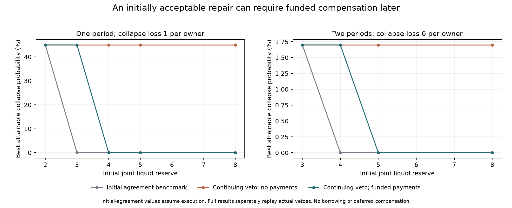

# Continuing participation and funded correction

An exploratory finite model with two half-owners, publicly revealed repair burdens, collective veto, and compensation paid from their joint reserve. It extends [plural correction](../plural-correction/README.md) using an unchanged copy of the [recoverable-inquiry physical model](../recoverable-inquiry/model.py). Personal losses and refusal decisions are new; the stock, fault, diagnosis, production and cash kernels are inherited.

**Result:** an initially acceptable corrective lottery can fail after burdens are revealed. A funded conditional payment can restore participation, but cannot create missing aggregate gains. The timing and ownership of the payment matter.

- [Research synthesis and exact calculations](../../sources/15-codex-theory-conversations/2026-10-05-continuing-participation-and-funded-correction.md)
- [Declared protocol](PROTOCOL.md), [configuration](config.json), [implementation](model.py), [independent tests](test_model.py)
- [All 92 comparisons and selected policy/refusal witnesses](results-v1/results.json), [numerical checks](results-v1/checks.json), [input manifest](results-v1/manifest.json), [completed test report](results-v1/test-report.txt)
- [Mathematical review](../../_process/history/2026-10-04-integrated-evolution/continuing-participation-math.md), [implementation audit](../../_process/history/2026-10-04-integrated-evolution/continuing-participation-design-review.md), [primary literature](../../_process/history/2026-10-04-integrated-evolution/continuing-participation-prior-art.md)

## Implemented choices

Both owners bear half the physical expense and receive half the output. A fair public assignment identifies the person bearing each repair's fixed burden. The action is then subject to both owners' continuing acceptance. Either may permanently veto active cooperation, leaving passive shared production and their property claims intact through the remaining horizon. This is a collective veto, not personal departure while another owner continues.

An allowed payout k in {0,1,2} is withdrawn from the shared reserve and received privately by the worker. Their net gain is k/2 because they already own half the money; the other owner loses k/2. Private payouts cannot be redeposited, and there is no borrowing or unsecured deferred compensation. Payment is conditional on simultaneous execution of the repair. Tests and setup are separately approved before their fees; refusal after a diagnostic uses actual remaining funds and posterior, without refunding sunk fees.

The tree retains complete public histories and revealed recommendations. Continuing constraints compare each person's remaining expected loss against their passive refusal at every occupied recommendation. The initial-only comparator checks acceptance before the first role assignment and assumes the plan executes. It is a commitment benchmark. A separate backward replay measures its consequences under actual veto.

We minimize collapse probability subject to each set of participation constraints. Equal collapse solutions minimize physical expense, then payouts. This reporting rule selects a reliability frontier; it is not a shared utility or bargaining solution. The original failure-only solutions remain preserved in development files.

## Selected results

| Horizon | Collapse loss per owner | Initial reserve | Initial-only benchmark | Continuing, no payouts | Continuing, payouts allowed |
|---|---:|---:|---:|---:|---:|
| 1 | 1 | 2 | .45 | .45 | .45 |
| 1 | 1 | 3 | 0 | .45 | .45 |
| 1 | 1 | 4 | 0 | .45 | 0 |
| 2 | 1 | 4 | 0 | .017 | .017 |
| 3 | 1 | 4 | .0017 | .017 | .017 |
| 2 | 6 | 4 | 0 | .017 | .017 |
| 2 | 6 | 5 | 0 | .017 | 0 |

Values are minimum modeled collapse probabilities. The initial-only column has payments available, although the selected policies pay none. Its one-period repairs are vetoed on replay, returning failure .45. For the listed two- and three-period cases, replay gives .017. All continuing policies replay unchanged to numerical tolerance.

The exact one-period comparison gives passive losses −.65 each, uncompensated repair losses −.30/−1.30, and initial expected repair losses −.80 each. The worker refuses after learning their role. A joint-pool payment must satisfy .7≤k≤1.3 for both to accept. Divisible payments require cash 3.7; the implemented integer grid requires cash 4. Repair alone costs 3. Payment 1 implements the repair with losses −.80 each.

At two periods and collapse loss6, the first repair's .1-probability low-stock branch leaves next fault probability .1. Initial cash 4 leaves cash 3 there; cash 5 leaves cash 4. The later required payment interval is [.68,1.32]; payment 1 is affordable in the second case. Expected total payout is .1. More initial reserve is a supplied endowment comparison, not a priced loan or a claim that raising it is free.

Counterweights are retained:

- With baseline collapse loss1, the same later repair worsens total continuation loss by 1.38. Transfers cannot make both owners better. Continuing collapse remains .017 in the H2/H3 cases with initial reserve≥3, even with payment access and more cash.
- A longer shared future can make initial repair acceptable without compensation. One-period thresholds are not universal multi-period funding rules.
- One-period repair burden .5 makes compensation unnecessary; burden 1.5 makes even the initial repair lottery unattractive. These controls are retained at cash 4 and8.
- No selected policy in the 92 cases buys a diagnostic. The model provides no selected evidence-acquisition benefit in this grid.



The [SVG](results-v1/participation.svg) contains the same scientific figure. Both panel scales are labeled; the right-hand differences are substantially smaller. Points are evaluated reserves; connecting lines guide the eye, not estimates for unevaluated cash values. The figure was visually inspected.

## Verification and reproduction

All nine independently constructed tests pass. They enumerate hidden physical outcomes, check every stage and prefix ledger, verify post-test fallback with sunk expenses, reconstruct action-conditioned participation rows independently, distinguish histories, check exact H1 payment thresholds, and independently compute veto replay. Across 92 cases, maximum flow residual is 5.56e−16, policy-evaluation discrepancy 1.07e−14, primary primal–dual gap 2.78e−16, and cash-ledger discrepancy 7.11e−15. Maximum measured continuing conditional refusal gain is 0; maximum continuing replay discrepancy is 3.56e−15.

The transition and belief kernels use rational arithmetic, followed by floating-point linear programming and evaluation. LP primal/dual tolerances are 1e−9; replay accepts indifference within 1e−8. Checks are numerical evidence, not formal interval certificates. See [checks.json](results-v1/checks.json) for unrounded values. No sampling is used.

```sh
python -m unittest discover -s experiments/continuing-participation -v
python experiments/continuing-participation/analyze.py --output results-new
```

Requires Python, NumPy, SciPy, and Matplotlib. The local verified runtime was `/private/tmp/meta-attractor-plot-env/bin/python`. The runner refuses to overwrite an output directory. Each result directory freezes model, upstream, tests, protocol, configuration and analysis code with SHA-256 hashes. The saved inputs can be run from their own directory with a fresh output name. [Verification metadata](results-v1/verification.json) records versions and artifact hashes.

The final grid is 60 base comparisons,16 burden controls, and 16 high-collapse-loss controls:92 policy results, with three sequential LPs per result for the reporting tie rule. These are selected finite cases, not independent replications. Development includes [24 initial H1/H2 cases](development.json), [12 H3 cases](development-h3.json), and [16 high-loss explorations](development-high-loss.json). The [initial wrapper](development-inputs/model.py) preserves the version before reporting tie-breaking and veto replay. The H3 development run preceded replay reporting; use the final results for replay comparisons.

## Scope

Public symmetric information, two supplied quasilinear loss functions, equal ownership, fixed horizon, a committed recommendation rule and atomic current payments are assumptions. The model verifies refusal deviations, not private reports, all alternative actions, coalitions, negotiated beliefs, preference formation, or endogenous enforcement. It does not establish that money can compensate every real harm, that veto rights should be weakened, or that improving aggregate reliability is ethically sufficient. The fallback is held fixed; changing what refusal leaves a person is a distinct intervention. Dynamic participation and limited-commitment contracting are established prior art.
