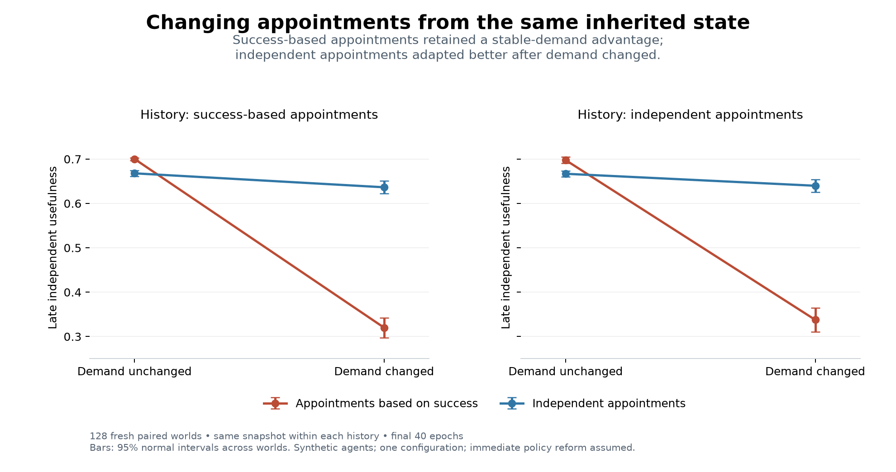

# Evaluator succession and effective correction

The experiments give a conditional result: appointing evaluators by success improved usefulness while demand stayed stable, but adapted poorly when demand changed. A matched-state follow-up reproduced this contrast after holding inherited institutional state fixed. Two of the first experiment's four prospective predictions were contradicted; all three follow-up predictions were supported. A separate mathematical model establishes conditions under which correction can retain enforceable authority. These are synthetic and conditional results, not empirical validation of a general theory of society or AI alignment.

This project was developed on 4 October 2026 following Ren's request to pursue the authority model and evaluator-succession benchmark. It is AI-generated research work, reviewed by other AI agents, not independent human peer review. It extends the [contribution-space assessment](../../sources/15-codex-theory-conversations/2026-10-04-alignment-coordination-contribution-space.md). Canonical theory has not been amended.

## What was completed

- [Matched-state follow-up report](BRANCH-REPORT.md): future appointment policy affects adaptation even from identical inherited states; stable demand retains the opposite effect.
- [Follow-up protocol](BRANCH-PROTOCOL.md) and [sealed records](results-v2/input_manifest.json): 128 fresh paired worlds, two source histories, two contexts and four branch policies, with complete checkpoints and trajectories.
- [Mathematical model and proofs](AUTHORITY-MODEL.md): authority reserve, an invariant region, and a deadline bound, with assumptions and counterexamples.
- [Prospective experiment protocol](PROTOCOL.md): six governance conditions, two demand contexts, four predictions, fixed parameters and statistical rules, specified before the outcome run.
- [Results and interpretation](REPORT.md): all four prediction verdicts, descriptive mechanisms, and limits.
- [Reproducible inputs and outputs](results-v1/input_manifest.json): archived source, protocol, configuration, tests, software versions and hashes; per-world summaries, complete epoch receipts, donor histories, and analysis.



## Reproduce the work

Python 3.11 was used. The authority checks use only the standard library. The benchmark and figure use the versions pinned in requirements.txt. The completed run used an existing temporary numerical environment; no project-wide dependency installation was made.

```sh
python -m venv .venv
.venv/bin/python -m pip install -r requirements.txt
.venv/bin/python -m unittest test_benchmark -v
.venv/bin/python authority_model.py --output authority-recheck.json
.venv/bin/python benchmark.py --output results-reproduction
.venv/bin/python analyze_results.py
.venv/bin/python -m unittest test_branching -v
.venv/bin/python branch_experiment.py --output results-branch-reproduction
.venv/bin/python analyze_branches.py
```

Run these commands from this directory. The benchmark refuses to overwrite an existing output directory. The analysis script audits and renders the preserved results-v1 run. The sealed-inputs subdirectory contains the exact four input files used for that run; hashes allow their integrity to be checked. Future experiments should use a new protocol and output directory.

The branch runner also refuses to overwrite an existing output directory. Its seven sealed inputs are preserved in results-v2/sealed-inputs. The branch analysis script audits and renders the preserved results-v2 run. The follow-up contains 256 source histories and 2,048 continuations, with 128 independent worlds as the statistical units. It estimates the total effect of future appointment policy, not a correction-only intervention.

The result includes 128 paired worlds per context, six treatments, and 128 independent donor worlds per context: 1,536 treatment trajectories and 256 donor trajectories. Worlds are the statistical units; epochs and agents are not treated as independent observations. No parameter sweep or outcome-dependent tuning was performed.

## Verification and historical evidence

Seven structural tests passed. Frozen-submission rescoring was independently recomputed from saved outputs; the first two worlds in two conditions reproduced exactly from the archived source. Twelve invariant-region trajectories passed the authority model's numerical checks, with step-halving comparisons and analytic checks. Numerical agreement illustrates and checks implementation; the mathematical claims rest on their written proofs.

Five additional structural tests passed for the follow-up. Its saved records passed 36 audit checks, including checkpoint restoration, unchanged input hashes, matching first-epoch production, complete summary reconciliation, and reconstruction of the primary comparisons. Further AI-agent review independently reproduced the primary intervals. The [follow-up report](BRANCH-REPORT.md) records the outcome and remaining causal limits.

The [earlier rubric pilot](../../drafts/2026-10-02-iaseai-selecting-the-selectors/experiment/PREDICTIONS-2.md) remains unchanged, including its failed P1. Its separately proposed design 2 was not executed by this project. This experiment does not replace that record.

The benchmark models myopic finite-choice agents, a fixed appointment constitution, protected minimum allocations, and exact synthetic usefulness. The protected arm assumes an independent evaluator with enforceable authority. There are no trained language models, human participants, coalition strategies, entry or extinction, or demonstrated infinite-horizon attractors here.
