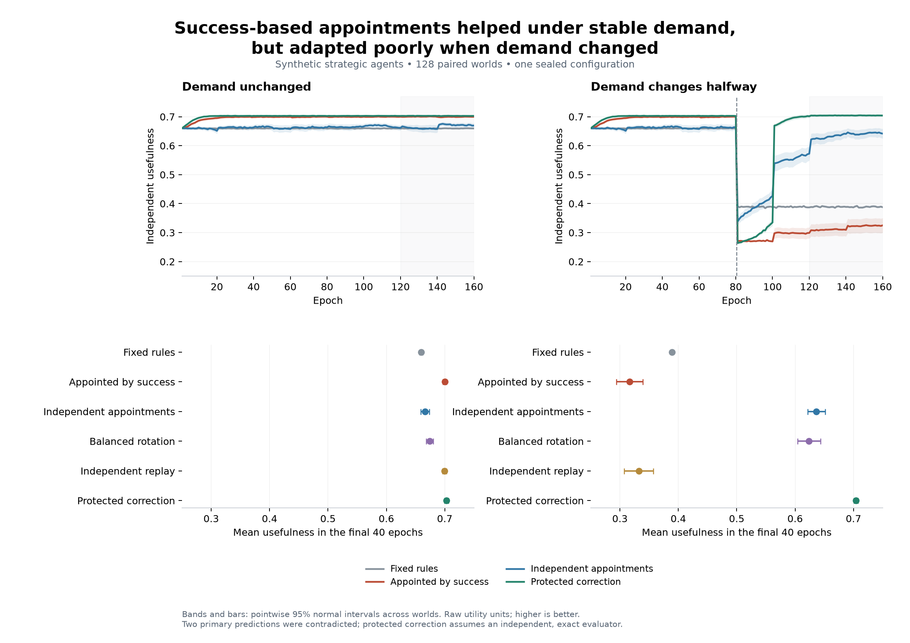

# Results of the evaluator succession experiment

The first sealed run produced a reversal across contexts. Success-dependent evaluator appointments improved independent usefulness when demand stayed stable, but often preserved the previously useful specialization after demand shifted. Two predictions were contradicted and two supported. The result favors a conditional account of institutional adaptation over a claim that success-dependent authority is uniformly harmful.

This is a synthetic mechanism experiment with myopic, utility-driven agents. It is not evidence about trained AI models or the prevalence of capture in human institutions. The protocol and source were archived and hashed before outcomes were computed, at 2026-10-04T16:11:16.808290+00:00. No parameters were tuned after results. Primary results are in [analysis.json](results-v1/analysis.json); [the audit](results-v1/audit-and-secondary.json) separately labels later descriptive analysis.

## Main results

The table reports mean independent usefulness in the final 40 epochs. Values are synthetic utility units, not percentages or real-world welfare estimates. There are 128 paired worlds per context.

| Governance condition | Stable demand | Changed demand |
|---|---:|---:|
| Fixed rubric | 0.6596 | 0.3889 |
| Appointments based on success | 0.6999 | 0.3166 |
| Independent uniform appointments | 0.6661 | 0.6364 |
| Balanced rotation | 0.6743 | 0.6239 |
| Independent replay of donor rules | 0.6996 | 0.3322 |
| Protected correction | 0.7030 | 0.7043 |

Protected correction combines a veto on immediately harmful amendments with mandatory implementation of qualifying external corrections. The experiment measures the package, not either component separately. Its independence and exact information are assumptions. After modeled administrative costs, the stable endogenous and independent means are 0.6988 and 0.6645; their shifted means are 0.3154 and 0.6348. The qualitative reversal therefore survives the specified cost accounting.

## All prospective predictions

Effects are the first named condition minus the second. Intervals are paired world-level bootstrap 95% intervals. Verdicts use two-sided tests with Holm adjustment across the four predictions; all four adjusted p-values are below 0.001. The intervals are marginal, not simultaneous intervals.

| Prediction | Observed effect and interval | Verdict |
|---|---|---|
| H1 Stable usefulness falls under success-based versus independent appointment | +0.03383 [0.02756, 0.04075] | Contradicted |
| H2 Stable purpose-impairing amendment count rises under success-based appointment | −11.09 [−11.66, −10.53] per evaluation window | Contradicted |
| H3 Under changed demand, independent appointment improves usefulness over fixed rules | +0.24749 [0.23148, 0.26219] | Supported |
| H4 Protected correction improves stable usefulness over success-based appointment | +0.00303 [0.00272, 0.00336] | Supported |

H2 counts accepted amendments that immediately increase the governor's contract share while lowering usefulness on identical frozen submissions. This is a mechanism measure, not a complete diagnosis of persistent capture. Success-based appointment produced fewer such amendments in the stable context, directly opposing the prediction.

The count also misses damaging inaction: preserving an outdated rule creates no new harmful amendment event. After the shift, success-dependent governance still produced fewer immediately harmful amendments than independent governance while delivering much lower usefulness. Effective correction therefore needs an outcome and response measure, not only a count of suspect rule changes.

The shifted success-based versus independent contrast was a permitted secondary comparison, not one of the four confirmatory predictions: −0.31980 [−0.34393, −0.29375]. The failure of H1 and H2 is not erased by this secondary result.

## What the receipts show

The following mechanism analysis was selected after seeing outcomes and is descriptive. Before the shift, demand favors output A; afterward it favors B. In the final window before the shift, success-appointed governors put an average weight of 0.939 on A, and 95.6% of appointments went to A-specialists. That favored the more useful specialization in the initial environment.

In the final window after the shift, the A rubric weight remained 0.831, and 86.3% of observed appointments still went to A-specialists. A-specialists retained 75.6% of contracts. With independent appointments, the A weight fell to 0.201, A-specialists held 50.2% of appointments and 29.7% of contracts. These observations are consistent with inherited evaluation rules preserving authority for previously useful specialists.

Across the entire observed postshift period, correction receipts were:

| Condition | Qualifying correction opportunities | Corrections implemented |
|---|---:|---:|
| Success-dependent appointment | 359 | 18 |
| Independent appointment | 266 | 119 |
| Balanced rotation | 278 | 124 |
| Protected correction | 128 | 128 |

Opportunity sets depend on preceding outcomes, so these conditional rates are descriptive, not causal estimates of responsiveness. There were no qualifying opportunities in the protected arm's final evaluation window because its corrections occurred earlier; 0/0 must not be interpreted as failure. Full per-world opportunity and response records, including worlds with no opportunities, are in the audit.

In success-dependent governance, A-specialists held 346 of the 359 postshift opportunities and implemented 5 corrections; B-specialists held 13 and implemented all 13. The reference correction lowered A-governors' modeled private utility in 341 of 346 cases despite raising usefulness. The synthetic conflict is therefore concrete: changing course often improved the stipulated shared purpose while reducing the incumbent governor's allocation. This does not establish deception, long-horizon planning, or any human motive.

## What the experiment does not isolate

Replaying rule histories from independent donor worlds produced similar average outcomes. The endogenous-minus-replay difference was +0.00030 [−0.00015, 0.00075] under stable demand and −0.01561 [−0.04971, 0.01911] after the shift. This run does not establish additional damage from ongoing identity-specific evaluator control beyond inheriting similar rule histories. Donors and recipients have the same two specialization classes, so class-favoring rules transfer across identities.

The treatments also enter the demand shift with different inherited rules. Their postshift difference combines earlier rule formation with subsequent correction. A future experiment should branch identical pre-shift states into appointment treatments to isolate correction from the same starting position. That experiment has not been run, and its predictions should be specified separately before execution.

Authority follows an externally fixed appointment constitution here. Agents cannot alter the constitution, remove the minimum contract allocation, capture the protected auditor, or create coalitions. The decision policy is a myopic logit response to own allocation plus a fixed concern for common output. No inference to inevitability, universal optimization, permanent lock-in, or an attractor is warranted from one finite horizon.

## The separate authority result

The [authority model](AUTHORITY-MODEL.md) proves a sufficient invariant-region condition:

\[
D>\sqrt{KC}+\frac{\kappa_\ell C}{\rho_\ell},
\]

with explicit initial bounds on authority and inherited influence. Here nominal correction must cover both the original row-gain threshold and authority erosion. A separate integral bound identifies when damping accumulated rule support cannot act before a deadline. The proofs are conditional on the equations; the benchmark does not estimate their parameters or validate the authority-erosion law.

Numerical checks covered twelve invariant-region trajectories, analytic solutions, step-halving convergence, and counterexamples. Maximum paired step-size disagreement was 5.48×10⁻⁶. An oversized initial influence stock can defeat a sufficient nominal reserve when the theorem's initial-state assumptions are violated. Stalled adaptation can avoid capture below the reserve threshold, showing that the condition is not necessary for every trajectory.

## Consequence for the research program

The next claim to investigate is narrower and more informative: **when useful success earns authority over evaluation, under what changes in the environment does that authority preserve obsolete measures and obstruct beneficial revision?** The current result supplies a concrete artificial example and a counterregime where success-dependent authority helps. It also exposes where additional evidence is needed: identical-state transition experiments, less privileged correction signals, and endogenous financing and authority for the corrector.

The earlier pilot's failed P1 remains in its original record. This run's two contradicted predictions remain equally central. Neither a successful toy safeguard nor a conditional theorem constitutes a solution to AI alignment.
