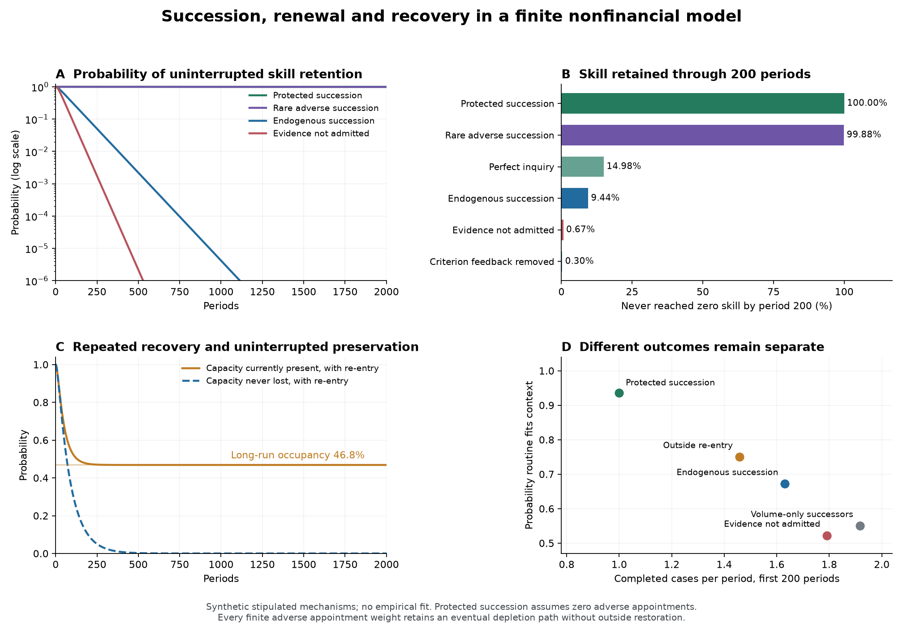

# Endogenous continuation of correction

5 October 2026. Research toward **Alignment as the Reproduction of Its Conditions**, before drafting that paper. This study joins inquiry, admitted memory, action, skill renewal, changing appointment criteria, and succession in one nonfinancial finite model. It establishes conditional results about that model and a general verification criterion for finite systems with specified dynamics. It does not establish a complete empirical theory across society, AI and life.

The main advance is a precise distinction between **a preserving policy being available** and **the installed system continuing to select and execute it**. The new construction can fail the second condition while satisfying the first. It also supplies a counterexample to treating reinforcing feedback as inherently harmful: under the stated initial conditions, reinforcement of the adaptive criterion prolongs correction.

## What has been joined

An organization has two work slots each period. It can complete two cases, complete one and investigate, or complete one and teach a successor. Inquiry and teaching are separate activities. Its routine must respond to a changing context; the installed policy sees only its admitted records and available skill. Failed work increases attrition, which changes the available successors. Current appointment criteria weight candidates differently, and the appointee transmits a criterion and decision practice into the next period.

The resulting loop is:

`criterion and practice → inquiry or teaching → records and action → consequences → attrition and qualified successors → criterion and practice`

An earlier design left experience downstream of institutional renewal. The outcome-to-attrition link repairs that omission and is separately removed in a control. This link is a stipulated hypothesis about the institution, not an empirical finding.

There are 72 formal states: two contexts, two implemented routines, two installed practices, three skill levels, and three record states. Changing purposes are represented only by inheritance of two supplied criterion/practice combinations. Admission and execution gates are fixed experimental settings, while the installed practice changes whether inquiry occurs and how records are used; their constitutional evolution is not separately modeled. The model does not explain the invention of new concepts, arbitrary preference formation, strategic deception, or political legitimacy.

## A general conditional result

Let `K` be the actual transition kernel, including changes to the installed rules, skill and memory. Let `C` be a declared set of acceptable outcomes. Repeatedly remove from `C` every state with a positive-probability transition outside the remaining set. The limiting set is the greatest closed safe region of the actual process.

For a finite, time-homogeneous system with known kernel, indefinite safety from a state holds with probability one exactly when that state belongs to this region. If continued functioning also requires recurring training, effective responses or other events, every reachable closed recurrent class must contain those events. The [formal note](FORMAL.md) states and proves the conditions, distinguishes partially informed external control, and treats uncertainty about transitions.

This is established finite-state probability and verification, applied to the joint reproduction of correction. Its value here is an exact criterion for a declared model class, not mathematical novelty. It does not require financial rewards, a scalar objective, or a conscious evaluator in every application.

## Results in the nonfinancial construction

All comparisons begin in the same skilled, responsive state. The table reports probability of never losing all skilled capacity by period 200 and expected time to the first loss. These are distinct from service quality or moral alignment.

| Succession or mechanism | Skill never lost through 200 periods | Mean periods until first loss | Indefinite retention from the initial state |
|---|---:|---:|---|
| Actual criterion-dependent succession | 9.44% | 91.09 | Probability zero without restoration |
| Perfect inquiry, actual succession | 14.98% | 111.32 | Probability zero without restoration |
| New evidence not admitted | 0.67% | 49.44 | Probability zero without restoration |
| Amendment execution blocked | 0.67% | 49.44 | Probability zero without restoration |
| Criterion feedback removed | 0.30% | 43.45 | Probability zero without restoration |
| Rare adverse succession | 99.88% | 159,001.83 | Probability zero without restoration |
| Protected adaptive succession | 100% | Infinite | Probability one under its zero-leak premise |

These numbers come from stipulated probabilities, not measurements or estimates of institutional lifetimes. Times are model periods. The transition system is exhaustively enumerated; reported numerical probabilities are floating-point calculations, with separate rational-arithmetic checks.

### A feasible corrective practice need not reproduce itself

The adaptive practice teaches at skill one and investigates at skill two. Teaching restores two carriers before turnover, and at most one carrier can leave per period. If adaptive practice is transmitted without error, at least one skilled carrier remains.

Actual succession gives an alternative practice positive appointment probability. It can then complete work without teaching, allowing the remaining carrier to be lost. If the per-period probability of an actual skill decrement is at least `δ₀>0`, appointment weights are bounded by finite `w_max`, and zero skill has no restoration route, the probability of depletion in the next two periods is at least

\[
p_* = \frac{\delta_0^2}{1+w_{\max}}.
\]

Survival for `2n` periods is consequently at most `(1−p_*)^n`. Eventual depletion has probability one. This proof uses conditional bounds and does not assume independent failure opportunities.

The protected arm is a useful existence comparison. It does not explain how a real institution establishes or preserves a perfectly reliable successor filter. Its 36-state protected region excludes some positive-skill states: an incumbent volume practice at skill one may lose its carrier before the protected succession procedure acts.

### Better diagnosis cannot by itself preserve succession

Perfect inquiry extends the mean lifetime but leaves the loss pathway intact. Disabling actual apprenticeship also eliminates preservation under protected adaptive succession. Evidence and transmission are therefore separate requirements in this construction.

Blocking admission and blocking execution yield identical observable routine, adequacy and skill dynamics from the declared initial state, even though their stored evidence differs. Outcome curves alone cannot diagnose which gate failed. The records separately track raw inquiry, admission, changed routines and beneficial changes.

When the link from failed work to attrition is removed, skill and criterion dynamics become identical across ordinary, no-admission and no-execution cases. That control identifies the implemented route through which evidence and action influence institutional continuation; it does not identify a corresponding causal effect in a real institution.

### Reinforcement can sustain correction

Replacing criterion-dependent appointment weights with the specified neutral rule (both weights equal one) shortens the mean lifetime from 91.09 to 43.45 periods in this comparison. The initially installed adaptive criterion favors its continuation. This compares two declared appointment mechanisms; it does not isolate a universal effect of self-influence while holding every appointment probability fixed. The loss theorem also holds when both criteria use identical finite weights, so that theorem alone does not establish that recursive criteria cause depletion.

This is a substantive boundary on the broader meta-attractor hypothesis: reinforcement can maintain either a damaging practice or a useful corrective practice. Which practice it favors, which alternatives it suppresses, and what consequences result must be measured separately.

### Recovery is different from uninterrupted preservation

When a specified outside entrant can restore lost skill and the adaptive practice with probability `.01` each depleted period, first-loss risk is unchanged. Long-run capacity is present about 46.85% of the time. The reachable recurrent class includes actual inquiry, teaching and beneficial revision events. This supports recurrent recovery under the stipulated external input; it does not establish uninterrupted preservation or self-sufficiency.

Merely recurring beneficial revisions does not guarantee that every discrepancy receives a timely response. No pending-obligation or response-deadline monitor was implemented in this study.

### Continued production is a different outcome

After permanent skill loss, ordinary work still continues. With the symmetric changing context, a fixed routine eventually fits the context half the time. The protected adaptive regime fits it about 93.55% of the time but performs fewer cases because it allocates time to inquiry and teaching.

Indeed, the depleted volume regime produces one adequate case per period in the long run on average, while protected adaptive practice produces about 0.9355. Volume also produces more inadequate cases and loses the modeled capacity to revise. Neither aggregate adequate-case count nor mere survival supplies a universal ranking. The figure reports these dimensions separately, and the normative choice among them remains explicit.

## Validation and its limits

The [protocol](PROTOCOL.md) was written before the numerical results. The implementation enumerates every transition branch, retains every positive edge in graph analysis, computes finite-horizon probabilities and recurrent classes, and solves the first-loss equations. The saved [analysis](results/analysis.json) includes 34 automated checks and 27 parameter combinations. An independently written event sampler checks five conditions with 30,000 trajectories each; those replications test the declared model, not the real world.

An independent AI review reconstructs transitions with rational arithmetic, checks graph structure without the same graph routine, and audits agent information access. See [implementation review](IMPLEMENTATION-REVIEW.md). These are independent implementations and AI review contexts, not independent human peer review.

Finite successful observations cannot establish that a possible failure transition has exactly zero probability. For example, with zero failures in `n` independent opportunities, the one-sided 95% binomial upper confidence limit is `1−0.05^(1/n)`, not zero. A claim of permanent safety therefore requires justified structural restrictions or explicitly stated uncertainty assumptions; high finite-horizon reliability is a different claim.

There is also a positive validation criterion. If actual conditional transitions differ from modeled transitions by at most `ε` in total variation, uniformly over the relevant histories, then the error in any event probability through `H` transitions is at most `1−(1−ε)^H`, and hence at most `Hε`. The [formal note](FORMAL.md) gives the coupling proof and qualifications. This turns a sufficiently strong validated transition bound into a finite-horizon risk guarantee. Neither our synthetic checks nor a better average prediction score establish that uniform bound; estimating and justifying it is separate empirical work.

Cross-domain transfer can be stated with the same precision. A proposed map from each domain into a shared model must preserve the relevant outcomes and approximately preserve next-state distributions. For causal claims, it must also do so under corresponding implementable interventions, with the relevant information restrictions intact. The resulting transition-error bounds give finite-horizon transfer bounds. This is established abstraction and coupling mathematics; it specifies what would justify a shared mechanism beyond renaming variables. The current ecological test does not establish those bounds.

The broader general theory still requires tests of independently measured mechanisms and predictions outside this construction. Relevant external evidence and any separate exploratory data analysis are recorded in [EXTERNAL-EVIDENCE.md](EXTERNAL-EVIDENCE.md), with their access and inference limits. An ecological predictive association cannot by itself validate institutional succession or legitimate purpose revision.

## An external prediction test with mixed evidence

We analyzed public microbial community measurements from [Huisman, Dal Bello and Gore's author repository](https://github.com/JSHuisman/salinity/tree/f14abee9d5e2d015deead102c04ea4d3030a5788). The narrow question was whether current community composition summaries improve prediction of measured biomass after the next growth/dilution cycle, beyond current biomass and experimental context. This does not test the synthetic institution or directly measure shock recovery.

The fixed analysis uses 72 current/next-cycle observations from 24 condition trajectories and four source inocula. All biological replicates of a condition are averaged and kept together because the biomass file lacks replicate identifiers. The design and primary metrics were recorded before inspecting numerical outcomes, but the authors' published findings were already known: this is exploratory secondary analysis, not prospective confirmation.

An audit identified that the authors' supplied feature summaries used a global rare-taxon filter, including later and held-out samples. We preserved the initial analysis and froze a repair before recomputing results. The reconstruction first reproduced the original summary pairs for all 368 samples to less than `2.5×10⁻¹⁴`, then removed that global prevalence filter and recomputed each sample's summaries from its own counts and a fixed external taxonomy reference. Upstream sequencing processing remains outside this audit.

| Corrected prediction comparison | Baseline RMSE | With composition RMSE | Baseline MAE | With composition MAE |
|---|---:|---:|---:|---:|
| Primary: hold out complete condition trajectories | 0.09369 | 0.08687 | 0.06868 | 0.06902 |
| Prespecified sensitivity: hold out source inocula | 0.09350 | 0.07719 | 0.06833 | 0.05960 |

The primary RMSE improves about 7.3%, but MAE worsens and the coarse four-source bootstrap interval for RMSE gain crosses zero. **The declared primary criterion of improvement in both errors was not met.** The stronger source-holdout result does not replace that primary result. The tests concern generalization across conditions or source inocula, not a strictly forward-in-calendar forecasting pipeline.

This is limited external evidence about extra predictive state information, with an explicit adverse result. It neither validates a causal feedback mechanism nor estimates the uniform transition-error bound used in the formal guarantee. See the [external results and repair record](external-test/RESULTS.md), the [original protocol](external-test/PROTOCOL.md), and the [frozen repair](external-test/PROTOCOL-REPAIR.md). No pair of domains has yet passed an independent mechanism-level transfer test.

## What is complete at this stage

The finite construction has specified state, events, information restrictions, outcomes, a conditional theorem, controls, a reproducible computation, and independent verification. The general finite-kernel criterion has necessary and sufficient conditions within its declared class. This closes a mathematical and implementation gap in the programme.

It does not complete the general empirical theory. Open work includes: estimating relevant transitions without assuming away rare failures; testing causal transfer between domains; representing new frames and changing plural commitments beyond a supplied finite menu; specifying legitimate revision; and comparing the proposed integration against its closest predecessors. These gaps cannot be closed by renaming the present example universal.

Research records: [formal result](FORMAL.md), [validation design](VALIDATION-DESIGN.md), [protocol](PROTOCOL.md), [implementation review](IMPLEMENTATION-REVIEW.md), [external evidence](EXTERNAL-EVIDENCE.md), and [general framework](../README.md). Reproduction uses the saved numerical environment with `python analyze.py` followed by `python render.py`. No manuscript has been drafted.
