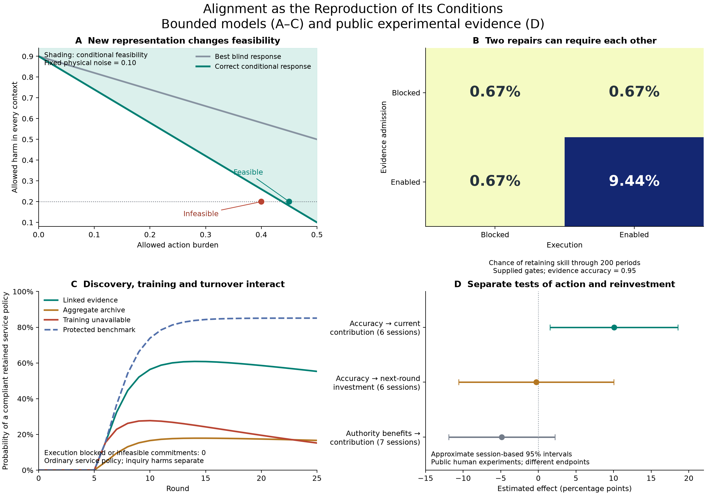

# Closing specific gaps in “Alignment as the Reproduction of Its Conditions”

5 October 2026 task date. AI-assisted research under Ren's direction. This is a research dossier within `experiments/`, not a paper draft, a canonical-theory replacement, or a claim to a complete validated general theory.

This round supplies a bounded account of representation and commitment change, an executable join with turnover and training, a causal diagnosis of complementary failure mechanisms, an explicit normative specification, and public experimental reanalysis. The empirical work includes an inconclusive test of the proposed transition from immediate experience to later support for information. That result is retained alongside the positive contemporaneous result.

## Integrated claim and what gives it content

The organizing claim is:

> Alignment depends on how a system's actual development maintains or reconstructs the conditions for responses that meet disclosed, contestable commitments. Those conditions include the ability to discover consequential distinctions, represent plural concerns, enact responses, and transmit or rebuild the relevant capacities. The process can also change its own commitments and criteria, so material improvement, justified revision, and the concealment of deterioration must be distinguished.

This statement is a research architecture. Its explanatory content comes from restricting the actual mechanisms and deriving outcomes that might be wrong. It assumes neither a universal objective nor optimization as the mechanism of every change. The same vocabulary does not make political representation, biological regeneration and AI learning identical processes.

For a stated application, distinguish four questions:

1. **Feasibility:** does any physically available response meet the declared plural commitments?
2. **Discovery and representation:** can the system acquire and express a relevant response with its actual observations and grammar?
3. **Implementation and continuation:** do its real authority, work allocation, transmission and reconstruction processes realize that response over the required horizon?
4. **Justification:** whose commitments are represented, and how can changes to them gain legitimate authority?

These questions can fail independently and interact. The constructions below make several of those distinctions mathematically explicit. Their supplied boundaries remain part of the claims.

The panels use different specified models and experimental endpoints. They must not be interpreted as estimates of one universal coefficient. The [figure inputs](figure-manifest.json) are recorded; [SVG](research-summary.svg) is available for inspection or reuse.

## Representation formation and plural feasibility

The [formation analysis](FORMATION.md) starts with a frame unable to condition action on the current case. Its aggregate history is equally likely under four different physical worlds. Further inference over those same records cannot identify the missing distinction; even an oracle supplying the correct belief cannot make a context-blind policy meet every group's harm bound.

Linked records permit a finite grammar to construct and select a conditional expression. The raw attributes and grammar are supplied, but the active distinction and its orientation are learned rather than inserted as a correct answer. The analysis separates that change from belief updating, goal revision, coercion and implementation.

Physical harm remains a vector across four contexts, with a separate action burden. At noise `ν`, harm ceiling `r`, and burden ceiling `b`, a correct conditional response is feasible exactly when

\[
b\ge\frac{1-\nu-r}{2(1-2\nu)},\qquad \nu\le r<\tfrac12.
\]

For `ν=.10,r=.20`, the minimum burden is `.4375`: a `.45` burden ceiling permits a response, while `.40` does not. Thus a new representation can expand available responses at the same time that a new commitment reduces the acceptable set. Neither better knowledge nor more capable execution resolves every conflict of purposes.

An explicit experience-dependent proposal and ratification procedure models bounded commitment change. Its response dispositions and consent rules remain normative/behavioral premises. No equation derives legitimate goals from physical success. Fourteen exact rational checks verify the supplied formation calculation.

## Discovery, transmission and work now share one finite process

The [coupled study](formation-coupled/RESULTS.md) makes inquiry and training compete for actual work slots. Experienced harm can trigger a complaint and inquiry; a five-case batch nominates a conditional frame; a specified procedure ratifies plural commitments; actual harm affects turnover; turnover changes both installed practice and retained records. A wrong candidate can be ratified. The evaluator of actual physical consequences is kept separate from that institutional verdict.

At round 25, the enumerated probabilities of possessing an enabled ordinary-response policy meeting every proposed expected harm and burden constraint are:

| Supplied mechanism | Actual plural compliance at endpoint |
|---|---:|
| Linked evidence and endogenous succession | 55.29% |
| Aggregate archive at the same cost per inquiry episode | 16.64% |
| Execution blocked | 0% |
| Training unavailable, work reallocated to cases | 15.19% |
| Physically infeasible burden commitment | 0% |
| Externally protected selection and record transmission | 85.11% |

These are computed probabilities in one model, not observed institutional frequencies. They concern endpoint ordinary-policy capabilities and expected consequence bounds, not a history without violations. Randomized inquiry can itself cause harm; that harm remains in the separate consequence accounting and is not excused by the endpoint result. **If the same .20 group harm ceiling applies to experimental inquiry, this construction violates it:** inquiry harm is .50 per context. Permission to investigate, acceptable transitional risks, or a less harmful information technology therefore need separate justification. Realized total work is allowed to differ after the interventions change outcomes and turnover. The externally protected benchmark does not explain how its own protection persists.

The aggregate arm uses a specified uniform nomination rule after unlinked randomized inquiry. It is not the best possible aggregate learner: a different mechanism could experiment with deployed candidate policies and learn from their different pooled harm rates. The comparison tests the declared archive and nomination mechanisms, not the universal necessity of retaining raw records.

Preservation can retain mistakes: the protected benchmark has 14.89% probability of a ratified but physically violating response at the endpoint. The original finite join has no direct reconsideration while a frame remains installed; loss and rebuilding can replace it. That limitation motivated a [separately frozen reopening extension](formation-coupled/REOPENING-PROTOCOL.md), preserving the original results. A new admitted complaint can trigger fresh inquiry while the institution retains its previous rule for ordinary service. The new evidence-selected candidate can replace the incumbent, including when the incumbent was correct.

| Succession regime | Endpoint compliant policy: original → reopening | Ratified but violating: original → reopening |
|---|---:|---:|
| Endogenous selection and fallible transmission | 55.29% → 54.59% | 7.27% → 5.61% |
| Protected selection and transmission | 85.11% → 89.90% | 14.89% → 10.10% |

At these parameters, reopening lowers the endpoint probability of a retained, ratified violating policy in both regimes. This can reflect correction, selection or lost capacity; it is not by itself a count of repaired mistakes. With endogenous succession, positive skill falls from 67.93% to 66.37%, and expected inquiry use rises from 4.68 to 8.40 cases. Under protected succession, endpoint correctness improves while inquiry rises from 5.00 to 11.11 cases and ordinary service falls from 37.33 to 24.82 cases. These are genuine tradeoffs in the supplied model, not a reason to sum all outcomes into a single score or declare more revision universally good. Panel C displays the original six-arm study; this table reports the subsequent [reopening comparison](formation-coupled/REOPENING-RESULTS.md).

## Causal diagnosis and the limits of a local gradient

The [causal analysis](CAUSAL.md) proves that blocked evidence admission and blocked execution can generate identical complete task/skill histories while requiring different targeted interventions. Observing the admitted record would distinguish them. The impossibility is relative to what is observed, not a claim that diagnosis is impossible under every measurement.

Starting from both gates blocked in the earlier closure model, restoring either alone leaves 200-period skill retention at `.00672`. Restoring both raises it to `.09437`. An isolated repair can have no measurable benefit when another necessary condition is missing. Conversely, the joint restoration worsens this endpoint when evidence is sufficiently misleading. Openness, stronger responsiveness and preservation each need a mechanism-specific argument.

This refines the original gradient intuition. For the elementary complementary response `F(a,e)=F0+c ae`, both partial derivatives vanish at `(0,0)` although a coordinated change improves F. Feasible combinations and transition paths can therefore matter even when local signals give no direction. This example does not supply a universal welfare landscape.

The extension also specifies delayed restoration and an intervention-preserving cross-domain map. A one-step total-variation error bound `ε` over the relevant histories implies an H-step event error no greater than `1−(1−ε)^H` for matching initial conditions. Transfer requires corresponding implementable interventions, observations, actions and outcome events. That is an acceptance criterion for a shared mechanism; it has not yet been estimated for the studied domains. The underlying causal-abstraction and coupling mathematics has established predecessors.

## Human experimental evidence, including a test that did not support the stronger link

The [empirical report](EMPIRICAL.md) analyzes the public [Dickson, Gordon and Huber experimental archive](https://doi.org/10.7910/DVN/SPIMAV). Protocols were frozen before each new outcome calculation, with prior knowledge and analysis order disclosed. This is secondary, exploratory reanalysis of an existing experiment, not a new preregistered trial.

| Contrast | Estimated effect | Approximate session-based 95% interval |
|---|---:|---:|
| Randomized higher information accuracy → current contribution | +10.07 percentage points | +1.57 to +18.57 |
| Same experience → next-round information investment, if randomly assigned authority | −0.29 points | −10.60 to +10.02 |
| Authority benefits from contribution → current contribution | −4.85 points | −11.93 to +2.23 |

The first estimate uses all 360 group-periods and six independent sessions, retaining enforcement choices made after the accuracy draw. It estimates a total contemporaneous effect that includes enforcement and material incentives. It does not isolate intrinsic legitimacy or measure alignment as a whole.

The one-round follow-up was proposed after that result was known, then separately frozen before constructing lagged outcomes. It uses 342 adjacent person-opportunities and requires externally randomized next-role assignment independent of earlier outcomes. The point estimate gives no support for the proposed experience-to-later-investment link at that horizon. The interval is too wide to establish absence or equivalence. No alternative lags or outcomes were searched.

The distinction between immediate performance and reproduction of its conditions now has a direct empirical test boundary: **the former is supported here; the latter link remains inconclusive**. The externally supplied experimental infrastructure is not an observed self-renewing institution. Increased compliance is not itself proof of legitimate authority.

The previous [microbial prediction test](../closure-study/external-test/RESULTS.md) also remains mixed: its declared primary criterion failed because RMSE improved while MAE worsened. Neither the positive secondary ecology result nor the positive immediate institutional result substitutes for a matched cross-domain causal test. Published yeast perturbation experiments provide separate domain evidence about regeneration and resilience, summarized with their limits in [CAUSAL.md](CAUSAL.md).

## Normative specification and revision

The [normative note](NORMATIVE.md) makes the candidate commitments explicit: affected-party standing, protected losses, plural and possibly incomplete preferences, genuine disagreement, and a fallible amendment process with real carriers and costs. It connects to the programme's earlier stated commitments rather than presenting a new ethics as a theorem.

It distinguishes the institution's currently installed evaluation from the disclosed reference used to assess it. A durable system may accurately detect harms, effectively revise its routines and still exclude people whose injuries matter under that reference. Persistence and operational revisability therefore do not by themselves settle alignment.

For a measured condition y and standard ψ, the exact decomposition

\[
b(y',\psi')-b(y,\psi)
=[b(y',\psi)-b(y,\psi)]+[b(y',\psi')-b(y',\psi)]
\]

separates outcome change under the old standard from the change in assessment caused by the revised standard. It does not decide whether that revision is justified. Recorded assent likewise cannot identify legitimate agreement when the history of coercion or dependence is omitted. The specification preserves both material records and the grounds of consequential amendments.

The mathematical work can check feasibility, decision procedures and conditional safeguards. People must still justify which parties have standing, which losses deserve protection and how disagreements are governed. That is a substantive part of alignment, not a missing constant that a performance regression can supply.

## What is resolved, and what would earn the broader claim

| Gap | Work now completed | Remaining boundary |
|---|---|---|
| Representation and changing commitments | Restricted formation mechanism, exact information and feasibility results, explicit revision procedure | Supplied grammar and response dispositions; no universal account of conceptual or value formation |
| Coupled continuation | Inquiry, plural ratification, actual consequences, work, turnover, transmission and a tested reopening extension | Stipulated physical/constitutional laws; bounded horizon; protected benchmark externally supplied |
| Causal diagnosis | Full-path equivalence proof, discriminating interventions, complementary/adverse effects, delayed-restoration bounds | Real systems require measured intervention mechanisms and adequate observation |
| Normative grounding | Transparent candidate premises and amendment/accounting procedure | Legitimacy requires reasoned human adoption, contestation and domain specification |
| External intervention evidence | Positive immediate institutional response, boundary contrast and inconclusive later-investment test | No empirical demonstration of the full reproduction loop |
| Cross-domain generality | Precise intervention/event-preserving transfer condition | No validated shared kernel or estimated uniform transfer error |

The strongest current deliverable is a more integrated and testable theory programme with checked restricted models and candid external evidence. It does not yet establish a general solution to AI alignment, a universal theory of social organization, or scientific priority over the relevant control, causal-inference, institutional and evolutionary literatures.

The principal empirical test now has a sharper target: independently vary access to consequential evidence, ability to act on it, and capacity transmission across replacement; retain externally measured outcomes and amendment histories; predict which combinations preserve justified correction beyond an initial success. The study must observe the regeneration mechanism itself and test a specified competing fixed-institution model. Merely finding another positive information effect would leave that question open.

## Verification and provenance

- [Formation checks](FORMATION-CHECKS.json) use exact rational arithmetic.
- [Causal review](CAUSAL-REVIEW.md) reconstructs the original model's intervention matrices independently, matching 16 factorial arms and eight delayed endpoints within `1.28e−15`.
- [Empirical review](empirical/REVIEW.md) independently reconstructs 800 group-period outcomes and all 342 lagged joins. Exact primary fractions and input hashes match; inferential and assignment limitations remain stated.
- [Coupled model protocol](formation-coupled/PROTOCOL.md), source, results and [independent review](formation-coupled/REVIEW.md) are stored together. Independent raw-case rational reconstruction checks 60 baseline and ten reopening transition rows; the extension preserves baseline source and result hashes. Exhaustive finite branch propagation uses floating-point arithmetic; it is not empirical validation.

All reviews are within the AI-assisted team. Reproducible independent implementations improve assurance but do not replace independent human scientific review. Original source archives and previous negative results remain intact.
