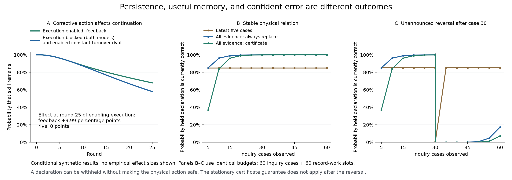

# Alignment as the reproduction of its conditions: persistence, renewal and justified revision

5 October 2026. AI-assisted research continuation, with explicit model comparisons, mathematical checks, and an exploratory public-data reanalysis. This dossier continues the [gap-resolution study](../gap-resolution/README.md). It is not the requested eventual paper, a completed general theory, or independent human peer review. The formulations are assistant elaborations of Ren's research direction, not quotations attributed to Ren.

The principal advance is a sharper distinction among **a condition still being present, a process recreating that condition, and the condition remaining appropriate to a changing situation**. The three can come apart. Existing skill can decay despite good current work; an agreement can remain unchanged without being actively renewed; retained evidence can become a basis for confident error.

The resulting central claim is a research proposition:

> Where alignment depends on capacities for observation, response and legitimate revision, its durability depends on how those capacities are continued or reconstructed, and on how their relevance to changing circumstances is assessed. Present performance and institutional persistence do not establish those mechanisms.

“Depends” here concerns specified causal requirements in a particular application. Some may be maintained by other institutions or environmental processes. An open system need not provide all its own support. Which capacities matter, whose requirements count, and which changes are legitimate remain situated questions. Nothing in this claim requires a common objective or a universal gradient.

## What the new work establishes

| Question | New result | Evidential standing |
|---|---|---|
| Does outcome feedback into future capacity predict anything beyond a fitted one-way account? | Two supplied models have the same complete skill–practice–turnover history law while execution is blocked. Enabling execution changes 25-round skill retention by +9.99 percentage points in the feedback model and zero in its calibrated rival. | Conditional formal discrimination and exhaustive computation; no empirical validation of the turnover law. |
| Must repeated correction keep introducing a constant risk of new error? | Retaining valid cumulative evidence removes the fixed fresh-batch error pattern. An established likelihood certificate bounds the probability of ever making a false declaration. | Proved under a fixed, correctly specified four-hypothesis observation model; computation independently checked. |
| Is greater retained confidence enough when circumstances change? | With identical evidence budgets, the certificate's endpoint accuracy is over 99.9999% in the stationary scenario but 7.06% after an unannounced reversal halfway through. | A specified robustness failure, not a refutation of the stationary theorem or an optimality result. |
| Do actual groups maintain institutions differently after a deliberative intervention? | A public experiment gives a +42.59-point contrast on retained sanction permission, with an approximate interval [22.02, 63.17]. Yet 66/72 groups keep the same agreement category throughout. | Exploratory component evidence of formation/persistence; treatment scheduling and coding qualify interpretation, and repeated renewal remains unidentified. |
| Can the missing reproduction route be tested directly? | A prospective study randomizes verified outcome-report timing before an actual maintenance choice, then package access before a successor takes over. | A specified, unrun causal design. |

The figure displays synthetic results only. Panel A enables execution from the common initial state and measures retention at round 25; it does not restore execution for the first time in round 25. Panels B–C have identical 60-case evidence budgets. “Correct” means matching the currently stipulated physical expression, not satisfying a comprehensive alignment standard.

## 1. The reproduction link has a discriminating prediction

The [model comparison](discrimination/RESULTS.md) changes exactly one mechanism. The full model makes turnover probability depend on realized harm proportion Z:

\[
\Pr(T=1\mid Z,s)=.05+.20Z.
\]

The rival uses constant probability .15 while retaining all the same learning, training, appointment and record-transmission mechanisms. Calibration is restricted to histories of skill, practice and turnover while execution is blocked. In that regime the full model has mean harm .5 in every compatible hidden state. The projected transition kernel—and hence every projected history distribution—is the same in both models.

This is a deliberately specified observational equivalence. Joint harm–turnover logs or archive records were not included in the calibration channel and can distinguish the models sooner. The fitted .15 is an exactly known synthetic moment; estimating it from finite observations would add uncertainty.

Enabling execution from the same original full initial state gives a test they disagree on. Skill remains after 25 rounds with probability 67.93% in the full model versus 57.94% when execution is blocked. Both rival arms yield 57.94%. The missing arrow therefore has predictive content beyond those specified calibration histories. It still has to earn empirical support.

The sign is conditional on the response. In a fixed state, executing a correct frame reduces expected turnover to .08, a reversed frame raises it to .22, and an irrelevant frame leaves it at .15. Maintaining executable power is not automatically beneficial. A harmful process can also reproduce itself, and a feedback sign can differ across domains.

## 2. Maintaining knowledge also requires assessing when it still applies

The [evidence study](adaptive-evidence/RESULTS.md) compares three procedures using the same 60 observations and 120 effort units. The latest-batch rule replaces its explanation after every five cases. The other rules retain sufficient statistics across batches; one always chooses the best cumulative fit, while the other requires a likelihood certificate.

For each candidate h among four supplied hypotheses, let Lh be its likelihood. The certificate declares h only if `Lh/Lk ≥ 3/δ` against every competitor k. Under the fixed, correctly specified observation law, likelihood-ratio martingales and a union bound control the probability of any false declaration across all inspection times by δ. This applies established [time-uniform inference](https://arxiv.org/abs/1810.08240); it is not a newly discovered statistical theorem. Discrete ratios sharpen our chosen 5% bound to 3/81 ≈ 3.70%.

The actual finite probability of any false certificate is 0.843% over twelve looks. Always replacing from the latest five cases gives 85.55%. Retaining evidence can therefore address the previous model's repeated fresh-batch error mechanism without buying more observations.

That same retention is insufficient after a change. When the physical relation reverses after case 30, current endpoint accuracy becomes 7.06% for the certificate, 17.14% for unconditional cumulative replacement, and 85.11% for the latest-batch rule. The previously adequate likelihood model now pools incompatible evidence. It can issue a **fresh** false certificate, so this is not merely counting a once-correct statement as a new error.

The mathematical guarantee remains correct: its stationarity premise no longer holds. The conceptual consequence is that continued possession of memory and authority does not establish continued contact with the relevant circumstances. A change-aware process would need its own specified observations, false-alarm control, detection delay, actions during uncertainty, and maintained operating capacity. No such extension is counted as tested here.

These procedures also leave the original investigation costs intact. Each arm incurs 30 expected inquiry harms under the supplied physical model. Randomized inquiry exceeds the ordinary-service harm ceiling if that ceiling also covers experimental cases. Withholding a statistical declaration supplies no harmless physical action in the current repertoire. Confidence, permission to investigate, and safe behavior remain separate.

## 3. Public institutional data expose persistence without demonstrated renewal

We analyzed the public records of [DeCaro and colleagues' 2024 experiment](https://doi.org/10.1371/journal.pone.0307832), which studies groups constructing enforcement agreements. The [empirical report](empirical/RESULTS.md) retains all 72 groups across 31 actual sessions and compares facilitated with ordinary discussion across all three initial-regime pairs. The article's findings were known before selecting the study. Our endpoint and comparisons were frozen before reading group outcome records; this is exploratory secondary analysis, not a prospective preregistration.

The endpoint requires sanction permission in both the second and third communication opportunities. The estimated contrast is +42.59 percentage points; its session-based 95% interval is approximately [22.02, 63.17]. The archive contains one treatment per actual session. A supplemental source audit, conducted after our outcome analysis, found instructions to use the treatment scheduled for the session, but not the randomization log behind that schedule. This contrast therefore cannot be presented as an established randomized causal effect. Small session counts also limit the interval approximation. Two coders disagree on 19/216 category records, changing the primary binary endpoint for 5/72 groups; supplied main outcomes were preserved.

The more consequential diagnostic is 66/72 groups retaining an identical agreement category at all three opportunities. The data remain compatible with an account in which agreements are initially formed and subsequently persist, with initial formation differing between treatment conditions. They do not distinguish fresh renewal from continuing to use an existing rule. Agreement, actual sanctions, and resource outcomes are reported separately.

This evidence has not closed the full loop. Experimental software, membership, communication opportunities and later withdrawal of enforcement were externally provided. Calling their continued availability endogenous institutional reproduction would misdescribe the experiment. A positive result on our chosen endpoint does not establish the stronger theory.

The earlier evidence remains in the record: the [one-round authority-investment estimate](../gap-resolution/empirical/SUCCESSION-RESULTS.md) was inconclusive, and the [microbial primary predictive criterion](../closure-study/external-test/RESULTS.md) failed. This new result does not replace either with a favorable narrative.

## 4. A direct test of the remaining causal gap

The [prospective design](design/DESIGN.md) uses a benign task with independently checked answers. A founder team receives either timely or delayed verified outcome information before choosing whether to spend real work capacity on a corrective handoff package. After the package is sealed, a separate randomization governs a successor's operative access. Founders then leave, and successors face new cases under a prespecified change.

This tests whether outcome information changes delivered maintenance, and whether the specified transmission route affects subsequent independently scored response. It includes lineages choosing no package and successors producing no answer. It does not condition its primary comparison on post-treatment maintenance or survival. The factorial interaction is a test of complementarity; it is not automatically a causal mediation estimate.

A fixed-maintenance account, an account with useful inheritance but no outcome-responsive maintenance, and transmission of a harmful rule make different restricted predictions. The design retains these rivals. One handoff would test a finite transmission mechanism; repeated handoffs and other settings would still be needed to support broader reproduction claims.

## Scientific position after this continuation

The programme now makes a more specific contribution than the observation that systems contain feedback: it separates continuation of capacity, retention of knowledge, validity under change, and legitimate revision, and asks for interventions that distinguish those mechanisms from simpler accounts. The formal models demonstrate that these distinctions alter predictions. The public evidence supports some components while leaving the full reproduction route unresolved.

The new mathematics draws on established finite-state processes, likelihood-ratio inference and experimental identification. An integration may be useful without each ingredient being new. Priority for a broad theory, cross-domain transfer to ecosystems or cancer, and a solution to AI alignment have not been established. There is still no validated universal attractor landscape or direction of improvement.

For AI institutions, the immediate research implication is concrete: test whether successor systems retain usable counterevidence, actual authority to change behavior, and ways of detecting when inherited evaluations cease to apply. Score consequences independently of obedience to an inherited evaluator. These are proposed applications of the framework, not results from an AI experiment conducted here.

The narrow empirical priority is now specified: observe and intervene on an actual outcome → maintenance → successor-response route, including cases where reliable inheritance preserves a mistake. Further elaboration alone cannot supply those missing observations.

## Reproducibility and provenance

- [Discrimination protocol](discrimination/PROTOCOL.md), [results](discrimination/RESULTS.md), and [independent audit](discrimination/REVIEW.md).
- [Adaptive evidence protocol](adaptive-evidence/PROTOCOL.md), [proofs](adaptive-evidence/FORMAL.md), [results](adaptive-evidence/RESULTS.md), and [independent audit](adaptive-evidence/REVIEW.md). The separate dense per-case reconstruction passes 147 comparisons; its maximum discrepancy is 4.88×10⁻¹⁴.
- [Empirical protocol](empirical/PROTOCOL.md), [results](empirical/RESULTS.md), [independent audit](empirical/REVIEW.md), and [source provenance](empirical/data/PROVENANCE.json). Source workbooks remain unchanged; macros were not executed. The article is CC BY, but the OSF node declares no separate data license.
- [Prospective causal design](design/DESIGN.md).
- [Machine-readable file manifest](MANIFEST.json). Previous dossiers and frozen analyses are preserved.
