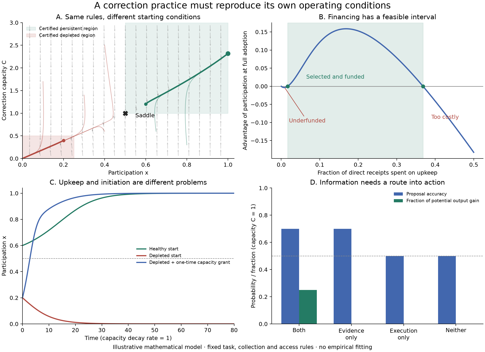

# Results of the integrated correction audit

5 October 2026. Mathematical verification and illustrative simulation, with no empirical data or fitting. See the [proofs](model/CONSTRUCTION.md), [verification plan](VERIFICATION.md) and [scope statement](CENTRAL-CLAIM.md).

## Reference case

The task pays 2 for a correct action and 0 otherwise. Without information, its balanced contexts give baseline output 1. A delivered signal is correct with probability 0.9, giving potential improvement 0.8. Both evidence delivery and implementation require the paid service.

Parameters are \(y_0=1, B=.8,\chi=1,\eta=10,\mu=K=\kappa=1,\tau=1/6\). Thus \(\eta\chi B=8>4\mu K\). A separate witness with \(\chi=.75\) confirms that the result can also coexist with an explicit common spillover.

The exact fee interval is approximately **1.687% to 36.823%** of direct receipts, excluding endpoints. At the chosen fee, the interior saddle is \((x_s,C_s)=(.5,1)\). The functioning equilibrium is \((1,2.3172954069)\), with positive participation advantage 0.1586477034. Both equilibrium eigenvalues are negative; the interior saddle has one eigenvalue of each sign.

Two explicit regions are sufficient for different long-run outcomes under these identical rules:

- \(x\ge.5,C\ge1\), except the saddle itself, converges to the functioning equilibrium.
- \(x\le.25,C\le.5\) converges to the depleted state.

These rectangles are proved subsets of attraction basins, not the complete basin boundary. The reference trajectories start at \((.6,1.2)\) and \((.2,.4)\), respectively.

## Controls

| Change, with other stated mechanisms retained | Outcome |
|---|---|
| Healthy reference start | Self-funded service persists |
| Depleted reference start | Funding practice and service disappear |
| Remove informative evidence, keep fees | Service disappears |
| Remove execution channel, keep fees | Service disappears |
| Signal performs at chance | Service disappears |
| Give nonpayers equal direct access | Funding practice and service disappear |
| Make all extra benefit common | Funding practice and service disappear under this copying rule |
| Reduce recoverable fraction to .25 | Falls below feasibility threshold; service disappears |
| Fee .008 or .42 | Outside feasible interval; service disappears when nonfunders are present |
| Hold capacity externally at 1.2 with fee .008 | Participation persists because the external controller supplies the maintenance shortfall |

The final row is deliberately an added external subsidy, not a comparison with equal resources. It demonstrates what an assumed permanent corrector can conceal. Loss of this service leaves baseline output intact; it is not host extinction.

At \(C=1\), exact task enumeration gives proposal accuracy .7 when evidence works probabilistically, versus .5 without informative evidence. Realized output rises from 1 to 1.2 only when the evidence and implementation channels are both available. Evidence alone improves proposals but leaves realized output at 1. These outcomes follow from the specified task and are not empirical measurements.

## Finite initiation

From \((x,C)=(.2,.4)\), choose a temporary capacity floor \(C_1=10\) and participation target .6. The proof's conservative construction gives time bound 4.6624278662 and a one-time post-investment capacity of 1058.9286402. Under the declared instantaneous conversion, the expenditure is 105.8528640 output units. Membership is not reset.

At the time bound, the simulated state is approximately \((.6963,11.7068)\), safely inside the functioning region. It subsequently approaches the same self-funded equilibrium without further subsidy.

This is an existence construction, **not an affordable reform estimate or a minimum cost**. It ignores endogenous capacity replenishment during the initial interval and therefore can greatly overstate the necessary seed. The intervention still needs an external funder and installation rights. If \(x=0\), copying cannot invent the practice and a capacity grant alone cannot sustain it.

## Equal current output, different continuation

This diagnostic was added after the initial audit and is explicitly exploratory. It compares states with the same gross task output \(y_0+xBq(C)=1.1\):

| Initial state | Current capacity | Current upkeep flow | Current retained output | Continuation |
|---|---:|---:|---:|---|
| Participation \(8/9\) | .6 | .164815 | .935185 | Enters the proved functioning region |
| Participation \(2/9\) | 3 | .053704 | 1.046296 | Enters the proved depleted region |

The state with higher current capacity and retained output loses the service. Current gross output alone cannot distinguish these futures; upkeep and participation identify a material difference. The comparison matches gross output, not every observable or expenditure. It illustrates the model's explanatory possibility; it does not establish empirical predictive advantage over another theory.

## Verification and reproducibility

The numerical audit checked output accounting and compared the analytic fee criterion against numerical equilibrium roots and stability for 600 varied parameter sets within the declared task domain. It also checked the two attraction regions, channel and funding controls, and the capacity-only initiation. These are algebra and implementation checks, not 600 empirical observations.

A second integration method reproduced the seeded trajectory with maximum absolute discrepancy below \(1.6\times10^{-7}\). Participation is integrated in log-odds coordinates, preventing numerical rounding near full adoption from falsely eliminating the rare nonfunding alternative. Raw capacity values occasionally fall about \(10^{-10}\) below zero within integration tolerance; they represent approximately zero. The proof establishes nonnegative physical trajectories.

Separate AI agents reviewed the mechanism, proofs, implementation and primary-literature comparisons. They found no blocking error within the declared scope. This is not independent human peer review or a formal proof-assistant verification.

Exact parameters, software versions, source hash and numerical outcomes are in [verification.json](results/verification.json); varied parameter cases are in [parameter-checks.json](results/parameter-checks.json); full sampled trajectories, including log-odds, are in `results/trajectories.npz`. The generating implementation is [verify_model.py](verify_model.py).
