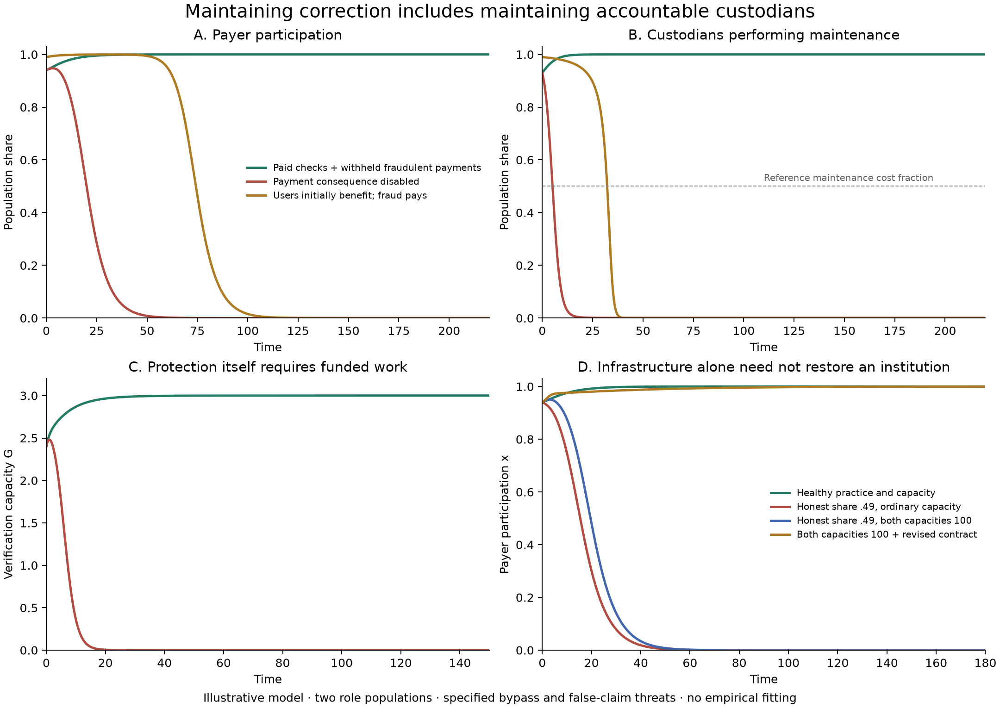

# Maintaining correction when its custodians can defect

5 October 2026. This extension addresses the earlier model's assumed collection, access and maintenance integrity. It establishes a conditional operating regime in which useful correction finances its verification system, and the practice delivering verification faces a profitable fraudulent alternative. It also proves when that arrangement fails.

**The gap is partially closed for an explicit threat class.** Nonpayers can obtain service through false credentials; custodians can claim maintenance payments without doing the work; dishonest peers can approve false claims. Protection and genuine maintenance are no longer fixed. Deferred settlement, authentic successful checks and the peer-assignment procedure remain specified primitives. The result does not establish survival against arbitrary constitutional capture.

The mathematical construction, mechanism audit and adversarial review were conducted by three specialist AI agents. The coordinating agent implemented the numerical verification and synthesis. This is internal mathematical research, not independent human peer review, empirical validation or a claim of scientific priority.

## What changed in the model

There are four operating variables: the payer share x, useful correction capacity C, paid verification capacity G, and the share h of custodians who deliver maintenance and report peer checks truthfully. This last item is a bundled practice; a hybrid that performs maintenance while lying about peers is not separately represented.

The same noisy contextual task produces baseline output y₀ and a correction improvement Aq(C), where A=χB is the privately recoverable part. A verification succeeds only if the technology works and the assigned peer reports honestly:

\[
q(C)=\left(\frac C{K+C}\right)^2,
\qquad D=h\frac G{L+G}.
\]

Paying users obtain service and pay fraction τ of their direct receipts r(C)=y₀+Aq(C). Nonpayers attempt unpaid access, succeeding with probability 1−D. Attempts have no extra cost, so ordinary nonparticipation does not supply a better omitted outside option.

Actual collected fees F=τxr(C) are divided between useful capacity and verification contracts. Let V=(1−λ)F be the latter. A genuine custodian uses fraction m of its contract for maintenance and retains 1−m as compensation. A fraudulent custodian supplies no work and attempts to retain the entire tranche. When an effective check detects that false completion claim, payment is withheld before release.

The practice dynamics follow actual net returns:

\[
\dot x=\kappa x(1-x)[DAq(C)-\tau r(C)],
\]

\[
\dot h=\nu h(1-h)V(D-m).
\]

Both physical capacities require paid renewal:

\[
\dot C=\eta_C\lambda F-\mu_C C,
\qquad
\dot G=\eta_GmhV-\mu_GG.
\]

The user and custodian populations are separate roles. Fees, work, compensation, successful diversion and withheld funds all appear in one exact output ledger. Withheld resources enter an inert reserve; they are never credited again as maintenance or automatic recovery. The reserve is outside the four operating equations, so stability refers to the operating regime, not a unique reserve balance.

## What is now proved

At a fully paying and genuinely maintained stationary regime, two separate conditions must hold:

\[
\boxed{Aq(C_*)p(G_*)>F_*},
\qquad
\boxed{p(G_*)>m},
\quad p(G)=G/(L+G).
\]

The first makes participation preferable to bypassing the fee. The second makes performing maintenance preferable to claiming payment without it. Given the task-derived coefficient bounds, both inequalities together give strict local stability against the represented alternatives. Neither implies the other.

There is also an exact necessary-and-sufficient design threshold for the existence of some fee and funding split meeting both requirements. Write c=C/K, g=G/L, a=μ_CK/η_C and b=μ_GL/(η_Gm). Then

\[
A>A_{\rm crit}
=\inf_{c>0,\;g>m/(1-m)}
\frac{ac+bg}{[c/(1+c)]^2[g/(1+g)]}.
\]

The denominator describes effective protection of the correction benefit. The numerator charges replacement of both capacities and genuine custodian compensation. The bound on g separately requires an incentive to deliver the work. The [full proof](model/CONSTRUCTION.md) reduces the threshold to a cubic equation and gives the actual fee and split realizing a feasible design. This is design feasibility, not a social optimum or an endogenous explanation of adopting that design.

The same construction proves the following:

- An explicit region restores participation, genuine maintenance and both capacities through ordinary copying and paid replacement, even with both attack practices initially present.
- A low-service basin loses funding and both capacities despite a large remaining share of genuine custodians.
- If h₀<m and nonpayers are present, finite initial capacity, or a finite total external capacity input, cannot prevent eventual operating loss under the unchanged contracts. Too little genuine maintenance keeps selecting against the practice needed to replenish verification.
- If false completion claims receive payment regardless of audit results, total delivered verification maintenance is finite. Verification disappears, followed by payer funding and useful capacity, provided both alternatives are initially present.

These loss results concern the service's function. They do not require every genuine custodian to disappear and do not imply extinction of the surrounding society. Purely imitative dynamics cannot introduce an absent alternative, so the corresponding population-boundary exceptions are stated in the proofs.

## Checked example and diagnostic interventions

The reference noisy task has y₀=1, A=.8. With a 15% fee, equal funding split, and m=.5, the checked technology parameters give the exact operating equilibrium x=h=1, C=G=3. The user advantage is .12 and the custodian advantage is .0271875. The joint benefit threshold is approximately .472602, below the assumed .8.

The region x,h≥.9, C≥2.5, G≥2.1 has strict inward and selection margins. The main trajectory starts at (.94,.93,2.7,2.4) and stays in that region while recovering. A separate low-service region x≤.15, C≤.4 loses function for any initial h and finite G.

| Intervention or initial state | Outcome within the specified model |
|---|---|
| Reference contract and healthy starting region | Participation and genuine maintenance persist; C,G approach 3 |
| Same technology, but fraudulent payment cannot be withheld | Genuine maintenance and then the service lose their funding basis |
| Initial genuine-maintenance share .49, below m=.5 | Operating capacity is lost |
| Same .49 share, both initial capacities increased to 100 | Operating capacity is still lost |
| No useful signal, no verification, or purchased verification work never delivered | Service is lost |
| Increase the contracted work fraction to m=.9, retaining the other rules | Users initially favor participation, but custodians favor fraud; the service eventually fails |

The last intervention exposes why a larger maintenance requirement need not strengthen the institution. At full genuine maintenance it raises G from 3 to 5.4 and improves the user advantage to .1621875. However, detection remains .84375 while genuine work consumes .9 of the contract. The custodian return advantage becomes negative. In the numerical trajectory, payer participation initially rises above 99.98% before declining. A proof in the [integration review](review/INTEGRATION.md) certifies loss from the stated capacity bounds; this is not merely a plotted unstable equilibrium. Other fee and allocation designs at m=.9 are not ruled out.

## An exploratory repair comparison

After the initial audit, we compared three imposed interventions from the .49 genuine-maintenance share. Reducing m from .5 to .2 leaves more compensation for genuine delivery but also supplies less work per contract. That contract change alone fails from the original capacity stocks. Raising both stocks to 100 alone also fails under the original contract. Combining the revised contract with those stocks produces recovery through the original copying equations, without forcing a change in either population share.

The combined trajectory enters a region satisfying the proved recovery inequalities, x≥.98, h≥.99, C≥2.9, G≥1.05, by the first qualifying sampled time 19. It subsequently approaches C=3 and G=1.2. This gives a concrete conditional distinction between repairing incentives and supplying the capacity needed while those incentives take effect.

The contract and starting stocks are externally imposed in this comparison. It is exploratory, not preregistered, cost-matched, cost-optimal or a proof that reform will be politically adopted. The supplied stock is an intervention assumption; the simulation does not establish its installation budget, recruitment feasibility or authorization. The resulting ongoing maintenance uses actual fees, with no permanent external subsidy.

## What this contributes and what remains

The central claim becomes more specific: **sustaining useful correction requires sustaining the practices that deliver and verify its maintenance, under the same resource and replacement pressures.** Generating evidence, acting on it, paying for its renewal and maintaining the relevant incentives are separate requirements.

This extension endogenizes a meaningful part of the old access boundary and a threat among its custodians. It does not assume a permanently honest population or a free external verification stock. Its remaining boundary is concrete: an authentic effective check must be able to prevent payment; claimants must not control assignment; delivery and settlement need workable financing; and the admitted maintenance/reporting practices are limited. Actors who seize the payment mechanism, forge final evidence, manipulate assignment, bribe otherwise genuine peers, or combine genuine maintenance with corrupt reporting need additional strategies and mechanisms. Full constitutional survival and legitimacy remain unproved.

These topics have close predecessors in [funded punishment and second-order free riding](https://www.nature.com/articles/nature09203) and [costly vigilance with corruptible enforcement](https://www.pnas.org/doi/10.1073/pnas.1900078116). The advance established here is within this project's explicit construction, not a claim to have discovered accountability or solved alignment generally.

## Verification and files

The audit checked 600 output-ledger cases, 300 Jacobian comparisons and 160 independent numerical comparisons of the design threshold, including 70 where the custodian incentive constraint is active. A second integration method reproduced the reference trajectory within 2.7×10⁻⁸ in the recorded operating variables and reserve. Log-odds and log-capacity coordinates preserve rare alternatives and positive stocks. These checks support the derivation and implementation; they are not empirical observations.

- [Full construction and proofs](model/CONSTRUCTION.md)
- [Integration and accounting review](review/INTEGRATION.md)
- [Adversarial proof and scope review](review/ADVERSARIAL.md)
- [Verification plan and exploratory amendment](VERIFICATION.md)
- [Exact outcomes and source hash](results/verification.json)
- [Reproducible implementation](verify_extension.py)
