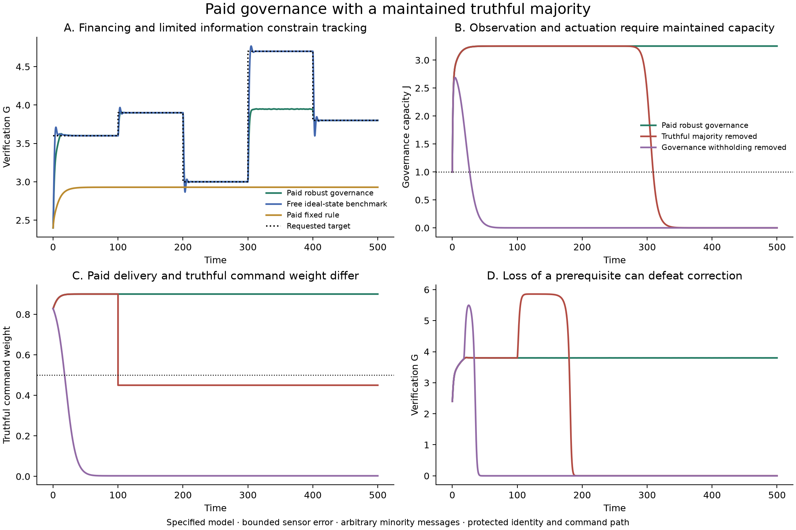

# Funding observation and executable correction

5 October 2026. AI-assisted mathematical construction and simulation, extending Ren's alignment and coordination research. This study closes the previously unpriced observation-and-actuation loop within a specified model: the operating institution now pays for the means of seeing its condition and changing its rules. It also distinguishes maintaining that machinery from maintaining truthful use of it.

**The result is conditional closure of operating finance and a bounded class of governance failures. It is not closure against arbitrary capture of truth, membership, settlement or physical execution.** The construction gives a positive preservation theorem, a loss-of-governance theorem, and a precise information boundary explaining why payment alone cannot supply a universal guarantee.

## What was missing and what changed

The [previous viability controller](../viability-control/README.md) could preserve distinct operating conditions while pursuing changing targets. It assumed that the information and authority needed to do this were available without modeled upkeep. Simply adding another perfectly informed, obedient supervisor would leave that gap intact.

We now divert 2% of the existing fee revenue to governance. This reduces the money available for useful capacity and ordinary verification. Governance capacity J depreciates and must be replenished by actual delivered work. It supports a joint package of sensing, communication, aggregation, computation and actuator maintenance. Its precision worsens and its maximum executable rate falls as J declines. The initial stock is inherited capital; the experiment does not create it from nothing.

The existing paid verification service checks false governance-completion claims. Its workload parameter increases from 1 to 1.1, explicitly reducing checking effectiveness for a given stock. This is an assumed congestion technology, not a measured ten-percent labor bill. Every fee unit is assigned once across useful work, verification, governance work, private retention and inert reserves. No reserve is simultaneously credited as new productive capacity.

## Delivery and truth are distinct practices

The governance population contains three practices:

| Practice | Delivered upkeep | Reports and commands | Modeled monetary return |
|---|---|---|---|
| Truthful maintainer | Pays for and delivers it | Follows the declared procedure | (1−d)W |
| Lying maintainer | Pays for and delivers it | May be arbitrary | (1−d)W |
| Shirker | Delivers none | May be arbitrary | (1−D)W |

Here W is the governance allocation, d=.3 is the delivered-service fraction, and D is existing effective verification. Completion audits detect missing work; they are not invented semantic-truth audits.

Let z be the total maintaining share, and θ the truthful fraction among maintainers. The financial selection equations imply

\[
\dot z=\nu_Z z(1-z)W(D-d),\qquad \dot\theta=0.
\]

The first equation can sustain delivery. The second is an exact limitation: the chosen payment mechanism is neutral between truthful and lying maintainers. It neither creates truthful reporting nor drives that lying minority away. We preserve this hybrid in the model rather than defining every dishonest provider as an easily detected shirker.

Canonical θ=.9 and protected z≥.9 imply at least .81 truthful reporting and command weight. That is a condition on the initial population and its modeled replacement process. Unmodeled drift, bribery, mutation or changes in authenticated weights can break it. The result is not a stochastic guarantee that a finite neutral population retains that composition forever.

## Information and execution with an explicit attack boundary

Within the funded interface, truthful instruments have error at most .002/J in each of the two observed quantities, verification capacity G and the current work requirement m. No informative reading is promised at J=0. Available actuation is J/(1+J), which also vanishes at zero. The controller does not receive an oracle measurement of hidden maintenance shares.

Authenticated weighted medians combine reports. If more than half the weight reports within the true instrument interval, the median lies inside that interval regardless of the other values. Truthful controllers then compute the same robust command from the common pair of estimates. A median of commands selects that command when their combined weight exceeds one half.

This tolerates arbitrary minority reports and commands immediately, even while lying maintainers persist. It does not wait for incentives to eliminate them. Nor does agreement itself establish truth: the majority's physical instrument bounds and the authenticated weights are premises of the argument.

The interface cannot be bypassed within the positive theorem. Its operating maintenance is paid, but its specified mapping, calibration law, membership rules and conditional settlement remain explicit architectural assumptions. This is a common aggregation interface, not a solution to distributed consensus over an arbitrary unreliable network. Continuous bounded-error sensing also does not automatically prove a finite-sampling or delayed implementation.

## The funded preservation theorem

The [mathematical analysis](model/ANALYSIS.md) derives a robust control interval using only purchased observations of G and m, fixed model coefficients and certified lower bounds. It accounts for the whole measurement-error box, even if the median coordinates came from different reports.

The protected region requires paying participation and genuine verification maintenance of at least .9, useful capacity at least 2.5, verification capacity at least 2.1, governance maintenance share at least .9, and governance capacity at least 1. The minimum work fraction rises from the previous .45 to .48, and a separate incentive reserve remains protected. Reusing the old floor after deducting governance costs would not have worked.

**Theorem:** starting within this region, the paid robust controller preserves all these conditions for arbitrary admissible instrument errors and arbitrary minority reports and commands through the specified interface. Paying participation, original genuine maintenance and governance delivery converge to one. Useful capacity approaches 2.929049 and governance capacity approaches 3.250347. Truthful governance weight approaches θ=.9, while lying maintainers persist with weight .1.

The robust admissible-rate interval has an analytic positive margin throughout the region. The proof jointly maintains the resources, provider incentives, observation quality and actual actuator capability needed for its own feedback law. Target tracking is separate: an incompatible request can remain unmet while those conditions survive.

## Numerical comparisons and real costs

The [protocol](PROTOCOL.md) fixed the construction and comparisons before trajectory runs. This is an internal record, not independent preregistration. Numerical results use the same initial operating states and explicitly stated financial differences.

For target 3.8, the funded mechanism preserves the protected state bounds and reaches verification approximately 3.8004; bounded instrument errors cause small continuing deviations. Its exact-observation comparison approaches 3.8. Useful capacity is lower than the earlier value 3 because governance consumes receipts.

The changing request follows 3.6, 3.9, 3, 4.7 and 3.8. Paid governance follows the lower requests, limits verification near 3.95 during the request for 4.7, and returns to 3.8. The old free, exact-state benchmark attains 4.7. This is a cost and information tradeoff, not an improvement on every metric. The paid sufficient controller can reject exact target 4 even when that state satisfies the protected state inequalities; a conservative filter is not the full set of feasible controls.

Fixed rules are useful controls. Reallocating the governance charge to the old two stocks preserves operation and approaches verification 3, without paying for active revision. Holding the rule fixed while paying the new governance charge also survives, approaching verification 2.929049. Neither follows the changing requests. A stable task can require less governance than an adaptive one.

## Failure tests distinguish missing functions

| Intervention | Result in the chosen trajectories | Supported interpretation |
|---|---|---|
| Pay false governance-completion claims despite detection | Maintaining share falls, J depletes, and the chosen malicious commands also lead to operating depletion | Payment consequences are necessary for this maintenance mechanism; the theorem below is narrower than this particular collapse |
| Convert truthful maintainers to lying maintainers at time 100 | Reporting and command control change while z, J and every contemporaneous budget flow are initially unchanged; verification later depletes | Maintaining resources does not establish truthful use of them |
| Bypass command aggregation at time 100 | Operation later depletes despite retaining truthful reporting weight | Information does not guarantee executable control when the command path can be overridden |
| Remove observation or actuation at time 100 | The current rule freezes; these trajectories remain operational but cease following later targets | Loss of revision capability need not cause immediate operating loss |

The truth-conversion event is an imposed change of θ to .45. It is not generated by the equal-payoff imitation equation. Subsequent budgets can change because subsequent behavior changes; only the intervention itself preserves all other states and contemporaneous flows. The bypass test deliberately removes a positive-theorem premise.

Outside the proved region, a reversed control interval is recorded and the truthful proposal becomes zero. This holds the current setting through the interface. It is not an unpriced reset to a safe default and carries no general fallback guarantee. Likewise, a trajectory preserving the listed state inequalities after an observation outage does not satisfy all interface assumptions of the positive theorem. The recorded field describes state bounds, not universal certification.

## A theorem for the loss of revisability

Without withholding for false governance completion, the maintained share satisfies

\[
\dot z=-\nu_Z dWz(1-z).
\]

For an initially present shirking alternative, total future delivered governance expenditure is finite. The maintained capacity J therefore tends to zero. Its sensing guarantee becomes uninformative, and total remaining executable rule variation is finite:

\[
\int_0^\infty |\dot m|\,dt
\le\int_0^\infty J(t)\,dt<\infty.
\]

The rule approaches a frozen setting. This proves loss of sustained observation and revision; it does not prove that the frozen institution always stops producing. The outage controls show why the distinction matters. An institution can keep operating while losing the ability to respond to changed conditions.

## Funding limits and states beyond the certificate

At the declared minimum fee base, maintaining J≥1 needs a governance fee share of at least .7793%. Keeping the useful-capacity floor at its worst corner permits at most 4.6565%. These are individual funding bounds for this particular certificate. The other incentive, information and control conditions must also hold; they are not universal spending recommendations or exact survival thresholds.

The declared sweeps show the limits of the certificate. Shares .2% and .5% lose the chosen J floor but still track the modest tested target. Shares 5% and 8% temporarily breach an operating floor yet reach positive operating regimes. Initial governance-maintenance shares .6 and .8 can recover even though they begin outside the proved region. These outcomes are retained rather than relabeled as model failure.

## Why unrestricted closure cannot follow from payment alone

The [boundary analysis](review/BOUNDARIES.md) gives a precise information obstruction. Suppose two possible situations produce identical available observations but require disjoint sets of actions to remain safe over the next decision interval. No policy using only those observations can guarantee safety in both. Randomization does not fix the problem: at least one situation has failure probability at least one half. With partially distinguishable observation laws, the note gives the corresponding total-variation bound.

This is an elementary information result, not a claim of novel impossibility theory. It concerns necessary safe actions, not merely disjoint sufficient controller intervals. A common conservative action, an initial reserve, better information or an accepted risk can change the conclusion. It does not say that every institution needs continuous observation.

The constructive and negative results together distinguish four questions: can the correction service be financed; will someone maintain it; does its information retain a justified connection to the state; and can the resulting command take effect? Their mechanisms interact, but one successful answer does not supply the others.

## What is closed and what remains an assumption

The previous unpriced observer and assumed execution service have been replaced by a paid, depreciating service; strategic non-delivery; a finite actuator; explicit sensor error; and tolerance of arbitrary minority messages. A closed flow ledger and preservation proof establish that this service can reproduce its operating requirements inside the declared region.

The construction retains an initially sufficient truthful composition, a replacement process preserving that composition, calibrated physical information, authenticated nonduplicable weights, an unbypassable command interface and enforceable settlement. It neither derives these from payment alone nor adds a new perfect semantic auditor. Political legitimacy, changing purposes, finite-population truth drift and unrestricted capture remain outside the result. Thus the correct achievement is a bounded governance-closure theorem, not a general solution to alignment.

This work builds on [costly state verification](https://economics.mit.edu/research/publications/optimal-contracts-and-competitive-markets-costly-state-verification), [measurement-robust control](https://arxiv.org/abs/2104.14030), and established robust aggregation. The [review](review/BOUNDARIES.md) also checks limited-commitment and report-only elicitation precedents. Novelty of the combined application has not been established by an exhaustive literature review.

The next empirical question is specific: can an implemented correction service maintain a validated information-and-actuation interface under its actual resource, latency and attack limits? That requires measured calibration, delivered work and executed commands, including controls that preserve the budget while corrupting reporting. Improving the resource account alone would not answer it.

## Verification and reproducibility

The [recorded results](results/analysis.json) include all comparison arms and sweeps. The nine-flow ledger closes within approximately 9×10⁻¹⁷ on the sampled algebra checks, and the reduced-budget operating derivatives match the earlier equations within 2×10⁻¹⁵. Two thousand protected states and sensor-error corners were checked against the analytic controller inequalities. Selected trajectory comparisons between two solvers agree within 9×10⁻⁶; an independently coded physical-coordinate check agrees within 4×10⁻⁷.

These numerical checks support the implementation; the all-admissible-error guarantee comes from the proof. The [institutional audit](review/INSTITUTIONAL-AUDIT.md), [mathematical construction](model/ANALYSIS.md), [protocol](PROTOCOL.md), and [implementation](simulate_governance.py) preserve the assumptions and adverse controls. All reviews here are AI-assisted internal reviews, not independent human peer review.
