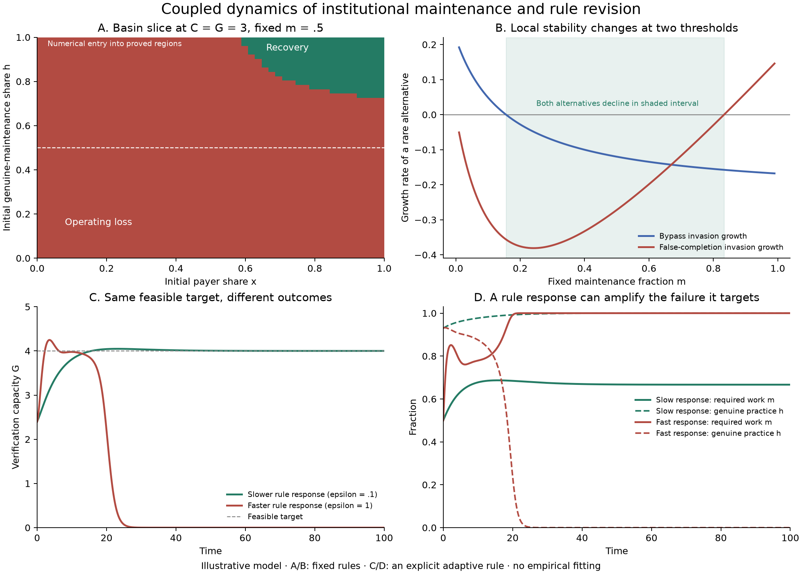

# Coupled adaptation across behavior institutions and shared conditions

5 October 2026. This study develops Ren's systems and complex-systems direction: investigate how local adaptation, shared conditions, institutional rules and situated purposes change one another. It analyzes the attractor structure of our existing model and adds one explicit feedback from institutional performance to rule revision. The broader plural-goal architecture is a proposed research framework; it is not already implemented in the experiment.

**The central research object is the joint dynamics of actions, the conditions supporting them, and the processes that revise actions and rules.** Locally improving responses can jointly maintain those conditions, erode them or lock the system into a difficult transition. Their interaction need not optimize any common objective.

## Local adaptation and collective outcomes

The useful version of the local-optimization intuition is conditional: an action can improve an actor's immediate situation while changing shared conditions in ways omitted from that actor's information, decision horizon or incentives. Other actors then adapt to the changed situation, potentially reinforcing the degradation. This can happen even if their purposes differ and no global objective exists.

It is not necessary to assume everybody literally solves an optimization problem. Learning, imitation, satisficing, norms, commitments and bargaining are different mechanisms and should be distinguished when they affect the prediction. Likewise, collective degradation is not an inevitable consequence of local adaptation. Coordination, reciprocal commitments, institutional design and changing what participants can observe can alter the loop.

A commons can be considered, in a broad causal sense, a shared condition supporting different purposes: water, usable knowledge, a trusted evidence process or the capacity to challenge decisions. This broad framing does not erase the different mechanisms of rival common-pool resources, public goods and excludable services. The present service model has partial exclusion and is not automatically a model of every commons. Ostrom's [polycentric analysis](https://www.aeaweb.org/articles?id=10.1257/aer.100.3.641) is a relevant foundation for studying situated governance without assuming one central optimizer.

## The levels should be connected in both directions

| Level or component | What changes | What its consequences change in turn |
|---|---|---|
| Situated action | Work, compliance, cooperation, exit, attempts to bypass rules | Output, others' opportunities, evidence and shared capacities |
| Operational institution | Resources, verification, funding and enacted decision rights | Feasible actions, local returns and what becomes observable |
| Rule revision | Fees, work requirements, appointment and admission procedures | The game faced by participants and the survival of its institutions |
| Frames and evaluative commitments | What actors notice, believe, can propose and regard as acceptable | Their choices, institutional proposals and willingness to maintain arrangements |
| Shared material and social conditions | Regeneration, exposure, inherited capabilities and relationships | Which purposes can be pursued and which forms of coordination remain viable |

These are interacting components, not an obligatory universal hierarchy. A participant may belong to several institutions; institutions can overlap. Multiple roles alone do not establish multilevel selection: that additional theory must specify reproduction, replacement or competition at the group level.

An expanded local model can use state S=(environment, network, institutions, resources, frames, beliefs, evaluative relations), with explicit transition mechanisms connecting them. If goals and rules change, a basin drawn only in current behavior coordinates can move. Including them as state variables requires specifying how they change; notation alone does not explain their formation. The [multilevel framework](review/MULTILEVEL.md) distinguishes these objects and proposes discriminating interventions.

## Why the whole can behave differently from its parts

Even a two-component linearization captures the issue. Suppose local adaptation u and institutional response v follow

\[
\dot u=-\alpha u+\beta v,
\qquad
\dot v=\gamma u-\delta v,
\quad \alpha,\delta>0.
\]

Each component restores itself when the other is fixed. The coupled system becomes unstable if βγ>αδ: reinforcement across the components exceeds their restoring responses. This is ordinary feedback mathematics, not a new universal law. Its methodological lesson is that studying each subsystem under a fixed background can miss the consequential relation.

The same principle applies beyond linear systems, but nonlinear claims need their own analysis. A reinforcing loop can enlarge a perturbation, move the system into another basin or saturate. It does not automatically imply exponential growth forever, a global potential function, a phase transition or a bad outcome.

## What the existing model actually contains

Our four operating states are payer participation x, genuine maintenance with truthful reporting h, useful correction capacity C and verification capacity G. Rules are fixed in the first analysis.

The main reinforcing loops are:

- Paying participation → fee revenue → useful and verification capacity → advantage of paying over bypass → participation.
- Genuine maintenance → delivered verification → effective checks → advantage of genuine maintenance over false completion → genuine maintenance.

Depreciation supplies restoring pressure on each stock. The work requirement m has opposing effects: it increases work delivered by a genuine contractor, while reducing the compensation retained for doing that work. Loop signs therefore depend on the mechanism and state; an intervention cannot be assessed by counting positive arrows.

At the reference fixed parameters we identified the following equilibrium structure, with coordinates ordered (x,h,C,G):

| Equilibrium | Coordinates, approximately | Local character |
|---|---|---|
| Functioning service | (1,1,3,3) | Locally attracting operating state |
| Depleted family | (0,h,0,0), for 0≤h≤1 | An attracting family, with neutral variation along h |
| Mixed users | (.61803,1,1.68080,1.68080) | Saddle with one unstable direction |
| Mixed custodians | (1,.72871,3,2.18614) | Saddle with one unstable direction |
| Both populations mixed | (.92375,.74561,2.73030,2.03574) | Saddle with two unstable directions |

An additional boundary state retains paying users with no genuine maintenance; it is unstable to the represented bypass practice. All points and eigenvalues are recorded in the [analysis](results/analysis.json). These equilibria and proved basin subsets are not a complete global classification of every possible invariant set.

The depleted family matters: once the institution loses paid activity, the replacement of custodian practices slows or stops. Operating capacity can be zero while different inherited shares remain. Present output or installed capacity alone therefore does not fully describe the conditions for future recovery.

The weak unstable direction near the fully mixed saddle has a characteristic growth time of about 143 model time units. Long plateaus can consequently be transients rather than additional attractors. We do not classify an unresolved trajectory as a new regime merely because it changes slowly.

Panel A maps 2,601 initial states at C=G=3 and m=.5. The numerical trajectories entered either a proved recovery region or a proved loss region by time 600: 221 and 2,380 cases, respectively. These counts describe an arbitrary grid slice, not a real-world failure probability or the volumes of complete four-dimensional basins. Halving the integration step changed no classifications; 32 independent adaptive-solver checks agreed. This is numerical evidence supported by analytical region certificates, not interval-validated exact basin geometry.

The mathematical analysis also finds a structural restriction. After a positive change of clock, the fixed-rule interior dynamics is strongly cooperative. That gives a componentwise upward-closed recovery basin and excludes attracting periodic orbits lying entirely in the interior. It does not prove that every trajectory converges or exclude all boundary and unstable recurrent behavior. Adding more complexity must therefore change actual mechanisms, rather than merely declaring that this particular system should oscillate. The argument uses established [cooperative-systems mathematics](https://escholarship.org/content/qt67z7c17v/qt67z7c17v.pdf).

## Different meanings of transition

Panel B varies the fixed work fraction m. For the reference technology, fee and split, the functioning equilibrium is strictly invasion-stable exactly when

\[
\frac{29}{186}<m<\frac56,
\]

approximately .155914<m<.833333. At the lower boundary the bypass alternative gains an invasion advantage; at the upper boundary false completion gains one. These are local stability changes involving boundary equilibrium branches. Their occurrence does not by itself prove that all initial states fail outside the interval.

Keep several questions separate:

- **Basin crossing:** a disturbance changes the state under otherwise fixed dynamics.
- **Bifurcation:** changing a parameter alters equilibria or their stability.
- **Rate-sensitive tracking:** the path and speed of change prevent a system from following an available regime.
- **Noise-driven escape:** stochastic events move a system between regimes.
- **Change of the modeled game:** new actions, categories, participants or rules require a changed state description or update mechanism.

The present audit establishes selected fixed-rule stability boundaries and a concrete rate-sensitive controller example. It does not demonstrate every mechanism on this list. The distinction between bifurcation, noise and rate mechanisms has an established formal literature, including [Ashwin and colleagues](https://doi.org/10.1098/rsta.2011.0306).

## A rule response that amplifies its own problem

We added one explicit meta-level response:

\[
\dot m=\epsilon m(1-m)(G_{\rm target}-G).
\]

A manager facing insufficient verification demands that custodians spend a larger fraction of each contract on maintenance. Holding their behavior fixed, that would increase delivered verification work. But the same change reduces its private advantage relative to a false completion claim. Declining genuine maintenance can then make verification worse, which prompts further increases in the requirement.

For the same initial state (.94,.93,2.7,2.4,m=.5) and the same feasible target G_target=4:

- With response speed ε=.1, the trajectory approaches x=h=1, C=3, G=4, m=2/3.
- With ε=1, genuine maintenance declines, verification collapses and m approaches one. By sampled time 21.6, it has entered a forward-invariant loss region whose inequalities certify eventual operating loss.

The desired functioning equilibrium remains locally stable for **every ε>0**. Its verification/rule response block has characteristic polynomial

\[
z^2+z+6\epsilon m_*(1-m_*)=0.
\]

The transition from real to complex roots changes damping, not stability. This example is therefore not a Hopf bifurcation. It is a difference in the joint dynamics' basins and transients as the rule-response speed changes. It should not be advertised as a complete classification of standard rate-induced tipping.

A useful negative control uses target 3.6. It recovers even at ε=10, despite briefly pushing m above the fixed-rule upper stability boundary. Crossing that boundary temporarily is consequently not sufficient to diagnose failure. The changing h, G, revenue and rule response must be considered together.

The controller has a single fixed target, accurate access to G, and an assumed ability to revise m at no modeled governance cost. It continues revising even if service revenue disappears. It illustrates one cross-level feedback; it does not close the institutional costs of governance or model the formation of its own goal.

## Multiple changing goals without a hidden master score

The broader framework should record each participant's consequences as a vector and its evaluative commitments as a potentially incomplete relation. Livelihood, autonomy, reliability, status, belonging and environmental conditions need not have fixed exchange rates. Different actors can maintain different concerns; priorities can change with experience and situation.

Three changes must be distinguishable: learning a new fact within an existing frame, acquiring a new way to represent the situation, and revising what one regards as acceptable or important. A changed action does not identify which occurred. Coercion and narrowed options can also resemble changed preference. Choice mechanisms and evidence are needed, not merely time-varying utility weights.

A small diagnostic in the current model shows how plurality can guide intervention without aggregating everything. To preserve a declared custodian incentive margin δ_h and prevent immediate depletion of verification, the work fraction must satisfy

\[
\frac{\mu_GG}{\eta_GhV}\le m\le D-\delta_h,
\quad hV>0.
\]

If the interval is empty, no present choice of m satisfies both concerns. A further concern, payer participation, requires DAq(C)−τr(C) to meet its declared margin; changing m cannot repair that condition instantaneously because its effects pass through future maintenance and capacity.

This exposes a situated conflict rather than resolving it by a universal scalar. Different funding, workloads, technology, practices or an openly accepted tradeoff may be necessary. The interval is an instantaneous feasibility test, not a guarantee under delay or uncertainty. Indeed, the recovering fast response at target 3.6 briefly has an empty interval: temporary depletion can be part of a viable path. Protected conditions, deadlines and the acceptability of such transitions require explicit judgments.

## The resulting research direction

The strengthened organizing claim is: **situated agents change the conditions and rules under which further adaptation occurs; those changes alter which goals, interpretations and actions can be maintained or revised. Collective trajectories depend on the resulting feedback across levels.**

For an application to AI alignment, this suggests analyzing how behavior, evaluation institutions, human interpretation, resource constraints and revision rights form a coupled process. Preserving a particular attractor is not automatically desirable. The normative questions—whose concerns count, which losses are acceptable and who may contest the arrangement—must remain explicit.

There is substantial prior work to build on. [Environmental-feedback games](https://pmc.ncbi.nlm.nih.gov/articles/PMC7021758/) already couple strategy and shared conditions. [Itao and Kaneko](https://arxiv.org/abs/2501.07249) evolve contextual decision functions and study emergent institutional modes, including cycles. These are serious comparators for the broader programme. The present contribution is a checked systems analysis of our specified mechanism and a concrete cross-level failure example; a validated theory integrating open-ended plural goal formation remains future work.

The [mathematical analysis](model/ANALYSIS.md), [multilevel architecture](review/MULTILEVEL.md), [systems review](review/SYSTEMS-REVIEW.md), [exploratory protocol](PROTOCOL.md) and [reproducible implementation](analyze_system.py) keep proved results, numerical findings and proposed extensions separate.

The subsequent [bounded rule-revision study](../viability-control/README.md) turns the constraint-based direction into an explicit controller, a sufficient invariant-region proof, and comparisons against simpler rules. It also tests vulnerability to the reintroduction of a rare competing practice.
