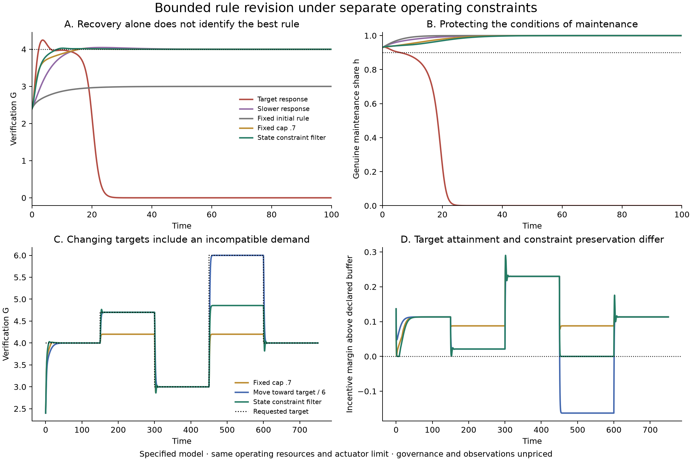
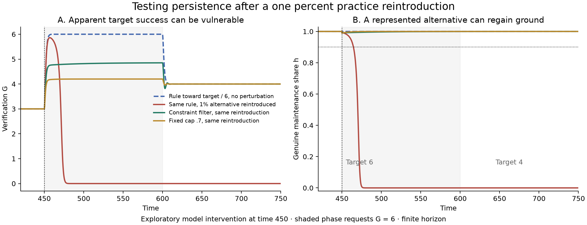

# Preserving institutional operation while revising its targets

5 October 2026. This AI-assisted study extends Ren's systems account of alignment and coordination. It constructs a bounded-rate rule for the existing paid-verification model, proves a sufficient region in which distinct operating conditions remain satisfied, and compares the rule with simpler alternatives. It then tests whether apparent success persists when a previously rare competing practice is reintroduced. The results are mathematical and numerical properties of a specified model, with no empirical fitting.

**A feasible direction of change can be a set of permitted actions that preserves several conditions, rather than the ascent direction of one shared objective.** In this model the set can be computed, shown to remain nonempty, and used while a requested target changes. That is a concrete extension of the earlier systems analysis. It does not establish how people choose legitimate conditions or form their purposes.

## The problem after identifying the failure loop

The [preceding study](../systems-dynamics/README.md) found that demanding more maintenance in response to weak verification could reduce the private advantage of genuine work. Declining genuine maintenance then weakened verification further. A locally stable, feasible target could coexist with a trajectory toward operating loss.

The next question is constructive: can a rule revise its demands without undermining the conditions that make delivered maintenance possible? A comparison with only the failing rule would be too easy. Fixed rules, slower adjustment, a move toward a known equilibrium, and fixed upper caps are serious alternatives.

The controlled variable is the required maintenance fraction m. Every dynamic controller has the same rate limit, |dm/dt|≤.5. The fee, allocation, production and maintenance technologies remain unchanged. Initial resources and available state information are matched; realized revenue can differ because participation is an outcome. Observation, calculation and authority to change rules remain unpriced assumptions.

## Separate conditions and an admissible direction

The four operating states are payer participation x, the genuine-maintenance share h, useful capacity C and verification capacity G. Effective checking is D=hG/(1+G). Genuine maintenance has a private return advantage proportional to D−m.

Declare the following protected region:

\[
\mathcal S=\{x\ge.9,\ h\ge.9,\ C\ge2.5,\ G\ge2.1,
\ m\ge.45,\ b=D-m-.02\ge0\}.
\]

The quantities remain separate. A high verification score cannot compensate for falling below the participation floor within this certificate. The numbers are design choices in an illustrative model; they are neither estimated social constants nor a complete account of human interests.

Let u=dm/dt. Starting from a requested command u₀, allow only rates in

\[
\boxed{
\mathcal U_{\rm adm}(z)=
\left[\max\{-0.5,-2(m-.45)\},
\min\{0.5,\dot D+2b\}\right].
}
\]

Choose the admissible rate nearest to u₀. The ordinary request remains u₀=εm(1−m)(T−G), where T is the verification target. The filter can slow, stop or reverse a request that would consume the protected incentive margin too rapidly. It changes the rate of the rule, with no instantaneous reset of m.

The [proof](model/ANALYSIS.md) establishes that this interval is nonempty everywhere in the declared region. The derivative inequalities prevent both m−.45 and b from crossing below zero. The remaining operating floors point inward under the same conditions.

**The resulting theorem:** from any state in this region, the exact continuous controller preserves every declared condition for any bounded measurable target path. Payer participation and genuine maintenance converge to one, useful capacity converges to three, and verification remains bounded above and away from zero. Target tracking is a separate question and is not guaranteed by this theorem.

The proof concerns a sufficient controlled invariant region. It does not compute the full viability kernel, certify arbitrary disturbances, or imply that states outside this region cannot recover. The filter presumes the model, observations and control authority it uses.

## Comparisons with simpler rules

The [initial protocol](PROTOCOL-INITIAL.md) specified the controller, comparisons and test cases before the new runs. It was an internal research record, not independent preregistration; the earlier target-only failure case was already known. The [current protocol](PROTOCOL.md) records later additions explicitly.

At the original reference state and target 4, several simple methods work. Slower adjustment, a fixed cap of .7, and moving toward the known equilibrium rule all recover. The filtered controller therefore has no demonstrated necessity on that one example. Holding m=.5 preserves operation but approaches verification 3.

A harder declared comparison uses target 4.7 across 72 initial states inside the protected region. All dynamic rules share the same actuator limit. Results through time 400 are:

| Controller | Runs with an operating floor breach | Runs with operating depletion by the horizon | Runs tracking 4.7 within .01 over the final 30 time units |
|---|---:|---:|---:|
| Target response | 48 | 48 | 24 |
| Ten-times-slower response | 26 | 26 | 46 |
| Fixed initial m | 0 | 0 | 0 |
| Move toward the known equilibrium rule | 46 | 46 | 26 |
| Fixed upper cap .6 | 0 | 0 | 0 |
| Fixed upper cap .7 | 4 | 0 | 0 |
| Fixed upper cap .8 | 48 | 48 | 24 |
| State constraint filter | 0 | 0 | 72 |

Operating depletion here means x, C and G are all below 10⁻⁶ at the final time. A floor breach is different: the cap-.7 cases include small temporary drops of h below .9 with no observed depletion. The fixed arm retains its initial .45 or .5 throughout; it receives no initial reset.

These counts describe a chosen grid, not real-world probabilities or an exhaustive comparison of possible controllers. They support a specific claim: the state-dependent filter combined protection with higher target attainment more consistently than these fixed precautions and adjustment rules. They do not prove superiority over every slower schedule, every cap, predictive control, or a differently chosen protected region.

## A changing request can become incompatible with its supporting conditions

A second case switches the target through 4, 4.7, 3, 6 and 4, with 150 time units per phase. The filter approaches the first three targets, limits verification during the request for 6, and returns to 4 afterward.

In a fully operating steady state, C=3 and G=6m. Retaining D−m≥.02 then requires

\[
\frac{G}{1+G}-\frac{G}{6}\ge.02.
\]

Together with the maintenance floor, this permits steady targets in the protected region from 2.7 to approximately 4.855285. A target of 6 conflicts with the declared incentive reserve at a clean steady state. The filter approaches the upper compatible value during that phase and leaves an explicit tracking shortfall.

This is a model-specific conditional bound. It says that the request and the protected conditions cannot all hold at that steady state; it does not establish that a universal social target is excessive. Different technologies, funding or explicitly revised conditions can change the bound.

## Apparent performance and vulnerability to a returning practice

There is an important adverse control. Without an imposed perturbation, moving toward the known equilibrium rule reaches verification near 6 for the whole finite high-target phase, even while its maintenance incentive is negative. It later returns to 4. A violated incentive margin therefore does not by itself demonstrate immediate collapse.

The model explains the delay. Earlier favorable selection made false completion extraordinarily rare. An invasion advantage needs time to amplify that small share. A long period of apparent success can reflect historical population composition rather than the ability to resist a returning practice. The same effect can delay payer exit after verification has failed.

After observing this result, we added a separately labeled exploratory intervention. At the switch to target 6, impose h:=min(h,.99) for every controller, leaving the other states untouched. This reintroduces a one-percent share of an already represented alternative where it was rarer. It is an imposed perturbation, not an endogenous mutation mechanism.

The equilibrium-rule controller then loses genuine maintenance and verification. At time 750, payer participation is still about .99865 and useful capacity about 2.996, so it would be inaccurate to report that every operating state has already depleted. The slower target response also loses verification. The filtered rule preserves its conditions, limits the excessive request, and reaches the later target 4. The cap-.7 and fixed-rule controls also survive, while retaining their tracking limits.

For the filtered controller, the imposed jump remains inside the certified region. The theorem applies again from the post-jump state. It does not cover every possible shock; a larger jump outside that region would need a new analysis. The identical intervention map has zero effect on arms whose genuine share had already fallen below .99.

The supported inference is that output, remaining incentive margin and response to reintroduced alternatives carry different information. Their distinction is relevant to alignment research, but its application to actual AI systems or institutions remains a hypothesis requiring evidence.

## Changing a protected condition and reducing the observation requirement

Two mathematical extensions were derived after the primary protocol and are not additional simulated treatment arms.

First, a declared incentive reserve δ can itself change. The admissible upper rate becomes Ddot−δdot+αb. A tightening reserve consumes some of the available response rate and slack. The proof gives an explicit sufficient bound on how rapidly it may tighten while retaining feasibility. This formalizes bounded revision of one protected standard; it does not explain where the revision came from or whether it is legitimate.

Second, direct observation of h is a serious assumption. A conservative variant uses a certified lower bound h≥.9 in place of repeated exact measurements. The mathematical note proves a corresponding invariant region and derives stricter tracking restrictions. This reduces the information required during operation at the cost of conservatism. It still needs a justified initial lower bound, reliable observations of the other states, and the correct model. It does not solve the institutional problem of establishing trustworthy evidence.

## Scientific contribution and remaining test

The central claim is now constructive and bounded: **when a proposed institutional change affects the incentives and capacities that sustain its own implementation, a jointly feasible set of rate constraints can preserve those conditions while requested targets change.** In the tested model, ignoring those constraints can create a failure loop, while fixed precautions can preserve operation but limit attainable targets.

This builds on established [control barrier functions](https://arxiv.org/abs/1609.06408) and [viability approaches to commons with multiple usages](https://arxiv.org/abs/2107.02684). Neither preserving multiple conditions nor separating performance from viability is new. The contribution here is the explicit funded-maintenance mechanism, its bounded-rate certificate, the comparison with simpler rules, and the exploratory distinction between unperturbed performance and persistence after practice reintroduction. Novelty beyond that has not been established.

The broader AI-alignment research proposition is to study whether evaluation demands change the incentives and resources required to produce trustworthy evaluation. A discriminating experiment would vary those demands at matched resources, measure actual delivery separately from reported completion, and test whether the proposed maintenance margin predicts deterioration before output does. It must compare against simpler precautions and include the costs and errors of observing that margin. The [research design](review/RESEARCH-DESIGN.md) states candidate tests and limits.

The principal remaining gap is empirical and institutional: the controller assumes trustworthy observations and executable revision. Those functions must themselves be supplied by fallible, resource-limited participants. Endogenizing them could change or eliminate the present safe region. Multiple human purposes, contestation over the protected conditions, and open-ended formation of goals also remain outside the implemented model.

The subsequent [paid-governance extension](../governance-closure/README.md) addresses that operating gap with a reduced resource budget, selected service delivery, finite observation quality and actuation, and arbitrary minority messages. It establishes a conditional preservation theorem while retaining the initial truthful-majority and physical-interface assumptions. The present experiment and its original scope are preserved.

## Verification and materials

The operating derivatives match the source model to approximately 10⁻¹⁷ on 2,000 sampled states. Analytic inequalities establish controller feasibility; selected trajectories agree between two adaptive solvers within 5×10⁻⁷ in physical state. A reviewer also independently integrated the physical-coordinate equations from the lowest protected corner and found agreement within 6×10⁻⁸. Numerical plots and minima are sampled approximations, not interval-arithmetic certification.

The [mathematical analysis](model/ANALYSIS.md), [prior-art and implementation review](review/PRIOR-ART.md), [recorded results](results/comparison.json), [complete grid outcomes](results/grid.json), and [comparison implementation](compare_controllers.py) preserve the distinction between theorem, numerical result and proposed application. No empirical validation or general solution to alignment is claimed.
