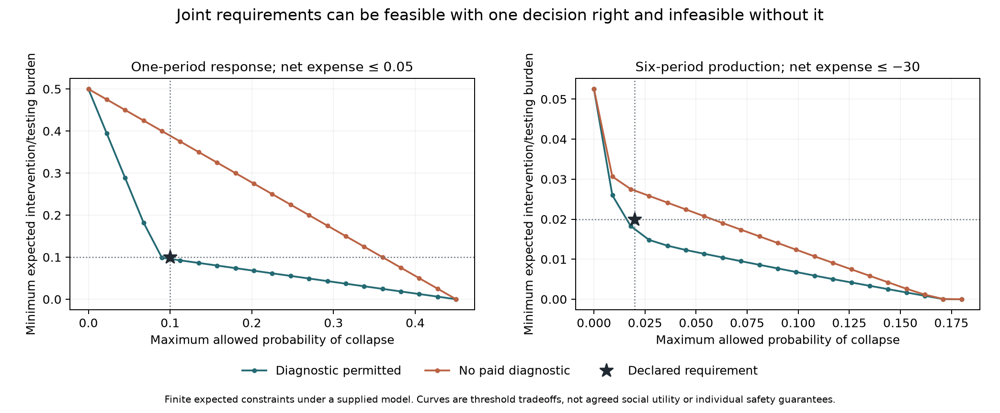

# Plural requirements for attainable correction

An exploratory finite decision study asking whether **one observation-based policy** can meet several declared bounds without a common weighted utility. It reuses the preceding experiment's physical dynamics unchanged and varies explicitly specified action permissions. AI-generated research under Ren's direction, 5 October 2026.

Read the [research synthesis](../../sources/15-codex-theory-conversations/2026-10-05-plural-requirements-and-attainable-correction.md), [protocol](PROTOCOL.md), [mathematical proofs](../../_process/history/2026-10-04-integrated-evolution/plural-correction-math.md), [design and implementation audit](../../_process/history/2026-10-04-integrated-evolution/plural-correction-design-review.md), and [prior-art audit](../../_process/history/2026-10-04-integrated-evolution/plural-correction-prior-art.md).

## What is evaluated

Three expected consequences replace the old scalar objective: F is terminal collapse probability; H is target-absent repair count plus .05 per test; C is cumulative expenditure minus output. Terminal stock salvage and the old collapse penalty are removed. Hard cash affordability still applies on every branch. The thresholds can stand for different constituencies' requirements, but the model does not contain individual identities, private information, ownership, bargaining or consent. H is a declared burden, not complete harm; repair may restore stock despite absence of its fault target.

A phase-I linear program finds the minimum normalized worst violation of all bounds together. Feasible queries return a policy witness. Infeasible queries return a positive separating certificate checked independently by backward dynamic programming. **Any policy shown for an infeasible query remains a violating diagnostic policy.** It is not an acceptable compromise or an agreed social objective.

## Exact one-period witness

Start with stock one, cash eight, ready diagnostics and fault belief one-half. Keep readiness, test, repair only on a positive result. Independent latent-event enumeration gives F=.085, H=.10, C=.04. This meets bounds (.10,.10,.05).

Without paid testing, every policy obeys F+.9H=.45, while those bounds require F+.9H<=.19. This is an analytic obstruction to joint feasibility, independent of C. Permission using a posterior floor .75 after the test admits the successful response; the same floor applied to the opening belief .5 blocks it. A post-test floor .95 also blocks all repairs here. These supplied rules are not claims about legitimate authority.

A funding/permission control starts with cash two and no repair permission. Funding alone or permission alone cannot meet the bounds. Both together can. This demonstrates a constructed complementarity: an isolated intervention can fail while a joint intervention succeeds. A different threshold tuple may produce a different result.

## Six-period comparisons

The full six-period graph has 2,374 belief states. Thresholds below use the same observed production, noisy diagnosis, actual cash, rebuilding lag and repair technology. Full access, no paid diagnosis and no repair differ only by removal of actions from that graph.

| Required F | Required H | Required C | Full access | No paid diagnosis | No repair |
|---:|---:|---:|---|---|---|
| <=.02 | <=.02 | <=−30 | Feasible | Infeasible | Infeasible |
| <=.01 | <=.02 | <=−30 | Infeasible | Infeasible | Infeasible |
| <=.02 | <=.03 | <=−30 | Feasible | Feasible | Infeasible |
| <=.005 | <=.01 | <=−31 | Infeasible | Infeasible | Infeasible |

For the first tuple, a full-access witness gives (.018232591, .018232591, −30.017674090). For the no-diagnostic restriction, weights (.158712769,.841287231,0) provide a separating margin .006015185 above the weighted bound. The zero coefficient on C means changing C alone cannot remove this particular obstruction while F and H stay fixed. It does not tell us which requirement should be relaxed.



Both plots retain an explicit bound on C. They join 21 solved threshold queries in each mode, rather than claiming an analytically complete frontier. At the marked requirement, full diagnostic access lies below the allowed burden and no paid diagnosis lies above it. Above each curve, the indicated burden allowance can be met at that failure and expense cap. These are expected quantities, not per-person or pathwise protections.

## Complete record

The [results](results-v1/results.json) contain all 252 grid queries, twelve detailed main examples, six one-period permission comparisons, four cash/permission comparisons, and 84 frontier queries. Detailed queries overlap the grid; they are not independent replications. Within each mode's 84 main queries, full access has 52 feasible, no diagnosis 44, and no repair 12. These counts describe the chosen grid only, not social prevalence or institutional quality.

The same results preserve three separate elementary constructions: pairwise-compatible but jointly-incompatible requirements; expected satisfaction with no jointly acceptable realized outcome; and an initially preferred plan refused after revelation of who bears its cost. Those are analytic counterexamples, not modules already integrated into the productive model.

`development.json` and `development-feasibility.json` retain the exploratory calculations that informed the examples. `development-inputs/` retains the initial wrapper before adding post-diagnostic authorization and terminal-state support. The finite model has no sampled experimental population, seeds, or held-out data.

The [manifest](results-v1/manifest.json) hashes exact inputs under `results-v1/inputs/`. `upstream_model.py` is byte-identical to `../recoverable-inquiry/model.py`; it is an isolated snapshot so later research does not silently change this experiment. A review found that terminal-only graphs initially failed in the wrapper; explicit support for zero stock or horizon zero was added and independently tested before the final run.

## Reproduction and verification

Dependencies: Python with NumPy, SciPy and Matplotlib. From repository root:

```sh
python -m unittest discover -s experiments/plural-correction -p 'test_model.py' -v
python experiments/plural-correction/analyze.py --output results-reproduction
```

The calculation refuses to overwrite an existing directory. The nine independent tests cover all one-period action consequences by latent enumeration, the analytic witness/obstruction, separation checked against independent actions, pre- versus post-diagnostic permission, action-set inclusion, forward/backward policy reconstruction and cash conservation, impossible observations, terminal-only graphs, and funding/permission complementarity. The actual completed test report is in [verification/TESTS.txt](verification/TESTS.txt).

[Saved run checks](results-v1/checks.json): maximum flow residual 1.01e−15; maximum independently reconstructed policy discrepancy 2.49e−14; maximum absolute primal–dual discrepancy 5.21e−17; no unresolved query. These are floating-point numerical checks, not interval-arithmetic proof or empirical error bounds. The figure was visually inspected. Final file hashes and local-link checks are in [verification/checks.json](verification/checks.json).

## Interpretation limits

Joint feasibility does not establish a bargaining solution, truthful reporting, decentralized executability, legitimate authority or continuing consent. The model's criteria, bounds, prior, technology and available actions remain supplied. An unavailable diagnostic has the same mathematical effect whether it comes from a ban, a broken device or another cause; real-world causal attribution requires separate evidence. Pure action restriction yields set inclusion only while all other relevant conditions are held fixed.

The next target is to specify actual loss-bearing parties and their refusal opportunities, then compare initial joint feasibility with a policy they would continue accepting after further evidence. Any compensation must have a real payer, available funds and explicit incidence. That strategic extension is not yet implemented here.
