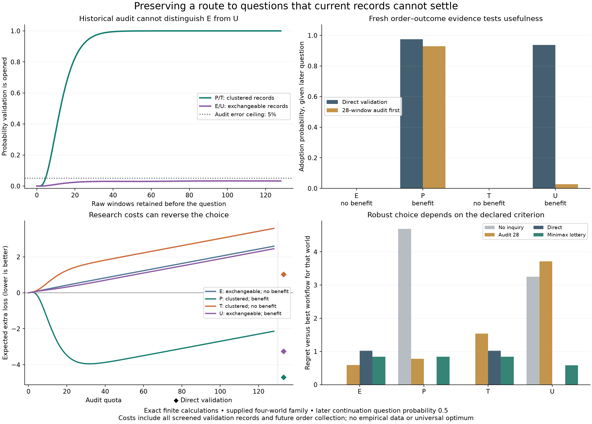

# Prospective preservation and questions without anomalies

Exact finite calculation for the seventh research cycle. The [research synthesis](../../sources/15-codex-theory-conversations/2026-10-05-questions-without-anomalies.md) explains the interpretation; [PROTOCOL.md](PROTOCOL.md) specifies the world, chronology, observations, and costs.

Four supplied worlds distinguish historical clustering from future policy usefulness. Every world has the same joint routine count/endpoint/outcome law. Within two world pairs, even the complete four-switch historical windows have the same law, until ordering is linked to fresh later outcomes. This makes the limit of anomaly-required investigation explicit.

Archive quotas are paid before a later question is revealed. A historical audit can open independent policy validation; direct validation can investigate without that audit. Fresh validation is charged for every screened case and controls false acceptance of nonpositive ongoing benefit after future record expenses. Response efficacy is supplied. This is one finite episode with common purposes and a known candidate grammar, not unrestricted discovery or empirical institutional research.

At base prices, conditional on the continuation question in world U, audit-28 adopts the useful unflagged relationship with probability 2.719%; direct validation does so with probability 93.838%. Across 286 declared priors, the best workflow is direct in 233, no inquiry in 49, and audit-first in four. Thus preservation can help, waste resources, or miss an opportunity that fresh evidence could reveal. No universal audit quota follows.



## Reproduce and inspect

The code uses Python, NumPy, SciPy, and Matplotlib. In this workspace the existing runtime is `/private/tmp/meta-attractor-plot-env/bin/python`.

```sh
cd experiments/prospective-revision
/private/tmp/meta-attractor-plot-env/bin/python -m unittest -v test_model.py
```

`analyze.py` refuses to overwrite an existing results directory. To reproduce without altering the record, copy the five files in [results/inputs](results/inputs) into a fresh directory and run `python analyze.py` there. No network or random seed is required.

- [model.py](model.py): joint laws, exact test probabilities, complete expense decomposition, feasible workflows, and minimax-regret LP.
- [test_model.py](test_model.py): six tests including independent finite enumeration, indistinguishability, net-zero boundaries, branch costs, and LP certificates.
- [analyze.py](analyze.py), [config.json](config.json): full enumeration and declared parameters.
- [Full results](results/results.json), [compact summary](results/summary.json), [input hashes](results/manifest.json), and [SVG figure](results/prospective-revision.svg).
- [First development output](results-v1/results.json) and [layout revision](results-v2/results.json): preserved with their exact inputs. Final calculation values are unchanged; labels/legend placement and the generic response-cost baseline expression were corrected after review.
- [Mathematical audit](../../_process/research/2026-10-04-integrated-evolution/prospective-revision-math.md), [implementation audit](../../_process/history/2026-10-04-integrated-evolution/prospective-revision-design-review.md), and [prior art](../../_process/history/2026-10-04-integrated-evolution/prospective-revision-prior-art.md).

All 130 baseline workflows and 286 priors are retained. Five question probabilities, six boundary controls, and thirteen additional parameter controls are evaluated. Some strict-budget controls leave only no inquiry feasible; their zero regret is relative to that impoverished feasible set, not zero harm. Equal caps are not equal actual expenditure. Exact calculations have numerical roundoff but no Monte Carlo sampling error. Exploratory prices, selected world grammar, fixed cohort sizes, supplied treatment efficacy, and normative losses limit every interpretation.
