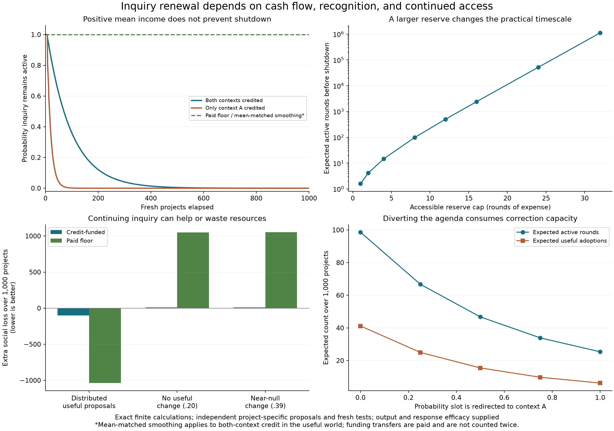

# How inquiry renews its capacity to continue

Exact finite model for the eighth research cycle. Participants' local observations generate a candidate from a two-rule grammar. Independent validation determines adoption; a third monitoring sample supplies observable credit. Paid grant rules replenish a bounded inquiry reserve. The [research synthesis](../../sources/15-codex-theory-conversations/2026-10-05-renewal-of-inquiry.md) explains the implications; [PROTOCOL.md](PROTOCOL.md) specifies the observations, timing, resources, controls, and limits.

In the useful-project case, the procedure produces social value +1.037754 per active round after expense and inquiry burden. Its uncapped expected grant after the retainer is also positive, +.866262. Nevertheless, under credit-only funding and cap eight, mean lifetime is 98.6084 rounds. Cap 32 extends that mean above a million rounds, with 99.914% survival after 1,000 rounds. The eventual-shutdown result must therefore be distinguished from practical finite-horizon risk.

Recognizing only one context's otherwise unchanged evidence shortens mean lifetime to 20.3577 rounds. A paid floor permits continuity and restart; a predictable grant matching nominal active-round mean income also preserves the main case. Those comparisons do not match total realized spending. No-benefit and near-null controls show the expense and false adoptions of continuing inquiry. Inquiry finance obeys an explicit conservation identity; response costs enter the operating-loss calculation. A guaranteed productive floor remains a supplied assumption.



## Records and reproduction

- [Model](model.py), [six tests](test_model.py), [analysis](analyze.py), and [parameters](config.json).
- [Full results](results/results.json), [compact summary](results/summary.json), [SVG figure](results/inquiry-renewal.svg).
- [Exact input snapshots](results/inputs), [SHA256 manifest](results/manifest.json).
- [Initial development results](results-v1/results.json) with preserved inputs. Final revision adds explicit no-inquiry/no-proposal controls, guards retainer consistency, and moves one figure legend. Existing numerical cases are unchanged.
- [Post-control results](results-v2/results.json) preserve the inputs before the final protocol wording clarification from capture to imposed agenda diversion. Calculation values are unchanged.
- [Mathematical audit](../../_process/research/2026-10-04-integrated-evolution/inquiry-renewal-math.md), [design and implementation review](../../_process/research/2026-10-04-integrated-evolution/inquiry-renewal-design-review.md), [primary literature](../../_process/research/2026-10-04-integrated-evolution/inquiry-renewal-prior-art.md).

```sh
cd experiments/inquiry-renewal
/private/tmp/meta-attractor-plot-env/bin/python -m unittest -v test_model.py
```

To reproduce calculations, copy the five saved input files into a fresh directory and run `python analyze.py` using Python with NumPy, SciPy and Matplotlib. The script refuses to overwrite an existing results directory. It requires no network, seed, or Monte Carlo sampling.

There are 480 cases: three project worlds, two recognition rules, five agenda-diversion probabilities, eight reserve caps, and two funding floors. Twelve baseline cases retain full 1,000-round reserve distributions. Six constant-grant benchmarks and boundary controls separate extinction, intermittent restart, absent credit, certain credit, no proposal, and no inquiry. Independent rational and high-precision audits verify the main episode and lifetime calculations, including cap-32 numerical conditioning.

This is a fixed institutional procedure on genuinely new independent projects. It has supplied response efficacy, a finite candidate grammar, a guaranteed ordinary output, fixed recognition and funding rules, and common evaluative commitments. The agenda intervention is imposed diversion, not strategic capture. The model does not prove permanent inquiry desirable, give a lifetime .05 error guarantee, endogenize production, or explain evolution of institutional rules. Prices and project laws are exploratory assumptions; no real institution or deployed AI was tested.
