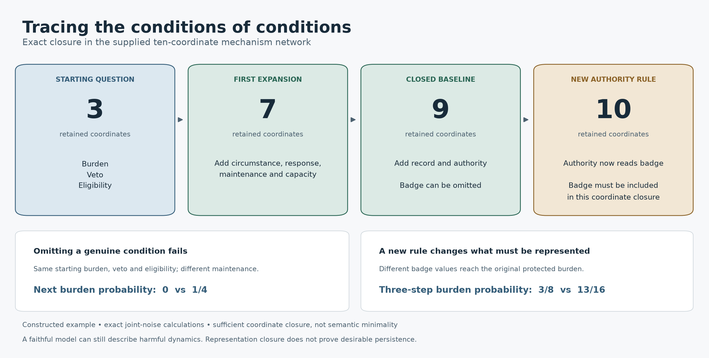

# Toward a generative basis for alignment and coordination

**Mathematical abstraction, 6 October 2026:** the [finite-check package](mathematical-abstraction/README.md) and [nine hand propositions](../../../../_process/research/2026-10-05-generative-foundation-review/root-foundation/MATHEMATICS-STRUCTURAL-RESULTS.md) develop canonical exact deterministic abstraction and finite all-continuation certification under a known state bound and exact testing interface. All 9,994 machines in the declared exhaustive classes pass separate refinement/product-graph comparisons and boundary checks. This supports the [mathematics claim audit](../../../../theories/becoming/chapters/MATHEMATICS-AND-GENERATIVITY.md); physical acquisition, calibration and supplied class membership remain separate obligations. No new Lean or empirical validation is claimed.

**Lean continuation, 6 October 2026:** [machine-checked core](lean/README.md) and [theory note](../../../../theories/becoming/chapters/GENERATIVE-CORE-LEAN.md) formalize exact finite relational histories, actual-successor composition, a reserve obstruction, and nontrivial witnesses. Complete and incomplete state summaries are exhibited. The probabilistic and structural results below retain their original proof and verification status; this addition does not claim to mechanize them all.

5 October 2026. AI-assisted formal research under Ren's direction. This study pursues the requested generative-completeness objective directly. It integrates selected recently completed chats, eleven cycles of local research, and the V7.3 transition construction. It preserves their limitations and original files. The formulations below are research elaborations, not quotations attributed to Ren or independent human peer review.

The theoretical advance is a precise account of **what a proposed generative representation must preserve, how to construct a complete representation within a finite class, and how to find omissions**. The current results establish a conditional mathematical foundation. They do not yet establish a unique explanatory root of alignment, life, and society.

The distinction matters because a language can encode every transition table while leaving every substantive mechanism unexplained. This study therefore combines an expressiveness theorem with a causal completeness criterion, constructive dependency tracing, and counterexamples to stronger claims.

## The completeness question is now explicit

Declare a system's possible states, permitted interventions, boundary inputs, participants' observation and action privileges, and the outcomes or obligations that the model must preserve. Outcomes can remain a vector of incompatible or incomplete concerns. There is no required scalar goal or optimization law.

For a proposed state summary q, the central exactness criterion is:

\[
q(s)=q(t)\quad\Longrightarrow\quad
L(s)=L(t),\qquad
\sum_{v:q(v)=b}K_{u,d}(s,v)
=\sum_{v:q(v)=b}K_{u,d}(t,v)
\]

for every permitted intervention u, boundary input d, and retained successor block b. State-dependent action permissions must also agree. In words: **states treated as equivalent must have the same retained consequences under each declared intervention, regardless of which member of the block the system actually occupies**.

Under this contract the condition is necessary and sufficient. It gives a well-defined quotient transition system and preserves its path probabilities under the same admissible, observation-based policies. An omitted event, an unavailable intervention, or information hidden from a participant is not supplied by the theorem. The [formal note](formal/FORMAL.md) proves the result and its conditions using established probabilistic bisimulation and aggregation mathematics, including [Givan, Dean and Greig's primary model-reduction work](https://cs.brown.edu/people/tdean/publications/archive/GivanetalAIJ-03.pdf).

This is stronger than matching one observed trajectory or one training distribution. It is also more demanding than some forms of output prediction. The [adversarial review](review/REVIEW.md) gives two states with identical entire output-trace laws that nevertheless cannot be merged under this strong state-level contract. Its minimality claim must not be generalized to every possible predictive representation.

## Constructive results

**A sufficient boundary derived from local mechanisms.** The [structural closure theorem](formal/STRUCTURAL-CLOSURE.md) starts with explicit update mechanisms rather than a full transition table. Choose the outcomes, participant observations, and permissions to preserve. Retain every coordinate those mechanisms read, including guards and probability selectors; then repeat for the newly retained coordinates. In a finite network this reaches a least dependency-closed set. Given the stated common-noise and input conditions, its projection preserves the entire retained trajectory under the same permitted policies.

The proof is pathwise: two states agreeing on the closed set receive the same inputs and joint noise, so every retained update agrees; the argument repeats at every step. Correlated effects remain correlated. The procedure is sufficient and conservative, not necessarily the smallest semantic representation: a written dependency can cancel or become redundant.

The constructed example has ten Boolean coordinates. Starting with burden, veto and eligibility, the procedure expands from **3 → 7 → 9** coordinates. The nine-coordinate model preserves all declared retained path laws while omitting a decorative badge. Both an independently written branchwise check and exact projected-distribution comparisons verify the finite example. Omitting maintenance fails: two otherwise matched seed states produce next-burden probabilities **0 versus 1/4**. Adding a badge-dependent authority rule expands the closure to all ten coordinates. In a fixed three-step example, the formerly equivalent badge states then produce original-burden probabilities **3/8 versus 13/16**; the difference reaches the original question, not just an internal variable.

This is a concrete generative advance: supplied local mechanisms determine both the dynamics and a sufficient boundary for the question. It does not infer the mechanisms from observations or establish that any institution follows these Boolean rules.

[Exportable figure](figures/closure.pdf). The diagram summarizes the constructed network; it is not an empirical result or an attractor diagram.

**A smallest exact partition within the declared class.** Start by grouping states with identical protected labels and permissions. Repeatedly split a group when an intervention gives its members different probabilities of entering an existing group. This process terminates at the unique coarsest faithful deterministic partition. It can produce no compression at all; a complete description is not necessarily a small one.

**A restricted generating language.** Finite Boolean registers, single-bit tests and writes, rational random choices, and finite sequencing can generate every finite rational stochastic transition kernel at declared macrostep boundaries. The proof constructs the program explicitly. Its coefficients still come from the supplied mechanism; the compiler does not discover them or explain their origins.

The generating language has a precise boundary. If randomness is restricted to fair coins and every macrostep uses a bounded number of draws, it generates exactly dyadic probabilities. It cannot generate a probability of 1/3 exactly. Allowing unbounded rejection loops changes the execution and cost assumptions. Thus even a broad computational completeness claim can have a clear falsifier.

**Composition with conditions.** Faithful reductions remain faithful under sequencing and mixtures controlled by retained information. Independent components can be composed through product kernels. Shared disturbances require their joint law to be preserved: matching two fair marginals does not say whether they always agree, always disagree, or vary independently. Intermediate deadlines and harms must remain visible if the claim concerns them; matching only a macrostep endpoint cannot certify intervening states.

These are established mathematical constructions developed explicitly for the programme's plural and situated requirements. Their contribution here is precision, integration, and a checkable boundary—not priority for a new universal computation or bisimulation theorem.

## Recursive conditions need not form an infinite hierarchy

The example contains a feedback path from burden through maintenance, capacity, records and response back to burden. Tracing the conditions of conditions eventually returns to coordinates already included. A finite cycle can therefore close the representation without a separate governor for every governor. It remains an open system with declared input and noise processes; representing the cycle does not explain the historical or physical origin of its rules.

Two different closure questions must remain distinct. **Causal closure of the representation** asks whether the model preserves the specified consequences. **Reproduction of acceptable conditions** asks whether its actual dynamics continue to meet the specified commitments through disturbances, turnover and change. The theorem answers the first within its class. The earlier [continuation study](../closure-study/README.md) supplies finite persistence and renewal criteria for the second. A mechanism network can be represented completely and still destroy its own support or sustain coercion. No stability calculation alone settles whose conditions deserve protection.

Together these suggest a disciplined central claim for the programme: **an explanation of durable alignment must preserve the causal distinctions needed to explain continuation and revision of its specified conditions; whether those conditions actually continue is a further dynamical claim**. It need not retain every raw variable or assume one fixed social objective. What counts as acceptable continuation remains a plural, situated specification and an object of contestation, not a consequence of the reduction theorem.

## A consequence for changing purposes and new interventions

Holding the old transition laws fixed, adding a protected outcome, permitting a new intervention, or requiring validity across more supplied environmental models can only refine the coarsest faithful partition. Some states that were previously interchangeable may now have to be distinguished.

This is a formal version of a central situated insight: **completeness for an existing question need not survive an expansion of what people need to ask or do**. A new affected party's burden can matter even when aggregate production has not changed. A new repair option can expose a distinction invisible under the previous operating policy.

Changes already represented inside the original system are covered by its theorem. An entirely new question outside that declared interface is an expansion of the claim. A universal arbitrary-query guarantee for a finite record requires preserving every distinction in that record; selective compression remains useful when its scope is explicit.

This does not prevent a finite generative foundation. An unbounded counter has only two update rules, increment and decrement, but infinitely many states distinguishable by future decrement sequences. **Finitely many generating mechanisms and finitely many sufficient states are different properties.** The obstruction rules out a finite exact quotient for that counter; it does not rule out a finite rule set or mathematical theory.

## What the other work contributes

The [integration map](integration/INTEGRATION.md) connects the new proof obligations to existing results rather than treating each study as a fresh analogy.

- Relative success can conceal depletion of absolute support. A basis that preserves only shares loses the viability question.
- Records sufficient for one model family can become insufficient when a different temporal pattern is admitted. A basis must preserve the distinctions the expanded question needs.
- Public lottery outcomes and outside options can change whether a participant continues to consent. A sufficient physical belief state can therefore be insufficient for coordination.
- A mature practice can be beneficial while the transition to it exhausts support. V7.3 supplies a conditional funded transition construction, not a proof of authority's indefinite reproduction.
- A question can be worth investigating without a detectable anomaly in the old evidence. Inquiry cannot universally be reduced to reacting to an already recognized error.

The reviewed app chats were **Save attachments and plan v5**, **Meta理论缺口分析**, **Paper summary**, and **Paper insights summary**. Their exact identities and bounded contributions are recorded in the integration note. The last two suggest applications to recursive AI research and changing visibility of reasoning; their primary abstracts were checked. These applications are motivation, not proof of the generative theory. The newer October 5 research and V7.3 were read as local artifacts, without claiming they were separately located chats.

## What this establishes about the proposed root

The programme's candidate architecture remains: activity changes the conditions of later activity, including how participants observe, interpret, act, continue, and revise those conditions. The present mathematics tells us when a particular representation of that architecture is causally sufficient for a declared problem.

It does not prove that the five semantic categories in the general framework are uniquely irreducible. Any finite tuple can be encoded in a single variable without losing predictions. The meaningful requirement is preservation of the relevant causal distinctions, such as separately changing a tool and changing permission to use it. A claim of unique semantic primitives would need additional restrictions on locality, accessibility, modularity, or description cost.

Nor does an exact generating language choose legitimate outcomes. It can describe coercion and damaging persistence as faithfully as beneficial cooperation. Evaluative commitments and the mechanisms by which people form and contest them remain separate objects of explanation and justification.

The strongest completed scope is therefore **conditional generative expressiveness, constructive dependency closure, and faithful causal reduction for supplied finite systems**, accompanied by explicit tests of what a smaller representation omits. A fuller explanatory theory must show how a restricted family of domain mechanisms is generated and constrained by common principles. The local-circuit construction avoids supplying a full transition table, but its particular equations remain premises. Deriving substantive restrictions shared across domains remains a theoretical task in its own right, alongside empirical application.

## Files and verification

- [Full proofs](formal/FORMAL.md).
- [Structural closure proof and complete local-mechanism example](formal/STRUCTURAL-CLOSURE.md).
- [Adversarial and prior-art review](review/REVIEW.md).
- [Integration of recent work and session provenance](integration/INTEGRATION.md).
- [Declared computation plan](CHECKPLAN.md) and [exact check results](checks/results.json).
- [Structural verification plan](STRUCTURAL-CHECKPLAN.md) and [exact structural results](checks/structural_results.json).
- [Readable computation results](checks/RESULTS.md).
- [Independent computation review](checks/REVIEW.md) and [review calculations](checks/review_checks.json).
- [File manifest](MANIFEST.json).

The primary computation uses exact rational arithmetic. It compares iterative reduction with exhaustive partitions for 36 supplementary finite systems and structured witnesses, reconstructs compiled transition rows, and retains the counterexamples. The structural supplement compares all 8,192 relevant pairs of projected transition rows and audits the actual Boolean dependencies of both supplied modes. Check counts describe software assertions, not independent scientific replications. No new human, biological, or AI deployment experiment was conducted.
