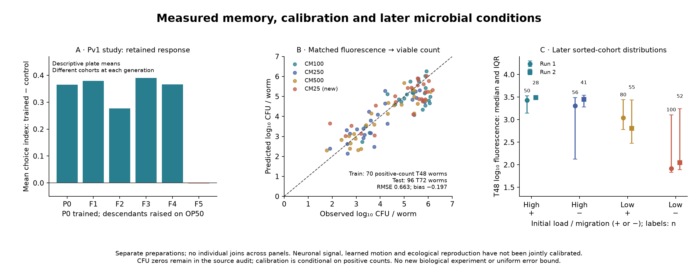

# Molecular memory, viable-count calibration and ecological return

8 October 2026. Secondary empirical analyses supporting [the integration](../../../../../../_process/research/2026-10-05-generative-foundation-review/history/root-foundation/BIOLOGICAL-RENEWAL-INTEGRATION.md). Ren selected full experimental validation. These computations advance that target; no new wet-lab experiment or full-loop validation is claimed.

## Reproduce

Python 3 with NumPy, SciPy, openpyxl and Matplotlib is required; exact versions are in the results. From this directory:

```sh
python3 analyze_renewal.py
python3 analyze_replication.py
python3 plot_results.py
```

- [Fixed exploratory plan](analysis-plan.json); [later replication-audit plan](replication-plan.json). Neither is external preregistration. The latter follows reading the new replication reports and spotting potential source discrepancies.
- [Producer](analyze_renewal.py), [results with source-cell references](results.json), [calibration predictions](calibration-predictions.csv), [replication producer](analyze_replication.py), [replication audit](replication-results.json).
- [Pv1 originals](../../../../../../sources/biological-scale-correspondence/pgen-1011178/README.md), [calibration/colonization archive](../../../../../../sources/biological-scale-correspondence/boddu-2025/README.md), [replication originals](../../../../../../sources/biological-scale-correspondence/inheritance-replication/README.md).

All 6,503 numeric cells in the Pv1 workbook match an independent XML decode. Descriptive extraction preserves neural versus plate sampling units and camera-setting limitations. The nonlinear CFU calibration uses 70 positive T48 observations for fitting and 96 T72 observations for testing, with three zero counts retained outside log regression. Five deterministic starts select by training SSE alone; gradients and termination are recorded. A constant and linear model receive exactly the same split. No post-test tuning, individual pairing across panels or fabricated hard error bound is used.

The colonization summaries retain all 3,594 archive rows across two runs, while explicitly identifying 694 repeated T0 entries in run 2. They are cohort distributions, not 3,594 independent longitudinal trajectories. The replication audit checks 725 numeric Table B cells and recomputes all 145 choice indices from bacterial counts; differences from supplied indices are within the source's displayed rounding. Source discrepancies prevent treating this as a clean reproduction of the published exclusion-based inference.



The [owned-scope checker](../../../../../../_process/research/2026-10-05-generative-foundation-review/history/root-foundation/BIOLOGICAL-RENEWAL-CHECK.py) verifies source preservation, independently recomputes saved arithmetic, checks links and keeps the older Lean result separate. Its passing status concerns those checks; it does not mean every empirical hypothesis passed or the full biological account is certified.
