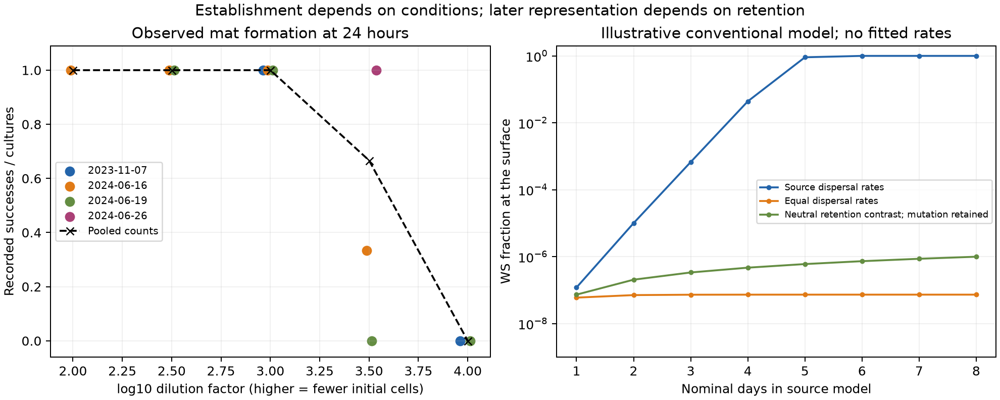

# Establishment observations and surface-selection correspondence

[Primary source](../../../../../../sources/evolutionary-selection/karita-2026/README.md) · [Research integration](../../../../../../_process/research/2026-10-05-generative-foundation-review/root-foundation/CONTEXTUAL-ESTABLISHMENT-INTEGRATION.md)

Run `python3 analyze.py` with openpyxl and SciPy, then optionally `python3 plot_results.py` with matplotlib. The executed environment used Python 3.12.14, openpyxl 3.1.5 and SciPy 1.18.1. Original source files are read without modification. Only the inspected parameter and function cells of the source notebook are executed; plotting cells and stored outputs are not used as evidence.

Run `python3 check_record.py` to check the saved source, output and proof bindings plus the scoped C14 integration. [The checker](check_record.py) writes [the integration receipt](../../../../../../_process/research/2026-10-05-generative-foundation-review/root-foundation/CONTEXTUAL-ESTABLISHMENT-CHECKS.json); it does not repeat the simulations or certify concurrent research entries.

[analyze.py](analyze.py) extracts [11 dated cohorts](pellicle-cohorts.csv) and [784 colony areas](colony-areas.csv). A separate raw-XLSX XML route checks count strings, dilution factors, dates and decoded numeric areas. [results.json](results.json) records original bindings, exact count totals, diameter sensitivity, model parameters and every numerical scenario. Area-to-diameter conversion follows the paper's circular approximation; the worksheet's unit and image/culture correspondence remain limitations.

The model check compares an independently expressed four-flux decomposition with the source notebook at five states (20 components), including the capacity boundary and an overshot state. Differences are zero in this run. This validates selected numerical correspondence, not a proof of equality for all inputs. The [Lean source](../../lean/universal-ethics/SurfaceSelection.lean) separately establishes seven rational local-balance results with 11 declaration audits. [Fresh-build checker and receipt](../../lean/universal-ethics/surface-selection-verification/verification.json) retain their actual proof scope: no ODE solution, long-term fixation or empirical calibration theorem.

## The numerical boundary matters

The fixed-step Euler replay uses the source's state-dependent field, initial conditions, parameters and step 0.001, limited to the plotted eight nominal days (96 source time units). It uses integer step indices rather than accumulated floating time and does not reproduce the source's initial dummy plotting zero. A second replay halves the step. Both cross the capacity boundary and subsequently produce negative SM surface populations in the source-rate scenario. The maximum capacity overshoot is approximately 0.0850% at step 0.001 and 0.0432% at step 0.0005. No negative population is silently clipped.

The explicitly separate event-based adaptation integrates the below-capacity field until the capacity event, then uses `q = W_surface / K` with `S_surface = K(1-q)` to remain on that boundary. This preserves the source field on the exact saturated surface, where incoming migration is zero. All inspected solver nodes and daily output points remain nonnegative and have q in [0,1]. Two relative tolerances, 1e-8 and 1e-10, change the source scenario's recorded q values by at most 1.65e-9. This is numerical sensitivity, not a rigorous error bound or biological uncertainty.

The event adaptation gives the following **illustrative**, unfitted eight-day surface WS fractions: source rates 0.9999999866; equal dispersal approximately 7.33e-8; neutral retention contrast with mutation retained approximately 9.97e-7. The source's nominal day conversion is not an empirical calibration. The last case is neutral only for the mutation-free saturated selection term; the full model still generates WS through mutation. A positive local selection term is not a proof of inevitable fixation.

[Plot source](plot_results.py) · [Vector figure](establishment-and-retention.svg). Left: dated empirical count fractions, with slight horizontal offsets for visibility; the dashed pooled line is a guide, not a fitted response. Right: daily event-adaptation outputs from day 1 onward; all scenarios start at zero WS, omitted from the logarithmic axis. Model parameters are supplied, not estimated from the left panel.

The subsequent [original microscopy audit](../microscopy-correspondence/README.md) establishes source-recorded scale, capture times and scoped position continuity. It retains the missing treatment/endpoint and colony-area joins; these later measurements do not change the earlier seven-theorem proof scope or make its illustrative trajectories a calibrated forecast.
