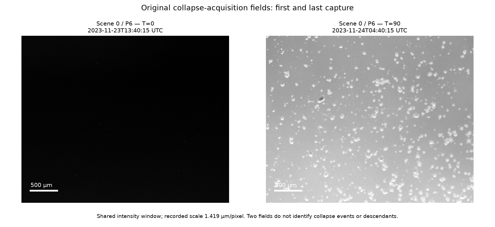

# Original CZI measurement correspondence

[Research integration](../../../../../../_process/research/2026-10-05-generative-foundation-review/root-foundation/MICROSCOPY-CORRESPONDENCE-INTEGRATION.md) · [Original range bodies and provenance](../../../../../../sources/evolutionary-selection/karita-2026/microscopy-metadata/README.md)

`inspect_czi.py --subblocks` replays preserved ranges offline and writes five decoded JSON/XML pairs. `--fetch` permits bounded acquisition of missing ranges only; `--workers 5` runs independent files concurrently. Requests reject full responses, wrong intervals/lengths or changed ETags. The five source file sizes come from the original archive inventory.

`check_reader.py` compares the decoded directory, metadata, timestamps and selected first/last subblocks against the preserved unmodified `czifile` source. It requires numpy and imagecodecs; the source reader is loaded from its recorded repository path. The executed imagecodecs version is 2026.8.16. Temporary dependency installations are not imported into this repository. [verification.json](verification.json) binds the range manifests, generated outputs and scripts and records measured scene offsets and rescue-file boundary gaps.

`inspect_frames.py` replays the predetermined first/last scene-0 high-resolution fields and compares every pixel with the separate reader. With `--fetch`, it downloads only their missing pixel ranges in chunks no larger than 4 MiB. [frame-verification.json](frame-verification.json) records pixel hashes and the common display intensity window. Original arrays remain exactly recoverable from the saved range bodies. The figure is a qualitative access check, not a collapse-event count, segmentation or endpoint score.

The metadata verification covers 4,383 directory entries, 388 common timestamps and 114 selected subblock records from five acquisitions. All directory scene/time combinations exist exactly once. It does not read every interior capture's metadata or every image's pixels. Calibration is the source-recorded specimen-plane scaling, not an independently measured stage standard. Scene labels and coordinates are not treatment assignments, filenames are not exact inoculation timestamps, and frames do not become independent culture replicates.

`check_record.py` checks the final documentary/source bindings and the owned C14 update without rerunning prior biological or Lean studies. Its receipt is [MICROSCOPY-CORRESPONDENCE-CHECKS.json](../../../../../../_process/research/2026-10-05-generative-foundation-review/root-foundation/MICROSCOPY-CORRESPONDENCE-CHECKS.json).
