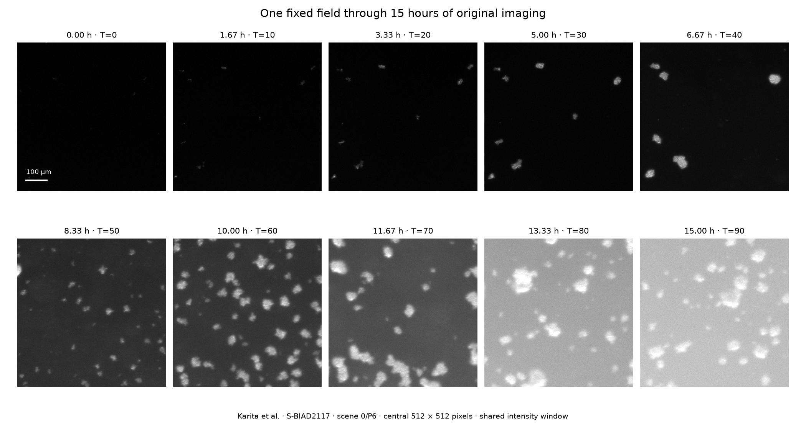

# Measuring formation and apparent loss in one fixed field

[Research findings](../../../../../../../_process/research/2026-10-05-generative-foundation-review/history/root-foundation/DEVELOPMENTAL-HISTORY-INTEGRATION.md) · [Prospective protocol](../../../../../../../_process/research/2026-10-05-generative-foundation-review/history/root-foundation/DEVELOPMENTAL-HISTORY-PROTOCOL.md) · [Original range bodies](../../../../../../../sources/evolutionary-selection/karita-2026/microscopy-history/README.md)

The analysis follows the central 512 × 512 pixels of one high-resolution scene through all 91 captures, about 15 hours. Acquisition metadata and two independent decoding routes bind the observations to the original CZI. Detection and spatial matching remain explicit measurement choices. The four longest assigned tracks include both abrupt local loss and a boundary-censored object still visible after its track ends.



## Reproduction

Run from this directory with Python and the required dependencies:

```sh
python3 acquire.py
python3 analyze.py
python3.12 check_measurements.py
python3 review_endpoints.py
```

`acquire.py` replays saved original ranges by default; `--fetch --workers 4` permits missing-range acquisition. NumPy is required. Its temporary `/tmp/evolutionary-organization-roi.npz` cache is reproducible from preserved sources; it is not the only copy of substantive evidence.

`analyze.py` uses NumPy, SciPy and Matplotlib. It writes all detections, frame summaries, adjacent assignments, sensitivity results and four figures. The recorded run used Python 3.11 with NumPy 2.4.6, SciPy 1.17.1 and Matplotlib 3.11.2 in a temporary dependency directory.

`check_measurements.py` uses Python 3.12 or newer for the unchanged pinned `czifile` source, plus NumPy and imagecodecs. The recorded check used Python 3.12.14, NumPy 2.3.5 and `czifile` 2026.8.16. It checks every crop against a separate array decoding, independently reads all subblock metadata, compares the two complete endpoint fields through the source reader, and verifies stored numerical records. The result is [measurement-verification.json](measurement-verification.json); it does not certify biological identity.

`review_endpoints.py` preserves the four AI visual assessments and post-inspection diagnostics in [endpoint-review.json](endpoint-review.json). It checks the specific boundary exclusion and threshold sensitivity without changing the prospective analysis. All four [endpoint panels](endpoint-inspection.png) and the [measurement-sensitivity plot](measurement-sensitivity.png) were visually inspected. An initial layout overlap was corrected; numerical results were unchanged.

No biological collapse rate, viable-descendant forecast or new mathematical theorem is asserted. A mathematical extension would need its own Lean check; source decoding and descriptive image measurements do not require relabeling a numerical check as a proof.
