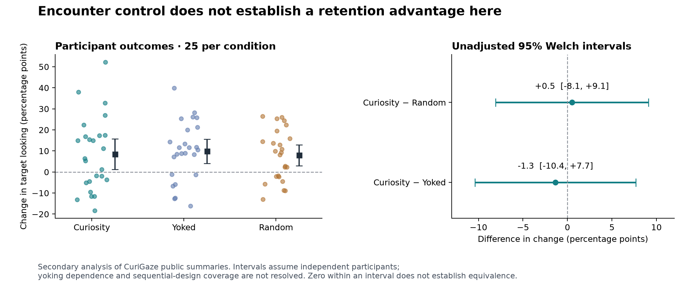

# Encounter control, retained change and later use

8 October 2026. Exploratory secondary analysis and substantive author counterreview for the [continuing cognitive account](../../../../../../theories/becoming/chapters/COGNITION-LEARNING-AND-EVOLUTION.md). Reuses `encounter-selection-and-revision` and `naming-attention-coverage`. The new contribution tests the selection-to-later-use correspondence with an observed learning outcome; it does not create another generic learning mechanism.

## Result and uncertainty

The public CuriGaze summaries do not establish a later recognition advantage for controlling the naming sequence. The point estimates are small, but the intervals admit differences that would require substantive interpretation. This is not evidence of equivalence or a refutation of every active-learning mechanism.

Our reconstruction uses the authors’ cleaned inclusion log: **75 participants, 25 per condition, and 451 valid test trials**. The outcome is each participant’s mean change in target-looking proportion after versus before the label. It is not percentage of correctly learned words. Values below are percentage points; SD describes participants, and the intervals are unadjusted 95% t intervals.

| Condition | Mean change | SD | 95% interval |
|---|---:|---:|---:|
| Curiosity | 8.49 | 17.52 | 1.26 to 15.72 |
| Yoked | 9.84 | 14.03 | 4.05 to 15.63 |
| Random | 7.99 | 12.06 | 3.01 to 12.97 |

| Primary comparison | Difference | Unadjusted 95% Welch interval |
|---|---:|---:|
| Curiosity − Yoked | −1.34 | −10.38 to +7.69 |
| Curiosity − Random | +0.50 | −8.08 to +9.08 |

The independently rebuilt ANOVA is F(2,72)=0.105409, p=0.900095. Relative-to-zero tests give three-comparison Bonferroni p values 0.06991 (Curiosity), 0.00544 (Yoked) and 0.00880 (Random). A significant result in one condition and a nonsignificant result in another is not itself a between-condition difference. These tests also do not establish comprehension by each child.

## Sources and analysis population

**Primary study context.** [Bazhydai et al. (2026)](https://onlinelibrary.wiley.com/doi/10.1111/desc.70101) tested screen-based naming at 20–23 months. Gaze triggered labels in Curiosity; Yoked replayed sequences and Random varied their order. Choice was constrained against immediate repetition. Participant randomization was not established; initial Curiosity collection supplied control sequences. Immediate recognition followed. Procedural changes after a pilot are disclosed. The final reported Bayes factor, 8.065, remained below the planned 10 threshold when the maximum sample was reached. We did not recompute that Bayesian analysis or the raw-gaze time series.

**Deposited-file reconstruction.** [Original bytes and provenance](../../../../../../sources/developmental-attention/bazhydai-2026/README.md) are preserved. The [authors’ R source](../../../../../../sources/developmental-attention/bazhydai-2026/curigaze_OSF_V3.R) saves a 77-participant summary before merging the trial data with the cleaned log. That merge, on condition and participant, removes three trials belonging to two participants and gives the 75-person analysis population. The individual omission reasons are not independently established. The complete 77-person export remains a declared sensitivity: Curiosity−Yoked −1.34 points [−10.94,+8.26]; Curiosity−Random +1.96 [−6.90,+10.81]. It does not replace the declared primary population.

The 921 pre/post summary rows yield 454 complete pairs and 13 incomplete pairs. Gaze-count ratios reconstruct the saved proportions; complete pairs reconstruct trial differences, and trial means reconstruct the 77-person summary within rounding tolerance. Joining the cleaned log leaves 145 Curiosity, 145 Random and 161 Yoked trials. We average within participants before group comparison. The files named `LearnedHits` count gaze samples and are not binary retention outcomes. Upstream files have already undergone exclusions; this analysis does not reproduce raw eye-tracker processing.

**Two reporting discrepancies.** Our SDs agree with the R comments, whereas the [article’s Table 2](https://onlinelibrary.wiley.com/doi/10.1111/desc.70101) lists Random .14 and Yoked .12. We retain .12063 and .14025 from the data. Separately, the R script calls `p.adjust` on each single p value without setting three comparisons. Our adjustment explicitly uses the declared family of three. The paper reports adjusted values but still describes all three as above chance; our Curiosity result does not pass a .05 three-test criterion.

## What the comparison can identify

The intervals assume independent participants and use the conventional t/Welch calculation. No partner identifiers were found in the acquired files, so sequence-sharing dependence cannot be reconstructed. The descriptive intervals have no demonstrated coverage guarantee under the study’s sequential sampling rule. Nonrandom allocation, exclusions and measurement limitations further constrain causal and population claims. There was no prespecified equivalence margin. A failure to distinguish groups cannot establish equal learning or absence of every control-related effect.

**Positive comparison.** In [Begus, Gliga and Southgate (2014)](https://journals.plos.org/plosone/article?id=10.1371/journal.pone.0108817), sixteen 16-month-olds reproduced more demonstrated actions after ten minutes for objects they had pointed to than for unchosen objects (40.6% versus 12.5%). A second experiment compared chosen-object and no-choice groups, 17 infants each, with a one-sided test. Gross looking-duration comparisons were nonsignificant, which does not establish equal attention. Demonstrators were not blind to choice. The authors do not resolve whether pointing indexes interest, a request or another motive. We read the methods and results, without reanalyzing participant records. Differences in age, task, delay and social arrangement prevent using the contrast with CuriGaze to isolate a social mechanism.

**Our inference across these sources.** Control of an encounter, information available within it, retained modification and later use are distinct relations within the same history. A social response can participate in any of those relations. It is not explanatory to add an unspecified “agency bonus,” nor to assume that matching displayed labels makes effective encounters identical. The measurements here do not show whether control was recognized, which relations were retained, or whether a learned reliability judgment governed their admission.

The existing `EnactedScene.same_inputs_preserve_interpretation` theorem fixes the declared retained interpretation inputs. It does **not** show that these empirical groups have equal inputs or that display-matched histories are cognitively equivalent. The encounter-choice result explains an advantage when acquired information selects a distinguishing encounter under its coverage premises. It does not require every opportunity to choose to improve learning. Both the uncertain group contrast and positive pointing comparison therefore constrain correspondence rather than invalidate those checked conditional results.

## Counterreview and the next discriminating connection

This is substantive author counterreview, not independent-agent acceptance.

**Has the theory explained the null result after the fact?** No identified mechanism has been selected by this analysis. Several candidates remain compatible. A sampling account locates the benefit in which informative encounters occur. A retention account additionally changes which encountered relations persist. An acquired-source account changes admission as a function of a learned relation to the producer. These roles may coexist; present outcomes do not estimate their separate contributions. Merely allowing all three would make the account too flexible without discriminating predictions.

**Would more looking settle the mechanism?** No. Equal gross duration can coexist with different temporal coordination, discrimination or retention. Conversely, a retained effect can arise without greater gross duration. The target must be an accessible cue’s effect on later evidence use, not an analyst’s designation of the right answer.

**What would change the account?** The next empirical connection is a change in **cue-conditioned evidence use after experienced reliability changes**, tested in later binding, transfer and correction. A useful comparison preserves label/object exposure while varying whether a producer responds contingently and reliably; subsequent trials test whether that learned relation changes the effect of new, otherwise matched naming evidence. Unprompted transfer and recovery after reliability reversal would separate mere repetition from acquired admission. Measured encounter differences must remain covariates or design constraints, not be declared absent by nonsignificance. This is a discriminating target, not a claimed experiment or a proof of an exclusive algorithm. Existing source-revision and method-formation mechanisms are reused; their generic construction is already completed.

**What remains incomplete?** This provides an outcome-level empirical constraint and an audited reconstruction, not a full developmental explanation, causal attribution, evolutionary genealogy, affective theory or account of consciousness. The whole objective remains active.

**中文整合。** 控制命名顺序不自动证明保留优势。正式纳入的75人中，主动条件相对配对条件为−1.34个百分点，95%区间为−10.38至+7.69；相对随机顺序为+0.50，区间为−8.08至+9.08。区间宽且配对依存未识别，不能宣布等效。另一个指点后成人响应的实验报告延迟动作再现优势，但跨研究差异不能独自认定社会机制。继续接通可取得的可靠性／协调线索、经历接纳与后续指称纠正；既有条件机制复用，完整目标不以这次复算宣告完成。

## Reproduction and scope of checks

[PLAN.md](PLAN.md) predates group-outcome inspection; the publication was already known, so it is not preregistration. Its acquisition amendment predates aggregation. [analyze.py](analyze.py) uses NumPy 2.3.5, pandas 2.2.3 and SciPy 1.18.1. [check_analysis.py](check_analysis.py) separately reconstructs proportions and arithmetic through `csv` and 50-digit Decimal; distribution functions share SciPy. Its first run exposed a UTF-8 BOM in the log header; decoding was corrected without changing original bytes. [verification.json](verification.json) binds the successful check to source and code hashes. [results.json](results.json) preserves full precision and sensitivity; [participant-summaries.csv](participant-summaries.csv) is derived, not an original source.

Run `analyze.py`, then `check_analysis.py` with those libraries available; run [plot.py](plot.py) with Matplotlib to regenerate PNG/SVG. The import scripts preserve exact original bytes and refuse to replace different originals. Dependency installations stayed outside the repository. No new mathematical theorem or new check of unchanged Lean proofs is claimed.
