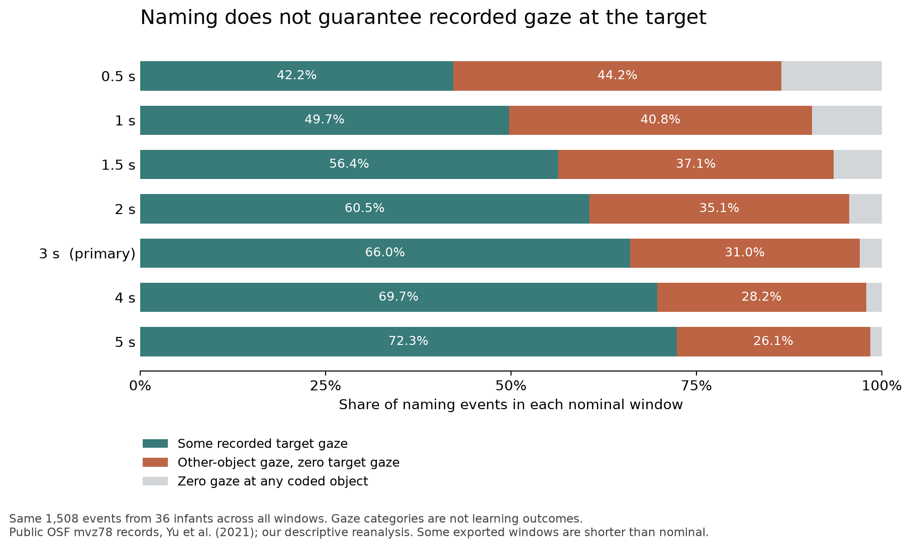

# Naming encounters do not guarantee recorded target gaze

8 October 2026. AI-authored exploratory secondary analysis. Result identity: `naming-attention-coverage`. This is a measurement correspondence assessment for the continuing cognition objective, not a new learning experiment or mathematical theorem.

## Result

The public three-second records contain **467 of 1,508 naming events (30.97%) with some recorded other-object gaze and zero recorded gaze at the intended target**. Such events occur for 35 of the 36 infants. The equal-participant mean is 30.35%, median 28.87%, and range 0–52.63%. This limits an unrestricted correspondence from naming to attended target coverage. It does not show that those infants necessarily learned a wrong name or lacked every form of access to the target.

| Recorded gaze in the nominal three-second window | Events | Fraction of events |
|---|---:|---:|
| Some target gaze, with or without other-object gaze | 996 | 66.05% |
| Some other-object gaze and zero target gaze | 467 | 30.97% |
| Zero gaze at any coded object | 45 | 2.98% |
| Total | 1,508 | 100% |

The last category is retained separately. It cannot be relabeled as observed attention to a wrong referent. Across all rows, the mean arithmetic remainder `1 − target − other` is 21.72% of the exported window, combining uncategorized time rather than isolating tracking loss. Values were not renormalized to target-plus-other gaze.



## Window and participant sensitivity

| Nominal seconds | Other gaze, zero target: count | Event fraction | Equal-participant mean | Zero on both: count |
|---:|---:|---:|---:|---:|
| 0.5 | 667 | 44.23% | 43.49% | 204 |
| 1 | 616 | 40.85% | 39.63% | 142 |
| 1.5 | 560 | 37.14% | 36.16% | 98 |
| 2 | 529 | 35.08% | 34.12% | 66 |
| 3 | 467 | 30.97% | 30.35% | 45 |
| 4 | 425 | 28.18% | 27.47% | 32 |
| 5 | 393 | 26.06% | 25.47% | 24 |

The same 1,508 events appear in all seven files; this is window sensitivity, not seven independent samples. The wider windows reduce recorded target absence, but do not remove it. No event with positive target gaze in a shorter window becomes zero in the next longer window; the corresponding other-object check also passes. Participant/event identity, onset and named category agree across files. Participants contribute 13–111 events each. No independent-event standard errors or population-generalization tests were used.

## Data and processing audit

The [plan](PLAN.md) was saved after reading the published finding and source README but before inspecting CSV outcome rows or aggregating results. This is exploratory reanalysis with known published findings, not preregistration. The [original archive](../../../../../../sources/developmental-attention/yu-2021/README.md) retains all eight deposited files with matching OSF hashes.

The seven-field schema in the author's README has one exception: the four-second file contains nine fields, including experiment and trial identifiers. The analysis reads the actual last two gaze columns and joins participant/event identities, never an assumed positional field 6 across all files. Experiment ID is uniformly 12. Gaze fractions lie in [0,1]. Five three-second rows have target-plus-other sums above one by no more than 0.000005. No source values were clipped or edited; the tiny negative remainders remain visible in the calculations.

Twelve three-second intervals are more than 5 ms shorter than nominal. Across the seven files those counts are 3, 4, 6, 8, 12, 14 and 17; the shortest exported span is 0.21 seconds. The source does not explain each shortened interval, so session-end clipping is not asserted as established. “Three-second” denotes the nominal exported window, not a claim that every row contains exactly three seconds of valid tracking. No gaze duration was reconstructed by assuming an unknown denominator.

**Published-analysis boundary.** Our all-row, unnormalized definitions are explicit. We have not reproduced the paper's reported bimodal bin percentages. The deposited files contain 1,508 events, while its Figure 2 caption refers to 1,024; its reported participant naming-count range also differs from this export. Exact zero-or-one target fractions in our three-second file cover 689/1,508 events (45.69%), rather than the paper's approximately 65% two-mode summary. Binning, gaze denominators, filtering or reporting differences have not been resolved. This is not evidence by itself that the publication is wrong. It prevents presenting our analysis as an exact reproduction of its distribution. The coverage result above uses the deposited zero/nonzero fields directly and does not depend on that unresolved binning correspondence.

## What changes in the theory

Reuse [encounter-selection-and-revision](../../../../../../theories/shengsheng-buxi-generative-existence/results/records/encounter-selection-and-revision.md) and its binding/access dependencies. They give conditional success and checked coverage-failure witnesses. This analysis supplies a new empirical reason to keep that condition explicit: **naming does not automatically ensure a recorded look to its intended referent**. It does not falsify the mathematical theorem, which assumes the relevant coverage, or equate gaze with the theorem's candidate set.

The corrective obligation is now more specific. A developmental account must explain how particular encounters are admitted, weighted, revisited or rejected, and how retained relations remain corrigible when coverage is imperfect. Candidate elimination over all admitted encounters, weighted accumulation and selective retention are substantive alternatives. These files alone cannot distinguish them: they aggregate all competitors and omit retained word knowledge, parent gaze and later learning outcomes. Calling a gate “correct” cannot supply its formation, and the observer-coded intended target cannot be handed to the learner as already known truth.

Within the common interaction, parent naming, infant orientation, object placement and subsequent use are differentiated relations. Their distinctions preserve who looks where and what follows; they are not independently given ontological domains. The data locate a selective-access limitation within that history. They neither derive the capacities' evolution nor establish a uniquely generative learning mechanism.

## Substantive author counterreview

1. **Could zero target gaze be missing data?** Forty-five completely unassigned windows are separated. The other 467 include some observed gaze elsewhere, but their remaining time can still include tracking failure or uncoded looking. Even the 68 fully other-object rows identify recorded fixation, not all covert or peripheral access. The claim stays at the gaze-measurement level.
2. **Could the wider window rescue coverage?** It improves the operational measure. At five nominal seconds, 393 events still have other gaze with zero recorded target. Window choice does not yield unrestricted measured coverage here.
3. **Does repeated naming solve the problem?** It may support learning across events. This analysis does not test that learning outcome, so it cannot infer failure from one episode or success from multiple episodes. The prior all-admitted intersection construction needs its declared coverage or an explicitly changed correction mechanism.
4. **Does the result prove our theory superior?** No. Existing attention and word-learning approaches can represent selective access. The contribution is a checked empirical constraint on an explicit connection, with rival mechanisms still open.
5. **Has the developmental explanation been completed?** No. The study measures already interacting infants. It does not explain how coordination develops, establish a causal coordination-to-retention pathway, or supply evolutionary-psychological history. The next discriminating connection joins locally available coordination/reliability cues to actual retained reference and correction, without injecting target truth.

## Reproduce and validation scope

Run from this directory with Python, NumPy and pandas:

```sh
python -B analyze.py
python -B check_analysis.py
python -B plot.py
```

The plot additionally uses Matplotlib. The actual calculation used the bundled Python runtime and its NumPy/pandas versions, recorded in [results.json](results.json). Matplotlib 3.11.2 was installed in a temporary directory solely for plotting; it is not a repository dependency installation. [fetch_sources.py](fetch_sources.py) documents public acquisition and refuses to replace changed original files. Existing archives should be verified rather than reimported.

[check_analysis.py](check_analysis.py) independently recomputes all eight descriptive count categories, participant means/SDs/ranges/medians and gaze means using `csv` and exact `Decimal` arithmetic. [verification.json](verification.json) records successful comparison and source bindings. [Participant summaries](participant-summaries.csv) and [full results](results.json) retain every planned descriptive measure. This computational cross-check is not independent-agent acceptance. No new Lean theorem or rerun of unchanged proofs is counted. The full cognition, learning and evolutionary-psychology objective remains active.
