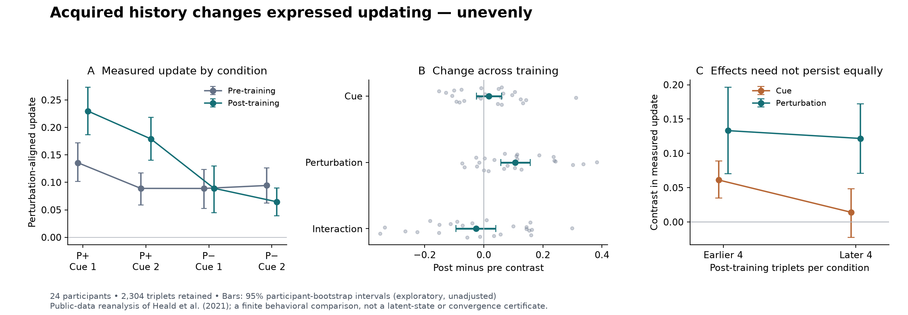

# Acquired context changes expressed updating, with unequal evidence across components

9 October 2026. Secondary analysis of the complete 24-person memory-updating experiment deposited by Heald, Lengyel and Wolpert (2021). No new participants, laboratory experiment, COIN refit or Lean theorem. [Plan and explicit extraction amendments](MEMORY-UPDATING-PLAN.md); [computed results](memory-updating-results.json); [verification](memory-updating-verification.json); [source provenance](../../../../../../sources/situated-recovery/heald-2021/README.md).

**结论：训练前后，后续更新对扰动方向的区分显著增强；训练后也有线索效应，但其相对训练前的增强并不明确，后段的线索效应反而较弱。** The evidence supports differentiated, history-dependent expressed updating. It does not support replacing that structure with a uniformly increasing awareness score.

## Relationship and measurement

Repeated movement, imposed perturbations, sensory cues, retained effects and later channel responses form one experimental history. Our contrast selects how an exposure changes the next measured response in a specified context. These analytical roles do not posit separately complete mind and world. The history can form a selective response without demonstrating conscious recognition of that history.

The [primary paper](https://pmc.ncbi.nlm.nih.gov/articles/PMC8809113/) and [author Fig. 3 code](https://zenodo.org/records/5512855) pair each cue with a perturbation direction during training. Test triplets put a single exposure between two channel measurements, both under cue 1. Our measurement is the second channel coefficient minus the first, multiplied by the exposure sign. Positive values follow the perturbation. P+ denotes the direction paired with cue 1, not a universal physical direction. The contextual model is an established explanation being reused, not a discovery of this repository.

The [public data](https://doi.org/10.5061/dryad.m63xsj42r) yield **51,152 retained trial rows, 7,008 channel measurements and 2,304 complete triplets**. All 24 participants are included. The author windows use 384 pre-training triplets and 768 post-training triplets; the 1,152 intervening triplets remain in the retained observations. The four conditions have respectively 36, 12, 12 and 36 triplets per person; endpoints use the first 4 and last 8 per condition.

Exact source fragments preserve each file's MAT5 header and complete compressed table subsystem. One complete original (participant 24) also matches its deposited SHA-256 and the fragments byte for byte. For participants 1–23, deposited whole-file hashes are identity metadata, not hashes verified from partial bytes. The extraction checks redundant serialized tables and reproduces the author's chronological grouping through a second implementation. Participant 13 lacks trial numbers 1667–1668 between two Exposure blocks; no analysed triplet crosses the gap. No missing value is imputed and no participant is removed from the primary analysis. The author-provided force coefficients are used; high-frequency preprocessing is not independently reconstructed.

## What the observations support

Means are in units of the author's force-compensation coefficient, after perturbation alignment. Intervals below resample participants, not individual trials: 20,000 samples, seed 20261009.

| Exposure | Pre-training mean | Post-training mean |
|---|---:|---:|
| P+ with cue 1 | 0.13575 | 0.22974 |
| P+ with cue 2 | 0.08905 | 0.17908 |
| P− with cue 1 | 0.08893 | 0.08929 |
| P− with cue 2 | 0.09434 | 0.06467 |

Cue contrast averages cue 1 minus cue 2 across perturbations. Perturbation contrast averages P+ minus P− across cues. Interaction is the difference between the two cue contrasts. The last contrast's scale is twice the main-effect contrast scale; their numerical magnitudes are not interchangeable.

| Contrast | Pre mean | Post mean | Post minus pre [95% bootstrap interval] | Holm-adjusted p for change |
|---|---:|---:|---|---:|
| Cue | 0.02064 | 0.03764 | 0.01700 [−0.02432, 0.06054] | 0.90036 |
| Perturbation | 0.02077 | 0.12743 | 0.10666 [0.05795, 0.15781] | 0.00138 |
| Interaction | 0.05212 | 0.02604 | −0.02608 [−0.09425, 0.04105] | 0.90036 |

Holm correction covers the three planned change tests, using two-sided paired t tests on participant contrasts. All displayed bootstrap intervals and other tests are exploratory and unadjusted. The post-training cue contrast is positive in 18/24 people, mean 0.03764, interval [0.01516, 0.06006]. Its phase-specific p=0.00382 matches the published result, but its change from pre-training is uncertain. **A significant post effect and a nonsignificant pre effect do not demonstrate a significant change.** The perturbation contrast increases in 18/24 people; its change remains positive under every single-participant omission.

The independently computed phase-specific numerical tests agree with the paper's rounded cue, perturbation and interaction statistics. That validates this extraction against an external published target. It is computational reproduction of the same observations, not a new independent sample or confirmation of one unique mechanism.



## Persistence, individual differences and sensitivity

The cue contrast is 0.06121 in the earlier four post-training triplets per condition and 0.01408 in the later four. Their paired change is −0.04713, unadjusted bootstrap interval [−0.09337, −0.00470]. This is a planned descriptive sensitivity, not a multiplicity-controlled new primary finding. The perturbation contrast is 0.13314 and 0.12173, change −0.01141 [−0.05473, 0.03318]. These finite windows suggest unequal persistence; they establish neither equivalence nor a long-run limit.

The subgroup cue comparison at P− is uncertain even after training: 0.02462 [−0.01868, 0.06130]. An average cue effect does not imply a clear effect in each condition or participant. Leaving out participant 13 changes the primary cue/perturbation/interaction change estimates to 0.01857, 0.11196 and −0.03351 respectively. This post-plan sensitivity preserves the main descriptive pattern but does not recover the missing events.

## Theoretical consequence and counterreview

Reuse result `situated-recovery-empirical-correspondence`: it established finite retention and constrained temporal forecasts. New result `context-sensitive-updating-correspondence` adds cue × perturbation discrimination, explicit pre/post changes and finite persistence sensitivity. Its producer output is a measured, history-dependent change in subsequent expression. The receiving theory must distinguish the formation of an association, its use in current updating, and its later persistence. This is an empirical and interpretive connection, not an adapter to Lean's hidden prediction-error variable.

An affirmative interpretation is that earlier activity changes which later perturbations most strongly affect a measured response. The clear acquired perturbation contrast supports that connection; the post cue effect supplies a narrower current-context correspondence. It would be an overstatement to claim the data clearly show an acquired increase of every cue effect. Before/after phase also changes elapsed time and exposure; there is no untreated parallel group in this reanalysis identifying the entire training package separately from every time-dependent alternative.

The strongest retained alternative is that expressed changes combine altered memory retrieval, motor generalization and state updating. The measurements do not independently read out those latent components. Our simple contrast analysis neither refits nor defeats the published COIN account. It requires any proposed exclusive account to predict these contrasts and their evolution, including adverse observations. Washout, cue history and order can change expression; fewer cues influencing a later response does not by itself show less understanding or maladaptation. An interpretation connecting the late decline specifically to washout remains a hypothesis here.

This narrows the description of situational awareness to testable functions: retained associations, current response selection, consequences of a new exposure and continued adequacy under changing histories. It supports one operational component, not complete conscious understanding, arbitrary concept creation or self-chosen final goals. More selective updating is not an ethical justification. Infinite-time convergence still requires the explicit premises of the earlier Lean results; no new mathematical conclusion is claimed.

**Completed:** full-participant measurement correspondence, reproduction of the published phase contrasts, and new exploratory checks of training-related change and persistence. **Next substantive connection:** use existing studies with observations or manipulations that distinguish actual memory revision from changed expression, then connect those consequences to deliberate model or goal revision. Repeating the original evidence search or waiting for our own laboratory is unnecessary.

## Reproduction

Use the scientific dependencies already listed in [requirements.txt](requirements.txt):

```sh
python -B fetch_memory_updating.py --full-crosscheck
python -B analyze_memory_updating.py
python -B plot_memory_updating.py
python -B check_memory_updating.py
```

Run from this directory (scripts resolve repository paths internally). Original bytes and all prior recovery scripts/results remain separate and unchanged. Verification concerns provenance, extraction, counts, numerical correspondence and file bindings; it is not independent scientific peer review.
