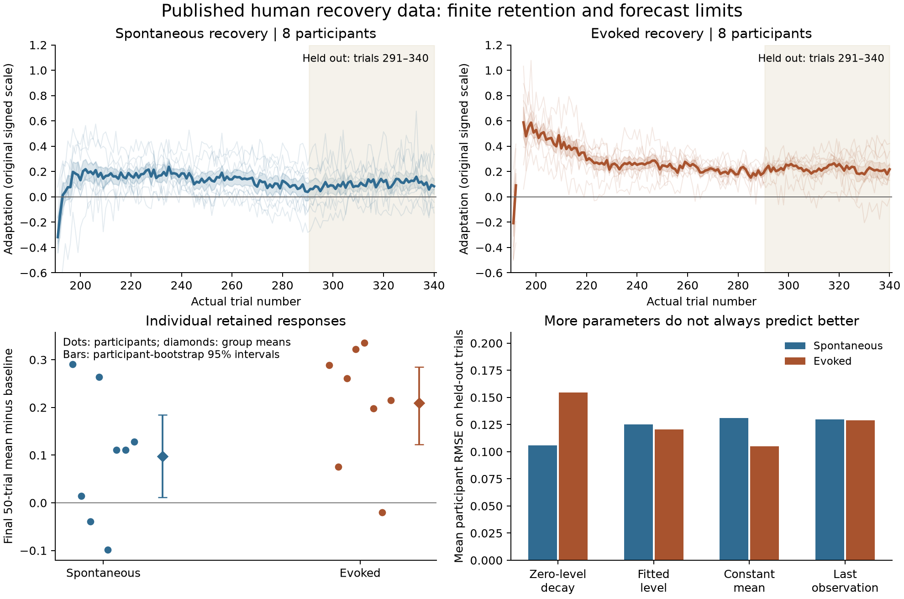

# Public human recovery data: correspondence and prediction

8 October 2026. Exploratory secondary analysis of Heald, Lengyel and Wolpert (2021), [dataset](https://doi.org/10.5061/dryad.m63xsj42r), [paper](https://doi.org/10.1038/s41586-021-04129-3). The paper's contextual-inference discovery receives credit; these are our checks and forecasts on its observations, not a new experimental replication or a refit of COIN.

**完成的新增量：公开的逐人测量已接入分析，既有文献支持进一步成为可追溯的数据对应。** All 16 recovery participants, 5,440 trial records and 2,656 measured channel responses are retained. The last 50 observations per participant, 800 overall, are forecast without fitting to their outcomes. No new laboratory data or mathematical theorem is introduced.

## Question, reuse and scope

Result: `situated-recovery-empirical-correspondence` (F04). Reuse the [completed operational account](../../../../../../theories/becoming/history/GOAL-FORMATION-AND-REVISION.md#18-experimental-grounding-already-exists) and [six-study evidence assessment](../../../../../../_process/research/2026-10-05-generative-foundation-review/root-foundation/SITUATED-RECOVERY-EXPERIMENTAL-EVIDENCE.md). The new correspondence connects actual channel-force responses and retained histories to finite persistence and predictive discrimination. It does not identify measured adaptation with complete understanding or with the error variable of the Lean observer.

Hand movement, robot forces, feedback conditions, recorded responses and subsequent behavior are differentiated relations within the experimental activity. The apparatus controls the channel and perturbation history; the observed response is only one projection. No fundamentally independent mind/world division or automatic normative conclusion is required.

The [analysis plan](ANALYSIS-PLAN.md) was written before participant outcome arrays were opened, after the published findings were known. It is not a prospective preregistration. A corrected extraction assumption is explicitly recorded: the author's plot uses nominal pre-terminal x-coordinates, whereas actual channel trials vary. We use actual trial numbers and the five Null-block measurements for the baseline. No participant is excluded; all deposited recovery files contain 340 rows with no marked miss trial.

## Measurement correspondence

Original [files, metadata and hashes](../../../../../../sources/situated-recovery/heald-2021/README.md) are retained. Every MAT file matches Dryad's deposited SHA-256 and size. MATLAB's serialized copies of the trial table agree on every common field; the dataset-specific reader also checks field type, finite-response count, trial sequence and terminal schedule. This does not assert a general MATLAB decoder.

Primary outcome: the author-provided signed adaptation coefficient, oriented by the first FieldA direction as in the author's code. A value of one represents full compensation relative to the study's reference force field. Zero is a response reference, not a measured absence of memory, zero prediction error, or universal ideal action.

An exploratory reconstruction from opposite robot wall force and forward velocity above 1 cm/s approximates the provided values: participant RMSE ranges 0.000375–0.003800; the largest individual difference is 0.024071. The README does not fix every preprocessing/window detail. We preserve this discrepancy and use the provided values for primary analysis; no exact independent recreation of their force processing is claimed.

## Finite retained response

Final 50 channel trials, subtracting each person's five initial baseline measurements:

| Group | Participants | Mean response | Participant-bootstrap 95% interval | Positive individual means |
|---|---:|---:|---:|---:|
| Spontaneous recovery | 8 | 0.09759 | [0.01103, 0.18495] | 6/8 |
| Evoked recovery | 8 | 0.20958 | [0.12279, 0.28460] | 7/8 |

These are normalized force-compensation units, not percentages of complete understanding. Group mean finite retention is supported by this analysis; some individuals have little or opposite baseline-corrected response. A finite tail cannot establish the infinite-time limit.

The corrected between-group difference is 0.11198, interval [-0.01126, 0.23160], with an exploratory two-sided exact allocation-permutation p=0.10862 (12,870 allocations). The raw difference is 0.11945, percentile-bootstrap interval [0.00251, 0.23195], permutation p=0.07646. These inferential procedures need not agree, and baseline correction changes the interval conclusion. We therefore do **not** claim a robust late-stage group difference from this small secondary analysis. This endpoint is narrower than the published study's tests and does not overturn its complete argument.

## Predicting later observations

For each participant, calibrate on the uninterrupted terminal channel segment before trial 291, then forecast trials 291–340. Models: zero-level exponential decay, relaxation to a fitted level, constant calibration mean, and last-observation persistence. Outcomes below are means of eight participant RMSE values, in the original response scale; smaller is better.

| Model | Spontaneous | Evoked |
|---|---:|---:|
| Zero-level exponential | **0.10589** | 0.15461 |
| Fitted-level relaxation | 0.12534 | 0.12043 |
| Constant calibration mean | 0.13124 | **0.10519** |
| Last observation | 0.12961 | 0.12910 |
| Nonnegative fitted level — post hoc sensitivity | 0.12130 | 0.10894 |

The unconstrained fitted-level model beats zero-level decay for 3/8 spontaneous and 6/8 evoked participants. Bootstrap intervals for its mean paired RMSE difference include zero in both groups. Four free-level fits have near-unit q and large cancelling coefficients: their distant levels are not substantively identified. The original result remains, alongside an explicitly [post hoc nonnegative-level sensitivity](SENSITIVITY-NOTE.md) motivated by that instability and the published model comparison's stated level constraint. It improves evoked forecasts relative to zero-level decay, while the constant model still has the lowest mean error there. Baseline correction preserves these group rankings.

These forecasts compare simple descriptive curves of expressed response. They do not reproduce the original full-data BIC comparison, test every mechanism, supply a hard noise bound or identify a unique neural process. Uncertainty in fitted mechanisms is a result, not a reason to conceal the observations.



## What changes in the theory

The empirical claim is now concrete: retained responses can persist over these tested histories; richer temporal models sometimes help and sometimes fail to transfer. An adequate account distinguishes acquisition, retained content, current expression and predictive adequacy. This supports our relational learning/revision account and reinforces the prior literature's warning against reading a single performance curve as complete understanding. It gives no new ethical goal or acceptable-risk threshold.

The scalar Lean observer remains a valid sufficient construction under its own observation and residual assumptions. This deposit records expressed adaptation, not a simultaneously measured hidden memory state and its true prediction error. It would be a correspondence mistake to install these response coefficients as that theorem's error series and announce empirical convergence. The particular correspondence test here is complete; no generic absence of public data remains for it. Full cross-scale biological validation and open-ended goal formation retain their distinct research scopes.

## Reproduction and retained evidence

Use Python with [requirements](requirements.txt). Originals are already preserved; `fetch_sources.py` can recover the MAT files from the public mirror and verify them without rewriting the import receipt.

```sh
python analyze_recovery.py
python analyze_sensitivity.py
python plot_recovery.py
python check_recovery.py
```

[Primary results](results.json), [sensitivity](sensitivity-results.json), [all trial projections](observations.json), [extraction audit](extraction-audit.json) and [verification](verification.json) retain all participants, favorable results and failures. A rerun reproduces numerical analysis of existing data; it is not an independent biological replication. No new Lean proof was asserted or rerun.
