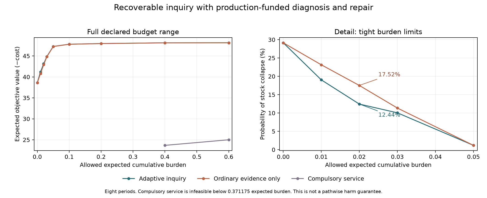

# Recoverable inquiry

An exploratory, exact finite belief-state decision model coupling stock regeneration, earned revenue, ordinary production evidence, optional noisy diagnosis, paid readiness/rebuilding, and an expected cumulative burden limit. AI-generated research under Ren's direction, 5 October 2026.

The principal distinction is between current inquiry activity and the ability to afford a timely return to inquiry. The model can choose to drop an apparatus, later rebuild it, and then test. It also retains cases in which paying for diagnosis is unnecessary. This is a conditional mechanism study using established control mathematics, not empirical institutional evidence or a universal optimal policy.

Read the [research synthesis](../../sources/15-codex-theory-conversations/2026-10-05-recoverable-inquiry.md), [protocol](PROTOCOL.md), [math audit](../../_process/research/2026-10-04-integrated-evolution/recoverable-inquiry-math.md), [design audit](../../_process/research/2026-10-04-integrated-evolution/recoverable-inquiry-design-review.md), and [prior-art audit](../../_process/research/2026-10-04-integrated-evolution/recoverable-inquiry-prior-art.md).

## Findings

At horizon eight, both adaptive and ordinary-evidence-only policies meet the same ex ante burden allowance. Lower cost is better; no row is a guaranteed survival policy.

| Allowance | Adaptive cost | No-test cost | Adaptive collapse | No-test collapse | Adaptive expected tests |
|---:|---:|---:|---:|---:|---:|
| 0 | −38.603074 | −38.603074 | 29.1588% | 29.1588% | 0 |
| .01 | −41.175369 | −40.815024 | 19.0431% | 23.1517% | .137075 |
| .02 | −43.127292 | −42.908108 | 12.4389% | 17.5176% | .137530 |
| .03 | −44.862380 | −44.842336 | 10.0547% | 11.3561% | .025155 |
| .05 | −47.263097 | −47.263097 | 1.1815% | 1.1815% | 0 |
| .1 | −47.797072 | −47.797072 | .0584% | .0584% | 0 |
| .2 | −47.955711 | −47.955711 | 0 | 0 | 0 |
| .4 | −48.134122 | −48.134122 | 0 | 0 | 0 |
| .6 | −48.149786 | −48.149786 | 0 | 0 | 0 |

The .02 adaptive policy expects .295752 rebuilds and no paid standby periods. Both mixture components initially drop readiness. A saved selected path later rebuilds after observed stock deterioration, waits the required round, pays for diagnosis, and repairs after a positive result. This is the first paid test within that path, not a demonstrated repeated testing cycle after an earlier negative result. The policy mixture is selected before observations; neither component need meet the expected constraint separately.

Compulsory service has minimum expected burden .371175 and is therefore infeasible at the first seven grid allowances. At .4 and .6 its costs are −23.672577 and −25.003241. It is a prescribed service benchmark, not an optimum over all calendar schedules. Equal available technology and starting resources do not mean equal realized expenditure.



## Controls and negative results

All seven additional controls are adaptive policies. Unless stated otherwise they use eight periods and allowance .02.

| Control | Cost | Collapse | Expected paid tests | Interpretation |
|---|---:|---:|---:|---|
| Original H=5, allowance .6 | −32.597278 | 0 | 0 | Initial zero-test finding retained. |
| Known absent fault, onset 0 | −51.780520 | .3862% | 0 | Healthy stochastic damage remains; direct stock repair can still be useful. |
| Uninformative paid test | −42.908108 | 17.5176% | 0 | Matches the no-test benchmark. |
| Initial cash 2 instead of 8 | −43.127292 | 12.4389% | .137530 | Early earnings suffice along selected policies; lower initial cash need not change the optimum. |
| Initial stock 1 instead of 3 | −34.619968 | 25.0025% | 0 | Different productive starting condition, not a pure cash comparison. |
| Output per stock 1 instead of 2 | −22.354427 | 16.0435% | 0 | Changes both economic returns and available income; does not isolate one cause. |
| Initially not ready | −43.127292 | 12.4389% | .137530 | Same as initially ready then freely dropped; no initial-ready premium in this case. |

The initial development sweep (`development.json`) contains eighteen H={5,6,8} cases. Seventeen bought no paid tests. The .02/H=8 detail was selected after that exploration, not prospectively held out. `development-h8-detail.json` preserves the same case after numerical vectorization. No parameter-frequency claim about real institutions follows.

## Reproduce and inspect

Dependencies: Python 3.11+ with NumPy, SciPy, and Matplotlib. From the repository root:

```sh
python -m unittest discover -s experiments/recoverable-inquiry -p 'test_model.py' -v
python experiments/recoverable-inquiry/analyze.py --output results-reproduction
```

The run refuses to overwrite an existing directory. There is no random seed because all finite observation branches are enumerated. Exact rational filtering is followed by floating-point value evaluation. The main adaptive graph has 59,229 belief states. All 34 declared cases, full parameters, main .02 reachable policies, and selected traces are in [results-v1/results.json](results-v1/results.json). The [input manifest](results-v1/manifest.json) hashes its preserved code, configuration, protocol, and test snapshot. The test file subsequently gained additional assertions within the same seven tests; the model and calculation inputs did not change. The final test snapshot is retained in `verification-final/` with its output and manifest.

Seven independent tests cover noisy Bayes updates, full latent-state production enumeration, pre-repair burden, prefix finance and rebuilding lag, independent one-period policy mixtures, two-period occupancy LP comparisons, minimum-burden infeasibility, and absorbing collapse. The [run checks](results-v1/checks.json) report maximum primal–dual gap 8.81e−9 and maximum expected cash-ledger residual 7.11e−15 across feasible declared cases. These certify the small supplied decision problems to numerical tolerance, not the empirical model or ethical adequacy of its objective.

The original figure remains under `results-v1`. The clearer [figure](figures-v2/frontier.png) uses the same saved numbers with a tight-budget detail and a moved legend; [plot_detail.py](plot_detail.py) and its [manifest](figures-v2/manifest.json) record that display-only revision. Figures were visually inspected.

## Scope

The burden counts target-absent repairs plus .05 per test; repair may still restore stock without the target fault. It is not a false-discovery rate, a pathwise cap, lifetime protection, or complete harm measure. At the highlighted allowance .02, 12.44% collapse remains possible. Every expense is prefunded; output arrives afterward and overflow cannot be borrowed back. Ordinary production evidence stays visible. The irreversible stock-zero boundary, correct probability family, direct repair, stock renewal technology, fixed purposes, and free belief retention are supplied. This cycle demonstrates rebuilding and paid inquiry after initial dormancy, not unrestricted discovery, a certified infinite-horizon viable policy, or formation of new purposes. The continuous bridge-finance and finite-information results in the research memo are separate analytic modules.
