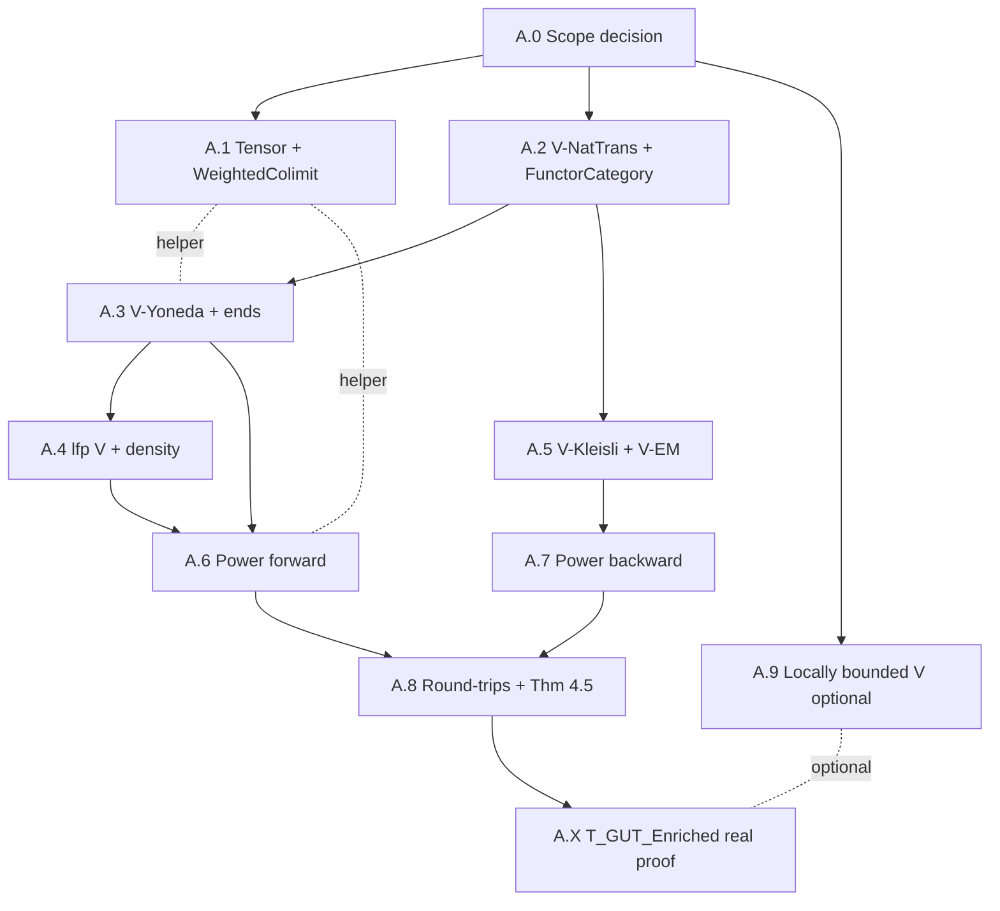

# Power 1999 Theorem 4.5 — Path A Progress Tracker

> Living phase tracker for the multi-year formalisation of Power 1999's
> equivalence between V-enriched Lawvere theories and finitary V-monads,
> as expanded into **Path A** of the
> [`enriched-universal-sayability-plan.md`](./enriched-universal-sayability-plan.md)
> roadmap.

---

## 0. Snapshot

| Field | Value |
|---|---|
| Current week | **0 (kickoff)** |
| Today's date | 2026-05-21 |
| Last update | 2026-05-21 |
| Overall completion | **~5%** (Phase 1 supplied-data interfaces vendored; constructive proofs largely undone) |
| Active phase(s) | A.0 (scope decision), A.1 (`Tensor.lean`), A.2 (`NatTrans.lean`) |
| Next milestone | Finish A.0 scope decision; begin A.1 cotensor/copower bridge |
| Path | **A** — full Lean proof of Power 1999 Theorem 4.5 |
| Calendar estimate | 18–28 months focused effort |
| Mathlib upstream PRs open | 0 |
| Soft-blocking risks | Mathlib review latency; universe-polymorphism choice in A.0 |

### 0.1 What "~5%" buys us right now

Vendored under `formal/SSBX/Foundation/Enriched/` (Phase 1 of the original plan):

- `Cotensor.lean` — V-cotensor (a.k.a. *power*) interface
- `Weighted.lean` — weighted V-limit interface
- `Monad.lean` — V-monad signature on a V-enriched ordinary category
- `Finitary.lean` — finitary V-monad class
- `Power.lean` — supplied-data boundary for Power Theorem 4.5
- `TypeOrdinary.lean` — `V = Type` enrichment bridge

These are **interfaces** with explicit data parameters; almost none of the
mathematical content of Power 1999 has been *constructed*. Phase A.6/A.7
fills the bodies; the round-trips in A.8 close the theorem.

### 0.2 What is _not_ in this tracker

- Day-by-day micro-status (use git log / branch state)
- LOC of supporting infrastructure that already lives in Mathlib master
- The categorical-vs-analytic gap analysis (see `[[e1-rtower-rh-closed]]`)
- The Hilb / continuous-substrate Phase 3 work (see plan §6 + `HilbertEnriched.lean`);
  it is downstream of A.X and shows up only as a footnote in A.9

---

## 1. Phase-by-Phase Tracker

### 1.1 Status legend

| Symbol | Meaning |
|---|---|
| `not_started` | No file or commit yet |
| `in_progress` | At least one file exists and is non-empty; not yet at acceptance criteria |
| `review` | Acceptance criteria met locally; awaiting code review / Mathlib upstream |
| `merged` | Landed in `main` or upstream `master` |
| `done` | Acceptance criteria met **and** `#print axioms` clean |
| `blocked` | Cannot make progress without an unmet upstream phase |
| `deferred` | Acknowledged useful, not scheduled this cycle |

### 1.2 Master tracker

| Phase ID | Title | Target files (relative to `formal/SSBX/`) | LOC est | Status | Started | Completed | % done | Notes |
|---|---|---|---|---|---|---|---|---|
| **A.0** | Scope decision (universes, weighted-vs-conical, skeleton convention) | `docs-next/10_formal_形式/power-4.5-scope-decision.md` | ~1000 LOC md | `in_progress` | 2026-05-21 | — | 10% | Sibling decision doc. Must lock universe convention before A.1 closes. |
| **A.1** | V-copower (tensor) + weighted V-colimit | `Foundation/Enriched/Tensor.lean` (~300), `Foundation/Enriched/WeightedColimit.lean` (~400) | ~700 | `in_progress` | 2026-05-21 | — | 5% | `Tensor.lean` skeleton started. Mirror of existing `Cotensor.lean` / `Weighted.lean` but on the co-side. |
| **A.2** | V-functor category + V-natural transformations | `Foundation/Enriched/NatTrans.lean` (~500), `Foundation/Enriched/FunctorCategory.lean` (~1000) | ~1500 | `in_progress` | 2026-05-21 | — | 5% | `NatTrans.lean` skeleton started. Hardest piece is V-naturality coherence. |
| **A.3** | V-enriched Yoneda | `Foundation/Enriched/End.lean` (~600), `Foundation/Enriched/Yoneda.lean` (~1500) | ~2000 | `not_started` | — | — | 0% | **Blocker: A.2.** ~10–16 weeks; the hardest piece of pure math in the plan. Needs ends or weighted limits as primary. |
| **A.4** | Locally finitely presentable V (density / Kan extension) | `Foundation/Enriched/LFP.lean` (~800) | ~800 | `not_started` | — | — | 0% | **Blocker: A.3** (density theorem). Subtle for non-cartesian V; may need `[HasFilteredColimits V]` + ℵ₀-presentability machinery. |
| **A.5** | V-Kleisli + V-Eilenberg–Moore | `Foundation/Enriched/Kleisli.lean` (~600), `Foundation/Enriched/EilenbergMoore.lean` (~700) | ~1300 | `not_started` | — | — | 0% | **Blocker: A.2** only (does not need A.3/A.4). Could be done in parallel with A.3. |
| **A.6** | Power §3 forward (T → S): `theoryToMonad` constructive body | `Foundation/Enriched/Power.lean` (theoryToMonad fill) | ~800 | `not_started` | — | — | 0% | **Blocker: A.3, A.4.** Replaces supplied-data projection with constructive monad assembly. |
| **A.7** | Power §4 backward (S → T): `monadToTheory` constructive body | `Foundation/Enriched/Power.lean` (monadToTheory fill) | ~1000 | `not_started` | — | — | 0% | **Blocker: A.5.** Builds the theory from the EM-category of the monad on f.p. objects. |
| **A.8** | Round trips + Theorem 4.5: `theory_monad_equiv` | `Foundation/Enriched/Power.lean` (close equiv) | ~600 | `not_started` | — | — | 0% | **Blocker: A.6, A.7.** Two iso constructions; one bidirectional natural-iso check. Should be the easiest of the math phases _given_ A.6/A.7. |
| **A.9** | (optional) Locally bounded V + Hilb extension | `Foundation/Enriched/LocallyBounded.lean` (~1000), then `Foundation/Doctrine/Instance/HilbertEnriched.lean` rewrite | ~1000 | `not_started` | — | — | 0% | **Optional, post-A.8.** Required only if V = Hilb is the target continuous substrate; finite-dim Hilb may not need it. |
| **A.X** | T_GUT_Enriched real proof: discharge `enriched_universal_sayability` | `Foundation/Doctrine/T_GUT_Enriched.lean` (rewrite main theorem) | ~300 | `not_started` | — | — | 0% | **Blocker: A.8.** Final delivery: GUT-C v0.6 universal sayability is no longer supplied-data. |

### 1.3 Totals and rough timing

| Aggregate | Value |
|---|---|
| Total estimated new LOC (A.1–A.8 + A.X, mandatory) | ~9 000 |
| Total estimated new LOC including optional A.9 | ~10 000 |
| Mandatory phase count | 10 (A.0, A.1, A.2, A.3, A.4, A.5, A.6, A.7, A.8, A.X) |
| Optional phase count | 1 (A.9) |
| Estimated calendar time (focused single-developer-equivalent) | 18–28 months |
| Estimated wall-clock with Mathlib review cycles | 24–36 months if every phase goes upstream |

### 1.4 Per-phase acceptance criteria (one-liners)

| Phase | "Done" means |
|---|---|
| A.0 | Decision doc merged; universe convention, weighted-vs-conical default, skeleton vs up-to-iso explicitly committed |
| A.1 | `Tensor.lean` + `WeightedColimit.lean` build clean; cotensor/copower duality lemma stated and proved; `#print axioms` clean |
| A.2 | `NatTrans.lean` + `FunctorCategory.lean` build clean; V-natural composition associative + unital; V-functor category is a V-category |
| A.3 | V-Yoneda lemma proved as a V-natural isomorphism; ends exist as weighted limits; representability bijection in place |
| A.4 | `LFP V` predicate + density theorem proved; `V = Type` and `V = Ab` shown to be LFP |
| A.5 | V-Kleisli is a V-category; V-EM forgetful is V-monadic; T-Alg(C) ≃ EnrichedModel V T C (Beck-style) |
| A.6 | `theoryToMonad` no longer takes supplied data — it constructs the monad from the theory via Yoneda + density |
| A.7 | `monadToTheory` no longer takes supplied data — it constructs the theory as `Free_T`-image on `Fin → V` |
| A.8 | `theory_monad_equiv : EnrichedLawvereTheory V T ≃ FinitaryEnrichedMonad V` proved end-to-end; round-trip natural isos discharged |
| A.9 | `LocallyBounded V` class; `Hilb` shown locally bounded; T_GUT enriched at V = Hilb is non-vacuous |
| A.X | `enriched_universal_sayability` in `T_GUT_Enriched.lean` proved; `#print axioms` returns only `{propext, Classical.choice, Quot.sound}`; old `universal_sayability` recovered as `V = Type` corollary |

### 1.5 Per-phase test plan

| Phase | Acceptance tests |
|---|---|
| A.0 | docs-next link check; sibling decision doc cross-refs back here |
| A.1 | `lake build SSBX.Foundation.Enriched.Tensor` + `WeightedColimit`; example: V = Type cotensor ≅ Π, copower ≅ Σ |
| A.2 | V = Type recovers ordinary functor cat; round-trip `NatTrans → comp → NatTrans` |
| A.3 | Yoneda map for representable functor is identity; ends commute with conical products |
| A.4 | V = Type LFP density gives Set's representable-presheaf result as corollary |
| A.5 | V-Kleisli adjunction unit/counit triangles; EM forgetful is V-faithful |
| A.6 | `theoryToMonad ∘ trivialTheory` returns the identity monad |
| A.7 | `monadToTheory ∘ identityMonad` returns the trivial theory |
| A.8 | Round-trip natural isos; benchmark: equiv lands in same universe as theorem statement |
| A.9 | Hilb has filtered colimits of bounded inclusions; T_GUT-model at FinHilb non-empty |
| A.X | `#print axioms enriched_universal_sayability` audited; ledger row added |

---

## 2. Already Vendored (Original Plan Phase 1)

The following files live under `formal/SSBX/Foundation/Enriched/` and were
the first deliverable of the original
[`enriched-universal-sayability-plan.md`](./enriched-universal-sayability-plan.md)
Phase 1. They establish **supplied-data interfaces** — no constructive
proof of Power 1999 sits inside them. The Path A phases A.6/A.7 are the
ones that fill the bodies.

| File | LOC | sorry | axiom | Role | What's there | What's missing |
|---|---|---|---|---|---|---|
| `Cotensor.lean` | 289 | 0 | 0 | V-cotensor interface | `HasCotensor X Y` class, universal-property `cotensorEquiv`, `V = Type` reduces to function space | Naturality of the equiv across all `Z`, `(X ⊗ X') ⋔ Y ≅ X ⋔ (X' ⋔ Y)` coherence |
| `Weighted.lean` | 341 | 0 | 0 | weighted V-limit interface | `VWeight V J` skeleton, `HasWeightedLimit W D`, cotensor as terminal-shaped weighted limit | V-functoriality of weights; Kelly §3.69 reduction (weighted = cotensor + conical) is stated but not yet shown |
| `Monad.lean` | 226 | 0 | 0 | V-monad endofunctor supplied-data | `EnrichedMonadStruct V C`, `EnrichedMonad V C` typeclass | V-naturality of `η`, `μ` is asserted as fields, not derived from a V-functor structure on `T` |
| `Finitary.lean` | 167 | 0 | 0 | finitary V-monad class | `FinitaryEnrichedMonad V T` (preserves filtered conical colimits) | Translation to "preserves filtered weighted colimits" pending A.1/A.3 |
| `Power.lean` | 245 | 0 | 0 | Theorem 4.5 supplied-data boundary | `theoryToMonad`, `monadToTheory`, comparison package — **as projections from supplied input data** | Constructive `theoryToMonad`, constructive `monadToTheory`, round-trip isos, the actual `theory_monad_equiv` |
| `TypeOrdinary.lean` | 143 | 0 | 0 | `V = Type` bridge | `enrichedCategoryTypeOfCategory` + ordinary/enriched hom equiv | Same bridge for other concrete V (Ab, Vect, Hilb) deferred until per-V instances are needed |
| **Total** | **1411** | **0** | **0** | — | — | — |

### 2.1 What "supplied data" means in practice

A supplied-data boundary in `Power.lean` looks roughly like:

```lean
structure TheoryToMonadData (V) [...] (T : EnrichedLawvereTheory V T_obj) where
  monad : C ⥤ C
  isMonad : EnrichedMonad V monad
  isFinitary : FinitaryEnrichedMonad V monad
  comparison : ...        -- the iso to T_obj on f.p. objects

def theoryToMonad (T) (d : TheoryToMonadData T) : FinitaryEnrichedMonad V :=
  ⟨d.monad, d.isMonad, d.isFinitary⟩  -- thin projection
```

This is honest — the supplied-data version *records* what the caller must
provide. Phase A.6 replaces the supplied `TheoryToMonadData` with a
**construction** built from Yoneda + density (A.3, A.4). At that point the
function gains real mathematical content.

### 2.2 Cross-reference to `EnrichedLawvereTheory.lean`

`Foundation/Doctrine/EnrichedLawvereTheory.lean` (929 LOC, 0 sorry, 0 axiom
as of 2026-05-18) is the *application* layer. It uses the supplied-data
interfaces above to define `EnrichedLawvereTheorySig`, `EnrichedModel`,
`EnrichedModelMorphism`, and `freeForgetfulAdjunction` (also via supplied
data: `FreeForgetfulAdjunctionData`).

When A.6/A.7/A.8 close, the supplied-data parameters at this layer become
*derivable* and the explicit supplied-data fields can be retired.

---

## 3. Dependency Graph

### 3.1 ASCII view (load-bearing)

```
                       A.0  (scope decision)
                         │
              ┌──────────┼──────────────────────────────┐
              │          │                              │
              ▼          ▼                              ▼
            A.1       A.2                              A.9
        (Tensor /   (V-NatTrans /              (locally bounded V,
       Wgt-Colim) FunctorCategory)               optional, post-A.8)
              │          │
              │          ├────────────────┐
              │          ▼                ▼
              │        A.3              A.5
              │     (V-Yoneda,        (V-Kleisli +
              │       ends)           V-Eilenberg-Moore)
              │          │                │
              │          ▼                │
              │        A.4                │
              │     (lfp V,               │
              │      density)             │
              │          │                │
              │          ▼                ▼
              │        A.6              A.7
              │   (theoryToMonad)   (monadToTheory)
              │          │                │
              │          └────────┬───────┘
              │                   ▼
              │                 A.8
              │            (round-trips +
              │             Theorem 4.5)
              │                   │
              │                   ▼
              └─────────────►   A.X
                          (T_GUT_Enriched
                           real proof)
```

### 3.2 Mermaid view (for IDEs that render it)



### 3.3 What blocks what (textual)

| Phase | Hard blockers (must be `done`) | Soft helpers (useful but skippable) |
|---|---|---|
| A.0 | — | — |
| A.1 | A.0 | — |
| A.2 | A.0 | — |
| A.3 | A.2 | A.1 (for weighted ends) |
| A.4 | A.3 | — |
| A.5 | A.2 | — |
| A.6 | A.3, A.4 | A.1 |
| A.7 | A.5 | A.4 |
| A.8 | A.6, A.7 | — |
| A.9 | A.8 (for non-vacuous test) | — |
| A.X | A.8 | A.9 (for Hilb instance) |

### 3.4 Parallelisation opportunities

Once A.0 lands, the work splits into two largely independent tracks until
A.6/A.7:

```
Track 1 (Yoneda track):  A.1 → A.3 → A.4 → A.6
Track 2 (Algebra track): A.2 → A.5 → A.7
                                          \
                                           → A.8 → A.X
```

This is the main lever for multi-agent parallel execution. The
[`multi-plan`](../../.claude/skills/multi-plan/SKILL.md) skill should be
invoked at the start of each track to decompose into sub-plans.

---

## 4. Critical-Path Items (Watch Most Carefully)

These are the three pieces with the most uncertainty and the largest
downstream blast radius. They deserve disproportionate attention in
weekly status reviews.

### 4.1 A.3 — V-enriched Yoneda

| Field | Value |
|---|---|
| Why critical | Every later phase (A.4 density, A.6 forward, indirectly A.7 via comparison) leans on V-Yoneda. If A.3 is wrong, everything downstream rebuilds. |
| Estimated effort | 10–16 weeks of math + Lean engineering |
| Math difficulty | High — Kelly 1982 Ch. 1 §1.9 + §2.4; ends-vs-weighted-limits choice affects everything |
| Lean difficulty | High — V-naturality coherence forces a lot of `simp`-able lemmas |
| Failure mode | Wrong universe choice in A.0 cascades here |
| Mitigation | Lock universe convention in A.0 *before* starting A.3; do a 2-week design spike before committing to `End.lean` API |
| Owner | TBD |
| Status | not_started |

### 4.2 A.6 / A.7 — Power §3 / §4 (the actual paper)

| Field | Value |
|---|---|
| Why critical | This is the actual Power 1999 content. If anyone is going to find a real mathematical gap in Power's proof, it surfaces here. |
| Estimated effort | A.6 ~12 weeks, A.7 ~14 weeks (overlapping with A.6 partially) |
| Math difficulty | High — Power 1999 §§3, 4 are the densest pages of the paper |
| Lean difficulty | High — the constructions are not purely formal, they involve choice principles and size considerations |
| Failure mode | A subtlety in Power's density argument (§3 Prop 3.2) is harder than the paper suggests; potential 1–2 month overrun |
| Mitigation | Try a paper-only walkthrough before any Lean code; consult Hyland–Power 2007 for a cleaner exposition |
| Owner | TBD |
| Status | not_started |

### 4.3 A.4 — Locally finitely presentable V

| Field | Value |
|---|---|
| Why critical | Density theorem (Kelly 1982 §5.5) is the main reason this phase exists. Subtle for non-cartesian V (e.g. Ab, Vect). |
| Estimated effort | 6–10 weeks |
| Math difficulty | Medium-high — well-trodden in the literature (Kelly §5; Adámek–Rosický 1994) but not in Lean |
| Lean difficulty | Medium — depends heavily on what Mathlib has for filtered colimits and presentable objects (already non-trivial) |
| Failure mode | Mathlib's `Presentable` machinery may not align with the V-enriched version |
| Mitigation | Spike on a single concrete V (V = Ab) before generalising; expect 1–2 weeks just for "translate Mathlib's presentable to the V-version" |
| Owner | TBD |
| Status | not_started |

### 4.4 Honourable mentions

- **A.5 EM-monadicity (Beck's theorem)** — generally not "critical path"
  because Beck's theorem is well-understood, but if Mathlib's monadicity
  story doesn't generalise cleanly to V-enriched, A.5 could balloon.
- **A.X final theorem** — small in LOC but everything has to be wired
  together. Expect 1–2 weeks of "make all the universes line up".

---

## 5. Recent Activity Log

### 2026-05-21 (week 0, kickoff)

- User reviewed scope-gap analysis and chose **Path A** over Path C.
  Path A = full Lean proof of Power 1999 Theorem 4.5. Path C =
  vendor-and-defer indefinitely (the original
  `enriched-universal-sayability-plan.md` v1 approach).
- Created sibling `power-4.5-scope-decision.md` (in progress, A.0).
- Created `Foundation/Enriched/Tensor.lean` skeleton (A.1 in progress).
- Created `Foundation/Enriched/NatTrans.lean` skeleton (A.2 in progress).
- Created this progress doc (`power-4.5-progress.md`).
- Confirmed Phase 1 supplied-data interfaces (Cotensor, Weighted, Monad,
  Finitary, Power, TypeOrdinary) still build clean against current Mathlib.
- No Mathlib PRs filed yet.

### (future entries to be appended)

Append new entries above this line in reverse-chronological order.
Each entry should have:

- Date (`YYYY-MM-DD`)
- Optional week number relative to kickoff
- 2–6 bullets: what was committed, what's blocked, what was learned
- If a phase status changed, mirror the change in §1.2 master tracker

---

## 6. Open Questions Pulled to Top

These are the design decisions that block forward progress. Each one is
cross-referenced to its target phase and to the sibling
`power-4.5-scope-decision.md`. **None should be silently resolved**;
each must be explicitly committed before its blocked phase starts.

| # | Question | Default leaning | Blocks | Cross-ref |
|---|---|---|---|---|
| Q1 | Universe convention: `[Category.{v} C]` vs `[Category.{v'} V]` — equal, related, or fully independent? | Independent at API boundary; equal in concrete `V = Type` instances | A.1, A.3 | scope-decision §1 |
| Q2 | Primary primitive: ends *or* weighted limits (Kelly 1982 picks weighted; Mathlib has neither) | Weighted (matches Power 1999); ends as derived | A.3, A.6, A.7 | scope-decision §2 |
| Q3 | Skeleton vs up-to-iso for theory objects (Power 1999 uses skeleton; Mathlib idiomatic is up-to-iso) | Up-to-iso; bridge lemma to skeleton on the side | A.2, A.6, A.7 | scope-decision §3 |
| Q4 | Conical vs weighted as the *default* product/coproduct in the framework | Weighted as default; conical bridge lemmas everywhere | A.1, A.4 | scope-decision §4 |
| Q5 | Finitary V-monad: "preserves filtered conical colimits" vs "preserves α-filtered weighted colimits" | Filtered conical for v0; α-filtered weighted post-A.4 | A.4, A.6, A.7 | scope-decision §5 |
| Q6 | Upstream vs vendor for each Phase A file — submit Mathlib PRs immediately, or batch? | Vendor first; batch into Mathlib PRs after A.8 lands | all | scope-decision §6 |
| Q7 | Whether to keep optional A.9 in scope or split into a separate plan | Keep optional, gate after A.X | A.9 | scope-decision §7 |

---

## 7. Mathlib PR Tracker

Upstream PRs to `leanprover-community/mathlib4`. Path A's vendor-first
policy (Q6) means we don't expect Mathlib PRs to land before A.8; we
file them in waves after the local proof has stabilised.

### 7.1 Open PRs

| PR title | Repo | Status | Date submitted | Reviewers | Blockers / Notes |
|---|---|---|---|---|---|
| _(none yet)_ | | | | | |

### 7.2 Drafted, not submitted

| PR title | Local branch | Drafted | Target submission | Notes |
|---|---|---|---|---|
| _(none yet)_ | | | | |

### 7.3 Closed / merged

| PR title | Repo | PR # | Merged | Notes |
|---|---|---|---|---|
| _(none yet)_ | | | | |

### 7.4 Planned waves

| Wave | Trigger | Approx. PRs |
|---|---|---|
| Wave 1 | A.1 + A.2 land locally with 0 sorry | `EnrichedCotensor`, `EnrichedWeightedLimit`, `EnrichedNatTrans`, `EnrichedFunctorCategory` (4 PRs) |
| Wave 2 | A.3 lands locally | `EnrichedEnd`, `EnrichedYoneda` (2 PRs) |
| Wave 3 | A.5 lands locally | `EnrichedKleisli`, `EnrichedEilenbergMoore` (2 PRs) |
| Wave 4 | A.8 lands locally | `EnrichedLawvereTheoryToFinitaryMonad` (single large PR with full Power 4.5 inside) |
| Wave 5 | A.X lands locally | T_GUT_Enriched is SSBX-local; no Mathlib PR |

---

## 8. How To Update This Doc

This is a **living** document. Future agents and future-Yongxu should
follow this protocol exactly.

### 8.1 After completing a phase

1. In §1.2 master tracker, change the row's `Status` to `done`,
   fill `Completed` with today's date, set `% done` to 100%.
2. If the phase produced a Mathlib PR, add a row to §7.1 or §7.3.
3. Add a dated bullet to §5 activity log (in reverse-chronological
   order, **above** the previous entries).
4. Update §0 Snapshot:
   - Bump `Last update` date
   - Adjust `Overall completion` (rough %; treat each mandatory phase
     as ~10%, A.0 + A.X collectively as one phase worth)
   - Update `Active phase(s)` to whatever is now `in_progress`
   - Update `Next milestone` to the immediate next phase
5. If the completion unblocks a downstream phase, change that
   downstream phase's `Status` from `blocked` to `not_started`
   (or directly to `in_progress` if work has begun).
6. If the completion changed the critical path, update §4.
7. Cross-reference: add a row to `claim-status-ledger.md` if the
   completion represents a verifiable claim (typically only A.8 and A.X).

### 8.2 After starting a phase

1. In §1.2 master tracker, change `Status` from `not_started` to
   `in_progress`, fill `Started` with today's date.
2. Add a dated bullet to §5.
3. Update §0 Snapshot's `Active phase(s)`.

### 8.3 After hitting a blocker

1. In §1.2, change `Status` from `in_progress` to `blocked`.
2. In §4 critical-path, escalate the affected phase if it wasn't
   already listed.
3. Add a dated bullet to §5 describing the blocker and any
   mitigation in flight.
4. If the blocker is a Mathlib PR, ensure §7 reflects it.

### 8.4 After resolving an open question

1. In §6, strike through the question and add a `→ resolved YYYY-MM-DD:
   <answer>` annotation.
2. Sync the decision into `power-4.5-scope-decision.md` (the source of
   truth for the decision itself).
3. If the resolution changes a phase's LOC estimate, update §1.2.

### 8.5 What NOT to do

- **Do not** retroactively edit historical activity-log entries.
  Append new entries instead.
- **Do not** delete a phase from §1.2 even if it becomes obsolete —
  mark it `deferred` with a note pointing to the replacement.
- **Do not** raise `Overall completion` ahead of the per-phase
  evidence (a phase is only "done" when `#print axioms` is clean).
- **Do not** introduce `axiom` to close a stubborn sorry (see
  `[[no-axiom-for-zero-sorry]]`).
- **Do not** weaken a theorem to fit an easier proof (see
  `[[dont-drop-theorems]]`).

### 8.6 Frequency

- **After each commit** that closes a phase: full update (§§ 0, 1, 5).
- **Weekly during active work**: snapshot refresh in §0 + activity
  log entry in §5 even if nothing visibly changed.
- **At phase transitions**: full review of §3 dependency graph and
  §4 critical-path lists; refresh §7 PR tracker.

### 8.7 Pickup-from-cold protocol

If you (a new agent) are picking this up mid-flight:

1. Read this entire document, then `power-4.5-scope-decision.md`,
   then `enriched-universal-sayability-plan.md`.
2. `git log --oneline -50` to see recent commits.
3. Check `formal/SSBX/Foundation/Enriched/` directory listing —
   anything in §1.2 marked `not_started` whose file already exists
   is a status drift; reconcile by reading the file and updating §1.2.
4. Run `lake build SSBX.Foundation.Enriched` to confirm the
   supplied-data interfaces still build.
5. The phase with the most recent activity-log entry is the active
   phase. Continue there.

---

## 9. References

### 9.1 SSBX docs (sibling and parent plans)

- [`enriched-universal-sayability-plan.md`](./enriched-universal-sayability-plan.md)
  — the original multi-phase plan; Path A is its expansion.
- `power-4.5-scope-decision.md`
  — sibling decision doc resolving the open questions in §6 above.
- `claim-status-ledger.md`
  — record A.8 (Theorem 4.5) and A.X (`enriched_universal_sayability`)
  completion here when they land.
- `gut-c-doctrine.md`
  — overall doctrine; v0.5 currently; bumps to v0.6 only when A.X is
  `done`.
- `E1-rtower-theta-experiment.md` (closed by `[[e1-rtower-rh-closed]]`)
  — historical analysis that triggered the original Path C ambition.
- `full-tgut-proof-plan.md`
  — proof-plan sibling for `T_GUT.lean` (the categorical version that
  Path A generalises).

### 9.2 Mathematical references

- **Power, J. 1999.** *Enriched Lawvere theories.* Theory and
  Applications of Categories **6** no. 7, 83–93. — **The** central
  reference; A.6/A.7 are its §§3, 4.
- **Kelly, G. M. 1982.** *Basic Concepts of Enriched Category Theory.*
  Cambridge University Press / TAC Reprint 10 (2005). — Ch. 1 (V-cat),
  Ch. 2 (V-functor / V-NatTrans), §3 (weighted limits, cotensors),
  Ch. 5 (density). The single most-cited dependency.
- **Hyland, M. and Power, J. 2007.** *The category-theoretic
  understanding of universal algebra: Lawvere theories and monads.*
  ENTCS **172**, 437–458. — Cleaner exposition of the equivalence.
- **Lawvere, F. W. 1963.** *Functorial Semantics of Algebraic Theories.*
  PhD thesis, Columbia; TAC Reprint 5. — `V = Set` case.
- **Borceux, F. 1994.** *Handbook of Categorical Algebra*, vol. 2,
  Cambridge UP. — Ch. 6 weighted limits.
- **Adámek, J. and Rosický, J. 1994.** *Locally Presentable and
  Accessible Categories.* LMS Lecture Note Series 189. — A.4 source.
- **Linton, F. E. J. 1966.** *Some aspects of equational categories.*
  Proc. La Jolla, 84–94. — `V = Ab` (additive theories).
- **Pisier, G. 2003.** *Introduction to Operator Space Theory.*
  Cambridge UP. — Hilb SMCC structure (A.9).

### 9.3 Memory cross-references

- `[[e1-rtower-rh-closed]]` — RH path closed; this work does not reopen it.
- `[[no-axiom-for-zero-sorry]]` — meta-rule for honest proofs.
- `[[dont-drop-theorems]]` — meta-rule against weakening statements.
- `[[final-theory-2026-05-10]]` — overall framework state.
- `[[v4-shi-doctrine-out-2026-05-17]]` — V₄ doctrine context.
- `[[squaring-tower]]` — R-tower structure, relevant to A.9 Hilb realisation.

### 9.4 Source files (current state)

Vendored Phase 1 (interfaces only, see §2):

- `formal/SSBX/Foundation/Enriched/Cotensor.lean`
- `formal/SSBX/Foundation/Enriched/Weighted.lean`
- `formal/SSBX/Foundation/Enriched/Monad.lean`
- `formal/SSBX/Foundation/Enriched/Finitary.lean`
- `formal/SSBX/Foundation/Enriched/Power.lean`
- `formal/SSBX/Foundation/Enriched/TypeOrdinary.lean`

Application layer (consumes the interfaces):

- `formal/SSBX/Foundation/Doctrine/EnrichedLawvereTheory.lean`
- `formal/SSBX/Foundation/Doctrine/Instance/HilbertEnriched.lean`
- `formal/SSBX/Foundation/Doctrine/T_GUT.lean` (categorical version, preserved)

To be created by Path A:

- `formal/SSBX/Foundation/Enriched/Tensor.lean` (A.1)
- `formal/SSBX/Foundation/Enriched/WeightedColimit.lean` (A.1)
- `formal/SSBX/Foundation/Enriched/NatTrans.lean` (A.2)
- `formal/SSBX/Foundation/Enriched/FunctorCategory.lean` (A.2)
- `formal/SSBX/Foundation/Enriched/End.lean` (A.3)
- `formal/SSBX/Foundation/Enriched/Yoneda.lean` (A.3)
- `formal/SSBX/Foundation/Enriched/LFP.lean` (A.4)
- `formal/SSBX/Foundation/Enriched/Kleisli.lean` (A.5)
- `formal/SSBX/Foundation/Enriched/EilenbergMoore.lean` (A.5)
- `formal/SSBX/Foundation/Enriched/LocallyBounded.lean` (A.9, optional)
- `formal/SSBX/Foundation/Doctrine/T_GUT_Enriched.lean` (A.X — rewrite)

---

**End of progress tracker.**

**Document version**: v1, week 0.
**Maintainer**: rotating; current = whoever last appended to §5.
**Update protocol**: §8.
