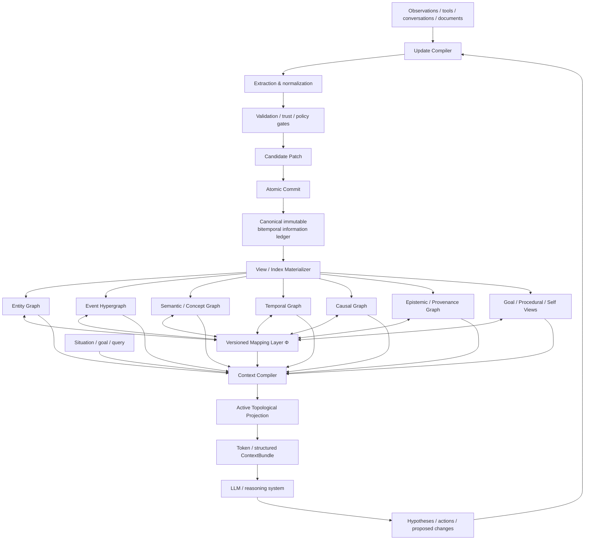
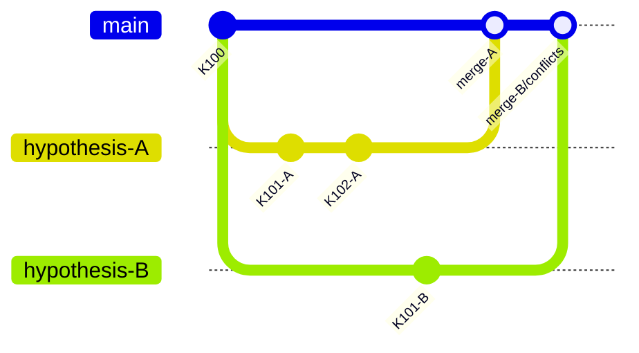
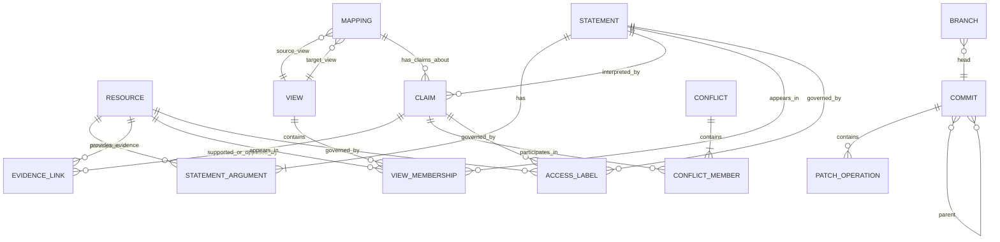
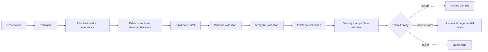

# Generative Topological Context in the Existing Landscape: Research Report and GTC v0.2 Design Recommendations

**Research snapshot:** August 9, 2026  
**Purpose:** identify the closest academic and industry precedents to Generative Topological Context (GTC), determine what is genuinely distinctive about GTC, and turn the comparison into an implementation-oriented specification for GTC v0.2.

## Executive summary

The central conclusion of this research is that **nearly every important primitive proposed by GTC has a precedent, but the combination does not appear to exist as a single coherent architecture**.

The closest intellectual relatives divide into several complementary families.

**MAGMA** is probably the closest recent academic work to GTC's multi-topology/context-compilation idea. It explicitly maintains semantic, temporal, causal, and entity graphs and uses an intent-aware traversal policy to select relational views and fuse the resulting subgraphs into a compact context. That is strikingly close to GTC's idea that persistent structured state should be projected into an active context rather than serialized wholesale. However, MAGMA does not appear to make **mappings between the graphs** themselves into versioned, addressable knowledge objects, nor does it provide a transactional belief-update/branch/merge substrate. citeturn20view8

**Graphiti/Zep** is the closest production-oriented system to GTC's notion of an **evolving context graph**. Graphiti represents entities, relationships, facts, and episodes in a temporal knowledge graph, incrementally updates it, preserves provenance, attaches lifecycle metadata to relationships, performs hybrid semantic/graph retrieval, and explicitly calls its construct a "Context Graph." Zep turns this into a managed large-scale agent-memory service. Its primary representation, however, remains essentially one temporal entity-relation graph per subject rather than an atlas of independently meaningful topologies connected by evolving mappings. citeturn20view9

**Kumiho**, a 2026 company-authored preprint, is particularly relevant to GTC's update and versioning layer. It proposes immutable revisions, mutable pointers, typed dependency edges, URI-addressable objects, belief-revision semantics, and a Redis working-memory/Neo4j long-term-memory architecture. This is close to the idea that agent memory should behave more like a versioned information system than a mutable note store. Its strongest lesson for GTC is that **belief revision and version control should be architectural primitives, not cleanup jobs applied after memory retrieval**. citeturn20view12

**RDF 1.2**, finalized in July 2026, now provides an important standards-level precedent for GTC's idea that statements themselves should be addressable: quoted triples can occur as RDF terms, allowing statements to be made about statements. GTC should therefore avoid inventing unnecessarily incompatible semantics for higher-order claims. citeturn20view1

**Knowledge hypergraphs and hyper-relational KGs** show why GTC should not reduce every real-world event to binary entity edges. Work such as *Knowledge Hypergraphs*, HINGE, and StarE explicitly models relations with more than two arguments or attaches qualifier structures to base relations; this is directly relevant to events containing participants, roles, places, times, instruments, amounts, and other context. citeturn20view2turn1search1turn1search2

**Multilayer-network theory** supplies a formal precedent for maintaining multiple graph layers rather than flattening heterogeneous relations into a single network. It also makes clear that layer identity is structural information, not merely a visualization choice. citeturn20view3

**Knowledge Sheaves** offers perhaps the most interesting mathematical precedent for the future of GTC mappings. It treats local representations as subject to compatibility maps and interprets a coherent global representation as an approximate global section. That gives GTC a route toward defining "can these local views be glued consistently?" without requiring every local view to be collapsed into a single global truth. citeturn20view0

**Ologs, categorical data integration, and functorial data migration** offer a second formal precedent: schemas can be represented categorically and mappings between schemas treated as structure-preserving morphisms/functors. This is highly relevant if GTC's \(\Phi_{ij}\) mappings are to become composable and machine-checkable rather than arbitrary edges labeled `mapsTo`. citeturn20view4turn3academia24turn3search9

**Datomic, XTDB, and Git** are not agent-memory systems, but together they expose a major weakness in many current agent-memory designs. Datomic treats facts and transactions as immutable information, XTDB makes both system time and valid time first-class, and Git represents history as a commit DAG with branches and merges. GTC v0.2 should borrow these semantics much more directly than it borrows the physical data model of a conventional mutable graph database. citeturn21view14turn21view15turn18search2

The resulting recommendation is to sharpen GTC's definition:

\[
\boxed{
\text{GTC is not primarily a graph database.}
}
\]

It should instead be defined as:

\[
\boxed{
\text{an immutable, bitemporal, epistemic information substrate}
+
\text{multiple materialized topological views}
+
\text{versioned mappings between those views}
+
\text{context and update compilers}
}
\]

The strongest implementation architecture emerging from the survey is:



The key distinction from conventional GraphRAG is:

\[
\text{GraphRAG}:
\quad
Documents \rightarrow Graph/Index \rightarrow Retrieval \rightarrow Prompt
\]

whereas GTC should become:

\[
\boxed{
\mathcal W_t
\xrightarrow{\text{compile}}
C_t
\xrightarrow{\text{cognition}}
Y_t
\xrightarrow{\text{validate/commit}}
\mathcal W_{t+1}
}
\]

The most important changes for v0.2 are therefore:

| Priority | Recommended change | Complexity | Expected benefit |
|---|---|---:|---:|
| **P0** | Separate canonical immutable information ledger from derived topology/index views | High | **Very high** |
| **P0** | Make Statement, Mapping, Transformation, Commit, Branch, Conflict and Scope addressable first-class objects | High | **Very high** |
| **P0** | Adopt native bitemporal semantics: valid time + system/knowledge time | Medium–High | **Very high** |
| **P0** | Turn Update Compiler into a mandatory transactional write gateway | High | **Very high** |
| **P0** | Add trust, provenance, taint, access scope and memory-poisoning controls before persistent writes | High | **Very high** |
| **P0** | Specify Context Compiler as an explicit query-planning system rather than "retrieval" | High | **Very high** |
| **P1** | Introduce Git-like commit DAGs and semantic three-way branch/merge | High | **High** |
| **P1** | Make event/n-ary statements canonical rather than encoding all knowledge as binary edges | Medium | **High** |
| **P1** | Define typed, composable, versioned \(\Phi\) mappings between views | High | **High** |
| **P1** | Add explicit epistemic/belief-revision semantics | Medium–High | **High** |
| **P1** | Treat vector/full-text/graph stores strictly as rebuildable indexes | Medium | **High** |
| **P2** | Add sheaf-inspired local-to-global consistency validators | High | Medium–High |
| **P2** | Allow topology schemas themselves to emerge, split, merge and retire | High | Potentially very high, but research-risky |

Most importantly, **GTC's novelty should not be claimed at the level of "using graphs for memory."** That space is now crowded. The distinctive claim is much stronger:

> **Persistent context is a versioned system of heterogeneous representations, their mappings, and their transformations; token context is a query-dependent compiled projection of that persistent state.**

That formulation remains meaningfully different from the systems reviewed below.

## Academic and conceptual landscape

The academic literature converges on GTC from several directions, but each direction captures only part of the architecture.

### Knowledge representation, higher-order statements, and hypergraphs

Traditional RDF gives a directed labeled graph model, but the 2026 RDF 1.2 standards are especially relevant because quoted triples may themselves be used as subjects or objects of other triples. In practical terms, a proposition can now be referred to and annotated by additional propositions without resorting entirely to ad-hoc application conventions. citeturn20view1

That aligns closely with a GTC requirement such as:

```text
Statement S17:
    Alice --worksAt--> OpenAI

Claim C42:
    supports(S17)

Evidence E9:
    evidenceFor(C42)

Event E31:
    creates(S17)
```

The important lesson is to distinguish three things that conventional graph schemas often conflate:

\[
\text{relation type}
\neq
\text{statement occurrence}
\neq
\text{belief about the statement}.
\]

GTC v0.2 should retain that distinction.

Hypergraph research provides the next step. *Knowledge Hypergraphs: Prediction Beyond Binary Relations* explicitly treats relations as potentially having arbitrary arity rather than forcing every fact into a binary subject-predicate-object form. Hyper-relational approaches such as HINGE and StarE preserve a base relation while associating arbitrary qualifier pairs with it. citeturn20view2turn1search1turn1search2

For GTC, this suggests that:

```text
Alice --paid--> Bob
```

should not be the canonical representation of:

> Alice paid Bob USD 100 in Bangkok at 13:42 under invoice X.

A more faithful canonical object is:

```text
PaymentEvent E
    payer       Alice
    payee       Bob
    amount      100
    currency    USD
    place       Bangkok
    time        ...
    invoice     X
```

Binary graph edges may then be **derived projections**:

```text
Alice --paid--> Bob
E --occurredIn--> Bangkok
E --amount--> USD100
```

This is a significant architectural distinction: the hyper/event representation should be canonical where the domain relation is intrinsically n-ary; binary views should be optimized representations rather than the source of truth.

### Multiple topologies and mappings between them

Multilayer-network theory explicitly generalizes ordinary networks so that different kinds of relationships can occupy distinct layers, including multiplex, interdependent, and network-of-networks formulations. The literature treats layer identity as part of the mathematical representation rather than assuming every relation should be aggregated into one adjacency structure. citeturn20view3

This validates a basic GTC intuition:

\[
G^{entity}
,\quad
G^{semantic}
,\quad
G^{temporal}
,\quad
G^{causal}
\]

should not necessarily be flattened into:

\[
G^{everything}.
\]

However, multilayer-network theory generally gives GTC only the **layer substrate**. It does not by itself supply the semantics of:

\[
\Phi_{ij}:
G_i\rightarrow G_j,
\]

particularly when a mapping means things like:

```text
Event E
    --createsStatement-->
Statement S

Statement S
    --instantiates-->
ConceptualRelation Employment

Observation O
    --supports-->
Claim C

Claim C
    --projectsTo-->
CausalEdge X
```

Category theory provides a closer analogue.

Spivak and Kent's **ologs** model knowledge schemas categorically and use structure-preserving maps to relate schemas. Functorial data-migration work goes further by treating schema mappings as mathematical objects that induce transformations of instances; CQL operationalizes related categorical ideas for data integration. citeturn20view4turn3academia24turn3search9

For GTC this suggests that \(\Phi\) should eventually become more than a generic `Mapping` record. A mapping should specify a contract such as:

\[
\phi:
G_\text{event}
\rightarrow
G_\text{entity}
\]

with explicit claims about what it preserves:

\[
\text{participant}(e,x)
\mapsto
\text{participatedIn}(x,e)
\]

or:

\[
\text{JoiningEvent}(e,p,o)
\mapsto
\text{worksAt}(p,o).
\]

This allows composition:

\[
G_E
\xrightarrow{\phi_{ES}}
G_S
\xrightarrow{\phi_{SC}}
G_C
\]

and therefore:

\[
\phi_{EC}
=
\phi_{SC}\circ\phi_{ES}.
\]

That property would make cross-topology reasoning substantially more principled than ordinary multi-hop traversal.

### Local consistency and sheaf-inspired knowledge

*Knowledge Sheaves* is unusually important because it attacks a related but deeper problem: local representations can each be meaningful while still requiring compatibility constraints where they overlap. It models KG embeddings using cellular sheaves and interprets a coherent representation as an approximate global section satisfying schema-induced consistency constraints. citeturn20view0

A GTC analogue would be:

```text
Personal-history view:
    Alice livesIn Bangkok

Employment view:
    Alice worksAt Organization X

Calendar view:
    Alice attended Meeting M in Singapore

Travel view:
    Alice flew Bangkok -> Singapore -> Bangkok
```

GTC should not prematurely reduce this to:

```text
Alice.location = ?
```

Instead, each view can retain local validity under its own scope, while compatibility constraints test whether a proposed global interpretation is possible.

This gives a much cleaner definition of contradiction:

\[
\boxed{
\text{Contradiction}
\neq
\text{two unequal values}
}
\]

but rather:

\[
\boxed{
\text{no compatible global assignment exists under the relevant scope and constraints}.
}
\]

That is a strong candidate for GTC v0.3 or later because generalized sheaf reasoning is mathematically and computationally nontrivial. It should, however, influence the v0.2 data model immediately: **do not destroy incompatible local assertions merely because the current global view cannot reconcile them.**

### Dynamic, temporal, event, and causal knowledge

Temporal-KG research has long treated graph evolution as more than a static timestamp column. Know-Evolve, for example, models temporally evolving entity representations and the occurrence timing of relational events; RE-NET conditions future-event prediction on sequences of previous temporal graph states and their neighborhoods. Later work explicitly studies continual learning and catastrophic forgetting in event-centric temporal KGs. citeturn20view5turn1search35turn1search3

These systems establish an important distinction:

\[
G(t)
\]

is not equivalent to:

\[
G+\text{timestamp properties}.
\]

GTC should go further by recording not merely temporal facts but **epistemic change**:

\[
\text{world-valid time}
\neq
\text{time first observed}
\neq
\text{time committed}
\neq
\text{time belief changed}.
\]

The first two are already enough to motivate bitemporality; more dimensions should be modeled as explicit events rather than indiscriminately adding temporal axes.

Causal KG work increasingly combines temporal reasoning with causal intervention or attempts to distinguish causal structure from ordinary relational correlations. citeturn1search31 The important implication for GTC is architectural rather than tied to one algorithm: a `causes` edge **must not merely be another relation label**.

GTC should distinguish at least:

```text
observedAssociation
hypothesizedCause
causalMechanism
interventionalEvidence
counterfactualDependency
```

and should never automatically promote:

\[
A\leftrightarrow B
\]

to:

\[
A\rightarrow B.
\]

Otherwise an evolving agent can recursively turn its own speculative explanations into "facts."

### RAG, graph retrieval, and compiled context

Original RAG couples a parametric generator with retrieved external knowledge, establishing the now-standard pattern:

\[
q
\rightarrow
Retrieve(D,q)
\rightarrow
LLM(q,D_q).
\]

The original work demonstrated the value of retrieved non-parametric knowledge on knowledge-intensive generation tasks. citeturn20view6

Later systems increasingly move decision-making into the retrieval layer. Self-RAG allows models to decide when retrieval and critique are useful; RAPTOR recursively builds hierarchical clusters and summaries so retrieval can operate at multiple abstraction levels. citeturn13search5turn13search2

These systems approach GTC's active-projection concept, but the difference is important.

RAG asks:

\[
\boxed{\text{Which documents/chunks should enter the prompt?}}
\]

GTC should ask:

\[
\boxed{
\text{Which parts, views, abstraction levels, temporal states, paths, conflicts and provenance of } \mathcal W_t
\text{ are required by this situation?}
}
\]

That makes Context Compiler closer to a **database query planner plus attention router** than a retriever.

### Memory-as-graph and agent-memory research

Recent agent-memory work is converging rapidly toward structural representations.

**HippoRAG** combines a knowledge graph with Personalized PageRank-style associative retrieval, inspired by hippocampal indexing. It provides a strong precedent for graph activation as memory recall rather than pure nearest-neighbor retrieval. citeturn20view13

**A-MEM** uses interconnected Zettelkasten-inspired memory notes, automatically generates links to existing memories, and importantly lets newly added memories trigger updates to contextual representations and attributes of older memories. That makes the memory structure itself evolvable rather than append-only. Source code is publicly referenced by the paper. citeturn21view13turn15search8

**MAGMA** goes substantially further and is probably the closest academic analogue to the GTC context layer. Every memory item participates in semantic, temporal, causal, and entity graphs; query intent selects which relational views to traverse; retrieved subgraphs are then fused into a compact type-aligned context. Its code is publicly linked by the paper. citeturn20view8

In GTC terminology, MAGMA effectively implements a restricted version of:

\[
\text{Situation}
\rightarrow
\text{Topology Routing}
\rightarrow
\text{Traversal}
\rightarrow
\text{Fusion}
\rightarrow
C_t.
\]

What remains missing is equally informative: its multiple graphs represent orthogonal retrieval relations, but public descriptions do not make **cross-view mappings themselves evolving epistemic resources**, and they do not define an immutable transactional world-state history or semantic branch/merge model. Those are exactly the areas where GTC should concentrate its differentiation. citeturn20view8

**Kumiho** attacks another portion of the problem. Its proposed primitives include immutable revisions, mutable tag pointers, typed dependency edges and URI addressing; it formally connects memory updates to belief-revision semantics and uses Redis for working memory plus Neo4j for long-term graph storage. Because this is a 2026 company-authored preprint rather than an established standard, its empirical claims should be treated as author-reported, but its data-management design deserves serious attention. citeturn20view12turn15search1

**Reflective Memory Management** introduces prospective reflection, which summarizes interactions across utterance/turn/session granularities for future retrieval, and retrospective reflection, which uses online feedback to refine retrieval. This reinforces GTC's idea that compaction is not merely text shortening; it can create abstractions optimized for future cognition. citeturn21view12

**StructMemEval**, introduced in 2026, is also directly relevant to GTC evaluation because it focuses on whether an agent organizes memory into useful structures—such as ledgers, task structures and trees—rather than merely retrieving isolated facts. Its initial experiments found that structural organization can materially distinguish memory agents from simple retrieval systems. citeturn14search3turn14search7

### Cognitive architectures as an older precedent

Long before LLM memory systems, cognitive architectures separated persistent knowledge from transient active state.

Soar distinguishes working memory, semantic/episodic memories and procedural knowledge. Its working memory represents the current situation—including active goals and intermediate inferences—and cognition repeatedly selects and applies operators to transform state. citeturn20view14turn14search16

That gives a surprisingly close conceptual predecessor to:

\[
\boxed{
State
\rightarrow
Projection
\rightarrow
Transformation
}
\]

even though Soar is not a heterogeneous evolving graph architecture.

This historical connection is important because it suggests that GTC should not define "working memory" as a separate storage tier. A more coherent formulation is:

\[
\boxed{
WorkingMemory_t
=
ActiveProjection(\mathcal W_t).
}
\]

That is one of the strongest conceptual decisions in GTC v0.1 and should be retained.

## Industry landscape and detailed inventory

The industry landscape is rapidly moving from "vector search plus chat history" toward explicit memory lifecycles, graph structures, consolidation, versioning and context assembly.

For the table below:

- **Native** means the capability is architecturally first-class.
- **Partial** means it is supported in a limited form or can be constructed from the system.
- **No/core-no** means it is not a central feature of the published design; it does **not** mean implementation is impossible.
- **Unspecified** means the reviewed primary/official material does not establish the property.

### Detailed inventory

| Work / system | Core idea and topology | Mappings and evolution | Higher-order relations / events | Active projection and update path | Storage, scale, openness |
|---|---|---|---|---|---|
| **RDF 1.2 / SPARQL 1.2** citeturn20view1 | Directed labeled RDF graph/dataset; quoted triples newly permit statements about statements | Cross-view semantics are not inherently a dynamic mapping system; history is not core RDF semantics | **Strong statement reification**; native graph remains triple-oriented rather than general hypergraph | Query language yes; agent context compilation and transactional belief workflow are outside core model | Open W3C standards; broad implementation ecosystem |
| **Knowledge Hypergraphs / HypE** citeturn20view2turn1search8 | Arbitrary-arity relational hypergraph | Inter-view mappings/history: **unspecified** | **Native n-ary relations** | Context compilation and commit workflow: **unspecified** | Research implementations/code available |
| **HINGE / StarE** citeturn1search1turn1search2turn1search14 | Hyper-relational triples with qualifiers | Mapping/history not central | Qualifiers attach context to primary relations; stronger than plain triples | Primarily representation/embedding rather than agent context/update system | Research code available |
| **Multilayer networks** citeturn20view3 | Multiple layers/networks with intra- and interlayer organization | Interlayer connections supported structurally; semantic mapping algebra and mapping history are not intrinsic | Ordinary multilayer edges; hyperedges not fundamental | No agent context compiler/commit semantics | Mathematical framework, not a storage product |
| **Knowledge Sheaves** citeturn20view0 | Graph plus local vector spaces and compatibility/restriction maps | **Strong local-to-global compatibility model**; temporal mapping evolution not central | Relations represented through sheaf constraints rather than event hyperedges | No agent compiler/transaction workflow | Academic framework; implementation details not a production storage design |
| **Ologs / categorical data integration / CQL** citeturn20view4turn3academia24turn3search9 | Categories as schemas; functors/structure-preserving mappings between schemas and instances | **Very strong mapping abstraction and composition**; dynamic mapping versioning not core | Can model rich schema relations; not specifically event/hypergraph memory | No LLM context compiler; transformation semantics are strong | Research/open tooling exists around CQL |
| **Know-Evolve / temporal KG line** citeturn20view5turn1search35 | Dynamic relation events and temporally evolving representations | History/evolution is central; inter-view mapping is not | Events are first-class temporally, but usually relation-event oriented rather than full general event hypergraphs | Prediction/reasoning over history, not an agent memory commit pipeline | Academic prototypes; storage architecture generally **unspecified** |
| **Causal-enhanced temporal KG work** citeturn1search31 | Causal interventions or causal structure augment temporal KG reasoning | Evolution yes; mapping algebra generally no | Causal relations represented explicitly; event richness varies | Reasoning-oriented, not persistent context management | Academic |
| **RAG** citeturn20view6 | Retrieved document passages + parametric generator | No persistent cross-view mapping model | No | **Strong query-time projection**, but primarily passage selection | External document/vector retrieval; foundational research architecture |
| **Self-RAG / RAPTOR** citeturn13search5turn13search2 | Adaptive retrieval/critique; hierarchical retrieval over recursively summarized corpora | Hierarchies exist but mappings are generally retrieval metadata rather than evolving semantic mappings | No native higher-order/event model | Stronger active retrieval/abstraction selection | Research implementations; production storage not central |
| **Generative Agents** citeturn8search4 | Memory stream plus retrieval, reflection and planning | Reflections derive higher-level memories; not a multi-topology mapping system | Experiences represented as memory records | Active selection based on current situation; reflections write abstractions back | Research prototype |
| **HippoRAG** citeturn20view13 | KG-based associative memory with graph propagation/PPR | Static-ish relational structure relative to GTC; mapping history not core | Ordinary KG | **Strong graph activation/retrieval** | Research code available according to project/paper ecosystem |
| **A-MEM** citeturn21view13 | Dynamically linked atomic notes inspired by Zettelkasten | Existing memories can evolve when new memories arrive; no formal multiple-view mapping algebra | Links/attributes rather than canonical event hyperedges | Agentic write/link/update decisions; retrieval over evolving memory network | Public research code referenced by authors |
| **MAGMA** citeturn20view8 | Semantic + temporal + causal + entity graphs | Multiple views are explicit; mappings between views are not first-class versioned objects in the published architecture | Memory items participate across views; general hyperedge semantics are not core | **Very strong intent-aware topology routing and structured context construction** | Open-source code linked by paper |
| **RMM** citeturn21view12 | Prospective multi-granularity memory formation + retrospective retrieval refinement | Memory representations evolve through reflection; no graph mapping algebra | No native event hypergraph | Strong reflection-driven write and retrieval adaptation | Academic, ACL 2025 |
| **Soar / classical cognitive architectures** citeturn20view14turn14search16 | Separate working, semantic, episodic and procedural representations | Different memory systems interact but not via explicit graph morphisms | Episodic memory yes; hypergraph no | **Strong active-state/operator model** | Soar implementation/documentation openly available |
| **MemGPT / Letta** citeturn20view7turn21view2turn21view3 | OS-inspired hierarchical context management; current Letta adds stateful memory blocks and Git-tracked MemFS/dreaming | Memory state evolves; Git-style tracking increasingly important; no typed topology atlas | Memories primarily strings/files/messages rather than semantic hyperedges | **Very strong context paging/agent-managed memory** | Public APIs/SDK; Letta platform plus open components |
| **Hermes Agent** citeturn21view0turn21view1 | Self-improving agent with skill creation, conversation search, built-in memory files and pluggable external memory providers | Memory evolves, skills evolve; only one external memory provider is active at a time; no unified cross-provider graph mapping | Not core | Provider context injection, prefetch, session-end extraction and memory-management tools | Open GitHub project; provider ecosystem |
| **Graphiti / Zep** citeturn20view9 | Temporal context graph of entities, relations, facts and episodes | Strong fact evolution and invalidation; not a multi-topology mapping algebra | Episodes first-class; facts usually represented by relationship edges | **Strong hybrid graph/semantic context retrieval** | Graphiti open-source; Zep managed/proprietary graph engine |
| **Google Agent Platform Memory Bank** citeturn20view10 | Long-term personalized self-contained memories generated from sessions | Consolidates new information into existing memories; scope isolation; not graph-based | No native higher-order graph/event model | Relevant-memory retrieval into prompts; generation/consolidation pipeline | Managed Google Cloud service/APIs |
| **Microsoft GraphRAG** citeturn21view4 | LLM-derived KG + network analysis + summaries for corpus understanding and RAG | Corpus-derived graph; dynamic world-model history not the focus | Standard entity/relation graph | **Strong graph-derived query context** | Microsoft project and open-source ecosystem |
| **Microsoft AutoGen Memory** citeturn21view5 | Pluggable memory abstraction integrated into agent context | Depends on backend; integration with Mem0 and other memory types | Depends on backend | Memory adapters update context at runtime | Open framework/API |
| **Mem0 Graph Memory** citeturn21view6turn21view7 | Entity/co-occurrence graph layered over memories | Evolving entity connections; not typed relation semantics | Explicitly **does not** assign typed labeled entity relations | Memory retrieval/injection supported | Current graph-memory feature is platform-only; removed from OSS v3 |
| **Neo4j GraphRAG** citeturn20view11 | Property graph + KG creation + vector/graph retrieval | Application-defined mappings; temporal mapping lifecycle not intrinsic | Property graph supports rich edge properties; canonical hyperedge semantics require modeling | Multiple retrieval strategies | First-party Python package; native vector index and external Weaviate/Pinecone/Qdrant integrations |
| **AWS Bedrock + Neptune GraphRAG** citeturn21view8 | Managed graph modeling combined with vector search for RAG | Application-level | Standard graph-centric | Retrieval-oriented | Managed AWS service |
| **Stardog** citeturn21view9turn21view10 | Semantic/RDF KG, virtualization/federation, inference and graph + vector use | Strong semantic-model/schema capabilities; GTC-style evolving mappings not core | RDF triples; statement modeling possible via RDF ecosystem | Query-time semantic and vector/graph retrieval | Commercial platform with standards-oriented interfaces |
| **Kumiho** citeturn20view12 | Versioned graph-native cognitive memory with belief-revision semantics | Strong revision/dependency/version history; multi-topology mappings not central | Addressable revisions and typed dependencies; general event hypergraph not central | Hybrid retrieval; explicit versioned write semantics | 2026 company-authored research preprint; Redis + Neo4j described |
| **Datomic** citeturn21view14 | Immutable datoms accrued through atomic transactions | Strong historical facts/transactions | Facts themselves retained with transaction provenance | Queryable database values; not an LLM context compiler | Production database; immutable transaction semantics |
| **XTDB** citeturn21view15 | Database-wide native system-time + valid-time histories | **Very strong bitemporal semantics** | Row/document rather than hypergraph-centric | SQL/query system, not agent context compilation | Production bitemporal database |
| **Git** citeturn18search2turn18search11 | Content-addressed immutable objects plus commit DAG, branches and merges | **Strong version/branch/merge history** | Objects/commits, not semantic relations | Explicit stage/commit/merge workflow | Open-source, extremely mature version-control architecture |

Several patterns become obvious from this inventory.

First, **industry has mostly converged on retrieval and memory lifecycle, not formal knowledge evolution**. Google Memory Bank, Hermes, Letta and similar systems all recognize that persistent memory must be selected, updated, consolidated or paged into active context, but their published abstractions are generally memory records, text blocks or provider outputs rather than a formal evolving world topology. Google Memory Bank, for example, generates meaningful persistent memories, consolidates new information with old memories, isolates memories by scope, and retrieves relevant items into prompts; it also explicitly warns that persistent memory introduces prompt-injection and memory-poisoning risks. citeturn20view10

Second, **graph vendors have solved efficient graph/vector retrieval much more than epistemic memory semantics**. Neo4j's current GraphRAG package supports graph construction, native vector indexes and external vector stores such as Weaviate, Pinecone and Qdrant; Amazon Bedrock Knowledge Bases combines Neptune graph analysis with vector retrieval; Stardog supports RDF graph extraction and graph-based querying alongside vector search. These are strong physical substrates for portions of GTC, but they do not by themselves define what an agent should believe, how mappings evolve, how conflicting branches merge, or what constitutes an admissible memory commit. citeturn20view11turn21view8turn21view10

Third, **Letta's move toward Git-tracked MemFS is directionally important**. Earlier Letta abstractions expose editable string memory blocks and persistent message history; the newer Agent SDK explicitly describes MemFS as Git-tracked and combined with "agent dreaming." That is evidence that agent memory architecture is beginning to converge with versioned file/revision systems rather than merely retrieval indexes. citeturn21view2turn21view3

Fourth, **Hermes illustrates a plugin-oriented alternative**. Its built-in memory remains memory/user files, while external providers inject context, prefetch memories, synchronize turns, perform session-end extraction and expose provider-specific management tools. This is valuable inspiration for GTC's interface boundaries: storage/retrieval implementations should be pluggable, but their outputs should enter one canonical GTC semantics rather than making the agent's ontology depend on which memory vendor is currently active. citeturn21view1

## Comparison against the GTC feature model

The following table is an analytical classification of the public designs, not a vendor-certified feature matrix.

**Legend:** ● = explicit/native; ◐ = partial or adjacent; ○ = not a core feature; **U** = unspecified in reviewed material.

| System / idea | Multi-topology | Typed inter-view \(\Phi\) | Versioned \(\Phi_t\) | Statement / relation addressable | Event / n-ary | Temporal / bitemporal history | Active context compilation | Validated commit workflow | Branch / merge | Provenance / epistemics | Hybrid graph + vector | Open code / API |
|---|:---:|:---:|:---:|:---:|:---:|:---:|:---:|:---:|:---:|:---:|:---:|:---:|
| **GTC v0.1 target** | ● | ● | ● | ● | ● | ● | ● | ● | ● | ● | ● | ● |
| RDF 1.2 citeturn20view1 | ◐ | ◐ | ○ | **●** | ◐ | ○ | ○ | ◐ | ○ | ◐ | ○ | ● |
| Knowledge Hypergraphs citeturn20view2 | ○ | ○ | ○ | ◐ | **●** | ○ | ○ | U | ○ | ○ | ○ | ● |
| Multilayer networks citeturn20view3 | **●** | ◐ | ○ | ○ | ◐ | ◐ | ○ | ○ | ○ | ○ | ○ | N/A |
| Knowledge Sheaves citeturn20view0 | ◐ | **●** | ○ | ◐ | ○ | ○ | ○ | ○ | ○ | ◐ | ○ | U |
| Ologs / categorical mappings citeturn20view4turn3search9 | ◐ | **●** | ○ | ◐ | ◐ | ○ | ○ | ◐ | ○ | ◐ | ○ | ● |
| Temporal KGs citeturn20view5turn1search35 | ○ | ○ | ○ | ◐ | ● | **●** | ◐ | ○ | ○ | ◐ | ○ | ◐ |
| RAG citeturn20view6 | ○ | ○ | ○ | ○ | ○ | ○ | **●** | ○ | ○ | ◐ | ◐ | ◐ |
| RAPTOR / Self-RAG citeturn13search2turn13search5 | ◐ | ○ | ○ | ○ | ○ | ○ | **●** | ○ | ○ | ◐ | ◐ | ● |
| HippoRAG citeturn20view13 | ○ | ○ | ○ | ◐ | ○ | ○ | **●** | ○ | ○ | ◐ | **●** | ● |
| A-MEM citeturn21view13 | ○ | ○ | ○ | ◐ | ○ | ◐ | ● | ◐ | ○ | ◐ | ● | **●** |
| MAGMA citeturn20view8 | **●** | ◐ | ○ | ◐ | ◐ | ● | **●** | ○ | ○ | ◐ | ◐ | **●** |
| RMM citeturn21view12 | ◐ | ○ | ○ | ○ | ◐ | ◐ | ● | ◐ | ○ | ◐ | ◐ | U |
| Soar citeturn20view14 | **●** | ◐ | ○ | ◐ | ◐ | ● | **●** | ● | ○ | ◐ | ○ | ● |
| MemGPT / Letta citeturn20view7turn21view3 | ◐ | ○ | ○ | ◐ | ○ | ◐ | **●** | ◐ | **◐** | ◐ | ◐ | **●** |
| Hermes citeturn21view0turn21view1 | ◐ | ○ | ○ | ○ | ◐ | ◐ | **●** | ◐ | ○ | ◐ | ◐ | **●** |
| Graphiti / Zep citeturn20view9 | ◐ | ○ | ○ | ◐ | ● | **●** | **●** | ◐ | ○ | **●** | **●** | ● / commercial |
| Google Memory Bank citeturn20view10 | ○ | ○ | ○ | ○ | ◐ | ◐ | **●** | ◐ | ○ | ● | ◐ | API |
| Microsoft GraphRAG citeturn21view4 | ◐ | ○ | ○ | ○ | ○ | ○ | **●** | ○ | ○ | ◐ | **●** | ● |
| Mem0 citeturn21view6turn21view7 | ◐ | ○ | ○ | ○ | ○ | ◐ | ● | ◐ | ○ | ◐ | **●** | OSS core / graph commercial |
| Neo4j GraphRAG citeturn20view11 | ◐ | ◐ | ○ | ◐ | ◐ | ◐ | **●** | ◐ | ○ | ◐ | **●** | ● / commercial DB |
| AWS Neptune GraphRAG citeturn21view8 | ◐ | ○ | ○ | ◐ | ◐ | ◐ | **●** | ◐ | ○ | ◐ | **●** | API |
| Stardog citeturn21view9turn21view10 | ◐ | ● | ○ | ◐ | ◐ | ◐ | ● | ◐ | ○ | ● | **●** | API / commercial |
| Kumiho citeturn20view12 | ◐ | ◐ | ◐ | **●** | ◐ | **●** | ● | **●** | ◐ | **●** | **●** | Research description |
| Datomic citeturn21view14 | ○ | ○ | ○ | ● | ○ | **●** | ○ | **●** | ○ | ● | ○ | API |
| XTDB citeturn21view15 | ○ | ○ | ○ | ◐ | ○ | **●** | ○ | **●** | ○ | ● | ○ | ● |
| Git citeturn18search2turn18search11 | ○ | ○ | ○ | ● | ○ | **●** | ○ | **●** | **●** | ● | ○ | **●** |

The table reveals a useful decomposition.

GTC is effectively proposing to combine:

\[
\underbrace{
\text{MAGMA}
}_{\text{multi-view context routing}}
+
\underbrace{
\text{Graphiti}
}_{\text{temporal context graph}}
+
\underbrace{
\text{Kumiho / Datomic / Git}
}_{\text{versioned transactional state}}
\]

with:

\[
\underbrace{
\text{RDF 1.2 / hypergraphs}
}_{\text{higher-order + n-ary facts}}
+
\underbrace{
\text{Ologs / category theory}
}_{\text{view mappings}}
+
\underbrace{
\text{Knowledge Sheaves}
}_{\text{compatibility}}
+
\underbrace{
\text{RAG / HippoRAG}
}_{\text{active projection}}
\]

and then treating the resulting object as the **persistent context substrate of an agent**.

That synthesis is where the strongest opportunity lies.

The most conspicuous empty column in the existing landscape is:

\[
\boxed{\text{Versioned mappings between heterogeneous topological views}}
\]

followed closely by:

\[
\boxed{\text{semantic branch/merge over evolving agent knowledge}}.
\]

These should become headline GTC features rather than secondary implementation details.

## Design patterns, gaps, and risks for GTC

Several design patterns are sufficiently recurrent that GTC should adopt them explicitly.

**Persistent state should be richer than prompt context.** MemGPT/Letta, RAG, GraphRAG, MAGMA, Google Memory Bank and Graphiti all separate persistent information from what is surfaced to the model for a particular inference. The disagreement is about the representation and selection mechanism, not the basic principle. citeturn20view7turn20view8turn20view9turn20view10

Therefore GTC should formally distinguish:

\[
\mathcal W_t
\]

from:

\[
C_t.
\]

A useful contract is:

\[
C_t =
Compile(
\mathcal W_t,
Situation_t,
Goal_t,
Identity_t,
Permissions_t,
Budget_t
).
\]

**The context compiler should become a query planner.** MAGMA's intent-aware routing and HippoRAG's graph activation both demonstrate that graph traversal can be conditioned on query requirements rather than treated as global nearest-neighbor search. citeturn20view8turn20view13

A mature compiler might generate a plan such as:

```text
QueryIntent:
    explain why Project X was delayed

Plan:
    1. activate Project X entity neighborhood
    2. route strongly to Event + Temporal + Causal views
    3. retrieve candidate delay events
    4. expand causal predecessors depth <= 3
    5. retrieve contradicting causal claims
    6. fetch evidence/provenance for selected claims
    7. resolve entity aliases
    8. include minimal concept definitions
    9. rank paths by relevance × confidence × recency
   10. render within 12k-token budget
```

That is substantially more expressive than:

```text
similarity_search(query, top_k=20)
```

or even:

```text
graph_search(query, depth=2)
```

**Writes require stricter semantics than reads.** This is arguably the largest architectural lesson from current memory-security work. Google explicitly warns that long-term memory can be poisoned and recommends mitigating prompt-injection and memory-poisoning risks. Academic attacks have demonstrated black-box extraction of private agent memories, query-only memory injection, and persistent memory-poisoning behavior. citeturn20view10turn17search1turn16search3turn16search1

Therefore the rule should be:

\[
\boxed{
LLM\ output \neq persistent\ state\ mutation.
}
\]

Instead:

\[
LLM
\rightarrow
CandidatePatch
\rightarrow
Validation
\rightarrow
Authorization
\rightarrow
Commit.
\]

No tool result, webpage, user utterance, agent inference or retrieved memory should be able to directly modify trusted persistent state.

**History should consist of immutable assertions and transformations, not overwritten objects.** Datomic demonstrates an information model where transactions accrue immutable additions and retractions; XTDB demonstrates database-wide system-time and valid-time semantics; Git demonstrates a DAG of immutable commits with branches and merges. citeturn21view14turn21view15turn18search2

GTC should therefore represent:

```text
Old:
Alice.location = Bangkok

Update:
Alice.location = Berlin
```

not as an in-place overwrite, but approximately:

```text
S1: livesIn(Alice, Bangkok)
    valid = [2024-01, 2026-03)

S2: livesIn(Alice, Berlin)
    valid = [2026-03, ∞)

Commit K7:
    learned_at = 2026-03-18
    adds = [S2]
    closes_valid_interval = [S1]
```

If on April 1 the agent learns that Alice actually moved on February 25:

```text
Commit K8:
    committed_at = 2026-04-01
    corrects_valid_time(S1, ...)
    corrects_valid_time(S2, ...)
```

Now the system can answer both:

> Where did the model believe Alice lived on March 10?

and:

> According to what we know now, where did Alice actually live on March 10?

That distinction is precisely what native bitemporal systems are designed to preserve. citeturn21view15

**Compaction should create derived structure rather than destroy evidence.** RMM's prospective summaries, A-MEM's evolving memory representations, and Letta's newer "dreaming" direction all support moving from raw experience toward higher-level abstractions. citeturn21view12turn21view13turn21view3

GTC should therefore encode:

```text
Episodes E1 ... E47
        |
        | abstractedBy
        v
Pattern P3
        |
        | supports
        v
Concept / strategy C8
```

rather than replacing \(E_1...E_{47}\) with \(C_8\).

Formally:

\[
Compression
=
\text{add abstraction edges}
+
\text{reduce default activation of raw episodes},
\]

not:

\[
Compression
=
\text{delete source experience}.
\]

### The most important unresolved gaps

The first gap is **mapping semantics**.

GTC v0.1 correctly recognizes:

\[
\Phi_{ij}
\]

but it still risks allowing mappings to degenerate into ordinary relations. v0.2 should define a `MappingDefinition` with:

```text
mapping_id
source_view
target_view
mapping_type
domain_constraint
codomain_constraint
transform
inverse_transform?
preserves[]
requires[]
valid_time
system_time
confidence
provenance
version
status
```

Possible `mapping_type` values should include:

```text
projection
realization
abstraction
instantiation
equivalence
alignment
derivation
aggregation
causal-realization
event-state-transition
schema-migration
```

A mapping should itself be addressable:

\[
M_{27}
\]

so the system can assert:

```text
Claim C:
    "M27 is no longer valid after ontology version 18"

Evidence E:
    supports(C)

Commit K:
    supersedes(M27, M31)
```

That is the missing bridge between category-theoretic mappings and temporal agent memory.

The second gap is **topology evolution**.

Most multi-graph systems predefine the views. MAGMA, for example, defines semantic, temporal, causal and entity graphs in advance. citeturn20view8

GTC's more ambitious idea is:

\[
\mathcal G_t
\neq
\mathcal G_{t+1}.
\]

The system may discover that a previously unnamed relation family deserves its own topology:

```text
Before:
Entity Graph
    contains thousands of "dependsOn" edges

Observation:
    dependence structure predicts outcomes and has unique traversal semantics

After:
New DependencyTopology
    + projection mappings from EntityGraph
    + dedicated compiler routing policy
```

This should be supported eventually, but **automatic topology creation should not be in the first production-critical path**. Otherwise GTC risks uncontrolled schema proliferation.

The third gap is **branching epistemic state**.

Suppose two agents independently reason from the same state:



A graph-memory system that merely upserts nodes and edges has difficulty representing this cleanly.

Git's commit-DAG model provides an architectural precedent for identifying common ancestors and merging divergent histories. citeturn18search2turn18search11

GTC should add:

\[
Commit =
(
id,
parents[],
patch,
author,
reason,
timestamp,
scope,
validatorResults
)
\]

and:

\[
Branch=
(name,headCommit).
\]

A merge should operate over **semantic patches**, not database rows.

For example:

```text
Branch A:
    assert causes(A,B)

Branch B:
    assert correlates(A,B)
    assert commonCause(C,A,B)
```

The merge result should not choose one string.

It should produce:

```text
Claim CA: causes(A,B)
Claim CB1: correlates(A,B)
Claim CB2: commonCause(C,A,B)

Conflict X:
    members = [CA, CB2]
    type = causal_explanation_conflict
```

The contradiction can remain alive until evidence resolves it.

### Risks

**Ontology explosion.** If every discovered pattern becomes a new node type, relation type or view, traversal and validation complexity can grow faster than useful knowledge. GTC needs explicit schema budgets, promotion thresholds and deprecation rules.

**Graph entropy.** LLMs are extremely good at proposing vaguely plausible relationships. Without controlled relation vocabularies and write validation, the graph can become densely connected but semantically meaningless.

**Self-reinforcing hallucination.** A generated inference can enter memory, later be retrieved as "evidence," and eventually reinforce itself. Provenance must therefore preserve observation-versus-inference lineage all the way through abstractions.

**False causality.** A causal topology creates unusually high epistemic risk. `causes` should require a stronger validation policy than `associatedWith`, and the compiler should distinguish causal hypothesis from accepted causal model.

**Temporal corruption.** Mutable node properties are insufficient for a world model because retroactive corrections can change the interpretation of previous states. Native bitemporal thinking is a better baseline. citeturn21view15

**Write amplification.** One observation may update entity resolution, event graph, temporal index, vector embeddings, provenance graph, abstractions and mappings. Synchronous mutation across all stores would be fragile.

**Polyglot-store inconsistency.** A vector DB and graph DB must not each become competing sources of truth. Their indexes should be disposable/rebuildable from the canonical commit history.

**Context-selection bias.** Once the Context Compiler decides what is relevant, omitted information may never reach the model. Retrieval traces and counterfactual retrieval tests therefore become part of correctness.

**Memory poisoning.** Persistent memory extends the duration of prompt-injection effects from one request to future sessions. Recent security research reports practical query-only injection and systematic poisoning vulnerabilities, while Google's own Memory Bank documentation explicitly treats poisoning as a deployment threat. citeturn16search3turn16search1turn20view10

**Privacy amplification.** Persistence and graph linking make isolated personal facts easier to recombine. MEXTRA demonstrated black-box extraction attacks against agent memories, making access scopes and information-flow constraints architectural requirements rather than optional application metadata. citeturn17search1turn17search5

## Proposed GTC v0.2 architecture and implementation plan

The primary architectural change should be to stop equating the logical GTC state with whatever graph database happens to store it.

### Canonical information model

The recommended v0.2 model is:

\[
\boxed{
\mathcal W_t
=
(
R,
S,
A,
C,
E,
M,
V,
K,
B,
X,
P
)_t
}
\]

where:

\[
R = Resources
\]

\[
S = Statements
\]

\[
A = StatementArguments
\]

\[
C = Claims
\]

\[
E = Evidence
\]

\[
M = Mappings
\]

\[
V = Views
\]

\[
K = Commits/Transformations
\]

\[
B = Branches
\]

\[
X = Conflicts
\]

\[
P = Policies/Scopes/Permissions.
\]

This should be understood as a **logical model**, not a mandate that every item becomes a relational table.

A possible entity model is:



The most consequential change from a normal property graph is that **Statement is a first-class resource**.

For an n-ary event:

```json
{
  "statement_id": "stmt:payment:123",
  "predicate": "gtc:Payment",
  "arguments": [
    {"role": "payer", "value": "entity:alice"},
    {"role": "payee", "value": "entity:bob"},
    {"role": "amount", "value": {"value": 100, "unit": "USD"}},
    {"role": "place", "value": "place:bangkok"}
  ],
  "valid_time": {
    "from": "2026-08-08T13:42:00Z",
    "to": "2026-08-08T13:42:01Z"
  },
  "provenance": ["observation:991"]
}
```

A binary edge can simply be an optimized special case.

RDF 1.2's new ability to refer to triples as terms makes standards interoperability substantially easier for the binary subset of this model. citeturn20view1

### Immutable commit model

All durable changes should occur through a transaction:

```json
{
  "commit_id": "commit:7f91",
  "parents": ["commit:7f90"],
  "actor": "agent:researcher",
  "reason": "Integrated evidence from source X",
  "scope": "project:gtc",
  "operations": [
    {
      "op": "assert",
      "target": "claim:123"
    },
    {
      "op": "supersede",
      "old": "mapping:44",
      "new": "mapping:57"
    }
  ],
  "validation": {
    "schema": "pass",
    "temporal": "pass",
    "authorization": "pass",
    "provenance": "pass",
    "epistemic": "warning"
  }
}
```

This closely follows the successful principle seen in Datomic: database history accrues information through atomic transactions rather than treating the database as a collection of mutable places. citeturn21view14

The commit DAG should permit multiple parents, enabling branch/merge.

### Bitemporal semantics

Every durable factual claim should support at least:

```text
valid_from
valid_to

system_from
system_to
```

where:

- **valid time** asks when the modeled fact is considered true in the world;
- **system time** asks when GTC stored/believed that version.

XTDB provides a concrete production example of this distinction and supports retrospective corrections while retaining the previous system-time history. citeturn21view15

Mappings should be bitemporal too:

\[
\Phi_{ij}(t_\text{valid},t_\text{system}).
\]

This is essential because not only facts but **interpretations** change.

### Views should become materializations

A major v0.2 change should be:

\[
\boxed{
CanonicalState \neq EntityGraph \neq EventGraph \neq CausalGraph.
}
\]

Instead:

\[
View_i
=
Materialize_i(
CanonicalState,
ViewDefinition_i
).
\]

Thus:

```text
canonical n-ary event
        |
        +--> Event Hypergraph
        |
        +--> Entity relationship projection
        |
        +--> Temporal index
        |
        +--> causal candidate view
        |
        +--> provenance graph
        |
        +--> vector embedding index
```

The benefits are substantial.

A view can be destroyed and rebuilt.

A faulty embedding model can be replaced without altering knowledge.

A causal schema can evolve without rewriting all raw episodes.

A graph database can be changed without migrating GTC's logical truth model.

And a mapping can describe relationships **between views** without requiring view-specific structures to become canonical facts.

### Context Compiler

The v0.2 Context Compiler should explicitly expose a query plan.

Recommended stages:

\[
SituationModel
\rightarrow
IntentClassification
\rightarrow
SeedActivation
\rightarrow
TopologyRouting
\rightarrow
StructuralExpansion
\rightarrow
MappingTraversal
\rightarrow
TemporalFiltering
\rightarrow
EpistemicCompletion
\rightarrow
ConflictExpansion
\rightarrow
EvidenceCompletion
\rightarrow
BudgetOptimization
\rightarrow
Rendering.
\]

MAGMA directly supports the value of intent-aware relational routing, while HippoRAG supports graph-based associative activation rather than only vector similarity. citeturn20view8turn20view13

The API should expose both a high-level call:

```http
POST /v2/context/compile
```

and its execution trace:

```json
{
  "situation": "...",
  "plan": {
    "views": ["event", "temporal", "causal", "epistemic"],
    "seed_strategy": ["entity", "vector", "goal"],
    "max_hops": 3,
    "historical_basis": {
      "valid_at": "...",
      "known_at": "..."
    },
    "conflict_policy": "include_material_conflicts",
    "evidence_policy": "required_for_causal_claims",
    "token_budget": 12000
  },
  "selected_paths": [],
  "excluded_high_score_candidates": [],
  "rendered_context": "..."
}
```

Recording exclusions matters because context compilation itself can create epistemic blind spots.

A useful retrieval score is not one scalar similarity but a composition:

\[
Score(x)
=
w_sS(x)
+
w_gG(x)
+
w_tT(x)
+
w_eE(x)
+
w_rR(x)
-
w_cCost(x),
\]

where, for example:

- \(S\): semantic similarity
- \(G\): graph/topological relevance
- \(T\): temporal relevance
- \(E\): epistemic quality
- \(R\): goal relevance
- \(Cost\): token/latency cost.

The compiler can then solve approximately:

\[
\max_{X\subseteq\mathcal W}
\sum_{x\in X} Score(x)
+
Coherence(X)
\]

subject to:

\[
Tokens(X)\le B.
\]

This formalizes "context engineering" as an optimization problem over structured persistent cognition.

### Update Compiler

The Update Compiler should receive untrusted observations and generate **candidate patches**, never direct mutations.



Validation should be **type-dependent**.

For example:

```text
user_preference:
    normal validation

identity_merge:
    high validation

causal_claim:
    high validation + evidence requirement

permission_change:
    deterministic authorization only

self-modifying policy:
    privileged review

cross-user memory:
    forbidden unless explicit capability
```

Google's public Memory Bank documentation already treats memory poisoning as a specific security consideration, while recent memory-injection and extraction studies show that persistent memory increases the consequences of malicious writes and unauthorized retrieval. citeturn20view10turn16search3turn17search1

### Branching and merge

The API should make branches explicit:

```http
POST /v2/branches
POST /v2/branches/{id}/commits
POST /v2/merge
POST /v2/merge/preview
```

A merge must use a common ancestor:

\[
B=
LCA(Head_A,Head_B).
\]

Then compare:

\[
\Delta_A=B\rightarrow A
\]

and:

\[
\Delta_B=B\rightarrow B'.
\]

Operations should be classified into:

```text
independent
identical
compatible
superseding
structurally conflicting
epistemically conflicting
authorization conflicting
```

This is more analogous to Git's branch/merge model than ordinary database synchronization. Git represents repository history as a commit DAG and merges changes from histories that forked from a common point. citeturn18search2turn18search11

The key GTC extension is that a semantic conflict does not necessarily make the merge fail:

\[
Conflict \in Knowledge.
\]

A merge may successfully commit the statement:

> Branch A and Branch B currently disagree about X.

### Storage architecture

The logical architecture should be storage-agnostic, but the physical implementation should separate the **system of record** from **indexes**.

Recommended architecture:

```text
                    CANONICAL
             ┌─────────────────────┐
             │ immutable commit log│
             │ + bitemporal state  │
             └─────────┬───────────┘
                       │ materialize
          ┌────────────┼──────────────┐
          ↓            ↓              ↓
      Graph index   Vector index   Search index
          │            │              │
          └────────────┼──────────────┘
                       ↓
                Context Compiler

Raw observations/documents
          ↓
      Object store
          ↑
 provenance pointers
```

A reasonable v0.2 reference stack would be:

| Layer | Recommended default | Alternatives | Rationale |
|---|---|---|---|
| Canonical transaction log | PostgreSQL append-only transaction tables initially | Datomic-style design, Kafka-backed log | Familiar transactional foundation; logical model remains portable |
| Bitemporal state | Explicit Postgres periods **or benchmark XTDB** | custom materialization | XTDB provides native system/valid-time semantics worth evaluating. citeturn21view15 |
| Traversal index | Neo4j initially | Kuzu, Neptune, TigerGraph, custom adjacency | Strong developer ecosystem; not source of truth |
| Vector index | pgvector initially | Qdrant, Pinecone, Weaviate, Neo4j vector | Keep semantic activation replaceable |
| Lexical search | PostgreSQL FTS initially | OpenSearch / Elasticsearch | Needed because embeddings alone are insufficient for identifiers/exact terms |
| Raw artifacts | S3-compatible object storage | filesystem for prototype | Keep documents, tool outputs, large episodes outside graph rows |
| Commit DAG | canonical relational/log layer | content-addressed object store | Required for branches/merge |
| Event bus | optional initially | Kafka / Redpanda / NATS | Materialized views can update asynchronously |
| Cache / activation state | Redis | local/in-process cache | Active context need not be durable canonical knowledge |

Neo4j's own GraphRAG package illustrates that graph retrieval and vector retrieval can coexist, including external vector-store integrations; AWS similarly combines Neptune graph analysis with vector retrieval. These are useful implementation patterns, but GTC should preserve the ability to reconstruct every such index from its canonical history. citeturn20view11turn21view8

### Prioritized change list

| Priority | GTC v0.2 change | Complexity | Benefit | Reason |
|---|---|---:|---:|---|
| **P0** | Introduce canonical `Statement` + arbitrary-role `StatementArgument` | High | Very high | Prevents binary graph representation from becoming a semantic prison |
| **P0** | Treat relations/statements as addressable resources | Medium | Very high | Enables evidence, confidence, contradiction, mapping and change to target statements directly; aligns directionally with RDF 1.2 citeturn20view1 |
| **P0** | Immutable `Commit` + patch log | Medium–High | Very high | Gives reproducibility, rollback, auditing and eventual branch/merge |
| **P0** | Native valid-time/system-time model | Medium–High | Very high | Separates changed world from changed knowledge; modeled directly by bitemporal systems such as XTDB citeturn21view15 |
| **P0** | Mandatory Update Compiler write gate | High | Very high | Prevents LLM output/tool content from becoming trusted memory directly |
| **P0** | Provenance, source trust and observation/inference distinction on every durable claim | Medium | Very high | Prevents self-reinforcing hallucinated evidence |
| **P0** | Security labels and capability-based scopes on Resources/Statements/Views | High | Very high | Persistent memory is now an established privacy/poisoning attack surface citeturn17search1turn16search1 |
| **P0** | Formal ContextPlan/ContextTrace objects | Medium | Very high | Makes context compilation observable, testable and optimizable |
| **P1** | `MappingDefinition` as versioned first-class resource | High | High | Core GTC differentiator |
| **P1** | Distinguish canonical state from materialized views | High | Very high | Eliminates graph/vector-store lock-in and index inconsistency |
| **P1** | Git-like branch/head/merge-base semantics | High | High | Enables multi-agent cognition and alternative hypotheses |
| **P1** | Semantic merge/conflict objects | High | High | Prevents branch merge from becoming destructive last-writer-wins |
| **P1** | Event-first n-ary representation | Medium | High | Better models actual episodes and processes; supported conceptually by knowledge-hypergraph work citeturn20view2 |
| **P1** | Epistemic states: observed/inferred/hypothesized/accepted/rejected/superseded | Medium | High | Prevents belief status from being encoded only by confidence floats |
| **P1** | Dedicated causal-claim policy | Medium | High | Prevents ordinary correlations from contaminating causal topology |
| **P1** | Asynchronous index materialization | High | High | Avoids graph/vector/search write amplification in commit path |
| **P1** | Rebuild/index-version API | Medium | High | Allows embedding/model/schema migrations without changing canonical knowledge |
| **P2** | Composable mapping algebra | High | High | Moves \(\Phi\) toward categorical structure instead of generic edges |
| **P2** | Local consistency/sheaf-inspired validator | High | Medium–High | Allows multiple local views without premature global collapse citeturn20view0 |
| **P2** | Learned compiler routing policy | High | Medium–High | MAGMA suggests query-conditioned graph routing can be effective citeturn20view8 |
| **P2** | Automatic abstraction promotion / "dreaming" | High | High | Converts episode volume into derived stable structure without destroying source memories |
| **P2** | Automatic topology creation/split/merge | **Very high** | Potentially very high | Closest to truly generative topology, but should come only after strong governance |

## Evaluation, security, and next research program

GTC should not be evaluated only by asking whether an LLM answers memory questions more accurately.

The architecture makes several stronger claims:

\[
\text{structured state is useful},
\]

\[
\text{multiple topologies are useful},
\]

\[
\text{mapping evolution matters},
\]

\[
\text{compiled projection beats generic retrieval},
\]

\[
\text{transactional memory produces safer learning},
\]

and:

\[
\text{branchable memory improves multi-agent reasoning}.
\]

Each claim needs a separate metric.

### Evaluation framework

**Answer utility** should measure final task quality on longitudinal QA and agent tasks.

**Context efficiency** should measure:

\[
\frac{\text{task utility}}{\text{tokens injected}}
\]

along with latency and retrieval/computation cost.

**Context precision** should ask what fraction of compiled context was actually useful.

**Context recall** should ask whether necessary supporting knowledge was omitted.

**Path faithfulness** should verify that explanations produced by the model correspond to actual retrieved graph/mapping paths.

**Structural utility** should test whether the system creates useful organization rather than merely retaining facts. StructMemEval is directly relevant because it was specifically constructed to test organizational memory structure rather than ordinary fact retrieval. citeturn14search3

**Temporal correctness** should test:

```text
what was true at time T?
what did GTC believe at time T?
what does GTC now believe was true at T?
```

These should intentionally yield different answers after retroactive corrections.

**Revision correctness** should measure whether superseded beliefs cease to influence active context without destroying their historical trace.

**Mapping correctness** should separately score:

\[
Precision(\Phi)
,\qquad
Recall(\Phi)
,\qquad
CompositionConsistency(\Phi).
\]

**Conflict quality** should measure whether the system preserves genuine disagreements while avoiding spurious contradiction generation.

**Branch/merge correctness** should test:

```text
lost updates
false conflicts
missed conflicts
semantic duplication
provenance loss
merge determinism
common-ancestor reconstruction
```

**Rebuild invariance** should require:

\[
Materialize(Log)=CurrentViews
\]

within formally permitted index approximations.

If deleting and rebuilding the graph/vector indexes changes the semantic state, the architecture has accidentally allowed an index to become canonical.

**Memory-write precision** should become a headline metric:

\[
WritePrecision
=
\frac{\text{useful durable writes}}
{\text{all durable writes}}.
\]

A memory agent that recalls well but permanently stores large amounts of misinformation may be worse than a weaker retriever.

**Security metrics** should include memory-poisoning attack success rate, malicious-memory retrieval rate, unauthorized cross-scope retrieval, private-memory extraction, rollback effectiveness and post-compromise persistence. MEXTRA and more recent memory-poisoning work establish that both extraction and durable contamination should be explicit threat models. citeturn17search1turn16search1turn16search13

### Security architecture

The most useful conceptual security change is to attach trust to **information flows**, not merely users.

For example:

```text
trusted system policy
        ↓
      high trust

user assertion
        ↓
    attributed claim

tool result
        ↓
  untrusted observation

retrieved webpage
        ↓
 potentially adversarial

LLM inference
        ↓
 generated hypothesis
```

None of those should automatically become another.

Every statement should have:

```text
source_principal
source_kind
trust_domain
sensitivity
allowed_scopes
derived_from[]
sanitization_state
write_policy
```

and derived information should conservatively inherit restrictions:

\[
Sensitivity(derived)
\ge
\max Sensitivity(inputs).
\]

Likewise:

\[
Trust(derived)
\not>
\max Trust(inputs)
\]

unless a trusted validation process explicitly promotes it.

A practical three-zone memory model would be:

```text
UNTRUSTED
observations / raw web / tool output
        |
        | validation
        v
ATTRIBUTED
claims with source + provenance
        |
        | stronger evidence / policy
        v
TRUSTED
system facts / approved knowledge
```

This avoids a common agent-memory failure mode in which everything that survives extraction becomes equally authoritative.

Privacy should also operate at projection time.

A fact may legitimately exist in persistent GTC while being forbidden from entering a particular ContextBundle:

\[
AllowedToStore(x)
\not\Rightarrow
AllowedToProject(x,Agent,Task).
\]

That distinction becomes especially important in multi-agent systems and shared organizational memory.

### Recommended next experiments

| Research step | Method | Main question | Success criterion |
|---|---|---|---|
| **Canonical-ledger prototype** | Implement `Resource`, n-ary `Statement`, `Claim`, `Evidence`, bitemporal periods and immutable commits; property-test full replay | Can state always be reconstructed deterministically from commits? | Replay equivalence, zero unexplained mutable state |
| **Multi-topology ablation** | Build the same memory corpus as entity-only; entity+temporal; +event; +causal; full GTC | Do separate topologies materially improve reasoning? | Statistically meaningful gain relative to added token/latency cost |
| **Context-compiler tournament** | Compare vector top-k, BM25, graph BFS, HippoRAG/PPR-like activation, MAGMA-style routed traversal, and GTC hybrid planning on identical state | Is "compiled active projection" genuinely better than retrieval? | Higher answer/context efficiency and better evidence recall |
| **Mapping consistency experiment** | Create domains with deliberately overlapping and conflicting local views; implement simple contract and sheaf-inspired validators | Do explicit \(\Phi\) mappings catch errors ordinary graphs miss? | Higher incompatibility detection with acceptable false-positive rate |
| **Branch/merge simulation** | Run multiple agents from common snapshots, let them independently form hypotheses, then semantic three-way merge | Can GTC preserve divergent reasoning without lost updates or destructive winner selection? | High conflict precision/recall and full provenance retention |
| **Adversarial memory laboratory** | Reproduce memory extraction, query-only memory injection and poisoning-style scenarios; compare no gate vs provenance gate vs trust gate + retrieval screen + scope policies | Does transactional memory governance materially reduce persistent compromise? | Large reduction in poisoning/extraction success with small utility degradation |

The first three should precede sophisticated topology generation. They test whether the central GTC thesis is worth its structural complexity.

The fifth experiment is especially important because multi-agent branching is one of the areas where GTC could become materially different from existing memory frameworks.

The sixth should occur **before** GTC is allowed to persist arbitrary web/tool observations, not after.

## Recommended references and implications for GTC

The following sources form the most useful reading set for a v0.2 iteration.

**For statement-level semantics:** W3C's current **RDF 1.2** publications are essential because quoted triples make statements-about-statements part of the standardized RDF model. GTC should map its binary statement representation cleanly onto this ecosystem wherever possible. citeturn20view1

**For n-ary events:** Fatemi et al., **Knowledge Hypergraphs: Prediction Beyond Binary Relations**, together with HINGE and StarE, provides the strongest justification for avoiding universal binary-edge reduction. citeturn20view2turn1search1turn1search2

**For multiple relational views:** Kivelä et al., **Multilayer Networks**, is the foundational framework to read before formalizing GTC's topology atlas. citeturn20view3

**For mappings:** Spivak and Kent, **Ologs: A Categorical Framework for Knowledge Representation**, followed by functorial data-migration and CQL work, is the most relevant route toward rigorous \(\Phi_{ij}\) semantics. citeturn20view4turn3academia24turn3search9

**For local-to-global consistency:** Gebhart, Hansen and Schrater, **Knowledge Sheaves**, is the clearest direct inspiration for maintaining locally valid representations and testing whether they glue consistently. citeturn20view0

**For temporal graph dynamics:** Trivedi et al., **Know-Evolve**, and the RE-NET line are useful precedents for treating time as part of graph dynamics rather than merely metadata. citeturn20view5turn1search35

**For retrieval as compiled projection:** Lewis et al., **RAG**, establishes the retrieval foundation; HippoRAG adds graph propagation; MAGMA is the most directly relevant recent work because it routes queries among semantic, temporal, causal and entity views and constructs structured context from the selected subgraphs. citeturn20view6turn20view13turn20view8

**For dynamic memory organization:** **A-MEM** is important because memory items and the representation of earlier memories can change as new experiences arrive. citeturn21view13

**For reflection/compaction:** Tan et al., **Reflective Memory Management**, gives a useful model for prospective multi-granularity abstraction and retrospective retrieval refinement. citeturn21view12

**For classical active-state cognition:** the **Soar** architecture remains surprisingly relevant to GTC's State → Projection → Transformation model, particularly its separation between current working state and multiple long-term memory systems. citeturn20view14turn14search16

**For context paging:** Packer et al., **MemGPT**, and current Letta stateful-agent/MemFS documentation are important references for treating limited model context as an actively managed resource rather than the persistent state itself. citeturn20view7turn21view2turn21view3

**For production temporal agent graphs:** **Graphiti/Zep** is probably the most important system to prototype against. It already implements evolving temporal context graphs, episodes, provenance, hybrid retrieval and point-in-time relationship semantics. citeturn20view9

**For production memory lifecycle:** **Google Agent Platform Memory Bank** is valuable for its extraction, consolidation, scope and retrieval lifecycle—and because its documentation explicitly recognizes memory poisoning as an operational concern. citeturn20view10

**For multi-provider agent memory:** current **Hermes Agent** provides a useful modularity pattern: memory providers implement lifecycle hooks for context injection, prefetch, synchronization, session-end extraction and memory-management actions. citeturn21view0turn21view1

**For graph-native versioned cognition:** **Kumiho** is the closest current design to GTC's revision-oriented persistent substrate. Its claims should be treated as those of a recent company-authored preprint, but immutable revisions, dependency edges, URI-addressability and explicit belief revision are directly relevant design ideas. citeturn20view12

**For immutable transaction semantics:** the **Datomic transaction model** is arguably more important to GTC than another graph database paper. Its core idea that a database accrues immutable facts through atomic transactions maps almost perfectly onto GTC's desired Update Compiler → Commit architecture. citeturn21view14

**For time:** **XTDB's bitemporal model** should be used as a concrete reference implementation for distinguishing "when this was true" from "when the system knew this version." citeturn21view15

**For branching:** **Git's commit DAG and merge model** is the right conceptual starting point for multi-agent GTC branches, although GTC's merge algorithm must operate on semantic claims and transformations rather than textual files. citeturn18search2turn18search11

**For structural evaluation:** **StructMemEval** should be added alongside ordinary long-term-memory QA benchmarks because it explicitly tests whether memory is organized into structures useful for future tasks. citeturn14search3

**For security:** Wang et al., **Unveiling Privacy Risks in LLM Agent Memory (MEXTRA)**, query-only memory-injection research, and recent systematic memory-poisoning studies should become required references for the Update Compiler threat model. citeturn17search1turn16search3turn16search1

Taken together, the literature suggests a sharper v0.2 definition than the original "evolving graph as context":

\[
\boxed{
\begin{aligned}
\textbf{GTC} =
&\;\textbf{an immutable, versioned and bitemporal information substrate}\\
&+\textbf{a dynamically materialized atlas of heterogeneous topological views}\\
&+\textbf{addressable and evolving mappings between those views}\\
&+\textbf{epistemic provenance, conflicts and belief transformations}\\
&+\textbf{a Context Compiler that produces situation-specific active projections}\\
&+\textbf{an Update Compiler that validates cognition before it becomes persistent state}\\
&+\textbf{branch/merge semantics for alternative and multi-agent cognition}.
\end{aligned}
}
\]

That definition makes the architectural boundary much clearer:

\[
\boxed{
\text{LLM} \neq \text{memory}
}
\]

\[
\boxed{
\text{graph database} \neq \text{GTC}
}
\]

\[
\boxed{
\text{retrieval} \neq \text{context compilation}
}
\]

\[
\boxed{
\text{LLM generation} \neq \text{knowledge commit}
}
\]

\[
\boxed{
\text{one graph} \neq \text{world representation}
}
\]

and, most importantly:

\[
\boxed{
\textbf{The persistent object is not a transcript or a graph.}
}
\]

\[
\boxed{
\textbf{It is a versioned system of structures, mappings, beliefs, evidence and transformations from which the context required for the present moment is compiled.}
}
\]

That appears to be the strongest technical and conceptual foundation on which to build **GTC v0.2**.