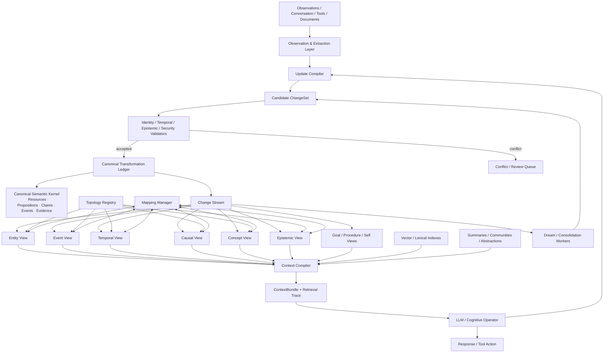
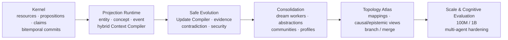

# Generative Topological Context: Prior Art, Design Landscape, and GTC v0.2 Architecture

## Executive summary

The central idea behind GTC—**persistent context as an evolving structured state, with token context produced as a situation-specific projection**—has substantial precedent in individual components, but I did not find a public academic or industrial system that combines the full set of ideas proposed in GTC v0.1.

The closest systems are complementary rather than equivalent.

**Zep/Graphiti is probably the closest engineering analogue.** Graphiti maintains continuously updated, bi-temporal Context Graphs, invalidates obsolete facts, preserves historical relationships, and uses hybrid semantic/keyword/graph retrieval to produce agent context. It is significantly closer to GTC than conventional RAG. However, its public model is essentially a temporal context knowledge graph, rather than a **topology atlas containing explicit entity, event, causal, epistemic, goal, procedural and other views connected by first-class mappings**. citeturn17search3turn17search7turn17search14

**Letta/MemGPT is the closest precedent for “context as managed persistent state.”** The original MemGPT framed context management as an operating-system-like virtual-memory problem; current Letta goes further with agent-editable persistent memory, Git-backed MemFS, memory reorganization and offline “dreaming.” The major difference is representational: Letta's durable substrate is primarily files, memory blocks and archival content, whereas GTC proposes typed higher-order structures and transformations as the substrate itself. citeturn17search1turn17search9

**OpenAI's publicly described memory direction independently validates several GTC intuitions, but there is no public evidence that ChatGPT memory itself is a knowledge graph.** OpenAI describes a “dreaming” process that periodically synthesizes information from prior conversations into a fresher, more useful memory state, explicitly targeting relevance, temporal freshness and scalability. OpenAI's in-house data agent similarly uses multiple context layers, scoped memories, retrieval and live validation. The public descriptions do not specify a KG or graph-based underlying memory representation, so it would be incorrect to assume one. citeturn18search0turn18search1

**Hermes also needs one correction:** Hermes's native persistent memory is not currently a knowledge graph. Its built-in mechanism is bounded curated `MEMORY.md` / `USER.md` state plus SQLite-backed sessions. It does, however, expose memory-provider plugins, some of which use graphs or richer user models. Hermes therefore provides a strong precedent for **pluggable memory/context substrates**, not for GTC's topology model itself. citeturn17search0turn17search4turn17search30

Academically, almost every primitive GTC needs already has a strong lineage: multilayer networks formalize multiple simultaneous relationship layers; knowledge hypergraphs formalize n-ary facts; RDF 1.2 permits triples themselves to be terms; sheaf theory formalizes local-to-global consistency; categorical databases formalize structure-preserving schema mappings; Temporal Graph Networks treat graph evolution as streams of events; A-MEM lets memory networks reorganize themselves; HippoRAG uses graph propagation for associative recall; GraphRAG uses hierarchical graph abstractions for global sense-making. citeturn20search0turn20search1turn14search13turn21search2turn14search32turn20search2turn21search0turn21search21turn21search3

The opportunity for GTC v0.2 is therefore **not to claim invention of graph memory**. Its potentially novel contribution is the composition:

\[
\boxed{
\text{Persistent typed world state}
+
\text{multiple explicit topology views}
+
\text{mappings between views}
+
\text{bitemporal epistemics}
+
\text{auditable transformations}
+
\text{context compilation}
+
\text{validated update compilation}
}
\]

Among the systems reviewed here, I found no public architecture exposing all of these as first-class parts of one runtime. That makes GTC **more expressive on paper**, but not yet “better”: Graphiti, Letta, Google Memory Bank, Microsoft GraphRAG and commercial graph products are much more mature operationally. GTC v0.2 should therefore concentrate on turning the conceptual advantage into a **small, rigorous kernel with replaceable materialized views**, rather than adding still more concepts.

## Research landscape and closest precedents

The landscape is easiest to understand as several research lineages converging on GTC from different directions.

Traditional RAG externalizes knowledge but fundamentally treats memory as a retrievable collection. Lewis et al.'s original RAG combines parametric model knowledge with a non-parametric external index; it established the now-common pattern:

\[
q\rightarrow Retrieve(D)\rightarrow LLM(q,D)
\]

but the retrieved knowledge does not itself evolve structurally because reasoning occurred over it. citeturn14search1turn14search5

Generative Agents introduced a more cognitive architecture: a complete stream of natural-language experiences is scored and retrieved, while higher-level reflections are periodically synthesized and subsequently influence planning. This is an important predecessor to GTC's ideas of **activation, consolidation and abstraction**, although the underlying memories remain natural-language records rather than typed topology. citeturn14search0turn14search11

Graph-oriented systems then address what flat retrieval misses. HippoRAG combines an LLM, open KG and Personalized PageRank to perform associative retrieval across related knowledge; HippoRAG 2 explicitly reframes RAG as non-parametric continual memory and targets factual, associative and sense-making behavior simultaneously. citeturn21search1turn21search21 Microsoft GraphRAG builds entity graphs, communities and hierarchical community summaries so that global questions can be answered from corpus-level structure rather than nearest-neighbor chunks alone. citeturn21search3turn21search11

A-MEM pushes closer to GTC's dynamic-topology intuition: it constructs interconnected Zettelkasten-like memory notes and allows insertion of new memories to modify the contextual representations and links of older memories. In other words, **learning changes memory structure**, not just the number of stored records. citeturn21search0turn21search12

The graph-theoretic literature supplies stronger representation machinery. Kivelä et al.'s multilayer-network framework explicitly covers multiplex networks, interconnected networks and networks-of-networks, showing why several kinds of connectivity should not automatically be collapsed into one network. citeturn20search0 Knowledge hypergraphs generalize binary KG triples into relations of arbitrary arity; ReAlE further connects those structures to relational-algebra operations such as projection, selection, union and difference. citeturn20search1 RDF 1.2 now includes **triple terms**, allowing statements to participate in other statements, which is directly relevant to GTC's requirement that claims, relations and evidence be addressable. citeturn14search13

Sheaf theory and category theory provide especially interesting foundations for GTC's cross-topology layer. Knowledge Sheaves describes KG representation as an approximate global section constrained by local consistency conditions, providing a formal vocabulary for determining when local representations can coherently glue together. citeturn21search2 Functorial data migration models schemas categorically and schema mappings as structure-preserving transformations, offering a mature mathematical precedent for GTC's desired typed mappings between views. citeturn14search32turn14search24

Dynamic-graph work makes another important distinction: a graph can be represented not merely as snapshots \(G_0,G_1,\ldots\), but as a chronological stream of structural events. Temporal Graph Networks explicitly model continuous-time dynamic graphs as sequences of timed events and combine node memory with graph operators. citeturn20search2 Event-centric KG work similarly argues that static entity-relation graphs fail to represent many activities and state transitions naturally; this is one reason GTC should preserve **world events** as first-class objects rather than treating every fact as a timeless edge.

The architecture emerging from these lineages is less “one graph” than:

\[
\mathcal W_t=
\left(
\text{canonical propositions/events},
\text{claims},
\{G_i(t)\},
\{\Phi_{ij}(t)\},
\text{transformation history}
\right)
\]

That formulation is considerably closer to GTC than a conventional KG.

## Comparative survey

The table below focuses on representative systems rather than every paper in each field. “Mapping” means explicit correspondence among different representations or views, not merely ordinary graph edges.

| System / work | Core model and topology | Mapping / evolution | Tooling / implementation | Strengths and limitations | Most useful lesson for GTC |
|---|---|---|---|---|---|
| **RAG — Lewis et al.** | Dense retrieval over external document memory plus generator. citeturn14search1 | Little persistent structural evolution; retrieval is query-time projection. | Retriever + vector index + seq2seq/LLM. | Simple, scalable and effective; weak relational, temporal and epistemic structure. | Treat vector retrieval as one projection operator, **not the memory model**. |
| **Generative Agents** | Natural-language memory stream + retrieval + reflections + plans. citeturn14search0 | Experience creates memories; reflection produces abstractions. | LLM, retrieval scoring, simulation loop; public code exists. citeturn14search29 | Strong cognitive loop; largely textual and weakly typed. | Activation and reflection should become first-class Context Compiler / consolidation stages. |
| **MemGPT → Letta** | OS-inspired context hierarchy; modern Letta uses persistent agent-owned memory and Git-backed MemFS. citeturn17search1turn17search9 | Agent edits memory; dreaming reorganizes it offline; Git supplies version history. | Open-source agent runtime, filesystem memory, custom RAG integration. | Excellent persistent-state lifecycle; weak explicit semantic graph model. | Adopt agent-owned state, offline dreaming and **versioned memory**, but apply them to typed structures. |
| **A-MEM** | Zettelkasten-inspired linked memory network with tags, descriptions and embeddings. citeturn21search0 | New memories create links and can update representations of old memories. | LLM + ChromaDB implementation. citeturn21search16 | One of the clearest examples of topology evolution; links are relatively unconstrained semantically. | Make **topology reorganization itself a learning operation**. |
| **HippoRAG / HippoRAG 2** | Open KG + LLM + graph propagation/PPR for associative memory. citeturn21search1turn21search21 | Primarily indexing/retrieval rather than explicit transformation history. | KG, embeddings, Personalized PageRank. | Very relevant to multi-hop recall; not a complete persistent agent-state architecture. | Use graph propagation as one activation kernel in Context Compiler. |
| **Microsoft GraphRAG** | Entity KG → community hierarchy → community summaries. citeturn21search11turn21search3 | Hierarchical abstraction, mainly batch-oriented corpus indexing. | Open-source Python GraphRAG. | Excellent global sense-making; indexing can be relatively expensive and is not designed as rapidly mutating agent identity/state. | Introduce **multi-resolution topology and cached abstractions**. |
| **Knowledge hypergraphs / ReAlE** | N-ary relations rather than only binary edges; relational-algebra semantics. citeturn20search1 | Operations such as projection and selection can be structure-aware. | Research embedding framework. | Correct representation for events/transactions; less operational agent tooling. | Keep GTC's n-ary `Statement` primitive rather than forcing all facts into triples. |
| **RDF 1.2 / triple terms** | RDF graphs can contain triple terms as graph terms. citeturn14search13 | Enables statements about statements and named graph organization. | W3C RDF/SPARQL ecosystem. | Standards interoperability and provenance possibilities; cumbersome for some operational graph workloads. | Align GTC references with RDF-style higher-order interoperability where practical. |
| **Multilayer networks** | Nodes participate in multiple layers with intra- and inter-layer connectivity; includes networks-of-networks. citeturn20search0 | Explicit inter-layer relationships; dynamics can differ by layer. | Mathematical/network-science ecosystem. | Closest formal precedent for topology atlas; semantics are usually much weaker than a KG. | Formalize each GTC topology as a layer/view and forbid naïve flattening. |
| **Knowledge Sheaves** | Local structures connected by consistency-preserving maps; global representation arises from compatible local information. citeturn21search2 | Local-to-global compatibility is the central mechanism. | Research implementation compatible with PyKEEN. citeturn21search26 | Deep formal match for view consistency; too mathematically heavy for the initial runtime kernel. | Use **sheaf-like validation** conceptually without requiring a sheaf library in v0.2. |
| **Functorial data migration / CQL** | Schemas as categories, mappings as functors, instances transformed through mappings. citeturn14search32turn14search24 | Structure-preserving transformations and composable schema mappings. | CQL reference implementation. | Excellent semantics for mappings; high conceptual/engineering cost. | Give GTC mappings identity, type, composition and validation rather than treating them as arbitrary edges. |
| **Temporal Graph Networks** | Dynamic graph represented as sequences of timestamped events plus learned node memory. citeturn20search2 | Native continuous evolution. | Neural temporal graph framework. | Strong learning machinery but embeddings are not an auditable symbolic history. | Separate **semantic state history** from learned dynamic-graph representations; use TGNs only as derived models. |
| **Graphiti / Zep** | Temporal Context Graph: entities, relationships, episodes/facts; bi-temporal history and hybrid retrieval. citeturn17search3turn17search14 | Incremental updates, fact invalidation, historical validity. | Graphiti OSS; Zep managed Context Graph Engine/Context Lake. | Closest production analogue to GTC's dynamic graph. Primarily one context-graph paradigm rather than a generalized topology atlas. | Borrow its temporal semantics, incremental graph construction and prompt-ready retrieval nearly wholesale. |
| **Mem0** | Extracted memories + vectors + entity-link graph + temporal ranking. Current graph memory uses entity co-occurrence rather than typed semantic relations. citeturn17search2turn17search6 | Asynchronous extraction, ADD-oriented memory ingestion, time-aware ranking. | Hosted platform and OSS SDK. | Production-friendly and efficient; graph semantics intentionally lightweight. | Keep ingestion cheap: full semantic promotion should happen selectively, not for every observation. |
| **Hermes Agent** | Built-in curated files plus SQLite session state; optional external memory provider. citeturn17search0turn17search30 | Memory edited across sessions; providers/context engines are pluggable. | Markdown, SQLite, plugin interfaces. | Very understandable and modular; native memory is not a KG. | GTC should be a **provider/runtime interface**, not tightly bound to one agent. |
| **Google Memory Bank** | Independent scoped memories plus newly GA structured Memory Profiles with fixed schemas and revision histories. citeturn19search4turn19search2turn19search12 | Extraction, consolidation, event ingestion, revisions and evolving profiles. | Google Agent Platform / ADK APIs. | Excellent managed lifecycle, scopes and security; little public relational topology. | Add **materialized structured profiles** as fast projections of richer GTC state. |
| **OpenAI public memory architecture** | “Dreaming” synthesizes prior conversational information into a useful current memory state; in-house data agent combines layered context, memory and live runtime validation. citeturn18search0turn18search1 | Consolidation emphasizes relevance, currentness and scalable memory maintenance. | Internal systems; public Agents/API context patterns. | Strong evidence for offline consolidation and layered context. Underlying representation is not publicly specified as a KG. | Make dreaming/consolidation a controlled transformation producer and separate memory state from inference context. |
| **LangMem / LangGraph ecosystem** | Semantic profiles, collections, episodic memories, hot-path and background memory updates. citeturn16search3turn16search7turn16search29 | LLM expands/consolidates state; can update synchronously or asynchronously. | Python, LangGraph storage and Pydantic schemas. | Very usable agent-memory primitives; structure remains application-defined. | Expose GTC through similarly simple memory APIs even if the internal model is sophisticated. |
| **Neo4j / Neptune / Stardog** | Property graph, RDF and semantic graph infrastructure; vector/graph integration and ontology reasoning depending product. citeturn15search4turn15search11turn16search22 | Database mutations and materialized/virtual graph mechanisms rather than agent-specific cognition. | Cypher/GDS; SPARQL/Gremlin; Stardog virtual graphs and inference. citeturn16search2 | Mature query/storage engines; none by itself supplies GTC's cognitive lifecycle. | Use graph databases as **materialization/query engines**, not as GTC's semantic definition. |

### Feature-support chart

The following is an analytical scoring of *publicly documented* capabilities, not a vendor benchmark. `█` = strong/native, `▓` = substantial, `▒` = partial, `·` = absent/not evident, `?` = not publicly disclosed.

| System | Persistent state | Graph structure | Temporal evolution | Multiple views | Explicit view mappings | Epistemic/provenance | Context compilation | Auditable history / branch |
|---|:---:|:---:|:---:|:---:|:---:|:---:|:---:|:---:|
| Hermes | ▓ | ▒ | ▒ | ▒ | · | ▒ | ▓ | ▒ |
| Letta | █ | · | ▓ | ▒ | · | ▒ | ▓ | █ |
| Mem0 | █ | ▓ | ▓ | ▒ | · | ▒ | ▓ | ▒ |
| Graphiti/Zep | █ | █ | █ | ▓ | ▒ | ▓ | █ | ▓ |
| GraphRAG | ▓ | █ | ▒ | ▓ | ▒ | ▒ | ▓ | ▒ |
| Google Memory Bank | █ | · | ▓ | ▓ | ▒ | ▓ | ▓ | ▓ |
| OpenAI public memory | █ | ? | █ | ▓ | ? | ? | █ | ? |
| **GTC v0.2 target** | **█** | **█** | **█** | **█** | **█** | **█** | **█** | **█** |

The important result is not that GTC scores more boxes—those are merely requirements we have written down. The interesting observation is that **existing systems cluster around different subsets of the same design space**. Graphiti dominates temporal graph memory; Letta dominates state ownership/versioned agent memory; GraphRAG and HippoRAG dominate structured retrieval; Google/OpenAI emphasize memory consolidation and context lifecycle; multilayer/sheaf/category-theoretic work supplies the missing mathematical machinery for cross-view structure. citeturn17search3turn17search1turn21search3turn21search21turn19search4turn18search0turn20search0turn21search2

## Design patterns GTC should absorb

The strongest v0.2 move is to reduce GTC to a **semantic kernel plus derived topology runtime**. GTC v0.1 already correctly says the graph database should not be the source of truth and proposes an event-sourced relational core. At the requested scale of roughly 100M resources and 1B relationships, I would make that separation architectural rather than optional.

| GTC module | Implementation choices | Recommended v0.2 choice | Trade-off / integration |
|---|---|---|---|
| **Persistent state kernel** | Property graph; RDF store; relational tables; event log | Immutable canonical propositions/claims + append-only commits | Harder than directly mutating graph, but deterministic replay and alternate projections become possible. |
| **Context Compiler** | Vector top-k; graph traversal; PPR; community retrieval; rules | Query planner combining semantic + temporal + graph + epistemic + goal activation | Borrow HippoRAG propagation, GraphRAG hierarchy and layered context patterns. citeturn21search1turn21search11turn18search1 |
| **Update Compiler** | Direct agent writes; CRUD; patch proposal | `CandidateChangeSet → validate → commit` | More latency but prevents arbitrary model output becoming durable truth. |
| **Projection / activation** | Embedding similarity; spreading activation; PPR; learned ranker | Multiple retrieval channels followed by calibrated reranking | Gives working memory a principled definition: active projection, not separate store. |
| **Topology Registry** | Hard-coded graph types; schema files; declarative registry | Versioned `TopologySpec` describing selectors, constraints, materializers and routing rules | Makes new topologies deployable without changing the kernel. |
| **Mapping Manager** | Generic edges; ETL mappings; functors | Typed, addressable mappings with direction, confidence, provenance and composition | Inspired by multilayer inter-layer links, CQL and sheaf consistency. citeturn20search0turn14search32turn21search2 |
| **Epistemic layer** | Confidence property; source field; claim graph | Separate proposition from source-specific claim/evidence | Allows two agents/sources to disagree without duplicating semantic content or overwriting history. |
| **Version/history** | DB history tables; event sourcing; Git | Immutable transformations + branch heads + bitemporal claims | Graphiti validates the value of bi-temporal agent facts; Letta demonstrates practical Git-backed memory. citeturn17search14turn17search1 |
| **Branch/merge** | Database branches; Git semantics; CRDT | Three-way semantic merge of transformations/claims | Do not use last-write-wins for beliefs; disagreement should survive as competing claims. |
| **Validation/audit** | SHACL/OWL; Pydantic; rules; LLM judge | Deterministic validators first, model-assisted semantic validation second | Commercial semantic stores demonstrate ontology/rule validation patterns. citeturn16search6turn16search22 |
| **Security** | Tenant ACL; row-level security; graph policies | Every resource/claim carries scope + security label; projection computes permission intersection | Google explicitly warns about memory poisoning and supports scoped/IAM-controlled memory; OpenAI's data agent maintains permissions on retrieved institutional context. citeturn19search4turn18search1 |
| **Dream / consolidation** | Summaries; clustering; offline agent; learned model | Asynchronous worker emits normal auditable ChangeSets | OpenAI dreaming, Letta dreaming, Generative Agents reflection and Google consolidation all support this pattern. citeturn18search0turn17search1turn14search0turn19search4 |

A particularly important v0.2 schema refinement is to split **semantic content from epistemic assertion** more sharply than most KGs do:

\[
\textbf{Proposition}
=
\text{“Alice works at X”}
\]

versus

\[
\textbf{Claim}
=
(\text{source S asserts proposition P},
confidence,
scope,
valid\_time,
recorded\_time)
\]

Several claims can point at one proposition:

```text
Source A ─claims─┐
                 ▼
          [Proposition P]
                 ▲
Source B ─denies─┘
```

That gives GTC a substantially cleaner epistemic model than placing `confidence` and `source` directly on an edge.

Likewise, v0.2 should distinguish **world events** from **GTC transformations**:

\[
Event_{world} = \text{Alice joined company}
\]

\[
Transformation_{GTC} = \text{the system learned/changed its representation of that event}
\]

Confusing the two would make historical reasoning very difficult.

## Recommended GTC v0.2 architecture

The architecture I would now recommend is a **CQRS/event-sourced semantic kernel with independently materialized topology views**.



This makes a crucial distinction:

\[
\boxed{\text{Canonical state} \neq \text{materialized graph}}
\]

A causal graph, event graph or social graph becomes a rebuildable projection of canonical propositions/claims/events, analogous to materialized database views. That gives GTC the freedom to invent or replace topology without migrating the underlying historical truth.

### Core data contracts

| Type | Essential fields |
|---|---|
| `Resource` | `id, kind, canonical_identity, scope, security_label, created_commit` |
| `Proposition` | `id, predicate, arity, semantic_status` |
| `Argument` | `proposition_id, role, resource_id/value, ordinal` |
| `Claim` | `id, proposition_id, source, stance, confidence, valid_from/to, recorded_commit, scope` |
| `Evidence` | `id, target_claim, source_ref, relation=supports|contradicts|derives, weight` |
| `WorldEvent` | `id, type, participants/roles, event_time, preconditions/effects` |
| `Transformation` | `commit_id, parent_commit_ids, actor, operations, reason, provenance, timestamp` |
| `TopologySpec` | `id, version, selectors, constraints, projection_rules, retrieval_policy` |
| `Mapping` | `id, source_ref/view, target_ref/view, type, confidence, provenance, validity` |
| `Branch` | `id, base_commit, head_commit, owner/scope, merge_policy` |
| `DerivedArtifact` | `id, kind=summary|cluster|embedding|profile, derived_from, algorithm/version` |
| `Activation` | `situation_id, ref, channel, score, explanation, expiry` |

### API surface

The external API should stay much simpler than the internal ontology.

```text
POST /observations
    -> ObservationReceipt

POST /changesets
    -> CandidateChangeSet

POST /changesets/{id}/validate
    -> ValidationReport

POST /changesets/{id}/commit
    expected_head: <commit>
    -> Commit

POST /context/compile
    SituationSpec + budget + policy
    -> ContextBundle + ContextTrace

GET /refs/{id}
    ?branch=&as_of_valid=&as_of_recorded=

POST /query
    -> structural / semantic / temporal / epistemic result

POST /topologies
POST /topologies/{id}/materialize

POST /mappings/resolve
POST /mappings/compose

POST /branches
POST /branches/{id}/merge

GET /explain/{claim|commit|context_bundle}
```

`ContextBundle` should contain both model-ready material and a machine-readable trace showing **why every object was included**. That trace becomes indispensable for evaluation and debugging.

### Storage architecture at 100M nodes / 1B edges

GTC v0.1's PostgreSQL + JSONB + pgvector stack remains excellent for the first implementation, but at the assumed scale I would reinterpret PostgreSQL as the **canonical transactional control plane**, rather than expecting one relational instance to execute every topology query.

A pragmatic layout is:

```text
Authoritative metadata / commit ledger
    PostgreSQL or distributed SQL

Change stream
    Kafka / Redpanda-class log

Graph projections
    Neo4j / Neptune / Stardog / distributed graph engine
    chosen per topology workload

Vector / lexical retrieval
    dedicated ANN/search service or graph-native index

Cold immutable history
    object storage + Parquet/Iceberg-class tables

Hot activation/cache
    Redis-class cache
```

Neo4j combines graph algorithms and vector indexes; Neptune supports both property-graph and RDF models; Stardog adds RDF/OWL-style inference and declarative virtual graphs, making all three useful reference implementations for different GTC projections. citeturn15search4turn15search7turn15search11turn16search2turn16search22

The transactional rule should be:

\[
\boxed{
\text{strong consistency for canonical commits;
eventual consistency for derived topology/indexes}
}
\]

A write commits a `ChangeSet` atomically against an expected branch head. Materializers then asynchronously update graphs, vectors, summaries and profiles. Reads requiring strict reproducibility specify a `commit_id`; ordinary agent reads may use the latest materialized state with a bounded index-lag policy.

Bitemporal reads should expose both:

\[
valid\_time = \text{when it was true in the modeled world}
\]

and

\[
recorded\_time = \text{when GTC knew/believed it}
\]

Graphiti's explicit bi-temporal design provides strong practical precedent for this distinction. citeturn17search14turn17search32

### Where GTC is genuinely differentiated

The most defensible novelty claim is **not “dynamic graph memory.”** Graphiti and A-MEM already invalidate that claim. citeturn17search7turn21search0

It is also not “persistent LLM memory,” “dreaming,” “episodic memory,” “graph retrieval,” “hyper-relations,” or “multiple graph layers”; all have substantial precedent. citeturn18search0turn17search1turn21search1turn20search1turn20search0

What appears unusual among the surveyed systems is the **combination and meta-level**:

\[
\boxed{
\begin{aligned}
&\text{different topologies are explicit objects;}\\
&\text{their mappings are explicit objects;}\\
&\text{those mappings can themselves change;}\\
&\text{changes are persistent first-class transformations;}\\
&\text{belief and semantic proposition are separated;}\\
&\text{context is compiled from that state;}\\
&\text{model outputs cannot directly mutate it.}
\end{aligned}
}
\]

That makes GTC closer to a **semantic state runtime** than a memory database.

There is one important caveat: this expressiveness creates substantial risks—ontology proliferation, view/mapping explosion, expensive updates, ambiguous identity resolution, uncontrolled abstraction, cyclic derivations and retrieval latency. GTC will be superior only if the kernel remains much smaller than the collection of topologies built on it.

## Implementation roadmap and evaluation program

The implementation should proceed by proving one architectural claim at a time rather than trying to construct the whole cognitive ontology immediately.



### Kernel

The first milestone should support n-ary propositions, separate epistemic claims, immutable transformations, valid/recorded time, point-in-time queries and deterministic replay.

The gating test is brutally simple:

\[
Replay(Commit_0,\Delta_{1:n})=State_n
\]

must always reproduce the same canonical state. Essential metrics are invariant pass rate, replay hash equality, provenance completeness and commit throughput.

### Projection runtime

Implement only **entity, concept and event** topology initially. Add vector retrieval, lexical retrieval and graph propagation behind a single Context Compiler interface. Use HippoRAG-style propagation and GraphRAG-style hierarchical abstractions as alternative retrieval channels rather than committing prematurely to one algorithm. citeturn21search1turn21search11

Measure context precision, recall of supporting facts, answer quality per injected token and p50/p95 context compilation latency.

### Safe evolution

Introduce `CandidateChangeSet`, deterministic validation, identity resolution, contradiction preservation, evidence links and security labels. No model receives raw write permission.

The critical metrics become **false durable-update rate**, contradiction preservation, stale-fact rate, temporal correctness, provenance coverage and unauthorized-memory-leak rate.

### Consolidation

Implement “dreaming” as an asynchronous client of exactly the same ChangeSet API rather than a privileged rewrite mechanism. It may generate summaries, detect duplicates, suggest entity merges, discover patterns and create higher-level abstractions, but every operation remains traceable to source observations.

This directly combines the strongest ideas from Generative Agents reflection, OpenAI dreaming, Letta dreaming and Google Memory Bank consolidation. citeturn14search0turn18search0turn17search1turn19search4

Measure compression ratio, retained QA performance, false abstraction rate, obsolete-memory elimination and ability to expand an abstraction back to its supporting evidence.

### Topology atlas

Only after the kernel is stable should GTC add causal, epistemic, goal, procedural, social and self topologies; typed mappings; mapping composition; and branch/merge.

This is where sheaf-inspired consistency becomes practical:

> Given locally valid structures in several views, can they form a consistent global interpretation?

Knowledge Sheaves provides the theoretical inspiration, while categorical schema mappings provide the abstraction for composable transformations. citeturn21search2turn14search32

Metrics include mapping accuracy, cross-view query success, inconsistency detection recall and semantic merge-conflict resolution.

### Scale and cognitive evaluation

Stress the canonical system at the assumed 100M-resource/1B-relation scale, including continuous writes while agents are compiling context. Evaluate index lag, storage amplification, graph expansion latency, branch overhead, recovery time and context compilation under concurrent load.

More importantly, compare GTC against progressively stronger ablations:

```text
Vector RAG
→ RAG + summaries
→ temporal memory
→ graph memory
→ temporal context graph
→ GTC without mappings
→ GTC without epistemics
→ full GTC
```

This will establish whether GTC's additional complexity actually produces value rather than merely expressive elegance.

### Benchmark suite

**LoCoMo** is especially relevant because it evaluates very-long-term dialogue through QA, event summarization and dialogue generation grounded in temporal event graphs; its authors found temporal/causal reasoning particularly challenging for existing approaches. citeturn15search0turn15search3

**LongMemEval** directly tests information extraction, multi-session reasoning, temporal reasoning, knowledge updates and abstention, making it well aligned with GTC's claim/temporal/update architecture. citeturn16search0turn16search4

**LongMemEval-V2**, released in 2026, extends the problem into agentic environments and tests static state recall, dynamic state tracking, workflow knowledge, environment-specific gotchas and premise awareness over very large histories. This is potentially the most important benchmark for later GTC phases. citeturn16search20

**LoCoMo-Plus** explicitly moves beyond factual recall toward latent constraints, user state, goals and values, which makes it unusually relevant to GTC's intended goal/self/epistemic topologies. citeturn15academia30turn15search6

GTC should additionally create synthetic tests that current benchmarks do not cover:

| Experiment | What it tests | Primary metric |
|---|---|---|
| “Alice moved A→B→C” with delayed corrections | Bitemporal state | point-in-time accuracy |
| Conflicting trustworthy/untrustworthy sources | Epistemics | calibrated belief + provenance |
| Event implies state change | Event/entity mapping | derived-state correctness |
| Same fact represented in causal/event/entity views | Cross-view mappings | reconstruction accuracy |
| Entity mistaken merge then split | Identity history | reversible recovery |
| Two agents fork and learn contradictory facts | Branch/merge | semantic conflict retention |
| 10,000 repetitive episodes → abstraction | Compaction | compression vs information loss |
| Malicious document asks agent to rewrite policy | Memory poisoning | zero privileged mutation |
| Relevant item many graph hops from query | Associative recall | recall@budget |
| Old preference explicitly replaced | Forgetting/currentness | stale-memory rate |

A particularly important metric should be:

\[
\boxed{
ContextUtility
=
\frac{\text{useful evidence delivered to cognition}}
{\text{tokens / compute spent compiling context}}
}
\]

because GTC succeeds only if its richer persistent state produces **smaller and more useful inference contexts**, not merely a more sophisticated database.

## Priority reading list for GTC v0.2

The highest-value reading order is deliberately not chronological.

**Graphiti / Zep — temporal Context Graphs.** This is the closest operational comparison and should be studied first, especially its bi-temporal model, episodes, invalidation and retrieval architecture. citeturn17search3turn17search14  
[Graphiti documentation](https://help.getzep.com/graphiti/getting-started/overview)

**OpenAI — “Dreaming: Better memory for a more helpful ChatGPT.”** Important for consolidation, freshness, temporal correctness and the idea that memory maintenance can happen outside the active inference loop. citeturn18search0  
[Primary source](https://openai.com/index/chatgpt-memory-dreaming/)

**MemGPT / Letta.** The strongest precedent for treating finite token context as a managed working set over persistent state; current MemFS/dreaming adds an especially useful Git-style lifecycle. citeturn17search1  
[Letta memory documentation](https://docs.letta.com/configuration/memory/)  
[MemGPT paper](https://arxiv.org/abs/2310.08560)

**A-MEM: Agentic Memory for LLM Agents.** Highly relevant to GTC's “learning = topology evolution” thesis. citeturn21search0  
[Paper](https://arxiv.org/abs/2502.12110)

**HippoRAG and HippoRAG 2.** Best direct inspiration for structural activation and associative context retrieval. citeturn21search1turn21search21  
[HippoRAG](https://arxiv.org/abs/2405.14831)  
[HippoRAG 2](https://arxiv.org/abs/2502.14802)

**Microsoft GraphRAG.** Study hierarchical communities and summaries as materialized abstraction layers rather than as the core GTC representation. citeturn21search3turn21search11  
[Microsoft Research](https://www.microsoft.com/en-us/research/project/graphrag/)

**Knowledge Sheaves.** Probably the most intellectually direct inspiration for future cross-topology consistency and “local views glue into global context.” citeturn21search2  
[Paper](https://proceedings.mlr.press/v206/gebhart23a.html)

**Kivelä et al., Multilayer Networks.** The foundational vocabulary GTC needs before formalizing topology layers and inter-layer edges. citeturn20search0  
[Paper](https://academic.oup.com/comnet/article/2/3/203/2841130)

**Knowledge Hypergraph Embedding Meets Relational Algebra.** Particularly useful for validating the decision that GTC's semantic kernel should be n-ary rather than edge-first. citeturn20search1  
[Paper](https://www.jmlr.org/papers/v24/22-063.html)

**Functorial Data Migration.** The best foundational reading for thinking of topology mappings as composable, structure-preserving transformations rather than arbitrary correspondence edges. citeturn14search32  
[Paper](https://www.sciencedirect.com/science/article/pii/S0890540112001010)

**Generative Agents.** Still one of the clearest demonstrations that retrieval, reflection and planning need to form one stateful cognitive loop. citeturn14search0  
[Paper](https://arxiv.org/abs/2304.03442)

**Google Memory Bank and Memory Profiles.** Useful less for topology and more for production semantics: scoping, asynchronous generation, consolidation, revisions, structured profiles and security. citeturn19search4turn19search2  
[Memory Bank](https://docs.cloud.google.com/gemini-enterprise-agent-platform/scale/memory-bank)  
[Memory Profiles](https://docs.cloud.google.com/gemini-enterprise-agent-platform/scale/memory-bank/profiles)

The resulting direction for v0.2 is therefore quite sharp. GTC should stop thinking of itself as a more elaborate knowledge graph and define itself as a **persistent semantic state machine whose graphs are projections**:

\[
\boxed{
\begin{array}{c}
\textbf{Canonical semantic/event history}\\
\downarrow\\
\textbf{multiple materialized topologies}\\
\xleftrightarrow{\;\text{typed mappings}\;}\\
\textbf{activation and context compilation}\\
\downarrow\\
\textbf{cognition}\\
\downarrow\\
\textbf{validated structural transformations}
\end{array}
}
\]

That is the clearest distinction I found between GTC and the current field. Graphiti demonstrates that an evolving temporal graph can be an excellent agent context substrate. Letta and OpenAI demonstrate that context can be continually consolidated outside the active inference loop. HippoRAG and GraphRAG demonstrate that topology can materially improve retrieval and sense-making. A-MEM demonstrates that memory structure itself can evolve. Multilayer networks, hypergraphs, sheaves and category theory show how multiple representations can coexist and relate. citeturn17search7turn17search1turn18search0turn21search21turn21search3turn21search0turn20search0turn20search1turn21search2turn14search32

**GTC's strongest v0.2 thesis should be the synthesis:** the durable object is not a transcript, vector store, KG, graph hierarchy or memory file. It is an **evolving, versioned semantic state**, while graphs, profiles, summaries, embeddings and token contexts are purpose-specific projections of that state. That makes the most fundamental GTC primitives no longer “node and edge,” but:

\[
\boxed{
\text{Proposition}
\quad+\quad
\text{Claim}
\quad+\quad
\text{Transformation}
\quad+\quad
\text{Projection}
\quad+\quad
\text{Mapping}
}
\]

If v0.2 makes those five primitives precise and keeps everything else—including entity graph, causal graph, memory profile, dream summary and LLM prompt—as derived machinery, GTC will be substantially cleaner, more scalable and easier to falsify experimentally than v0.1.